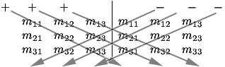

In this article, I will discuss matrices and operations on matrices. It is assumed that the reader has some experience with Linear Algebra, vectors, operations on vectors, and a basic understanding of matrices.

## Conventions

Throughout this article, I will use a convention when referring to vectors, scalars, and matrices.

1.  Scalars are represented by lower-case italic characters ($a,b,\theta,\lambda$).
2.  Vectors are represented by lower-case bold characters ($\mathbf{x,y,z}$)
3.  Matrices are represented by upper-case bold characters ($\mathbf{R,S,T,M}$)

Vectors are column vectors (transformed as $\mathbf{v}'=\mathbf{Mv}$) and rotations are expressed using the right-handed coordinate system.

## Linear Transformation

A linear transformation is defined as a transformation between two vector spaces $\mathbf{V}$ and $\mathbf{W}$ denoted $\mathbf{T} : \mathbf{V} \rightarrow \mathbf{W}$ and must preserve the operations of vector addition and scalar multiplication.  That is,

1.  $T(\mathbf{v_1}+\mathbf{v_2})=T(\mathbf{v_1})+T(\mathbf{v_2})$ for any vectors $\mathbf{v_1}$ and $\mathbf{v_2}$
2.  $T(\alpha\mathbf{v})=\alpha{T}(\mathbf{v})$ for any scalar $\alpha$

This property also implies that any linear transformation will transform the zero vector into the zero vector.  Since a non-zero translation will transform the zero vector into a non-zero vector then any transformation that translates a vector is not a linear transformation. A few examples of linear transformations of three-dimensional space $\mathbb{R}^{3}$ are:

### Rotation

As stated in the article about coordinate systems ([Coordinate Systems](/3d-math-primer-for-game-programmers/)) considering a right-handed coordinate system, a positive rotation rotates a point in a counter-clockwise direction when looking from the positive end of the axis of rotation toward the origin.

#### Rotation about the X Axis

A linear transformation that rotates a vector space about the $X$ axis:

$$
R_{x}(\theta) =  \begin{bmatrix} 1 & 0 & 0 & 0 \\ 0 & \cos(\theta) & -\sin(\theta) & 0 \\ 0 & \sin(\theta) & \cos(\theta) & 0 \\ 0 & 0 & 0 & 1 \end{bmatrix}
$$

For example rotating the point $(0,1,0)$ 90° about the $X$ axis would result in the point $(0,0,1)$. Let’s confirm if this is true using this rotation.

$$
\begin{array}{ccl} v' & = & \begin{bmatrix} 1 & 0 & 0 & 0 \\ 0 & \cos(90) & -\sin(90) & 0 \\ 0 & \sin(90) & \cos(90) & 0 \\ 0 & 0 & 0 & 1 \end{bmatrix} \begin{bmatrix} 0 \\ 1 \\ 0 \\ 0 \end{bmatrix} \\ \\ & = & \begin{bmatrix} 1 & 0 & 0 & 0 \\ 0 & 0 & -1 & 0 \\ 0 & 1 & 0 & 0 \\ 0 & 0 & 0 & 1 \end{bmatrix} \begin{bmatrix} 0 \\ 1 \\ 0 \\ 0 \end{bmatrix} \\ \\ & = & \begin{bmatrix} 0 \\ 0 \\ 1 \\ 0 \end{bmatrix} \end{array}
$$

And rotating the point $(0,0,1)$ 90° about the $X$ axis would result in the point $(0,-1,0)$.

$$
\begin{array}{ccl} v' & = & \begin{bmatrix} 1 & 0 & 0 & 0 \\ 0 & 0 & -1 & 0 \\ 0 & 1 & 0 & 0 \\ 0 & 0 & 0 & 1 \end{bmatrix} \begin{bmatrix} 0 \\ 0 \\ 1 \\ 0 \end{bmatrix} \\ \\ & = & \begin{bmatrix} 0 \\ -1 \\ 0 \\ 0 \end{bmatrix} \end{array}
$$

#### Rotation about the Y Axis

A linear transformation that rotates a vector space about the $Y$ axis:

$$
R_{y}(\theta) = \begin{bmatrix} \cos(\theta) & 0 & \sin(\theta) & 0 \\ 0 & 1 & 0 & 0 \\ -\sin(\theta) & 0 & \cos(\theta) & 0 \\ 0 & 0 & 0 & 1 \end{bmatrix}
$$

For example rotating the point $(1,0,0)$ 90° about the $Y$ axis would result in the point $(0,0,-1)$.

$$
\begin{array}{ccl} v' & = & \begin{bmatrix} \cos(90) & 0 & \sin(90) & 0 \\ 0 & 1 & 0 & 0 \\ -\sin(90) & 0 & \cos(90) & 0 \\ 0 & 0 & 0 & 1 \end{bmatrix} \begin{bmatrix} 1 \\ 0 \\ 0 \\ 0 \end{bmatrix} \\ \\ & = & \begin{bmatrix} 0 & 0 & 1 & 0 \\ 0 & 1 & 0 & 0 \\ -1 & 0 & 0 & 0 \\ 0 & 0 & 0 & 1 \end{bmatrix} \begin{bmatrix} 1 \\ 0 \\ 0 \\ 0 \end{bmatrix} \\ \\ & = & \begin{bmatrix} 0 \\ 0 \\ -1 \\ 0 \end{bmatrix} \end{array}
$$

And rotating the point $(0,0,1)$ 90 degrees about the $Y$ axis would result in the point $(1,0,0)$.

$$
\begin{array}{ccl} v' & = & \begin{bmatrix} 0 & 0 & 1 & 0 \\ 0 & 1 & 0 & 0 \\ -1 & 0 & 0 & 0 \\ 0 & 0 & 0 & 1 \end{bmatrix} \begin{bmatrix} 0 \\ 0 \\ 1 \\ 0 \end{bmatrix} \\ \\ & = & \begin{bmatrix} 1 \\ 0 \\ 0 \\ 0 \end{bmatrix} \end{array}
$$

#### Rotation about the Z Axis

A linear transformation that rotates a vector space about the $Z$ axis:

$$
R_{z}(\theta) = \begin{bmatrix} \cos(\theta) & -\sin(\theta) & 0 & 0 \\ \sin(\theta) & \cos(\theta) & 0 & 0 \\ 0 & 0 & 1 & 0 \\ 0 & 0 & 0 & 1 \end{bmatrix}
$$

For example rotating the point $(1,0,0)$ 90° about the $Z$ axis would result in the point $(0,1,0)$.

$$
\begin{array}{ccl} v' & = & \begin{bmatrix} \cos(90) & -\sin(90) & 0 & 0 \\ \sin(90) & \cos(90) & 0 & 0 \\ 0 & 0 & 1 & 0 \\ 0 & 0 & 0 & 1 \end{bmatrix} \begin{bmatrix} 1 \\ 0 \\ 0 \\ 0 \end{bmatrix} \\ \\ & = & \begin{bmatrix} 0 & -1 & 0 & 0 \\ 1 & 0 & 0 & 0 \\ 0 & 0 & 1 & 0 \\ 0 & 0 & 0 & 1 \end{bmatrix} \begin{bmatrix} 1 \\ 0 \\ 0 \\ 0 \end{bmatrix} \\ \\ & = & \begin{bmatrix} 0 \\ 1 \\ 0 \\ 0 \end{bmatrix} \end{array}
$$

And rotating the point $(0,1,0)$ 90° about the $Z$ axis would result in the point $(-1,0,0)$.

$$
\begin{array}{ccl} v' & = & \begin{bmatrix} 0 & -1 & 0 & 0 \\ 1 & 0 & 0 & 0 \\ 0 & 0 & 1 & 0 \\ 0 & 0 & 0 & 1 \end{bmatrix} \begin{bmatrix} 0 \\ 1 \\ 0 \\ 0 \end{bmatrix} \\ \\ & = & \begin{bmatrix} -1 \\ 0 \\ 0 \\ 0 \end{bmatrix} \end{array}
$$

#### Rotation about an arbitrary axis

A 3D rotation about an arbitrary axis $\mathbf{n}$ by an angle $\theta$:

$$
R(\mathbf{n},\theta) = \begin{bmatrix}  \mathbf{n}_{x}^{2}(1-\cos\theta)+\cos\theta & \mathbf{n}_{x}\mathbf{n}_{y}(1-\cos\theta) - \mathbf{n}_{z}\sin\theta & \mathbf{n}_{x}\mathbf{n}_{z}(1-\cos\theta)+\mathbf{n}_{y}\sin\theta & 0 \\ \mathbf{n}_{x}\mathbf{n}_{y}(1-\cos\theta)+n_{z}\sin\theta & \mathbf{n}_{y}^{2}(1-\cos\theta)+\cos\theta & \mathbf{n}_{y}\mathbf{n}_{z}(1-\cos\theta)-\mathbf{n}_{x}\sin\theta & 0 \\ \mathbf{n}_{x}\mathbf{n}_{z}(1-\cos\theta)-\mathbf{n}_{y}\sin\theta & \mathbf{n}_{y}\mathbf{n}_{z}(1-\cos\theta)+\mathbf{n}_{x}\sin\theta & \mathbf{n}_{z}^{2}(1-\cos\theta)+\cos\theta & 0 \\ 0 & 0 & 0 & 1  \end{bmatrix}
$$

### Scale

A linear transformation that scales a vector space:

$$
S(k_{x}, k_{y}, k_{z}) = \begin{bmatrix} k_{x} & 0 & 0 & 0 \\ 0 & k_{y} & 0 & 0 \\ 0 & 0 & k_{z} & 0 \\ 0 & 0 & 0 & 1  \end{bmatrix}
$$

A linear transformation that scales by a factor $k$ in an arbitrary direction $\mathbf{n}$:

$$
S(\mathbf{n},k) = \begin{bmatrix}  1+(k-1)\mathbf{n}_{x}^{2} & (k-1)\mathbf{n}_{x}\mathbf{n}_{y} & (k-1)\mathbf{n}_{x}\mathbf{n}_{z} & 0 \\ (k-1)\mathbf{n}_{x}\mathbf{n}_{y} & 1+(k-1)\mathbf{n}_{y}^{2} & (k-1)\mathbf{n}_{y}\mathbf{n}_{z}&0\\(k-1)\mathbf{n}_{x}\mathbf{n}_{z}&(k-1)\mathbf{n}_{y}\mathbf{n}_{z}&1+(k-1)\mathbf{n}_{z}^{2}&0\\0&0&0&1  \end{bmatrix}
$$

## Affine Transformation

An affine transformation is a linear transformation followed by a translation. Any linear transformation is an affine transformation with a translation of $\mathbf{0}$, but not all affine transformations are linear transformations. The set of affine transformations is a superset of linear transformations. Types of affine transformations are scale, shear, rotation, reflection, and translation. Any combination of affine transformation results in an affine transformation. Any transformation in the form $\mathbf{v}'=\mathbf{Mv}+\mathbf{b}$ is an affine transformation where $\mathbf{v}'$ is the transformed vector, $\mathbf{v}$ is the original vector, $\mathbf{M}$ is a linear transform matrix, and $\mathbf{b}$ is a translation vector.

## Determinant of a Matrix

For every square matrix, you can calculate a special scalar value called the “determinant” of the matrix.  If the determinant is not zero, then the matrix is invertible and we can use the determinant to calculate the inverse of that matrix.

The determinant of a matrix $\mathbf{M}$ is denoted $|\mathbf{M}|$ or $\det\mathbf{M}$.

Before we discuss how to calculate the determinant of a larger $4\times 4$ matrix, let’s first discuss the determinant of a $2\times 2$ matrix:

$$
|\mathbf{M}|=\begin{vmatrix}m_{11} & m_{12} \\ m_{21} & m_{22} \end{vmatrix}=m_{11}m_{22}-m_{12}m_{21}
$$

You can use the following diagram to help you remember the order in which the terms should be placed:

In this diagram, we see the arrows passing through the diagonal terms. We simply multiply the operands on the diagonal terms and we subtract the result of the back diagonal term from the result of the front diagonal term.

The determinant of a $3\times 3$ matrix is shown below:

$$
\begin{array}{l} \begin{vmatrix} m_{11} & m_{12} & m_{13} \\ m_{21} & m_{22} & m_{23} \\ m_{31} & m_{32} & m_{33} \end{vmatrix} = m_{11}m_{22}m_{33}+m_{12}m_{23}m_{31}+m_{13}m_{21}m_{32}-m_{13}m_{22}m_{31}-m_{12}m_{21}m_{33}-m_{11}m_{23}m_{32} \end{array}
$$

We can use a similar diagram to memorize this equation. For this diagram, we duplicate the matrix and place it next to itself, then we multiply the forward-diagonal operands, and the backward-diagonal operands and we add the results of the forward-diagonals and subtract the results of the backward-diagonals:

If we imagine the rows of the $3\times 3$ matrix as vectors, then the determinant of the matrix is equivalent to the **triple product** that was introduced in the article on vector operations. If you recall, this is the result of taking the dot product of a cross product. This is shown below:

$$
\begin{array}{ll}\begin{vmatrix}\mathbf{a}_{x} & \mathbf{a}_{y} & \mathbf{a}_{z} \\ \mathbf{b}_{x} & \mathbf{b}_{y} & \mathbf{b}_{z} \\ \mathbf{c}_{x} & \mathbf{c}_{y} & \mathbf{c}_{z} \end{vmatrix} & = \mathbf{a}_{x}\mathbf{b}_{y}\mathbf{c}_{z}+\mathbf{a}_{y}\mathbf{b}_{z}\mathbf{c}_{x} + \mathbf{a}_{z}\mathbf{b}_{x}\mathbf{c}_{y}-\mathbf{a}_{z}\mathbf{b}_{y}\mathbf{c}_{x}-\mathbf{a}_{y}\mathbf{b}_{x}\mathbf{c}_{z}-\mathbf{a}_{x}\mathbf{b}_{z}\mathbf{c}_{y} \\ & = (\mathbf{a}_{y}\mathbf{b}_{z}-\mathbf{a}_{z}\mathbf{b}_{y})\mathbf{c}_{x}+ (\mathbf{a}_{z}\mathbf{b}_{x}-\mathbf{a}_{x}\mathbf{b}_{z})\mathbf{c}_{y} + (\mathbf{a}_{x}\mathbf{b}_{y}-\mathbf{a}_{y}\mathbf{b}_{x})\mathbf{c}_{z} \\ & = (\mathbf{a}\times\mathbf{b})\cdot\mathbf{c}\end{array}
$$

We can calculate the determinant of a $n\times n$ matrix $\mathbf{M}$ by choosing an arbitrary row $i$ and applying the general formula:

$$
|\mathbf{M}|=\sum_{j=1}^{n}m_{ij}c_{ij}=\sum_{j=1}^{n}m_{ij}(-1)^{i+j}\left|\mathbf{M}^{\{ij\}}\right|
$$

Note that we can also arbitrarily choose a column $j$ that can be used to calculate the determinant, but for our general formula, we see the determinant applied to the $i^{th}$ row.

Where $\mathbf{M}^{\{ij\}}$ is the matrix obtained by removing the $i^{th}$ row and the $j^{th}$ column from matrix $\mathbf{M}$. This is called the minor of the matrix $\mathbf{M}$ at the $i^{th}$ row and the $j^{th}$ column:

$$
\mathbf{M}=\begin{bmatrix}m_{11} & m_{12} & m_{13} \\ m_{21} & m_{22} & m_{23} \\ m_{31} & m_{32} & m_{33}\end{bmatrix}\implies\mathbf{M}^{\{22\}} = \begin{bmatrix} m_{11} & m_{13} \\ m_{31} & m_{33} \end{bmatrix}
$$

The cofactor of a matrix $\mathbf{M}$ at the $i^{th}$ row and the $j^{th}$ column is denoted $c_{ij}$ and is the signed determinant of the minor of the matrix $\mathbf{M}$ at the $i^{th}$ row and the $j^{th}$ column:

$$
c_{ij}=(-1)^{i+j}\left|\mathbf{M}^{\{ij\}}\right|
$$

Note that the $(-1)^{i+j}$ term has the effect of negating every odd-sum cofactor:

$$
\begin{bmatrix}+&-&+\\-&+&-\\+&-&+\end{bmatrix}
$$

Let’s take an example of using the general form of the equation to calculate the determinant of a $4\times 4$ matrix:

$$
\begin{array}{ll}\begin{vmatrix}m_{11} & m_{12} & m_{13} & m_{14} \\ m_{21} & m_{22} & m_{23} & m_{24} \\ m_{31} & m_{32} & m_{33} & m_{34} \\ m_{41} & m_{42} & m_{43} & m_{44} \end{vmatrix} & = m_{11}\begin{vmatrix}m_{22} & m_{23} & m_{24} \\ m_{32} & m_{33} & m_{34} \\ m_{42} & m_{43} & m_{44} \end{vmatrix}-m_{12}\begin{vmatrix}m_{21} & m_{23} & m_{24} \\ m_{31} & m_{33} & m_{34} \\ m_{41} & m_{43} & m_{44} \end{vmatrix} \\ & + m_{13}\begin{vmatrix}m_{21} & m_{22} & m_{24} \\ m_{31} & m_{32} & m_{34} \\ m_{41} & m_{42} & m_{44} \end{vmatrix}-m_{14}\begin{vmatrix}m_{21} & m_{22} & m_{23} \\ m_{31} & m_{32} & m_{33} \\ m_{41} & m_{42} & m_{43} \end{vmatrix} \end{array}
$$

And expanding the determinants for the $3\times 3$ minors of the matrix:

$$
\begin{array}{ll} & m_{11}\left(m_{22}\left(m_{33}m_{44}-m_{34}m_{43}\right) + m_{23}\left(m_{34}m_{42}-m_{32}m_{44}\right) + m_{24}\left(m_{32}m_{43}-m_{33}m_{42}\right)\right)\\-& m_{12}\left(m_{21}\left(m_{33}m_{44}-m_{34}m_{43}\right) + m_{23}\left(m_{34}m_{41}-m_{31}m_{44}\right) + m_{24}\left(m_{31}m_{43}-m_{33}m_{41}\right)\right)\\ + & m_{13}\left(m_{21}\left(m_{32}m_{44}-m_{34}m_{42}\right) + m_{22}\left(m_{34}m_{41}-m_{31}m_{44}\right) + m_{24}\left(m_{31}m_{42}-m_{32}m_{41}\right)\right) \\-& m_{14}\left(m_{21}\left(m_{32}m_{43}-m_{33}m_{42}\right) + m_{22}\left(m_{33}m_{41}-m_{31}m_{43}\right) + m_{23}\left(m_{31}m_{42}-m_{32}m_{41}\right)\right)  \end{array}
$$

As you can see, the equations for calculating the determinants of matrices grows very quickly (factorially) as the dimension of our matrix increases.

## Inverse of a Matrix

We can calculate the inverse of any square matrix as long as it has the property that it is invertible. We can say that a matrix is invertible if its determinant is not zero. A matrix that is invertible is also called “non-singular” and a matrix that does not have an inverse is also called “singular”:

$$
|\mathbf{M}|=\begin{cases} 0, & \text{singular} \\ \neq 0 & \text{non-singular} \end{cases}
$$

The general equation for the inverse of a matrix is:

$$
\mathbf{M}^{-1}=\frac{adj(\mathbf{M})}{|\mathbf{M}|}
$$

Where $adj(\mathbf{M})$ is the classical adjoint, also known as the adjugate of the matrix and $|\mathbf{M}|$ is the determinant of the matrix defined in the previous section. The adjugate of a matrix $\mathbf{M}$ is the transpose of the matrix of cofactors. The fact that the denominator of the ratio is the determinant of the matrix explains why only matrices whose determinant is not $0$ have an inverse.

For a $2\times 2$ matrix $\mathbf{M}$:

$$
\mathbf{M}=\begin{bmatrix} a & b \\ c & d \end{bmatrix}
$$

the adjugate is:

$$
adj(\mathbf{M})=\begin{bmatrix} d & -b \\ -c & a \end{bmatrix}
$$

The adjugate of a $3\times 3$ matrix $\mathbf{M}$:

$$
\mathbf{M}=\begin{bmatrix} m_{11} & m_{12} & m_{13} \\ m_{21} & m_{22} & m_{23} \\ m_{31} & m_{32} & m_{33} \end{bmatrix}
$$

is:

$$
adj(\mathbf{M})=\begin{bmatrix} +\begin{vmatrix} m_{22} & m_{23} \\ m_{32} & m_{33} \end{vmatrix}&-\begin{vmatrix} m_{21} & m_{23} \\ m_{31} & m_{33} \end{vmatrix} & +\begin{vmatrix} m_{21} & m_{22} \\ m_{31} & m_{32} \end{vmatrix} \\ & & \\ -\begin{vmatrix} m_{12} & m_{13} \\ m_{32} & m_{33} \end{vmatrix} & +\begin{vmatrix} m_{11} & m_{13} \\ m_{31} & m_{33} \end{vmatrix} & -\begin{vmatrix} m_{11} & m_{12} \\ m_{31} & m_{32} \end{vmatrix} \\ & & \\ +\begin{vmatrix} m_{12} & m_{13} \\ m_{22} & m_{23} \end{vmatrix} & -\begin{vmatrix} m_{11} & m_{13} \\ m_{21} & m_{23} \end{vmatrix} & +\begin{vmatrix} m_{11} & m_{12} \\ m_{21} & m_{22} \end{vmatrix}  \end{bmatrix}^{T}
$$

As an example, let us take the matrix $\mathbf{M}$:

$$
\mathbf{M}=\begin{bmatrix} -4 & -3 & 3 \\ 0 & 2 & -2 \\ 1 & 4 & -1 \end{bmatrix}
$$

Then $adj(\mathbf{M})$ is defined as:

$$
\begin{array}{ll}adj(\mathbf{M}) &= \begin{bmatrix} +\begin{vmatrix} 2 & -2 \\ 4 & -1 \end{vmatrix} & -\begin{vmatrix} 0 & -2 \\ 1 & -1 \end{vmatrix} & +\begin{vmatrix} 0 & 2 \\ 1 & 4 \end{vmatrix} \\ & & \\ -\begin{vmatrix} -3 & 3 \\ 4 & -1 \end{vmatrix} & +\begin{vmatrix} -4 & 3 \\ 1 & -1 \end{vmatrix} & -\begin{vmatrix} -4 & -3 \\ 1 & 4 \end{vmatrix} \\ & & \\ +\begin{vmatrix} -3 & 3 \\ 2 & -2 \end{vmatrix} & -\begin{vmatrix} -4 & 3 \\ 0 & -2 \end{vmatrix} & +\begin{vmatrix} -4 & -3 \\ 0 & 2 \end{vmatrix} \end{bmatrix}^{T} \\ & \\ &= \begin{bmatrix} 6 & -2 & -2 \\ 9 & 1 & 13 \\ 0 & -8 & -8 \end{bmatrix}^{T} \\ & \\ &= \begin{bmatrix} 6 & 9 & 0 \\ -2 & 1 & -8 \\ -2 & 13 & -8 \end{bmatrix} \end{array}
$$

Once we have the adjugate of the matrix, we can compute the inverse of the matrix by dividing the adjugate by the determinant:

$$
\begin{array}{ll} \mathbf{M}^{-1} &= \cfrac{adj(\mathbf{M})}{|\mathbf{M}|} \\ & \\ &= \cfrac{ \begin{bmatrix} 6 & 9 & 0 \\ -2 & 1 & -8 \\ -2 & 13 & -8 \end{bmatrix} }{ -24 } \\ & \\ &= \begin{bmatrix} -1/4 & -3/8 & 0 \\ 1/12 & -1/24 & 1/3 \\ 1/12 & -13/24 & 1/3 \end{bmatrix} \end{array}
$$

An interesting property of the inverse of a matrix is that a matrix multiplied by its inverse is the identity matrix:

$$
\mathbf{MM}^{-1}=\mathbf{I}
$$

## Orthogonal Matrices

A square matrix $\mathbf{M}$ is orthogonal if and only if the product of the matrix and its transpose is the identity matrix:

$$
\mathbf{M} \text{ is orthogonal } \iff \mathbf{MM}^{T}=\mathbf{I}
$$

And since we know from the previous section that an invertible matrix $\mathbf{M}$ multiplied by its inverse $\mathbf{M}^{-1}$ is the identity matrix $\mathbf{I}$, we can conclude that the transpose of an orthogonal matrix is equal to its inverse:

$$
\mathbf{M} \text{ is orthogonal } \iff \mathbf{M}^{T}=\mathbf{M}^{-1}
$$

This is a very powerful property of orthogonal matrices because of the computational benefit that we can achieve if we know in advance that our matrix is orthogonal. Rotation and reflection (and combinations of them) are the only orthogonal transformations. A matrix that has a scale applied to it is no longer orthogonal. If we can guarantee the matrix is orthogonal, then we can take advantage of the fact that the transpose of the matrix is its inverse and save on the computational power needed to calculate the inverse the hard way.

How can we tell if an arbitrary matrix $\mathbf{M}$ is orthogonal? Let us assume $\mathbf{M}$ is a $3\times 3$ matrix, then by definition $\mathbf{M}$ is orthogonal if and only if $\mathbf{M}^{T}\mathbf{M}=\mathbf{I}$ (for a square matrix this is the same as $\mathbf{MM}^{T}=\mathbf{I}$).

$$
\begin{array}{rcl} \mathbf{M}^{T}\mathbf{M} & = & \mathbf{I} \\ & & \\ \begin{bmatrix} m_{11} & m_{21} & m_{31} \\ m_{12} & m_{22} & m_{32} \\ m_{13} & m_{23} & m_{33} \end{bmatrix} \begin{bmatrix} m_{11} & m_{12} & m_{13} \\ m_{21} & m_{22} & m_{23} \\ m_{31} & m_{32} & m_{33} \end{bmatrix} & = & \begin{bmatrix} 1 & 0 & 0 \\ 0 & 1 & 0 \\ 0 & 0 & 1 \end{bmatrix} \end{array}
$$

If we rewrite the matrix $\mathbf{M}$ as a set of column vectors:

$$
\begin{array}{rcl} \mathbf{c}_1 & = & \begin{bmatrix} m_{11} & m_{21} & m_{31} \end{bmatrix} \\ \mathbf{c}_2 & = & \begin{bmatrix} m_{12} & m_{22} & m_{32} \end{bmatrix} \\ \mathbf{c}_3 & = & \begin{bmatrix} m_{13} & m_{23} & m_{33} \end{bmatrix} \\ & & \\ \mathbf{M} & = & \begin{bmatrix} \mathbf{c}_1^{T} & \mathbf{c}_2^{T} & \mathbf{c}_3^{T} \end{bmatrix} \end{array}
$$

Then each element of $\mathbf{M}^{T}\mathbf{M}$ is the dot product of two columns, and we can write our matrix multiply as a series of dot products:

$$
\begin{matrix} \mathbf{c}_1 \cdot \mathbf{c}_1 = 1 & \mathbf{c}_1 \cdot \mathbf{c}_2 = 0 & \mathbf{c}_1 \cdot \mathbf{c}_3 = 0 \\ \mathbf{c}_2 \cdot \mathbf{c}_1 = 0 & \mathbf{c}_2 \cdot \mathbf{c}_2 = 1 & \mathbf{c}_2 \cdot \mathbf{c}_3 = 0 \\ \mathbf{c}_3 \cdot \mathbf{c}_1 = 0 & \mathbf{c}_3 \cdot \mathbf{c}_2 = 0 & \mathbf{c}_3 \cdot \mathbf{c}_3 = 1 \end{matrix}
$$

From this, we can make some interpretations:

-   The dot product of a vector with itself is one if and only if the vector has a length of one, that is it is a unit vector.
-   The dot product of two vectors is zero if and only if they are perpendicular.

So for a matrix to be orthogonal, the following must be true:

-   Each column of the matrix must be a unit vector. This fact implies that there can be no scale applied to the matrix.
-   The columns of the matrix must be mutually perpendicular.

## References

Fletcher Dunn and Ian Parberry (2002). [3D Math Primer for Graphics and Game Development](https://www.gamemath.com/). Wordware Publishing.

