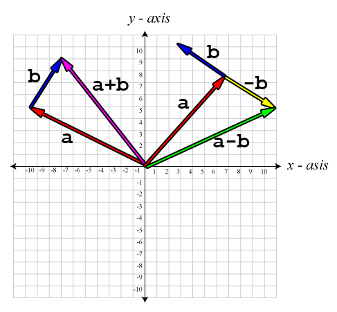
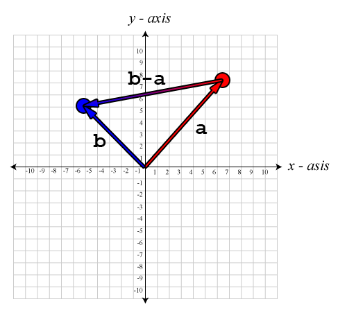
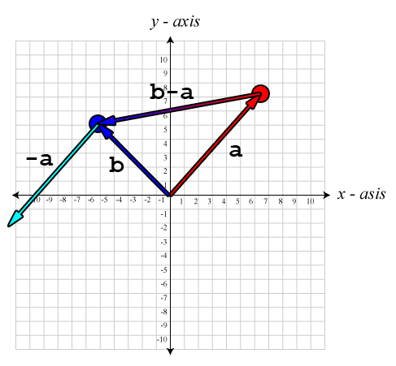
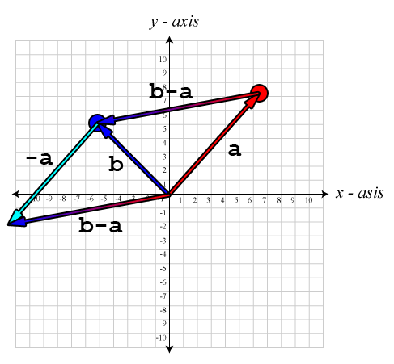
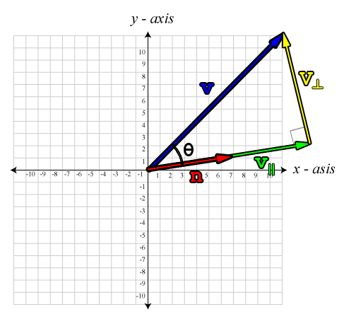
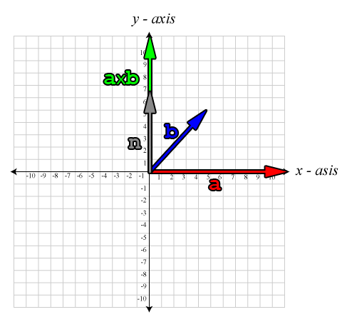
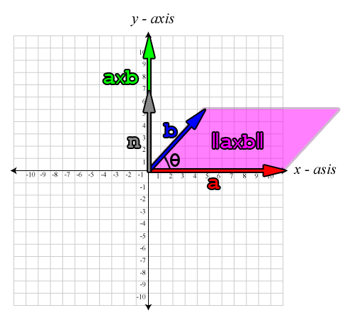

In this article I would like to discuss operations on vectors.  This article assumes the reader has a basic knowledge of what vectors are and how they are represented. My goal here is simply to refresh your memory about what kind of operations can be performed on vectors specifically operations that are important if you are trying to create a 3D game engine.  

## Conventions

Throughout this article, I will use a convention when referring to vectors, scalars, and matrices.

1.  Scalars are represented by lower-case italic characters ($a,b,\theta,\lambda$).
2.  Vectors are represented by lower-case bold characters ($\mathbf{x,y,z}$)
3.  Matrices are represented by upper-case bold characters ($\mathbf{R,S,T,M}$)

## Vector Operations

There are several useful operations that can be performed on vectors.  These operations include negating a vector, adding two vectors, subtracting two vectors, calculating the length (or magnitude) of a vector, calculating the distance between two points and normalizing a vector.  Other operations on vectors that might not be immediately obvious are calculating the dot product between two vectors and calculating the cross-product between two vectors.

## Vector Negation

To negate a vector, we simply negate every component of the vector.  Negating a vector, results in a vector of the same magnitude, but opposite in direction.

A few examples of vector negation are:

$$
-\begin{bmatrix}x & y & z & w\end{bmatrix}=\begin{bmatrix}-x & -y & -z & -w \end{bmatrix}
$$

$$
-\begin{bmatrix}x_1 & x_2 & x_3 & \cdots & x_n\end{bmatrix} = \begin{bmatrix}-x_1 & -x_2 & -x_3 & \cdots & -x_n\end{bmatrix}
$$

## Vector Addition and Subtraction

We can perform vector addition and vector subtraction on two vectors of the same dimension.  To perform vector addition and subtraction, we simply add or subtract each component of the first vector with the matching component of the second vector.

Suppose we have two vectors, vector $\mathbf{a}$, and vector $\mathbf{b}$.  Visually, $\mathbf{a}+\mathbf{b}$ is equivalent to placing the tail of vector $\mathbf{b}$ on the head of vector $\mathbf{a}$ without changing the direction of either vector.  Vector subtraction is equivalent to addition of the negative of vector $\mathbf{b}$, that is $\mathbf{a}-\mathbf{b} \equiv \mathbf{a} + (-\mathbf{b})$.  Visually, we would negate vector $\mathbf{b}$ then add the vectors the same way – the tail of $(-\mathbf{b})$ placed at the head of $\mathbf{a}$.  The resulting vector is the vector that starts at the tail of vector $\mathbf{a}$ and ends at the head of vector $(-\mathbf{b})$.

Some examples of vector addition and subtraction are:

$$
\begin{bmatrix} a_x \\ a_y \\ a_z \\ a_w \end{bmatrix} + \begin{bmatrix} b_x \\ b_y \\ b_z \\ b_w \end{bmatrix} = \begin{bmatrix} a_x + b_x \\ a_y + b_y \\ a_z + b_z \\ a_w + b_w \end{bmatrix}
$$

$$
\begin{bmatrix} 3 \\ 4 \\ 5 \\ 6 \end{bmatrix}-\begin{bmatrix} 1 \\ 2 \\ 3 \\ 4 \end{bmatrix} = \begin{bmatrix} 2 \\ 2 \\ 2 \\ 2 \end{bmatrix}
$$

Personally, I have trouble remembering what order I have to subtract vectors in order to get the vector in the correct direction.  I use the following mnemonic to help me remember:

> The vector from “a” to “b” is “b” minus “a”.

The following images show examples of adding and subtracting vectors:

Vector addition and subtraction

## Vector Multiplication by a Scalar

Vectors can also be multiplied by a scalar.  Scalar division is also supported, but this is equivalent to multiplying the vector by the reciprocal of the scalar.

Vector multiplication by a scalar is shown below:

$$
k\mathbf{v}=\begin{bmatrix}kv_x & kv_y & kv_z \end{bmatrix}
$$

Multiplying a vector by a positive scalar does not change the direction of the vector, it only changes the magnitude of the vector.  Multiplying by a negative number will reverse the direction of the vector and scale the magnitude.  Multiplying a vector by $-1$ is equivalent to negating the vector.

$$
(-1)\mathbf{v}\equiv-\mathbf{v}=\begin{bmatrix}-v_x & -v_y &-v_z \end{bmatrix}
$$

## Magnitude of a Vector

The magnitude of a vector, also called the length, or the norm of the vector is a scalar and is represented using the double vertical bars on either side of the vector variable ($\|\mathbf{v}\|$), not to be mistaken as the notation used to denote the absolute value of a scalar.  The length of a vector is calculated using the following general algebraic rule:

$$
\|\mathbf{v}\|=\sqrt{\sum_{i=1}^{n}v_i^2}
$$

An example of calculating the length of a vector is shown below:

$$
\|\mathbf{v}\|=\sqrt{v_x^2+v_y^2+v_z^2}
$$

$$
\begin{array}{ll}\|\begin{bmatrix}5&-4& 7\end{bmatrix}\|&=\sqrt{5^2+(-4)^2+7^2}\\&=\sqrt{25+16+49}\\&=\sqrt{90}\\&\approx 9.487\end{array}
$$

## Normalizing Vectors

It is sometimes useful to express vectors only by their direction and not by their length.  This is necessary for example when we want to find out if another object, or point is in front of or behind our reference frame, or when we need to calculate a reflection vector that would occur from a surface with a “upward facing plane”.  Vectors of unit length are called unit vectors (a unit vector that is perpendicular to a surface is called a normal).

The normalized vector can be calculated using the following equation:

$$
\mathbf{v}_{norm}=\frac{\mathbf{v}}{\|\mathbf{v}\|}
$$

In words, the normalized vector is the vector divided by the magnitude of itself.  This results in a vector of unit length.

We must take care when calculating the normalized vector because zero length vectors cannot be normalized.  Normalizing a zero-length vector will usually result in a “divide-by-zero” error.  Usually we resolve this by performing the normalization in multiple steps:

1.  Calculate the length squared of the vector (only calculate the squared length of the vector because we only need the square root if the squared length is not zero).
2.  If the squared length is greater than zero, then calculate the square root of that and multiply the vector components by the reciprocal of the length.

## Distance Between two Points

Recall from the “Vector Addition and Subtraction” section that I stated the mnemonic “the vector from ‘a’ to ‘b’ is ‘b’ minus ‘a'”?  Well this is where this comes in handy.  When we want to know the vector that goes from one point to another, we visualize the two points $\mathbf{a}$ and $\mathbf{b}$ as vectors from the origin and when we subtract them, the result is another vector which doesn’t necessarily describe a point in space, but rather a direction from one point to the other.

The images below shows an example of using vector subtraction to calculate a vector from one point in space to the other:

The distance between two points (1)

The image shows the resulting vector $(\mathbf{b}-\mathbf{a})$ by subtracting point $\mathbf{a}$ from $\mathbf{b}$ to get the vector from $\mathbf{a}$ to $\mathbf{b}$.

Distance between two points (2)

The vector $\mathbf{a}$ is negated and the tail of $-\mathbf{a}$ is placed at the head of vector $\mathbf{b}$.

Distance between two points (3)

The resulting vector is a vector from the origin to the head of vector $-\mathbf{a}$.

To get the distance between these two points, we simply calculate the magnitude of the resulting vector $(\mathbf{b}-\mathbf{a})$.

$$
distance(\mathbf{a},\mathbf{b})=\|\mathbf{b}-\mathbf{a}\|=\sqrt{(b_x-a_x)^{2}+(b_y-a_y)^{2}+(b_z-a_z)^{2}}
$$

Notice that if the only thing we need to calculate is the distance between the two points, it doesn’t matter if we calculate $\|\mathbf{b}-\mathbf{a}\|$ or $\|\mathbf{a}-\mathbf{b}\|$, the result will be the same.

## Vector Dot Product

The result of a dot product on two vectors is a sum of the products of the matching components of each vector.  Dot products are defined on vectors of all dimensions, but both vectors must have the same dimension (same number of components) to calculate a valid dot product.  The result of a dot product is always a scalar.

The general form for the dot product rule is:

$$
\mathbf{a}\cdot\mathbf{b}=\sum_{i=1}^{n}a_{i}b_{i}
$$

An example of calculating the dot product of two vectors:

$$
\mathbf{a}\cdot\mathbf{b}=a_xb_x+a_yb_y+a_zb_z
$$

You may have noticed that if you calculate the dot product of a vector with itself, it gives the squared length (magnitude) of the vector.

The dot product of two vectors is equal to the magnitude of the vectors multiplied by the cosine of the angle between them.

$$
\mathbf{a}\cdot\mathbf{b}=\|\mathbf{a}\| \|\mathbf{b}\| \cos\theta
$$

We can solve for $\theta$ if we rearrange the equation:

$$
\theta=\cos^{-1}\left(\frac{\mathbf{a}\cdot\mathbf{b}}{\|\mathbf{a}\| \|\mathbf{b}\|}\right)
$$

We can further simplify the equation if we assume that both $\mathbf{a}$ and $\mathbf{b}$ are of unit-length (that is to say that the vectors are normalized). In such a case, the denominator becomes 1:

$$
\theta=\cos^{-1}(\mathbf{a}\cdot\mathbf{b})
$$

If we are only interested in the position of an object relative to another, we only need to calculate the dot product.  The following table shows the result of the dot product under specific conditions:

| $\mathbf{a}\cdot\mathbf{b}$ | $\cos^{-1}(\mathbf{a}\cdot\mathbf{b})$ | $\mathbf{a}$ and $\mathbf{b}$ relative to each other |
| --- | --- | --- |
| $> 0$ | $0^{\circ} \le \theta < 90^{\circ}$ | vector $\mathbf{a}$ and vector $\mathbf{b}$ point in roughly the same direction (less than 90° apart). |
| $0$ | $\theta=90^{\circ}$ | vector $\mathbf{a}$ and vector $\mathbf{b}$ are perpendicular to each other. |
| $< 0$ | $90^{\circ} < \theta \le 180^{\circ}$ | vector $\mathbf{a}$ and vector $\mathbf{b}$ point in roughly opposite directions (more than 90° apart). |

## Vector Projection

It is sometimes useful to know how much of one vector is parallel to another, and how much of a vector is perpendicular to another.  The part of the vector $\mathbf{v}$ that is parallel to vector $\mathbf{n}$ is denoted $\mathbf{v}_{\parallel}$ and the part that is perpendicular to $\mathbf{n}$ is denoted $\mathbf{v}_{\perp}$.

The image below shows this graphically:

This image shows a vector $\mathbf{v}$ projected onto another vector $\mathbf{n}$. This results in a parallel, and perpendicular part.

Using what we know about the dot product shown in the previous example, we can solve for $\mathbf{v}_\parallel$:

$$
\mathbf{v}_\parallel=\frac{\mathbf{n}}{\|\mathbf{n}\|}\|\mathbf{v}_\parallel\|
$$

I think you will recognize the first part of the equation, $\frac{\mathbf{n}}{\|\mathbf{n}\|}$. This is simply the vector normalization formula.  The next part of the formula might be a bit confusing, $\|\mathbf{v}_\parallel\|$. You’re probably thinking “how can we know the length of the vector that we are trying to calculate?”.  Well, this is easy if we remember back from our trigonometry class the simple trigonometric ratio for right-angle triangles:

$$
\cos\theta=\frac{adjacent}{hypotenuse}
$$

In this case, the hypotenuse is $\|\mathbf{v}\|$, and the adjacent is $\|\mathbf{v}_\parallel\|$.

$$
\cos\theta=\frac{\|\mathbf{v}_\parallel\|}{\|\mathbf{v}\|}
$$

Re-writing our equation, we get:

$$
\cos\theta\|\mathbf{v}\|=\|\mathbf{v}_\parallel\|
$$

So now we can express $\|\mathbf{v}_\parallel\|$ in terms of things we know.  Substituting the left side of the previous equation back into our original formula gives:

$$
\mathbf{v}_\parallel=\frac{\mathbf{n}}{\|\mathbf{n}\|}\cos(\theta)\|\mathbf{v}\|
$$

We can re-write the equation and multiply both the numerator and denominator by $\|\mathbf{n}\|$ to get:

$$
\mathbf{v}_\parallel=\mathbf{n}\frac{\|\mathbf{v}\|\|\mathbf{n}\|\cos(\theta)}{\|\mathbf{n}\|^2}
$$

Now we see that the numerator of our fraction looks like the dot product shown earlier, which we can easily solve.  So substituting the numerator for the dot product equation gives:

$$
\mathbf{v}_\parallel=\mathbf{n}\frac{\mathbf{v}\cdot\mathbf{n}}{\|\mathbf{n}\|^2}
$$

If we know that the vector $\mathbf{n}$ is of unit length, then we know that $\|\mathbf{n}\|$ is $1$ and the denominator becomes $1$ and can be omitted from the equation:

$$
\mathbf{v}_\parallel=\mathbf{n}\left(\mathbf{v}\cdot\mathbf{n}\right)
$$

Be careful to only use this form of the equation when we know that $\mathbf{n}$ is of unit length.

Now that we know how to solve for $\mathbf{v}_\parallel$, we can easily solve for $\mathbf{v}_\perp$.  Using vector addition, we know that:

$$
\mathbf{v}_\parallel+\mathbf{v}_\perp=\mathbf{v}
$$

Subtracting $\mathbf{v}_\parallel$ from both sides gives:

$$
\mathbf{v}_\perp=\mathbf{v}-\mathbf{v}_\parallel
$$

And substituting $\mathbf{v}_\parallel$ for the previous equation:

$$
\mathbf{v}_\perp=\mathbf{v}-\mathbf{n}\frac{\mathbf{v}\cdot\mathbf{n}}{\|\mathbf{n}\|^2}
$$

## Vector Cross Product

Unlike the dot product, the cross product is only defined for three-dimensional vectors. In addition, the result of the cross product is a vector as opposed to the result of a dot product is a scalar.  
The cross product is written using the $\times$ symbol, but it should not be mistaken with scalar multiplication.

$$
\mathbf{c}=\mathbf{a}\times\mathbf{b}
$$

The result of the cross product between vector $\mathbf{a}$ and vector $\mathbf{b}$ is a vector that is perpendicular to both vectors $\mathbf{a}$ and $\mathbf{b}$ as shown in the image below:

The image shows two vectors $\mathbf{a}$, and $\mathbf{b}$, and the result of the cross product $\mathbf{a}\times\mathbf{b}$, a vector which is perpendicular to both $\mathbf{a}$ and $\mathbf{b}$.

In this image we see a vector $\mathbf{a}$ (red) and vector $\mathbf{b}$ (blue) which lie in the plane with normal $\mathbf{n}$ (gray).  The cross product $\mathbf{a}\times\mathbf{b}$ is perpendicular to both $\mathbf{a}$ and $\mathbf{b}$ and parallel to $\mathbf{n}$.

The equation for the cross product is given by:

$$
\begin{bmatrix}\mathbf{a}_x \\ \mathbf{a}_y \\ \mathbf{a}_z\end{bmatrix} \times\begin{bmatrix}\mathbf{b}_x \\ \mathbf{b}_y \\ \mathbf{b}_z\end{bmatrix}=\begin{bmatrix}\mathbf{a}_{y}\mathbf{b}_{z}-\mathbf{a}_{z}\mathbf{b}_{y}\\\mathbf{a}_{z}\mathbf{b}_{x}-\mathbf{a}_{x}\mathbf{b}_{z}\\\mathbf{a}_{x}\mathbf{b}_{y}-\mathbf{a}_{y}\mathbf{b}_{x}\end{bmatrix}
$$

If the dot product and the cross product are used together, then the cross product must be calculated first, as in the formula $\mathbf{a}\cdot\mathbf{b}\times\mathbf{c}$.  This is obvious if you try to cross a vector with the result of a dot product, which is a scalar, it simply won’t work.  This form of taking the dot product of a cross product is known as the **triple product** and will be discussed further in the article about matrices.

It is useful to note that the cross product is not commutative, in fact, the cross product is anti-commutative.  That is to say that if we reverse the operands, the resulting vector is negated:

$$
\mathbf{a}\times\mathbf{b}=-\left(\mathbf{b}\times\mathbf{a}\right)
$$

The cross product is also not associative:

$$
\left(\mathbf{a}\times\mathbf{b}\right)\times\mathbf{c} \neq\mathbf{a}\times\left(\mathbf{b}\times\mathbf{c}\right)
$$

The result of a cross product is a vector which is perpendicular to both vectors, even if the original vectors are not perpendicular to each other.  This is a useful property of the cross product and can be exploited when we need to find a vector basis where all three axes are perpendicular to each other, for example when we need to orthogonalize the basis vectors for a camera’s view matrix.  This will be explained in more detail in the article on matrices.

Another useful property of the cross product is that the magnitude of the cross product is equal to the product of the magnitudes of the two vectors and the sine of the angle between them.  The expression of this is shown below:

$$
\|\mathbf{a}\times\mathbf{b}\|=\|\mathbf{a}\|\|\mathbf{b}\| \sin(\theta)
$$

It is also true that the magnitude of the cross product is the positive area of the parallelogram ($A$) formed by the edges of the two vectors.

$$
A=\|\mathbf{a}\times\mathbf{b}\|=\|\mathbf{a}\|\|\mathbf{b}\| \sin(\theta)
$$

This is shown in the image below:

The magnitude of the cross product is equivalent to the area of the parallelogram formed by the original vectors.

If vector $\mathbf{a}$ and vector $\mathbf{b}$ are parallel vectors or if either vector $\mathbf{a}$ or vector $\mathbf{b}$ is the zero vector, then the result of $\mathbf{a}\times\mathbf{b}$ is the zero vector.

If we say the vectors $\left(\mathbf{i},\mathbf{j},\mathbf{k}\right)$ are the vectors that form the orthonormal basis for our coordinate space, then the cross product satisfies the following identities:

$$
\mathbf{i}\times\mathbf{j}=\mathbf{k}
$$

 

$$
\mathbf{j}\times\mathbf{k}=\mathbf{i}
$$

 

$$
\mathbf{k}\times\mathbf{i}=\mathbf{j}
$$

And if we swap the order of the vectors for the cross product, the result will be negated:

$$
\mathbf{j}\times\mathbf{i}=-\mathbf{k}
$$

 

$$
\mathbf{k}\times\mathbf{j}=-\mathbf{i}
$$

 

$$
\mathbf{i}\times\mathbf{k}=-\mathbf{j}
$$

It is also useful to note that when switching from a left-handed coordinate system to a right-handed coordinate system, one of the axes is inverted (traditionally the z-axis is inverted). In both coordinate systems, the cross product of the unit basis vectors $\left(\mathbf{x},\mathbf{y},\mathbf{z}\right)$ gives:

$$
\mathbf{x}\times\mathbf{y}=\mathbf{z}
$$

This means that in a left-handed coordinate system, the result of the cross product will point away from the viewer (into the screen), but in a right-handed coordinate system, the result of the same cross product will point towards the viewer (out of the screen). This is a by-product of the handedness of the coordinate system.

## References

Fletcher Dunn and Ian Parberry (2002). [3D Math Primer for Graphics and Game Development](https://www.gamemath.com/). Wordware Publishing.

