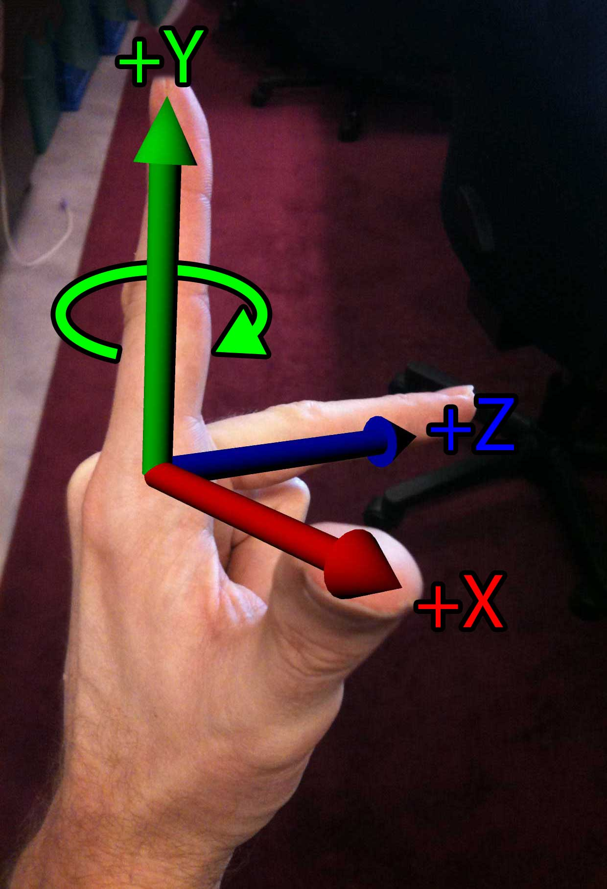
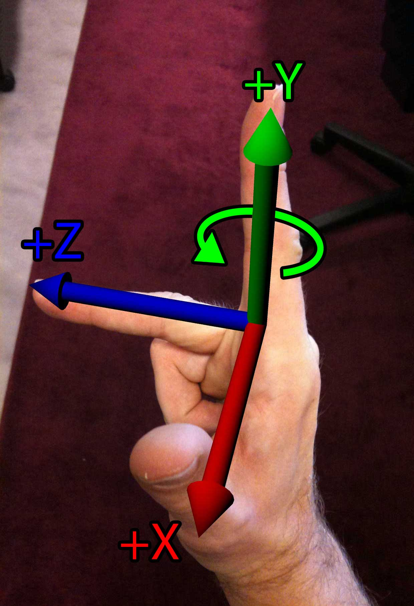
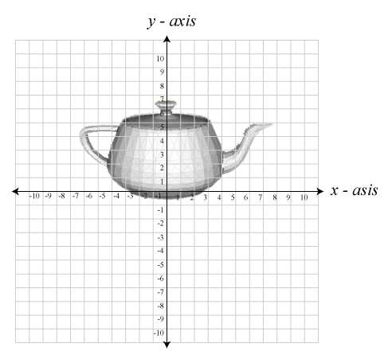
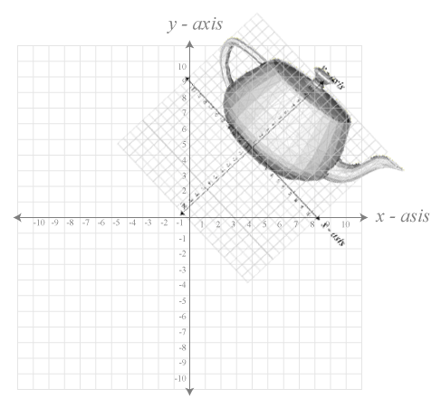
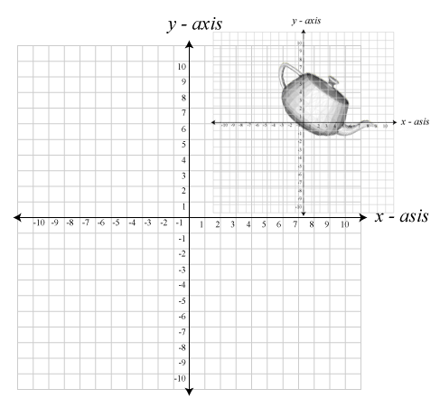

In this article, I would like to provide a brief math primer for people who would like to get involved in game programming.  This is not an exhaustive explanation of all the math theory that one will have to know in order to be a successful game programmer, but it’s the very minimum amount of information that is necessary to know before you can begin as a game programmer.

This article assumes you have a minimum understanding of vectors and matrices.  I will simply show applications of vectors and matrices and how they apply to game programming.

## Coordinate Systems

Before we can talk about transformations, we must make a formal definition of what our coordinate system is.  The default coordinate system used by DirectX is a left-handed coordinate system. The default coordinate system used by OpenGL is a right-handed coordinate system.

The easiest way to remember what coordinate system you are using is to use your hands.  If you point your thumb, your index finger, and your middle finger orthogonal to each other, then each finger will point in the direction of a positive cardinal axis in your coordinate space.  Using your left hand, your thumb points to the right (the $+X$ axis), your index finger points up (the $+Y$ axis), and your middle finger points away from you (the $+Z$ axis).

Using your right-hand, your thumb (the $+X$ axis) and your index finger (the $+Y$ axis) still point in the same direction, but the middle finger (the $+Z$ axis) points in the opposite direction.  If we rotated our hand around the index finger (the $+Y$ axis) in order to get your thumb to point to the right, then your middle finger (the $+Z$ axis) would be pointing towards you.

Another important note to remember is the direction of rotation.  If you point your thumb in the positive direction of the axis of rotation and curl your fingers around that imaginary axis, your fingers will curl in the positive direction of rotation.  If you do this on your left hand your fingers will curl in a clockwise direction when looking down at your thumb.  However if you do this on your right hand, your fingers will curl in a counter-clockwise direction when looking down at your thumb.

This can be seen in the images below:

<figure>

<figcaption>Left-hand Rule</figcaption>
</figure>
<figure>

<figcaption>Right-hand Rule</figcaption>
</figure>

The following table shows the direction of rotation for positive and negative rotations depending on the handedness of the coordinate system.

| Viewed from | Left-hand: positive rotation | Left-hand: negative rotation | Right-hand: positive rotation | Right-hand: negative rotation |
| --- | :---: | :---: | :---: | :---: |
| The negative end looking toward the positive end | Counter-clockwise | Clockwise | Clockwise | Counter-clockwise |
| The positive end looking toward the negative end | Clockwise | Counter-clockwise | Counter-clockwise | Clockwise |

## Coordinate Spaces

In a 3D game engine, we usually deal with several different coordinate spaces.  Among the most commonly used spaces are Object space, World space, Inertial space, and Camera space.

### Object Space

In object space, also known as local space, or modeling space, an object’s vertices are expressed relative to the object that they describe.  That is, the way the artist intended for them to be displayed if you didn’t move the object from the origin.

The image below shows an example of an object in object space.  As you can see from the image, the object is placed at its relative origin.

Object shown in local space.

### World Space

The world coordinate space is the global coordinate space in which all other object spaces are described.  The image below shows an object described in world space.  Notice how the object’s world transformation places it away from the world-origin by some translation, and rotation.

Object shown in world space.

### Inertial Space

The inertial space is the “halfway” space between object space and world space.  The origin of inertial space has the same origin as object space, and the axes of inertial space are parallel to that of the world space axes.

To transform a point from object space to inertial space requires only a rotation and to transform a point from inertial space to world space requires only a translation.

The image below shows an example of inertial space.

Object shown in inertial space.

### Camera Space

Camera space is the coordinate space that is associated with the observer.  Camera space is considered to be the origin and orientation of what we are looking at.  The camera’s coordinate axis usually assume the positive $\mathbf{X}$ axis points right, the positive $\mathbf{Y}$ axis points up, and in a left-handed coordinate system, the positive $\mathbf{Z}$ axis points forward, or at the scene.  In a right-handed coordinate system, the $\mathbf{Z}$ axis is reversed, so the negative $\mathbf{-Z}$ axis points forward, or at the object in our scene.  A more common name for these camera axes are the “Right”, “Up”, and “At” axes.

The camera space transformation together with the projection transformation is useful for answering such questions as:

1.  Is an object completely in view of the camera, partially in view, or not in view at all,
2.  Is one object closer to the camera than the other,
3.  Is an object directly in front of, above, below, to the left, or to the right of the camera.

### Combining Coordinate Spaces

In 3D computer graphics, coordinate spaces are described using a homogeneous coordinate system.  A homogeneous coordinate system allows us to represent all of our transformations (the affine transformations translation, rotation and scale, and also perspective projection, which is not affine) in a similar way so they can easily be combined into a single representation.

Any number of coordinate spaces can be combined using matrix multiplication which results in a single matrix that can be applied to all the vertices of an object.

Even multiple world coordinate spaces can be combined in order to derive a final coordinate space that describes the location of all of our vertices in an object.  This is useful for nested coordinate spaces where the position of an object is expressed relative to a “parent” object.  When the parent object’s world transform is changed, the transform of the child object is also changed implicitly.  Using this method, complex scenes can be constructed from several smaller scenes and placed into the larger scene to create a complete world.

## References

Fletcher Dunn and Ian Parberry (2002). [3D Math Primer for Graphics and Game Development](https://www.gamemath.com/). Wordware Publishing.

