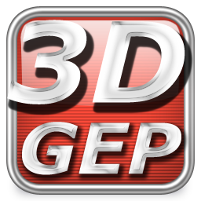

3DGEP.com is about learning the latest 3D Game Engine Programming techniques. Most of the articles on this website will be tutorials or technical articles about programming techniques. A few of the subjects I will write about are 3D game programming, OpenGL, DirectX, loading and displaying 3D models, skeletal animation, terrains, shaders and special effects, and more.

If you don’t find what you’re looking for now, maybe you will want to come back later and take a look if I have added an article on a subject you are interested in.

Thanks for visiting!

Jeremiah van Oosten  
Webmaster, Programmer, Teacher, Game Enthousiast
