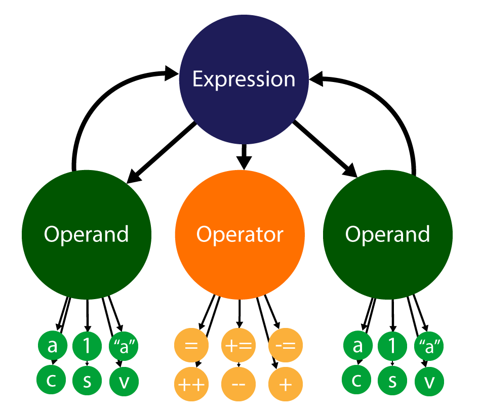
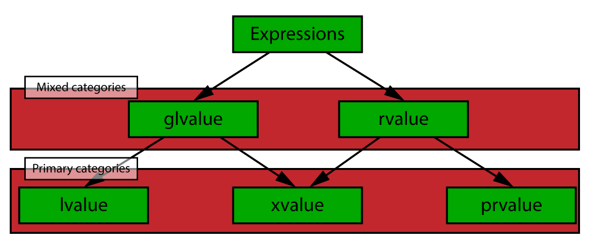
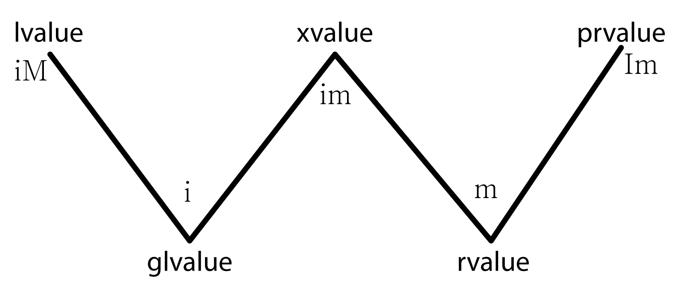

<span id="attachment-10455"></span>

In this post, I will introduce you to C++ template programming. Some of the topics I will cover are function templates, class templates, variable templates, variadic templates, type traits, SFINAE, and C++ 20 concepts.

## Introduction

C++ Template Programming has been around for a long time and there are plenty of books and articles on the internet that describe C++ template programming. Although the information is in abundance, there doesn’t seem to be a comprehensive source for learning how to apply template programming and demystify some of the more complex features of C++ template programming such as using and writing type traits, template meta programming, and *Substitution Failure Is Not An Error* (SFINAE) which are a few of the topics that I would like to cover in this article.

## Terminology

Before delving into the details of C++ template programming, it is important to establish some common terminology when describing template programming.

*Value categories* are a way to categorize how a value can be used. There are five value categories (*lvalue*, *prvalue*, *xvalue*, *glvalue*, and *rvalue*). You may already be familiar with *lvalue*, and *rvalue*, but might not have encountered *prvalue*, *xvalue*, or *glvalue* yet.

Understanding the difference between *template parameters* and *template arguments* is also important when talking about template programming. In short, template parameters are used to declare the template and template arguments are used to define the template. Template parameters can be either typed, or non typed.

Let’s first look at value categories.

### Expressions and Value Categories

All C++ programmers work with value categories but may not be able to describe which category a value belongs.

Value categories are often defined in terms of the result of an *expression*. An example of an expression is [assignment](https://en.cppreference.com/cpp/language/operator_assignment), [increment and decrement](https://en.cppreference.com/cpp/language/operator_incdec), [arithmetic](https://en.cppreference.com/cpp/language/operator_arithmetic), [logical](https://en.cppreference.com/cpp/language/operator_logical), [function calls](https://en.cppreference.com/cpp/language/operator_other), [etc.](https://en.cppreference.com/cpp/language/expressions) An expression consists of one or more operands and one operator (or two operators in the case of the ternary operator). Expressions are usually terminated with a semicolon (`;`) but can also be nested inside other expressions or used inside conditional constructs (like `if`, `while`, and `for` loops).

<span id="attachment-9899"></span>



<div class="caption">

A C++ Expression is a sequence of operators and operands that produce a result.

</div>

Expressions are categorized according to the following taxonomy:

<span id="attachment-9931"></span>



<div class="caption">

Expressions are categorized according to the following taxonomy.[\[6\]](#ref-ref-6)

</div>

According to Stroustrup[\[2\]](#ref-ref-2), value categories can be identified by two independent properties:

1. **“has identity” (i)**: A value is *identified* by a name. Pointers and references also represent identities.
2. **“can be moved from” (m)**: A value can be moved. Expressions that use move semantics like the [move constructor](https://en.cppreference.com/cpp/language/move_constructor) and the [move assignment operator](https://en.cppreference.com/cpp/language/move_assignment) are examples of move expressions.

When a value category has the identity property, it can be denoted with a lower-case **i**. When a value type does not have the identity property, it will be denoted with an upper-case **I**.  
Similarly for the move property: if the value category can be moved, it will be denoted with a lower-case **m**, otherwise it will be denoted with an upper-case **M**.

There are five value categories (three primary, and two mixed categories) that are discussed in this section:

- Primary categories
  - lvalue
  - prvalue
  - xvalue
- Mixed categories
  - glvalue
  - rvalue

lvalue, prvalue, and xvalue are primary value categories because they are mutually exclusive. glvalue and rvalue categories are mixed categories because they are a generalization of the primary value categories.

#### lvalue

An *lvalue* is a value that is named by an identifier (**i**) but cannot be moved (**M**). An lvalue is something that has a location in memory. For this reason, lvalues are sometimes referred to as *locator values*.

The following code snippet shows some examples of lvalues.

```cpp title="lvalues" showLineNumbers
int i = 3;                       // i is an lvalue.
std::string s = "Hello, world!"; // s is an lvalue.
int* p = nullptr;                // p is an lvalue.
int& r = *p;                     // r is an lvalue.
```

It might be tempting to think of lvalues as something that only appears on the left-hand side of an assignment operator, but this is not a good way to think of them. For example, a const value is an lvalue, but it cannot be assigned to after initialization.

```cpp title="immutable lvalues" showLineNumbers
const int i = 3; // i is an lvalue.
i = 4;           // error: assignment of read-only variable 'i'
```

Of course, lvalues can also appear on the right side of the assignment operator.

```cpp title="assign from lvalue" showLineNumbers
const int i = 3; // i is an lvalue.
int j = i;       // i is an lvalue on the right side of the assignment operator.
```

However, calling `i` an lvalue in this context (when it appears on the right side of the assignment operator) is not entirely correct. In this case, `i` is implicitly cast to an rvalue (the contents of `i`) which is what gets assigned to `j`[\[4\]](#ref-ref-4).

:::note
An easy way to remember if something is an lvalue is to ask the question “is it possible to take the address of this value?”. If the answer is yes, then the value is an lvalue.
:::

#### prvalue

A *prvalue* is a pure rvalue. Pure rvalues do not have an identifier (**I**) but can be moved (**m**). Literal values are examples of prvalues.

```cpp title="prvalues" showLineNumbers
int i = 3;                       // 3 is a prvalue.
std::string s = "Hello, world!"; // "Hello, world!" is a prvalue.
int* p = nullptr;                // nullptr is a prvalue.
bool b = true;                   // true is a prvalue.
```

It is possible to assign a prvalue to an lvalue (as demonstrated in the previous code example) but it is not possible to assign an lvalue to a prvalue.

```cpp title="can't assign a value to a prvalue" showLineNumbers
int i = 3; // prvalue 3 is assigned to lvalue i.
int j = 4; // prvalue 4 is assigned to lvalue j.
3 = i + j; // error: lvalue required as left operand of assignment
```

It is also an error to try to get the address of a prvalue.

```cpp title="Address of prvalues" showLineNumbers
bool* b = &true;      // error: lvalue required as unary '&' operand
int* i = &3;          // error: lvalue required as unary '&' operand
int* j = &( 3 + 4 );  // error: lvalue required as unary '&' operand
```

The result of an expression using built-in operators are also prvalues.

```cpp title="built-in operators return prvalues" showLineNumbers
(1 + 3);         // prvalue
(true || false); // prvalue
(true && false); // prvalue
```

:::note
It is possible to override the built-in operators to return non-prvalues, but that is not important in order to describe value categories.
:::

One special thing to note is that prvalues can be candidates for move operations. The following example is valid:

```cpp title="prvalues can be moved" showLineNumbers
int MoveMe(int&& i) // MoveMe takes an rvalue reference.
{
    int j = i;
    return j;
}

int main()
{
    int i = 0;
    i = MoveMe(3); // prvalue (3) is used where an rvalue reference is expected.
    return 0;
}
```

This code compiles fine since the prvalue (`3`) is moved into the `i` parameter in the `MoveMe` function.

#### xvalue

An *xvalue* are values that are named using an identifier (**i**) and are movable (**m**). Any function that returns an rvalue reference (such as `std::move`) is an xvalue expression. xvalues are the result of casting an lvalue to an rvalue reference as shown in the following example:

```cpp title="xvalues" showLineNumbers
int i = 0;              // i is an lvalue.
int&& j = std::move(i); // The result of std::move is an xvalue.
```

The result of `std::move` is an xvalue and can be assigned to an rvalue reference.

The xvalue is referred to as an “expiring value” since it is used to refer to an object that is expiring since its resources are likely only going to be moved to another object soon[\[5\]](#ref-ref-5).

The xvalue value category is somewhat esoteric and likely only important for compiler writers and people working on the C++ standard documentation. For this article, it’s only important to know of its existence.

#### glvalue

A *glvalue* is a “generalized lvalue”[\[2\]](#ref-ref-2). glvalues can be either an lvalue or an xvalue. You can think of it as a movable (**m**) lvalue. glvalues can also be named by an identifier (**i**). Some examples of glvalues are:

```cpp title="glvalues" showLineNumbers
int i;       // i is a glvalue (lvalue)
int* p = &i; // p is a glvalue (lvalue)
int& f();    // the result of f() is a glvalue (lvalue)
int&& g();   // the result of g() is an glvalue (xvalue)
```

A glvalue is anything that is not a prvalue.

#### rvalue

An *rvalue* is a generalization of prvalues and xvalues. An rvalue is not named with an identifier (**I**) but can be moved (**m**). To avoid ambiguity with prvalues, rvalues are only denoted with the lower-case (**m**) to indicate the value “can be moved from”.

```cpp title="rvalue" showLineNumbers
int i = 3;                       // 3 is an rvalue (prvalue).
std::string s = "Hello, world!"  // "Hello, world!" is an rvalue (prvalue)
int&& g();                       // The result of g() is an rvalue (xvalue)
```

An rvalue is anything that is not an lvalue.

<span id="attachment-9926"></span>



<div class="caption">

This images shows the various value categories and their corresponding properties as depicted by Bjarne Stroustrup[\[2\]](#ref-ref-2).

</div>

### Template Arguments versus Template Parameters

Suppose we have the following template class:

```cpp title="Array.h" showLineNumbers
template<typename T, size_t N>
class Array
{
public:
    Array()
        : m_Data{}
    {}

    size_t size() const
    {
        return N;
    }

    T& operator[](size_t i)
    {
        assert(i < N);

        return m_Data[i];
    }

    const T& operator[](size_t i) const
    {
        assert(i < N);

        return m_Data[i];
    }

private:
    T m_Data[N];
};
```

And we also have the following instantiation of the template class:

```cpp title="main.cpp" showLineNumbers
Array<float, 3> Position;
Array<float, 3> Normal;
Array<float, 2> TexCoord;
```

In this example, the template parameters are `T` and `N` and the *type* template argument is `float` and the *non-type* template arguments are `3`, and `2`. You can say that “*parameters* are initialized by *arguments*“.

Unlike function arguments, value of non-type template arguments must be determined at compile-time and the definition of a template with its arguments is called the *template-id*.

Each parameter in a template parameter list can be one of following types:

-   A type template parameter
-   A non-type template parameter
-   A template template parameter

The `Array` class template demonstrates the use of both type (`T`), and non-type (`N`) template parameters. In the next section, all three parameter types are explored.

#### Type Template Parameter

The most common template parameter is a *type template parameter*. A type template parameter starts with either `typename` or `class` and (optionally) followed by the parameter name. The name of the parameter is used as an alias of the type within the template and has the same naming rules as an identifier used in a [typedef](https://en.cppreference.com/cpp/language/typedef) or a [type alias](https://en.cppreference.com/cpp/language/type_alias).

A type template parameter may also define a default argument. If a type template parameter defines a default value, it must appear at the end of the parameter list.

A type template parameter can also be a *parameter pack*. A parameter pack starts with `typename...` (or `class...`) and is used to list an unbounded number of template parameters. Since parameter packs apply to all template parameter categories, parameter packs are discussed in the section about [template parameter packs](#template-parameter-pack).

The following example demonstrates the use of type template parameters.

```cpp title="Type Template Parameters" showLineNumbers
// typename introduces a type template parameter.
template<typename T> class Array { ... }; 

// class also introduces a type template parameter.
template<class T> struct MyStruct { ... }; 

// A type template parameter with a default argument.
template<typename T = void> struct RType { ... };

// The parameter name is optional.
template<typename> struct Tag { ... };
```

#### Non-type Template Parameter

Non-type template parameters can be used to specify a *value* rather than a *type* in the template parameter list.

Non-type template parameters can be:

-   An integral type (`bool`, `char`, `int`, `size_t`, and unsigned variants of those types)
-   An enumeration type
-   An lvalue reference type (a references to an existing object or function)
-   A pointer type (a pointer to an existing object or function)
-   A pointer to a member type (a pointer to a member object or a member function of a class)
-   [std::nullptr\_t](https://en.cppreference.com/cpp/types/nullptr_t)

C++20 also adds floating-point types and literal class types (with some limitations explained [here](https://ctrpeach.io/posts/cpp20-class-as-non-type-template-param/)) to the list of allowed non-type template parameters.

Similar to type template parameters, the name of the template parameter is optional and non-type template parameters may also define default values.

The following shows examples of non-type template parameters:

```cpp title="Non-Type Template Parameters" showLineNumbers
// Integral non-type template parameter.
template<int C> struct Integral {};

// Also an Integral non-type template parameter.
template<bool B> struct Boolean {};

// Enum non-type template parameter
template<MyEnum E> struct Enumeration {};

// lvalue reference can also be used as a non-type template parameter.
template<const int& C> struct NumRef {};

// lvalue reference to an object is also allowed.
template<const std::string& S> struct StrRef {};

// Pointer to function
template<void(*Func)()> struct Functor {};

// Pointer to member object or member function.
template<typename T, void(T::*Func)()> struct MemberFunc {};

// std::nullptr_t is also allowed as a non-type template parameter.
template<std::nullptr_t = nullptr> struct NullPointer {};

// Floating-point types are allowed in C++20
template<double N> struct FloatingPoint {};

// Literal class types are allowed in C++20.
template<MyClass C> struct Class {};
```

Non-type template parameters must be constant values that are evaluated at compile-time.

#### Template Template Parameter

Templates can also be used as template parameters:

```cpp title="Template Template Parameter" showLineNumbers
// C is a template class that takes a single type template parameter.
template<template<typename T> class C> struct TemplateClass {};

// C is a template class that takes a type and non-type template parameter.
template<template<typename T, size_t N> class C> struct ArrayClass {};

// keyword typename is allowed in C++17.
template<template<typename T> typename C> struct TemplateTemplateClass {};
```

Note that until C++17, unlike type template parameters, template template parameters can only use the keyword `class` and not `typename`.

#### Template Parameter Pack

A *template parameter pack* is a placeholder for zero or more template parameters. A template parameter pack can be applied to type, non-type, and template template parameters but the parameter types cannot be mixed in a single parameter pack.

A few examples of template parameter packs:

```cpp title="Template Parameter Pack" showLineNumbers
// Function template with a parmeter pack.
template<typename... Args> void func(Args... args);

// Type template parameter pack.
template<typename... Args> struct TypeList {};

// Non-type template parameter pack.
template<size_t... Ns> struct IntegralList {};

// Template template parameter pack.
template<template<typename T> class... Ts> struct TemplateList {};
```

A pack that is followed by an ellipsis expands the pack. A pack is expanded by replacing the pack with a comma-separated list of the template arguments in the pack.

For example, if a function template is defined with a parameter pack:

```cpp title="Template Parameter Pack" showLineNumbers
template<typename... Args>
void func(Args... args)
{
    std::tuple<Args...> values(args...);
}
```

And invoking the function:

```cpp title="Template Parameter Pack" showLineNumbers startLineNumber=6
func(4, 3.0, 5.0f);
```

Will result in the following expansion:

```cpp title="Template Parameter Pack" showLineNumbers startLineNumber=7
void func(int arg1, double arg2, float arg3)
{
    std::tuple<int, double, float> values(arg1, arg2, arg3);
}
```

More examples of using template parameter packs are shown later in the section about [variadic templates](#variadic-templates).

## Basics

The following sections introduce the basics of templates. If you are already familiar with templates, then you may want to skip to the next section.

### Function Templates

Function templates provide a mechanism to define a function that operates on different types. Function templates look like ordinary functions but start with the `template` keyword followed by a list of (one or more) template parameters surrounded by angle brackets.

```cpp title="Function Template" showLineNumbers
template<typename T>
T max(T a, T b)
{
    return a > b ? a : b;
}
```

The `max` function accepts a single template parameter `T`. The `max` function template defines a *family* of functions that can take different types. The type is defined when the function is invoked either by explicitly specifying the type or by allowing the compiler to deduce the type:

```cpp title="Function Template" showLineNumbers
int m = max<int>(3, 5); // Explicit type.
int n = max(3, 5);      // Implicit type deduction.
```

On the first line, `int` is explicitly provided as the template argument. On the second line, the template argument is not specified but the complier automatically deduces it as `int` because the `3` and the `5` are deduced as `int`. In both cases, the same function is instantiated.

Implicit template type deduction does not work if you want to mix types as in the following case:

```cpp title="Function Template" showLineNumbers startLineNumber=3
double x = max(3, 5.0);
```

In this case, the `max` function template is being instantiated with `3` (`int`) and `5.0` (`double`) and the compiler does not know how to implicitly determine the template argument. In this case, the compiler will generate an error. There are a few ways this can be fixed:

1.  Use an explicit template argument
2.  Cast all function arguments to the same type
3.  Multiple template parameters

Explicitly specifying the template arguments will ensure that all of the parameters are cast to the correct type through implicit casting:

```cpp title="Function Template" showLineNumbers startLineNumber=3
double x = max<double>(3, 5.0);
```

`3` is implicitly cast to a `double`. In this case, the compiler may not even issue a warning since this type of cast does not cause any truncation of the original type. However, if a narrowing conversion occurs, the compiler will very likely generate a warning. To avoid this warning, an explicit cast can be used:

```cpp title="Function Template" showLineNumbers startLineNumber=3
int x = max(3, static_cast<int>(5.0));
```

In this example, an explicit cast is used to convert `5.0` from a `double` to an `int`. The compiler no longer generates a warning and `T` is implicitly deduced to `int`.

The other solution to this problem is to allow `a` and `b` to be different types:

```cpp title="Function Template" showLineNumbers
template<typename T, typename U>
T max(T a, U b)
{
    return a > b ? a : b;
}
```

Now `a` and `b` can be different types and we can call the function template with mixed types without the compiler issuing any warnings… right? What about the return type? If `T` is “narrower” than `U` then the compiler will have to perform a narrowing conversion again and likely issue a warning when this happens. So what should the return type be? Is it possible to let the compiler decide?

Since the compiler will do anything to prevent data loss, it will try to convert all arguments to the largest (widest) type before performing the comparison and the return type will be the widest type. We can use the **auto return type deduction**, [trailing return type](https://en.cppreference.com/cpp/language/function), and the [`decltype`](https://en.cppreference.com/cpp/language/decltype) specifier to automatically determine the safest type to use for the return value of the function template:

```cpp title="Function Template" showLineNumbers
template<typename T, typename U>
auto max(T a, U b) -> decltype(a > b ? a : b)
{
    return a > b ? a : b;
}
```

:::note
The trailing return type can be omitted in C++14 and higher.
:::

:::caution
This version of the `max` function template may still generate a warning about returning a reference to a temporary, but we can use type traits to avoid this. Type traits are discussed later so I won’t complicate this example more than necessary for now.
:::

Using this version of the function template, any type can be used for `a` and `b` and the return value is the widest type of `a` or `b`. For example:

```cpp title="Function Template" showLineNumbers startLineNumber=3
auto x = max(3.0, 5);
```

`x` is automatically deduced to `double` because comparing `3.0` (`double`) and `5` (`int`) results in a conversion to `double` and the `max` function template returns `double`.

The [`decltype`](https://en.cppreference.com/cpp/language/decltype) specifier is explained in more detail later.

There is also a solution to determine the return type using [`std::common_type`](https://en.cppreference.com/cpp/types/common_type) but requires knowledge of type traits which is discussed later.

### Class Templates

Similar to **Function Templates**, classes can also be parameterized with one or more template parameters. The most common use case for class templates are containers for other types. If you have used any of the container types in the **Standard Template Library** (STL) (such as [`std::vector`](https://en.cppreference.com/cpp/container/vector), [`std::map`](https://en.cppreference.com/cpp/container/map), or [`std::array`](https://en.cppreference.com/cpp/container/array)), then you have already used class templates. In this section, I describe how to create class templates.

Consider the `Array` class template from the previous section. Here it is again for clarity:

```cpp title="Array.h" showLineNumbers
template<typename T, size_t N>
class Array
{
public:
    Array()
        : m_Data{}
    {}

    size_t size() const
    {
        return N;
    }

    T& operator[](size_t i)
    {
        assert(i < N);

        return m_Data[i];
    }

    const T& operator[](size_t i) const
    {
        assert(i < N);

        return m_Data[i];
    }

private:
    T m_Data[N];
};
```

:::note
A class template that doesn’t specialize any template parameters is called the **primary template**.
:::

The `Array` class template demonstrates two kinds of template parameters:

1.  Type template parameters (denoted with `typename` or `class`)
2.  Non-type template parameters (denoted with an integral type such as `size_t`)

The `Array` class template defines a simple container for a static (fixed-size) array similar to the [`std::array`](https://en.cppreference.com/cpp/container/array) implementation from the STL.

Inside the `Array` class template, `T` can be used wherever a type is expected (such as the declaration of the `m_Data` member variable or the return value of a member function) and `N` can be used wherever the number of elements is required (such as in the `assert`‘s in the index operator member functions).

A class template is instantiated when a variable that uses the class is defined:

```cpp title="Class Template" showLineNumbers
Array<float, 3> Position;
Array<float, 2> TexCoord;
```

Here, `Array<float, 3>` represents the *type* of the `Position` variable and `Array<float, 2>` is the *type* of the `TexCoord` variable. Although both types are instantiated from the same class template, they are in no way related. You cannot use `Array<float, 3>` where an `Array<float, 2>` is expected. For example, the following code will not compile:

```cpp title="Class Template" showLineNumbers
Array<float, 2> add(const Array<float, 2>& a, const Array<float, 2>& b)
{
    Array<float, 2> c;
    
    c[0] = a[0] + b[0];
    c[1] = a[1] + b[1];

    return c;
}

...

Array<float, 3> Position1;
Array<float, 3> Position2;

auto Position3 = add(Position1, Position2); // Error: Array<float, 3> is not compatible with Array<float, 2>
```

Although this is a pretty contrived example, it demonstrates that different combinations of template arguments create different (unrelated) types.

### Variable Templates

**Variable templates** were added to the C++ standard with C++14. Variable templates allow you to define a family of variables or static data members of a class using template syntax.

```cpp title="Variable Templates" showLineNumbers
template<typename T>
constexpr T pi = T(3.1415926535897932384626433832795L);
```

The variable template `pi` can now be used with varying levels of precision:

```cpp title="Variable Templates" showLineNumbers startLineNumber=10
std::cout << std::setprecision(30);
std::cout << PI<int> << std::endl;
std::cout << PI<float> << std::endl;
std::cout << PI<double> << std::endl;
```

Will print:

```cpp title="Variable Templates" showLineNumbers
3
3.1415927410125732421875
3.14159265358979311599796346854
```

Variable templates can also have both type and non-type template parameters:

```cpp title="Variable Templates" showLineNumbers
template<typename T, T N>
constexpr T integral_constant = N;
```

`T` is a type template parameter and `N` is a non-type template parameter of type `T`.

:::caution
It’s important to understand that a variable template does not define a *type*, but rather a *value* that is evaluated at compile-time.

```cpp title="Variable Templates" showLineNumbers startLineNumber=10
integral_constant<int, 3> i;        // ERROR integral_constant<int, 3> is not a type.
auto i = integral_constant<int, 3>; // OK: i is an int with the value 3.
```
:::

Variable templates can also be specialized:

```cpp title="Variable Templates" showLineNumbers
template<size_t N>
constexpr size_t Fib = Fib<N-1> + Fib<N-2>;

template<>
constexpr size_t Fib<0> = 0;

template<>
constexpr size_t Fib<1> = 1;
```

The `Fib` variable template computes the Nth Fibonacci number.

```cpp title="Variable Templates" showLineNumbers startLineNumber=10
std::cout << Fib<10> << std::endl;
```

This will print `55` to the console.

Variable templates can also be used as a limited form of type traits:

```cpp title="Variable Templates" showLineNumbers
template<typename T>
constexpr bool is_integral = false;

template<>
constexpr bool is_integral<short> = true;

template<>
constexpr bool is_integral<int> = true;

template<>
constexpr bool is_integral<long> = true;

// ... specialized for all other integral types.
```

If `T` is an integral type then `is_integral<T>` is `true`. For all other types, `is_integral<T>` is `false`.

:::note
Type-traits are discussed in more detail later in the article.
:::

### Alias Template

Templates can be aliased using the `using` keyword:

```cpp title="Alias Template" showLineNumbers
template<typename T, T v>
constexpr T integral_constant = v;

template<bool v>
using bool_constant = integral_constant<bool, v>;
```

On line 5, `bool_constant` is defined as an alias template of the `integral_constant` variable template where `T` is `bool`. The value `v` remains open as a non-type template parameter.

### typename Keyword

Besides being used as the keyword used to introduce a [type template parameter](#type-template-parameter), the `typename` keyword is also used in a class or function template definition to declare that a type is dependent on a template parameter.

For example, suppose we have the following class template:

```cpp title="typename Keyword" showLineNumbers
template<typename T>
struct MyClassTemplate
{
    using type = T;
};
```

The `MyClassTemplate` class template has a single template parameter (`T`) and `type` is a [type alias](https://en.cppreference.com/cpp/language/type_alias) of `T`.

Now suppose we have a function template that uses `MyClassTemplate`:

```cpp title="typename Keyword" showLineNumbers startLineNumber=10
template<typename U>
U MyFuncTemplate(U a)
{
    MyClassTemplate<U>::type b; // ERROR: Use of dependent type must be prefixed with 'typename'
    b = a;
    return b;
}
```

The `MyFuncTemplate` function template has a single template parameter (`U`) and declares a local variable (`b`) whose type is `MyClassTemplate<U>::type`. Since `MyClassTemplate<U>::type` names a type and that type is *dependent* on the template parameter (`U`), then `MyClassTemplate<U>::type` **must** be proceeded by `typename`:

```cpp title="typename Keyword" showLineNumbers startLineNumber=10
template<typename U>
U MyFuncTemplate(U a)
{
    typename MyClassTemplate<U>::type b; // OK: Use of dependent type is prefixed with 'typename'
    b = a;
    return b;
}
```

The need for the `typename` keyword in this case, can be avoided by using an [alias template](#alias-template):

```cpp title="typename Keyword" showLineNumbers startLineNumber=10
template<typename T>
using MyClassTemplate_t = typename MyClassTemplate<T>::type;

template<typename U>
U MyFuncTemplate(U a)
{
    MyClassTemplate_t<U> b; // OK: MyClassTemplate_t names a type.
    b = a;
    return b;
}
```

:::note
The `typename` keyword is used to name a type that is dependent on a template parameter unless it was already established as a type (by using a `typedef` or a (template) type alias.
:::

### Template Specialization

Both function templates and class templates can be specialized for specific types. When all template parameters are specialized, then it is called fully specialized. Suppose we have the following function template definition:

```cpp title="Template Specialization" showLineNumbers
template<typename T, typename U>
auto add(T a, U b) -> decltype(a + b)
{
    return a + b;
}
```

The function template can be specialized by declaring the function with an empty template parameter list `template<>` and specifying the specialized template arguments after the function name:

```cpp title="Function Overloading" showLineNumbers
template<>
double add<double, double>(double a, double b)
{
    return a + b;
}
```

All occurrences of template parameters (`T` and `U`) in the function must also be replaced with the specialized template arguments (`double`).

:::note
It is possible to provide the same functionality by using function overloading:

```cpp showLineNumbers
double add(double a, double b)
{
    return a + b;
}
```

It is perfectly legal to overload function templates in this way.
:::

The compiler will use the specialized (or overloaded) version of the function template if all of the substituted template arguments (either explicitly or implicitly) match the specialized version:

```cpp title="Template Specialization" showLineNumbers startLineNumber=60
float a = add(3.0f, 4.0f); // Uses generic version.
double b = add(3.0, 4.0);  // Uses specialized version for doubles.
```

Similar to function templates, class templates can also be specialized. If we take the `Array` class template from the [Class Template](#class-templates) section and we want to specialize it for 4-component floating-point values:

```cpp title="Template Specialization" showLineNumbers
template<>
class Array<float, 4>
{
public:
    Array()
    : m_Vec(_mm_setzero_ps())
    {}

    size_t size() const
    {
        return 4;
    }

    float& operator[](size_t i)
    {
        assert(i < 4);

        return m_Data[i];
    }

    const float& operator[](size_t i) const
    {
        assert(i < 4);

        return m_Data[i];
    }

private:
    union
    {
        __m128 m_Vec;     // Vectorized data.
        float  m_Data[4]; // Float data.
    };
};
```

The specialized version of the `Array` class template allows you to provide a different implementation of the class depending on its template arguments. In this case, we provide a specialization for `Array<float, 4>` that allows for some SSE optimizations to be made.

It is important to note that if you specialize a class template, you must also specialize all of the member functions of that class. This can be quite cumbersome for large classes, especially if you decide to refactor the generic class template, you must also update all specialized versions of the class.

Keep in mind that the compiler will only generate code for class template member functions *that are used*. That is, if you never call a specific member function of a specialized class template, then no code will be generated for that version of the member function. If a specialized class template defines a member function that just doesn’t make any sense for a certain specialized type, and you are sure that the member function is not being used anywhere in the codebase, then you can leave that function undefined in the specialized version of the class template.

### Partial Specialization

Although it is not possible to partially specialize function templates, we can achieve something similar by using function template overloading. Let’s consider the `max` function template introduced in the previous section on [Function Templates](#function-templates). Suppose we want to provide an implementation for pointer types:

```cpp title="Partial Specialization" showLineNumbers
template<typename T, typename U>
auto max(const T* a, const U* b) -> decltype(*a > *b ? *a : *b)
{
    return *a > *b ? *a : *b;
}
```

This version of the function template is used whenever pointers are used as the arguments to the function as in the following example:

```cpp title="Partial Specialization" showLineNumbers startLineNumber=95
double d = 3.0;
int i = 5;

auto k = max(&d, &i); // Uses double max(const double* a, const int* b);
```

:::note
Strictly speaking, this is not partial specialization because none of the template parameters are specialized. We’re just providing a specific implementation when the types exhibit specific characteristics.
:::

Unlike function templates, class templates *can* be partially specialized. Special implementations of class templates can be created to handle specific situations. Consider the `Array` class template from before. A special implementation can be created if the array holds pointer types:

```cpp title="Partial Specialization" showLineNumbers
template<typename T, size_t N>
class Array<T*, N>
{
public:
    explicit Array(T* data)
        : m_Data(data)
    {}

    T& operator[](size_t i)
    {
        assert(i < N);

        return m_Data[i];
    }

    const T& operator[](size_t i) const
    {
        assert(i < N);

        return m_Data[i];
    }

private:
    T* m_Data;
};
```

A class template can be partially specialized by specifying the `template` keyword followed by a list of template parameters surrounded by angle brackets, just as with the non-specialized class template. The specialized template parameters are specified after the class name (`T*` and `N` in this case).

This implementation of the `Array` class template will be used when `T` is a pointer type. This may not seem like a very useful thing, but now we have a class template that can provide all the functionality of the original `Array` class template, but instead of allocating a static array, it now works with arbitrary data that is allocated elsewhere.

```cpp title="Partial Specialization" showLineNumbers startLineNumber=105
float p[16] = {};
auto a = Array<float*, 16>(p);
// a provides all the functionality of Array on arbitrary data.
a[8] = 1.0f;
```

Similarly to a fully specialized class template, if one of the template parameters is fully defined then it does not need to be listed in the template parameter list, but must be specified in the template argument list (after the class name):

```cpp title="Partial Specialization" showLineNumbers
// Specialized for arrays of size 4 and arbitrary type.
template<typename T>
class Array<T, 4>
{
    ...
};

// Specialized for float arrays of arbitrary size.
template<size_t N>
class Array<float, N>
{
    ...
};
```

Partial template specialization is the cornerstone of type traits and SFINAE.

### Variadic Templates

**Variadic templates** are function templates or class templates that can accept an unbounded number of template arguments.

For example, suppose we want a function that creates an [`std::unique_ptr`](https://en.cppreference.com/cpp/memory/unique_ptr) from an arbitrary type:

```cpp title="Variadic Templates" showLineNumbers
template<typename T, typename... Args>
std::unique_ptr<T> make_unique(Args&&... args)
{
    return std::unique_ptr<T>(new T(std::forward<Args>(args)...));
}
```

:::note
For some reason, [`std::make_shared`](https://en.cppreference.com/cpp/memory/shared_ptr/make_shared) was introduced in C++11 but [`std::make_unique`](https://en.cppreference.com/cpp/memory/unique_ptr/make_unique) wasn’t introduced until C++14. This example provides a possible implementation of [`std::make_unique`](https://en.cppreference.com/cpp/memory/unique_ptr/make_unique) for C++11 compilers.
:::

There are a few things to note here:

1.  The template parameter list contains a *template parameter pack* in the form of `typename... Args`
2.  An arbitrary number of arguments are passed to the function in the form of `Args&&...`. Not to be mistaken by an *rvalue reference*, this is called a *[forwarding reference](https://en.cppreference.com/cpp/language/reference#Forwarding_references)* which preserves the value category of the function arguments when used in conjunction with [`std::forward`](https://en.cppreference.com/cpp/utility/forward)
3.  The arguments are unpacked by performing a *pack expansion* which replaces the parameter pack by a comma-separated list of the arguments using the pattern immediately preceding the `...` (ellipsis)

For example, suppose we have the following class:

```cpp title="Object.h" showLineNumbers
class Object
{
public:
    Object(int i, float f, int* ip, double d)
    : m_i(i)
    , m_f(f)
    , mp_i(ip)
    , m_d(d)
    {}

private:
    int m_i;
    float m_f;
    int* mp_i;
    double m_d;
};
```

And if the `make_unique` function template was invoked with:

```cpp title="Variadic Templates" showLineNumbers startLineNumber=126
int i = 3;
float f = 4.0f;
double d = 6.0;

auto o = make_unique<Object>(i, f, &i, d);
```

Then the `make_unique` function would generate something like this:

```cpp title="Variadic Templates" showLineNumbers
std::unique_ptr<Object> make_unique(int args0, float args1, int* args2, double args3)
{
    return std::unique_ptr<Object>(new Object(std::forward<int>(args0), std::forward<float>(args1), std::forward<int*>(args2), std::forward<double>(args3)));
}
```

### Recursive Variadic Templates

Suppose you want to write a function that prints an arbitrary number of arguments to the standard output stream. Using a C++17 compiler, this can be accomplished using *[fold expressions](https://en.cppreference.com/cpp/language/fold)*:

```cpp title="Variadic Templates" showLineNumbers
template<typename... Args>
void print(Args... args)
{
    (std::cout << ... << args) << std::endl;
}
```

But how could this be accomplished without a C++17 compiler? To accomplish this without fold expressions, we need to create a recursive template function. To do this we must:

1.  Define the base case (only a single template parameter)
2.  Define the recursive case (where multiple template parameters are passed in a parameter pack)

First, let’s define the case where only a single argument is passed:

```cpp title="Base case" showLineNumbers
template<typename Arg>
void print(Arg arg)
{
    std::cout << arg << std::endl;
}
```

And the recursive case with a parameter pack:

```cpp title="Recursive case" showLineNumbers startLineNumber=6
template<typename Arg, typename... Args>
void print(Arg arg, Args... args)
{
    std::cout << arg;
    print(args...);
}
```

The subtle trick here is that the recursive case has two template parameters:

1.  `typename Arg`
2.  `typename... Args`

This way, the first argument can be extracted from the parameter pack and the rest of the arguments are passed to the recursive `print` function. When there is only a single argument left in the parameter pack, the base case (with a single template argument) is used.

At this point, you should have a pretty good idea of how to use templates in your code. In the following sections, I will show a few more complex uses of templates.

## Template Type Deduction

*Template type deduction* is the process the compiler performs to determine the type that is used to instantiate a function or class template. Many programmers use templates with a reasonable amount of success without really understanding how template type deduction works. This might be sufficient for simple use cases but becomes complicated (and perhaps unintuitive) in more complex applications of templates.

Understanding template type deduction forms the foundation for understanding how the [`decltype`](https://en.cppreference.com/cpp/language/decltype) specifier works.

Scott Meyers provides a very good explanation of how type deduction works[\[7\]](#ref-ref-7). I will attempt to summarize Scott Meyers’ explanation here.

As we’ve seen in previous examples, function templates have the following basic form:

```cpp title="Template Type Deduction" showLineNumbers
template <typename T>
void f(ParamType param);
```

In the snippet above, `T` and `ParamType` may be different in the case that `ParamType` has modifiers (`const`, pointer (`*`), or reference (`&`) qualifiers). For example, if the template is declared like this:

```cpp title="Template Type Deduction" showLineNumbers
template<typename T>
void f(const T& param); // ParamType is const T&
```

Now suppose the template function is invoked like this:

```cpp title="Template Type Deduction" showLineNumbers
int x = 0;
f(x); // Call f with an int (lvalue)
```

In this case, `T` is deduced to `int` and `ParamType` is deduced to `const int&`.

In this case, it seems obvious that `T` is deduced to `int` since `f` was invoked with an `int` argument, but it’s not always that obvious. The type deduced for `T` is dependent on not only the argument type, but also the form of `ParamType`. There are three forms of `ParamType` that must be considered:

1.  `ParamType` is a pointer or reference type, but not a [forwarding reference](https://en.cppreference.com/cpp/language/reference#Forwarding_references)
2.  `ParamType` is a [forwarding reference](https://en.cppreference.com/cpp/language/reference#Forwarding_references)
3.  `ParamType` is neither a pointer nor a reference

:::note
Scott Meyers uses the term *universal reference* to refer to the double ampersand (`&&`) being applied to template parameters (not to be mistaken with rvalue references). Since the C++ standard uses the term *forwarding reference*, I will use that term in this article.
:::

:::note
A forwarding reference is a special kind of reference that preserve the value category of a (function) argument making it possible to forward it to another function using [`std::forward`](https://en.cppreference.com/cpp/utility/forward).
:::

For each of the three cases, consider the general form of invoking the template function:

```cpp title="Template Type Deduction" showLineNumbers
template <typename T>
void f(ParamType param);

f(expr);  // Deduce T and ParamType from expr.
```

### Case 1: ParamType is a Reference or Pointer

In the first case, `ParamType` is a reference or pointer type, but not a [forwarding reference](https://en.cppreference.com/cpp/language/reference#Forwarding_references). In this case, type deduction works like this:

1.  If `expr` evaluates to a reference, ignore the reference part.
2.  Then match `expr`‘s type against `ParamType` to determine `T`.

For example, if the function template is declared like this:

```cpp title="Template Type Deduction" showLineNumbers
template<typename T>
void f(T& param); // param is a reference.
```

Then given the following variables:

```cpp title="Template Type Deduction" showLineNumbers
int i          = 3; // i is an int.
const int ci   = i; // ci is a const int.
const int& rci = i; // rci is a reference to a const int.

f(i);   // T is int, param's type is int&
f(ci);  // T is const int, param's type is const int&
f(rci); // T is const int, param's type is const int&
```

Notice on lines 6, and 7 where `expr` is a `const int` or `const int&`, then `T` is deduced to be `const int`. The constness of `expr` becomes part of the type deduced for `T`.

If, on the other hand, `ParamType` is changed to `const T&` then type deduction works slightly differently:

```cpp title="Template Type Deduction" showLineNumbers
template<typename T>
void f(const T& param); // param is now a reference to const T.

int i          = 3; // i is an int.
const int ci   = i; // ci is a const int.
const int& rci = i; // rci is a reference to a const int.

f(i);   // T is int, param's type is const int&
f(ci);  // T is int, param's type is const int&
f(rci); // T is int, param's type is const int&
```

Since the constness is now part of `param`‘s type, there is no need for `const` to be part of `T`‘s type deduction.

If `param` were a pointer or a pointer to `const`, then the type deduction for `T` works the same way:

```cpp title="Template Type Deduction" showLineNumbers
template<typename T>
void f(T* param); // param is now a pointer to T.

int i         = 3;  // i is an int.
const int* pi = &i; // pi is a pointer to const int.

f(&i); // T is int, param's type is const int*
f(pi); // T is const int, param's type is const int*
```

This may seem obvious so far, but becomes less obvious if `ParamType` is a [forwarding reference](https://en.cppreference.com/cpp/language/reference#Forwarding_references).

### Case 2: ParamType is a Forwarding Reference

Now let’s consider the case where `ParamType` is a [forwarding reference](https://en.cppreference.com/cpp/language/reference#Forwarding_references):

```cpp title="Template Type Deduction" showLineNumbers
template<typename T>
void f(T&& param); // param is now a forwarding reference.

int i          = 3; // i is an int (lvalue).
const int ci   = i; // ci is a const int (lvalue).
const int& rci = i; // rci is a reference to a const int (lvalue).

f(i);   // T is int&, param's type is also int&
f(ci);  // T is const int&, param's type is also const int&
f(rci); // T is const int&, param's type is also const int&
f(3);   // T is int, param's type is int&&
```

On line 4, an `int` variable (`i`) is defined. This is an `lvalue` (according to the [value category](#lvalue) rules defined at the beginning of this article). On line 9, `i` is passed to `f`. In this case, `ParamType` is deduced to `int&` (lvalue reference) and `T` is deduced to `int&` (lvalue reference).

On line 9, `ci` (lvalue) is passed to `f` and `ParamType` is deduced to `const int&` (lvalue reference) and `T` is deduced to `const int&` (lvalue reference). Similar deduction rules are applied to `rci` on line 10.

On line 11, the value `3` (prvalue, which is a primary value category of rvalue) is passed to `f`. In this case `ParamType` is deduced to `int&&` (rvalue reference) and `T` is deduced to `int`. The deduction rules for rvalues are the same as Case 1 above (`expr`‘s type is matched against `ParamType` to determine `T`).

The general rules of type deduction when `ParamType` is a [forwarding reference](https://en.cppreference.com/cpp/language/reference#Forwarding_references), are:

-   If `expr` is an lvalue, both `T` and `ParamType` are deduced to be lvalue references.
-   If `expr` is a rvalue (prvalue or xvalue), then the rules for [Case 1](#case-1-paramtype-is-a-reference-or-pointer) are applied.

In short, use a [forwarding reference](https://en.cppreference.com/cpp/language/reference#Forwarding_references) when you need to maintain the value category of the template argument. This is almost *always* the case when the arguments are being forwarded to another function.

### Case 3: ParamType is Neither a Pointer nor a Reference

If `ParamType` is neither a pointer nor a reference, then we say that the parameter is *passed-by-value*:

```cpp title="Template Type Deduction" showLineNumbers
template<typename T>
void f(T param); // param is now passed-by-value.
```

In this case, the rules for type deduction are:

1.  If `expr`‘s type is a reference, ignore the reference part
2.  If `expr`‘s type is const, ignore that too.

Then we have:

```cpp title="Template Type Deduction" showLineNumbers
int i          = 3; // i is an int.
const int ci   = i; // ci is a const int.
const int& rci = i; // rci is a reference to a const int.

f(i);   // T is int, param's type is also int
f(ci);  // T is int, param's type is also int
f(rci); // T is int, param's type is also int
```

Note that despite `ci` and `rci` being `const` values, `param` doesn’t become `const`. Just becase `expr` can’t be modified doesn’t mean that a copy of it can’t be.

This pretty much summarizes the rules that are applied during template parameter type deduction. There are a few more cases that can be considered, for example how static arrays and function objects decay to their pointer types (see the [decay](#decay) type trait for more information). I encourage the reader to consult Scott Meyers’ books[\[7\]](#ref-ref-7) for more information regarding the edge cases of template parameter type deductions. But at this point, you should have a good foundation for understanding the [`decltype`](https://en.cppreference.com/cpp/language/decltype) specifier and [`std::declval`](https://en.cppreference.com/cpp/utility/declval) which is the subject of the next sections.

## decltype Specifier

The [`decltype`](https://en.cppreference.com/cpp/language/decltype) specifier is used to inspect the declared type and value category of an expression.

Earlier, in the section about [Function Templates](#function-templates), the [`decltype`](https://en.cppreference.com/cpp/language/decltype) specifier was used to determine the return type for the `max` function template. If you read the warning that followed the code example, you might know that in certain cases, the compiler will generate a warning about returning a reference to a temporary. But under what circumstances does this happen?

In most cases, the [`decltype`](https://en.cppreference.com/cpp/language/decltype) produces the expected type:

```cpp title="decltype specifier" showLineNumbers
int h        = 0;
int* i       = &h;
int& j       = h;
const int k  = 0;
const int* l = &k;
const int& m = k; 

decltype(h) n = 0;  // n is int
decltype(i) o = &n; // o is int*
decltype(j) p = n;  // p is int&
decltype(k) q = 0;  // p is const int
decltype(l) r = &q; // r is const int*
decltype(m) s = q;  // s is const int&
```

No surprises here. [`decltype`](https://en.cppreference.com/cpp/language/decltype) gives the exact type as the provided expression maintaining `const` (and `volatile`), reference (`&`) and pointer (`*`) attributes.

When the the expression passed to [`decltype`](https://en.cppreference.com/cpp/language/decltype) is parenthesized, then the expression is treated as an lvalue and [`decltype`](https://en.cppreference.com/cpp/language/decltype) adds a reference to the expression:

```cpp title="decltype specifier" showLineNumbers
int h        = 0;
int* i       = &h;
int& j       = h;
const int k  = 0;
const int* l = &k;
const int& m = k; 

decltype((h)) n = h; // n is int&
decltype((i)) o = i; // o is int*&
decltype((j)) p = j; // p is int&
decltype((k)) q = k; // q is const int&
decltype((l)) r = l; // r is const int*&
decltype((m)) s = m; // s is const int&
```

Okay, but this doesn’t explain why the `max` function template can sometimes return a reference. To understand when this happens, we need to look at the deduction guide for the ternary (conditional) operator. The ternary operator has the form:

```cpp title="Ternary Operator" showLineNumbers
condition ? expr1 : expr2
```

First, `condition` is evalutated and (implicitly converted) to `bool`. If the result is `true`, then `expr1` is evaluated. If the result is `false`, then `expr2` is evaluated. The deduction rules for the resulting value of the ternary operator are complex and you can read the full guide [here](https://en.cppreference.com/cpp/language/operator_other#Conditional_operator).

One of the rules of the deduction guide for the ternary operator states that if `expr1` and `expr2` are [glvalues](#glvalue) ([lvalues](#lvalue) or [xvalues](#xvalue)) of the the same type and the same value category, then the result has the same type and value category.

Here is the `max` function template again:

```cpp title="max function template" showLineNumbers
template<typename T, typename U>
auto max(T a, U b) -> decltype(a > b ? a : b)
{
    return a > b ? a : b;
}
```

So if `T` and `U` are the same type and value category (see [Case 3](#case-3-paramtype-is-neither-a-pointer-nor-a-reference) above when the template parameter is passed-by-value) then `decltype(a > b ? a : b)` will have the same type and value category of both `a` and `b`. If both `a` and `b` are the same type and they are always both lvalues (since they are identified by a name), then in order to avoid creating a temporary, `decltype(a > b ? a : b)` results in an lvalue references that refers to either `a` or `b` (whichever is larger).

Let’s take a look at a few examples of this:

```cpp title="declval with the Ternary Operator" showLineNumbers
int a = 3;
int b = 5;
double c = 3.0;
double d = 5.0;

decltype(a > b ? a : b) g; // g is int&
decltype(a > c ? a : c) h; // h is double
decltype(c > d ? c : d) i; // i is double&
decltype(3 > 5 ? 3 : 5) k; // k is int
```

On line 6, both `a` and `b` are `int`s and they are both lvalues. The result of the ternary operator is an lvalue reference.

On line 7, `a` is an `int` and `c` is a `double`. In this case, they are not the same type and the result of the ternary operator is the the type of the widest operand (in this case, `double`)

On line 8, both `c` and `d` are `double`s and they are both lvalues. The result of the tenary operator is an lvalue reference.

On line 9, both operands are prvalues of type `int`. In this case, the result of the ternary operator is also a prvalue.

Consequently, the result of the ternary operator has an interesting side effect that you should be aware of. You can *sometimes* assign a value to the result of the ternary operator:

```cpp title="Result of Ternary Operator" showLineNumbers
int a = 3;
int b = 5;

( a > b ? a : b ) = 10; // OKAY, b now has the value 10.
( 3 > b ? 3 : b ) = 10; // ERROR: expression must be a modifiable lvalue.
( 3 > 5 ? 3 : 5 ) = 10; // ERROR: expression must be a modifiable lvalue.
```

In the case where the the result of the ternary operator is an lvalue reference, you can actually assign a value to that result. In all other cases, the result of the ternary operator is a temporary prvalue that can’t be modified directly (unless it is stored in a lvalue first).

Okay, you’ve probably heard enough about the ternary operator. This should be enough knowledge to know under which circumstance the `max` function template returns a reference, but how can we fix this? In later sections, I’ll talk about using type traits to coerce [`declval`](https://en.cppreference.com/cpp/language/decltype) to give us what we want. But before we get to type traits, there is one more tool we need in our template toolbox, and that’s the [`std::declval`](https://en.cppreference.com/cpp/utility/declval).

## std::declval()

[`std::declval`](https://en.cppreference.com/cpp/utility/declval) is a utility function that converts any type to a reference type without the need to create an instance of an object.

Okay, maybe that doesn’t help to understand why we need `std::declval`, so let’s take a look at an example. Suppose we have an abstract base class:

```cpp title="std::declval" showLineNumbers
struct Abstract
{
    virtual ~Abstract() = default;
    virtual int value() const = 0;
};
```

We know that `Abstract` is an abstract type because it declares at least one pure virtual function. Pure virtual functions are not required to (but may) have a definition. Classes with pure virtual functions are called *abstract* classes and cannot be instantiated.

Now suppose we wanted to determine the type that is returned from the `Abstract::value` method. As explained in the previous section, we can use the [`decltype`](https://en.cppreference.com/cpp/language/decltype) keyword for this:

```cpp title="declval" showLineNumbers startLineNumber=10
decltype(Abstract().value()) a; // ERROR: cannot instantiate abstract class.
decltype(Abstract::value()) b;  // ERROR: illegal call of non-static member function.
decltype(std::declval<Abstract>().value()) c; // OK: c is type int.
```

On line 10, we try to to determine the return type by constructing an instance of `Abstract` and inspect the return value of the `value` method. In this case, the compiler complains since, as was previously established, `Abstract` is an abstract class and can’t be instantiated (even in [unevaluated expression](https://en.cppreference.com/cpp/language/expressions#Potentially-evaluated_expressions) like the [`decltype`](https://en.cppreference.com/cpp/language/decltype) operator).

On line 11, we try to determine the return value by using a scope resolution operator (`::`). This only works if `Abstract::value` is a static function.

On line 12, the [`std::declval`](https://en.cppreference.com/cpp/utility/declval) function template allows for the use of non-static member functions of abstract base classes, (or with types with deleted or private constructors, which is common when dealing with [singletons](https://refactoring.guru/design-patterns/singleton)) without requiring an instance of the type.

The [`std::declval`](https://en.cppreference.com/cpp/utility/declval) utility function can be implemented like this:

```cpp title="std::declval" showLineNumbers
template<typename T>
typename std::add_rvalue_reference<T>::type declval() noexcept;
```

We haven’t looked at type traits yet, but I think you can guess that [`std::add_rvalue_reference<T>`](https://en.cppreference.com/cpp/types/add_reference) makes `T` an rvalue reference.

You may have noticed that the `declval` function template only provides a declaration but not a definition. This is no mistake. This function does not have a definition! It simply converts `T` to an rvalue reference so that it can be used in an [unevaluated context](https://en.cppreference.com/cpp/language/expressions#Potentially-evaluated_expressions) such as [`decltype`](https://en.cppreference.com/cpp/language/decltype).

:::note
[`std::declval`](https://en.cppreference.com/cpp/utility/declval) converts any type (`T`) to a reference type to enable the use of member functions without the need to construct an instance of `T`.

Since [`std::declval`](https://en.cppreference.com/cpp/utility/declval) is not defined and therefore, it can only be used in an [unevaluated context](https://en.cppreference.com/cpp/language/expressions#Potentially-evaluated_expressions) such as [`decltype`](https://en.cppreference.com/cpp/language/decltype).
:::

## Type Traits

C++11 introduces the [`type_traits`](https://en.cppreference.com/cpp/header/type_traits) library.

> Type traits defines a compile-time template-based interface to query or modify the properties of types.

Type traits allow you to discover certain things about a type at compile-time. Some things you may want to know about types are:

1.  Is it an integral type?
2.  Is it a floating-point type?
3.  Is it a class type?
4.  Is it a function type?
5.  Is it a pointer type?
6.  Are two types the same?
7.  Is one type derived from the other?
8.  Is one type convertible to another?

And the list goes on… There are many things we might want to know about one or more types that can be determined at compile-time.

Don’t confuse type traits with Run-Time Type Information (RTTI) which is used to query type information at run-time. Type traits are resolved at compile-time and impose no run-time overhead.

Type traits are the cornerstone for “Substitution Failure Is Not An Error” (SFINAE). But before we look at SFINAE, let’s investigate a few type traits that we can use as the basis for SFINAE later.

Keep in mind that a lot of the type traits described in following sections comes from the Standard Template Library (STL). You don’t need to define these types yourself in your own code. You can find the original source code for the [`type_traits`](https://en.cppreference.com/cpp/header/type_traits) library here:

-   Microsoft STL: [https://github.com/microsoft/STL](https://github.com/microsoft/STL)
-   GCC: [https://github.com/gcc-mirror/gcc](https://github.com/gcc-mirror/gcc)
-   Clang/LLVM: [https://github.com/llvm/llvm-project](https://github.com/llvm/llvm-project)

My motivation for describing the type traits in this article is to give the reader a better understanding of how they work. Once you know how they work, you will have a better understanding of how to use them correctly.

### integral\_constant

The `integral_constant` structure is the base class for the type traits library. It is a wrapper for a static constant of a specified type. It wraps both the type and a value in a struct so it can be used as a type. You’ll see why this is useful later.

```cpp title="integral_constant" showLineNumbers
template<typename T, T v>
struct integral_constant
{
    // Member types
    using value_type = T;
    using type = integral_constant;

    // Member constants
    static constexpr T value = v;

    // Member functions
    constexpr operator value_type() const noexcept
    {
        return value;
    }

    constexpr value_type operator()() const noexcept
    {
        return value;
    }
};
```

The `integral_constant` class (struct) template is composed of a type template parameter (`T`) and a *non-type* template parameter `v` (of type `T`).

The value type that was used to instantiate the `integral_constant` can be queried through the `value_type` type alias and the type of the `integral_constant` itself can be queried through the `type` type alias.

The `operator value_type()` member function defined on line 12 is an [implicit conversion operator](https://en.cppreference.com/cpp/language/cast_operator) which allows an instance of the `integral_constant` template to be converted to `value_type` at compile-time. This allows an instance of `integral_constant` to be used in place where `value_type` is expected (in mathematical expressions for example).

The `value_type operator()` member function defined on line 17 is a [function call operator](https://en.cppreference.com/cpp/language/operators#Function_call_operator) that takes no parameters and returns `value`. This allows `integral_constant` to be used as a function object that takes no parameters and returns the stored value.

```cpp title="integral_constant example" showLineNumbers
using three_t = integral_constant<int, 3>;
using five_t = integral_constant<int, 5>;

three_t three;
five_t five;

auto fifteen = three_t() * five_t();
fifteen = three * five;

std::cout << "3 * 5 = " << fifteen << std::endl;
```

On lines 1 and 2, two type aliases of the `integral_constant` template are defined: `three_t` which is a type that represents `3`, and `five_t` which is a type that represents `5`.

On lines 4 and 5, two instances are instantiated using the type aliases that were just defined. `three` is an instance of `type_constant<int, 3>` and `five` is an instance of `type_constant<int, 5>`.

On line 7 and 8, two different methods to get the internal value are demonstrated. The first method on line 7 uses the function call operator to retrieve the internal value. On line 8, the implicit conversion operator is used to convert `three` and `five` to their integer equivalents to be multiplied together. Both expressions result in 15. If you run this program, the following is printed to the console:

3 \* 5 = 15

That might be the most contrived method of computing the value 15 I’ve ever seen, but in the next section it will be become clear why this is useful.

### bool\_constant

With the definition of `integral_constant` from the previous section, other types can be derived from `integral_constant`. One useful type that can be derived from `integral_constant` is `bool_constant`. It is not necessary to define a full class for this as a [template alias](https://en.cppreference.com/cpp/language/type_alias) will do:

```cpp title="bool_constant" showLineNumbers
template<bool v>
using bool_constant = integral_constant<bool, v>;
```

The `bool_constant` defines a “boolean” `integral_constant`. And as you may have guessed, we can define two new types based on `bool_constant`.

### true\_type

`true_type` is a type alias of `bool_constant` with a `value` of `true`:

```cpp title="true_type" showLineNumbers
using true_type = bool_constant<true>;
```

### false\_type

`false_type` is a type alias of `bool_constant` with a `value` of `false`:

```cpp title="false_type" showLineNumbers
using false_type = bool_constant<false>;
```

Both `true_type` and `false_type` are aliases of `integral_type` which means that they can be used wherever a class or struct type can be used. For example, we can create a partial specialization of a class that is derived from either `true_type` or `false_type`. But before I get into that, I need to introduce another useful tool for our type traits library: [`enable_if`](#enable_if).

### type\_identity

At first glance, the `type_identity` class template may not seem very useful. It simply mimics the type `T` that was specified in the template argument.

```cpp title="type_identity" showLineNumbers
template<class T>
struct type_identity
{
    using type = T;
};

template<class T>
using type_identity_t = typename type_identity<T>::type;
```

The `type_identity` class template becomes useful in a [non-deduced context](https://en.cppreference.com/cpp/language/template_argument_deduction#Non-deduced_contexts) (for example when used with the [`decltype`](#decltype-specifier) specifier). We’ll use it later to help form SFINAE enabled types (see [`add_lvalue_reference`](#add_lvalue_reference) and [`add_rvalue_reference`](#add_rvalue_reference)).

### void\_t

`void_t` is an alias template that maps any number of type template parameters to `void`. This is useful in the context of SFINAE where you only want to check if a certain set of operations is valid on a type but you don’t care about the return type of that check. `void_t` allows you to form these expressions without concern for the return type.

```cpp title="void_t" showLineNumbers
template<class... T>
using void_t = void;
```

The `void_t` alias template is commonly used to check if a certain operation is valid on a specific type. For example, if we want to check if a type supports the pre-increment operator, but we don’t care about the the actual result type, then we could do something like this:

```cpp title="void_t" showLineNumbers startLineNumber=4
template<class, class = void>
struct has_pre_increment_operator : false_type
{};

template<class T>
struct has_pre_increment_operator<T, void_t<decltype(++std::declval<T&>())>> : true_type
{};
```

In this example, the primary template for `has_pre_increment_operator` is derived from [`false_type`](#false_type). The primary template is *only* chosen if there isn’t a partial specialization that is a better match. In order to get the compiler to choose the specialized version of the template definition, the operation `++`[`std::declval`](#stddeclval)`<&T>()` must succeed. But since we only want to see if the operation succeeded, but we don’t care what the return value is, we can wrap the result of performing the pre-increment operator in the `void_t` alias template.

Since `void_t` takes a variadic number of template parameters, `void_t` can be used to check if any number of operations are valid on one or more types.

When the compiler fails to instantiate the second template argument in the specialized version of the `has_pre_increment_operator`, this is called *substitution failure* and is the basis of SFINAE ([Substitution Failure Is Not An Error](https://en.cppreference.com/cpp/language/sfinae)). SFINAE is used to express type trait operations and the `void_t` template alias is used to help formulate those expressions.

### enable\_if

The `enable_if` struct template provides a convenient mechanism to leverage SFINAE in our template classes. “Substitution Failure Is Not An Error” (or [SFINAE](https://en.cppreference.com/cpp/language/sfinae)) is a C++ technique to conditionally remove specific functions from [overload resolution](https://en.cppreference.com/cpp/language/overload_resolution) based on a type’s traits. We’ll get into more details of SFINAE later, for now let’s take a look at how we can define the `enable_if` template:

```cpp title="enable_if" showLineNumbers
template<bool B, class T = void>
struct enable_if
{};

template<class T>
struct enable_if<true, T>
{
    using type = T;
};
```

The *primary template* for `enable_if` is a class template that has two template parameters:

1.  `bool B`: A non-type template parameter that can be either `true` or `false`.
2.  `class T`: A type template parameter that can be any type. If no type is provided, `void` is used by default.

The magic trick comes from the partial specialization that is defined when `B` is `true`. The `type` type alias is **not** defined in the primary template and is *only* defined when `B` is `true`. Any attempt to access the `type` type alias when `B` is `false` will fail (since it’s just not defined in this case).

We’ll see how we can use this to leverage SFINAE later. Before we can do that, we’ll need some type trait templates to work with.

To simplify coding, we’ll also define a helper template alias for the `enable_if` template:

```cpp title="enable_if" showLineNumbers startLineNumber=11
template<bool B, class T = void>
using enable_if_t = typename enable_if<B, T>::type;
```

Now, instead of typing `typename enable_if<B, T>::type`, we only need to type `enable_if_t<B, T>`. As you can see, this saves us a lot of typing.

:::note
The `enable_if_t` template alias was introduced in C++14 but there is nothing stopping you from defining these kinds of template aliases in your C++11 code.
:::

### remove\_const

Sometimes is it convenient to express a type without the `const` qualifier associated with it. The `remove_const` class template allows us to do just that:

```cpp title="remove_const" showLineNumbers
template<class T>
struct remove_const
{
    using type = T;
};

template<class T>
struct remove_const<const T>
{
    using type = T;
};
```

The primary template for `remove_const` is only used when `T` is a non-const type. If `T` *is* const, then the partial specialization kicks-in to remove the const modifier from `T`.

And again, we’ll also define a helper template alias:

```cpp title="remove_const" showLineNumbers startLineNumber=13
template<class T>
using remove_const_t = typename remove_const<T>::type;
```

:::caution
The `remove_const` class template only removes the *topmost* const qualifier from T.
:::

### remove\_volatile

Similar to `remove_const`, the `remove_volatile` class template can be used to remove the `volatile` qualifier from a type:

```cpp title="remove_volatile" showLineNumbers
template<class T>
struct remove_volatile
{
    using type = T;
};

template<class T>
struct remove_volatile<volatile T>
{
    using type = T;
};
```

And the helper template alias:

```cpp title="remove_volatile" showLineNumbers startLineNumber=13
template<class T>
using remove_volatile_t = typename remove_volatile<T>::type;
```

### remove\_cv

The `remove_cv` class template is used to remove the topmost `const`, `volatile`, or both qualifiers if present:

```cpp title="remove_cv" showLineNumbers
template<class T>
struct remove_cv
{
    using type = remove_const_t<remove_volatile_t<T>>;
};

// Helper template alias.
template<class T>
using remove_cv_t = typename remove_cv<T>::type;
```

In this example, the [`remove_const`](#remove_const) and [`remove_volatile`](#remove_volatile) are combined on line 4 to remove both `const` and `volatile` qualifiers from `T` (if present).

### remove\_reference

The `remove_reference` class template is used to remove any reference (or rvalue references) from a type.

```cpp title="remove_reference" showLineNumbers
template<class T>
struct remove_reference
{
    using type = T;
};

template<class T>
struct remove_reference<T&>
{
    using type = T;
};

template<class T>
struct remove_reference<T&&>
{
    using type = T;
};

// Helper template alias.
template<class T>
using remove_reference_t = typename remove_reference<T>::type;
```

If `T` is a reference (or rvalue reference) type, then the `remove_reference` class template will strip off the reference from the type.

### remove\_cvref

Now we can combine `remove_cv` and `remove_reference` to remove `const`, `volatile`, and references from a type:

```cpp title="remove_cvref" showLineNumbers
template<class T>
struct remove_cvref
{
    using type = remove_cv_t<remove_reference_t<T>>;
};

template<class T>
using remove_cvref_t = typename remove_cvref<T>::type;
```

### remove\_extent

It might be useful to extract the type of an array. The `remove_extent` class template can be used to extract the type of an array. For example, if `T` is an (bounded or unbounded) array of type `X`, then `remove_extent_t<T>` evaluates to `X`.

```cpp title="remove_extent" showLineNumbers
template<class T>
struct remove_extent 
{
    using type = T;
};

template<class T>
struct remove_extent<T[]> 
{
    using type = T;
};

template<class T, std::size_t N>
struct remove_extent<T[N]> 
{
    using type = T;
};
```

The primary template (lines 1-5) is used if `T` is not an array type. If `T` is an unbounded array (lines 7-11) or a bounded array (lines 13-17), then `remove_extent<T>::type` is defined to be the type of the array with the extents removed.

:::caution
If `T` is a multidimensional array, `remove_extent<T>` only removes the first dimension.
:::

A short-hand for the `remove_extent` class template:

```cpp title="remove_extent" showLineNumbers startLineNumber=19
template<typename T>
using remove_extent_t = typename remove_extent<T>::type;
```

### remove\_all\_extents

Since the [`remove_extent`](#remove_extent) class template only removes the first dimension of multidimensional arrays, the `remove_all_extents` class template can be used to remove all of the extents of multidimensional arrays.

```cpp title="remove_all_extents" showLineNumbers
template<class T>
struct remove_all_extents
{
    using type = T;
};

template<class T>
struct remove_all_extents<T[]>
{
    using type = typename remove_all_extents<T>::type;
};

template<class T, std::size_t N>
struct remove_all_extents<T[N]>
{
    using type = typename remove_all_extents<T>::type;
};
```

The primary template (lines 1-5) for the `remove_all_extents` class template looks similar to the [`remove_extent`](#remove_extent) class template. The primary template is only used when `T` is not an array type or all of the extents have already been removed from the type.

If `T` is an unbounded (line 7-11) or bounded (line 13-17) array type, then the appropriate partial specialization is used. In this case, the first dimension is removed from `T` and the `remove_all_extents` class template is invoked recursively to remove the next extent. This process continues until the primary template is reached.

And the shorthand form:

```cpp title="remove_all_extents" showLineNumbers startLineNumber=19
template<class T>
using remove_all_extents_t = typename remove_all_extents<T>::type;
```

### remove\_pointer

The `remove_pointer` class template can be used to remove the pointer from a type. Any `const` or `volatile` qualifiers added to the *pointer* are also removed.

Any `const` or `volatile` qualifiers added to *the pointed-to type* are not removed. For example, `const int*` becomes `const int`, but `int* const` becomes `int` and `const int* const` becomes `const int`. If you *also* want to remove the `const` or `volatile` qualifiers from the pointed-to type, then you must use the [`remove_cv`](#remove_cv) class template as well.

```cpp title="remove_pointer" showLineNumbers
template<class T>
struct remove_pointer
{
    using type = T;
};

template<class T>
struct remove_pointer<T*>
{
    using type = T;
};

template<class T>
struct remove_pointer<T* const>
{
    using type = T;
};

template<class T>
struct remove_pointer<T* volatile>
{
    using type = T;
};

template<class T>
struct remove_pointer<T* const volatile>
{
    using type = T;
};
```

The primary template (lines 1-5) is used if `T` is not a pointer type. Partial specializations (lines 7-29) are used if `T` is a (`const` or `volatile` qualified) pointer type.

And a short-hand version:

```cpp title="remove_pointer" showLineNumbers startLineNumber=31
template<class T>
using remove_pointer_t = typename remove_pointer<T>::type;
```

### add\_const

In some cases, you may want to add the `const` qualifier to a type. The `add_const` class template can be used to add the `const` qualifier to any type `T` (except for function and reference types, since these can’t be `const` qualified).

```cpp title="add_const" showLineNumbers
#pragma warning(push)
#pragma warning(disable: 4180) // Disable C4180: qualifier applied to function type has no meaning; ignored
template<class T>
struct add_const
{
    using type = const T;
};
#pragma warning(pop)

template<class T>
using add_const_t = typename add_const<T>::type;
```

Due to `const` collapsing rules, if `T` is already `const`, then adding another `const` to `T` does not change the constness of `T`.

If we try to apply the `add_const` class template to a function type, then the compiler will generate a [C4180](https://learn.microsoft.com/cpp/error-messages/compiler-warnings/compiler-warning-level-1-c4180) warning that applying a `const` to a function type does not make sense and has no meaning. `#pragma warning(disable: 4180)` causes this warning to be suppressed in Visual Studio.

### add\_volatile

Similar to [`add_const`](#add_const) class template, the `add_volatile` class template can be used to add the `volatile` qualifier to a type (except for function and reference types, since these can’t be `volatile` qualified).

```cpp title="add_volatile" showLineNumbers
#pragma warning(push)
#pragma warning(disable: 4180) // Disable C4180: qualifier applied to function type has no meaning; ignored
template<class T>
struct add_volatile
{
    using type = volatile T;
};
#pragma warning(pop)

template<class T>
using add_volatile_t = typename add_volatile<T>::type;
```

Similar to the [`add_const`](#add_const) class template, the `add_volatile` class template, adds the `volatile` qualifier to a type (`T`). Adding the `volatile` qualifier if `T` is already `volatile` does not change `T`.

Similar to [`add_const`](#add_const), if `T` is a function type, then the compiler will generate a [C4180](https://learn.microsoft.com/cpp/error-messages/compiler-warnings/compiler-warning-level-1-c4180) warning. `#pragma warning(disable: 4180)` suppresses this warning in Visual Studio.

### add\_cv

The `add_cv` template combines [`add_const`](#add_const) and [`add_volatile`](#add_volatile).

```cpp title="add_cv" showLineNumbers
#pragma warning(push)
#pragma warning(disable: 4180) // Disable C4180: qualifier applied to function type has no meaning; ignored
template<class T>
struct add_cv
{
    using type = const volatile T;
};
#pragma warning(pop)

template<class T>
using add_cv_t = typename add_cv<T>::type;
```

Similar to [`add_const`](#add_const) and [`add_volatile`](#add_volatile), we also need to suppress the [C4180](https://learn.microsoft.com/cpp/error-messages/compiler-warnings/compiler-warning-level-1-c4180) compiler warning if we try to use `add_cv` with a function type.

### add\_lvalue\_reference

The `add_lvalue_reference` class template is used to create an lvalue reference from a type. We have to be careful since trying to add a reference to non-referenceable type (for example, `void` is a non-referenceable type) will generate a compilation error. To account for this, we’ll use a helper template that is specialized for referenceable types. Trying to use `add_lvalue_reference` with a non-referenceable type should produce the original type.

```cpp title="add_lvalue_reference" showLineNumbers
template<class T, class = void>
struct add_lvalue_reference_helper
{
    using type = T;
};

template<class T>
struct add_lvalue_reference_helper<T, void_t<T&>>
{
    using type = T&;
};

template<class T>
struct add_lvalue_reference : add_lvalue_reference_helper<T>
{};

template<class T>
using add_lvalue_reference_t = typename add_lvalue_reference<T>::type;
```

The `add_lvalue_reference_helper` class template uses SFINAE to safely convert `T` to `T&`. If `T` is a referenceable type, then the partial specialization (lines 7-11) succeeds and `add_lvalue_reference_helper<T>::type` evaluates to `T&`. If the partial specialization fails, then `T` is a non-referenceable type, and the primary template is chosen. In this case, `add_lvalue_reference_helper<T>::type` evaluates to `T`.

On lines 13-15, the `add_lvalue_reference` class template is defined which is derived from `add_lvalue_reference_helper` allowing the `add_lvalue_reference` to be defined with a single template parameter. Theoretically, the `add_lvalue_reference` class template could be implemented without `add_lvalue_reference_helper`, but then we’d need to define `add_lvalue_reference` using two template parameters. Since the second template parameter is *only* used for SFINAE, using `add_lvalue_reference_helper` allows us to define the `add_lvalue_reference` class template using a single template parameter.

### add\_rvalue\_reference

Similar to [`add_lvalue_reference`](#add_lvalue_reference), the `add_rvalue_reference` class template is used to create an rvalue reference from a type. Once again, we’ll use a helper class template to account for non-referenceable types (such as `void`).

```cpp title="add_rvalue_reference" showLineNumbers
template<class T, class = void>
struct add_rvalue_reference_helper
{
    using type = T;
};

template<class T>
struct add_rvalue_reference_helper<T, void_t<T&&>>
{
    using type = T&&;
};

template<class T>
struct add_rvalue_reference : add_rvalue_reference_helper<T>
{};

template<class T>
using add_rvalue_reference_t = typename add_rvalue_reference<T>::type;
```

The derivation for the `add_rvalue_reference` class template is similar to that of [`add_lvalue_reference`](#add_lvalue_reference), so I won’t repeat it here.

:::caution
Due to reference collapsing rules, `add_rvalue_reference<T&>` will result in `T&` not `T&&`. There are two reference collapsing rules:

1.  An rvalue reference to an rvalue reference becomes an rvalue reference.
2.  All other references to references (all combinations involving an lvalue reference) becomes an lvalue reference.

In the case where `T` is an lvalue reference, then `add_rvalue_reference<T&>` will collapse into a lvalue reference[\[8\]](#ref-ref-8).
:::

### add\_pointer

Similar to [`add_lvalue_reference`](#add_lvalue_reference) and [`add_rvalue_reference`](#add_rvalue_reference) class templates, the `add_pointer` class template adds a pointer to a give type `T`. If `T` is a reference type, then `add_pointer<T>::type` becomes `remove_reference_t<T>*`, that is, a pointer is added to the type `T`, after removing the reference.

:::caution
Although it is possible to have a reference to a pointer (`T*&`), it is not possible to add a pointer to a reference (`T&*`). Attempting to create a pointer to a reference type will result in a compiler error.
:::

```cpp title="add_pointer" showLineNumbers
template<class T>
auto add_pointer_helper(int) -> type_identity<remove_reference_t<T>*>;

template<class T>
auto add_pointer_helper(...) -> type_identity<T>;

template<class T>
struct add_pointer : decltype(add_pointer_helper<T>(0))
{};

template<class T>
using add_pointer_t = typename add_pointer<T>::type;
```

Although it is possible to implement the `add_pointer` class template using a similar technique that is used to implement the [`add_lvalue_reference`](#add_lvalue_reference) and [`add_rvalue_reference`](#add_rvalue_reference) class templates, I want to demonstrate a different technique that utilizes SFINAE to achieve a similar result. Instead of using a struct with partial specialization, we declare two functions.

The first function declared on lines 1-2 takes an `int` parameter and returns the template argument `T` with the reference removed and a pointer added to the type wrapped in the [`type_identity`](#type_identity) template (which provides the `type` member).

If `T` a `const`, `volatile`, or reference-qualified function type, then trying to add a pointer to `T` (`T*`) would normally generate a compiler error. Instead of generating an error, the compiler will consider the second overload of `add_pointer_helper` instead.

The second function declared on lines 4-5 is a fallback function that takes any other parameter type using the ellipsis (`...`) and since the compiler considers this the worst possible match, it *only* chooses this overload if the compiler fails to instantiate the first version of the function. In this case, the template argument `T` is wrapped in the [`identity_type`](#type_identity) unmodified.

This technique that forces the compiler to choose worse match during function overload resolution is discussed in more detail later in the article (see SFINAE Out Function Overloads)

:::note
Both functions can’t take the same parameters (in this case `int`) because then the function signatures would become ambiguous and would fail to compile. Using the ellipsis (`...`) tells the compiler to only match this version of the function if it fails to instantiate the first version of the function.
:::

You’ll notice that we provide a declaration of the `add_pointer_helper` functions but do not provide a definition. This is perfectly fine, as long as these functions are only used in a [non-deduced context](https://en.cppreference.com/cpp/language/template_argument_deduction#Non-deduced_contexts) such as an expression that is only evaluated using the [`decltype`](#decltype-specifier) specifier.

On lines 7-9, the `add_pointer` class template is defined and is derived from the return value of the `add_pointer_helper` function.

And, as usual, the short-hand alias of the `add_pointer` class template is defined on lines 11-12.

### conditional

In some cases, it is useful to choose a specific type based on some condition. The `conditional` class template can be used to return one type or another type based on some condition (usually based on another type trait). The `conditional` class template is equivalent to an `if` condition in regular C++.

```cpp title="conditional" showLineNumbers
template<bool B, class T, class F>
struct conditional
{
    using type = T;
};

template<class T, class F>
struct conditional<false, T, F>
{
    using type = F;
};

// Helper template alias.
template<bool B, class T, class F>
using conditional_t = typename conditional<B, T, F>::type;
```

On lines 1-5 the primary template is defined. When `B` is `true`, then the `type` is an alias of `T` (let’s call this the *true type*). However, when the partial specialization where `B` is `false` is matched, then `type` is `F` (the *false type*).

Pretty simple right? Let’s see how we can use the `conditional` class template to implement more complex logical template types.

### conjunction

A [logical conjunction](https://en.wikipedia.org/wiki/Logical_conjunction) is a *truth-functional* operator that is *true* if and only if all of its operands are *true*. This is equivalent to a logical **AND** (`&&`) operation.

The `conjunction` class template works by passing any number of type traits that are derived from either [`true_type`](#true_type) or [`false_type`](#false_type) (or has a static member variable `value` that is convertible to `bool`) as template arguments to `conjunction`. The `conjunction` class template is derived from the first template argument whose `value` member variable is (or is convertible to) `false`. If all type traits passed to `conjunction` are `true`, then conjunction is derived from the last type trait in the template argument list.

We haven’t looked at many type trait templates that are derived from [`true_type`](#true_type) or [`false_type`](#false_type) yet, but these are introduced later in the article. For now, we just have to keep in mind that a class template that derives from either [`true_type`](#true_type) or [`false_type`](#false_type) has a `static const` member variable `value` that is `true` if it is derived from [`true_type`](#true_type) or `false` if it is derived from [`false_type`](#false_type).

We’ll use a [recursive variadic template](#recursive-variadic-templates) to implement the `conjunction` class template. First, let’s take a look at the primary template.

```cpp title="conjunction" showLineNumbers
// Primary template
template<class...>
struct conjunction : true_type
{};
```

The *primary template* is a class template that doesn’t specialize any of the template parameters. The compiler will choose this version of the `conjunction` class template only if there isn’t a specialization of the class template that is a better match. As we’ll see in a second, the primary template will only be chosen when `conjunction` is used without any template arguments (which is probably a mistake by the programmer). Although the primary template should never be chosen by the compiler, we need it before we can specialize it.

Now let’s take a look at the base case of the [recursive variadic template](#recursive-variadic-templates), that is, when `conjunction` has only a single template argument.

```cpp title="conjunction" showLineNumbers startLineNumber=6
// Specialized for a single template argument.
template<class T>
struct conjunction<T> : T
{};
```

In the base case, when `conjunction` has only a single template argument (`T`), then `conjunction` is derived from `T`. Since all of the template arguments passed to `conjunction` must have a static member variable called `value` that is convertible to `bool` (like [`true_type`](#true_type) and [`false_type`](#false_type)), then `conjunction::value` is `true` when `T::value` is `true` and `false` when `T::value` is `false`.

Now let’s look at the recursive case:

```cpp title="conjunction" showLineNumbers startLineNumber=11
// Specialized for 2 or more template arguments.
template<class T, class... Tn>
struct conjunction<T, Tn...> : conditional_t<bool(T::value), conjunction<Tn...>, T>
{};
```

The recursive case is used when `conjunction` has two or more template arguments. In this case, the [`conditional`](#conditional) class template is used to conditionally select either `conjunction<Tn...>` (recursively calling itself) if `T::value` is `true` or `T` when `T::value` is `false`.

Consequently, if `T::value` is `false` then the expansion of `Tn...` stops and no further types need to be instantiated to determine the type of `conjunction`. This is in contrast to using fold expressions `(... && Tn::value)` where every `T` in `Tn` is instantiated before the expression is evaluated.

In order to reduce some typing later, we’ll also define an inline [variable template](#variable-templates) for `conjunction::value`:

```cpp title="conjunction" showLineNumbers startLineNumber=16
// Requires C++17
template<class... T>
inline constexpr bool conjunction_v = conjunction<T...>::value;
```

Now, instead of typing `conjunction<...>::value`, we only need to type `conjunction_v<...>`. Small victory, but every little bit helps.

:::caution
[Variable templates](#variable-templates) require a C++14 compatible compiler. [Inline variables](https://en.cppreference.com/cpp/language/inline) requires a C++17 compiler. The `inline` specifier can be dropped if you need to support C++14.

In my own projects, I use the following macro to support both C++14 and C++17 when available:

```cpp title="Inline Variables" showLineNumbers
#if defined(__cpp_inline_variables) && __cpp_inline_variables >= 201606L
  #define INLINE_VAR inline constexpr
#else
  #define INLINE_VAR constexpr
#endif
```

Then prepend inline variable templates with the `INLINE_VAR` macro instead of `inline constexpr`.
:::

### disjunction

Similar to [`conjunction`](#conjunction), the `disjunction` class template is equivalent to a logical **OR** operator.

The `disjunction` class template works by passing any number of type traits that are derived from either [`true_type`](#true_type) or [`false_type`](#false_type) (or has a static member variable `value` that is convertible to `bool`) as template arguments. The `disjunction` class template is derived from the first template argument whose `value` member variable is (or is convertible) to `true`. If all template arguments passed to `disjunction` are `false`, then `disjunction` is derived from the last type trait in the template argument list.

Similar to the implementation of the [`conjunction`](#conjunction) class template, we’ll use a [recursive variadic template](#recursive-variadic-templates) to implement the `disjunction` class template. First, let’s take a look at the primary template.

```cpp title="disjunction" showLineNumbers
// Primary template
template<class...>
struct disjunction : false_type
{};
```

The *primary template* doesn’t specialize any of the template parameters. The compiler will use the primary template only if there isn’t a specialization of the `disjunction` class template that is a better match. Since there is a specialization for a single template argument and a specialization for two or more template arguments (see below), the primary template is only chosen when `disjunction` is used without any template arguments (which is probably a mistake). Although the primary template should never be chosen by the compiler, we need to define it before we can specialize it.

The base case for the [recursive variadic template](#recursive-variadic-templates) has only a single template parameter:

```cpp title="disjunction" showLineNumbers startLineNumber=6
// Base case
template<class T>
struct disjunction<T> : T
{};
```

In the base case, when the `disjunction` class template has only a single template argument (`T`), then `disjunction` is derived from `T`. Since all of the template arguments passed to `disjunction` must have a static member variable called `value` that is convertible to `bool`, then `disjunction::value` is `true` when `T::value` is `true` and `false` if `T::value` is `false`.

Now, let’s look at the recursive case.

```cpp title="disjunction" showLineNumbers startLineNumber=11
template<class T, class... Tn>
struct disjunction<T, Tn...> : conditional_t<bool(T::value), T, disjunction<Tn...>>
{};
```

The recursive case is instantiated when `disjunction` is used with two or more template arguments. In this case, the [`conditional`](#conditional) class template is used to conditionally select either `T` if `T::value` is `true` or `disjunction<Tn...>` (recursively calling itself) if `T::value` is `false`.

Consequently, if `T::value` is `true`, then the expansion of `Tn...` stops and no further types need to be instantiated to determine the type of `disjunction`. This is in contrast to using the fold expression `(... || Tn::value)` which must instantiate every `T` in `Tn` before the expression is evaluated.

And similar to [`conjunction`](#conjunction), we’ll define an inline [variable template](#variable-templates) to create a short-hand for `disjunction::value`

```cpp title="disjunction" showLineNumbers startLineNumber=16
// Requires C++17
template<class... T>
inline constexpr bool disjunction_v = disjunction<T...>::value;
```

Now, instead of typing `disjunction<...>::value`, we only need to type `disjunction_v<...>`.

### negation

The `negation` class template forms a logical negation of the type trait `T`.

```cpp title="negation" showLineNumbers
template<class T>
struct negation : bool_constant<!bool(T::value)>
{};
```

The `negation` class template is derived from the [`bool_constant`](#bool_constant) class template. If `T::value` is `true`, then `negation::value` is `false` (which is equivalent to being derived from [`false_type`](#false_type)) and if `T::value` is `false`, then `negation::value` is `true` (which is equivalent to being derived from [`true_type`](#true_type)).

And a short-hand version of `negation::value`:

```cpp title="negation" showLineNumbers startLineNumber=5
// Requires C++17
template<class T>
inline constexpr bool negation_v = negation<T>::value;
```

With the definition of [`conditional`](#conditional), [`conjunction`](#conjunction), [`disjunction`](#disjunction), and [`negation`](#negation), we have the logical operators that are needed to make any logical combination of type traits that we need. In the following sections, we’ll use these logical class templates as the basis for other type traits.

### is\_same

The `is_same` class template is the first class in our type traits library that can actually be considered a type trait. Most type traits result in a boolean `value` that is either `true` or `false`. This is accomplished by inheriting from either [`true_type`](#true_type) if the type trait is `true` or [`false_type`](#false_type) if the type trait is `false`.

In most cases, the primary template for the type trait is derived from [`false_type`](#false_type) and one or more [partial specializations](#partial-specialization) exist that are derived from [`true_type`](#true_type).

First, let’s look at the primary template for the `is_same` type trait.

```cpp title="is_same" showLineNumbers
// Primary template.
template<class T, class U>
struct is_same : false_type
{};
```

The primary template is chosen by the compiler when `T` and `U` are different types. Next, we’ll create a partial specialization of `is_same` when `T` and `U` are the same types.

```cpp title="is_same" showLineNumbers startLineNumber=6
// Specialization for matching types.
template<class T>
struct is_same<T, T> : true_type
{};
```

The partial specialization is only chosen when `T` and `U` are *exactly* the same types. That means that their `const`, `volatile`, reference or pointer attributes must also be the same. If you want to ignore any `const`, `volatile`, or references that might adorn the type, then wrap the type in either the [`remove_cv`](#remove_cv) or [`remove_cvref`](#remove_cvref) class template.

A short-hand for `is_same::value` can be defined using a [variable template](#variable-templates) (requires C++14):

```cpp title="is_same" showLineNumbers startLineNumber=11
// Requires C++17
template<class T, class U>
inline constexpr bool is_same_v = is_same<T, U>::value;
```

### is\_void

With the [`is_same`](#is_same) and [`remove_cv`](#remove_cv) type traits defined, we can use these to define other type traits which can be used to identify all of the primary types. The `is_void` type trait evaluates to [`true_type`](#true_type) if the template argument is `void` (ignoring any `const` and `volatile` qualifiers) and [`false_type`](#false_type) otherwise.

```cpp title="is_void" showLineNumbers
template<class T>
struct is_void : is_same<void, remove_cv_t<T>>
{};
```

As was shown in the previous section, the [`is_same`](#is_same) type trait is derived from [`true_type`](#true_type) when the first and second template arguments are exactly the same type, and [`false_type`](#false_type) otherwise. We can use this to define a type trait that checks for a primary type (like `int`s and `float`s which we’ll look at in the following sections).

We’ll also define an inline variable template called `is_void_v` that can be used as a short-hand for `is_void::value`:

```cpp title="is_void" showLineNumbers startLineNumber=5
// Requires C++17
template<class T>
inline constexpr bool is_void_v = is_void<T>::value;
```

### is\_null\_pointer

Similar to the [`is_void`](#is_void) type trait, the `is_null_pointer` type trait is derived from [`true_type`](#true_type) if the template argument is [`std::nullptr_t`](https://en.cppreference.com/cpp/types/nullptr_t).

```cpp title="is_null_pointer" showLineNumbers
#include <cstddef> // for std::nullptr_t

template<class T>
struct is_null_pointer : is_same<std::nullptr_t, remove_cv_t<T>>
{};

// Requires C++17
template<class T>
inline constexpr bool is_null_pointer_v = is_null_pointer<T>::value;
```

The implementation of `is_null_pointer` is similar to [`is_void`](#is_void).

### is\_any\_of

The `is_any_of` type trait can be used to check if a certain type template argument matches *any one of* the other type template arguments. We’ll use the [`disjunction`](#disjunction) and the [`is_same`](#is_same) type traits defined earlier to implement the `is_any_of` type trait.

The `is_any_of` type trait does not currently exist in the C++ standard, but we’ll use this type trait to simplify the defintion of other type traits later in this article.

```cpp title="is_any_of" showLineNumbers
template<class T, class... Tn>
struct is_any_of : disjunction<is_same<T, Tn>...>
{};

// Requires C++17
template<class T, class... Tn>
inline constexpr bool is_any_of_v = is_any_of<T, Tn...>::value;
```

The implementation of the `is_any_of` type trait is super simple since we can rely on the [`disjunction`](#disjunction) and the [`is_same`](#is_same) type traits that were previously defined. Variadic template arguments are used to check if the type `T` matches any one of types in the pack represented by `Tn`.

### is\_integral

With the [`is_any_of`](#is_any_of) type trait defined previously, it is now super simple to implement other type traits. The `is_integral` type trait is [`true_type`](#true_type) if the template argument is one of the following types:

-   [`bool`](https://en.cppreference.com/cpp/keyword/bool)
-   [`char`](https://en.cppreference.com/cpp/keyword/char)
-   [`char8_t`](https://en.cppreference.com/cpp/keyword/char8_t) (since C++20)
-   [`char16_t`](https://en.cppreference.com/cpp/keyword/char16_t)
-   [`char32_t`](https://en.cppreference.com/cpp/keyword/char32_t)
-   [`wchar_t`](https://en.cppreference.com/cpp/keyword/wchar_t)
-   [`short`](https://en.cppreference.com/cpp/keyword/short)
-   [`int`](https://en.cppreference.com/cpp/keyword/int)
-   [`long`](https://en.cppreference.com/cpp/keyword/long)
-   [`long long`](https://en.cppreference.com/cpp/language/types)

Or any other equivalent type including signed or unsigned, with const, and volatile qualified variants. Otherwise, it is [`false_type`](#false_type).

```cpp title="is_integral" showLineNumbers
template<class T>
struct is_integral : is_any_of<remove_cv_t<T>,
    bool,
    char,
    signed char,
    unsigned char,
    wchar_t,
    char16_t,
    char32_t,
    short,
    unsigned short,
    int,
    unsigned int,
    long,
    unsigned long,
    long long,
    unsigned long long
#if defined(__cpp_char8_t) && __cpp_char8_t >= 201811L
    , char8_t // Since C++20
#endif
>
{};

// Requires C++17
template<class T>
inline constexpr bool is_integral_v = is_integral<T>::value;
```

Using the [`is_any_of`](#is_any_of) type trait defined previously, the `is_intgral` type trait becomes much simpiler. If the template argument `T` is any one of the types listed (after removing `const` and `volatile` qualifiers), then `is_integral` is [`true_type`](#true_type), otherwise it is [`false_type`](#false_type).

### is\_floating\_point

Similar to the [`is_integral`](#is_integral) type trait, the `is_floating_point` type trait is [`true_type`](#true_type) if the template argument is one of the following types:

-   [`float`](https://en.cppreference.com/cpp/keyword/float)
-   [`double`](https://en.cppreference.com/cpp/keyword/double)
-   [`long double`](https://en.cppreference.com/cpp/language/types#Floating-point_types)

Including `const` and `volatile` qualified variants. Otherwise, it is [`false_type`](#false_type).

```cpp title="is_floating_point" showLineNumbers
template<class T>
struct is_floating_point : is_any_of<remove_cv_t<T>,
    float,
    double,
    long double
>
{};

// Requires C++17
template<class T>
inline constexpr bool is_floating_point_v = is_floating_point<T>::value;
```

### is\_arithmetic

The `is_arithmetic` type trait is [`true_type`](#true_type) if its template argument is either an integral type or a floating-point type, and [`false_type`](#false_type) otherwise. As you may have guessed, we can use the [`is_integral`](#is_integral) and [`is_floating_point`](#is_floating_point) type traits defined earlier in combination with [`disjunction`](#disjunction) to implement this type trait.

```cpp title="is_arithmetic" showLineNumbers
template<class T>
struct is_arithmetic : disjunction<is_integral<T>, is_floating_point<T>>
{};

// Requires C++17
template<class T>
inline constexpr bool is_arithmetic_v = is_arithmetic<T>::value;
```

An an alternative and equivalent implementation of the `is_arithmetic` type trait uses the [`bool_constant`](#bool_constant) class template directly:

```cpp title="is_arithmetic" showLineNumbers
template<class T>
struct is_arithmetic : bool_constant<is_integral_v<T> || is_floating_point_v<T>>
{};
```

Although it doesn’t change the meaning of the `is_arithmetic` type trait, it demonstrates that you can use the logical **OR** operator (`||`) to evaluate template arguments. Note however that the [`disjunction`](#disjunction) class template expects its template arguments to be types, while the [`bool_constant`](#bool_constant) class template expects a non-type template argument that is convertible to `bool`. In this case, we can use the `_v` short-hand variants of the type traits to get the `value` member variable of the type trait.

### is\_const

The `is_const` type trait checks to see if a type is const-qualified. The `is_const` type trait is derived from [`true_type`](#true_type) if the type is const-qualified, or [`false_type`](#false_type) otherwise.

```cpp title="is_const" showLineNumbers
template<class T>
struct is_const : false_type
{};

template<class T>
struct is_const<const T> : true_type
{};

// Required C++17
template<class T>
inline constexpr bool is_const_v = is_const<T>::value;
```

Similar to the [`remove_const`](#remove_const) class template that was previously shown, the `is_const` type trait uses [partial specialization](#partial-specialization) to detect const-qualified types.

### is\_reference

The `is_reference` type trait can be used to check if a type is either an lvalue reference or rvalue reference type.

```cpp title="is_reference" showLineNumbers
template<class T>
struct is_reference : false_type
{};

template<class T>
struct is_reference<T&> : true_type
{};

template<class T>
struct is_reference<T&&> : true_type
{};
```

The `is_reference` type trait is derived from [`true_type`](#true_type) if the type `T` is either an lvalue (line 6) or an rvalue (line 10) reference. Otherwise, `is_reference` is derived from [`false_type`](#false_type).

And the short-hand version:

```cpp title="is_const" showLineNumbers startLineNumber=12
template<class T>
inline constexpr bool is_reference_v = is_reference<T>::value;
```

### is\_bounded\_array

The `is_bounded_array` type trait checks if `T` is an array type with a known size.

```cpp title="is_bounded_array" showLineNumbers
template<class T>
struct is_bounded_array : false_type
{};

template<class T, std::size_t N>
struct is_bounded_array<T[N]> : true_type
{};
```

If `T` is a bounded array (an array with a known size in the form of `T[N]`), then `is_bounded_array` is derived from [`true_type`](#true_type), otherwise it is derived from [`false_type`](#false_type).

And the short-hand variant:

```cpp title="is_bounded_array" showLineNumbers startLineNumber=9
// Requires C++17
template<class T>
inline constexpr bool is_bounded_array_v = is_bounded_array<T>::value;
```

### is\_unbounded\_array

The type trait for an unbounded array is very similar to that of the bounded array. The primary difference is that the size of the array is unspecified.

```cpp title="is_unbounded_array" showLineNumbers
template<class T>
struct is_unbounded_array : false_type
{};

template<class T>
struct is_unbounded_array<T[]> : true_type
{};

// Requires C++17
template<class T>
inline constexpr bool is_unbounded_array_v = is_unbounded_array<T>::value;
```

### is\_array

The `is_array` type trait can be used to check if a type is either a bounded or unbounded array.

```cpp title="is_array" showLineNumbers
template<class T>
struct is_array : bool_constant<is_bounded_array_v<T> || is_unbounded_array_v<T>>
{};

// Requires C++17
template<class T>
inline constexpr bool is_array_v = is_array<T>::value;
```

### is\_function

The `is_function` type trait can be used to check if a type is a function. The `is_function` type trait only considers free functions and static member functions of a class to be function types. [`std::function`](https://en.cppreference.com/cpp/utility/functional/function), [lambdas](https://en.cppreference.com/cpp/language/lambda), callable function objects (classes or structs with overloaded function call operator [operator()](https://en.cppreference.com/cpp/language/operators#Function_call_operator)) and pointers to functions are not considered function types.

```cpp title="is_function" showLineNumbers
#pragma warning(push)
#pragma warning(disable: 4180) // Disable C4180: qualifier applied to function type has no meaning; ignored
template<class T>
struct is_function : bool_constant<!is_const_v<const T> && !is_reference_v<T>>
{};
#pragma warning(pop)

template<class T>
inline constexpr bool is_function_v = is_function<T>::value;
```

The `is_function` type trait works on the basis that only function types and reference types can’t be const-qualified. Adding the `const` qualifier to a function type does not change its constness. If `T` is a function type (or a reference type), then `is_const_v<const T>` will be `false`. If `is_reference_v<T>` is also `false`, then `T` must be a function type.

In fact, trying to add a `const` qualifier to a function type will generate a warning ([C4180](https://learn.microsoft.com/cpp/error-messages/compiler-warnings/compiler-warning-level-1-c4180)) in Visual Studio. The warning about applying a const qualifier to a function type can be disabled using the `#pragma warning(disable: 4180)` pragma as shown in the code snippet.

### decay

The `decay` class template is used to perform the same conversion operations that are applied to template arguments when passed by value. The `decay` class template will do one of three things depending on the argument type:

-   **Array**: If `T` is an array of type `U` (either an unbounded array of the form `U[]` or a bounded array of the form `U[N]`) then `decay<T>::type` will be `U*`. That is, array types decay to pointers to the array element type.
-   **Function**: If `T` is a function type or a reference to a function, then `decay<T>::type` will be [`add_pointer_t`](#add_pointer)`<T>`. That is, function types become pointers to functions.
-   **Neither array nor function**: `decay<T>::type` removes any reference, `const`, and `volatile` qualifiers from the type using [`remove_cv_t`](#remove_cv)`<`[`remove_reference_t`](#remove_reference)`<T>>`

We’ll use a piecewise technique to implement the `decay` class template that is split into 3 parts:

1.  The primary template which is used when `T` is neither an array type nor a function type.
2.  A partial specialization when `T` is an array type.
3.  A partial specialization when `T` is a function type.

Similar to how we implemented [`add_lvalue_reference`](#add_lvalue_reference), and [`add_rvalue_reference`](#add_rvalue_reference), we’ll use a helper class template so that the `decay` class template only requires a single template parameter.

First, we’ll look at the primary template for the `decay_helper` class template.

```cpp title="decay" showLineNumbers
template<class T, 
    bool IsArray = is_array_v<T>, 
    bool IsFunc = is_function_v<T>
>
struct decay_helper
{
    using type = remove_cv_t<T>;
};
```

The primary template for the `decay_helper` class template takes three template arguments:

1.  `T`: The type to decay,
2.  `IsArray`: A boolean non-type template parameter that is `true` if `T` is an array type or `false` otherwise.
3.  `IsFunc`: A boolean non-type template parameter that is `true` if `T` is a function type or `false` otherwise.

The `IsArray` template parameter defaults to [`is_array_v`](#is_array)`<T>` and the `IsFunc` template parameter defaults to [`is_function_v`](#is_function)`<T>`.

Since we will provide a partial specialization when `T` is an array type and another specialization for when `T` is a function type, the primary template is only used when `T` is neither an array nor a function type (that is, both `IsArray` and `IsFunc` are `false`).

When `T` is neither an array nor a function type, we’ll use the [`remove_cv`](#remove_cv) class template to remove any `const`, and `volatile` qualifiers from `T`.

Next, we’ll provide a partial specialization of `decay_helper` when `T` is an array type.

```cpp title="decay" showLineNumbers startLineNumber=10
template<class T>
struct decay_helper<T, true, false>
{
    using type = remove_extent_t<T>*;
};
```

This partial specialization will be used when [`is_array_v`](#is_array)`<T>` evaluates to `true` and [`is_function_v`](#is_function)`<T>` evaluates to `false`. In this case, the resulting type is [`remove_extent_t`](#remove_extent)`<T>*`, which removes the array extent from the type and adds a pointer to the resulting element type.

Next, we’ll provide a partial specialization of `decay_helper` when `T` is a function type.

```cpp title="decay" showLineNumbers startLineNumber=16
template<class T>
struct decay_helper<T, false, true>
{
    using type = add_pointer_t<T>;
};
```

This partial specialization is used when [`is_array_v`](#is_array)`<T>` evaluates to `false` and [`is_function_v`](#is_function)`<T>` evaluates to `true`. In this case, we just add a pointer to the function type using the [`add_pointer`](#add_pointer) class template.

With all the possible combinations handled, we can now define the `decay` class template.

```cpp title="decay" showLineNumbers startLineNumber=22
template<class T>
struct decay
{
    using type = typename decay_helper<remove_reference_t<T>>::type;
};

template<class T>
using decay_t = typename decay<T>::type;
```

The `decay` class template uses the `decay_helper` class template to determine the type of the `type` member after removing any references from `T`.

And of course, on lines 28-29, the short-hand alias template for `typename decay<T>::type` is defined.

## SFINAE

**SFINAE** (*sfee-nay*) is an acronym for “Substitution Failure Is Not An Error” and it refers to a technique used by the compiler to turn potential errors into “deduction failures” during template argument deduction. It is a technique used to eliminate certain functions from being chosen during overload resolution or to choose a particular class template specialization based on characteristics of the template arguments. If the compiler finds an invalid expression during template argument deduction, instead of generating a compiler error, it removes that function or class specialization from the set of possible candidates.

We’ve already seen a few examples of using SFINAE to generate a few of the type traits in the previous sections. The [`add_pointer`](#add_pointer) type trait uses a set of function overloads to *SFINAE-out* the case where adding a pointer to `T` would result in an error. For example, if `T` was a `const`, `volatile` or reference qualified function type, then attempting to add a pointer to `T` would generate a compile-time error. Instead of generating an error, the compiler eliminates the first function from the set of overloads and considers the next function.

Another SFINAE technique is used to define the [`add_lvalue_reference`](#add_lvalue_reference) and [`add_rvalue_reference`](#add_rvalue_reference) type traits. Instead of function overloads, partial specialization of a class template is used to SFINAE-out cases where adding a reference to `T` would result in a compiler error (for example, if `T` is `void`).

### SFINAE-Out Function Overloads

To demonstrate SFINAE using function template overloads, we’ll create a SFINAE-based type trait to determine if a type `T` is constructible using a particular set of arguments (`Args...`).

The approach to implementing SFINAE-based traits with function overloads is to declare two overloaded function templates named `test` (you can use any name for this function, but `test` is traditionally used for SFINAE-based traits).

```cpp title="is_constructible" showLineNumbers
template<...>
true_type test(int);

// fallback
template<...>
false_type test(...);
```

The first overload version of the `test` function template takes an `int` (any parameter type can be used, but `int` seems like a good choice) and returns [`true_type`](#true_type). This version of the function template is used if the template parameters for the provided template arguments are well-formed.

The second overload of the `test` function is called the *fallback* and takes any argument types using the ellipsis operator (`...`). Since the compiler considers functions taking the ellipsis operator the worst possible match during function overload resolution, the second version of the `test` function will only be chosen if the template parameters in the first overload are not well formed. In this case, the fallback for the test function returns [`false_type`](#false_type).

The form of the template parameters for the overload that returns [`true_type`](#true_type) should only be valid if (and only if) the condition we want to check is `true`. In this case, we want to check if it is possible to construct a type `T` from a given set of arguments (`Args...`). That is, we want to check if `T(Args...)` is valid.

To avoid name clashes in the current scope, the `test` functions are wrapped in a struct called `is_constructible_helper`.

```cpp title="is_constructible_helper" showLineNumbers
struct is_constructible_helper
{
    template<class T, class... Args, class = decltype(::new T(std::declval<Args>()...))>
    static true_type test(int);

    template<class...>
    static false_type test(...);
};
```

The `is_constructible_helper` declares (but does not define) two static member function templates called `test`. The first version of the `test` function template takes a type `T` (the type we are testing) and a variadic set of arguments `Args...` (the arguments we are using to test if it is possible construct an instance of `T`). If the expression `::new T(Args...)` is valid, then the first version of the `test` function is chosen during overload resolution.

:::note
See [`decltype`](#decltype-specifier) and [`std::declval`](#stddeclval) if you’re not sure what they do.
:::

If, for any reason, the expression `::new T(Args...)` is not a valid expression, then the compiler will choose the second overload of the `test` function, which returns [`false_type`](#false_type).

Next, we’ll define the `is_constructible` trait that is derived from [`true_type`](#true_type) if `T(Args...)` is valid, or [`false_type`](#false_type) otherwise.

```cpp title="is_constructible" showLineNumbers startLineNumber=10
template <class T, class... Args>
struct is_constructible : decltype(is_constructible_helper::test<T, Args...>(0))
{};
```

The `is_constructible` class template is derived from the return type of one of the `test` functions. As was just derived, this will be either [`true_type`](#true_type) if `T` can be constructed from `Args...`, or [`false_type`](#false_type) otherwise.

Next, we’ll implement the exact same SFINAE-based type trait, but this time using [partial specialization](#partial-specialization) of a class template.

### SFINAE-Out Partial Specializations

Using function overloads is one technique to implement SFINAE-based traits. Another technique uses [partial specialization](#partial-specialization) of a class template. Let’s see how we can implement the `is_constructible` type trait using [partial specialization](#partial-specialization).

The basic principal for using [partial specialization](#partial-specialization) for implementing SFINAE-based type traits is to first define the primary template (the template that does not specialize any of the template parameters) which is derived from [`false_type`](#false_type) and define a partial specialization that is derived from [`true_type`](#true_type) that tests the condition we want to check for. Since the compiler consider a partial specialization a better match than the primary template, the partial partial specialization is used when the template arguments are well-formed.

```cpp title="is_constructible" showLineNumbers
template<class, class T, class... Args>
struct is_constructible_helper : false_type
{};

template<class T, class... Args>
struct is_constructible_helper<void_t<decltype(::new T(std::declval<Args>()...))>,
    T, Args...> : true_type
{};
```

The primary template is defined on lines 1-3. The primary template has three template parameters. The first (unnamed) template parameter is a dummy placeholder for the condition we want to check. The 2nd and 3rd template parameters are the `T` and `Args...` that we want to check if `T` is constructible from `Args...`.

:::note
In most cases, the dummy placeholder template parameter that is used to check the condition appears as the last template parameter in the parameter list. However in this case, the type trait uses a [template parameter pack](#template-parameter-pack), which must appear at the end of the template parameter list.
:::

The specialized version on lines 5-8 uses [`void_t`](#void_t) to test if the expression is valid. As was described earlier in the post, [`void_t`](#void_t) can be used with SFINAE-based expressions when the resulting type is not used (since [`void_t`](#void_t) maps any number of template arguments to `void`). In this case, we don’t care about the type that results from the expression, we just want to test if the expression is valid.

With the helper template defined, we can then create the actual type trait that is derived from the helper trait.

```cpp title="is_constructible" showLineNumbers startLineNumber=10
template<class T, class... Args>
struct is_constructible : is_constructible_helper<void, T, Args...>
{};
```

Whether we use function overloads or partial specialization to define the SFINAE-based type traits, we can define the short-hand version of the type trait the same way:

```cpp title="is_constructible" showLineNumbers startLineNumber=14
// Requires C++17.
template<class T, class... Args>
inline constexpr bool is_constructible_v = is_constructible<T, Args...>::value;
```

### SFINAE with enable\_if

The [`enable_if`](#enable_if) trait uses SFINAE to disable certain function overloads from being considered during overload resolution. As is described earlier, the [`enable_if`](#enable_if) trait defines a member called `type` (which defaults to `void`) only if the first template argument to [`enable_if`](#enable_if) evaluates to `true`. If the first template argument to [`enable_if`](#enable_if) is `false`, then `type` is not defined and attempting to use it would result in a substitution failure.

The [`enable_if`](#enable_if) utility can be used as:

1.  An additional (type or non-type) template parameter,
2.  An additional function argument,
3.  The return type of a function

To demonstrate the various ways that [`enable_if`](#enable_if) utility can be used to SFINAE-out function overloads, suppose we have a struct called `Scalar` that can hold either an `int`, a `float`, or a `double`, but no other types are allowed. We want to be able to retrieve the stored value, and update the stored value. Trying to retrieve the internal value using a different type than the stored type or trying to set the stored value to a type other than the stored type should produce an error (either by throwing an exception or by triggering an assertion. For this simple demo, we will use asserts if there is a type mismatch).

:::note
The `Scalar` class shown here is purely for demonstration purposes only. I do not recommend you implement something like this in your own projects. In practice, [`std::variant`](https://en.cppreference.com/cpp/utility/variant) (since C++17) would be a much better choice for solving this kind of problem.
:::

For this example, we also define a few type traits to check for `int`, `float`, and `double` types.

```cpp title="Scalar.hpp" showLineNumbers
template<typename T>
struct is_int : is_same<remove_cvref_t<T>, int>
{};

template<typename T>
inline constexpr bool is_int_v = is_int<T>::value;

template<typename T>
struct is_float : is_same<remove_cvref_t<T>, float>
{};

template<typename T>
inline constexpr bool is_float_v = is_float<T>::value;

template<typename T>
struct is_double : is_same<remove_cvref_t<T>, double>
{};

template<typename T>
inline constexpr bool is_double_v = is_double<T>::value;
```

You should be familiar with the construct of the `is_int`, `is_float`, and `is_double` type traits. If you need a refresher, check out [`remove_cvref`](#remove_cvref), [`is_same`](#is_same), [`is_integral`](#is_integral), and [`is_floating_point`](#is_floating_point).

First, we will see how [`enable_if`](#enable_if) can be used as an additional template parameter to choose a function overload based on type traits.

#### As a Template Parameter

For the `Scalar` class, we will use [`enable_if`](#enable_if) utility to SFINAE-out the constructor based on the type that is used to initialize an instance of `Scalar`.

```cpp title="Scalar.hpp" showLineNumbers startLineNumber=22
class Scalar
{
    enum class Type
    {
        Integer,
        Float,
        Double
    };

    const Type m_Type;

    union
    {
        int m_Int;
        float m_Float;
        double m_Double;
    };

public:
    template<typename I, enable_if_t<is_int_v<I>>* = nullptr>
    Scalar(I i)
        : m_Type(Type::Integer)
        , m_Int(i)
    {}

    template<typename F, enable_if_t<is_float_v<F>>* = nullptr>
    Scalar(F f)
        : m_Type(Type::Float)
        , m_Float(f)
    {}

    template<typename D, enable_if_t<is_double_v<D>>* = nullptr>
    Scalar(D d)
        : m_Type(Type::Double)
        , m_Double(d)
    {}
```

In this example, three constructors for the `Scalar` class are defined on lines 41-57. The constructors are template member functions that have two template parameters.

1.  The first template parameter is the type of the passed parameter.
2.  The second template parameter uses [`enable_if`](#enable_if) to SFINAE-out the constructor based on the type of the first template parameter.

The construct of the second template parameter might look strange. Let’s take a closer look at the first constructor:

```cpp title="Scalar.hpp" showLineNumbers startLineNumber=22
struct Scalar
{
    template<typename I, enable_if_t<is_int_v<I>>* = nullptr>
    Scalar(I i)
    ...
```

The second template parameter doesn’t use `typename` to declare the template parameter. This is because the second template parameter is a [non-type template parameter](#non-type-template-parameter). If `I` is an `int`, then this is what the compiler would produce:

```cpp title="Scalar.hpp" showLineNumbers startLineNumber=22
struct Scalar
{
    template<typename I, void* = nullptr>
    Scalar(I i)
    ...
```

Since pointer types are perfectly valid as non-type template parameters (see [Non-type Template Parameters](#non-type-template-parameter)), this code compiles.

:::caution
A common mistake when using [`enable_if`](#enable_if) as an additional template parameter, is to use it as a type template parameter with a default template argument like this:

```cpp title="Scalar.hpp" showLineNumbers startLineNumber=24
    template<typename I, typename = enable_if_t<is_int_v<I>>>
    Scalar(I i)
	...
```

But this only creates an ambiguous function overload since the default template arguments are not taken into consideration during overload resolution and cannot be used to SFINAE-out function overloads!

Only failures in the types and expressions in the *immediate context* of a function type or its template parameter types are SFINAE errors. Default template arguments are not part of the *immediate context* and therefore cannot be used to SFINAE-out function overloads.
:::

Next, we’ll see how [`enable_if`](#enable_if) can be used as an additional function argument to SFINAE-out function overloads.

#### As a Function Argument

[`enable_if`](#enable_if) can also be used as an additional function argument. To demonstrate this, we’ll implement a set of functions called `set` in the `Scalar` class that are used to update the internal value. The overload that is used is determined by the type of the first function argument to the `set` function.

```cpp title="Scalar.hpp" showLineNumbers startLineNumber=59
    template<typename I>
    void set(I i, enable_if_t<is_int_v<I>>* = nullptr)
    {
        assert(m_Type == Type::Integer);
        m_Int = i;
    }

    template<typename F>
    void set(F f, enable_if_t<is_float_v<F>>* = nullptr)
    {
        assert(m_Type == Type::Float);
        m_Float = f;
    }

    template<typename D>
    void set(D d, enable_if_t<is_double_v<D>>* = nullptr)
    {
        assert(m_Type == Type::Double);
        m_Double = d;
    }
```

Similar to the way that [`enable_if`](#enable_if) is used to SFINAE-out the constructors, it is used here as an additional function argument to SFINAE-out the overload of the `set` member function.

In the case of the first overload on lines 59-60, if `I` is an `int`, this is what the compiler produces:

```cpp title="Scalar.hpp" showLineNumbers startLineNumber=60
    void set(int i, void* = nullptr)
    {
        assert(m_Type == Type::Integer);
        m_Int = i;
    }
```

:::caution
Optionally, we can name the second parameter, but since it’s not being used in the body of the function, doing so may cause a warning about the unused function parameter. Omitting the name of the unused function parameters avoids that warning.
:::

Another way to use [`enable_if`](#enable_if) to SFINAE-out function overloads is as the return type of the function.

#### As a Return Type

[`enable_if`](#enable_if) can also be used as the return type of a function. To demonstrate this, we’ll create a set of member functions for the `Scalar` class called `get`:

```cpp title="Scalar.hpp" showLineNumbers startLineNumber=66
    template<typename I>
    enable_if_t<is_int_v<I>, I> get() const
    {
        assert(m_Type == Type::Integer);
        return m_Int;
    }

    template<typename F>
    enable_if_t<is_float_v<F>, F> get() const
    {
        assert(m_Type == Type::Float);
        return m_Float;
    }

    template<typename D>
    enable_if_t<is_double_v<D>, D> get() const
    {
        assert(m_Type == Type::Double);
        return m_Double;
    }
```

If you recall from the derivation of the [`enable_if`](#enable_if) utility template, the second template argument is the type that is used for the return value of the function if the first template argument evaluates to `true`. In this case, we could have written:

```cpp title="Scalar.hpp" showLineNumbers startLineNumber=66
    template<typename I>
    enable_if_t<is_int_v<I>, int> get() const
    ...
```

Which may have been a better choice since we know `I` must be `int` if this overload is chosen. Regardless, the return value of the function is actually the second template argument of the [`enable_if`](#enable_if) utility template.

In this case, there are three overloads of the `get` function. The version of the `get` function that is chosen during overload resolution is determined by the type of the template argument. For example, if the template argument is `int`, then the compiler will generate something like this:

```cpp title="Scalar.hpp" showLineNumbers startLineNumber=67
    int get() const
    {
        assert(m_Type == Type::Integer);
        return m_Int;
    }
```

We’ve now seen three ways of using [`enable_if`](#enable_if) to SFINAE-out function template overloads. But what is the best technique to use? Let’s look at that next.

#### Summary

To summarize, we’ve seen three different techniques showing how to use [`enable_if`](#enable_if) to SFINAE-out function template overloads. The following table attempts to summarize when you should use which technique.

| Usage | Use Case |
| --- | --- |
| [Template Parameter](#as-a-template-parameter) | When used with special member functions like constructors and destructors that don’t have a return type.<br /><br />Also for [operator overloads](https://en.cppreference.com/cpp/language/operators) of a class that have a specific function signature with a fixed number of function arguments. |
| [Function Argument](#as-a-function-argument) | There is probably no good use case for using this form. Since it adds an additional parameter to the function signature, you add the risk that the end user thinks that they need to pass an argument. The dummy argument also appears in IntelliSense in the Visual Studio IDE (or whatever IDE you are using) which may cause more confusion for the poor end user who doesn’t understand the [`enable_if`](#enable_if) construct. I would advise against using [`enable_if`](#enable_if) as a function argument. |
| [Return Type](#as-a-return-type) | Whenever possible. Using [`enable_if`](#enable_if) as the return type of a function does not change the number of template parameters nor the number of function arguments, this is arguably the least intrusive way of using [`enable_if`](#enable_if). This form should be preferred whenever possible. |

If you think that the use of [`enable_if`](#enable_if) is clumsy and makes the code harder to read, well then join the club. Luckily the C++ standards committee agrees with you, which is why C++20 introduces *concepts*.

## Concepts

In the previous section, we used [`enable_if`](#enable_if) to constrain the types of template parameters in class and function templates. Although it is possible to use [`enable_if`](#enable_if) to impose constraints on template parameters, it’s not the the most elegant syntax, nor does it improve the readability of the diagnostic error messages produced by the compiler when those constraints are violated. C++20 *concepts* are a way to express a set of constraints on template parameters that make it possible to:

-   Clearly communicate the constraints on template parameters, providing better “self-documenting code”
-   Improve the diagnostic error messages from a compiler when constraints are not met
-   Specialize function and class templates based on a set of type constraints

### Concept Definition

A *concept* refers to a template for a named set of *constraints* where each constraint is defined by one or more *requirements* for the set of template parameters. A *concept definition* has the following form:

<pre class="grammar"><strong>template&lt;</strong> <em>template-parameter-list</em> <strong>&gt;</strong>
<strong>concept</strong> <em>concept-name</em> <strong>=</strong> <em>constraint-expression</em><strong>;</strong></pre>

A concept’s parameter list specifies one or more template parameters. Similar to function and class templates, these can be either [type](#type-template-parameter) or [non-type](#non-type-template-parameter) template parameters. Unlike regular templates, concepts are never instantiated by the compiler and they never produce code that is executed at run-time. They are used to define a set of constraints on the template parameters that the compiler uses to check if the type satisfies those constraints.

The constraints in the *constraint expression* is a logical set of boolean expressions that consists of conjunctions (using `&&`) and disjunctions (using `||`) that must evaluate (at compile time) to either `true` if the constraints on the template parameter are satisfied, or `false` otherwise.

If a type `T` satisfies the *constraint expression*, that is, the *constraint expression* evaluates to `true` for the given type `T`, then it is said that the type `T` *models* the concept.

```cpp title="Small concept" showLineNumbers
template <typename T>
concept Small = sizeof(T) <= sizeof(int);
```

In the above example, the type `T` *models* the `Small` concept if the size of `T` is not larger than the size of an `int`.

Besides regular C++ expressions, the *constraint expression* can be defined in terms of type traits (that evaluate to `true` or `false`) and they can also be either a *concept expression*, or a *requires expression*.

In the following sections, we will look at *concept expressions* and *requires expressions*.

### Concept Expression

A *concept expression* is used to verify if a give type models a concept. A concept expression consists of the name of a previously defined concept followed by a set of template arguments between angle brackets. For example, `Small<char>` and `Small<short>` are concept expressions that evaluate to `true`, but `Small<double>` and `Small<long double>` generally evaluate to `false`.

Concepts can be defined in terms of previously defined named concepts by using a *concept expression*.

```cpp title="Integral concept" showLineNumbers
template <class T>
concept Integral = is_integral_v<T>;

template <class T>
concept SignedIntegral = Integral<T> && is_signed_v<T>;

template <class T>
concept UnsignedIntegral = Integral<T> && !SignedIntegral<T>;
```

In this example, the `SignedIntegral` concept is defined in terms of the previously defined `Integral` concept, and the `UnsignedIntegral` is in-turn defined by the previously defined `Integral` and `SignedIntegral` concepts.

Although you can get pretty far with defining concepts using *concept expressions*, at some point, you may find that there isn’t a concept expression that tests the requirements of the type that you need. In this case you can use a `requires` expression.

### Requires Expression

A `requires` expression has one of the following forms:

<pre class="grammar"><strong>requires {</strong> <em>requirement-seq</em> <strong>}</strong>
<strong>requires (</strong> <em>parameter-list</em> <strong>) {</strong> <em>requirement-seq</em> <strong>}</strong></pre>

The optional *parameter list* is a comma-separated list of typed arguments that can be used in the *requirement sequence*. The *requirement sequence* is a list of one or more expressions that are evaluated by the compiler. The expressions in the requirement sequence never produces executable code. They are only used by the compiler to check if the expressions form valid C++ code.

Each requirement in the requirement sequence can be one of the following types:

-   Simple requirement
-   Type requirement
-   Compound requirement
-   Nested requirement

In the following sections, we’ll look at each type of requirement.

#### Simple Requirement

A *simple requirement* is an arbitrary C++ expression that is evaluated by the compiler for correctness. A simple requirement has one of the the following forms:

<pre class="grammar"><strong>requires {</strong> <em>simple-requirement</em><strong>; }</strong>
<strong>requires (</strong> <em>parameter-list</em> <strong>) {</strong> <em>simple-requirement</em><strong>; }</strong></pre>

An example of a simple requirement that checks if two types can be added together might look like this:

```cpp title="Addable" showLineNumbers
template<class T, class U>
concept Addable = requires (const T& t, const U& u) {
    t + u;
};
```

:::caution
The `Addable` concept shown here is simplified for demonstration purposes. For example, you may want to check if both `t + u` and `u + t` are valid expressions. You may also want to account for cases where `T` and `U` are already reference types by adding `remove_reference_t` to the parameter types.
:::

A *simple requirement* is just a C++ expression that is terminated by a semicolon (`;`).

#### Type Requirement

A *type requirement* is used to check for the existence of a named nested type. A type requirement has the following form:

<pre class="grammar"><strong>requires { typename</strong> <em>name</em><strong>; }</strong>
<strong>requires (</strong> <em>parameter-list</em> <strong>) { typename</strong> <em>name</em><strong>; }</strong></pre>

Where `name` refers to a nested member type, an alias type, or a class template type.

The following example checks if the template argument `T` has a nested member type called `value_type`:

```cpp title="HasValueType" showLineNumbers
template<class T>
concept HasValueType = requires {
    typename T::value_type;
};
```

Another common usage for a type requirement is to check if a given type can be used to instantiate a specific class template. For example, if your code requires some template argument to be used with an [`std::vector`](https://en.cppreference.com/cpp/container/vector), then you can check that with this concept:

```cpp title="WorksWithVectors" showLineNumbers
#include <vector>

template<class T>
concept WorksWithVectors = requires {
    typename std::vector<T>;
};
```

The `WorksWithVectors` concept checks if instantiating `std::vector<T>` would not produce a compiler error.

:::caution
The `WorksWithVectors` concept may erroneously succeed with abstract class types. The `WorksWithVectors` concept only checks if a vector can be instantiated with a specific type, but it does not check any of the operations that can be performed on an [`std::vector`](https://en.cppreference.com/cpp/container/vector) of type `T`.
:::

#### Compound Requirement

Similar to *simple requirements*, *compound requirements* are used to check the validity of a C++ expression. In addition to simple requirements, compound requirements can also verify that the result of the expression meets some kind of type constraint or that the expression does not throw an exception.

Compound requirements have one of the following forms:

<pre class="grammar"><strong>requires { {</strong> <em>compound-requirement</em> <strong>}; }</strong>                             <em>// Same as a simple requirement</em>
<strong>requires { {</strong> <em>compound-requirement</em> <strong>} noexcept; }</strong>                    <em>// compound-requirement does not throw an exception</em>
<strong>requires { {</strong> <em>compound-requirement</em> <strong>} -&gt;</strong> <em>type-constraint</em><strong>; }</strong>          <em>// The result of compound-requirement satisfies type-constraint</em>
<strong>requires { {</strong> <em>compound-requirement</em> <strong>} noexcept -&gt;</strong> <em>type-constraint</em><strong>; }</strong> <em>// The result of compound-requirement satisfies type-constraint and does not throw an exception</em>
<em>// And parameter-list variants:</em>
<strong>requires (</strong> <em>parameter-list</em> <strong>) { {</strong> <em>compound-requirement</em> <strong>}; }</strong>                             <em>// Same as a simple requirement</em>
<strong>requires (</strong> <em>parameter-list</em> <strong>) { {</strong> <em>compound-requirement</em> <strong>} noexcept; }</strong>                    <em>// compound-requirement does not throw an exception</em>
<strong>requires (</strong> <em>parameter-list</em> <strong>) { {</strong> <em>compound-requirement</em> <strong>} -&gt;</strong> <em>type-constraint</em><strong>; }</strong>          <em>// The result of compound-requirement satisfies type-constraint</em>
<strong>requires (</strong> <em>parameter-list</em> <strong>) { {</strong> <em>compound-requirement</em> <strong>} noexcept -&gt;</strong> <em>type-constraint</em><strong>; }</strong> <em>// The result of compound-requirement satisfies type-constraint and does not throw an exception</em></pre>

For example, the `EqualityComparable` concept could be implemented like this:

```cpp title="EqualityComparable" showLineNumbers
template<class T, class U>
concept Same = is_same_v<T, U>;

template<class T>
concept EqualityComparable = requires (const T & a, const T & b) {
    { a == b } -> Same<bool>;
    { a != b } -> Same<bool>;
};
```

The `EqualityComparable` concept uses two compound requirements to check if an object of type `T` defines the `==` and `!=` operators and that those operators return a `bool` result.

:::caution
Notice that the semicolon comes at the end of the compound requirement. There is no semicolon inside the body of the compound requirement.
:::

#### Nested Requirement

A *nested requirement* is used to test a *constraint expression* inside of a parent *requires expression*. The *constraint expression* of a *nested requirement* can use any of the local parameters introduced in any one of the the parent *requires expression*.

A *nested requirement* can have one of the following forms:

<pre class="grammar"><strong>requires { requires</strong> <em>constraint-expression</em><strong>; }</strong>
<strong>requires (</strong> <em>parameter-list</em> <strong>) { requires</strong> <em>constraint-expression</em><strong>; }</strong></pre>

Similar to the *constraint expression* of the [concept definition](#concept-definition), The *constraint expression* of a *nested requirement* is a logical set of boolean expression that consist of conjunctions (`&&`) and disjunctions (`||`) that are evaluated at compile-time to `true` if the constraint is satisfied or `false` otherwise.

The *constraint expression* can be:

-   A C++ (compile-time) expression that evaluates to `true` or `false`
-   A type trait that evaluates to `true` or `false`
-   A [concept expression](#concept-expression)
-   A [requires expression](#requires-expression)

Using nested requirements, it is technically possible to create atrocities such as this (but please don’t do this in your own code):

```cpp title="AddressOf" showLineNumbers
template<class T, class U>
concept Same = is_same_v<T, U>; // Uses is_same type trait.

template<class T>
concept AddressOf = requires (T t) {             // Requires expression
    requires requires (T u) {                    // Nested requirement
        requires requires (T v) {                // Nested requirement
            requires requires (T w) {            // Nested requirement
                requires Same<T*, decltype(&w)>; // Concept expression
            };
        };
    };
};
```

This of course can be simplified to just a single nested requirement:

```cpp title="AddressOf" showLineNumbers
template<class T, class U>
concept Same = is_same_v<T, U>;

template<class T>
concept AddressOf = requires (T t) {
    requires Same<T*, decltype(&t)>;
};
```

The `AddressOf` concept uses a nested requirement that, in turn, uses a [concept expression](#concept-expression) to verify that the address of (`&`) operator applied to an instance of `T` results in `T*`. This concept is useful to check if `T` does not overload the address of operator to return a different type than expected.

:::note
[`std::addressof`](https://en.cppreference.com/cpp/memory/addressof) was added in C++11 to obtain the actual address of an object, even in the presence of an overloaded address of operator (`&`).
:::

### Requires Clause

The *requires clause* can be placed after the template parameter list in a class template or a function template definition. The template parameter list and the requires clause together form the *template head*. A template definition that uses a requires clause has this form:

<pre class="grammar"><strong>template&lt;</strong> <em>parameter-list</em> <strong>&gt; requires</strong> <em>constraint-expression</em>
<em>template body</em><strong>;</strong></pre>

:::note
Notice that the requires clause is not terminated by a semicolon but any sub expressions of the constraint expression are.
:::

The *constraint expression* of the requires clause is analogous to the constraint expression of the [concept definition](#concept-definition) and the [requires expression](#requires-expression). That is, the constraint expression is a logical set of boolean expressions consisting of conjunctions (`&&`) or disjunctions (`||`) of one or more constant expressions that evaluate to `true` or `false` at compile time. The boolean expressions can be:

-   A C++ (compile-time) [primary expression](https://en.cppreference.com/cpp/language/expressions#Primary_expressions) that evaluates to `true` or `false`
-   A type trait that evaluates to `true` or `false`
-   A [concept expression](#concept-expression)
-   A [requires expression](#requires-expression)

Using the same example from before, the following example shows that it is possible to used a nested requires expression in the requires clause:

```cpp title="Requires clause" showLineNumbers
template<typename T> requires requires (T t) {
    requires requires (T u) {
        requires requires (T v) {
            requires Same<T*, decltype(&v)>;
        };
    };
}
T* addressof(T& t)
{
    return &t;
}
```

:::caution
I don’t recommend you use this in your own code. I recommend you use [`std::addressof`](https://en.cppreference.com/cpp/memory/addressof) instead. The example shown here demonstrates that you *can* use nested requires expressions in a requires clause.
:::

The `requires` keyword appears twice in the template head because the first one introduces the *requires clause* and the second one introduces a *[requires expression](#requires-expression)*.

Using a requires clause, we can constrain the template arguments that are used in the `max` function template from the [Function Templates](#function-templates) section above:

```cpp title="max" showLineNumbers
template<typename T, typename U> requires requires (T a, U b) { { a > b } -> Same<bool>; }
auto max(T a, U b) -> remove_reference_t<decltype(a > b ? a : b)>
{
    return a > b ? a : b;
}
```

Trying to use the `max` function template with a types that do not define the greater than operator (`>`) will result in a compiler error that states something like “the associated constraints are not satisfied”. It should be possible to improve this diagnostic error message by creating a named concept definition:

```cpp title="max" showLineNumbers
template<class T, class U>
concept Same = is_same_v<T, U>;

template<typename T, typename U>
concept GreaterThanComparableWith = requires (T a, U b) { { a > b } -> Same<bool>; };

template<typename T, typename U> requires GreaterThanComparableWith<T, U>
auto max(T a, U b) -> remove_reference_t<decltype(a > b ? a : b)>
{
    return a > b ? a : b;
}
```

Ideally, the compiler should generate better diagnostics when using named concepts. At the time of this writing, only the GCC compiler mentions the constraint that is being violated. Regardless, you should prefer to use named constraints in a requires clause to improve the compiler diagnostic error messages (at least, in the future).

It is also possible to specify the requires clause after the parameter list of a function declaration. For example, the two function template definitions are identical:

```cpp title="Trailing requires clause" showLineNumbers
// Regular requires clause
template<typename T, typename U> requires GreaterThanComparableWith<T, U>
auto max(T a, U b)
{
    return a > b ? a : b;
}

// Trailing requires clause
template<typename T, typename U>
auto max(T a, U b) requires GreaterThanComparableWith<T, U>
{
    return a > b ? a : b;
}
```

The second form of the `max` function template uses a *trailing requires clause*. It is also possible to combine a regular requires clause with a trailing requires clause in the same function template declaration. This will come in handy when we want to constrain the template parameters of a member function template of a class template.

#### Shorthand Notation

Instead of using a *requires clause*, a constraint can be placed directly on a template parameter. A named concept can be used in the template parameter list instead of `typename` (or `class`).

For example, the `max` function template can be written without the requires clause:

```cpp title="max" showLineNumbers startLineNumber=7
template<typename T, GreaterThanComparableWith<T> U>
auto max(T a, U b) -> remove_reference_t<decltype(a > b ? a : b)>
{
    return a > b ? a : b;
}
```

In the above example, the second template parameter becomes `GreaterThanComparableWith<T> U` which moves the type constraint out of the requires clause and places the constraint directly on the type of `U`. This shorthand notation also allows us to omit the first template parameter from the named concept. In this case, `U` is implicitly used as the first argument to `GreaterThanComparableWith` and `T` is explicitly used as the second argument. That is, `GreaterThanComparableWith<T> U` (when used in the template parameter list) is equivalent to `GreaterThanComparableWith<U, T>` (when used in the requires clause).

The astute reader will realize that the shorthand notation, used in this way, changes the result of the concept. Instead of checking for the validity of `a > b` (as was the case when using the requires clause), the concpet now checks `b > a` which may not be the intention and may fail. To fix this issue, you could swap the order of the types in the template parameter list:

```cpp title="max" showLineNumbers startLineNumber=7
template<typename U, GreaterThanComparableWith<U> T>
auto max(T a, U b) -> remove_reference_t<decltype(a > b ? a : b)>
{
    return a > b ? a : b;
}
```

Which would be fine if the end user relies on implicit type deduction. If the end user tries to specify the types explicitly, but gets the order of the types wrong, this could result in unintended behaviour.

:::caution
The following is not allowed:

```cpp title="max" showLineNumbers startLineNumber=7
template<GreaterThanComparableWith<U> T, GreaterThanComparableWith<T> U>
auto max(T a, U b) -> remove_reference_t<decltype(a > b ? a : b)>
{
    return a > b ? a : b;
}
```

The first occurrence of `GreaterThanComparableWith<U>` on line 7 will fail since `U` was not defined yet.
:::

If the concept expression only applies to a single template parameter, then the template argument on the constraint can be omitted:

```cpp title="Increment" showLineNumbers
template<typename T>
concept Increment = requires (T a) { ++a; a++; };

template<Increment T>
T increment(T a)
{
    return ++a;
}
```

In this case, the type `T` is constrained with the `Increment` concept. Since `Increment` only applies to a single template parameter, using the shorthand notation, `T` is used as an implicit template argument and can be omitted.

### Constrained Class Templates

Constraining the template prameters of a class template is similar to that of a function template.

If you recall from the section about [template arguments versus template parameters](#template-arguments-versus-template-parameters), we defined a simple `Array` class template. We can now constrain the types that can be used with the `Array` class template.

```cpp title="Array" showLineNumbers
template<typename T, size_t N>
requires std::default_initializable<T> && std::destructible<T>
class Array
{
public:
    Array()
        : m_Data{}
    {}

    size_t size() const
    {
        return N;
    }

    T& operator[](size_t i)
    {
        assert(i < N);

        return m_Data[i];
    }

    const T& operator[](size_t i) const
    {
        assert(i < N);

        return m_Data[i];
    }

private:
    T m_Data[N];
};
```

[`std::default_initializable`](https://en.cppreference.com/cpp/concepts/default_initializable) is a concept which checks if the type can be created using a default constructor. This eliminates types that have an inaccessible default constructor (because it is either deleted, protected, or private to the class). Additionally, the [`std::destructible`](https://en.cppreference.com/cpp/concepts/destructible) concept checks if a type can be safely destroyed at the end of its lifetime.

If you want to define the member functions of a class template outside of the class declaration, you must repeat the requires clause.

```cpp title="Array" showLineNumbers
// Array header file.
template<typename T, size_t N> 
requires std::default_initializable<T> && std::destructible<T>
class Array
{
public:
    Array();

    size_t size() const;
	
	...
};

// Array implementation file.
template<typename T, size_t N>
requires std::default_initializable<T> && std::destructible<T>
Array<T, N>::Array()
    : m_Data{}
{}

template<typename T, size_t N>
requires std::default_initializable<T>&& std::destructible<T>
size_t Array<T, N>::size() const
{
    return N;
}
```

This example shows the `Array` constructor and `size` member functions are defined outside of the `Array` declaration. In this case, the template head (including the requires clause) must be repeated for each of the member functions of the class template.

#### Constrained Class Members

It can happen that you need to specify additional constraints on the member functions of a class template. For example, if we wanted to implement copy semantics on the `Array` class template, we would need to specify additional constraints the copy constructor and the assignment operator of the `Array` class:

```cpp title="Array" showLineNumbers
// Array header file.
template<typename T, size_t N>
requires std::default_initializable<T> && std::destructible<T>
class Array
{
public:
    Array();

    Array(const Array & copy) requires std::copyable<T>;

    Array& operator=(const Array& rhs) requires std::copyable<T>;

	...
};

// Array implementation file.
template<typename T, size_t N>
requires std::default_initializable<T> && std::destructible<T>
Array<T, N>::Array()
   : m_Data{}
{}

template<typename T, size_t N>
requires std::default_initializable<T>&& std::destructible<T>
Array<T, N>::Array(const Array& copy) requires std::copyable<T>
{
   std::ranges::copy_n(copy.m_Data, N, m_Data);
}

template<typename T, size_t N>
requires std::default_initializable<T>&& std::destructible<T>
Array<T, N>& Array<T, N>::operator=(const Array& rhs) requires std::copyable<T>
{
    if (&rhs != this)
    {
        std::ranges::copy_n(rhs.m_Data, N, m_Data);
    }
    return *this;
}
```

Although the code is starting to look a bit unwieldy, the example demonstrates that:

-   The requires clause after the template parameter list constrains the class template parameters.
-   The requires clause after the member function can further constrain the types. These constraints are only checked if the member function is instantiated.
-   The requires clause on the class template parameter list and the member function must be repeated in the definition of the member function (when defined outside the class declaration)

### Concept-Based SFINAE

Similar to how the [`enable_if`](#enable_if) utility template is used to SFINAE-out function overloads, we can now use concepts instead. To demonstrate this, we’ll modify the `Scalar` class template from the [SFINAE with `enable_if`](#sfinae-with-enable_if) example above. First, we’ll define a few concepts that mimic the `is_int`, `is_float`, and `is_double` type traits:

```cpp title="Scalar.hpp" showLineNumbers
template<typename T>
concept Int = is_int_v<T>;

template<typename T>
concept Float = is_float_v<T>;

template<typename T>
concept Double = is_double_v<T>;
```

In the previous example, we used [`enable_if`](#enable_if) [as an additional template parameter](#as-a-template-parameter) to SFINAE-out the constructor of the `Scalar` class based on the template argument type. Using concepts and the [shorthand notation](#shorthand-notation), this can be written much more succinctly:

```cpp title="Scalar.hpp" showLineNumbers startLineNumber=22
class Scalar
{
    ...
public:
    template<Int I>
    Scalar(I i)
        : m_Type(Type::Integer)
        , m_Int(i)
    {}

    template<Float F>
    Scalar(F f)
        : m_Type(Type::Float)
        , m_Float(f)
    {}

    template<Double D>
    Scalar(D d)
        : m_Type(Type::Double)
        , m_Double(d)
    {}
```

Instead of adding an additional template parameter using [`enable_if`](#enable_if), we can constrain the template parameter directly using a named concept in the template parameter list. I hope you agree that using concepts to choose the correct function overload is much nicer looking than using [`enable_if`](#enable_if).

The other functions of the `Scalar` class can also be improved using the same technique:

```cpp title="Scalar.hpp" showLineNumbers startLineNumber=59
    template<Int I>
    void set(I i)
    {
        assert(m_Type == Type::Integer);
        m_Int = i;
    }

    template<Float F>
    void set(F f)
    {
        assert(m_Type == Type::Float);
        m_Float = f;
    }

    template<Double D>
    void set(D d)
    {
        assert(m_Type == Type::Double);
        m_Double = d;
    }

    template<Int I>
    I get() const
    {
        assert(m_Type == Type::Integer);
        return m_Int;
    }

    template<Float F>
    F get() const
    {
        assert(m_Type == Type::Float);
        return m_Float;
    }

    template<Double D>
    D get() const
    {
        assert(m_Type == Type::Double);
        return m_Double;
    }
```

No more extraneous template parameters, function arguments, or ugly return types using [`enable_if`](#enable_if) when named concepts will suffice.

:::note
I realize that the `Scalar` class is a contrived example that could be solved with just regular function overloading or [`if constexpr`](https://en.cppreference.com/cpp/language/if#Constexpr_If). Regardless, I hope you have a better understanding of how concepts can be used to choose function overloads based on type traits.
:::

### Constraining Auto & Abbreviated Function Templates

Concepts can be used to constrain [`auto`](https://en.cppreference.com/cpp/language/auto). Wherever [`auto`](https://en.cppreference.com/cpp/language/auto) can be used, `Concept` [`auto`](https://en.cppreference.com/cpp/language/auto) can also be used (where `Concept` is a previously defined named concept).

For example, suppose we have the following function template:

```cpp title="add" showLineNumbers
template<typename T>
concept Arithmetic = is_arithmetic_v<T>;

template<Arithmetic T, Arithmetic U>
auto add(T a, U b)
{
    return a + b;
}
```

This form of the `add` function uses the [shorthand notation](#shorthand-notation) to place constraints on the types `T` and `U`. This function can also be written as an *abbreviated function template*:

```cpp title="add" showLineNumbers startLineNumber=4
auto add(Arithmetic auto a, Arithmetic auto b)
{
    return a + b;
}
```

The *abbreviated function template* notation replaces the template parameter list with *constrained [`auto`](https://en.cppreference.com/cpp/language/auto)* function parameters.

:::note
**Note**: You can also use *abbreviated function templates* without constraints.
:::

Constraints can also be placed on the return value of the function:

```cpp title="add" showLineNumbers startLineNumber=4
Arithmetic auto add(Arithmetic auto a, Arithmetic auto b)
{
    return a + b;
}
```

We can further constrain the function parameters using a *trailing requires clause*, but when using *abbreviated function templates*, we need to use the [`decltype`](#decltype-specifier) specifier to get at the underlying type:

```cpp title="add" showLineNumbers startLineNumber=4
template<class T, class U>
concept Addable = requires (const T& t, const U& u) {
    t + u;
};

Arithmetic auto add(Arithmetic auto a, Arithmetic auto b) requires Addable<decltype(a), decltype(b)>
{
    return a + b;
}
```

:::note
You may argue that if `a` and `b` are `Arithmetic` types, then they will also be `Addable`. The example demonstrates how to specify additional requirements when using *abbreviated function templates*.
:::

And we can also constrain the expected return value of a function:

```cpp title="Constrained auto" showLineNumbers
Arithmetic auto i = add(3, 5);
Arithmetic auto j = add(3.0, 5);
Arithmetic auto k = add(3, 5.0f);
```

In the above example, `i`, `j`, and `k` are constrained to be valid `Arithmetic` types (see [`is_arithmetic`](#is_arithmetic) for more information) and the return value from the `add` function template is determined by the types of the arguments (which must also be arithmetic types).

## Conclusion

A lot was covered in this article and if you got this far then congratulations! You are now an expert on C++ templates. You learned about [value categories](#expressions-and-value-categories), [template arguments and template parameters](#template-arguments-versus-template-parameters), [function templates](#function-templates), [class templates](#class-templates), and [variable templates](#variable-templates). You also learned about the many uses of the [typename keyword](#typename-keyword) and how to [specialize templates](#template-specialization). You’ve also seen example of using [variadic templates](#variadic-templates) and how to use a [template parameter pack](#template-parameter-pack) to implement [recursive function templates](#recursive-variadic-templates).

You also learned how to use the [`decltype` specifier](#decltype-specifier) and [`std::declval`](#stddeclval) to form correct template expressions. You were bombarded with a set of (almost) 40 [type traits](#type-traits) that can be used to query or transform your template types and give you the tools needed to specify a set of constraints on template arguments. This article doesn’t even cover half of the type traits that are available in the standard template library (see [type\_traits](https://en.cppreference.com/cpp/header/type_traits) for more information).

You learned about [SFINAE](#sfinae) and the various ways to utilize [SFINAE](#sfinae) to implement more complex type traits. You also learned about the various ways that [enable\_if](#enable_if) can be used to specifiy constraints on template arguments. And finally, you learned about C++20 [Concepts](#concepts) that allow you to specify constraints on template arguments without using [`enable_if`](#enable_if).

As an added bonus, you also learned about [abbreviated function templates](#constraining-auto--abbreviated-function-templates) that lets you write (constrained) function templates using a very succinct syntax.

But despite covering all of these topics, there are still a few that I’d like to cover:

1.  Typelists
2.  Type erasure

And possibly a few more templates related topics that I can’t even think of right now. In any case, I think this article provides a good foundation for getting started with C++ templates and template meta programming. Thanks for reading, and please leave a comment if you notice any omissions or corrections or if you can think of any templates related topics that you’d like me to cover.

## Bibliography

<span id="ref-ref-1"></span>\[1\] D. Vandevoorde, N. M. Josuttis, and D. Gregor, C++ templates: the complete guide, Second edition. Boston: Addison-Wesley, 2018.

<span id="ref-ref-2"></span>\[2\] B. Stroustrup, “‘New’ Value Terminology.” Accessed: Jul. 06, 2020. \[Online\]. Available: [https://www.stroustrup.com/terminology.pdf](https://www.stroustrup.com/terminology.pdf).

<span id="ref-ref-3"></span>\[3\] “Value categories – cppreference.com.” [https://en.cppreference.com/cpp/language/value_category](https://en.cppreference.com/cpp/language/value_category) (accessed Jul. 06, 2020).

<span id="ref-ref-4"></span>\[4\] “Understanding lvalues and rvalues in C and C++ – Eli Bendersky’s website.” [https://eli.thegreenplace.net/2011/12/15/understanding-lvalues-and-rvalues-in-c-and-c](https://eli.thegreenplace.net/2011/12/15/understanding-lvalues-and-rvalues-in-c-and-c) (accessed Jul. 06, 2020).

<span id="ref-ref-5"></span>\[5\] “C++11 Tutorial: Explaining the Ever-Elusive Lvalues and Rvalues,” SmartBear.com. [https://web.archive.org/web/20201111145512/https://smartbear.com/blog/develop/c11-tutorial-explaining-the-ever-elusive-lvalues-a/](https://web.archive.org/web/20201111145512/https://smartbear.com/blog/develop/c11-tutorial-explaining-the-ever-elusive-lvalues-a/) (accessed Jul. 06, 2020).

<span id="ref-ref-6"></span>\[6\] W. M. Miller, “A Taxonomy of Expression Value Categories,” p. 20.

<span id="ref-ref-7"></span>\[7\] S. Meyers, Effective modern C++: 42 specific ways to improve your use of C++11 and C++14, First edition. Beijing ; Sebastopol, CA: O’Reilly Media, 2014.

<span id="ref-ref-8"></span>\[8\] “Universal References in C++11 — Scott Meyers : Standard C++.” [https://isocpp.org/blog/2012/11/universal-references-in-c11-scott-meyers](https://isocpp.org/blog/2012/11/universal-references-in-c11-scott-meyers) (accessed May 16, 2021).

<span id="ref-ref-9"></span>\[9\] I. Horton and P. van Weert, Beginning C++20: from novice to professional. 2020.

<span id="ref-ref-10"></span>\[10\] “c++ – How is std::is\_function implemented?,” Stack Overflow. [https://stackoverflow.com/questions/59654482/how-is-stdis-function-implemented](https://stackoverflow.com/questions/59654482/how-is-stdis-function-implemented) (accessed Apr. 29, 2021).

<span id="ref-ref-11"></span>\[11\] “c++ – What is std::decay and when it should be used?,” Stack Overflow. [https://stackoverflow.com/questions/25732386/what-is-stddecay-and-when-it-should-be-used](https://stackoverflow.com/questions/25732386/what-is-stddecay-and-when-it-should-be-used) (accessed May 13, 2021).

<span id="ref-ref-12"></span>\[12\] Cᐩᐩ Weekly With Jason Turner, C++ Weekly – Ep 189 – C++14’s Variable Templates, (Oct. 14, 2019). Accessed: Apr. 13, 2021. \[Online Video\]. Available: [https://www.youtube.com/watch?v=2kY-go52rNw](https://www.youtube.com/watch?v=2kY-go52rNw)

<span id="ref-ref-13"></span>\[13\] “Constraints and concepts (since C++20) – cppreference.com.” [https://en.cppreference.com/cpp/language/constraints](https://en.cppreference.com/cpp/language/constraints) (accessed May 21, 2021).

<span id="ref-ref-14"></span>\[14\] “Expressions – cppreference.com.” [https://en.cppreference.com/cpp/language/expressions](https://en.cppreference.com/cpp/language/expressions) (accessed Jul. 06, 2020).

<span id="ref-ref-15"></span>\[15\] “Function Templates Partial Specialization in C++,” Fluent C++, Aug. 15, 2017. [https://www.fluentcpp.com/2017/08/15/function-templates-partial-specialization-cpp/](https://www.fluentcpp.com/2017/08/15/function-templates-partial-specialization-cpp/) (accessed Mar. 30, 2021).

<span id="ref-ref-16"></span>\[16\] gcc-mirror/gcc. gcc-mirror, 2021. Accessed: Apr. 06, 2021. \[Online\]. Available: [https://github.com/gcc-mirror/gcc](https://github.com/gcc-mirror/gcc)

<span id="ref-ref-17"></span>\[17\] llvm/llvm-project. LLVM, 2021. Accessed: Apr. 06, 2021. \[Online\]. Available: [https://github.com/llvm/llvm-project](https://github.com/llvm/llvm-project)

<span id="ref-ref-18"></span>\[18\] microsoft/STL. Microsoft, 2021. Accessed: Apr. 06, 2021. \[Online\]. Available: [https://github.com/microsoft/STL](https://github.com/microsoft/STL)

<span id="ref-ref-19"></span>\[19\] B. Stroustrup, “‘New’ Value Terminology.” Accessed: Jul. 06, 2020. \[Online\]. Available: [https://www.stroustrup.com/terminology.pdf](https://www.stroustrup.com/terminology.pdf)

<span id="ref-ref-20"></span>\[20\] “SFINAE – cppreference.com.” [https://en.cppreference.com/cpp/language/sfinae](https://en.cppreference.com/cpp/language/sfinae) (accessed May 21, 2021).

<span id="ref-ref-21"></span>\[21\] “Singleton.” [https://refactoring.guru/design-patterns/singleton](https://refactoring.guru/design-patterns/singleton) (accessed Apr. 19, 2021).

<span id="ref-ref-22"></span>\[22\] “Template parameters and template arguments – cppreference.com.” [https://en.cppreference.com/cpp/language/template_parameters](https://en.cppreference.com/cpp/language/template_parameters) (accessed Mar. 31, 2021).

<span id="ref-ref-23"></span>\[23\] “Type alias, alias template (since C++11) – cppreference.com.” [https://en.cppreference.com/cpp/language/type_alias](https://en.cppreference.com/cpp/language/type_alias) (accessed Apr. 13, 2021).

<span id="ref-ref-24"></span>\[24\] “Yet another type-trait: decay.” [https://www.open-std.org/jtc1/sc22/wg21/docs/papers/2006/n2069.html](https://www.open-std.org/jtc1/sc22/wg21/docs/papers/2006/n2069.html) (accessed May 13, 2021).
