<span id="attachment-8103"></span>

Welcome to the first article in the Programming C++ Fast Track tutorial series! These tutorials are designed to take you from zero to a decent entry level in a somewhat smooth fashion. We start at the absolute basics: all that you need to get started is a laptop or PC, a fair bit of time, and quite a bit of dedication.

Regarding dedication: These tutorials are supposed to take you anywhere between two and four hours each. Aim to complete a minimum of two tutorials per week. That means that you have an extra workload of 4-8 hours. No-one said this was going to be easy, right?

If you need support while going through these articles, join the Discord channel [https://discord.com/invite/gsxxaxc](https://discord.com/invite/gsxxaxc). You’ll have no problems getting answers to your newbie questions there. Lecturers and experienced programmers also roam this channel.

## About the Authors

This course was originally created for the Games programme at Breda University of Applied Sciences (known as IGAD at the previously named NHTV); see [https://www.buas.nl/games](https://www.buas.nl/games).  
It was recently updated for the students of the Utrecht University as well; see [https://www.uu.nl/en/organisation/faculty-of-science/education/bachelors-programmes](https://www.uu.nl/en/organisation/faculty-of-science/education/bachelors-programmes).

This tutorial was written by Jacco Bikker, Brian Beuken, Nils Deslé, and Carlos Bott and updated for Visual Studio 2019 by Robbie Grigg and Phil de Groot and updated for Visual Studio 2026 by Jeremiah van Oosten.

## Getting the Stuff You Need

For the purpose of these tutorials, I will assume you develop your games on PCs. The preferred development environment is Microsoft’s Visual Studio 2026. A free version (the Community Edition) of this software is available from Microsoft, via [https://visualstudio.microsoft.com/downloads/](https://visualstudio.microsoft.com/downloads/).

Checklist:

-   A PC or laptop, pretty much any CPU and GPU will do
-   Windows 10 (32-bit or 64-bit)
-   Visual Studio 2026 Community Edition (Professional and Enterprise more than welcome), installed with default settings

:::tip
Keep in mind you will want to install Visual Studio and programming projects on your fastest storage device – a super fast Solid State Drive (SSD) is preferred! Some people even go crazy and use RAM disks for their projects. This might not matter now but when you are hitting tens of thousands of Lines of Code (LOCs) it will save you a lot of time.
:::

## Starting Visual Studio 2026

When you start Visual Studio 2026 for the first time you are greeted with this window:

<span id="attachment-9392"></span>

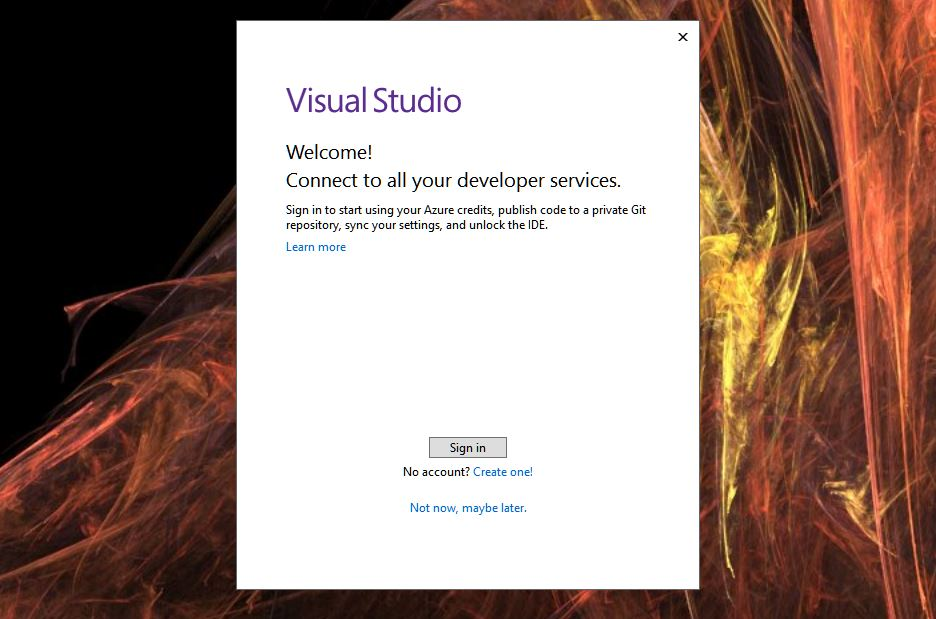

<div class="caption">

Visual Studio installation splash screen to sign in or not to sign in – that is the question…

</div>

Selecting *not now, maybe later* is luckily a perfectly viable option, so let’s go for that (no need to leave any more personal information with a tech giant than strictly necessary, right?). In the next window, you get to choose a theme. As the window says, you can always change this later, so let’s go with *dark*. Now we finally get into the Integrated Development Environment (**IDE**)

## Create a New Program

Now that you have Visual Studio up and running, select the 4th option *Create a new project* as pictured:

<span id="attachment-9709"></span>

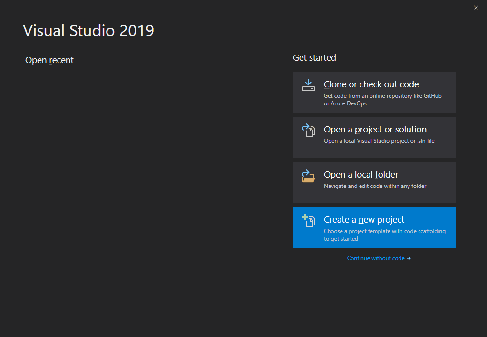

<div class="caption">

Your first adventure will be to create a new simple project using Visual Studio.

</div>

You then need to select the type of project. Because we are building a very simple project then select *Empty project* as you can see here:

<span id="attachment-9708"></span>

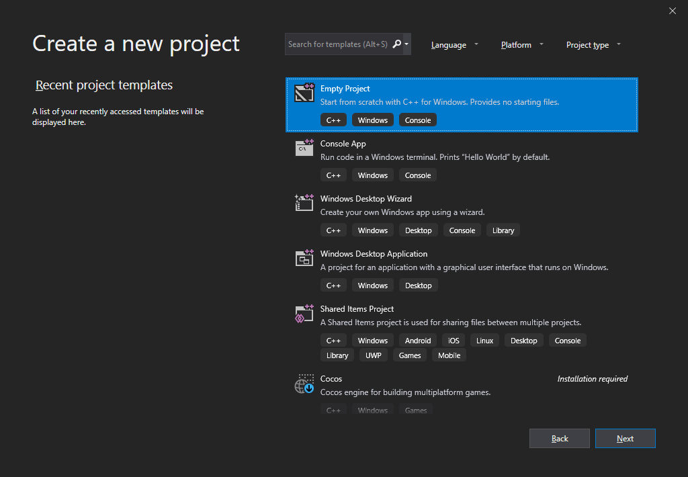

<div class="caption">

Starting with an empty project means we do not have to delete as many things later 😉

</div>

:::note
Even an empty project will create enough directories anyway. With this option you will have **x86** (for 32-bit) and **x64** (for 64-bit) options – essentially a C++ console application. In selecting an empty project we want to avoid adding any [ATL](https://discord.com/invite/gsxxaxc), [MFC](https://learn.microsoft.com/cpp/mfc/mfc-desktop-applications) or [SDL](https://www.microsoft.com/en-us/securityengineering/sdl) stuff.
:::

You now need to change a few things in the following dialog – this is *all* about where you place your files.

<span id="attachment-9711"></span>

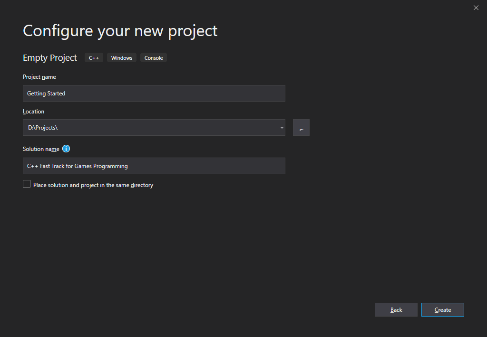

<div class="caption">

You may choose any folder you want to create your new project.

</div>

Set the *Project name* to `Getting Started`

Set the *Location* to `C:\my_projects` (or whichever folder you keep all of your programming projects).

:::danger
It is not recommended to keep your projects in the **Desktop** folder (`C:\Users\[username]\Desktop`) folder or in your **Documents** (`C:\Users\[username]\Documents`) folder because these folders are indexed by the Microsoft indexing services to improve search performance. The indexing services will have a negative impact on the performance of the build process and for this reason, it is recommended to save your projects in a folder that is not being indexed by the indexing service.
:::

Set the *Solution name* to `C++ Fast Track for Games Programming`

Click the *Create* button to create your new project!

You should see something similar to the screenshot below.

<span id="attachment-9716"></span>

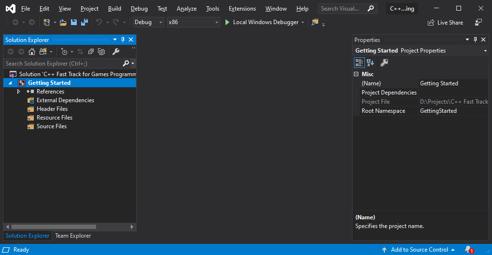

<div class="caption">

You should have an empty project.

</div>

## IDE Tidy-Up

:::note
This section is completely optional but it is our preference to tidy up the IDE to make room to view the C++ source code.  
Optionally, you can skip ahead to the [Hello World](#hello-world) section below.
:::

As you can see, there is a lot of stuff on the screen. Let’s make some room:

-   Click on *Team Explorer*, then close it to get rid of it. The Team Explorer can also be hidden by selecting *View > Team Explorer* from the main menu.
-   Do the same to *Toolbox* and *Properties*.
-   Drag the *Solution Explorer* to the left of the screen.
-   If you don’t like toolbars and their buttons then on the main menu, click on *View*, go to *Toolbars*, and deselect *Standard*.

You should now have something like this:

<span id="attachment-9713"></span>

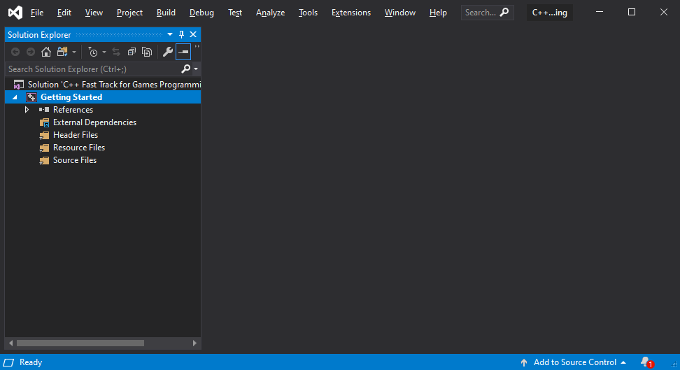

<div class="caption">

Almost there…

</div>

I often see people work on the area of a postage stamp (not just when programming) due to all the toolbars: this layout prevents that. We didn’t remove anything that we need (apart from one thing), and we assumed control of the software in the process.

The one thing we are missing is two drop-down boxes (OK, so two things). We can store these next to the menu bar, so they don’t need their own toolbar.

In the main menu, select *Tools > Customize* and select the *Commands* tab. Now click on *Add Command*, select the *Build* category, and choose the Solution Configurations *command*. This adds the drop-down box to the left of your menu bar; click the *Move Down* button a few times, until it is all the way to the right. Repeat this for the Solution Platforms command.

The top of the screen now looks like this:

<span id="attachment-9402"></span>

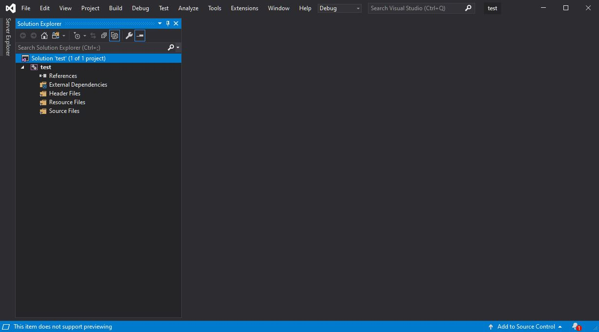

<div class="caption">

Now your IDE has some space to breath!

</div>

And the IDE is as tidy as it gets for now.

## Solution Explorer Tidy-Up

Your Solution Explorer should currently look like this:

<span id="attachment-9717"></span>

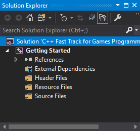

<div class="caption">

Your ‘solution’ (although you didn’t solve anything, but whatever) should look like this now.

</div>

Now, let’s delete some things we don’t need: Select all three folders (*Header files*, *Resource files* and *Source files* and delete them.

From the main menu, select *Tool > Options* and expand *Text Editor > C/C++ > Advanced* option or search for *“Disable External Dependencies Folder”* in the Search Options (Ctrl+E)

Set the *“Disable External Dependencies Folder”* option to *true*.

Your solution explorer should now look something like this:

<span id="attachment-9718"></span>

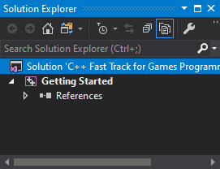

<div class="caption">

Your solution explorer should be totally clean now.

</div>

Before we go on:

:::caution
This is the first and only article in these series that is this boring. Starting with part 2, you will be coding, not downloading + installing + adjusting settings. Promise.
:::

That being said, let’s get coding!

Now it’s finally time to add a C++ source file to play with. Right-click on your project *Getting Started* in the *Solution Explorer* and select *Add > New Item*.

In the *Add New Item* dialog that appears, select *C++ File (.cpp)*, and name it `main.cpp` (or anything else really, as long as it ends with `.cpp`). Then click the *Add* button.

<span id="attachment-9720"></span>

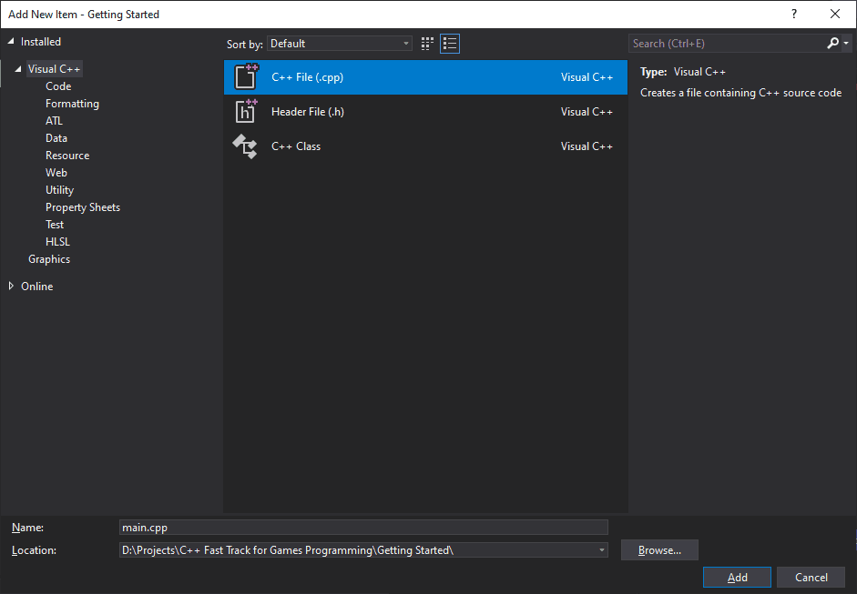

<div class="caption">

We just need the one .cpp file for now.

</div>

The new file is immediately opened, and we’re ready for some coding.

## Hello World

A tutorial on C++ is not complete without a ‘hello world’ example, so here we go. Enter the following program:

```cpp title="main.cpp" showLineNumbers
#include "stdio.h"

void main()
{
   printf( "Hello world!\n" );
   getchar();
}
```

You can start the program by hitting F5. Visual Studio will ask you if you want to build the program; you want this so click *yes*.

You should see a console window with the text `Hello world!` printed in it.

<span id="attachment-9722"></span>

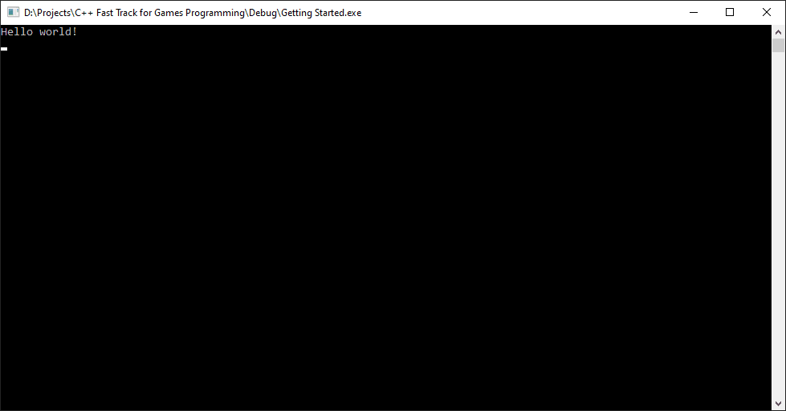

<div class="caption">

You should see a console window with the text “Hello world!” printed in it.

</div>

Press Enter (while the console window has the keyboard focus) to close the console window.

## Discussion

When you go to `D:\Projects\C++ Fast Track for Games Programming` (or wherever you saved your Visual Studio solution files) you will see that Visual Studio created a large amount of files for you. The most interesting one is in the *Debug* folder, and it’s called `Getting Started.exe`. When you start this application, you will see that you created it yourself.

Apart from this file, we have:

-   `C++ Fast Track for Games Programming.sln`: your *solution file*, which points to
-   `Getting Started.vcxproj`: your *project file*, which points to
-   `main.cpp`: the *source code file*.

A project can have multiple source files, and a solution can have multiple projects. Other files:

-   `Getting Started.vcxproj.filters`: stores the references to all of the source files in your project;
-   `Getting Started.VC.db` and `opendb`: some internal information for Visual Studio;
-   various other files in the Debug folder: `.obj`, `.ilk`, `.pdb`.

Quite confusing perhaps, but all that matters right now is the `.cpp` file in `Projects\C++ Fast Track for Games Programming\Getting Started` folder and the executable that it was built from it.

<span id="attachment-9724"></span>

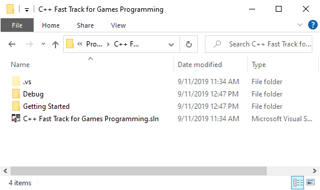

<div class="caption">

It is always good to understand what each file is for – especially when it comes to working out which ones you need on GitHub or Perforce (hint: Never commit compiler generated content to version control!)

</div>

:::caution
If you do not see the `.vs` folder as shown in the screenshot above, make sure you you select *“Show hidden files, folders, or drives”* in *File Explorer Options* in windows control panel.

To change this setting, open the Windows control panel and go to *File Explorer Options*, then the select the *View* tab, and select the *Show hidden files, folders, and drives* radio button.

If you don’t see file extensions (`.sln`, `.ccp`, and `.h`) in the File Explorer, make sure the *Hide extensions for known file types* is not checked as shown in the screenshot below.

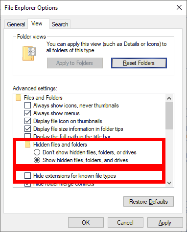
:::

## Assignment

So, here’s your task:

1.  Every article in this series will end with a small practical assignment. You need to complete this assignment. Feel free to share your solution on the 3dgep.com Discord server: ([https://discord.com/invite/gsxxaxc](https://discord.com/invite/gsxxaxc)).
2.  Create an executable that prints your name 10 times, then waits for a key, then prints *Coding is awesome!* 10 times, then waits for a key again, then exits.
