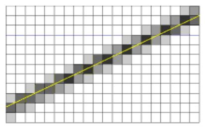
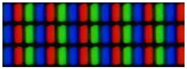
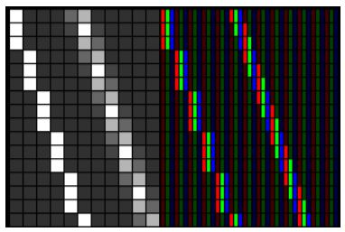

<span id="attachment-8103"></span>

In previous episodes we generally worked with one object at a time: one ball, one grain of sand, and so on. In practice, we will generally want several of these. This is where arrays come in handy.

For this tutorial, we’ll be using the same template from the [2nd tutorial](/cpp-fast-track-2-template/):

[https://github.com/3dgep/tmpl8](https://github.com/3dgep/tmpl8)

[tmpl8-main.zip](https://github.com/3dgep/tmpl8/archive/refs/heads/main.zip)

### Arrays

So, to store the locations of two balls, we could type:

```cpp title="Initialize many balls (without arrays)" showLineNumbers
int ballx1 = ..., bally1 = ...;
int ballx2 = ..., bally2 = ...;
```

Obviously, this quickly gets annoying with many balls. This is where arrays come in handy:

```cpp title="Initialize many balls (with arrays)" showLineNumbers
int ballx[2], bally[2];
```

Now, variable `ballx` doesn’t contain a single integer, but two; and even better: we can replace the `2` (for the number of elements in the array) by pretty much any number we want (theoretically).

Let’s give this a try. Copy the following code into a fresh template:

```cpp title="game.cpp" showLineNumbers
#include "game.h"
#include "surface.h"
#include <cstdio> //printf

namespace Tmpl8
{

    int x[4096], y[4096];

    void Game::Init()
    {
        for (int i = 0; i < 4096; i++)
            x[i] = IRand(800), y[i] = IRand(512);
    }

    void Game::Shutdown() {}

    void Game::Tick(float deltaTime)
    {
        screen->Clear(0);
        for (int i = 0; i < 4096; i++)
        {
            x[i] = (x[i] + 800 + (((i & 1) * 2) - 1)) % 800;
            y[i] = (y[i] + 512 + ((((i >> 2) & 1) * 2) - 1)) & 511;
            screen->GetBuffer()[x[i] + y[i] * 800] = 0xffffff;
        }
    }
};
```

:::danger
**Error**  
When you compile this you get an error:  
`error C3861: 'IRand': identifier not found`. This is because we need to add a header file that makes the `IRand` function available.
:::

To fix the compile error, add the following line to `game.cpp`:

```cpp title="game.cpp" showLineNumbers startLineNumber=3
#include "template.h"
```

This probably requires some explanation. 😊 First, the arrays: two arrays are allocated to store `x` and `y` coordinates. There is room for `4096` integers in each array. This is not a random choice: `4096` is $2^{12}$, so actually (for a computer) it’s a nice round number. The arrays are filled with random numbers in the `Game::Init` method:

```cpp title="game.cpp" showLineNumbers startLineNumber=13
        for (int i = 0; i < 4096; i++)
            x[i] = IRand(800), y[i] = IRand(512);
```

To keep the code brief, I sometimes use a trick here: a comma (,) links the two variable assignments, which is perfectly fine in C++, and sometimes very handy, e.g. in loops:

```cpp title="Example of executing multiple statements delimited by commas" showLineNumbers
for( int i = 0, j = 0, k = 0; i < 10; i++, j++, k++ )
```

In the above code, it simply allows us to skip the curly brackets, which are not needed for a for-loop that executes a single *instruction*, reducing the `Game::Init` method to just two lines.

The magic is happening in the `Game::Tick` method however. Each of the `4096` particles moves, but always diagonally:

-   half the particles go left, half go right;
-   half the particles go up, half go down.

The decision for movement direction is made based on the index of the particle. Specifically: *even* particles go left, *uneven* particles go right. This is done using *bit-masking* (which we used for colours before). *Even* particles are numbered `0, 2, 4, ...;` these numbers have in common that their first bit is set to `0`. For uneven particles, the first bit is `1`. So, we take this bit, multiply it by `2` (to get `0` or `2`), and subtract `1` (to get `-1` or `1`). This value is then added to the `x`\-coordinate of the particle.

To modify `y`, the same trick is applied, but using a different bit of the index.

Finally, we need to make sure that the particles stay on the screen. A modulo (`%`) is used for this. I am never sure how `%` behaves with negative numbers, so the screen width is simply added to the current coordinate, and then the `%` is used. This solves off-screen problems on the left and the right, using a single operation.

After this, a pixel is plotted by directly accessing the pixel buffer.

### Smooth

This runs pretty smooth. But how smooth exactly? Try this: start [FRAPS](https://fraps.com/), and increase the particle count until the frame rate drops below 60 FPS.

:::note
If you are not able to get the demo to run below 60 FPS without adding millions of particles and getting a completely white screen, you may want to add a bit of lag at the end of the `Game::Tick` method to simulate a lower frame-rate:

```cpp title="game.cpp" showLineNumbers
...
#include <thread>
...
    void Game::Tick(float deltaTime)
    {
        ...
        static const float TARGET_FPS = 30.0f;
        static const float TARGET_MS = ( 1.0f / TARGET_FPS ) * 1000.0f;
        static float lag = 0.0f;
        lag += deltaTime;
        std::this_thread::sleep_for( std::chrono::duration<float, std::milli>(TARGET_MS - lag) );
        lag -= TARGET_MS;
    }
```

Try adjusting the `TARGET_FPS` constant variable to see how this affects the frame-rate.
:::

There’s a slight problem if you want to update the number of particles: the number `4096` appears four times in the code. To ease the pain, add a `#define` at the top of the code:

```cpp title="game.cpp" showLineNumbers startLineNumber=5
#define PARTICLES 4096
```

Now, instead of typing `4096` you can type `PARTICLES`, and changing the count is much easier.

The `#define` is a macro: C++ will replace each occurrence with the specified value. The C++11 standards onward you can use a different approach:

```cpp title="game.cpp" showLineNumbers startLineNumber=5
constexpr auto PARTICLES = 4096u;
```

The [`constexp`](https://en.cppreference.com/cpp/language/constexpr) specifier also allows you to define compile-time constants with the added bonus of being *type-safe*.

### Smoother

Let’s try another program:

```cpp title="game.cpp" showLineNumbers
#include "game.h"
#include "surface.h"
#include "template.h"

namespace Tmpl8
{
    float x = 400, y = 256;

    void Game::Init() {}

    void Game::Shutdown() {}

    void Game::Tick(float deltaTime)
    {
        screen->Clear(0);
        screen->Line(mousex, 0, mousex, 511, 0xff0000);
        screen->Line(0, mousey, 799, mousey, 0xff0000);
    }
};
```

This also requires some changes in `game.h`:

Add two variables at the end of the class definition:

```cpp title="game.h" showLineNumbers startLineNumber=20
int mousex, mousey;
```

Replace the `MouseMove` function by:

```cpp title="game.h" showLineNumbers startLineNumber=15
void MouseMove( int x, int y ) { mousex = x, mousey = y; }
```

When you start the program you will notice there is a bug in the template: the lines do not actually follow your mouse. You can fix this in `template.cpp`, line `389`: replace `xrel` by `x`, and `yrel` by `y`. Now you have some crosshairs that follow the mouse.

```cpp title="template.cpp" showLineNumbers startLineNumber=389
			case SDL_MOUSEMOTION:
				game->MouseMove( event.motion.x, event.motion.y );
				break;
```

Let’s have some fun with the mouse. Add these lines at the end of the `Game::Tick` method:

```cpp title="game.cpp" showLineNumbers startLineNumber=18
float dx = x - mousex, dy = y - mousey;
float dist = sqrtf( dx * dx + dy * dy );
if (dist < 50)
    x += dx / dist, y += dy / dist;
screen->Plot( (int)x, (int)y, 0xffffff );
```

Now we have a pesky white dot that is afraid of the mouse.

### Silky Smooth

The white dot has floating point coordinates, but when we plot it, it is plotted to an integer position. That’s only logical: it cannot move by less than a pixel at a time. Or can it? – Let’s zoom in on a pixel moving from the left to the right:


… And now, let’s make it move smoother:


The two images may not be entirely convincing, but what we apply here is the fundamental principle of anti-aliasing: when a 1×1 pixel is located at a coordinate that is not an integer, it essentially *overlaps* multiple pixels. It thus contributes to the colour of multiple pixels, which our eyes in turn interpret as sub-pixel movement.

Here’s an anti-aliased line to make the effect more visible:



### Smoother Still

A final trick to make things move even smoother requires a closer look at computer screens:



As you know, a white pixel is obtained by setting red, green, and blue to their maximum values. But, what if we set green, blue and red instead? Or blue, red, and green? On a screen that uses the three colour components in the layout shown above, we can move a white pixel by one third of a pixel… This is called subpixel rendering and is the core idea behind the [ClearType](https://en.wikipedia.org/wiki/ClearType) font rendering technology.



### Assignment

#### Part 1 – Regular

This episode started with a discussion of arrays. Make the mouse-evading pixel into a pixel plague: Using arrays, add a large amount of pixels, all exhibiting the same annoying behavior.

#### Part 2 – Hard

You probably noticed that there is no code in this episode to make the pixel move at the sub-pixel level. That is because this is your second assignment for today.

Some hints:

-   Add a new method to the `Surface` class called `Surface::Plot` that takes floating-point variables as arguments instead of integers.
-   A pixel located at position `x`, `y` affects pixels (`x`,`y`), (`x+1`,`y`), (`x`,`y+1`) and (`x+1`,`y+1`).
-   The brightness of each of these four pixels is proportional to the area of overlap.
-   The [`fmodf`](https://en.cppreference.com/cpp/numeric/math/modf) function can be used to get just the fractional part of a floating-point value.
-   The sum of these areas is `1`.

Also notice that a single pixel may have multiple overlapping particles. This means that the brightness you want to write to a pixel should actually be additive. You can find a useful function for this in `surface.h`: The `AddBlend` function takes two `Pixel` colours and returns the summed colour.
