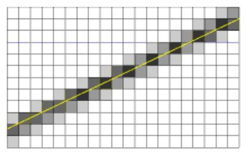
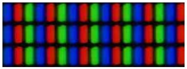
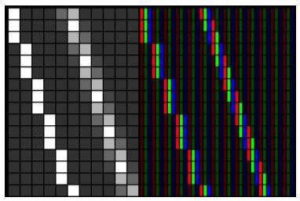

In the previous parts, we mostly worked with one object at a time: one ball, one dot, and so on. In a game, you will usually want many of them. This is where *arrays* come in handy.

## Getting the Stuff You Need

For this tutorial, you will be using the same template as in the [2nd tutorial](/cpp-fast-track-2-template/):

[https://github.com/3dgep/tmpl8](https://github.com/3dgep/tmpl8)

[tmpl8-main.zip](https://github.com/3dgep/tmpl8/archive/refs/heads/main.zip)

As usual, we will start with a fresh copy of the template: extract the zip file to `C:\Projects\C++ Fast Track`, and rename the `tmpl8-main` folder to `Part 10`. Open `tmpl8.slnx` in the `C:\Projects\C++ Fast Track\Part 10` folder.

## Arrays

To store the positions of two balls, we could write:

```cpp
int ballx1 = 100, bally1 = 50;
int ballx2 = 300, bally2 = 200;
```

Obviously, this quickly gets annoying with many balls. This is where arrays come in handy:

```cpp
int ballx[2], bally[2];
```

Now, the variable `ballx` doesn't contain a single integer, but two. You get to them with an *index* between square brackets: `ballx[0]` is the first one, and `ballx[1]` is the second one. Note that the first element has index `0`, so the last one is `ballx[1]`, not `ballx[2]`. And even better: we can replace the `2` (the number of elements in the array) by pretty much any number we want.

You have used this before, by the way: in [part 8](/cpp-fast-track-8-memory-addresses/), `address[i]` was the pixel with index `i` in the screen. An array is exactly that: a number of variables of the same type, one after the other in memory.

Let's give this a try. Change `game.cpp` to:

```cpp source="tmpl8-part-10/1-particles/game.cpp#L1-L38" {7,14-15,30-36}
```

<iframe class="embed embed-tmpl8" src="/demos/cpp-fast-track-10-particles/index.html" title="4096 white dots that move diagonally over the screen" loading="lazy" allowfullscreen></iframe>

<div class="caption">

4096 particles, each moving diagonally.

</div>

This probably requires some explanation. 😊 First, the arrays: on line 7, two arrays are created, to store the `x` and `y` coordinates of the particles. There is room for `4096` integers in each array. This is not a random choice: `4096` is $2^{12}$, so (for a computer) it's a nice round number. The arrays are filled with random numbers in the `Game::Init` function: `IRand(800)` is a random whole number from 0 to 799.

To keep the code brief, I use a trick here: a comma (`,`) links the two assignments on line 15 into a single statement. That's perfectly fine in C++, and sometimes very handy, for example in loops:

```cpp
for (int i = 0, j = 0, k = 0; i < 10; i++, j++, k++)
```

In the code above, it allows us to skip the curly brackets, which are not needed for a `for` loop that executes a single statement.

The magic is happening in the `Game::Tick` function, however. Each of the `4096` particles moves, but always diagonally:

-   half the particles go left, half go right;
-   half the particles go up, half go down.

The direction is based on the index of the particle. *Even* particles (with index `0`, `2`, `4`, ...) go left, and *odd* particles go right. This uses the *bitmasking* from the [previous part](/cpp-fast-track-9-colours/): for even numbers, the lowest bit is `0`, and for odd numbers it is `1`. So we take this bit (`i & 1`), multiply it by `2` (to get `0` or `2`), and subtract `1` (to get `-1` or `1`). This value is then added to the `x` coordinate of the particle. To move `y`, the same trick is used, with a different bit of the index (`(i >> 2) & 1`).

Finally, the particles have to stay on the screen. For `x`, the *modulo* operator (`%`) does that: `a % b` is the remainder after dividing `a` by `b`, so `x % 800` is always between 0 and 799, and a particle that leaves the screen on the right comes back on the left. On the left side, there's a catch: in C++, the remainder of a negative number is negative (`-1 % 800` is `-1`). That's why the screen width is added first: `x + 800 - 1` is never negative. For `y`, there's an even faster way, because `512` is a power of two: `& 511` keeps the lowest 9 bits of the number (511 is `1 1111 1111` in binary), which is the same as `% 512`, also for `-1`.

After this, a pixel is plotted by writing to the screen memory directly, like in [part 8](/cpp-fast-track-8-memory-addresses/).

## Smooth

This runs pretty smoothly. But how smoothly exactly? Let's show the frame rate, like in [part 6](/cpp-fast-track-6-floats/), and let <kbd>V</kbd> switch VSync on and off. And while we're at it: the number `4096` appears four times in the code, so changing the number of particles means changing it in four places. Let's give it a name instead. Make the highlighted changes:

```cpp source="tmpl8-part-10/2-fps/game.cpp#L1-L9" {3,8-9}
```

```cpp source="tmpl8-part-10/2-fps/game.cpp#L14-L18" {3}
```

```cpp source="tmpl8-part-10/2-fps/game.cpp#L30-L41" {4,10-11}
```

<iframe class="embed embed-tmpl8" src="/demos/cpp-fast-track-10-fps/index.html" title="The moving particles, with the frame rate in the top-left corner" loading="lazy" allowfullscreen></iframe>

<div class="caption">

The particles, with the frame rate. (In a web browser, VSync is always on.)

</div>

`constexpr int Particles = 4096;` is a *constant*: a value with a name, which can't change while the program runs. `constexpr` means that the compiler knows its value when it compiles the program, so you can use it for the size of an array. Now you only have to change one number to change the number of particles.

:::note
In older code, you will often see `#define PARTICLES 4096` instead. That's a *macro*: before compiling, every `PARTICLES` in the code is replaced by the text `4096`. It works, but a macro has no type and ignores the rules of C++ (it is replaced everywhere, even where you didn't mean it), so in modern C++, `constexpr` is the better choice.
:::

Now run the program, press <kbd>V</kbd> to switch VSync off, and increase the number of particles until the frame rate drops below 60 frames per second. How many particles can your computer handle? (Try it with a *Release* build as well: remember [part 7](/cpp-fast-track-7-debugging/)?)

## Smoother

Let's try another program. Remove the particles from `game.cpp` again (the arrays, and the code in `Init` and `Tick`), so that you have empty functions like in a fresh template. Then make the highlighted changes to `game.hpp`, so that the game knows where the mouse is:

```cpp source="tmpl8-part-10/3-crosshair/game.hpp#L20" {1}
```

```cpp source="tmpl8-part-10/3-crosshair/game.hpp#L43-L47" {5}
```

The template calls `MouseMove` whenever the mouse moves over the window, with the position of the mouse. `mousex = x, mousey = y;` stores that position in two variables of the game (the comma trick again). Now change the `Tick` function in `game.cpp` to:

```cpp source="tmpl8-part-10/3-crosshair/game.cpp#L24-L29"
```

<iframe class="embed embed-tmpl8" src="/demos/cpp-fast-track-10-crosshair/index.html" title="Red crosshairs that follow the mouse" loading="lazy" allowfullscreen></iframe>

<div class="caption">

Crosshairs that follow the mouse. Move the mouse over the demo.

</div>

Let's have some fun with the mouse. Add the highlighted lines to `game.cpp`:

```cpp source="tmpl8-part-10/4-dot/game.cpp#L1-L8" {3,8}
```

```cpp source="tmpl8-part-10/4-dot/game.cpp#L27-L37" {6-10}
```

<iframe class="embed embed-tmpl8" src="/demos/cpp-fast-track-10-dot/index.html" title="A white dot in the middle of the screen that moves away from the mouse" loading="lazy" allowfullscreen></iframe>

<div class="caption">

A pesky white dot, in the middle of the screen, that is afraid of the mouse. Move the mouse towards it. (In this demo, the dot is 3 × 3 pixels, so that it is easier to see.)

</div>

`dx` and `dy` are the distances from the mouse to the dot, and `dist` is the distance between them, thanks to Pythagoras: $\sqrt{dx^2 + dy^2}$ (`std::sqrt` is the square root, from `<cmath>`). When the mouse is closer than 50 pixels, the dot moves one pixel away from the mouse: `dx / dist` and `dy / dist` together are a step of length 1, in the direction from the mouse to the dot. And `dist > 0` makes sure that we never divide by zero, which would give NaN (remember [part 6](/cpp-fast-track-6-floats/)?) when the mouse is exactly on the dot.

## Silky Smooth

The white dot has floating point coordinates, but when we plot it, it is plotted at an integer position. That's only logical: it cannot move by less than a pixel at a time. Or can it? Let's zoom in on a pixel that moves from left to right, a quarter of a pixel at a time:

<svg class="pixel-diagram" viewBox="0 0 700 274" role="img" aria-label="A pixel that moves from x = 1 to x = 2 in steps of a quarter pixel: plotted at whole pixels it stays put and then jumps; anti-aliased, its brightness moves over from one pixel to the next">
<text class="head" x="205.0" y="22" text-anchor="middle">whole pixels</text>
<text class="head" x="505.0" y="22" text-anchor="middle">anti-aliased</text>
<text class="label" x="100" y="62.0" text-anchor="end">x = 1</text>
<rect x="120" y="40" width="34" height="34" fill="rgb(0,0,0)" class="cell"/>
<rect x="154" y="40" width="34" height="34" fill="rgb(255,255,255)" class="cell"/>
<rect x="188" y="40" width="34" height="34" fill="rgb(0,0,0)" class="cell"/>
<rect x="222" y="40" width="34" height="34" fill="rgb(0,0,0)" class="cell"/>
<rect x="256" y="40" width="34" height="34" fill="rgb(0,0,0)" class="cell"/>
<rect x="420" y="40" width="34" height="34" fill="rgb(0,0,0)" class="cell"/>
<rect x="454" y="40" width="34" height="34" fill="rgb(255,255,255)" class="cell"/>
<rect x="488" y="40" width="34" height="34" fill="rgb(0,0,0)" class="cell"/>
<rect x="522" y="40" width="34" height="34" fill="rgb(0,0,0)" class="cell"/>
<rect x="556" y="40" width="34" height="34" fill="rgb(0,0,0)" class="cell"/>
<text class="label" x="100" y="106.0" text-anchor="end">x = 1.25</text>
<rect x="120" y="84" width="34" height="34" fill="rgb(0,0,0)" class="cell"/>
<rect x="154" y="84" width="34" height="34" fill="rgb(255,255,255)" class="cell"/>
<rect x="188" y="84" width="34" height="34" fill="rgb(0,0,0)" class="cell"/>
<rect x="222" y="84" width="34" height="34" fill="rgb(0,0,0)" class="cell"/>
<rect x="256" y="84" width="34" height="34" fill="rgb(0,0,0)" class="cell"/>
<rect x="420" y="84" width="34" height="34" fill="rgb(0,0,0)" class="cell"/>
<rect x="454" y="84" width="34" height="34" fill="rgb(191,191,191)" class="cell"/>
<text class="pct dark" x="471.0" y="105.0" text-anchor="middle">75%</text>
<rect x="488" y="84" width="34" height="34" fill="rgb(64,64,64)" class="cell"/>
<text class="pct light" x="505.0" y="105.0" text-anchor="middle">25%</text>
<rect x="522" y="84" width="34" height="34" fill="rgb(0,0,0)" class="cell"/>
<rect x="556" y="84" width="34" height="34" fill="rgb(0,0,0)" class="cell"/>
<text class="label" x="100" y="150.0" text-anchor="end">x = 1.5</text>
<rect x="120" y="128" width="34" height="34" fill="rgb(0,0,0)" class="cell"/>
<rect x="154" y="128" width="34" height="34" fill="rgb(255,255,255)" class="cell"/>
<rect x="188" y="128" width="34" height="34" fill="rgb(0,0,0)" class="cell"/>
<rect x="222" y="128" width="34" height="34" fill="rgb(0,0,0)" class="cell"/>
<rect x="256" y="128" width="34" height="34" fill="rgb(0,0,0)" class="cell"/>
<rect x="420" y="128" width="34" height="34" fill="rgb(0,0,0)" class="cell"/>
<rect x="454" y="128" width="34" height="34" fill="rgb(128,128,128)" class="cell"/>
<text class="pct light" x="471.0" y="149.0" text-anchor="middle">50%</text>
<rect x="488" y="128" width="34" height="34" fill="rgb(128,128,128)" class="cell"/>
<text class="pct light" x="505.0" y="149.0" text-anchor="middle">50%</text>
<rect x="522" y="128" width="34" height="34" fill="rgb(0,0,0)" class="cell"/>
<rect x="556" y="128" width="34" height="34" fill="rgb(0,0,0)" class="cell"/>
<text class="label" x="100" y="194.0" text-anchor="end">x = 1.75</text>
<rect x="120" y="172" width="34" height="34" fill="rgb(0,0,0)" class="cell"/>
<rect x="154" y="172" width="34" height="34" fill="rgb(255,255,255)" class="cell"/>
<rect x="188" y="172" width="34" height="34" fill="rgb(0,0,0)" class="cell"/>
<rect x="222" y="172" width="34" height="34" fill="rgb(0,0,0)" class="cell"/>
<rect x="256" y="172" width="34" height="34" fill="rgb(0,0,0)" class="cell"/>
<rect x="420" y="172" width="34" height="34" fill="rgb(0,0,0)" class="cell"/>
<rect x="454" y="172" width="34" height="34" fill="rgb(64,64,64)" class="cell"/>
<text class="pct light" x="471.0" y="193.0" text-anchor="middle">25%</text>
<rect x="488" y="172" width="34" height="34" fill="rgb(191,191,191)" class="cell"/>
<text class="pct dark" x="505.0" y="193.0" text-anchor="middle">75%</text>
<rect x="522" y="172" width="34" height="34" fill="rgb(0,0,0)" class="cell"/>
<rect x="556" y="172" width="34" height="34" fill="rgb(0,0,0)" class="cell"/>
<text class="label" x="100" y="238.0" text-anchor="end">x = 2</text>
<rect x="120" y="216" width="34" height="34" fill="rgb(0,0,0)" class="cell"/>
<rect x="154" y="216" width="34" height="34" fill="rgb(0,0,0)" class="cell"/>
<rect x="188" y="216" width="34" height="34" fill="rgb(255,255,255)" class="cell"/>
<rect x="222" y="216" width="34" height="34" fill="rgb(0,0,0)" class="cell"/>
<rect x="256" y="216" width="34" height="34" fill="rgb(0,0,0)" class="cell"/>
<rect x="420" y="216" width="34" height="34" fill="rgb(0,0,0)" class="cell"/>
<rect x="454" y="216" width="34" height="34" fill="rgb(0,0,0)" class="cell"/>
<rect x="488" y="216" width="34" height="34" fill="rgb(255,255,255)" class="cell"/>
<rect x="522" y="216" width="34" height="34" fill="rgb(0,0,0)" class="cell"/>
<rect x="556" y="216" width="34" height="34" fill="rgb(0,0,0)" class="cell"/>
<g transform="translate(679 253) scale(0.7)" opacity="0.35"><title>Made with Claude</title><path d="M4.709 15.955l4.72-2.647.08-.23-.08-.128H9.2l-.79-.048-2.698-.073-2.339-.097-2.266-.122-.571-.121L0 11.784l.055-.352.48-.321.686.06 1.52.103 2.278.158 1.652.097 2.449.255h.389l.055-.157-.134-.098-.103-.097-2.358-1.596-2.552-1.688-1.336-.972-.724-.491-.364-.462-.158-1.008.656-.722.881.06.225.061.893.686 1.908 1.476 2.491 1.833.365.304.145-.103.019-.073-.164-.274-1.355-2.446-1.446-2.49-.644-1.032-.17-.619a2.97 2.97 0 01-.104-.729L6.283.134 6.696 0l.996.134.42.364.62 1.414 1.002 2.229 1.555 3.03.456.898.243.832.091.255h.158V9.01l.128-1.706.237-2.095.23-2.695.08-.76.376-.91.747-.492.584.28.48.685-.067.444-.286 1.851-.559 2.903-.364 1.942h.212l.243-.242.985-1.306 1.652-2.064.73-.82.85-.904.547-.431h1.033l.76 1.129-.34 1.166-1.064 1.347-.881 1.142-1.264 1.7-.79 1.36.073.11.188-.02 2.856-.606 1.543-.28 1.841-.315.833.388.091.395-.328.807-1.969.486-2.309.462-3.439.813-.042.03.049.061 1.549.146.662.036h1.622l3.02.225.79.522.474.638-.079.485-1.215.62-1.64-.389-3.829-.91-1.312-.329h-.182v.11l1.093 1.068 2.006 1.81 2.509 2.33.127.578-.322.455-.34-.049-2.205-1.657-.851-.747-1.926-1.62h-.128v.17l.444.649 2.345 3.521.122 1.08-.17.353-.608.213-.668-.122-1.374-1.925-1.415-2.167-1.143-1.943-.14.08-.674 7.254-.316.37-.729.28-.607-.461-.322-.747.322-1.476.389-1.924.315-1.53.286-1.9.17-.632-.012-.042-.14.018-1.434 1.967-2.18 2.945-1.726 1.845-.414.164-.717-.37.067-.662.401-.589 2.388-3.036 1.44-1.882.93-1.086-.006-.158h-.055L4.132 18.56l-1.13.146-.487-.456.061-.746.231-.243 1.908-1.312-.006.006z" fill="#D97757"/></g>
</svg>

<div class="caption">

On the left, the pixel stays where it is, and then jumps to the next pixel. On the right, the pixel's brightness moves over to the next pixel.

</div>

What we apply on the right is the fundamental principle of *anti-aliasing*: when a 1×1 pixel is located at a coordinate that is not an integer, it *overlaps* multiple pixels. It thus contributes to the colour of each of them, as much as it overlaps them. Our eyes see that as movement of less than a pixel.

Here's an anti-aliased line, to make the effect more visible:



## Smoother Still

A final trick to make things move even smoother requires a closer look at a computer screen:



As you know, a white pixel is obtained by setting red, green, and blue to their maximum values. But what if we set the green and blue parts of one pixel, and the red part of the next pixel? On a screen that uses the layout shown above, that's a white pixel that has moved by a third of a pixel... This is called *subpixel rendering*, and it is the core idea behind the [ClearType](https://en.wikipedia.org/wiki/ClearType) font rendering technology.



Not every screen has its red, green and blue parts in this order, though: some have them the other way around, and many phone and OLED screens use different layouts. That's why ClearType asks you which text looks best when you set it up.

## Assignment

### Part 1: Regular

This part started with arrays. Make the mouse-evading pixel into a *pixel plague*: using arrays, add a large number of pixels, all with the same annoying behaviour.

<iframe class="embed embed-tmpl8" src="/demos/cpp-fast-track-10-assignment-1/index.html" title="Thousands of white pixels that move away from the mouse" loading="lazy" allowfullscreen></iframe>

<div class="caption">

A pixel plague: 2000 pixels that are afraid of the mouse. Move the mouse over the demo.

</div>

### Part 2: Hard

You probably noticed that there is no code in this part that makes a pixel move by less than a pixel. That's because this is your second assignment for today.

Some hints:

-   Add a function `Surface::Plot` that takes floating point coordinates (`float x, float y`) instead of integers.
-   A pixel located at position `x`, `y` covers (parts of) the pixels (`x`, `y`), (`x + 1`, `y`), (`x`, `y + 1`) and (`x + 1`, `y + 1`), where `x` and `y` are rounded down.
-   The brightness of each of these four pixels is proportional to the area that the pixel covers, and the sum of these areas is `1`.
-   `x - std::floor(x)` (from `<cmath>`) is the fractional part of `x`: the part after the decimal point.

Also note that a pixel on the screen may be covered by more than one moving pixel. This means that you should *add* brightness to a pixel, instead of replacing it. You can find a useful function for this in `surface.hpp`: `AddBlend` takes two `Pixel` colours, and returns their sum (where every colour channel stops at 255).

<iframe class="embed embed-tmpl8" src="/demos/cpp-fast-track-10-assignment-2/index.html" title="The pixel plague, with pixels that move smoothly by less than a pixel at a time" loading="lazy" allowfullscreen></iframe>

<div class="caption">

The pixel plague, with anti-aliased pixels: they move smoothly, also by less than a pixel at a time.

</div>

Once you have completed these, you may continue with the next part.
