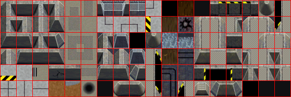
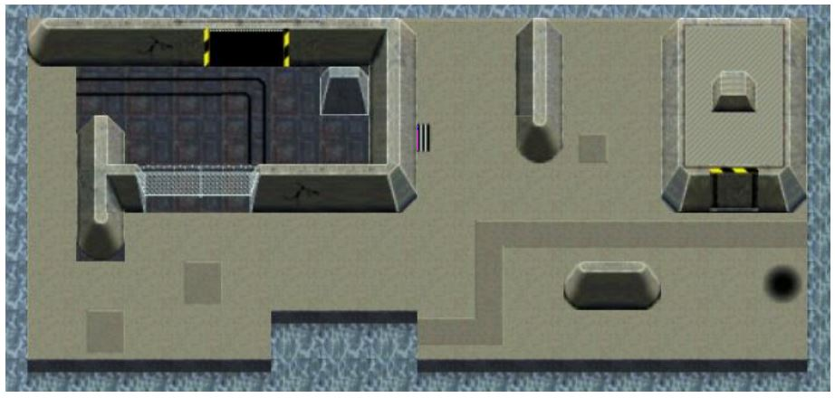
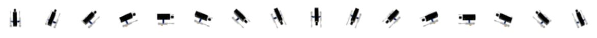

<span id="attachment-8103"></span>

It is time to introduce you to a great concept for 2D graphics in C++, that you will find very useful and easy to use: **tilemaps**.

For this tutorial, we’ll be using the same template from the [2nd tutorial](/cpp-fast-track-2-template/):

[https://github.com/3dgep/tmpl8](https://github.com/3dgep/tmpl8)

[tmpl8-main.zip](https://github.com/3dgep/tmpl8/archive/refs/heads/main.zip)

## Tilemaps

Have a look at this image:

<span id="attachment-9831"></span>



<div class="caption">

Tilemap for a sprite based game. Save this image to your computer.

</div>

This is a set of tiles I made for a mobile game (a long time ago). You can download it here: [https://jbikker.github.io/files/nc2tiles.png](https://jbikker.github.io/files/nc2tiles.png)

These tiles can be used to construct a background for a game. The average programmer is perfectly capable of producing his/her own level art this way, for example:

<span id="attachment-9347"></span>



<div class="caption">

A game level built with a set of tiles.

</div>

Now that’s a fine backdrop for a stealth tank adventure game!

## My First Tilemap

Copy [nc2tiles.png](/downloads/nc2tiles.png) file to the **assets** folder of a fresh template directory. Then, enter the following code:

```cpp title="game.cpp" showLineNumbers
#include "game.h"
#include "surface.h"

namespace Tmpl8
{
    void Game::Init() {}
    void Game::Shutdown() {}

    Surface tiles("assets/nc2tiles.png");

    char map[5][30] = {
         "kc kc kc kc kc kc kc kc kc kc",
         "kc fb fb fb kc kc kc kc kc kc",
         "kc fb fb fb fb fb kc kc kc kc",
         "kc lc lc fb fb fb kc kc kc kc",
         "kc kc kc lc lc lc kc kc kc kc"
    };

    void Game::Tick(float deltaTime)
    {
        screen->Clear(0);
        for (int y = 0; y < 5; y++)
            for (int x = 0; x < 10; x++)
            {
                int tx = map[y][x * 3] - 'a';
                int ty = map[y][x * 3 + 1] - 'a';
                Pixel* src = tiles.GetBuffer() + 1 + tx * 33 + (1 + ty * 33) * 595;
                Pixel* dst = screen->GetBuffer() + x * 32 + y * 32 * 800;
                for (int i = 0; i < 32; i++)
                {
                    for (int j = 0; j < 32; j++)
                        dst[j] = src[j];
                    src += 595, dst += 800;
                }
            }
    }
};
```

That’s a bit more code than usual, but we will make good use of it. Let’s go over the details.

The `Tick` function draws 5 lines of 10 tiles each for a total of 50 tiles. Each tile is specified using two characters in the array: the first one specifies the column (*a* … *r*), the second one the line (*a* … *f*). The spaces in the array are just there for clarity. Using the coordinates of a tile (in `tx` and `ty`) we can find its first pixel. The address of this pixel is stored in variable `src` (*source*). The destination address (`dst`) is in the screen buffer; the way this is calculated should be pretty obvious. Finally, we loop over the pixels of a single tile to draw it to the screen.

## Some Clarity

We can improve the above code by isolating the tile rendering code. Add a function `DrawTile` just above your `Tick` function:

```cpp title="game.cpp" showLineNumbers startLineNumber=18
void DrawTile( int tx, int ty, Surface* screen, int x, int y )
{
    Pixel* src = tiles.GetBuffer() + 1 + tx * 33 + (1 + ty * 33) * 595;
    Pixel* dst = screen->GetBuffer() + x + y * 800;
    for( int i = 0; i < 32; i++, src += 595, dst += 800 )
        for( int j = 0; j < 32; j++ )
            dst[j] = src[j];
}
```

It is the same functionality we had before, but now the deep logic of rendering a single tile is nicely hidden.

In the `Tick` function, you can now see how much we can simplify it by using this new function `DrawTile` to simplify the `Tick` function:

```cpp title="game.cpp" showLineNumbers startLineNumber=28
   void Game::Tick(float deltaTime)
    {
        screen->Clear(0);
        for (int y = 0; y < 5; y++)
            for (int x = 0; x < 10; x++)
            {
                int tx = map[y][x * 3] - 'a';
                int ty = map[y][x * 3 + 1] - 'a';
                DrawTile(tx, ty, screen, x * 32, y * 32);
            }
    }
```

Which is far easier on the eyes.

## Player

Now that we have a map, we need a player to explore it.

Let’s load a sprite for this:

```cpp title="game.cpp" showLineNumbers startLineNumber=19
Sprite tank( new Surface( "assets/ctankbase.tga" ), 16 );
```

The player needs coordinates:

```cpp title="game.cpp" showLineNumbers startLineNumber=20
int px = 0, py = 0;
```

It needs to be drawn by adding this to the `Tick` function:

```cpp title="game.cpp" showLineNumbers startLineNumber=41
tank.Draw( screen, px, py );
```

And finally, we need to be able to control it:

```cpp title="game.cpp" showLineNumbers startLineNumber=42
if (GetAsyncKeyState( VK_LEFT )) px--;
if (GetAsyncKeyState( VK_RIGHT )) px++;
if (GetAsyncKeyState( VK_UP )) py--;
if (GetAsyncKeyState( VK_DOWN )) py++;
```

You might notice you get an error – `GetAsyncKeyState`. Again you might need to search online to find out what this function belongs to and therefore what `#include` you need to add (sometimes Visual Studio can suggest and correct) – or every text scan all the headers on your system… Whatever the method you use to solve the compilation error, you would eventually find out it is apart of `windows.h` header file and then add:

```cpp title="game.cpp" showLineNumbers startLineNumber=3
#define WIN32_LEAN_AND_MEAN
#include <windows.h>
```

To make it point in the right direction, we can use `tank.SetFrame()` to select the correct frame from the available options. File `ctankbase.tga` has `16` frames; frame `0` points up, `4` points to the right, `8` is down, and `12` is left.

## Obstacles

One particularly useful feature of a `tilemap` is that it allows us to specify quite a bit more than just the appearance of a tile. A simple extension of the functionality we already have is to store for each tile whether the player should be able to move over it or not. We can add a character to each tile for this, which we set to `X` if access is blocked, and to `-` if the player can move over it. Any other choice of indicators will do the job just as well, obviously.

In practice, it turns out that this is a bit harder to implement than you might expect. The player is not a point: we thus need to make sure that movement does not result in a position where *any part* of the player overlaps an obstacle tile.

An easy solution to this problem is to reduce the player (for collision detection purposes) to a square. Before accepting a move, we then first check the four corners of this square. Let’s create a small helper function for this.

```cpp title="game.cpp" showLineNumbers startLineNumber=23
bool CheckPos( int x, int y )
{
    int tx = x / 32, ty = y / 32;
    return map[ty][tx * 3 + 2] != 'X';
}
```

Now, key movement is handled like this:

```cpp title="game.cpp" showLineNumbers startLineNumber=49
int nx = px, ny = py;
if (GetAsyncKeyState( VK_LEFT )) nx--;
if (GetAsyncKeyState( VK_RIGHT )) nx++;
if (GetAsyncKeyState( VK_UP )) ny--;
if (GetAsyncKeyState( VK_DOWN )) ny++;
if (CheckPos( nx, ny ) && CheckPos( nx + 30, ny + 30 ) &&
    CheckPos( nx + 30, ny) && CheckPos( nx, ny + 30))
    px = nx, py = ny;
```

In other words: rather than updating `px` and `py` directly, we *propose* a new position in `nx` and `ny`. A square starting at (`nx`,`ny`) is then checked using its four corners. Only if these tests are OK, are `px` and `py` set to the new position.

Besides collision information we can store all kinds of data in the tilemap:

-   tiles that hurt or kill the player;
-   tiles that contain a bonus or credits;
-   tiles that make the player move in a certain direction (conveyor belts or escalators);
-   tiles that behave like switches, and so on.

## Further Improvements

There are many things that could improve the code we have so far:

-   Map and tile size is specified using constants: consider using `#define` to make it easier to use different dimensions;
-   The top-left of the `ctankbase` sprite isn’t exactly part of the actual object, so the collision box needs tweaking;
-   A map editor would be really nice to have.

Regarding program structure, it would be very nice if the tiles and the map would be isolated even more from the game. This is something we will deal with in the next episode.

## Assignment

The assignment for this tutorial comes in two difficulty settings. The regular difficulty tests your ability to make minor changes to the base assignment. The hard difficulty will take more time and effort to complete. Which difficulty are you able to achieve?

### Regular

1.  The current code renders the map starting at screen pixel (`0`,`0`). Modify the code so that it can center the map on the screen.
2.  Tweak the collision box of the tank sprite so that collisions are more accurate.

### Hard

1.  Use all frames of the tank sprite: when changing direction, do this by turning in four steps.
2.  A matching turret can be found in the assets folder (ctankgun.tga). Draw it on top of the `ctankbase` sprite (you may need to tweak the offset of the gun sprite to align it correct to the tank sprite), and make it turn in the correct direction with the tank, but with a slight delay.
3.  Draw the tanks sprite exactly in the center of the screen, and scroll the map underneath the tank. Make the map larger, and make sure that tiles that are partially off-screen are handled correctly.


