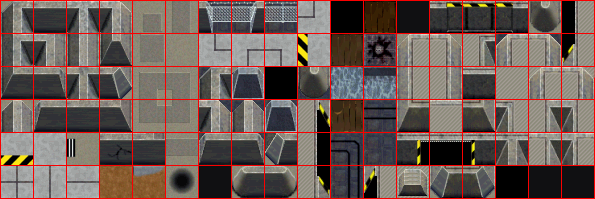
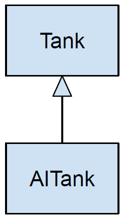
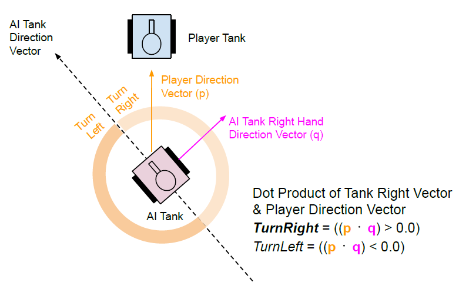
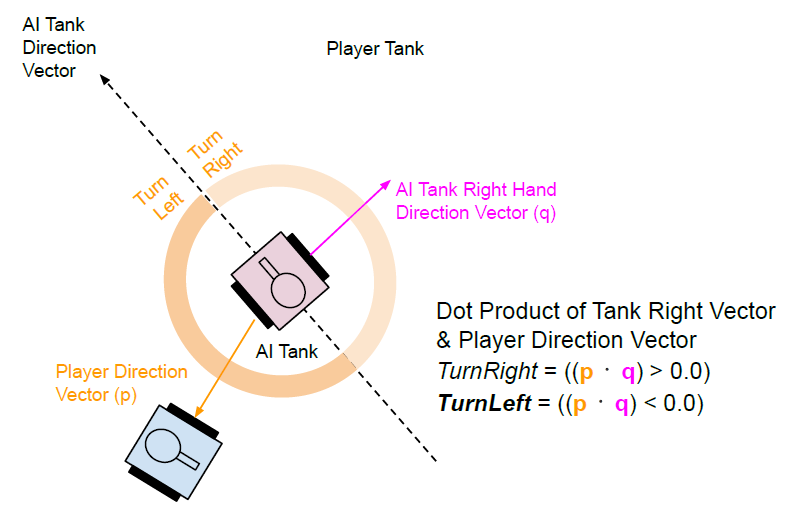

<span id="attachment-8103"></span>

Like physics, AI (*Artificial Intelligence*) is an incredibly complex field, and it’s always changing. Some companies allocate entire teams to the subject to make their game provide challenging game play. So we will only cover a few very basic concepts in this tutorial.

## Getting Started

For this tutorial, we’ll be using the same template from the [2nd tutorial](/cpp-fast-track-2-template/):

[https://github.com/3dgep/tmpl8](https://github.com/3dgep/tmpl8)

[tmpl8-main.zip](https://github.com/3dgep/tmpl8/archive/refs/heads/main.zip)

We will use the same tileset that we used in [Part 11 (Tiles)](/cpp-fast-track-11-tiles/). Make sure you save the [nc2tiles.png](/downloads/nc2tiles.png) file to the assets folder where you extracted the template zip file.

<span id="attachment-9831"></span>



<div class="caption">

Tilemap for a sprite based game. Right-click and save the file to the template's **assets** folder.

</div>

A key point about AI is that it is designed to provide *intelligent* players in a game. But don’t make the mistake of assuming *intelligent* means *perfect,* or that *intelligent* means any level of *intelligence*. The best AI should always introduce an element of *error* in its approach, because if you are trying to emulate another human player/controller, humans are rarely perfect.

Update `game.cpp` to the following:

```cpp title="game.cpp" showLineNumbers
#include "game.h"
#include "surface.h"
#include "template.h"
#include "windows.h"

namespace Tmpl8
{
    Surface tiles("assets/nc2tiles.png");
    Sprite tanksprite(new Surface("assets/ctankbase.tga"), 16);

    class Tank
    {
    public:
        Tank(float ix, float iy, float ispeed = 1.5f, int idirection = 0)
        {
            x = ix;
            y = iy;
            direction = idirection;
            speed = ispeed;
        }
        
        void TurnLeft()
        {
            if (--direction < 0) direction = 15;
        }
        
        void TurnRight() {
            if (++direction > 15) direction = 0;
        }
        
        void Move()
        {
            float angle = ((2 * PI) / 16) * direction;
            x += (sinf(angle) * speed);
            y += (-cosf(angle) * speed);
            if (x > ScreenWidth) x = 0;
            if (x < 0) x = ScreenWidth;
            if (y > ScreenHeight) y = 0;
            if (y < 0) y = ScreenHeight;
        } 
        
        void Draw(Surface* gameScreen) 
        { 
            tanksprite.SetFrame(direction); 
            tanksprite.Draw(gameScreen, (int)x, (int)y); 
        } 
        
        float x, y; 
        int direction; 
        float speed;
    }; 
    
    class AITank : public Tank 
    {
    public: 
        AITank(float ix, float iy, int idirection = 0) 
        : Tank(ix, iy, 0.5f, idirection) //Make sure the AI Tank is slower than the player 
        {} 
        
        void Think(Tank *target) {} 
        int turn_delay = rand() % 40; 
    }; 
    
    Tank mytank( 64, 64 ); 
    AITank aitank( 128, 64); 
    float frame_timer = 0.0f; 
    
    void Game::Init() {} 
    void Game::Shutdown() {} 
    
    static char map[16][78] = { 
        "jb fb fa fb fb fb fb fb fb fb fb fb fb fa fb fb kc kc kc kc kc kc kc kc kc kc", 
        "jb fb fa fb fb fb fb fb fb fb fb fb fb fa fb fb kc kc kc kc kc kc kc kc kc kc", 
        "jb fb fa fb fb fb fb fb fb fb fb fb fb fa fb fb kc kc kc kc kc kc kc kc kc kc", 
        "jb fb ed fe fe fe fe fe fe fe fe fe fe fd fb fb kc kc kc kc kc kc kc kc kc kc", 
        "jb fb fb fb fb fb fb fb fb fb fb fb fb fb fb fb kc kc kc kc kc kc kc ad kc kc", 
        "jb fb fb fb fb fb fb fb fb fb fb fb fb fb fb fb kc kc kc kc kc kc kc cb kc kc", 
        "jb fb kc kc kc kc kc kc kc kc kc kc kc kc kc kc kc kc kc kc kc kc kc cb kc kc", 
        "jb fb kc kc kc kc kc kc kc kc kc kc kc kc kc kc kc kc kc kc kc kc kc cb kc kc", 
        "jb fb kc kc kc kc kc kc kc kc kc kc kc kc kc kc kc kc kc kc kc kc kc cb kc kc", 
        "jb fb kc kc kc kc kc kc kc kc kc kc kc kc kc kc kc kc kc kc kc kc kc cb kc kc", 
        "jb fb kc kc kc kc kc kc kc kc kc kc kc kc kc kc kc kc kc kc kc kc kc db kc kc", 
        "jb fb kc kc kc kc kc kc kc kc kc kc kc kc kc kc kc kc kc kc kc kc kc kc kc kc", 
        "bd cd de cd cd cd cd cd cd cd cd cd de cd cd bc kc kc kc kc kc kc kc kc kc kc", 
        "fb fb fb fb fb fb fb fb fb fb fb fb fb fb fb fb fb fb fb fb fb fb fb fb fb fb", 
        "fb fb fb fb fb fb fb fb fb fb fb fb fb fb fb fb fb fb fb fb fb fb fb fb fb fb", 
        "fb fb fb fb fb fb fb fb fb fb fb fb fb fb fb fb fb fb fb fb fb fb fb fb fb fb" 
    }; 
    
    void DrawTile(int tx, int ty, Surface* screen, int x, int y) 
    { 
        Pixel* src = tiles.GetBuffer() + 1 + tx * 33 + (1 + ty * 33) * 595; 
        Pixel* dst = screen->GetBuffer() + x + y * 800;

        for (int i = 0; i < 32; i++, src += 595, dst += 800)
            for (int j = 0; j < 32; j++) 
                dst[j] = src[j];
    } 
    
    void Game::Tick(float deltaTime) 
    {
        frame_timer += deltaTime; 
        if (frame_timer > 50)
        {
            screen->Clear(0);
            for (int y = 0; y < 16; y++)
                for (int x = 0; x < 25; x++)
                {
                    int tx = map[y][x * 3] - 'a', ty = map[y][x * 3 + 1] - 'a';
                    DrawTile(tx, ty, screen, x * 32, y * 32);
                }
            if (GetAsyncKeyState(VK_LEFT)) { mytank.TurnLeft(); }
            if (GetAsyncKeyState(VK_RIGHT)) { mytank.TurnRight(); }
            mytank.Move();
            aitank.Think(&mytank);
            aitank.Move();
            mytank.Draw(screen);
            aitank.Draw(screen);
            frame_timer = 0.0f;
        }
    }
};
```

Now we can see there are two classes called `Tank` that does everything for the player tank, and an `AITank` which needs all the functionality of the player tank but with the a new method called `AITank::Think` that will do the magic for making our AI tank chase the player. We can use the Object Oriented Programming (OOP) approach of [inheritance](https://www.geeksforgeeks.org/cpp/inheritance-in-c/) giving the `AITank` all the abilities of the `Tank` class. We can use [UML class diagrams](https://medium.com/@smagid_allThings/uml-class-diagrams-tutorial-step-by-step-520fd83b300b) to model this inheritance relationship.

<span id="attachment-9779"></span>



<div class="caption">

UML Class diagram for the Tank classes.

</div>

## AI Engines

Though not as commonplace as Physics or graphic engines, there are a few AI engines available that provide some basic AI features. Despite this, AI very much depends on the type of game you are playing and what kind of gameplay you want your computer controlled players to do, therefore you will need to carefully consider how you make a computer opponent function.

Let’s start at the beginning. One of the simplest forms of AI is to get an enemy (or ally) to chase you. In an open playfield, it is a simple matter to determine if a player is above or below you, or to the left or right and move in the direction to intercept. We can simplify this further – if our AI tank is always moving forward then we can work out if we need to turn left or right. To do this we will use the direction of the player from the AI tank and the AI tank direction. These directions we will represent as two 2D *vectors* and apply the [dot product](https://betterexplained.com/articles/vector-calculus-understanding-the-dot-product/) between them. To make life easier, we take the vector that is perpendicular (90 degrees) to the direction that the AI tank is travelling – this will make the dot product result more useful as seen in the diagram below showing a turn to right situation.

<span id="attachment-9775"></span>



<div class="caption">

By taking the dot product of the AI tank’s right-hand vector and the direction to the player, the direction to turn the AI tank can be determined.

</div>

Conversely the AI tank turning to the left would look like:

<span id="attachment-9774"></span>



<div class="caption">

If the dot product with the AI tank’s right-hand vector and the direction to the player is negative, then the AI tank should turn right.

</div>

To implement the turning behaviour, update the `AITank::Think` method:

```cpp title="game.cpp" showLineNumbers startLineNumber=60
        void Think(Tank* target)
        {
            if (turn_delay-- <= 0) 
            { 
                //Current direction of the AITank
                int toright = direction + 4; 
                if (toright > 15) toright = 0;
                float angle = ((2 * PI) / 16) * (float)toright;
                float ax = sinf(angle);
                float ay = -cosf(angle);
                //The direction of the target tank relative to this tank
                float bx = (target->x - x);
                float by = (target->y - y);
                float dot_result = ax * bx + ay * by;
                if (dot_result > 0.0f)
                    this->TurnRight();
                else
                    this->TurnLeft();
                turn_delay = rand() % 40;
            }
        }
```

Consider what we are doing here. It’s a simple movement system which first determines the direction to turn based on the direction to the target tank (in this case, the player). Using the dot product (line 73), we can decide whether to turn right or left in order to face towards the target tank. It does not currently make any attempt to prevent the AI tank from moving on top of the player tank, and whenever you move the player tank the AI tank should move to the same place and hover around that spot if the player tank stops moving.

## Constrained AI

Your simple tank movement is an example of an unconstrained logic decision. The tank simply moves left/right/up/down as it needs and does not give any consideration to anything else.

Constraints can be added to this. For example: Suppose we do not allow the AI tank to go outside a certain boundary in the middle of the screen. Our human controlled tank can still move all over the screen (or even move off the screen).

In the `AITank` class, override the `Tank::Move` method. Change the method to prevent the AI tank from moving outside of the range $(100\cdots 500)$ in the x-axis and $(150\cdots 450)$ in the y-axis.

Why do you think you do this check is in the `AITank::Move` method and not in the `AITank::Think` method? (\*answer at the end!<span id="ref-q1"></span>[\[1\]](#ref-a1)). Note: it is important to make sure your AI tank starts within these boundaries (otherwise it will get stuck right away).

Now as it stands, your AI tank has to obey certain simple boundary rules which constrains its movement, but once those rules do not interfere, it will move towards you and pounce if you enter its range.

Now add some code to prevent our AI tank moving at all unless the player *also* enters the previously specified range.

## Too perfect?

Despite having a boundary limit, our AI tank is a pretty hard opponent to avoid, as soon as you go into his range he will home in to you. Imagine if he were able to move diagonally, or even in a vector movement, he’d be pretty hard to sneak past…

It might be helpful if we were to introduce a little inconsistency in his movement. There are 2 simple ways to do this:

1.  Reduce the frequency of decisions: At the moment the tank is making a decision and moving every frame. Suppose he only made a decision every 8th frame. Try adding a timer that counts down each time the decision code is called, and only allows the decision part of your code to function when the timer is `0`. Remember to reset the timer when you make a decision.
2.  Add some degree of error in decisions: The easiest way to add error, is to provide a degree of randomness to the decision process. After your decisions are made, add some code to overwrite the direction choice with a random value in the range $(0\cdots 3)$ (which will correspond to a direction). Note though: doing this each frame will be very unsatisfactory but try it and see. How could you make this randomness more effective? (\*\*Answer later<span id="ref-q2"></span>[\[2\]](#ref-a2))

There are of course many other methods to add inconstancy, but these work well for most things.

## Pacman AI

Pacman was probably one of the first arcade games ever to make use of AI. We can approximate its ghost movement with a variation of the logic presented here.

Essentially Pacman AI operates like this: if the ghost is above you, it moves down, and if left of you, it moves right. But there were more constraints in place and also some forced decisions.

For example, in Pacman the ghosts all have to move inside the maze and obey the collision systems. They also had different levels of intelligence, ranging from very clever to downright stupid. As an example of a forced decision, it also has enough intelligence to not get stuck in  
corners/dead ends, should the Pacman not move and provide updated homing information. If a ghost is moving in a direction which has a dead end, it is forced into choosing another direction, sometimes randomly, sometimes the most effective direction.

The biggest constraint imposed on a Pacman ghost though was the maze. The ghosts must be able to home in on the hero but they have to move within the maze.

The key to the ghost’s movement though is deciding *when* to move. We could use the timer we already have, but we already know we can only move in spaces where the maze allows movement, i.e. at junction points. Therefore rather than a timer, what we need is a way to tell  
if we are at a junction point.

## Assignment

Using tiles and a 2D array, create a Pacman style maze (no need for dots). You just need 2 values in the array and on screen, so you can create walls and spaces. Position your tank on screen, and from then on, reference the array to decide if it can move around the maze.

Now place another tank on screen, as your chase ghost. The logic is essentially the same as we did previously but rather than `x` and `y` boundaries, test your array to see if there is space in the chosen direction, and if so allow the movement.

Calling this update routine every frame will make your tank super effective at hunting you down as you move inside your maze. Try adapting your AI to detect if you are at a junction point (at least 1 point adjacent to you in the array is blank) and then make your decisions to move.

Once this is working, add a small counter, and make your ghost change direction every other junction point.

You can add many refinements to this basic chase code. Feel free to add more *ghost* tanks, change the frequency of their decision process, and their speed. Also make sure any random choices you do make in forced situations result in valid decisions.

<span id="ref-a1"></span>[\[1\]^](#ref-q1) \*Answer: At the point of decision making, you do not yet know which direction you are moving, therefore you can only use the current `x` and `y` coordinates. If either of those are out of the specified range, it should prevent any further movement.

<span id="ref-a2"></span>[\[2\]^](#ref-q2) \*\*Answer: Calling random every frame is chaotic and not *intelligent* in anyway, however by *occasionally* choosing a random number, combined with a reduced frequency decision process, you can throw in odd movements. *Occasionally* suggests a process to decided when to do this. You can use another timer or test a random number for a certain range to trigger these *errors*.

**Congratulations on getting here! This is the last one for now…**
