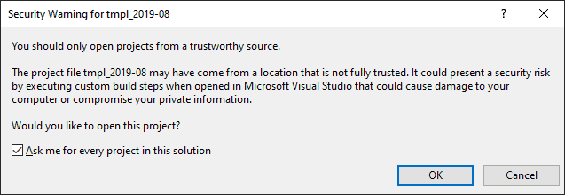
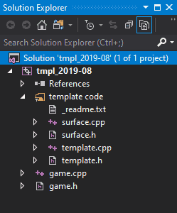
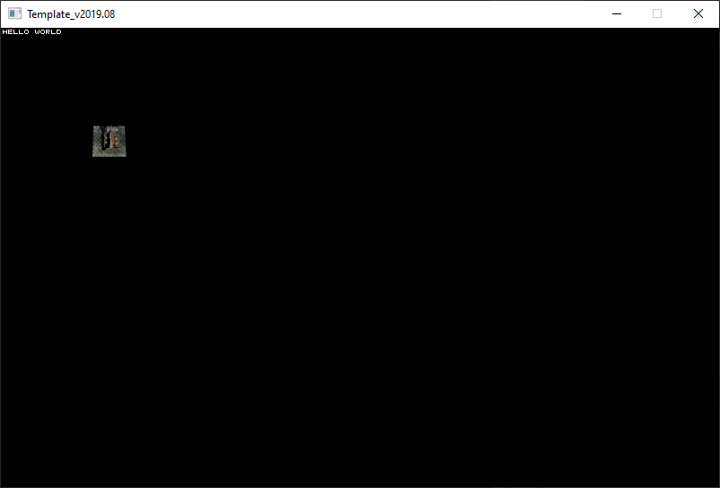

<span id="attachment-8103"></span>

As you noticed in the [first article](/cpp-fast-track-1-getting-started/), setting up a project in Visual Studio can be quite a task. And we didn’t (nearly) touch all the settings that you can adjust for a project either. To make your life a bit easier, we will use a project template from now on. This template is simply a directory that contains all the files that you need, with all the settings tuned just right for the kind of programs that we will be building in this series. The template also contains a bit of code that you need for most projects, so that you don’t have to type it yourself. This code aims to take away the *platform specific* things from you; i.e. it opens a window, lets you draw to it, and updates it for you. Sounds simple, but really it isn’t. Windows operating system can be quite a nightmare to deal with properly, and since that’s just not the core of game development, we felt it’s best to take care of that once and for all. The result is the template.  

## Getting the Stuff You Need

Get the latest template package:

[https://github.com/3dgep/tmpl8](https://github.com/3dgep/tmpl8)

[tmpl8-main.zip](https://github.com/3dgep/tmpl8/archive/refs/heads/main.zip)

Extract the package to `C:\Projects\template` (or whichever folder you used for your project in the [first tutorial](/cpp-fast-track-1-getting-started/)). Then, open the project by double-clicking the `tmpl8.slnx` file in the directory.

:::caution
If you are presented with the security warning shown in the image below, just click the **OK** button to load the project.  
  
You are receiving this warning because Visual Studio has never seen this project before (it was not created on your computer). The next time you open the same solution file, you will not receive this warning again.
:::

You should see the project in the *Solution Explorer* now:

<span id="attachment-9746"></span>



<div class="caption">

Solution Explorer for the tmpl8 solution.

</div>

You should see the files in the project: `game.h` and `game.cpp` and well as `surface.h` and `surface.cpp`, `template.h` and `template.cpp` in the *template code* folder.

If you click the *Local Windows Debugger* () button (F5), you should see a beautiful window with the text “HELLO WORLD” printed in the top-left corner. To emphasise the magnitude of this accomplishment, there is a spinning gun turret drawn on the screen as well.

<span id="attachment-9747"></span>



<div class="caption">

You should see a beautiful window with a spinning gun turret.

</div>

The code that you should be interested in right now is in `game.cpp`. Here are its contents:

```cpp title="game.cpp" showLineNumbers
#include "game.h"
#include "surface.h"
#include <cstdio> //printf

namespace Tmpl8
{
	// -----------------------------------------------------------
	// Initialize the application
	// -----------------------------------------------------------
	void Game::Init()
	{
	}
	
	// -----------------------------------------------------------
	// Close down application
	// -----------------------------------------------------------
	void Game::Shutdown()
	{
	}

	static Sprite rotatingGun(new Surface("assets/aagun.tga"), 36);
	static int frame = 0;

	// -----------------------------------------------------------
	// Main application tick function
	// -----------------------------------------------------------
	void Game::Tick(float deltaTime)
	{
		// clear the graphics window
		screen->Clear(0);
		// print something in the graphics window
		screen->Print("hello world", 2, 2, 0xffffff);
		// print something to the text window
		printf("this goes to the console window.\n");
		// draw a sprite
		rotatingGun.SetFrame(frame);
		rotatingGun.Draw(screen, 100, 100);
		if (++frame == 36) frame = 0;
	}
};
```

This code will be the starting point for all episodes of the Fast track tutorial.

## Nuts and Bolts

Even though this is just a small program, there’s a lot to say about it. Most (all, actually) of it will be explained in this tutorial series, but for now, let’s limit ourselves to some observations:

-   The `#include` line at the beginning of the program basically pastes some source code from another file into the current file.
-   Whenever something needs to be drawn, a line starts with `screen->`. The things we can make `screen` do are specified in `surface.h`, starting at line 37 (`class Surface`).
-   There are some things that happen just once. We specify those in the `void Game::Init()` function.
-   This particular program basically does nothing in the `Init` function.
-   Other things are done for each frame: These are listed in `void Game::Tick( float deltaTime )`.
-   There’s also a `Shutdown` function, which gets executed only once: when you terminate the program (e.g. by pressing ESC).
-   Lines that start with `//` are merely comments. The program still works if you remove or alter them.

There’s quite a bit more, and even more when you explore the other source files, such as `template.cpp`. Feel free to do so; if you mess anything up, just extract the template from the zip file you downloaded at the beginning of this tutorial.

## Experiments

Let’s try some random things with this program:

1.  Change the `0` on line 30 to some other number. Make it a big number.
2.  Change the `0xffffff` on line 32 to `0xff0000`. Then, change it to `0x00ff00`, and finally to `0x0000ff`. What happens?
3.  Change the `2, 2` on line 32 to `100, 20`. Now change it to `640, 20`. What happens?
4.  Change `Clear` into `clear` (lower case) on line 30. Is there a problem now?
5.  Append line 37 to the end of line 36 (don’t remove the semicolon at the end of line 36). Line 36 should now look like this:
    
    ```cpp title="game.cpp" showLineNumbers startLineNumber=36
rotatingGun.SetFrame(frame);  rotatingGun.Draw(screen, 100, 100);
```
    
6.  Move lines 29-34 from the `Tick` function to the `Init` function (they do the same thing for each frame anyway, right?). What is the result of doing this?

An important concept is the screen coordinate system. Every pixel on the screen has a position: the horizontal position is called `X`, the vertical position is called `Y`. By default, the template opens a `800` by `512` pixel window, so if you draw something at `X = 820;` it doesn’t fit, and wraps to the left side of the screen (one pixel lower though!).  
And finally, there are numbers: `0xffffff` (or capitals: `0xFFFFFF`) is a number too. In fact, `0x0000FF` equals `255`. We will discuss this in more detail at a later time.

## Console Window

You probably noticed that you still have a console window. This seems quite useless now that we can produce proper graphics, but it may come in handy later. We will use it for printing information that is not supposed to be seen by the end user. This will be useful for debugging.

## Assignment

Take a single A4 sheet of paper and draw an 8×8 grid on it. Label the vertical lines from top to bottom: 0, 80, 160, 240, 320, 400, 480, 560, 640. Label the horizontal lines from left to right: 0, 60, 120, 180, 240, 300, 360, 420, 480. Now draw the word “CODE” on this sheet, using straight lines that pass through grid intersection points. Use as few lines as you can; you’ll be translating each line to a line in your program, so don’t make it too difficult for yourself.

Then, for each straight line:

1.  Determine the `X` and `Y` coordinate of the start of the line (`X1`, `Y1`).
2.  Determine the `X` and `Y` coordinate of the end of the line (`X2`, `Y2`).
3.  Add a line to the `Tick` function using the `screen->Line( X1, Y1, X2, Y2, 0xffffff );` method.

For bonus points: store the `X` & `Y` coordinates in an array and loop through the array to draw the lines.

And finally:

-   Make the **C** red;
-   Make the **O** green;
-   Make the **D** blue, and
-   Make the **E** yellow.

Once you have completed this assignment, you may continue with the next part.
