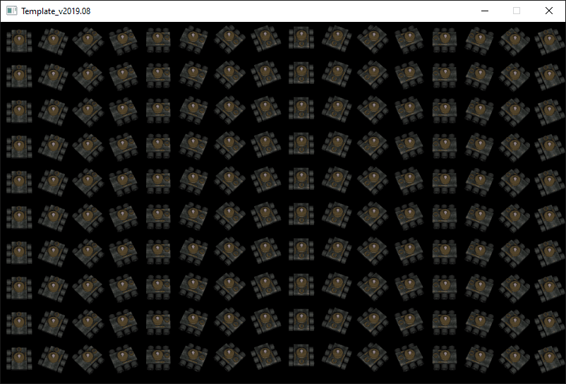

<span id="attachment-8103"></span>

This tutorial is about two things: sprites and loops. Sprites will get you on your way to making interesting stuff move on the screen, whereas loops will help you write less code to do more. On with the show!

## Getting the stuff you need

For this tutorial, you will be using the same template from the [2nd tutorial](/cpp-fast-track-2-template/):

[https://github.com/3dgep/tmpl8](https://github.com/3dgep/tmpl8)

[tmpl8-main.zip](https://github.com/3dgep/tmpl8/archive/refs/heads/main.zip)

Extract the template ZIP file to a fresh directory (say, `C:\Projects\loops`) and load up the `.sln` file.

Open the `game.cpp` file and remove the *hello world* stuff in the `Game::Tick` function. Your `Game::Tick` function should now look like this:

```cpp title="game.cpp" showLineNumbers startLineNumber=27
void Game::Tick(float deltaTime)
{

}
```

## Sprites

Let’s see if we can draw something more interesting than a line this time. We’d like to start drawing 2D game entities, like cars, people, and so on. These 2D game elements are called *Sprites*, and here’s how you use them in this framework:

Add a `Sprite` variable *above* the `Game::Tick` function like this:

```cpp title="game.cpp" showLineNumbers startLineNumber=27 {1}
Sprite theSprite( new Surface("assets/ctankbase.tga"), 16 );
void Game::Tick( float deltaTime )
{
    ...
```

This will create a `Sprite` variable, from the `ctankbase.tga` image which you can find in the assets folder.

:::tip
Have a look at `ctankbase.tga` file with your favourite image viewer.
:::

Now make your `Tick` function like this:

```cpp title="game.cpp" showLineNumbers startLineNumber=28
void Game::Tick( float deltaTime )
{
    screen->Clear( 0 );
    theSprite.Draw( screen, 0, 0 );
}
```

Run the program and look at the pretty tank!

Ok, so we can display an image, which is what a `Sprite` basically is. Except that sprites are usually animated. If you haven’t opened the `assets/ctankbase.tga` file in a good image viewer yet, do so now. You will see that it contains a row of similar tank images, each one rotated a bit more so all possible directions of the tank are present in the big image. But when we draw our tank in the `Tick` function, it only shows the first of the rotated tanks! That is what the sprite class does for us, it keeps track of which one of the frames to draw. We can tell the sprite to draw one of the other rotated tanks in the file (i.e. another frame of the animation) if we want to.

Change the `Game::Tick` function to make it look like this:

```cpp title="game.cpp" showLineNumbers startLineNumber=28
void Game::Tick( float deltaTime )
{
    screen->Clear( 0 );
    theSprite.SetFrame( 6 );
    theSprite.Draw( screen, 0, 0 );
}
```

The tank is now rotated 45°!

What we’ve done is that we told the sprite that its *active* or *current* frame is now 6. Each next call to the `Sprite::Draw` function will now draw the 6th frame of the sprite, which happens to be the one in which the tank is rotated approximately 45°.

## Loops

I like the tank so much, I want to see more of them on the screen. Let’s try this. Change the `Tick` function to look like this:

```cpp title="game.cpp" showLineNumbers startLineNumber=28
void Game::Tick( float deltaTime )
{
    screen->Clear( 0 );
    theSprite.SetFrame( 0 );
    theSprite.Draw( screen, 0, 0 );
    theSprite.SetFrame( 1 );
    theSprite.Draw( screen, 50, 0 );
    theSprite.SetFrame( 2 );
    theSprite.Draw( screen, 100, 0 );
    theSprite.SetFrame( 3 );
    theSprite.Draw( screen, 150, 0 );
}
```

Four tanks in a row, and with different frames shown. Nice, but it’s a lot of typing, or copy-pasting. And what if we want to draw sixteen tanks in a row? That would become a lot of work to produce a long list of very similar code.

Luckily, C++ has loops to do this. Try the following:

```cpp title="game.cpp" showLineNumbers startLineNumber=28
void Game::Tick( float deltaTime )
{
    screen->Clear( 0 );
    for( int i=0; i < 16; i++ )
    {
        theSprite.SetFrame( i );
        theSprite.Draw( screen, i * 50, 0 );
     }
}
```

Sixteen tanks in a row, with only five lines of code! And if the screen was wider, we could have drawn more without making the code any bigger.  
Just change the number `16` on the first line to change the number of tanks that are drawn.

But how does this work, I hear you ask. Well, let’s analyze the code, line by line:

```cpp title="game.cpp" showLineNumbers startLineNumber=31
    for( int i=0; i < 16; i++ )
```

This is the start of the loop, where you define what the loop will do and when it will stop. It has three important parts, each separated by a semicolon `;`.

The first part is `int i=0`. This means we are declaring a variable with the name `i` and it will be an integer, and its initial value will be `0`.

:::caution
We encountered this concept in the [previous tutorial](/cpp-fast-track-3-variables/). Variables can be declared at global scope (i.e., outside any function), in which case they will be available to all functions in the current `.cpp` file.

We can also declare them inside a function, in which case they can be accessed in that function, but not outside it.

And, we can declare a variable inside a block marked by curly brackets (`{`, and `}`). It will not be available outside that block, and if the name of the variable overlaps with variables outside the block, the newly declared variable takes precedence.

The `for` statement is a special case: the `int i` used in the first line is not declared inside the curly brackets, but it is in fact considered to be limited to the scope of the loop. That means that variable `i` is not available outside the `for` loop.
:::

The second part is the condition that will be checked at the start of each loop. In our case, that check is `i < 16`. This means that, as long as `i` is smaller than `16`, the code below the for statement will run again and again and again.

The third and last part is what should happen at the end of the loop every time. In our case, that is `i++`. This is C++ shorthand for `i = i + 1`, and it means that, at the end of each loop, we want to add one to the current value of `i`, or increment it by one.

What this means in practice is that we are going to run the code below the `for` statement exactly 16 times: we start from zero, and add one for each time we loop **as long as** we stay under 16. Once we reach 16, the loop stops, we skip over the code below the for loop and continue with whatever comes after it.

Now let’s look at the line below the for statement:

```cpp title="game.cpp" showLineNumbers startLineNumber=32
    {
```

Not much, is it? Just the open bracket. In C++, anything that’s in between `{` and `}`, is considered a *code block*, and it belongs together. In the case of the for loop, it means that all the code below the for statement, encompassed by `{` and `}`, needs to be executed as many times as the loop wants.

The next line then:

```cpp title="game.cpp" showLineNumbers startLineNumber=33
        theSprite.SetFrame( i );
```

You should recognise this line. It tells the sprite which animation frame is the active one. Except that this time, we don’t tell it `0` or `1` or `6` directly, but we use the variable `i` that we defined in the `for` loop. Once the program runs, the actual value of `i` will be used. This means that the first time it runs, frame `0` will be set. The second time, frame `1`, the third time, frame `2` and so on.

The line after that one looks like this:

```cpp title="game.cpp" showLineNumbers startLineNumber=34
        theSprite.Draw( screen, i * 50, 0 );
```

Which is where we draw the sprite to the screen. This time, we are using `i` to change the X coordinate of where we are going to draw the sprite. The sprite is around 50 pixels wide (you can check this in an image viewer), so by multiplying `i` by `50`, the first time around, X will be `0 * 50 = 0`, the second time it will be `1 * 50 = 50`, the third time `2 * 50 = 100`, and so on.

The last line of the `for` block looks like this:

```cpp title="game.cpp" showLineNumbers startLineNumber=35
}
```

Which does nothing more than close the code block that is going to be looped.

That’s it, your first `for` loop! Note that you can put any kind of code inside the code block that follows a `for` statement, including other `for` statements. Try doing the assignment now, to find out why this could be useful.

## Assignment

Here’s your task for today:

1.  Create a **nested** for loop (a loop inside a loop) that draws 10 lines of 16 tanks.

You should see something like this:

<span id="attachment-9758"></span>



<div class="caption">

This is what you should see if you render 10 rows of 16 tanks.

</div>

Once you have completed this assignment you are ready for the next part.
