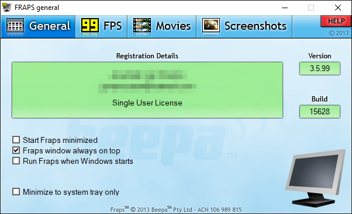
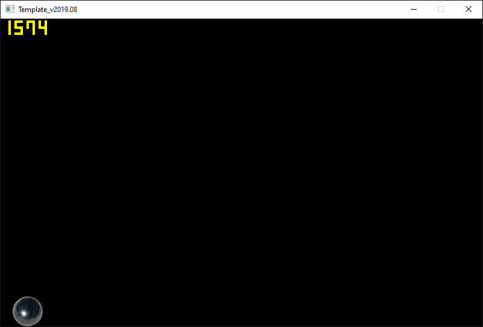
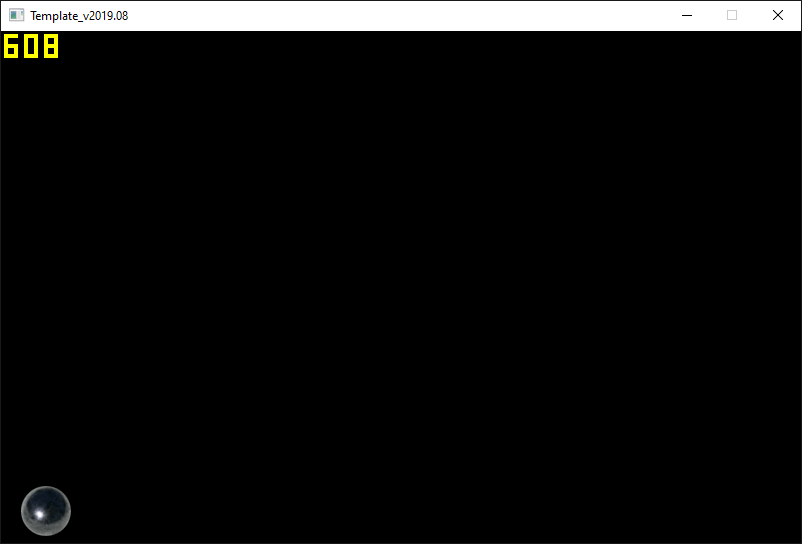

<span id="attachment-8103"></span>

In this tutorial, we’re going to look at how you can get the computer to calculate with decimal values (numbers like 3.14, called floats), instead of only integral values (numbers like 3, called integers).

## Getting the Stuff You Need

If you don’t have it yet, get the template package:

[https://github.com/3dgep/tmpl8](https://github.com/3dgep/tmpl8)

[tmpl8-main.zip](https://github.com/3dgep/tmpl8/archive/refs/heads/main.zip)

As usual, extract the package to a fresh directory (say, `C:\Projects\floats` or where ever you keep your projects) and load up the `.sln` file. Remove the *hello world* code in the `Game::Tick` function in `game.cpp`:

```cpp title="game.cpp" showLineNumbers startLineNumber=27
    void Game::Tick(float deltaTime)
    {

    }
```

## Balls Again

Before we start working with floats, let’s setup things so we can show something interesting. Let’s load a `Sprite` again!  
Add a `Sprite` variable **above** the `Tick` function like this:

```cpp title="game.cpp" showLineNumbers startLineNumber=27 {1}
Sprite theSprite( new Surface("assets/ball.png"), 1 );
void Game::Tick( float deltaTime )
{
    ...
```

:::note
You may have noticed that some images are in `.tga` files, while others are in `.png` files. These are image file formats. Other formats are: `.gif`, `.jpg`, `.bmp`, and many others exist. Each format has advantages and disadvantages: `.gif` is small but can store only 256 unique colors; `.jpg` is often even smaller but is *lossy*, which means that it is only an approximation of the original image, `.tga` has a really simple internal layout.

The template loads images using a library, in this case the [FreeImage](https://freeimage.sourceforge.io/) library. A library is a collection of useful code that we can include in our project. Have a look at `Surface::LoadImage` (in surface.cpp, line 51) to see how [FreeImage](https://freeimage.sourceforge.io/) is used to load image files to a surface.
:::

Now make your `Tick` function like this:

```cpp title="game.cpp" showLineNumbers startLineNumber=28
int spriteY = 0, speed = 1;
void Game::Tick( float deltaTime )
{
    screen->Clear( 0 );
    spriteY += speed++;
    if (spriteY > (512 - 50))
    {
        spriteY = 512 - 50;
        speed = (-speed * 40) / 50;
    }
    theSprite.Draw( screen, 20, spriteY );
}
```

Some interesting things here: the code to add `speed` to `spriteY` on line 30 are collapsed into a single line by using the increment operation (`speed++`). This translates to: use speed here, and increment it right after obtaining its value. Alternatively, we can write: `++speed`, which first increments the value, and then uses the already incremented value.

The bouncing also contains an interesting construct: the inverted speed is multiplied by `40`, then divided by `50`. Why? To dampen it: the ball will now lose energy. Alternatively, we could have written:

```cpp title="game.cpp" showLineNumbers startLineNumber=36
speed = -speed * 0.8;
```

But that is not the same thing. Try that line, and instead of hitting F5 to run the application, hit (Ctrl + F7, or select **Build > Compile** from the main menu) to just build the source file that is currently open in the editor. The compiler will give you a warning:

`1>game.cpp(32): warning C4244: '=': conversion from 'double' to 'int', possible loss of data`

The `speed` variable is of type `int` (integer, $\mathbb{Z}$), which means that it can store whole numbers only. So when we perform a calculation that involves a *real* number ($\mathbb{R}$), the processor has to truncate the result to the nearest whole number, which is a potential loss of precision; hence the warning.

## Switching to Floats

Let’s convert our program so that it uses `float`s. Here is the code:

```cpp title="game.cpp" showLineNumbers startLineNumber=28 {1,5,6,10}
float spriteY = 0, speed = 1;
void Game::Tick( float deltaTime )
{
    screen->Clear( 0 );
    spriteY += speed;
    speed += 1.0f;
    if (spriteY > (512 - 50))
    {
        spriteY = 512 - 50;
        speed = -speed * 0.8f;
    }
    theSprite.Draw( screen, 20, spriteY );
}
```

Not a lot changed: incrementing speed with `++` doesn’t work with floats, so it was put back on its own on line 33, and the damping now done using `0.8f` on line 37. The code also still does the same thing. So what’s the big deal?

Well, in the previous version, speed could only be an integer value (1, 2, 3, etc…), making the ball bounce slower than 1 would be a bit of a problem. With floats, we totally have that option. We can for instance have a low gravity bounce by adding `0.1f` to speed. Or, we can adapt to the current frame rate.

:::caution
We fixed the warning that was occuring on line 32, but now we are getting a warning on line 39 where the sprite is drawn. Why?

`Sprite::Draw` expects integer coordinates for the sprite. Sending it a `float` value where it is expecting an `int` forces the processor to truncate the value. To prevent the warning, we can do the truncation ourselves, so that it is clear that the loss of precision is intentional. We do this by *casting* the `float` value to an `int` by adding `(int)` in front of `spriteY` on line 39:

```cpp title="game.cpp" showLineNumbers startLineNumber=39
        theSprite.Draw(screen, 20, (int)spriteY);
```

Likewise, we can *cast* an `int` value to a `float`:

```cpp showLineNumbers
int a = 300;
float b = (float)a;
```

This seems useless: the compiler would not warn us of such a conversion (since no precision is lost). However, you need to be aware that this conversion is happening: conversions take time, and can be a performance issue once we start executing complex applications.
:::

## Fraps

The bouncing ball application probably runs at 60 Frames Per Second (FPS) on your machine. You can verify this using a tool called [Fraps](https://fraps.com/).

You can download Fraps for free here: [https://fraps.com/](https://fraps.com/). When you start the application, it looks like this:

<span id="attachment-9769"></span>



<div class="caption">

Also great for recording videos of your work for educational evidence or for your game programming portfolio.

</div>

Click on the *99 FPS* tab. Now start your application again. Fraps adds a framerate counter, which should confirm that you are indeed running at 60 frames per second. This is not a limit of the template; typically this is limited by the refresh rate of your screen. Let’s remove this restriction. For that, we need to modify the template somewhat. This is going to get ugly…

Open `template.cpp` and locate the `main` function. This is where a template application starts. Right after the opening bracket of this function we are going to add a line:

```cpp title="template.cpp" showLineNumbers startLineNumber=301 {3}
int main( int argc, char **argv ) 
{  
    SDL_SetHintWithPriority(SDL_HINT_RENDER_VSYNC, "0", SDL_HINT_OVERRIDE);
```

This line tells **SDL2** (another library the template uses) to disable the *VSync*.

What is *VSync* anyways? Well, old-skool monitors produced images by aiming an electron beam at a glass plate (and then your eyes). This beam zig-zagged over the pixels to light them up. At the bottom of the screen, this beam stops, and returns to the top-left corner. This is called the *vertical retrace*. This is the perfect moment to start displaying a new image; only during the retrace swapping can be done without tearing. So *synchronising* frames to this retrace is useful. Modern monitors simulate this retrace, typically at 60 Hz. Synchronising to the refresh rate of your screen limits your framerate to 60 (or 120 Hz if you have a 120 Hz monitor).

<span id="attachment-9770"></span>



<div class="caption">

By disabling VSync, we can achieve unlocked frame rates.

</div>

Now that we have lifted the limitation we can reach much higher framerates: on my system, I get ~1500 FPS. But there’s more. 🙂

In the file `template.h` you will find a line that reads:

```cpp title="template.h" showLineNumbers startLineNumber=14
// #define ADVANCEDGL
```

The start of this line indicates that it is a comment. This is a popular way to leave functionality in a source file without enabling it. We can apply the setting by removing the slashes:

```cpp title="template.h" showLineNumbers startLineNumber=14
#define ADVANCEDGL
```

Now run the application again. This setting enables a faster internal code path of the template. Sadly, this code path is not compatible with all graphics adaptors, and in some cases you may see a reduced frame rate, like I did, which is why it is disabled by default. On my machine it works, but now I get ~600 FPS.

<span id="attachment-9771"></span>



<div class="caption">

When enabling OpenGL, the screen’s framebuffer is copied to the GPU for direct display. Depending on your CPU and operating system, you may or may not see a performance improvement.

</div>

It is important to continually monitor the performance of your application so that you know if a change you have made had a positive or negative impact on the performance. But keep in mind that what works well on your PC, may not work the same way on everyone’s PC.

## Too Fast to be Fun

By now, the ball sprite is bouncing frantically on your screen. We could easily reduce its speed, but by how much? One system runs at 450 FPS, another at 700 FPS, and perhaps your ancient Asus EEE is barely able to achieve 60 FPS…

We can solve that.

Add the following line at the top of your `Game::Tick` function:

```cpp title="game.cpp" showLineNumbers startLineNumber=29 {2}
    void Game::Tick(float deltaTime)
    {
        printf("%f\n", deltaTime);
```

This prints the value of the mysterious `deltaTime` variable that we had available since the start of this course. The numbers that you see in the console window are the frame durations, in milliseconds. In other words: we know how much time has elapsed since the previous call to the `Tick` function.

And that is very useful if you want something to move over the screen at a constant speed, regardless of framerate. Which takes us directly to the…

## Assignment

Convert the bouncing ball application to floating point. Make sure that the ball moves at a constant speed, regardless of frame-rate. Make sure your code compiles without compiler warnings.
