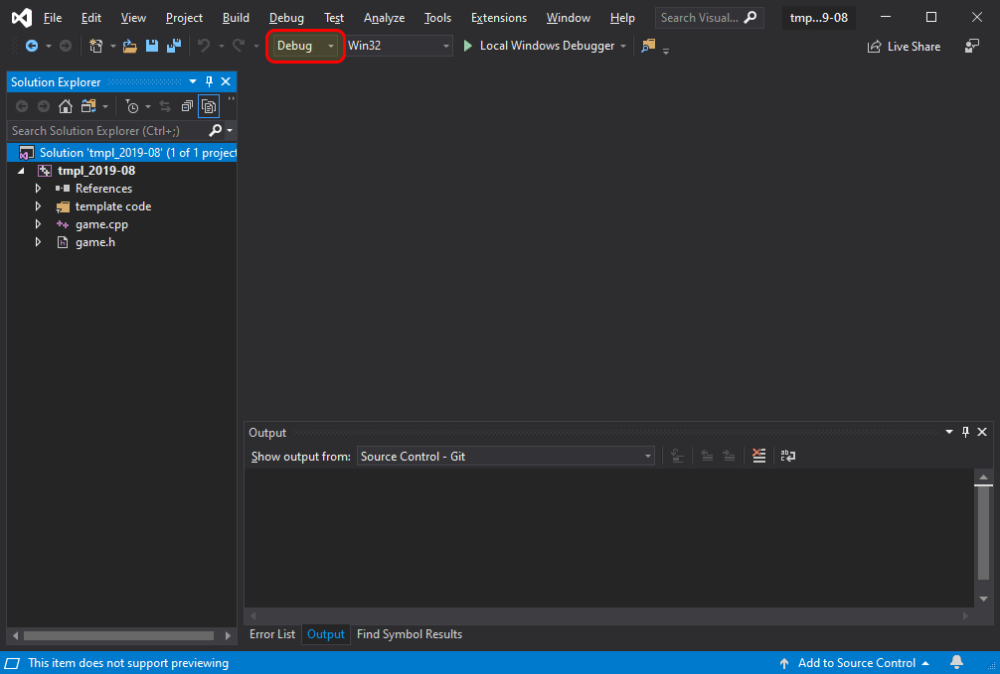
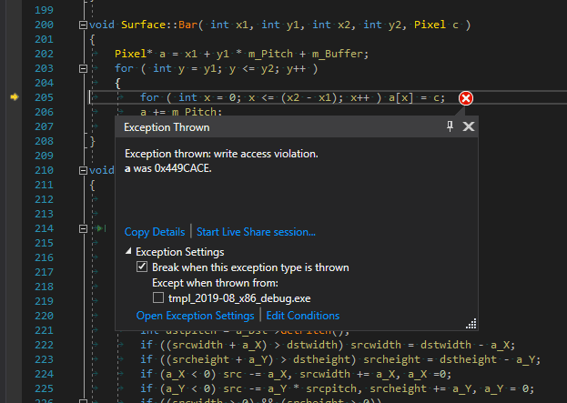
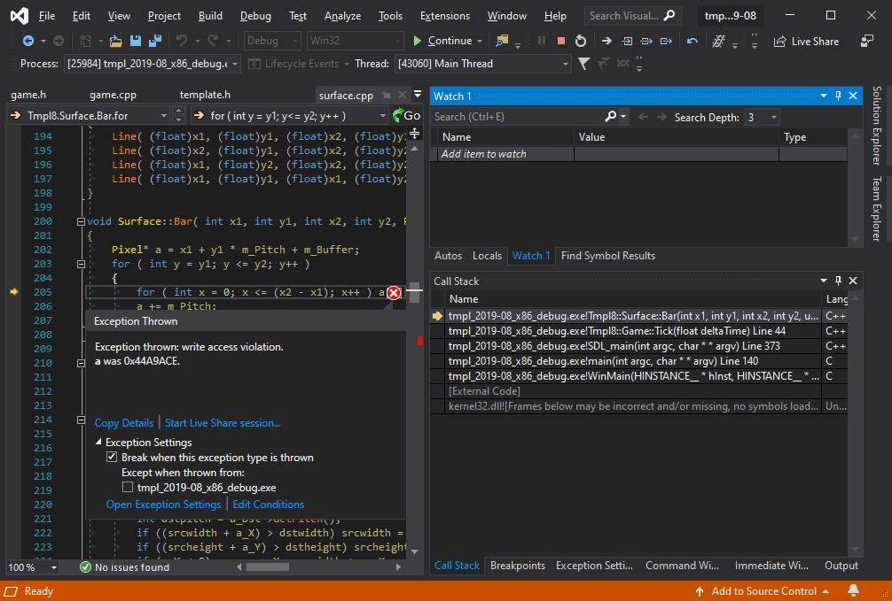
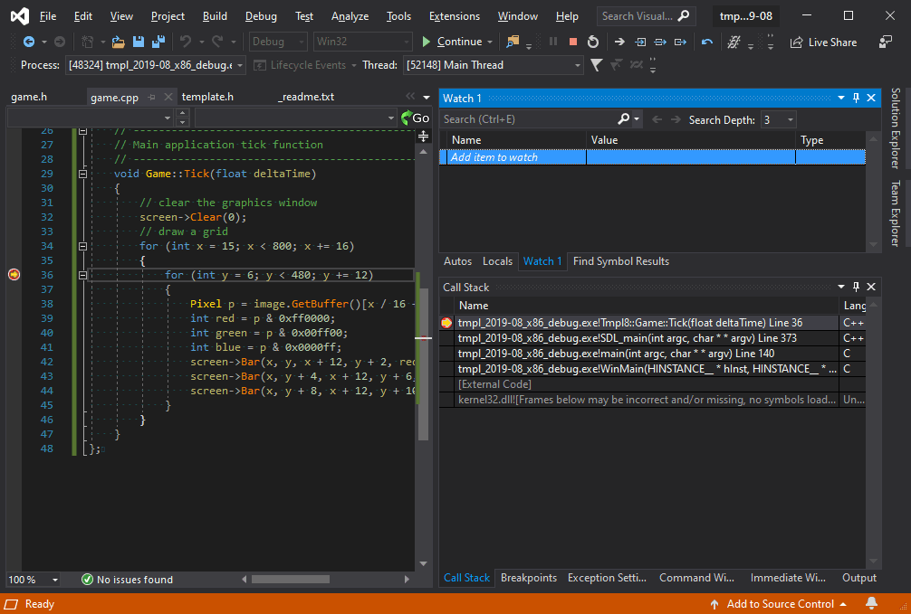
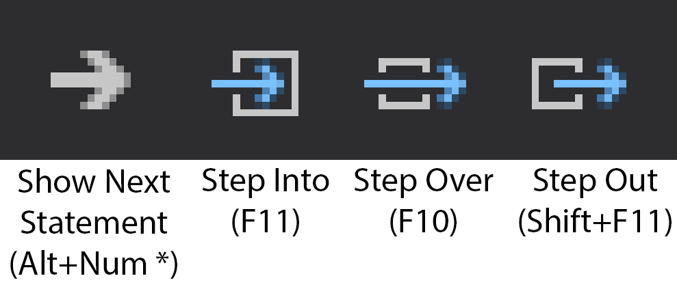
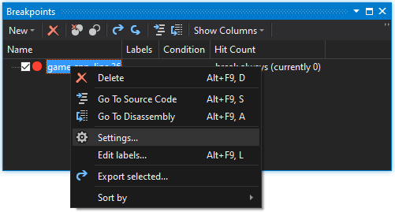
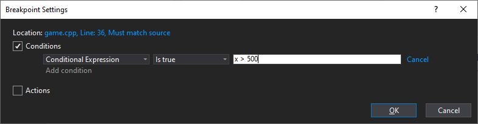
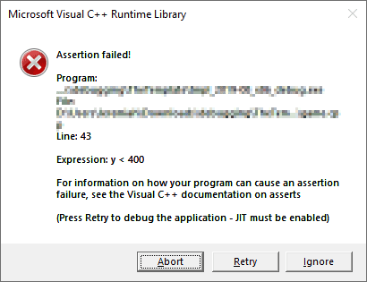

<span id="attachment-8103"></span>

This episode covers *debugging*. We will see how an application can be halted at any time or at a specific line and how we can inspect variables to verify that everything works as intended. Debugging can be a complex process but we’ll limit ourselves to the basics of breakpoints and following program flow, while keeping an eye on variables.

## Getting the Stuff You Need

For this tutorial, you will be using the same template from the [2nd tutorial](/cpp-fast-track-2-template/):

[https://github.com/3dgep/tmpl8](https://github.com/3dgep/tmpl8)

[tmpl8-main.zip](https://github.com/3dgep/tmpl8/archive/refs/heads/main.zip)

As usual, we will start with a fresh copy of the template. Extract the package to a new directory (say, `C:\Projects\debugging` – or wherever you saved your projects from the previous tutorials) and load up the `.sln` file. Remove the *hello world* code in the `Game::Tick` function.

Your `Game::Tick` function should look like this now:

```cpp title="game.cpp" showLineNumbers startLineNumber=27
void Game::Tick(float deltaTime)
{

}
```

## Debug Mode

Visual Studio projects typically can run in two configurations: Debug  
and Release. You can select this mode in the Solution Configuration drop-down box in the toolbar.

<span id="attachment-9783"></span>



<div class="caption">

Debug Configuration

</div>

By default, Debug mode is selected.

### So What’s the Difference?

Well, Debug builds generate larger, slower programs. To verify this: build your program – Select *Build > Build Solution* from the main menu (or use the Ctrl+Shift+B or F7 keyboard shortcut depending on your configuration). Go to the folder where you unpacked the template and you will see a new executable there (`tmpl_2019-08_x86_debug.exe`) is 45 KB.

You can run the executable directly from the output folder due to it knowing what `.dll` files it needs under what subfolder (under the folder `dlls_x86` for 32-bit builds, or under `dlls_x64` for 64-bit builds). We set this up for you to make it easy to run it, but normally you would need to make sure the right `.dll` files are in the same folder as your executable – or at least on the search [`PATH`](https://learn.microsoft.com/windows/win32/dlls/dynamic-link-library-search-order). Also keep in mind that DLL’s are built for specific platforms (e.g. 32-bit or 64-bit) – so don’t get them mixed up or you will get some interesting errors.

Now do the same in Release mode (change the compile configuration from Debug to Release). Interestingly enough, the template also puts the `.exe` right next to the `.sln` but with a slightly different name `tmpl_2019-08_x86.exe` – Yes, we set this up in the project settings for each configuration. 🙂 As you can see, the release `.exe` is slightly smaller at 43 KB.

### Why is it Smaller?

The answer is: *debug information*. The Debug executable contains extra information, lacks certain optimizations, and adds a number of checks (e.g., array boundary checks). It will also initialize variables to 0. The Release executable on the other hand lacks the checks and variable initializations. As a result, it runs faster and is smaller.


Insert the following code in `game.cpp`:

```cpp title="game.cpp" showLineNumbers startLineNumber=24
    Surface image("assets/ball.png");

    // -----------------------------------------------------------
    // Main application tick function
    // -----------------------------------------------------------
    void Game::Tick(float deltaTime)
    {
        // clear the graphics window
        screen->Clear(0);
        // draw a grid
        for (int x = 15; x < 800; x += 16)
        {
            for (int y = 6; y < 512; y += 12)
            {
                Pixel p = image.GetBuffer()[x / 16 + (y / 12) * 50];
                int red = p & 0xff0000;
                int green = p & 0x00ff00;
                int blue = p & 0x0000ff;
                screen->Bar(x, y, x + 12, y + 2, red);
                screen->Bar(x, y + 4, x + 12, y + 6, green);
                screen->Bar(x, y + 8, x + 12, y + 10, blue);
            }
        }
    }
```

What it is supposed to do is a surprise, but for now one thing is clear: it doesn’t do it:

<span id="attachment-9785"></span>



<div class="caption">

When running the Debug build, an exception is thrown. Now what should we do?

</div>

After you stop execution of the programme (or use the Shift+F5 keyboard shortcut) you will be looking at some template code: The `Surface::Bar` function, with a little yellow arrow pointing at a line that apparently caused a problem. Time to figure out what the problem is.

## Gathering Intel

Let’s make sure we have the necessary windows open in order to start debugging the application:

-   Select **Debug > Windows > Call Stack** from the main menu.
-   Drag the **Call Stack** window to the right of the screen.
-   Likewise, select **Debug > Windows > Watch > Watch 1** from the main menu.
-   Drag the **Watch 1** window right of the screen as well, so the **Call Stack** and **Watch 1** both both take up half of the vertical space.

You now have a layout as in the screenshot.

<span id="attachment-9786"></span>



<div class="caption">

With this setup, you are able to see the values of variables and you can see the call stack which shows you how you got here.

</div>

The call stack is our first useful bit of information. It tells us where we are (a bit verbose: `tmpl_2019-08_x64_debug.exe!Tmpl8::Surface::Bar`) and how we got there (via `Game::Tick`). Double-click on `Game::Tick` method in the **Call Stack** window to see which line of code jumped to the `Surface::Bar` method.

Let’s go back to `Surface::Bar` method to see what’s going on. In the **Watch 1** window, click on *Add item to watch* type (under **Name**) and type `x1`. You will immediately see the value of parameter `x1`, which was passed to `Surface::Bar` from the `Tick` function. Add `y1` as well. It’s value is `514`… And that’s outside of the screen (which is `800x512` pixels). Is that a problem? Yes it is: a chunk of memory was reserved for those pixels, and we’re trying to write outside of that chunk of memory. It’s illegal to access memory outside of the range of the allocated memory for the pixel buffer and the program crashes.

Fixing this is easy: in the `Game::Tick` method, make sure we don’t loop all the way to `512` in the `y` axis. Let’s loop to `480` or so instead.

```cpp title="game.cpp" showLineNumbers startLineNumber=33 {4}
        // draw a grid
        for (int x = 15; x < 800; x += 16)
        {
            for (int y = 6; y < 480; y += 12)
            {
```

## Tracing

Obviously you don’t have to wait for a crash to freeze your program mid-flight. Move your cursor to line 36 in `game.cpp` and hit F9. The result is a red circle in front of the line. Now run the program again. It will halt at the line you marked. This is called a *breakpoint*, and you can have as many breakpoints in your program as you like.

<span id="attachment-9787"></span>



<div class="caption">

Using breakpoints in your source code allow you to halt execution of the program.

</div>

Once your program is halted, you can continue execution using F5, or step through it one line at a time by pressing F10. When you encounter a function call (such as `screen->Bar(...)`), you can either step over it using F10, or into it, using F11 or step-out of the current function using Shift+F11. And, if you don’t feel like remembering those function keys: there’s icons on the icon bar for the same functionality.

<span id="attachment-9788"></span>



<div class="caption">

Use the debug controls to Step Into (F11), Step Over (F10) or Step Out (Shift+F11) of functions during debugging.

</div>

## Conditional Breakpoints

Imagine you want to halt the program only when a certain condition is met, e.g. when the `x` coordinate exceeds `500`.

One way to do this is by setting a condition for the breakpoint.

Select **Debug > Windows > Breakpoints** from the main menu.

Right-click on the breakpoint in the Breakpoints window and select **Settings…** item from the popup that appears.

<span id="attachment-9789"></span>



<div class="caption">

Right-click on a breakpoint in the Breakpoint window and select settings…

</div>

In the **Breakpoint Settings** window that appears, select the **Conditions** checkbox and type `x > 500` in the text field.

<span id="attachment-9790"></span>



<div class="caption">

Add a breakpoint condition to only halt execution if `x > 500` evaluates to `true`.

</div>

Or, keep it simple, and add the condition directly to your code:

```cpp title="game.cpp" showLineNumbers startLineNumber=36
if (x > 500)
{
    int w = 0;
}
```

The `int w = 0` statement is obviously irrelevant: it is just there to be able to place a breakpoint inside the if-statement.

:::tip
You can safely leave bits of debugging code like these: they will not affect application performance once you switch back to release mode. The reason for this is interesting: in release mode, the compiler does its best to optimize your code. It will notice that the value of `w` is never used, so it doesn’t actually produce code in your `.exe` for it. That means in turn that there is no code inside the if-scope, so that is removed as well. In debug mode, when these optimizations are disabled, this code will remain in the executable, but when running in Debug mode, you should not be concerned with performance.
:::

## Trust No One

Some things are not supposed to happen. Perhaps you assume no one will draw boxes outside the screen. And still it happens. A great way to catch problems like that is using asserts.

Add the following line inside the inner for-loop:

```cpp title="game.cpp" showLineNumbers startLineNumber=38 {5}
                Pixel p = image.GetBuffer()[x / 16 + (y / 12) * 50];
                int red = p & 0xff0000;
                int green = p & 0x00ff00;
                int blue = p & 0x0000ff;
                assert(y < 400);
                screen->Bar(x, y, x + 12, y + 2, red);
                screen->Bar(x, y + 4, x + 12, y + 6, green);
                screen->Bar(x, y + 8, x + 12, y + 10, blue);
```

Note that you cannot compile and you see `assert` has a red squiggly underlined. This is because we have not included the header file that the `assert` function comes from. If you are not sure, you can search to find out or just add the following at the top of `game.cpp`:

```cpp title="game.cpp" showLineNumbers {4}
#include "game.h"
#include "surface.h"
#include <cstdio> //printf
#include <cassert>
```

Obviously this assertion is going to fail. When it does, the program will halt with the following message:

<span id="attachment-9791"></span>



<div class="caption">

When an assertion fails, the Assertion failed dialog box is shown. Press the Retry button to debug the application.

</div>

It is a good habit to add assertions like these (well, slightly more sane assertions perhaps) to your program: they are only included in debug mode, and they add a fair bit of safety for those unforeseen situations.

## Assignment

Debugging is something you need to get used to; once you are familiar with the process you will not be able to live without it. It’s a bit hard to give you a debugging assignment, so instead:

-   Fix the `Surface::Bar` function so that it doesn’t crash when off-screen coordinates are specified.
-   Replace the `ball.png` image with an image you found on the internet (i.e. not an image that is already in the assets folder).
-   Modify the size of the *leds* so that the full image fits on the screen.
