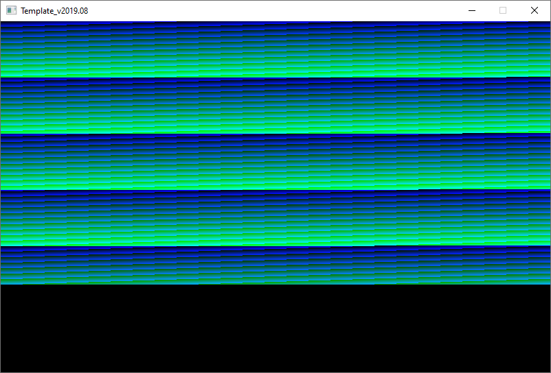
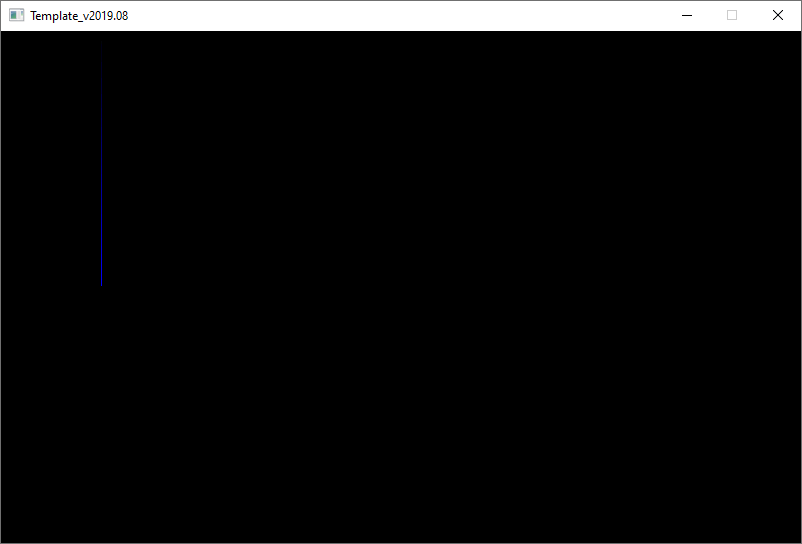
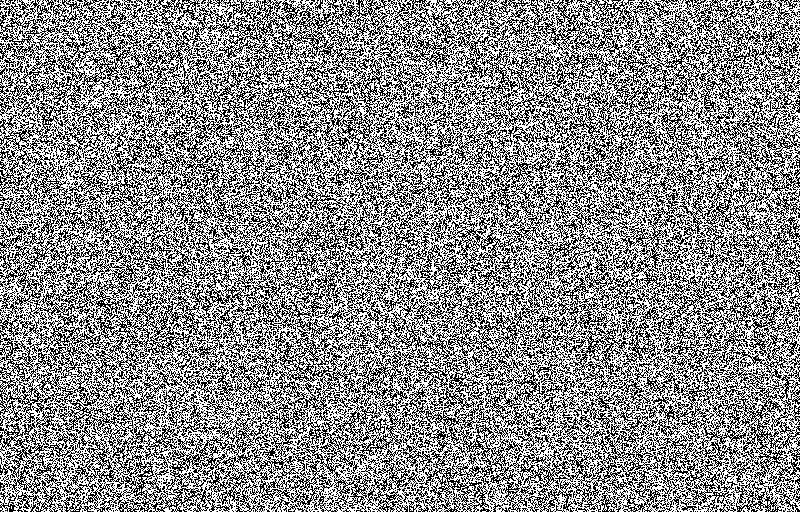

<span id="attachment-8103"></span>

One of the harder concepts in C++ is the concept of pointers. Pointers have everything to do with the very nature of the language: C++ gets you pretty close to the hardware you are working with, and one of the most important parts of that hardware is memory. In this tutorial, you will learn to use pointers to refer to memory addresses.

## Getting the Stuff You Need

For this tutorial, you will be using the same template from the [2nd tutorial](/cpp-fast-track-2-template/):

[https://github.com/3dgep/tmpl8](https://github.com/3dgep/tmpl8)

[tmpl8-main.zip](https://github.com/3dgep/tmpl8/archive/refs/heads/main.zip)

Your system probably has a few *GiB* (or more commonly but incorrectly denoted *GB*) of memory, which roughly corresponds to a couple billion bytes:

<table><caption>SI units for binary data (<a href="https://en.wikipedia.org/wiki/Units_of_information#Units_derived_from_bit" rel="noopener noreferrer" target="_blank">Units of information</a>)</caption><tbody><tr><th>Symbol</th><th>Prefix</th><th>Name</th><th>Bytes</th><th>Size</th></tr><tr><td>B</td><td>&nbsp;</td><td>byte (B)</td><td>$2^0$ bytes</td><td>1 B</td></tr><tr><td>Ki</td><td>kibi</td><td>kibibyte (KiB)</td><td>$2^{10}$ bytes</td><td>1,024 B</td></tr><tr><td>Mi</td><td>mebi</td><td>mebibyte (MiB)</td><td>$2^{20}$ bytes</td><td>1,024 KiB</td></tr><tr><td>Gi</td><td>gibi</td><td>gibibyte (GiB)</td><td>$2^{30}$ bytes</td><td>1,024 MiB</td></tr><tr><td>Ti</td><td>tebi</td><td>tebibyte (TiB)</td><td>$2^{40}$ bytes</td><td>1,024 GiB</td></tr><tr><td>Pi</td><td>pebi</td><td>pebibyte (PiB)</td><td>$2^{50}$ bytes</td><td>1,024 TiB</td></tr><tr><td>Ei</td><td>exbi</td><td>exbibyte (EiB)</td><td>$2^{60}$ bytes</td><td>1,024 PiB</td></tr></tbody></table>

Notice that we use the Ki, Mi, Gi, Ti, etc… symbols for binary units in order to differentiate them from the metric symbols (k, M, G, T, etc…). Computer data is measured in powers of 2 ($2^b$ – binary) units rather than powers of 10 ($10^d$ – decimal) units.

Each of the billions of bytes of data is stored in the memory of your computer and can be referred to by its memory *address*. In a 32-bit processor, memory addresses are represented as a 32-bit number. This means that (theoretically) a 32-bit computer can access a maximum of $2^{32}$ unique memory addresses. Since each memory address refers to a unique byte in memory (since memory is *byte addressable*), that’s 4,294,967,296 bytes, or 4,194,304 KiB, or 4,096 MiB, or 4 GiB.

64-bit processors can access up to $2^{64}$ unique memory addresses. That’s ‭18,446,744,073,709,551,616‬ bytes, or 17,179,869,184 GiB, or 16 EiB. Since most personal computers these days have between 8 – 64 GiB of memory, that’s more data than you’ll probably ever see in a personal computer in your lifetime (maybe…).

## Back to the screen

Load up a fresh template project. Have a look at the `Surface::Bar` method in `surface.cpp`:

```cpp title="surface.cpp" showLineNumbers startLineNumber=200
void Surface::Bar( int x1, int y1, int x2, int y2, Pixel c )
{
    Pixel* a = x1 + y1 * m_Pitch + m_Buffer;
    for ( int y = y1; y <= y2; y++ )
    {
        for ( int x = 0; x <= (x2 - x1); x++ ) a[x] = c;
        a += m_Pitch;
    }
}
```

This function draws a bar. At the first line of this function, a *pointer* is created (denoted by the asterisk symbol `*`). Once line 202 is executed, the *pointer* `a` will contain the memory address of the first pixel to start drawing the bar. Then the function proceeds with drawing the actual pixels: it loops over the lines that contain the bar (`y1` to `y2`), and then over the rows that contain the bar (`x1` to `x2`). However, it does not use the `Plot` function: instead, it writes directly to the memory address that contains the screen pixels.

So, let’s do some experiments. Copy the following `Game::Tick` method:

```cpp title="game.cpp" showLineNumbers startLineNumber=27
void Game::Tick( float deltaTime )
{
    Pixel* address = screen->GetBuffer();
    for ( int i = 0; i < 307200; i++ ) address[i] = i;
}
```

This code gets the memory address of the screen surface in memory, and stores it in a pointer variable (*address*). Then, it uses a single for-loop to fill (most of) the screen.

<span id="attachment-9795"></span>



<div class="caption">

The result of writing directly to the screen buffer.

</div>

Now try this code:

```cpp title="game.cpp" showLineNumbers startLineNumber=27
void Game::Tick( float deltaTime )
{
    Pixel* address = screen->GetBuffer() + 100;
    for ( int i = 0; i < 255; i++ ) address[i * 800] = i;
}
```

This gets us a blue vertical line.

<span id="attachment-9796"></span>



<div class="caption">

Vertical blue line. You may have to click on the image to show it at 100% zoom.

</div>

This demonstrates something important. The lines of your screen may appear separate, but they are not: in memory, your screen is one continuous line in memory, consisting of 800 \* 512 pixels. That means that you should look 800 pixels further to get to the next line. Which is exactly what above code does. This also explains why printing text too close to the right edge of your window makes it wrap to the left side: there is no right edge.

## Variables in memory

Let’s leave the screen pixels for a moment. Copy the following Tick function:

```cpp title="game.cpp" showLineNumbers startLineNumber=27
void Game::Tick( float deltaTime )
{
    int a = 100;
    int b = 200;
    int* c = &a;
    *c = 300;
    int w = 0;
}
```

Put a breakpoint (F9) on line 31 (`int* c = &a;`), and run the code. Your program will stop right before it executes line 31.

Now, open a *watch* window (**Debug > Windows > Watch > Watch 1**), and inspect the following values:

| Name | Value | Type |
| --- | --- | --- |
| `a` | `100` | `int` |
| `&a` | `0x0019fe08 {100}` (this address will be different for you) | `int *` |

The `&` symbol, when attached to a variable, gives you the *address of* a variable. So in this case, `a` is stored somewhere in memory, and now you know what the address of that variable is.

The ampersand (`&`) is used on line 31 of the code. Here we create a pointer (notice the asterisk `*` symbol), which points to the address of `a`. So there is a fundamental difference between variable `a` and `c`: `a` is an *integer* variable, but `c` is a *pointer* to an *integer*, that is, it contains the *address* of an integer variable.

## But… Why!?

So why are pointers so important in C++? The reason is: performance. When you plot a pixel at coordinate (`x`, `y`), in the end all that matters is that some value at some memory location changes. That’s a simple operation, in principle. But when you only have `x` and `y`, you need to calculate that address: it’s on line `y`, so at least `800 * y` pixels past the start of the first address of the screen memory. Add `x` to that to get the correct address. Oh and don’t forget the address of the screen itself. So the formula is: `screen->GetBuffer() + x + y * 800`. At that point you just have the address, so you still need to plot.

That’s an awful lot of work for a single pixel. If you know the address, all you need to do is put a value right there. Pointers give you low-level control over memory. This gives you fine control over the work that is carried out, and this in turn gives you raw performance (and thus, speedy games).

## Assignment

Here’s your task for today:

1.  Draw a dotted line (skip every other dot) from (`0`, `0`) to (`400`, `400`). Do not use the `Plot` function, use a pointer variable instead.
2.  Figure out what the distance between dots in memory is to make this code super simple and fast.
3.  Create an application that does the following:
    1.  Load an `800x512` image
    2.  Moves a green dot from the top-center (say, `x = 400`, `y = 0`) to the bottom. While doing so, the dot evades obstacles.
    3.  When the pixel below the dot is black, it goes down. Otherwise, it goes one pixel to the left if its y is an odd number, or the right if its y is an even number.
    4.  When the pixel reaches the bottom of the screen, it returns to the top.

Make sure that the image that you use for step A is suitable for the other steps. Also note that even though we’re moving a single pixel now, but this will become an avalanche soon 🙂

<span id="attachment-9799"></span>



<div class="caption">

You can use this noisy image for this assignment.

</div>

For this assignment, you need to use pointers: it’s also a great way to read screen pixels rather than writing to them.

If you’ve completed the assignment, you should see something similar to the video shown below (the green dot is larger than a single pixel so that it is more visible in the video, but you only need to draw a single green pixel):

<video class="embed-video-file" src="/videos/Template_v2019.08-2019-10-30-15-49-56.mp4" width="584" height="374" loop controls preload="metadata" playsinline></video>

Once you have completed this assignment, you may continue with the next part.
