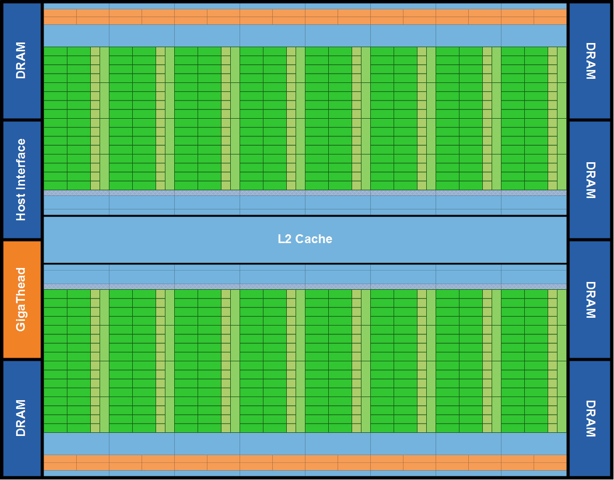
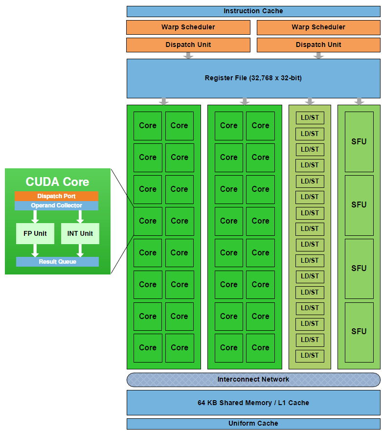
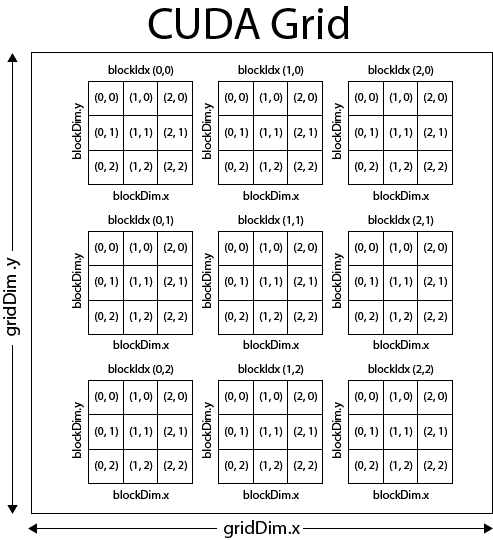
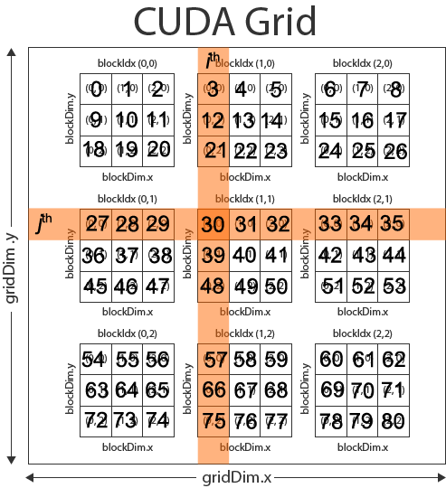
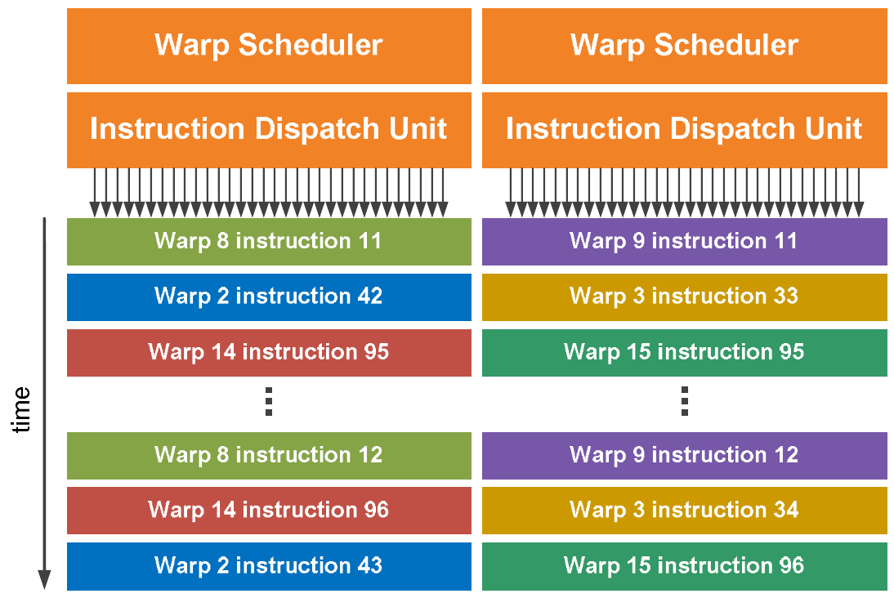
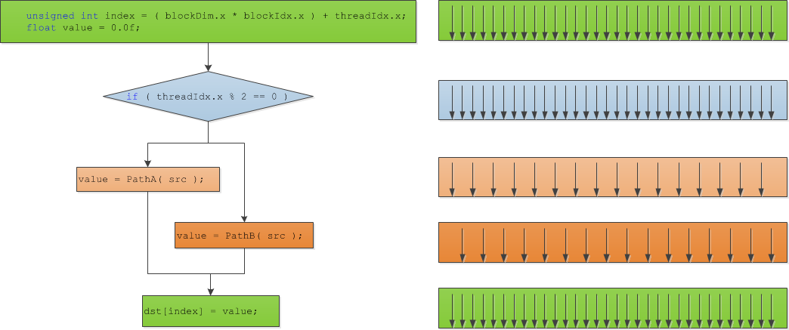

<span id="attachment-2007"></span>

:::note
This article was written in 2011 for the Fermi architecture (compute capability 2.x). Grids, blocks, warps and the occupancy calculation still work the same way, but the numbers (cores and warp schedulers per SM, maximum threads and blocks per SM) are different on current GPUs: see the compute capabilities table in the [CUDA C++ Programming Guide](https://docs.nvidia.com/cuda/cuda-programming-guide/).
:::

In a previous article, I gave an introduction to programming with CUDA. Now I’d like to go into a little bit more depth about the CUDA thread execution model and the architecture of a CUDA enabled GPU. I assume that the reader has basic knowledge about CUDA and already knows how to setup a project that uses the CUDA runtime API. If you don’t know how to setup a project with CUDA, you can refer to my previous article: Introduction to CUDA.

## GPU Architecture

To understand the thread execution model for modern GPU’s, we must first make an analysis of the GPU compute architecture. In this article I will focus on the Fermi compute architecture found in modern GPU’s (GTX 580).

### Overview of the Fermi Architecture

A Fermi GPU consists of 512 **CUDA cores**. These 512 **CUDA cores** are split across 16 **Streaming Multiprocessors** (**SM**) each SM consisting of 32 CUDA cores. The GPU has 6 64-bit memory partitions supporting up to 6 GB of GDDR5 DRAM memory.

<span id="attachment-1917"></span>



<div class="caption">

Fermi Arcitecture

</div>

Each streaming multiprocessor (SM) has 32 cuda cores. Each CUDA core consists of an integer **arithmetic logic unit** (**ALU**) and a **floating point unit** (**FPU**).

<span id="attachment-1920"></span>



<div class="caption">

Fermi Streaming Multiprocessor (SM)

</div>

The SM has 16 load/store units allowing source and destination addresses to be calculated for sixteen threads per clock.

Each SM also has four Special Function Units (SFU) that execute transcendental instructions such as sin, cosine, reciprocal, and square root.

## CUDA Threads

Now that we’ve seen the specific architecture of a Fermi GPU, let’s analyze the more general CUDA thread execution model.

Each kernel function is executed in a grid of threads. This grid is divided into blocks also known as thread blocks and each block is further divided into threads.

<span id="attachment-1940"></span>



<div class="caption">

Cuda Execution Model

</div>

In the image above we see that this example grid is divided into nine thread blocks (3×3), each thread block consists of 9 threads (3×3) for a total of 81 threads for the kernel grid.

This image only shows 2-dimensional grid, but if the graphics device supports compute capability 2.0, then the grid of thread blocks can actually be partitioned into 1, 2 or 3 dimensions, otherwise if the device supports compute capability 1.x, then thread blocks can be partitioned into 1, or 2 dimensions (in this case, then the 3rd dimension should always be set to 1).

The thread block is partitioned into individual threads and for all compute capabilities, threads can be partitioned into 1, 2, or 3 dimensions. The maximum number of threads that can be assigned to a thread block is 512 for devices with compute capability 1.x and 1024 threads for devices that support compute capability 2.0.

<table style="border-width: 2px; border-color: #000000; border-style: solid;" border="2" frame="box"><caption>Compute Capability</caption><tbody><tr style="background-color: #a9a9a9;"><td style="text-align: left; border-width: 1px; border-color: #000000; border-style: solid;"><strong>Technical Specifications</strong></td><td style="text-align: left; border-width: 1px; border-color: #000000; border-style: solid;"><strong>1.0</strong></td><td style="text-align: left; border-width: 1px; border-color: #000000; border-style: solid;"><strong>1.1</strong></td><td style="text-align: left; border-width: 1px; border-color: #000000; border-style: solid;"><strong>1.2</strong></td><td style="text-align: left; border-width: 1px; border-color: #000000; border-style: solid;"><strong>1.3</strong></td><td style="text-align: left; border-width: 1px; border-color: #000000; border-style: solid;"><strong>2.0</strong></td></tr><tr><td style="text-align: left; border-width: 1px; border-color: #000000; border-style: solid;">Maximum dimensionality of a grid of thread blocks</td><td style="text-align: center; border-width: 1px; border-color: #000000; border-style: solid;" colspan="4">2</td><td style="text-align: center; border-width: 1px; border-color: #000000; border-style: solid;">3</td></tr><tr><td style="text-align: left; border-width: 1px; border-color: #000000; border-style: solid;">Maximum x-, y-, or z-dimension of a grid of thread blocks</td><td style="text-align: center; border-width: 1px; border-color: #000000; border-style: solid;" colspan="5">65535</td></tr><tr><td style="text-align: left; border-width: 1px; border-color: #000000; border-style: solid;">Maximum dimensionality of a thread block</td><td style="text-align: center; border-width: 1px; border-color: #000000; border-style: solid;" colspan="5">3</td></tr><tr><td style="text-align: left; border-width: 1px; border-color: #000000; border-style: solid;">Maximum x- or y-dimension of a block</td><td style="text-align: center; border-width: 1px; border-color: #000000; border-style: solid;" colspan="4">512</td><td style="text-align: center; border-width: 1px; border-color: #000000; border-style: solid;">1024</td></tr><tr><td style="text-align: left; border-width: 1px; border-color: #000000; border-style: solid;">Maximum z-dimension of a block</td><td style="text-align: center; border-width: 1px; border-color: #000000; border-style: solid;" colspan="5">64</td></tr><tr><td style="text-align: left; border-width: 1px; border-color: #000000; border-style: solid;">Maximum number of threads per block</td><td style="text-align: center; border-width: 1px; border-color: #000000; border-style: solid;" colspan="4">512</td><td style="text-align: center; border-width: 1px; border-color: #000000; border-style: solid;">1024</td></tr></tbody></table>

The number of blocks within a gird can be determined within a kernel by using the built-in variable **gridDim** and the number of threads within a block can be determined by using the built-in variable **blockDim**.

A thread block is uniquely identified in a kernel function by using the built-in variable **blockIdx** and a thread within a block is uniquely identified in a kernel function by using the built-in variable **threadIdx**.

The built-in variables **gridDim**, **blockDim**, **blockIdx**, and **threadIdx** are each 3-component structs with members x, y, z.

With a 1-D kernel, the unique thread ID within a block is the same as the x component of the threadIdx variable.

$$
\text{threadID}=\text{threadIdx.x}
$$

and the unique block ID within a grid is the same as the x component of the blockIdx variable:

$$
\text{blockID}=\text{blockIdx.x}
$$

To determine the unique thread ID in a 2-D block, you would use the following formula:

$$
\text{threadID}=(\text{threadIdx.y}\cdot \text{blockDim.x})+\text{threadIdx.x}
$$

and to determine the unique block ID within a 2-D grid, you would use the following formula:

$$
\text{blockID}=(\text{blockIdx.y}\cdot \text{gridDim.x})+\text{blockIdx.x}
$$

I’ll leave it as an exercise for the reader to determine the formula to compute the unique thread ID and block ID in a 3D grid.

### Matrix Addition Example

Let’s take a look at an example kernel that one might execute.

Let’s assume we want to implement a kernel function that adds two matrices and stores the result in a 3rd.

The general formula for matrix addition is:

$$
\begin{matrix}C & = & A+B \\ c_{i,j} & = & a_{i,j}+b_{i,j}\end{matrix}
$$

That is, the sum of matrix **A** and matrix **B** is the sum of the components of matrix **A** and matrix **B**.

Let’s first write the host version of this method that we would execute on the CPU.

```cpp title="MatrixAdd.cpp" showLineNumbers
void MatrixAddHost( float* C, float* A, float* B, unsigned int matrixRank )
{
    for( unsigned int j = 0; j < matrixRank; ++j )
    {
        for ( unsigned int i = 0; i < matrixRank; ++i )
        {
            unsigned int index = ( j * matrixRank ) + i;
            C[index] = A[index] + B[index];
        }
    }
}
```

This is a pretty standard method that loops through the rows and columns of a matrix and adds the components and stores the results in a 3rd. Now let’s see how we might execute this kernel on the GPU using CUDA.

First, we need to think of the problem domain. I this case, the domain is trivial: it is the components of a matrix. Since we are operating on 2-D arrays, it seems reasonable to split our domain into two dimensions; one for the rows, and another for the columns of the matrices.

We will assume that we are working on square matrices. This simplifies the problem but mathematically matrix addition only requires that the two matrices have the same number of rows and columns but does not have the requirement that the matrices must be square.

Since we know that a kernel is limited to 512 threads/block with compute capability 1.x and 1024 threads/block with compute capability 2.0, then we know we can split our job into square thread blocks each consisting of 16×16 threads (256 threads per block) with compute capability 1.x and 32×32 threads (1024 threads per block) with compute capability 2.0.

For simplicity, I will assume compute capability 1.x for the remainder of this tutorial.

If we limit the size of our matrix to no larger than 16×16, then we only need a single block to compute the matrix sum and our kernel execution configuration might look something like this:

```cpp title="main.cpp" showLineNumbers
    dim3 gridDim( 1, 1, 1 );
    dim3 blockDim( matrixRank, matrixRank, 1 );
    MatrixAddDevice<<<gridDim, blockDim>>>( C, A, B, matrixRank );
```

In this simple case, the kernel grid consists of only a single block with *matrixRank* x *matrixRank* threads.

However, if we want to sum matrices larger than 512 components, then we must split our problem domain into smaller groups that can be processed in multiple blocks.

Let’s assume that we want to limit our blocks to execute in 16×16 (256) threads. We can determine the number of blocks that will be required to operate on the entire array by dividing the size of the matrix dimension by the maximum number of threads per block and round-up to the nearest whole number:

$$
\text{blocks}=\text{Ceiling}\lceil{\frac{\text{matrixRank}}{16}}\rceil
$$

And we can determine the number of threads per block by dividing the size of the matrix dimension by the number of blocks and round-up to the nearest whole number:

$$
\text{threads}=\text{Ceiling}\lceil{\frac{\text{matrixRank}}{\text{blocks}}}\rceil
$$

So for example, for a **4×4** matrix, we would get

$$
\begin{matrix}\text{blocks} & = & \lceil\frac{4}{16}\rceil \\ \text{blocks} & = & \lceil{0.25}\rceil \\ \text{blocks} & = & 1\end{matrix}
$$

and the number of threads is computed as:

$$
\begin{matrix}\text{threads} & = & \lceil\frac{4}{1}\rceil \\ \text{threads} & = & 4\end{matrix}
$$

resulting in a **1×1** grid of **4×4** thread blocks for a total of **16** threads.

Another example a **512×512** matirx, we would get:

$$
\begin{matrix}\text{blocks} & = & \lceil\frac{512}{16}\rceil \\ \text{blocks} & = & \lceil{32}\rceil \\ \text{blocks} & = & 32\end{matrix}
$$

and the number of threads is computed as:

$$
\begin{matrix}\text{threads} & = & \lceil\frac{512}{32}\rceil \\ \text{threads} & = & 16\end{matrix}
$$

resulting in a **32×32** grid of **16×16** thread blocks for a total of **262,144** threads.

The host code to setup the kernel granularity might look like this:

```cpp title="main.cpp" showLineNumbers
    size_t blocks = ceilf( matrixRank / 16.0f );
    dim3 gridDim( blocks, blocks, 1 );
    size_t threads = ceilf( matrixRank / (float)blocks );
    dim3 blockDim( threads, threads, 1 );

    MatrixAddDevice<<< gridDim, blockDim >>>( C, A, B, matrixRank );
```

You may have noticed that if the size of the matrix does not fit nicely into equally divisible blocks, then we may get more threads than are needed to process the array. It is not possible to configure a gird of thread blocks with 1 block containing less threads than the others. The only way to solve this is to execute multiple kernels – one that handles all the equally divisible blocks, and a 2nd kernel invocation that handles the partial block. The other solution to this problem is simply to ignore any of the threads that are executed outside of our problem domain which is generally the easier (and more efficient) than invoking multiple kernels (this should be profiled to be proven).

### The Matrix Addition Kernel Function

On the device, one kernel function is created for every thread in the problem domain (the matrix elements). We can use the built-in variables **gridDim**, **blockDim**, **blockIdx**, and **threadIdx**, to identify the current matrix element that the current kernel is operating on.

If we assume we have a **9×9** matrix and we split the problem domain into **3×3** blocks each consisting of **3×3** threads as shown in the CUDA Grid below, then we could compute the *i*th column and the *j*th row of the matrix with the following formula:

$$
\begin{matrix}i & = & (\text{blockDim.x}\cdot \text{blockIdx.x})+\text{threadIdx.x} \\ j & = & (\text{blockDim.y}\cdot \text{blockIdx.y})+\text{threadIdx.y}\end{matrix}
$$

So for thread **(0,0)** of block **(1,1)** of our **9×9** matrix, we would get:

$$
\begin{matrix}i & = & (3\cdot 1)+0 \\ i & = & 3\end{matrix}
$$

for the column and:

$$
\begin{matrix}j & = & (3\cdot 1)+0 \\ j & = & 3\end{matrix}
$$

for the row.

The index into the 1-D buffer that store the matrix is then computed as:

$$
\text{index}=(\text{rank}\cdot i)+j
$$

and substituting gives:

$$
\begin{matrix}\text{index} & = & (\text{rank}\cdot 3)+3 \\ \text{index} & = & (9\cdot 3)+3 \\ \text{index} & = & 30\end{matrix}
$$

Which is the correct element in the matrix. This solution assumes we are accessing the matrix in row-major order.

<span id="attachment-1971"></span>



<div class="caption">

CUDA Grid Example

</div>

Let’s see how we might implement this in the kernel.

```cpp title="MatrixAdd.cu" showLineNumbers
__global__ void MatrixAddDevice( float* C, float* A, float* B, unsigned int matrixRank )
{
    unsigned int column = ( blockDim.x * blockIdx.x ) + threadIdx.x;
    unsigned int row    = ( blockDim.y * blockIdx.y ) + threadIdx.y;

    unsigned int index = ( matrixRank * row ) + column;
    if ( index < matrixRank * matrixRank ) // prevent reading/writing array out-of-bounds.
    {
        C[index] = A[index] + B[index];
    }
}
```

On line 3, and 4 we compute the column and row of the matrix we are operating on using the formulas shown earlier.

On line 6, the 1-d index in the matrix array is computed based on the size of a single dimension of the square matris.

We must be careful that we don’t try to read or write out of the bounds of the matrix. This might happen if the size of the matrix does not fit nicely into the size of the CUDA grid (in the case of matrices whose size is not evenly divisible by 16) To protect the read and write operation, on line 7 we must check that the computed index does not exceed the size of our array.

## Thread Synchronization

CUDA provides a synchronization barrier for all threads in a block through the **\_\_syncthreads()** method. A practical example of thread synchronization will be shown in a later article about optimization a CUDA kernel, but for now it’s only important that you know this functionality exists.

Thread synchronization is only possible across all threads in a block but not across all threads running in the grid. By not allowing threads across blocks to be synchronized, CUDA enables multiple blocks to be executed on other streaming multiprocessors (SM) in any order. The queue of blocks can be distributed to any SM without having to wait for blocks from another SM to be complete. This allows the CUDA enabled applications to scale across platforms that have more SM at it’s disposal, executing more blocks concurrently than another platforms with less SM’s.

Thread synchronization follows strict synchronization rules. All threads in a block must hit the synchronization point or none of them must hit synchronization point.

Give the following code block:

```cpp title="sample.cu" showLineNumbers
if ( threadID % 2 == 0 )
{
    __syncthreads();
}
else
{
    __syncthreads();
}
```

will cause the threads in a block to wait indefinitely for each other because the two occurrences of **\_\_syncthreads** are considered separate synchronization points and all threads of the same block must hit the same synchronization point, or all of them must not hit it.

## Thread Assignment

When a kernel is invoked, the CUDA runtime will distribute the blocks across the SM’s on the device. A maximum of 8 blocks (irrelevant of platform) will be assigned to each SM as long as there are enough resources (registers, shared memory, and threads) to execute all the blocks. In the case where there are not enough resources on the SM, then the CUDA runtime will automatically assign less blocks per SM until the resource usage is below the maximum per SM.

The total number of blocks that can be executed concurrently is dependent on the device. In the case of the Fermi architecture discussed earlier, a total of 16 SM’s can concurrently handle 8 blocks for a total of 128 blocks executing concurrently on the device.

Because the Fermi architecture support compute compatibility 2.0, we can create thread blocks consisting of at most 1024 threads, then the Fermi device can technically support 131,072 threads residing in the SM’s for execution. This does not mean that every clock tick the devices is executing 131,072 instruction simultaneously. In order to understand how the blocks are actually executed on the device, we must look one step further to see how the threads of a block are actually scheduled on the SM’s.

## Thread Scheduling

When a block is assigned to a SM, it is further divided into groups of 32 threads called a **warp**. Warp scheduling is different depending on the platform, but if we take a look at the Fermi architecture, we see that a single SM consists of 32 CUDA cores (or streaming processor) – two groups of 16 per SM.

Each SM in the Fermi architecture (see Fermi architecture image above) features two warp schedulers allowing two warps to be issued and executed concurrently. Fermi’s dual-warp scheduler selects two warps and issues one instruction from each warp to a group of sixteen cores, sixteen load/store units, or four special function units (SFU’s).

Most instructions can be dual-issued; two integer instructions, two floating point instructions, or a mix of integer, floating point, load, store, and SFU instructions can be issued concurrently.

<span id="attachment-1922"></span>



<div class="caption">

Fermi - Dual Warp Scheduler

</div>

You might be wondering why it would be useful to schedule 8 blocks of a maximum of 1024 threads if the SM only has 32 SP’s? The answer is that each instruction of a kernel may require more than a few clock cycles to execute (for example, an instruction to read from global memory will require multiple clock cycles). Any instruction that requires multiple clock cycles to execute incurs latency. The latency of long-running instructions can be hidden by executing instructions from other warps while waiting for the result of the previous warp. This technique of filling the latency of expensive operations with work from other threads is often called **latency hiding**.

## Thread Divergence

It is reasonable to imagine that your CUDA program contains flow-control statements like **if-then-else**, **switch**, **while** loops, or **for** loops. Whenever you introduce these flow-control statements in your code, you also introduce the possibility of thread divergence. It is important to be aware of the consequence of thread divergence and also to understand how you can minimize the negative impact of divergence.

Thread divergence occurs when some threads in a warp follow a different execution path than others. Let’s take the following code block as an example:

```cpp title="test.cu" showLineNumbers
__global__ void TestDivergence( float* dst, float* src )
{
    unsigned int index = ( blockDim.x * blockIdx.x ) + threadIdx.x;
    float value = 0.0f;

    if ( threadIdx.x % 2 == 0 )
    {
        // Threads executing PathA are active while threads
        // executing PathB are inactive.
        value = PathA( src );
    }
    else
    {
        // Threads executing PathB are active while threads 
        // executing PathA are inactive.
        value = PathB( src );
    }
    // Threads converge here again and execute in parallel.
    dst[index] = value;
}
```

Then our flow control and thread divergence would look something like this:

<span id="attachment-2010"></span>



<div class="caption">

Thread Divergence

</div>

As you can see from this example, the even numbered threads in each block will execute **PathA** while the odd numbered threads in the block will execute **PathB**. This is pretty much the worst-case scenario for simple divergence example.

Both **PathA** and **PathB** cannot be executed concurrently on all threads because their execution paths are different. Only the threads that execute the exact same execution path can run concurrently so the total running time of the warp is the sum of the execution time of both **PathA** and **PathB**.

In this example, the threads in the warp that execute **PathA** are activated if the condition is true and all the other threads are deactivated. Then, in another pass, all the threads that execute **PathB** are activated if the condition is false are activated and the other threads are deactivated. This means that to resolve this condition requires 2-passes to be executed for a single warp.

The overhead of having the warp execute both **PathA** and **PathB** can be eliminated if the programmer takes careful consideration when writing the kernel. If possible, all threads of a block (since warps can’t span thread blocks) should execute the same execution path. This way you guarantee that all threads in a warp will execute the same execution path and there will be no thread divergence within a block.

## Exercise

If a device supports compute capability 1.3 then it can have blocks with a maximum of 512 threads/block and 8 blocks/SM can be scheduled concurrently. Each SM can schedule groups of 32-thread units called warps. The maximum number of resident warps per SM in a device that supports compute capability 1.3 is 32 and the maximum number of resident threads per SM is 1024.

**Q.** What would be the ideal block granularity to compute the product of two 2-D matrices of size 1024 x 1024?

1.  4×4?
2.  8×8?
3.  16×16?
4.  or 32×32?

**A.** To answer this question, let’s analyze each choice and give pros and cons for each one.

**4×4**: If we decide to split our domain into 4×4 thread blocks, then we have 16 threads per block. In order to fully occupy the SM that can support 1024 threads per SM, we would need 1024/16 = 64 blocks but the SM can only schedule 8 blocks/SM so each SM would be scheduled with 8 blocks each having 16 threads which is 128 threads/SM. When divided into warps, we only have 4 warps scheduled per SM out of a total of 32 which gives only 12.5% occupancy.

**8×8**: We have the same problem here as we did with the 4×4 thread block granularity except not as severe. With 8×8 thread blocks, we get 64 threads per block. For a SM that can support 1024 threads per SM, we would need 1024/64 = 16 blocks but since we are limited to 8 blocks maximum per SM, we can only execute 8×64 = 512 threads/SM. When split into warps of 32-threads each, we get 512/32 = 16 warps scheduled per SM from a possible total 32 warps. This give only 50% occupancy.

**16×16**: A 16×16 thread block gives 256 threads/block. With a maximum thread limit per SM of 1024, we get 1024/256 = 4 blocks/SM. This is within the 8 block limit so 4 blocks, each of 256 threads can be scheduled on one SM. With 4 blocks each with 256 threads, we get a total of 1024 threads. The threads are further split into warps of 32 threads each for a total of 32 warps. Since the device can support 32 warps/SM we have achieved 100% occupancy.

**32×32**: This option is not even an option since a 32×32 thread block produces a single block with 1024 threads. As stated earlier, we are limited to 512 threads per block with compute capability 1.3 so our kernel wouldn’t even run.

So the best choice for this problem domain would be to invoke a kernel with block size **16×16**.

## Conclusion

In this article, I discussed the architecture of a CUDA enabled GPU, in particular the Fermi architecture. I also showed how a kernel function is scheduled on the GPU and how the warp scheduler executes instructions from different warps in order to minimize the amount of noticeable latency between kernel instructions.

## References

<div class="book-ref">


Kirk, David B. and Hwu, Wen-mei W. (2010). Programming Massively Parallel Processors. 1st. ed. Burlington, MA 01803, USA: Morgan Kaufmann Publishers.

</div>

NVIDIA Corporation (2011, May). NVIDIA CUDA C Programming Guide. (Version 4.0). Santa Clara, CA 95050, USA Available from: [http://developer.download.nvidia.com/compute/cuda/4\_0/toolkit/docs/CUDA\_C\_Programming\_Guide.pdf](https://web.archive.org/web/20120214233111/http://developer.download.nvidia.com/compute/cuda/4_0/toolkit/docs/CUDA_C_Programming_Guide.pdf). Accessed: 15 November 2011.

NVIDIA Corporation (2009, January). NVIDIA’s Next Generation CUDA Compute Architecture: Fermi. (V1.1). Santa Clara, CA 95050, USA Available from: [http://www.nvidia.com/content/PDF/fermi\_white\_papers/NVIDIA\_Fermi\_Compute\_Architecture\_Whitepaper.pdf](https://www.nvidia.com/content/PDF/fermi_white_papers/NVIDIA_Fermi_Compute_Architecture_Whitepaper.pdf). Accessed: 15 November 2011.
