<span id="attachment-6663"></span>

In this article, I will analyze and compare three rendering algorithms:

1.  Forward Rendering
2.  Deferred Shading
3.  Forward+ (Tiled Forward Rendering)

## Introduction

**Forward rendering** works by rasterizing each geometric object in the scene. During shading, a list of lights in the scene is iterated to determine how the geometric object should be lit. This means that every geometric object has to consider every light in the scene. Of course, we can optimize this by discarding geometric objects that are occluded or do not appear in the view frustum of the camera. We can further optimize this technique by discarding lights that are not within the view frustum of the camera. If the range of the lights is known, then we can perform frustum culling on the light volumes before rendering the scene geometry. Object culling and light volume culling provide limited optimizations for this technique and light culling is often not practiced when using a forward rendering pipeline. It is more common to simply limit the number of lights that can affect a scene object. For example, some graphics engines will perform per-pixel lighting with the closest two or three lights and per-vertex lighting on three or four of the next closes lights. In traditional fixed-function rendering pipelines provided by OpenGL and DirectX the number of dynamic lights active in the scene at any time was limited to about eight. Even with modern graphics hardware, forward rendering pipelines are limited to about 100 dynamic scene lights before noticeable frame-rate issues start appearing.

**Deferred shading** on the other hand, works by rasterizing all of the scene objects (without lighting) into a series of 2D image buffers that store the geometric information that is required to perform the lighting calculations in a later pass. The information that is stored into the 2D image buffers are:

-   screen space depth
-   surface normals
-   diffuse color
-   specular color and specular power

<span id="attachment-6715"></span>

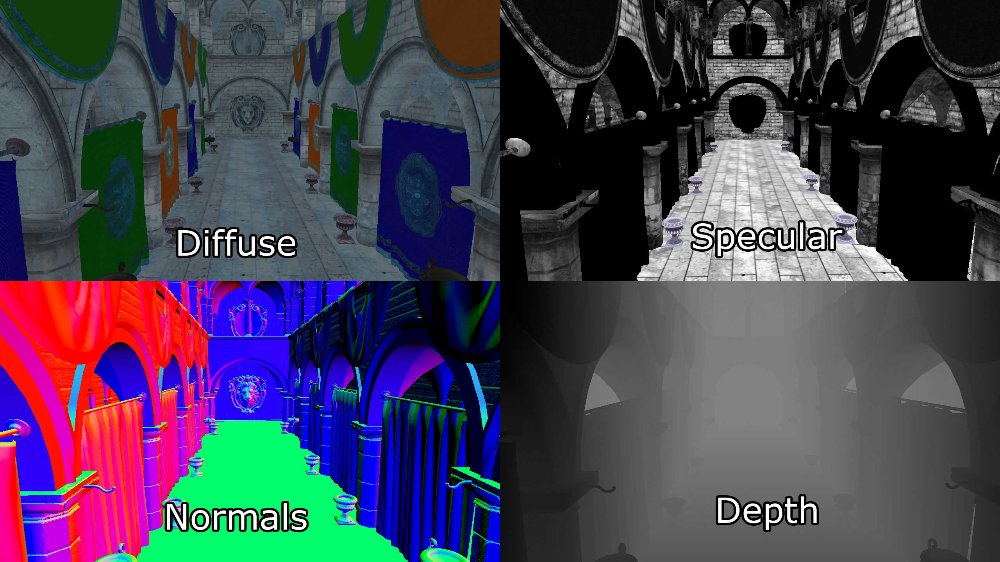

<div class="caption">

The textures that compose the G-Buffer. Diffuse (top-left), Specular (top-right), Normals (bottom-left), and Depth (bottom-right). The specular power is stored in the alpha channel of the specular texture (top-right).

</div>

The combination of these 2D image buffers are referred to as the **Geometric Buffer** (or **G-buffer**) [\[1\]](#cite-1).

Other information could also be stored into the image buffers if it is required for the lighting calculations that will be performed later but each G-buffer texture requires at least 8.29 MB of texture memory at full HD (1080p) and 32-bits per pixel.

After the G-buffer has been generated, the geometric information can then be used to compute the lighting information in the lighting pass. The lighting pass is performed by rendering each light source as a geometric object in the scene. Each pixel that is touched by the light’s geometric representation is shaded using the desired lighting equation.

The obvious advantage with the deferred shading technique compared to forward rendering is that the expensive lighting calculations are only computed once per light per covered pixel. With modern hardware, the deferred shading technique can handle about 2,500 dynamic scene lights at full HD resolutions (1080p) before frame-rate issues start appearing when rendering only opaque scene objects.

One of the disadvantage of using deferred shading is that only opaque objects can be rasterized into the G-buffers. The reason for this is that multiple transparent objects may cover the same screen pixels but it is only possible to store a single value per pixel in the G-buffers. In the lighting pass the depth value, surface normal, diffuse and specular colors are sampled for the current screen pixel that is being lit. Since only a single value from each G-buffer is sampled, transparent objects cannot be supported in the lighting pass. To circumvent this issue, transparent geometry must be rendered using the standard forward rendering technique which limits either the amount of transparent geometry in the scene or the number of dynamic lights in the scene. A scene which consists of only opaque objects can handle about 2000 dynamic lights before frame-rate issues start appearing.

Another disadvantage of deferred shading is that only a single lighting model can be simulated in the lighting pass. This is due to the fact that it is only possible to bind a single pixel shader when rendering the light geometry. This is usually not an issue for pipelines that make use of übershaders as rendering with a single pixel shader is the norm, however if your rendering pipeline takes advantage of several different lighting models implemented in various pixel shaders then it will be problematic to switch your rendering pipeline to use deferred shading.

**Forward+** [\[2\]](#cite-2)[\[3\]](#cite-3) (also known as **tiled forward shading**) [\[4\]](#cite-4)[\[5\]](#cite-5) is a rendering technique that combines forward rendering with tiled light culling to reduce the number of lights that must be considered during shading. Forward+ primarily consists of two stages:

1.  Light culling
2.  Forward rendering

<span id="attachment-6718"></span>

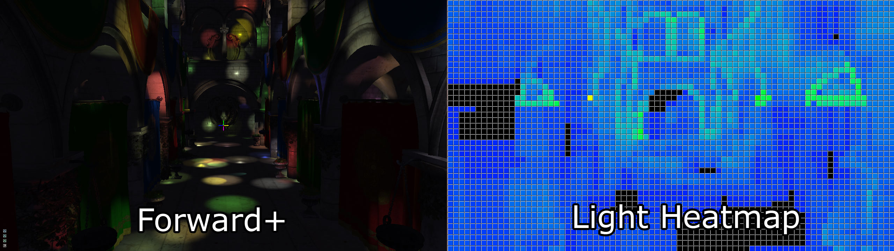

<div class="caption">

Forward+ Lighting. Default Lighting (left), Light heatmap (right). The colors in the heatmap indicate how many lights are affecting the tile. Black tiles contain no lights while blue tiles contain between 1-10 lights. The green tiles contain 20-30 lights.

</div>

The first pass of the Forward+ rendering technique uses a uniform grid of tiles in screen space to partition the lights into per-tile lists.

The second pass uses a standard forward rendering pass to shade the objects in the scene but instead of looping over every dynamic light in the scene, the current pixel’s screen-space position is used to look-up the list of lights in the grid that was computed in the previous pass. The light culling provides a significant performance improvement over the standard forward rendering technique as it greatly reduces the number of redundant lights that must be iterated to correctly light the pixel. Both opaque and transparent geometry can be handled in a similar manner without a significant loss of performance and handling multiple materials and lighting models is natively supported with Forward+.

Since Forward+ incorporates the standard forward rendering pipeline into its technique, Forward+ can be integrated into existing graphics engines that were initially built using forward rendering. Forward+ does not make use of G-buffers and does not suffer the limitations of deferred shading. Both opaque and transparent geometry can be rendered using Forward+. Using modern graphics hardware, a scene consisting of 5,000 – 6,000 dynamic lights can be rendered in real-time at full HD resolutions (1080p).

In the remainder of this article, I will describe the implementation of these three techniques:

1.  Forward Rendering
2.  Deferred Shading
3.  Forward+ (Tiled Forward Rendering)

I will also show performance statistics under various circumstances to try to determine under which conditions one technique performs better than the others.

### Definitions

In the context of this article, it is important to define a few terms so that the rest of the article is easier to understand. If you are familiar with the basic terminology used in graphics programming, you may skip this section.

The **scene** refers to a nested hierarchy of objects that can be rendered. For example, all of the static objects that can be rendered will be grouped into a scene. Each individual renderable object is referenced in the scene using a **scene node**. Each scene node references a single renderable object (such as a mesh) and the entire scene can be referenced using the scene’s top-level node called the **root node**. The connection of scene nodes within the scene is also called a **scene graph**. Since the root node is also a scene node, scenes can be nested to create more complex scene graphs with both static and dynamic objects.

A **pass** refers to a single operation that performs one step of a **rendering technique**. For example, the **opaque pass** is a pass that iterates over all of the objects in the scene and renders only the opaque objects. The **transparent pass** will also iterate over all of the objects in the scene but renders only the transparent objects. A pass could also be used for more general operations such as copying GPU resources or dispatching a compute shader.

A **technique** is the combination of several passes that must be executed in a particular order to implement a rendering algorithm.

A **pipeline state** refers to the configuration of the **rendering pipeline** before an object is rendered. A pipeline state object encapsulates the following render state:

-   Shaders (vertex, tessellation, geometry, and pixel)
-   Rasterizer state (polygon fill mode, culling mode, scissor culling, viewports)
-   Blend state
-   Depth/Stencil state
-   Render target

DirectX 12 introduces a pipeline state object but my definition of the pipeline state varies slightly from the DirectX 12 definition.

**Forward rendering** refers to a rendering technique that traditionally has only two passes:

1.  Opaque Pass
2.  Transparent Pass

The **opaque pass** will render all opaque objects in the scene ideally sorted front to back (relative to the camera) in order to minimize overdraw. During the opaque pass, no blending needs to be performed.

The **transparent pass** will render all transparent objects in the scene ideally sorted back to front (relative to the camera) in order to support correct blending. During the transparent pass, alpha blending needs to be enabled to allow for semi-transparent materials to be blended correctly with pixels already rendered to the render target’s color buffer.

During forward rendering, all lighting is performed in the pixel shader together will all other material shading instructions.

**Deferred shading** refers to a rendering technique that consists of three primary passes:

1.  Geometry Pass
2.  Lighting Pass
3.  Transparent Pass

The first pass is the **geometry pass** which is similar to the opaque pass of the forward rendering technique because only opaque objects are rendered in this pass. The difference is that the geometry pass does not perform any lighting calculations but only outputs the geometric and material data to the **G-buffer** that was described in the introduction.

In the **lighting pass**, the geometric volumes that represent the lights are rendered into the scene and the material information stored in the G-buffer is used to compute the lighting for the rasterized pixels.

The final pass is the **transparent pass**. This pass is identical to the transparent pass of the forward rendering technique. Since deferred shading has no native support for transparent materials, transparent objects have to be rendered in a separate pass that performs lighting using the standard forward rendering method.

**Forward+** (also referred to as **tiled forward rendering**) is a rendering technique that consists of three primary passes:

1.  Light Culling Pass
2.  Opaque Pass
3.  Transparent Pass

As mentioned in the introduction, the light culling pass is responsible for sorting the dynamic lights in the scene into screen space tiles. A light index list is used to indicate which light indices (from the global light list) are overlapping each screen tile. In the light culling pass, two sets of light index lists will be generated:

1.  Opaque light index list
2.  Transparent light index list

The opaque light index list is used when rendering opaque geometry and the transparent light index list is used when rendering transparent geometry.

The opaque and transparent passes of the Forward+ rendering technique are identical to that of the standard forward rendering technique but instead of looping over all of the dynamic lights in the scene, only the lights in the current fragment’s screen space tile need to be considered.

A **light** refers to one of the following types of lights:

-   Point light
-   Spot light
-   Directional light

All rendering techniques described in this article have support for these three light types. Area lights are not supported. The point light and the spot light are simulated as emanating from a single point of origin while the directional light is considered to emanate from a point infinitely far away emitting light everywhere in the same direction. Point lights and spot lights have a limited range after which their intensity falls-off to zero. The fall-off of the intensity of the light called **attenuation**. Point lights are geometrically represented as spheres, spot lights as cones, and directional lights as full-screen quads.

Let’s first take a more detailed look at the standard forward rendering technique.

## Forward Rendering

Forward rendering is the simplest of the three lighting techniques and the most common technique used to render graphics in games. It is also the most computationally expensive technique for computing lighting and for this reason, it does not allow for a large number of dynamic lights to be used in the scene.

Most graphics engines that use forward rendering will utilize various techniques to simulate many lights in the scene. For example, **lightmapping** and **light probes** are methods used to pre-compute the lighting contributions from static lights placed in the scene and storing these lighting contributions in textures that are loaded at runtime. Unfortunately, lightmapping and light probes cannot be used to simulate dynamic lights in the scene because the lights that were used to produce the lightmaps are often discarded at runtime.

For this experiment, forward rendering is used as the **ground truth** to compare the other two rendering techniques. The forward rendering technique is also used to establish a performance baseline that can be used to compare the performance of the other rendering techniques.

Many functions of the forward rendering technique are reused in the deferred and forward+ rendering techniques. For example, the vertex shader used in forward rendering is also used for both deferred shading and forward+ rendering. Also the methods to compute the final lighting and material shading are reused in all rendering techniques.

In the next section, I will describe the implementation of the forward rendering technique.

### Vertex Shader

The vertex shader is common to all rendering techniques. In this experiment, only static geometry is supported and there is no skeletal animation or terrain that would require a different vertex shader. The vertex shader is as simple as it can be while supporting the required functionality in the pixel shader such as normal mapping.

Before I show the vertex shader code, I will describe the data structures used by the vertex shader.

```hlsl source="ForwardPlus-94f71f9/CommonInclude.hlsl#L141-L148"
```

The **AppData** structure defines the data that is expected to be sent by the application code (for a tutorial on how to pass data from the application to a vertex shader, please refer to my previous article titled [Introduction to DirectX 11](/introduction-to-directx-11/)). For normal mapping, in addition to the **normal** vector, we also need to send the **tangent** vector, and optionally the **binormal** (or **bitangent**) vector. The tangent and binormal vectors can either be created by the 3D artist when the model is created, or they can be generated by the model importer. In my case, I rely on the Open Asset Import Library [\[7\]](#cite-7) to generate the tangents and bitangents if they were not already created by the 3D artist.

In the vertex shader, we also need to know how to transform the object space vectors that are sent by the application into view space which are required by the pixel shader. To do this, we need to send the world, view, and projection matrices to the vertex shader (for a review of the various spaces used in this article, please refer to my previous article titled [Coordinate Systems](/3d-math-primer-for-game-programmers/)). To store these matrices, I will create a constant buffer that will store the per-object variables needed by the vertex shader.

```hlsl source="ForwardPlus-94f71f9/CommonInclude.hlsl#L150-L154"
```

Since I don’t need to store the world matrix separately, I precompute the combined model, and view, and the combined model, view, and projection matrices together in the application and send these matrices in a single constant buffer to the vertex shader.

The output from the vertex shader (and consequently, the input to the pixel shader) looks like this:

```hlsl source="ForwardPlus-94f71f9/CommonInclude.hlsl#L182-L190"
```

The **VertexShaderOutput** structure is used to pass the transformed vertex attributes to the pixel shader. The members that are named with a **VS** postfix indicate that the vector is expressed in view space. I chose to do all of the lighting in view space, as opposed to world space, because it is easier to work in view space coordinates when implementing the deferred shading and forward+ rendering techniques.

The vertex shader is fairly straightforward and minimal. It’s only purpose is to transform the object space vectors passed by the application into view space to be used by the pixel shader.

The vertex shader must also compute the clip space position that is consumed by the rasterizer. The **SV\_POSITION** semantic is applied to the output value from the vertex shader to specify that the value is used as the clip space position but this semantic can also be applied to an input variable of a pixel shader. When **SV\_POSITION** is used as an input semantic to a pixel shader, the value is the position of the pixel in screen space [\[8\]](#cite-8). In both the deferred shading and the forward+ shaders, I will use this semantic to the get the screen space position of the current pixel.

```hlsl source="ForwardPlus-94f71f9/ForwardRendering.hlsl#L3-L17"
```

You will notice that I am pre-multiplying the input vectors by the matrices. This indicates that the matrices are stored in column-major order by default. Prior to DirectX 10, matrices in HLSL were loaded in row-major order and input vectors were post-multiplied by the matrices. Since DirectX 10, matrices are loaded in column-major order by default. You can change the default order by specifying the **row\_major** type modifier on the matrix variable declarations [\[9\]](#cite-9).

### Pixel Shader

The **pixel shader** will compute all of the lighting and shading that is used to determine the final color of a single screen pixel. The lighting equations used in this pixel shader are described in a previous article titled [Texturing and Lighting in DirectX 11](/texturing-lighting-directx-11/) if you are not familiar with lighting models, then you should read that article first before continuing.

The pixel shader uses several structures to do its work. The **Material** struct stores all of the information that describes the surface material of the object being shaded and the **Light** struct contains all of the parameters that are necessary to describe a light that is placed in the scene.

#### Material

The **Material** struct defines all of the properties that are necessary to describe the surface of the object currently being shaded. Since some material properties can also have an associated texture (for example, diffuse textures, specular textures, or normal texture), we will also use the material to indicate if those textures are present on the object.

```hlsl source="ForwardPlus-94f71f9/CommonInclude.hlsl#L10-L45"
```

The **GlobalAmbient** term is used to describe the ambient contribution applied to all object in the scene globally. Technically, this variable should be a global variable (not specific to a single object) but since there is only a single material at a time in the pixel shader, I figured it was a fine place to put it.

The **ambient**, **emissive**, **diffuse**, and **specular** color values have the same meaning as in my previous article titled [Texturing and Lighting in DirectX 11](/texturing-lighting-directx-11/#materials-properties) so I will not explain them in detail here.

The **Reflectance** component could be used to indicate the amount of reflected color that should be blended with the diffuse color. This would require environment mapping to be implemented which I am not doing in this experiment so this value is not used here.

The **Opacity** value is used to determine the total opacity of an object. This value can be used to make objects appear transparent. This property is used to render semi-transparent objects in the transparent pass. If the opacity value is less than one (1 being fully opaque and 0 being fully transparent), the object will be considered transparent and will be rendered in the transparent pass instead of the opaque pass.

The **SpecularPower** variable is used to determine how shiny the object appears. Specular power was described in my previous article titled [Texturing and Lighting in DirectX 11](/texturing-lighting-directx-11/#materials-properties) so I won’t repeat it here.

The **IndexOfRefraction** variable can be applied on objects that should refract light through them. Since refraction requires environment mapping techniques that are not implemented in this experiment, this variable will not be used here.

The **HasTexture** variables defined on lines 29-38 indicate whether the object being rendered has an associated texture for those properties. If the parameter is **true** then the corresponding texture will be sampled and the texel will be blended with the corresponding material color value.

The **BumpIntensity** variable is used to scale the height values from a bump map (not to be confused with normal mapping which does not need to be scaled) in order to soften or accentuate the apparent bumpiness of an object’s surface. In most cases models will use normal maps to add detail to the surface of an object without high tessellation but it is also possible to use a heightmap to do the same thing. If a model has a bump map, the material’s **HasBumpTexture** property will be set to **true** and in this case the model will be bump mapped instead of normal mapped.

The **SpecularScale** variable is used to scale the specular power value that is read from a specular power texture. Since textures usually store values as unsigned normalized values, when sampling from the texture the value is read as a floating-point value in the range of \[0..1\]. A specular power of 1.0 does not make much sense (as was explained in my previous article titled [Texturing and Lighting in DirectX 11](/texturing-lighting-directx-11/#specular-intensity)) so the specular power value read from the texture will be scaled by **SpecularScale** before being used for the final lighting computation.

The **AlphaThreshold** variable can be used to discard pixels whose opacity is below a certain value using the “discard” command in the pixel shader. This can be used with “cut-out” materials where the object does not need to be alpha blended but it should have holes in the object (for example, a chain-link fence).

The **Padding** variable is used to explicitly add eight bytes of padding to the material struct. Although HLSL will implicitly add this padding to this struct to make sure the size of the struct is a multiple of 16 bytes, explicitly adding the padding makes it clear that the size and alignment of this struct is identical to its C++ counterpart.

The material properties are passed to the pixel shader using a constant buffer.

```hlsl source="ForwardPlus-94f71f9/CommonInclude.hlsl#L156-L159"
```

This constant buffer and buffer register slot assignment is used for all pixel shaders described in this article.

#### Textures

The materials have support for eight different textures.

1.  Ambient
2.  Emissive
3.  Diffuse
4.  Specular
5.  SpecularPower
6.  Normals
7.  Bump
8.  Opacity

Not all scene objects will use all of the texture slots (normal and bump maps are mutually exclusive so they can probably reuse the same texture slot assignment). It is up to the 3D artist to determine which textures will be used by the models in the scene. The application will load the textures that are associated to a material. A texture parameter and an associated texture slot assignment is declared for each of these material properties.

```hlsl source="ForwardPlus-94f71f9/CommonInclude.hlsl#L168-L175"
```

In every pixel shader described in this article, texture slots 0-7 will be reserved for these textures.

#### Lights

The **Light** struct stores all the information necessary to define a light in the scene. Spot lights, point lights and directional lights are not separated into different structs and all of the properties necessary to define any of those light types are stored in a single struct.

```hlsl source="ForwardPlus-94f71f9/CommonInclude.hlsl#L47-L106"
```

The **Position** and **Direction** properties are stored in both world space (with the **WS** postfix) and in view space (with **VS** postfix). Of course the Position variable only applies to point and spot lights while the Direction variable only applies to spot and directional lights. I store both world space and view space position and direction vectors because I find it easier to work in world space in the application then convert the world space vectors to view space before uploading the lights array to the GPU. This way I do not need to maintain multiple light lists at the cost of additional space that is required on the GPU. But even 10,000 lights only require 1.12 MB on the GPU so I figured this was a reasonable sacrifice. But minimizing the size of the light structs could have a positive impact on caching on the GPU and improve rendering performance. This is further discussed in the [Future Considerations](#future-considerations) section at the end of this article.

In some lighting models the diffuse and specular lighting contributions are separated. I chose not to separate the diffuse and specular color contributions because it is rare that these values differ. Instead I chose to store both the diffuse and specular lighting contributions in a single variable called **Color**.

The **SpotlightAngle** is the half-angle of the spotlight cone expressed in degrees. Working in degrees seems to be more intuitive than working in radians. Of course, the spotlight angle will be converted to radians in the shader when we need to compute the cosine angle of the spotlight and the light vector.

<span id="attachment-5888"></span>

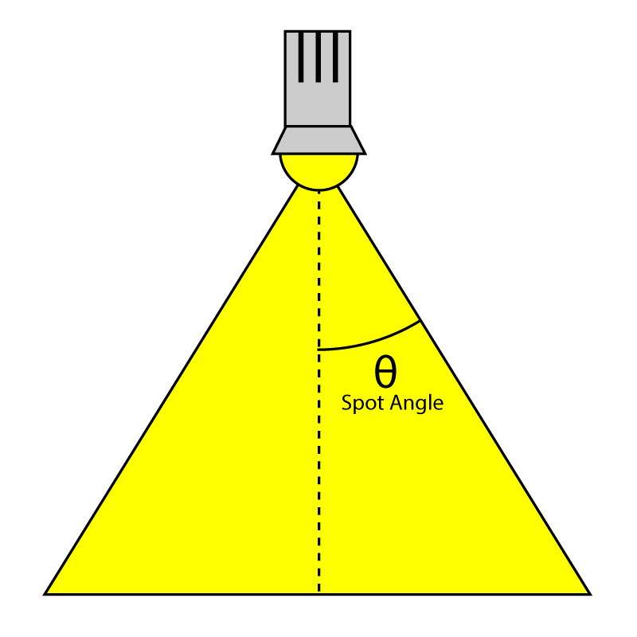

<div class="caption">

Spotlight Angle

</div>

The **Range** variable determines how far away the light will reach and still contribute light to a surface. Although not entirely physically correct (real lights have an attenuation that never actually reaches 0) lights are required to have a finite range to implement the deferred shading and forward+ rendering techniques. The units of this range are scene specific but generally I try to adhere to the 1 unit is 1 meter specification. For point lights, the range is the radius of the sphere that represents the light and for spotlights, the range is the length of the cone that represents the light. Directional lights don’t use range because they are considered to be infinitely far away pointing in the same direction everywhere.

The **Intensity** variable is used to modulate the computed light contribution. By default, this value is 1 but it can be used to make some lights brighter or more subtle than other lights.

Lights in the scene can be toggled on and off with the **Enabled** flag. Lights whose **Enabled** flag is **false** will be skipped in the shader.

Lights are editable in this demo. A light can be selected by clicking on it in the demo application and its properties can be modified. To indicate that a light is currently selected, the **Selected** flag will be set to **true**. When a light is selected in the scene, its visual representation will appear darker (less transparent) to indicate that it is currently selected.

The **Type** variable is used to indicate which type of light this is. It can have one of the following values:

```hlsl source="ForwardPlus-94f71f9/CommonInclude.hlsl#L6-L8"
```

Once again the Light struct is explicitly padded with 8 bytes to match the struct layout in C++ and to make the struct explicitly aligned to 16 bytes which is required in HLSL.

The lights array is accessed through a **StructuredBuffer**. Most lighting shader implementations will use a constant buffer to store the lights array but constant buffers are limited to 64 KB in size which means that it would be limited to about 570 lights before running out of constant memory on the GPU. Structured buffers are stored in texture memory which is limited to the amount of texture memory available on the GPU (usually in the GB range on desktop GPUs). Texture memory is also very fast on most GPUs so storing the lights in a structured buffer did not impose a performance impact. In fact, on my particular GPU (NVIDIA GeForce GTX 680) I noticed a considerable performance improvement when I moved the lights array to a structure buffer.

```hlsl source="ForwardPlus-94f71f9/CommonInclude.hlsl#L177-L177"
```

### Pixel Shader Continued

The pixel shader for the forward rendering technique is slightly more complicated than the vertex shader. If you have read my previous article titled [Texturing and Lighting in DirectX 11](/texturing-lighting-directx-11/) then you should already be familiar with most of the implementation of this shader, but I will explain it in detail here as it is the basis of all of the rendering algorithms shown in this article.

#### Materials

First, we need to gather the material properties of the material. If the material has textures associated with its various components, the textures will be sampled before the lighting is computed. After the material properties have been initialized, all of the lights in the scene will be iterated and the lighting contributions will be accumulated and modulated with the material properties to produce the final pixel color.

```hlsl source="ForwardPlus-94f71f9/ForwardRendering.hlsl#L19-L24"
```

The **\[earlydepthstencil\]** attribute before the function indicates that the GPU should take advantage of early depth and stencil culling [\[10\]](#cite-10). This causes the depth/stencil tests to be performed before the pixel shader is executed. This attribute can not be used on shaders that modify the pixel’s depth value by outputting a value using the **SV\_Depth** semantic. Since this pixel shader only outputs a color value using the **SV\_TARGET** semantic, it can take advantage of early depth/stencil testing to provide a performance improvement when a pixel is rejected. Most GPU’s will perform early depth/stencil tests anyways even without this attribute and adding this attribute to the pixel shader did not have a noticeable impact on performance but I decided to keep the attribute anyways.

Since all of the lighting computations will be performed in view space, the eye position (the position of the camera) is always (0, 0, 0). This is a nice side effect of working in view space; The camera’s eye position does not need to be passed as an additional parameter to the shader.

On line 24 a temporary copy of the material is created because its properties will be modified in the shader if there is an associated texture for the material property. Since the material properties are stored in a constant buffer, it would not be possible to directly update the materials properties from the constant buffer uniform variable so a local temporary must be used.

##### Diffuse

The first material property we will read is the diffuse color.

```hlsl source="ForwardPlus-94f71f9/ForwardRendering.hlsl#L26-L38"
```

The default diffuse color is the diffuse color assigned to the material’s **DiffuseColor** variable. If the material also has a diffuse texture associated with it then the color from the diffuse texture will be blended with the material’s diffuse color. If the material’s diffuse color is black (0, 0, 0, 0), then the material’s diffuse color will simply be replaced by the color in the diffuse texture. The **any** hlsl intrinsic function can be used to find out if any of the color components is not zero.

##### Opacity

The pixel’s alpha value is determined next.

```hlsl source="ForwardPlus-94f71f9/ForwardRendering.hlsl#L41-L46"
```

By default, the fragment’s transparency value is determined by the alpha component of the diffuse color. If the material has an opacity texture associated with it, the red component of the opacity texture is used as the alpha value, overriding the alpha value in the diffuse texture. In most cases, opacity textures store only a single channel in the first component of the color that is returned from the **Sample** method. In order to read from a single-channel texture, we must read from the red channel, not the alpha channel. The alpha channel of a single channel texture will always be 1 so reading the alpha channel from the opacity map (which is most likely a single channel texture) would not provide the value we require.

##### Ambient and Emissive

The ambient and emissive colors are read in a similar fashion as the diffuse color. The ambient color is also combined with the value of the material’s **GlobalAmbient** variable.

```hlsl source="ForwardPlus-94f71f9/ForwardRendering.hlsl#L48-L76"
```

##### Specular Power

Next the specular power is computed.

```hlsl title="ForwardRendering.hlsl" showLineNumbers startLineNumber=78
    if ( mat.HasSpecularPowerTexture )
    {
        mat.SpecularPower = SpecularPowerTexture.Sample( LinearRepeatSampler, IN.texCoord ).r \
                            * mat.SpecularScale;
    }
```

If the material has an associated specular power texture, the red component of the texture is sampled and scaled by the value of the material’s **SpecularScale** variable. In this case, the value of the **SpecularPower** variable in the material is replaced with the scaled value from the texture.

##### Normals

If the material has either an associated normal map or a bump map, normal mapping or bump mapping will be performed to compute the normal vector. If neither a normal map nor a bump map texture is associated with the material, the input normal is used as-is.

```hlsl title="ForwardRendering.hlsl" showLineNumbers startLineNumber=85
    // Normal mapping
    if ( mat.HasNormalTexture )
    {
        // For scenes with normal mapping, I don't have to invert the binormal.
        float3x3 TBN = float3x3( normalize( IN.tangentVS ),
                                 normalize( IN.binormalVS ),
                                 normalize( IN.normalVS ) );

        N = DoNormalMapping( TBN, NormalTexture, LinearRepeatSampler, IN.texCoord );
    }
    // Bump mapping
    else if ( mat.HasBumpTexture )
    {
        // For most scenes using bump mapping, I have to invert the binormal.
        float3x3 TBN = float3x3( normalize( IN.tangentVS ),
                                 normalize( -IN.binormalVS ), 
                                 normalize( IN.normalVS ) );

        N = DoBumpMapping( TBN, BumpTexture, LinearRepeatSampler, IN.texCoord, mat.BumpIntensity );
    }
    // Just use the normal from the model.
    else
    {
        N = normalize( float4( IN.normalVS, 0 ) );
    }
```

##### Normal Mapping

The **DoNormalMapping** function will perform normal mapping from the **TBN** (tangent, bitangent/binormal, normal) matrix and the normal map.

<span id="attachment-6721"></span>

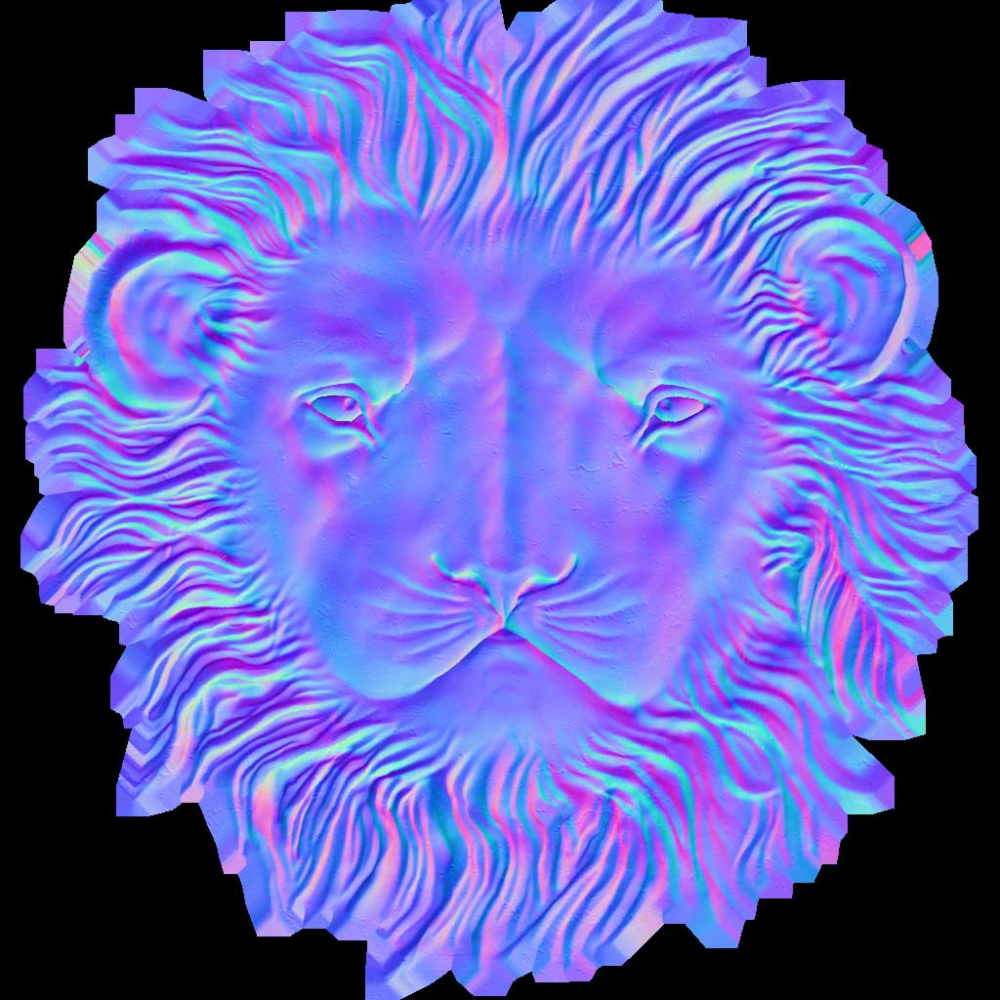

<div class="caption">

An example normal map texture of the lion head in the Crytek Sponza scene. [\[11\]](#cite-11)

</div>

```hlsl title="CommonInclude.hlsl" showLineNumbers startLineNumber=319
float3 ExpandNormal( float3 n )
{
    return n * 2.0f - 1.0f;
}

float4 DoNormalMapping( float3x3 TBN, Texture2D tex, sampler s, float2 uv )
{
    float3 normal = tex.Sample( s, uv ).xyz;
    normal = ExpandNormal( normal );

    // Transform normal from tangent space to view space.
    normal = mul( normal, TBN );
    return normalize( float4( normal, 0 ) );
}
```

Normal mapping is pretty straightforward and is explained in more detail in a previous article titled [Normal Mapping](https://web.archive.org/web/20160315060219/http://www.3dgep.com/normal-mapping-with-cg-and-opengl/) so I won’t explain it in detail here. Basically we just need to sample the normal from the normal map, expand the normal into the range \[-1..1\] and transform it from tangent space into view space by post-multiplying it by the TBN matrix.

##### Bump Mapping

Bump mapping works in a similar way, except instead of storing the normals directly in the texture, the bumpmap texture stores height values in the range \[0..1\]. The normal can be generated from the height map by computing the gradient of the height values in both the U and V texture coordinate directions. Taking the cross product of the gradients in each direction gives the normal in texture space. Post-multiplying the resulting normal by the TBN matrix will give the normal in view space. The height values read from the bump map can be scaled to produce more (or less) accentuated bumpiness.

<span id="attachment-6723"></span>

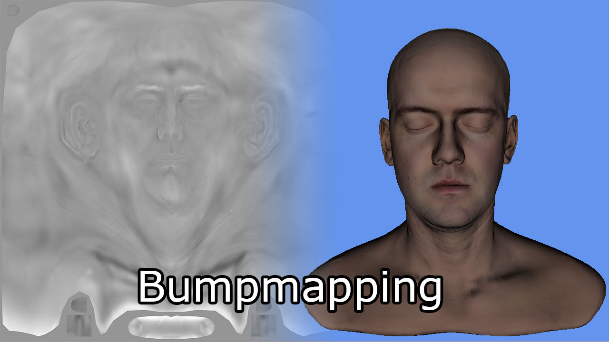

<div class="caption">

Bumpmap texture (left) and the corresponding head model (right). [\[12\]](#cite-12)

</div>

```hlsl title="CommonInclude.hlsl" showLineNumbers startLineNumber=334
float4 DoBumpMapping( float3x3 TBN, Texture2D tex, sampler s, float2 uv, float bumpScale )
{
    // Sample the heightmap at the current texture coordinate.
    float height = tex.Sample( s, uv ).r * bumpScale;
    // Sample the heightmap in the U texture coordinate direction.
    float heightU = tex.Sample( s, uv, int2( 1, 0 ) ).r * bumpScale;
    // Sample the heightmap in the V texture coordinate direction.
    float heightV = tex.Sample( s, uv, int2( 0, 1 ) ).r * bumpScale;

    float3 p = { 0, 0, height };
    float3 pU = { 1, 0, heightU };
    float3 pV = { 0, 1, heightV };

    // normal = tangent x bitangent
    float3 normal = cross( normalize(pU - p), normalize(pV - p) );

    // Transform normal from tangent space to view space.
    normal = mul( normal, TBN );

    return float4( normal, 0 );
}
```

:::caution
I’m not sure if this bump mapping algorithm is 100% correct. I couldn’t find any resource that shows how to do correct bump mapping. Please leave a comment below if you can suggest a better (and correct) method for performing bump mapping.
:::

If the material does not have an associated normal map or a bump map, the normal vector from the vertex shader output is used directly.

Now we have all of the data that is required to compute the lighting.

#### Lighting

The lighting calculations for the forward rendering technique are performed in the **DoLighting** function. This function accepts the following arguments:

-   **lights**: The lights array (as a structured buffer)
-   **mat**: The material properties that were just computed
-   **eyePos**: The position of the camera in view space (which is always (0, 0, 0))
-   **P**: The position of the point being shaded in view space
-   **N**: The normal of the point being shaded in view space.

The **DoLighting** function returns a **LightingResult** structure that contains the diffuse and specular lighting contributions from all of the lights in the scene.

```hlsl title="ForwardRendering.hlsl" showLineNumbers startLineNumber=425
// This lighting result is returned by the 
// lighting functions for each light type.
struct LightingResult
{
    float4 Diffuse;
    float4 Specular;
};

LightingResult DoLighting( StructuredBuffer<Light> lights, Material mat, float4 eyePos, float4 P, float4 N )
{
    float4 V = normalize( eyePos - P );

    LightingResult totalResult = (LightingResult)0;

    for ( int i = 0; i < NUM_LIGHTS; ++i )
    {
        LightingResult result = (LightingResult)0;

        // Skip lights that are not enabled.
        if ( !lights[i].Enabled ) continue;
        // Skip point and spot lights that are out of range of the point being shaded.
        if ( lights[i].Type != DIRECTIONAL_LIGHT &&
             length( lights[i].PositionVS - P ) > lights[i].Range ) continue;

        switch ( lights[i].Type )
        {
        case DIRECTIONAL_LIGHT:
        {
            result = DoDirectionalLight( lights[i], mat, V, P, N );
        }
        break;
        case POINT_LIGHT:
        {
            result = DoPointLight( lights[i], mat, V, P, N );
        }
        break;
        case SPOT_LIGHT:
        {
            result = DoSpotLight( lights[i], mat, V, P, N );
        }
        break;
        }
        totalResult.Diffuse += result.Diffuse;
        totalResult.Specular += result.Specular;
    }

    return totalResult;
}
```

The view vector (**V**) is computed from the eye position and the position of the shaded pixel in view space.

The light buffer is iterated on line 439. Since we know that disabled lights and lights that are not within range of the point being shaded won’t contribute any lighting, we can skip those lights. Otherwise, the appropriate lighting function is invoked depending on the type of light.

Each of the various light types will compute their diffuse and specular lighting contributions. Since diffuse and specular lighting is computed in the same way for every light type, I will define functions to compute the diffuse and specular lighting contributions independent of the light type.

##### Diffuse Lighting

The **DoDiffuse** function is very simple and only needs to know about the light vector (**L**) and the surface normal (**N**).

<span id="attachment-5861"></span>

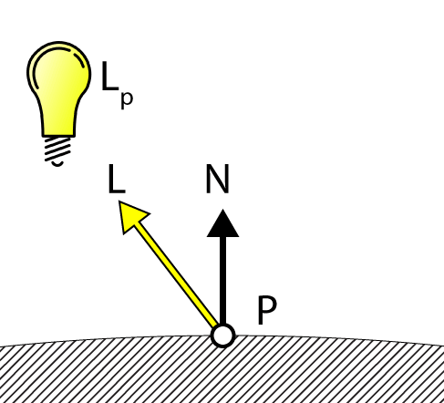

<div class="caption">

Diffuse Lighting

</div>

```hlsl source="ForwardPlus-94f71f9/CommonInclude.hlsl#L356-L360"
```

The diffuse lighting is computed by taking the dot product between the light vector (**L**) and the surface normal (**N**). The **DoDiffuse** function expects both of these vectors to be normalized.

The resulting dot product is then multiplied by the color of the light to compute the diffuse contribution of the light.

Next, we’ll compute the specular contribution of the light.

##### Specular Lighting

The **DoSpecular** function is used to compute the specular contribution of the light. In addition to the light vector (**L**) and the surface normal (**N**), this function also needs the view vector (**V**) to compute the specular contribution of the light.

<span id="attachment-5872"></span>

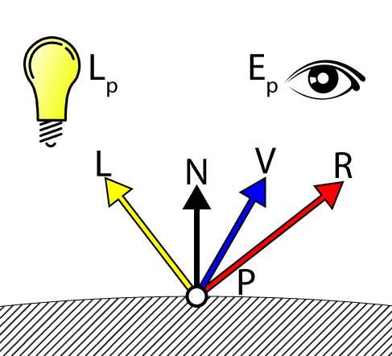

<div class="caption">

Specular Lighting

</div>

```hlsl source="ForwardPlus-94f71f9/CommonInclude.hlsl#L362-L368"
```

Since the light vector **L** is the vector pointing from the point being shaded to the light source, it needs to be negated so that it points from the light source to the point being shaded before we compute the reflection vector. The resulting dot product of the reflection vector (**R**) and the view vector (**V**) is raised to the power of the value of the material’s specular power variable and modulated by the color of the light. It’s important to remember that a specular power value in the range (0…1) is not a meaningful specular power value. For a detailed explanation of specular lighting, please refer to my previous article titled [Texturing and Lighting in DirectX 11](/texturing-lighting-directx-11/#specular).

##### Attenuation

Attenuation is the fall-off of the intensity of the light as the light is further away from the point being shaded. In traditional lighting models the attenuation is computed as the reciprocal of the sum of three attenuation factors multiplied by the distance to the light (as explained in [Attenuation](/texturing-lighting-directx-11/#attenuation)):

1.  Constant attenuation
2.  Linear attenuation
3.  Quadratic attenuation

However this method of computing attenuation assumes that the fall-off of the light never reaches zero (lights have an infinite range). For deferred shading and forward+ we must be able to represent the lights in the scene as volumes with finite range so we need to use a different method to compute the attenuation of the light.

One possible method to compute the attenuation of the light is to perform a linear blend from 1.0 when the point is closest to the light and 0.0 if the point is at a distance greater than the range of the light. However a linear fall-off does not look very realistic as attenuation in reality is more similar to the reciprocal of a quadratic function.

I decided to use the **smoothstep** hlsl intrinsic function which returns a smooth interpolation between a minimum and maximum value.

<span id="attachment-7240"></span>

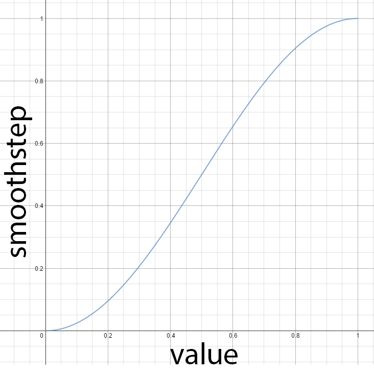

<div class="caption">

HLSL smoothstep intrinsic function

</div>

```hlsl source="ForwardPlus-94f71f9/CommonInclude.hlsl#L370-L374"
```

The **smoothstep** function will return 0 when the distance to the light (**d**) is less than ¾ of the range of the light and 1 when the distance to the light is more than the range. Of course we want to reverse this interpolation so we just subtract this value from 1 to get the attenuation we need.

Optionally, we could adjust the smoothness of the attenuation of the light by parameterization of the 0.75f in the equation above. A smoothness factor of 0.0 should result in the intensity of the light remaining 1.0 all the way to the maximum range of the light while a smoothness of 1.0 should result in the intensity of the light being interpolated through the entire range of the light.

<span id="attachment-6744"></span>

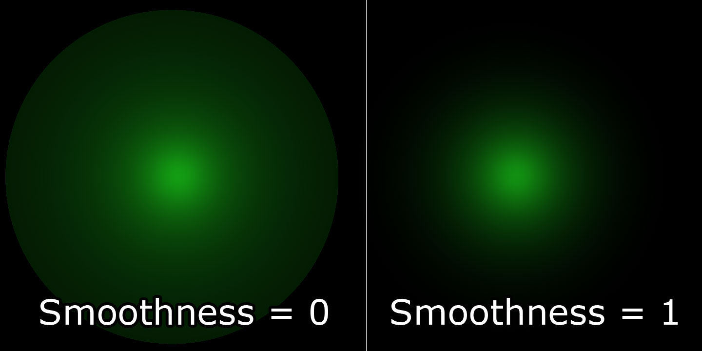

<div class="caption">

Variable attenuation smoothness.

</div>

Now let’s combine the diffuse, specular, and attenuation factors to compute the lighting contribution for each light type.

##### Point Lights

Point lights combine the attenuation, diffuse, and specular values to determine the final contribution of the light.

```hlsl title="ForwardRendering.hlsl" showLineNumbers startLineNumber=390
LightingResult DoPointLight( Light light, Material mat, float4 V, float4 P, float4 N )
{
    LightingResult result;

    float4 L = light.PositionVS - P;
    float distance = length( L );
    L = L / distance;

    float attenuation = DoAttenuation( light, distance );

    result.Diffuse = DoDiffuse( light, L, N ) * 
                      attenuation * light.Intensity;
    result.Specular = DoSpecular( light, mat, V, L, N ) * 
                       attenuation * light.Intensity;

    return result;
}
```

On line 400-401, the diffuse and specular contributions are scaled by the attenuation and the light intensity factors before being returned from the function.

##### Spot Lights

In addition to the attenuation factor, spot lights also have a cone angle. In this case, the intensity of the light is scaled by the dot product between the light vector (**L**) and the direction of the spotlight. If the angle between light vector and the direction of the spotlight is less than the spotlight cone angle, then the point should be lit by the spotlight. Otherwise the spotlight should not contribute any light to the point being shaded. The **DoSpotCone** function will compute the intensity of the light based on the spotlight cone angle.

```hlsl title="CommonInclude.hlsl" showLineNumbers startLineNumber=376
float DoSpotCone( Light light, float4 L )
{
    // If the cosine angle of the light's direction 
    // vector and the vector from the light source to the point being 
    // shaded is less than minCos, then the spotlight contribution will be 0.
    float minCos = cos( radians( light.SpotlightAngle ) );
    // If the cosine angle of the light's direction vector
    // and the vector from the light source to the point being shaded
    // is greater than maxCos, then the spotlight contribution will be 1.
    float maxCos = lerp( minCos, 1, 0.5f );
    float cosAngle = dot( light.DirectionVS, -L );
    // Blend between the minimum and maximum cosine angles.
    return smoothstep( minCos, maxCos, cosAngle );
}
```

First, the cosine angle of the spotlight cone is computed. If the dot product between the direction of the spotlight and the light vector (**L**) is less than the min cosine angle then the contribution of the light will be 0. If the dot product is greater than max cosine angle then the contribution of the spotlight will be 1.

<span id="attachment-6770"></span>

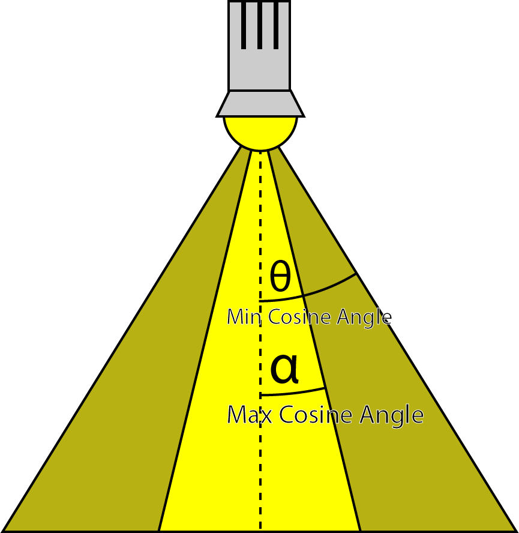

<div class="caption">

The spotlights minimum and maximum cosine angles.

</div>

It may seem counter-intuitive that the max cosine angle is a smaller angle than the min cosine angle but don’t forget that the cosine of 0° is 1 and the cosine of 90° is 0.

The **DoSpotLight** function will compute the spotlight contribution similar to that of the point light with the addition of the spotlight cone angle.

```hlsl title="ForwardRendering.hlsl" showLineNumbers startLineNumber=418
LightingResult DoSpotLight( Light light, Material mat, float4 V, float4 P, float4 N )
{
    LightingResult result;

    float4 L = light.PositionVS - P;
    float distance = length( L );
    L = L / distance;

    float attenuation = DoAttenuation( light, distance );
    float spotIntensity = DoSpotCone( light, L );

    result.Diffuse = DoDiffuse( light, L, N ) * 
                       attenuation * spotIntensity * light.Intensity;
    result.Specular = DoSpecular( light, mat, V, L, N ) * 
                       attenuation * spotIntensity * light.Intensity;

    return result;
}
```

##### Directional Lights

Directional lights are the simplest light type because they do not attenuate over the distance to the point being shaded.

```hlsl title="ForwardRendering.hlsl" showLineNumbers startLineNumber=406
LightingResult DoDirectionalLight( Light light, Material mat, float4 V, float4 P, float4 N )
{
    LightingResult result;

    float4 L = normalize( -light.DirectionVS );

    result.Diffuse = DoDiffuse( light, L, N ) * light.Intensity;
    result.Specular = DoSpecular( light, mat, V, L, N ) * light.Intensity;

    return result;
}
```

#### Final Shading

Now we have the material properties and the summed lighting contributions of all of the lights in the scene we can combine them to perform final shading.

```hlsl title="ForwardRendering.hlsl" showLineNumbers startLineNumber=111
    float4 P = float4( IN.positionVS, 1 );

    LightingResult lit = DoLighting( Lights, mat, eyePos, P, N );

    diffuse *= float4( lit.Diffuse.rgb, 1.0f ); // Discard the alpha value from the lighting calculations.

    float4 specular = 0;
    if ( mat.SpecularPower > 1.0f ) // If specular power is too low, don't use it.
    {
        specular = mat.SpecularColor;
        if ( mat.HasSpecularTexture )
        {
            float4 specularTex = SpecularTexture.Sample( LinearRepeatSampler, IN.texCoord );
            if ( any( specular.rgb ) )
            {
                specular *= specularTex;
            }
            else
            {
                specular = specularTex;
            }
        }
        specular *= lit.Specular;
    }

    return float4( ( ambient + emissive + diffuse + specular ).rgb, 
                     alpha * mat.Opacity );

}
```

On line 113 the lighting contributions is computed using the **DoLighting** function that was just described.

On line 115, the material’s diffuse color is modulated by the lights diffuse contribution.

If the material’s specular power is lower than 1.0, it will not be considered for final shading. Some artists will assign a specular power less than 1 if a material does not have a specular shine. In this case we just ignore the specular contribution and the material is considered diffuse only (lambert reflectance only). Otherwise, if the material has a specular color texture associated with it, it will be sampled and combined with the material’s specular color before it is modulated with the light’s specular contribution.

The final pixel color is the sum of the ambient, emissive, diffuse and specular components. The opacity of the pixel is determined by the alpha value that was determined earlier in the pixel shader.

## Deferred Shading

The deferred shading technique consists of three passes:

1.  G-buffer pass
2.  Lighting pass
3.  Transparent pass

The g-buffer pass will fill the g-buffer textures that were described in the introduction. The lighting pass will render each light source as a geometric object and compute the lighting for covered pixels. The transparent pass will render transparent scene objects using the standard forward rendering technique.

### G-Buffer Pass

The first pass of the deferred shading technique will generate the G-buffer textures. I will first describe the layout of the G-buffers.

#### G-Buffer Layout

The layout of the G-buffer can be a subject of an entire article on this website. The layout I chose for this demonstration is based on simplicity and necessity. It is not the most efficient G-buffer layout as some data could be better packed into smaller buffers. There has been some discussion on packing attributes in the G-buffers but I did not perform any analysis regarding the effects of using various packing methods.

The attributes that need to be stored in the G-buffers are:

-   Depth/Stencil
-   Light Accumulation
-   Diffuse
-   Specular
-   Normals

##### Depth/Stencil Buffer

The Depth/Stencil texture is stored as 32-bits per pixel with 24 bits for the depth value as a unsigned normalized value (UNORM) and 8 bits for the stencil value as an unsigned integer (UINT). The texture resource for the depth buffer is created using the **R24G8\_TYPELESS** texture format and the depth/stencil view is created with the **D24\_UNORM\_S8\_UINT** texture format. When accessing the depth buffer in the pixel shader, the shader resource view is created using the **R24\_UNORM\_X8\_TYPELESS** texture format since the stencil value is unused.

The Depth/Stencil buffer will be attached to the output merger stage and will not directly computed in the G-buffer pixel shader. The results of the vertex shader are written directly to the depth/stencil buffer.

<span id="attachment-6808"></span>

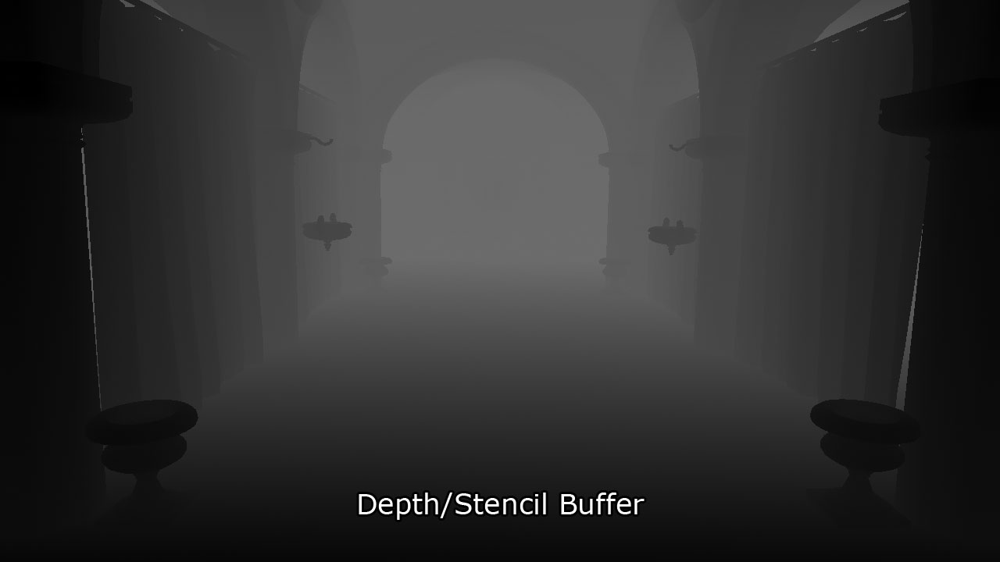

<div class="caption">

Output of the Depth/Stencil Buffer in the G-buffer pass

</div>

##### Light Accumulation Buffer

The light accumulation buffer is used to store the final result of the lighting pass. This is the same buffer as the back buffer of the screen. If your G-buffer textures are the same dimension as your screen, there is no need to allocate an additional buffer for the light accumulation buffer and the back buffer of the screen can be used directly.

The light accumulation buffer is stored as a 32-bit 4-component unsigned normalized texture using the **R8G8B8A8\_UNORM** texture format for both the texture resource and the shader resource view.

<span id="attachment-6810"></span>

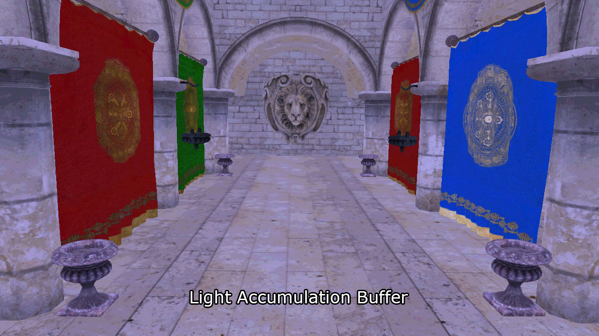

<div class="caption">

The light accumulation buffer stores the emissive and ambient terms. This image has been considerably brightened to make the scene more visible.

</div>

After the G-buffer pass, the light accumulation buffer initially only stores the ambient and emissive terms of the lighting equation. This image was brightened considerably to make it more visible.

You may also notice that only the fully opaque objects in the scene are rendered. Deferred shading does not support transparent objects so only the opaque objects are rendered in the G-buffer pass.

As an optimization, you may also want to accumulate directional lights in the G-buffer pass and skip directional lights in the lighting pass. Since directional lights are rendered as full-screen quads in the lighting pass, accumulating them in the g-buffer pass may save some shader cycles if fill-rate is an issue. I’m not taking advantage of this optimization in this experiment because that would require storing directional lights in a separate buffer which is inconsistent with the way the forward and forward+ pixel shaders handle lighting.

##### Diffuse Buffer

The diffuse buffer is stored as a 32-bit 4-component unsigned normalized (UNORM) texture. Since only opaque objects are rendered in deferred shading, there is no need for the alpha channel in this buffer and it remains unused in this experiment. Both the texture resource and the shader resource view use the **R8G8B8A8\_UNORM** texture format.

<span id="attachment-6811"></span>

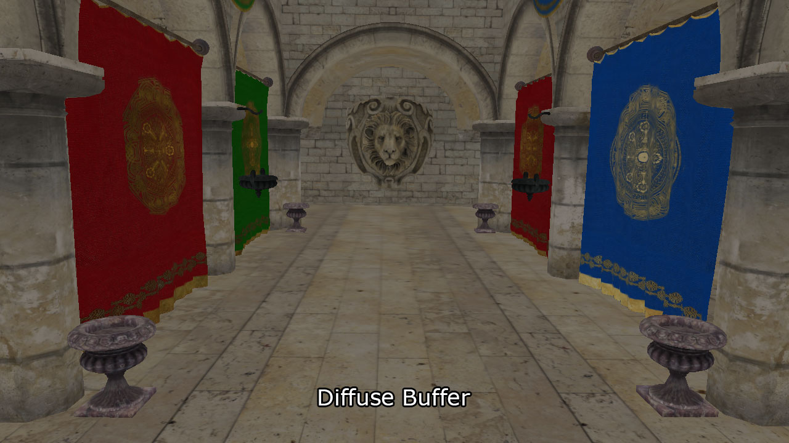

<div class="caption">

The Diffuse buffer after the g-buffer pass.

</div>

The above image shows the result of the diffuse buffer after the G-buffer pass.

##### Specular Buffer

Similar to the light accumulation and the diffuse buffers, the specular color buffer is stored as a 32-bit 4-component unsigned normalized texture using the **R8G8B8A8\_UNORM** format. The red, green, and blue channels are used to store the specular color while the alpha channel is used to store the specular power. The specular power value is usually expressed in the range $(1 \ldots 256]$ (or higher) but it needs to be packed into the range $[0 \ldots 1]$ to be stored in the texture. To pack the specular power into the texture, I use the method described in a presentation given by Michiel van der Leeuw titled “Deferred Rendering in Killzone 2” [\[13\]](#cite-13). In that presentation he uses the following equation to pack the specular power value:

$$
\alpha'=\frac{\log_2(\alpha)}{10.5}
$$

This function allows for packing of specular power values in the range $[1 \ldots 1448.15]$ and provides good precision for values in the normal specular range $(1 \ldots 256)$. The graph below shows the progression of the packed specular value.

<span id="attachment-6816"></span>

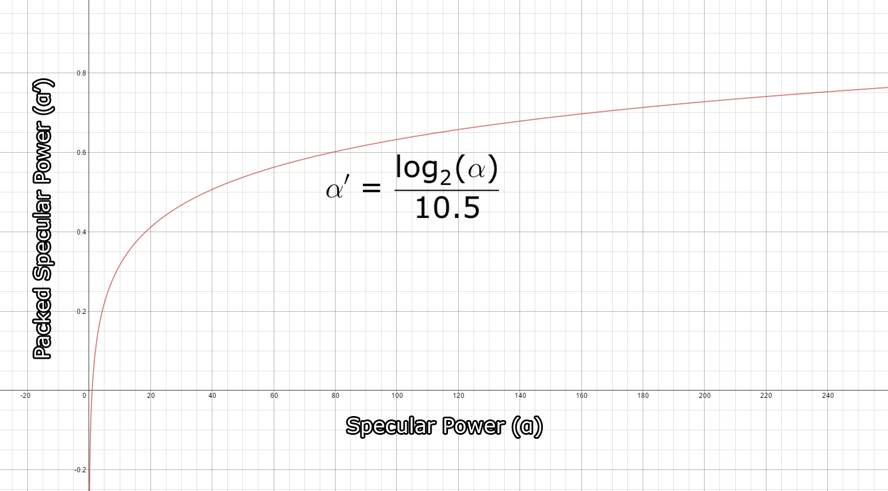

<div class="caption">

The result of packing specular power. The horizontal axis shows the original specular power and the vertical axis shows the packed specular power.

</div>

And the result of the specular buffer after the G-buffer pass looks like this.

<span id="attachment-6819"></span>

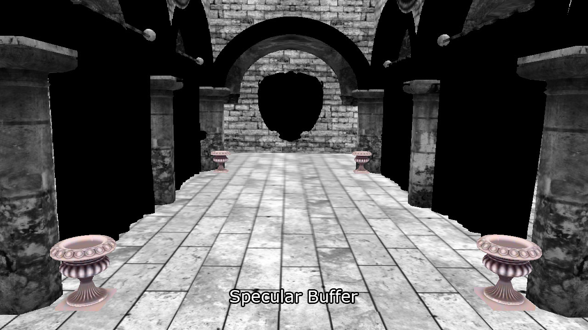

<div class="caption">

The results of the specular buffer after the G-buffer pass.

</div>

##### Normal Buffer

The view space normals are stored in a 128-bit 4-component floating point buffer using the **R32G32B32A32\_FLOAT** texture format. A normal buffer of this size is not really necessary and I could probably have packed the **X** and **Y** components of the normal into a 32-bit 2-component half-precision floating point buffer and recomputed the z-component in the lighting pass. For this experiment, I favored precision and simplicity over efficiency and since my GPU is not constrained by texture memory I used the largest possible buffer with the highest precision.

It would be worthwhile to investigate other texture formats for the normal buffer and analyze the quality versus performance tradeoffs. My hypothesis is that using a smaller texture format (for example **R16G16\_FLOAT**) for the normal buffer would produce similar quality results while providing improved performance.

<span id="attachment-6821"></span>

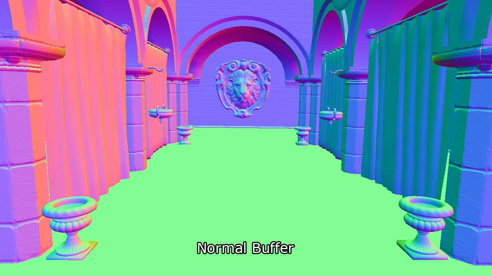

<div class="caption">

The result of the normal buffer after the G-buffer pass.

</div>

The image above shows the result of the normal buffer after the G-buffer pass.

##### Layout Summary

The total G-buffer layout looks similar to the table shown below.

|  | R | G | B | A |
| --- | --- | --- | --- | --- |
| Depth/Stencil | D24\_UNORM | S8\_UINT |
| Light Accumulation | R8\_UNORM | G8\_UNORM | B8\_UNORM | A8\_UNORM |
| Diffuse | R8\_UNORM | G8\_UNORM | B8\_UNORM | A8\_UNORM |
| Specular | R8\_UNORM | G8\_UNORM | B8\_UNORM | A8\_UNORM |
| Normal | R32\_FLOAT | G32\_FLOAT | B32\_FLOAT | A32\_FLOAT |

Layout of the G-buffer.

#### Pixel Shader

The pixel shader for the G-buffer pass is very similar to the pixel shader for the forward renderer. The primary difference being no lighting calculations are performed in the G-buffer pass. Collecting the material properties are identical in the forward rendering technique so I will not repeat that part of the shader code here.

To output the G-buffer data to the textures, each G-buffer texture will be bound to a render target output using **PixelShaderOutput** structure.

```hlsl title="DeferredRendering.hlsl" showLineNumbers startLineNumber=3
struct PixelShaderOutput
{
    float4 LightAccumulation    : SV_Target0;
    float4 Diffuse              : SV_Target1;
    float4 Specular             : SV_Target2;
    float4 NormalVS             : SV_Target3;
};
```

Since the depth/stencil buffer is bound to the output-merger stage, we don’t need to output the depth value from the pixel shader.

Now let’s fill the G-buffer textures in the pixel shader.

```hlsl title="DeferredRendering.hlsl" showLineNumbers startLineNumber=12
[earlydepthstencil]
PixelShaderOutput PS_Geometry( VertexShaderOutput IN )
{
    PixelShaderOutput OUT;

    // Get emissive, ambient, diffuse, specular and normal values 
    // In the same way as the forward rendering pixel shader.
    // The source code is not shown here for the sake of brevity.

    OUT.LightAccumulation = ( ambient + emissive );
    OUT.Diffuse = diffuse;
    OUT.Specular = float4( specular.rgb, log2( specularPower ) / 10.5f ); 
    OUT.NormalVS = N;

    return OUT;
}
```

Once all of the material properties have been retrieved, we only need to save the properties to the appropriate render target. The source code to read all of the material properties has been skipped for brevity. You can download the source code at the end of this article to see the complete pixel shader.

With the G-buffers filled, we can compute the final shading in the light pass. In the next sections, I will describe the method used by Guerrilla in Killzone 2 and I will also describe the implementation I used and explain why I used a different method.

### Lighting Pass (Guerrilla)

The primary source of inspiration for the lighting pass of the deferred shading technique that I am using in this experiment comes from a presentation called “**Deferred Rendering in Killzone 2**” presented by Michiel van der Leeuw at the Sony Computer Entertainment Graphics Seminar at Palo Alto, California in August 2007 [\[13\]](#cite-13). In Michiel’s presentation, he describes the lighting pass in four phases:

1.  Clear stencil buffer to 0,
2.  Mark pixels in front of the far light boundary,
3.  Count number of lit pixels inside the light volume,
4.  Shade the lit pixels

I will briefly describe the last three steps. I will then present the method I chose to use to implement the lighting pass of the deferred shading technique and explain why I chose a different method than what was explained in Michiel’s presentation.

#### Determine Lit Pixels

According to Michiel’s presentation, in order to determine which pixel are lit, you first need to render the back faces of the light volume and mark the pixels that are in-front of the far light boundary. Then count the number of pixels that are behind the front faces of the light volume. And finally, shade the pixels that are marked and behind the front faces of the light volume.

##### Mark Pixels

In the first phase, the pixels that are in front of the back faces of the light volume will be marked in the stencil buffer. To do this, you must first clear the stencil buffer to 0 then configure the pipeline state with the following settings:

-   Bind only the vertex shader (no pixel shader is required)
-   Bind only the depth/stencil buffer to the output merger stage (since no pixel shader is bound, there is no need for a color buffer)
-   Rasterizer State:
    -   Set cull mode to **FRONT** to render only the back faces of the light volume
-   Depth/Stencil State:
    -   Enable depth testing
    -   Disable depth writes
    -   Set the depth function to **GREATER\_EQUAL**
    -   Enable stencil operations
    -   Set stencil reference to 1
    -   Set stencil function to **ALWAYS**
    -   Set stencil operation to **REPLACE** on depth pass.

And render the light volume. The image below shows the effect of this operation.

<span id="attachment-6759"></span>

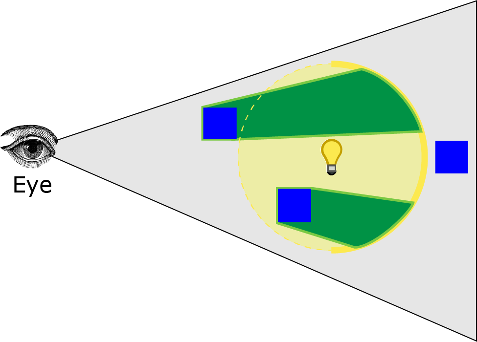

<div class="caption">

Render back faces of light volume. Write to stencil on depth pass.

</div>

The dotted line of the light volume is culled and only the back facing polygons are rendered. The green volumes show where the stencil buffer will be marked with the stencil reference value. The next step is to count the pixels inside the light volume.

##### Count Pixels

The next phase is to count the number of pixels that were both marked in the previous phase and are inside the light volume. This is done by rendering the front faces of the light volume and counting the number of pixels that are both stencil marked in the previous phase and behind the front faces of the light volume. In this case, the pipeline state should be configured with:

-   Bind only the vertex shader (no pixel shader is required)
-   Bind only the depth/stencil buffer to the output merger stage (since no pixel shader is bound, there is no need for a color buffer)
-   Configure the Rasterizer State:
    -   Set cull mode to **BACK** to render only the front faces of the light volume
-   Depth/Stencil State:
    -   Enable depth testing
    -   Disable depth writes
    -   Set the depth function to **LESS\_EQUAL**
    -   Enable stencil operations
    -   Set stencil reference to 1
    -   Set stencil operations to **KEEP** (don’t modify the stencil buffer)
    -   Set stencil function to **EQUAL**

And render the light volume again with an occlusion pixel query to count the number of pixels that pass both the depth and stencil operations. The image below shows the effect of this operation.

<span id="attachment-6772"></span>

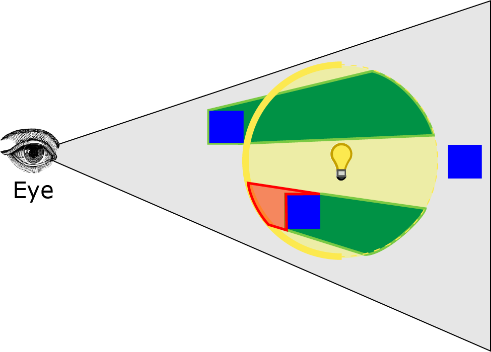

<div class="caption">

Render front faces of light volume. Count pixels that are marked and behind the front faces of the light volume.

</div>

The red volume in the image shows the pixels that would be counted in this phase.

If the number of pixels rasterized is below a certain threshold, then the shading step can be skipped. If the number of rasterized pixels is above a certain threshold then the pixels need to be shaded.

:::note
One step that was described in Michiel’s presentation but is skipped for this experiment is generating the light shadow maps. The primary purpose of the pixel query is to skip shadow map generation. Since I’m not doing shadow mapping in this experiment, I completely skip this step in my own implementation (as will be shown later).
:::

#### Shade Pixels

The final step according to Michiel’s method is to shade the pixels that are inside the light volume. To do this the configuration of the pipeline state should be identical to the pipeline configuration of the [count pixels phase](#count-pixels) with the addition of enabling additive blending, binding a pixel shader and attaching a color buffer to the output merger stage.

-   Bind both vertex and pixel shaders
-   Bind depth/stencil and light accumulation buffer to the output merger stage
-   Configure the Rasterizer State:
    -   Set cull mode to **BACK** to render only the front faces of the light volume
-   Depth/Stencil State:
    -   Enable depth testing
    -   Disable depth writes
    -   Set the depth function to **LESS\_EQUAL**
    -   Enable stencil operations
    -   Set stencil reference to 1
    -   Set stencil operations to **KEEP** (don’t modify the stencil buffer)
    -   Set stencil function to **EQUAL**
-   Blend State:

-   Enable blend operations
-   Set source factor to **ONE**
-   Set destination factor to **ONE**
-   Set blend operation to **ADD**

The result should be that only the pixels that are contained within the light volume are shaded.

### Lighting Pass (My Implementation)

The problem with the lighting pass described in Michiel’s presentation is that the pixel query operation will most certainly cause a stall while the CPU has to wait for the GPU query results to be returned. The stall can be avoided if the query results from the previous frame (or previous 2 frames) is used instead of the query results from the current frame relying on the temporal coherence theory [\[15\]](#cite-15). This would require multiple query objects to be created for each light source because query objects can not be reused if they must be persistent across multiple frames.

Since I am not doing shadow mapping in my implementation there was no apparent need to perform the pixel occlusion query that is described in Michiel’s presentation thus avoiding the potential stalls that are incurred from the query operation.

The other problem with the method described in Michiel’s presentation is that if the eye is inside the light volume then no pixels will be counted or shaded in the count pixels and shade pixels phases.

<span id="attachment-6776"></span>

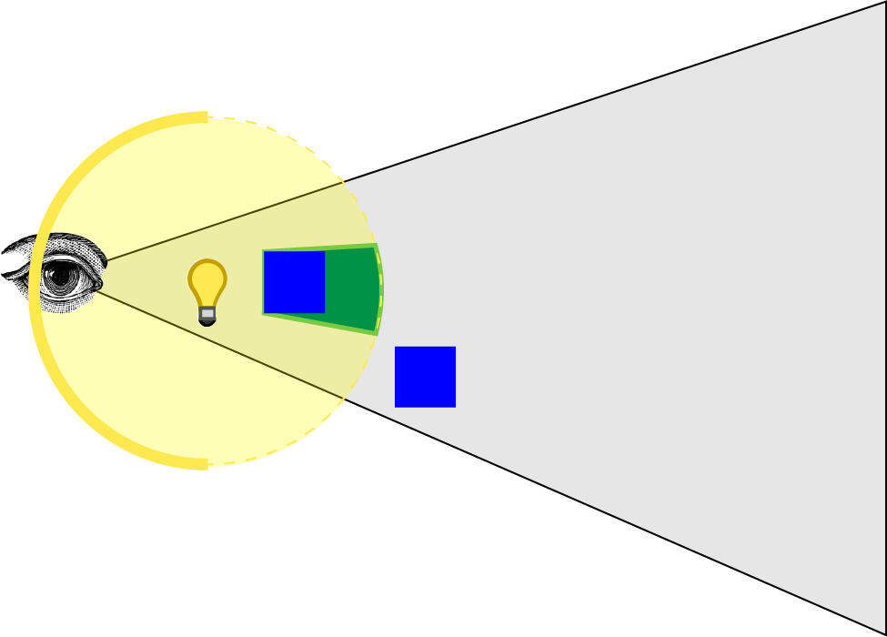

<div class="caption">

When the eye is inside the light volume, the front faces of the light volume will be clipped by the view frustum.

</div>

The green volume shown in the image represents the pixels of the stencil buffer that were marked in the first phase. There is no red volume showing the pixels that were shaded because the front faces of the light volume are clipped by the view frustum. I tried to find a way around this issue by disabling depth clipping but this only prevents clipping of pixels in front of the viewer (pixels behind the eye are still clipped).

To solve this problem, I reversed Michiel’s method:

1.  Clear stencil buffer to 1,
2.  Unmark pixels in front of the near light boundary,
3.  Shade pixels that are in front of the far light boundary

I will explain the last two steps of my implementation and describe the method used to shade the pixels.

#### Unmark Pixels

In the first phase of my implementation we need to unmark all of the pixels that are in front of the front faces of the light’s geometric volume. This ensures that pixels that occlude the light volume are not rendered in the next phase. This is done by first clearing the stencil buffer to 1 to mark all pixels and unmark the pixels that are in front of the front faces of the light volume. The configuration of the pipeline state would look like this:

-   Bind only the vertex shader (no pixel shader is required)
-   Bind only the depth/stencil buffer to the output merger stage (since no pixel shader is bound, there is no need for a color buffer)
-   Rasterizer State:
    -   Set cull mode to **BACK** to render only the front faces of the light volume
-   Depth/Stencil State:
    -   Enable depth testing
    -   Disable depth writes
    -   Set the depth function to **GREATER**
    -   Enable stencil operations
    -   Set stencil function to **ALWAYS**
    -   Set stencil operation to **DECR\_SAT** on depth pass.

And render the light volume. The image below shows the result of this operation.

<span id="attachment-6789"></span>

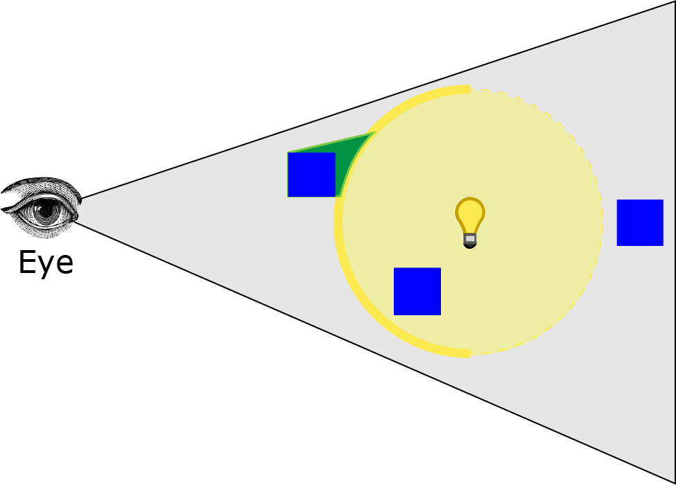

<div class="caption">

Unmark pixels in the stencil buffer where the pixel is in front of the front faces of the light volume.

</div>

Setting the stencil operation to **DECR\_SAT** will decrement and clamp the value in the stencil buffer to 0 if the depth test passes. The green volume shows where the stencil buffer will be decremented to 0. Consequently, if the eye is inside the light volume, all pixels will still be marked in the stencil buffer because the front faces of the light volume would be clipped by the viewing frustum and no pixels would be unmarked.

In the next phase the pixels in front of the back faces of the light volume will be shaded.

#### Shade Pixels

In this phase the pixels that are both in front of the back faces of the light volume and not unmarked in the previous frame will be shaded. In this case, the configuration of the pipeline state would look like this:

-   Bind both vertex and pixel shaders
-   Bind depth/stencil and light accumulation buffer to the output merger stage
-   Configure the Rasterizer State:
    -   Set cull mode to **FRONT** to render only the back faces of the light volume
    -   Disable depth clipping
-   Depth/Stencil State:
    -   Enable depth testing
    -   Disable depth writes
    -   Set the depth function to **GREATER\_EQUAL**
    -   Enable stencil operations
    -   Set stencil reference to 1
    -   Set stencil operations to **KEEP** (don’t modify the stencil buffer)
    -   Set stencil function to **EQUAL**
-   Blend State:

-   Enable blend operations
-   Set source factor to **ONE**
-   Set destination factor to **ONE**
-   Set blend operation to **ADD**

You may have noticed that I also disable depth clipping in the rasterizer state for this phase. Doing this will ensure that if any part of the light volume exceeds the far clipping plane, it will not be clipped.

The image below shows the result of this operation.

<span id="attachment-6791"></span>

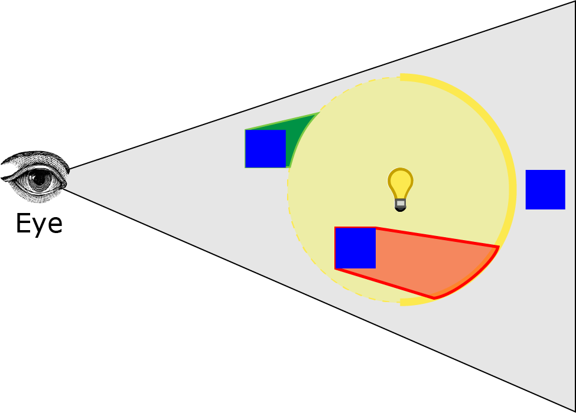

<div class="caption">

The pixels in front of the back faces of the light volume will be shaded.

</div>

The red volume shows pixels that will be shaded in this phase. This implementation will properly shade pixels even if the viewer is inside the light volume. In the second phase, only pixels that are both in front of the back faces of the light volume and not unmarked in the previous phase will be shaded.

Next I’ll describe the pixel shader that is used to implement the deferred lighting pass.

#### Pixel Shader

The pixel shader is only bound during the shade pixels phase described above. It will fetch the texture data from the G-buffers and use it to shade the pixel using the same lighting model that was described in the [Forward Rendering](#forward-rendering) section.

Since all of our lighting calculations are performed in view space, we need to compute the view space position of the current pixel.

We will use the the screen space position and the value in the depth buffer to compute the view space position of the current pixel. To do this, we will use the **ClipToView** function to convert clip space coordinates to view space and the **ScreenToView** function to convert screen coordinates to view space.

In order to facilitate these functions, we need to know the screen dimensions and the inverse projection matrix of the camera which should be passed to the shader from the application in a constant buffer.

```hlsl title="CommonInclude.hlsl" showLineNumbers startLineNumber=161
// Parameters required to convert screen space coordinates to view space.
cbuffer ScreenToViewParams : register( b3 )
{
    float4x4 InverseProjection;
    float2 ScreenDimensions;
}
```

And to convert the screen space coordinates to clip space we need to scale and shift the screen space coordinates into clip space then transform the clip space coordinate into view space by multiplying the clip space coordinate by the inverse of the projection matrix.

```hlsl title="CommonInclude.hlsl" showLineNumbers startLineNumber=192
// Convert clip space coordinates to view space
float4 ClipToView( float4 clip )
{
    // View space position.
    float4 view = mul( InverseProjection, clip );
    // Perspective projection.
    view = view / view.w;

    return view;
}

// Convert screen space coordinates to view space.
float4 ScreenToView( float4 screen )
{
    // Convert to normalized texture coordinates
    float2 texCoord = screen.xy / ScreenDimensions;

    // Convert to clip space
    float4 clip = float4( float2( texCoord.x, 1.0f - texCoord.y ) * 2.0f - 1.0f, screen.z, screen.w );

    return ClipToView( clip );
}
```

First, we need to normalize the screen coordinates by dividing them by the screen dimensions. This will convert the screen coordinates that are expressed in the range (\[0…SCREEN\_WIDTH\], \[0…SCREEN\_HEIGHT\]) into the range (\[0…1\], \[0..1\]).

In DirectX, the screen origin (0, 0) is the top-left side of the screen and the screen’s y-coordinate increases from top to bottom. This is the opposite direction than the y-coordinate in clip space so we need to flip the y-coordinate in normalized screen space to get it in the range (\[0…1\], \[1…0\]). Then we need to scale the normalized screen coordinate by 2 to get it in the range (\[0…2\], \[2…0\]) and shift it by -1 to get it in the range (\[-1…1\], \[1…-1\]).

<span id="attachment-6801"></span>

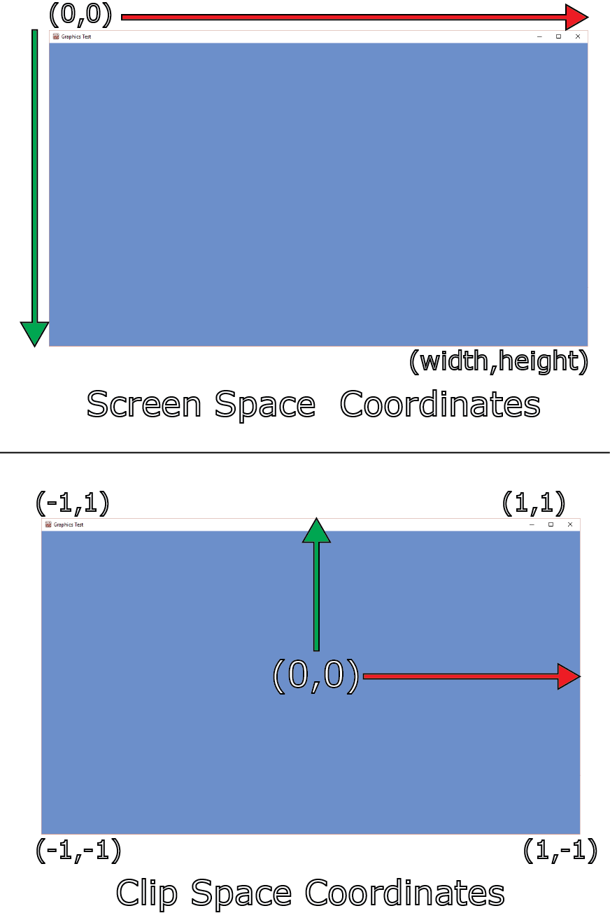

<div class="caption">

Converting screen space coordinates to clip space.

</div>

Now that we have the clip space position of the current pixel, we can use the **ClipToView** function to convert it into view space. This is done by multiplying the clip space coordinate by the inverse of the camera’s projection matrix (line 195) and divide by the **w** component to remove the perspective projection (line 197).

Now let’s put this function to use in our shader.

```hlsl source="ForwardPlus-94f71f9/DeferredRendering.hlsl#L160-L169"
```

The input structure to the deferred lighting pixel shader is identical to the output of the vertex shader including the position parameter that is bound to the **SV\_Position** system value semantic. When used in a pixel shader, the value of the parameter bound to the **SV\_Position** semantic will be the screen space position of the current pixel being rendered. We can use this value and the value from the depth buffer to compute the view space position.

Since the G-buffer textures are the same dimension as the screen for the lighting pass, we can use the **Texture2D.Load** [\[16\]](#cite-16) method to fetch the texel from each of the G-buffer textures. The texture coordinate of the **Texture2D.Load** method is an **int3** where the **x** and **y** components are the **U** and **V** texture coordinates in non-normalized screen coordinate and the **z** component is the mipmap level to sample. When sampling the G-buffer textures, we always want to sample mipmap level 0 (the most detailed mipmap level). Sampling from a lower mipmap level will cause the textures to appear blocky. If no mipmaps have been generated for the G-Buffer textures, sampling from a lower mipmap level will return black texels. The **Texture2D.Load** method does not perform any texture filtering when sampling the texture making it faster than the **Texture2D.Sample** method when using linear filtering.

Once we have the screen space position and the depth value, we can use the **ScreenToView** function to convert the screen space position to view space.

Before we can compute the lighting, we need to sample the other components from the G-buffer textures.

```hlsl source="ForwardPlus-94f71f9/DeferredRendering.hlsl#L171-L179"
```

On line 179 the specular power is unpacked from the alpha channel of the specular color using the inverse of the operation that was used to pack it in the specular texture in the G-buffer pass.

In order to retrieve the correct light properties, we need to know the index of the current light in the light buffer. For this, we will pass the light index of the current light in a constant buffer.

```hlsl source="ForwardPlus-94f71f9/DeferredRendering.hlsl#L144-L148"
```

And retrieve the light properties from the light list and compute the final shading.

```hlsl source="ForwardPlus-94f71f9/DeferredRendering.hlsl#L181-L204"
```

You may notice that we don’t need to check if the light is enabled in the shader like we did in the forward rendering shader. If the light is not enabled, the light volume should not be rendered by the application.

We also don’t need to check if the light is in range of the current pixel since the pixel shader should not be invoked on pixels that are out of range of the light.

The lighting functions were already explained in the section on [forward rendering](#lighting) so they won’t be explained here again.

On line 203, the diffuse and specular terms are combined and returned from the shader. The ambient and emissive terms were already computed in the light accumulation buffer during the G-buffer shader. With additive blending enabled, all of the lighting terms will be summed correctly to compute final shading.

In the final pass, we need to render transparent objects.

### Transparent Pass

The transparent pass for the deferred shading technique is identical to the [forward rendering](#forward-rendering) technique with alpha blending enabled. There is no new information to provide here. We will reflect on the performance of the transparent pass in the results section described later.

Now let’s take a look at the final technique that will be explained in this article; Forward+.

## Forward+

Forward+ improves upon regular forward rendering by first determining which lights are overlapping which area in screen space. During the shading phase, only the lights that are potentially overlapping the current fragment need to be considered. I used the term “potentially” because the technique used to determine overlapping lights is not completely accurate as I will explain later.

The Forward+ technique consists primarily of these three passes:

1.  Light culling
2.  Opaque pass
3.  Transparent pass

In the light culling pass, each light in the scene is sorted into screen space tiles.

In the opaque pass, the light list generated from the light culling pass is used to compute the lighting for opaque geometry. In this pass, not all lights need to be considered for lighting, only the lights that were previously sorted into the current fragments screen space tile need to be considered when computing the lighting.

The transparent pass is similar to the opaque pass except the light list used for computing lighting is slightly different. I will explain the difference between the light list for the opaque pass and the transparent pass in the following sections.

### Grid Frustums

Before light culling can occur, we need to compute the culling frustums that will be used to cull the lights into the screen space tiles. Since the culling frustums are expressed in view space, they only need to be recomputed if the dimension of the grid changes (for example, if the screen is resized) or the size of a tile changes. I will explain the basis of how the frustum planes for a tile are defined.

The screen is divided into a number of square tiles. I will refer to all of the screen tiles as the **light grid**. We need to specify a size for each tile. The size defines both the vertical and horizontal size of a single tile. The tile size should not be chosen arbitrarily but it should be chosen so that a each tile can be computed by a single thread group in a DirectX compute shader [\[17\]](#cite-17). The number of threads in a thread group should be a multiple of 64 (to take advantage of dual warp schedulers available on modern GPUs) and cannot exceed 1024 threads per thread group. Likely candidates for the dimensions of the thread group are:

-   8×8 (64 threads per thread group)
-   16×16 (256 threads per thread group)
-   32×32 (1024 threads per thread group)

For now, let’s assume that the thread group has a dimension of 16×16 threads. In this case, each tile for our light grid has a dimension of 16×16 screen pixels.

<span id="attachment-6874"></span>

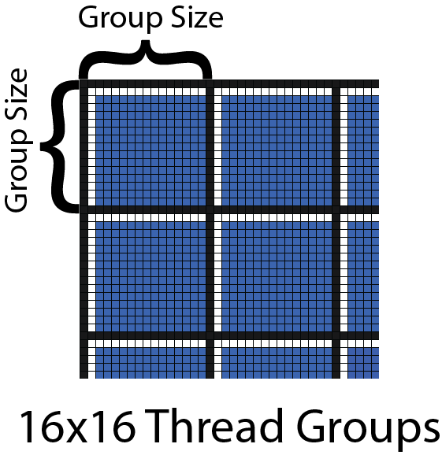

<div class="caption">

16×16 Thread Groups

</div>

The image above shows a partial grid of 16×16 thread groups. Each thread group is divided by the thick black lines and the threads within a thread group are divided by the thin black lines. A tile used for light culling is also divided in the same way.

If we were to view the tiles at an oblique angle, we can visualize the culling frustum that we need to compute.

<span id="attachment-6881"></span>

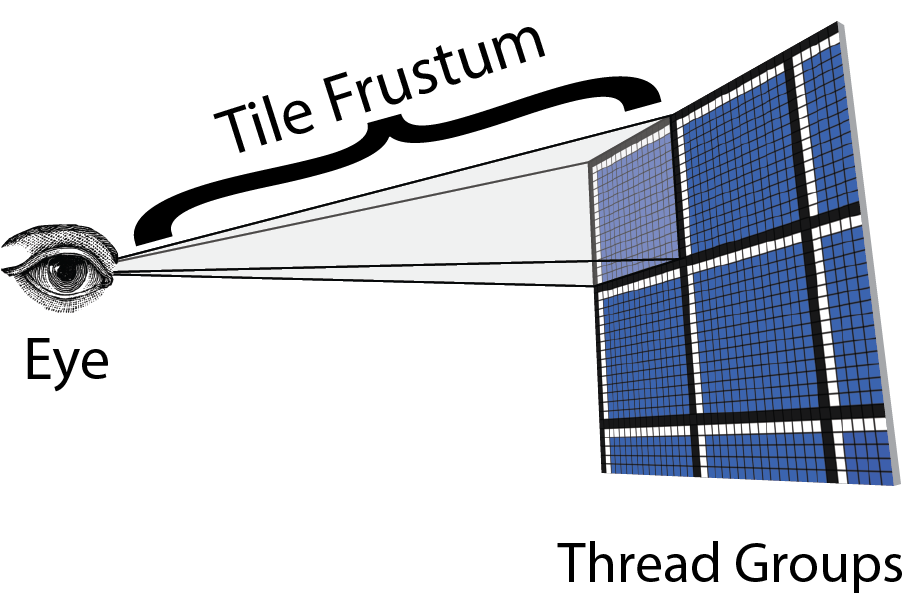

<div class="caption">

Tile Frustum

</div>

The above image shows that the camera’s position (eye) is the origin of the frustum and the corner points of the tile denote the frustum corners. With this information, we can compute the planes of the tile frustum.

A view frustum is composed of six planes, but to perform the light culling we want to pre-compute the four side planes for the frustum. The computation of the near and far frustum planes will be deferred until the light culling phase.

To compute the left, right, top, and bottom frustum planes we will use the following algorithm:

1.  Compute the four corner points of the current tile in screen space.
2.  Transform the screen space corner points to the far clipping plane in view space.
3.  Build the frustum planes from the eye position and two other corner points.
4.  Store the computed frustum in a **RWStructuredBuffer**.

<span id="attachment-6884"></span>

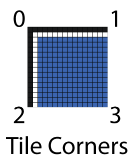

<div class="caption">

Tile Corners

</div>

A plane can be computed if we know three points that lie on the plane [\[18\]](#cite-18). If we number the corner points of a tile, as shown in the above image, we can compute the frustum planes using the eye position and two other corner points in view space.

For example, we can use the following points to compute the frustum planes assuming a counter-clockwise winding order:

-   **Left Plane**: Eye, Bottom-Left (2), Top-Left (0)
-   **Right Plane**: Eye, Top-Right (1), Bottom-Right (3)
-   **Top Plane**: Eye, Top-Left (0), Top-Right (1)
-   **Bottom Plane**: Eye, Bottom-Right (3), Bottom-Left (2)

<span id="attachment-7210"></span>

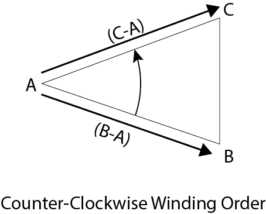

<div class="caption">

Counter-Clockwise Winding Order

</div>

If we know three non-collinear points $ABC$ that lie in the plane (as shown in the above image), we can compute the normal to the plane $\mathbf{n}$ [\[18\]](#cite-18):

$$
\mathbf{n}=\left(B-A\right)\times\left(C-A\right)
$$

If $\mathbf{n}$ is normalized then a given point $P$ that lies on the plane can be used to compute the signed distance from the origin to the plane:

$$
d=\mathbf{n}\cdot{P}
$$

This is referred to as the **constant-normal form** of the plane [\[18\]](#cite-18) and can also be expressed as

$$
ax+by+cz-d=0
$$

Where $\mathbf{n}=(a,b,c)$ and $X=(x,y,z)$ given that $X$ is a point that lies in the plane.

In the HLSL shader, we can define a plane as a unit normal $\mathbf{n}$ and the distance to the origin $d$.

```hlsl source="ForwardPlus-94f71f9/CommonInclude.hlsl#L108-L112"
```

Given three non-collinear counter-clockwise points that lie in the plane, we can compute the plane using the **ComputePlane** function in HLSL.

```hlsl source="ForwardPlus-94f71f9/CommonInclude.hlsl#L215-L231"
```

And a frustum is defined as a structure of four planes.

```hlsl source="ForwardPlus-94f71f9/CommonInclude.hlsl#L128-L139"
```

To precompute the grid frustums we need to invoke a compute shader kernel for each tile in the grid. For example, if the screen resolution is 1280×720 and the light grid is partitioned into 16×16 tiles, we need to compute 80×45 (3,600) frustums. If a thread group contains 16×16 (256) threads we need to dispatch 5×2.8125 thread groups to compute all of the frustums. Of course we can’t dispatch partial thread groups so we need to round up to the nearest whole number when dispatching the compute shader. In this case, we will dispatch 5×3 (15) thread groups each with 16×16 (256) threads and in the compute shader we must make sure that we simply ignore threads that are out of the screen bounds.

<span id="attachment-6959"></span>

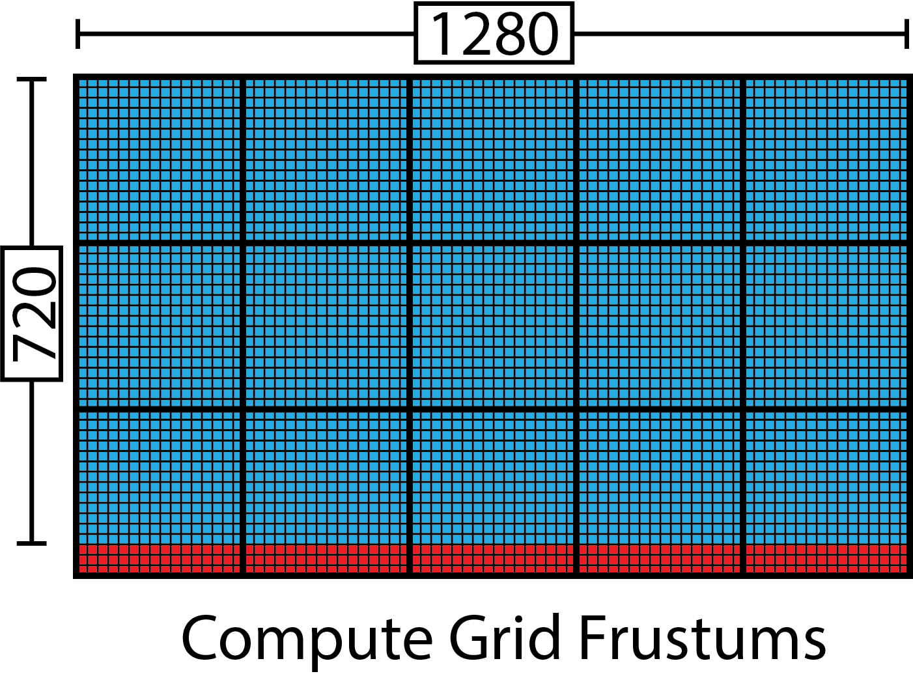

<div class="caption">

Compute Frustums

</div>

The above image shows the thread groups that will be invoked to generate the tile frustums assuming a 16×16 thread group. The thick black lines denote the thread group boundary and the thin black lines represent the threads in a thread group. The blue threads represent threads that will be used to compute a tile frustum and the red threads should simply skip the frustum tile computations because they extend past the size of the screen.

We can use the following formula to determine the dimension of the dispatch:

$$
\begin{array}{rcl}\mathbf{g}(x,y,z) & = & \left(\lceil\frac{w}{B}\rceil,\lceil\frac{h}{B}\rceil,1\right) \\ \\ \mathbf{G}(x,y,z) & = & \left(\lceil\frac{\mathbf{g}_x}{B}\rceil,\lceil\frac{\mathbf{g}_y}{B}\rceil,1\right)\end{array}
$$

Where $\mathbf{g}$ is the total number of threads that will be dispatched, $w$ is the screen width in pixels, $h$ is the screen height in pixels, $B$ is the size of the thread group (in our example, this is 16) and $\mathbf{G}$ is the number of thread groups to execute.

With this information we can dispatch the compute shader that will be used to precompute the grid frustums.

### Grid Frustums Compute Shader

By default, the size of a thread group for the compute shader will be 16×16 threads but the application can define a different block size during shader compilation.

```hlsl source="ForwardPlus-94f71f9/ForwardPlusRendering.hlsl#L3-L6"
```

And we’ll define a common structure to store the common compute shader input variables.

```hlsl source="ForwardPlus-94f71f9/ForwardPlusRendering.hlsl#L8-L14"
```

See [\[10\]](#cite-10) for a list of the system value semantics that are available as inputs to a compute shader.

In addition to the system values that are provided by HLSL, we also need to know the total number of threads and the total number of thread groups in the current dispatch. Unfortunately HLSL does not provide system value semantics for these properties. We will store the required values in a constant buffer called **DispatchParams**.

```hlsl title="ForwardPlusRendering.hlsl" showLineNumbers startLineNumber=15
// Global variables
cbuffer DispatchParams : register( b4 )
{
    // Number of groups dispatched. (This parameter is not available as an HLSL system value!)
    uint3   numThreadGroups;
    // uint padding // implicit padding to 16 bytes.

    // Total number of threads dispatched. (Also not available as an HLSL system value!)
    // Note: This value may be less than the actual number of threads executed 
    // if the screen size is not evenly divisible by the block size.
    uint3   numThreads;
    // uint padding // implicit padding to 16 bytes.
}
```

The value of the **numThreads** variable can be used to ensure that a thread in the dispatch is not used if it is out of bounds of the screen as described earlier.

To store the result of the computed grid frustums, we also need to create a structured buffer that is large enough to store one frustum per tile. This buffer will be bound to the **out\_Frustrum** [RWStructuredBuffer](https://learn.microsoft.com/windows/win32/direct3dhlsl/sm5-object-rwstructuredbuffer) variable using a uniform access view.

```hlsl source="ForwardPlus-94f71f9/ForwardPlusRendering.hlsl#L236-L237"
```

#### Tile Corners in Screen Space

In the compute shader, the first thing we need to do is determine the screen space points of the corners of the tile frustum using the current thread’s global ID in the dispatch.

```hlsl title="ForwardPlusRendering.hlsl" showLineNumbers startLineNumber=239
// A kernel to compute frustums for the grid
// This kernel is executed once per grid cell. Each thread
// computes a frustum for a grid cell.
[numthreads( BLOCK_SIZE, BLOCK_SIZE, 1 )]
void CS_ComputeFrustums( ComputeShaderInput IN )
{
    // View space eye position is always at the origin.
    const float3 eyePos = float3( 0, 0, 0 );

    // Compute the 4 corner points on the far clipping plane to use as the 
    // frustum vertices.
    float4 screenSpace[4];
    // Top left point
    screenSpace[0] = float4( IN.dispatchThreadID.xy * BLOCK_SIZE, -1.0f, 1.0f );
    // Top right point
    screenSpace[1] = float4( float2( IN.dispatchThreadID.x + 1, IN.dispatchThreadID.y ) * BLOCK_SIZE, -1.0f, 1.0f );
    // Bottom left point
    screenSpace[2] = float4( float2( IN.dispatchThreadID.x, IN.dispatchThreadID.y + 1 ) * BLOCK_SIZE, -1.0f, 1.0f );
    // Bottom right point
    screenSpace[3] = float4( float2( IN.dispatchThreadID.x + 1, IN.dispatchThreadID.y + 1 ) * BLOCK_SIZE, -1.0f, 1.0f );
```

To convert the global thread ID to the screen space position, we simply multiply by the size of a tile in the light grid. The z-component of the screen space position is **\-1** because I am using a right-handed coordinate system which has the camera looking in the -z axis in view space. If you are using a left-handed coordinate system, you should use **1** for the z-component. This gives us the screen space positions of the tile corners at the far clipping plane.

#### Tile Corners in View Space

Next we need to convert the screen space positions into view space using the **ScreenToView** function that was described in the section about the [deferred rendering pixel shader](#pixel-shader-2).

```hlsl source="ForwardPlus-94f71f9/ForwardPlusRendering.hlsl#L260-L265"
```

#### Compute Frustum Planes

Using the view space positions of the tile corners, we can build the frustum planes.

```hlsl source="ForwardPlus-94f71f9/ForwardPlusRendering.hlsl#L267-L277"
```

#### Store Grid Frustums

And finally we need to write the frustum to global memory. We must be careful that we don’t access an array element that are out of bounds of the allocated frustum buffer.

```hlsl source="ForwardPlus-94f71f9/ForwardPlusRendering.hlsl#L279-L285"
```

Now that we have the precomputed grid frustums, we can use them in the light culling compute shader.

### Light Culling

In the next step of the Forward+ rendering technique is to cull the lights using the grid frustums that were computed in the previous section. The computation of the grid frustums only needs to be done once at the beginning of the application or if the screen dimensions or the size of the tiles change but the light culling phase must occur every frame that the camera moves or the position of a light moves or an object in the scene changes that affects the contents of the depth buffer. Any one of these events could occur so it is generally safe to perform light culling each and every frame.

The basic algorithm for performing light culling is as follows:

1.  Compute the min and max depth values in view space for the tile
2.  Cull the lights and record the lights into a light index list
3.  Copy the light index list into global memory

#### Compute Min/Max Depth Values

The first step of the algorithm is to compute the minimum and maximum depth values per tile of the light grid. The minimum and maximum depth values will be used to compute the near and far planes for our culling frustum.

<span id="attachment-6979"></span>

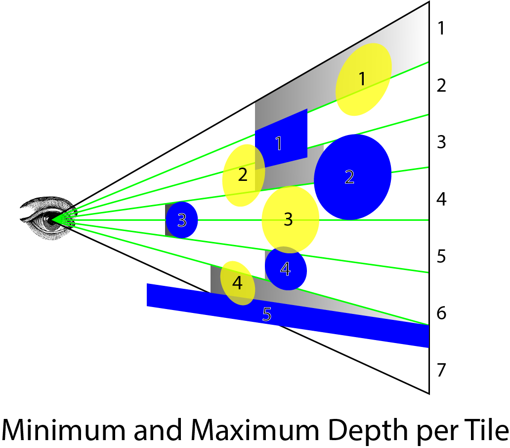

<div class="caption">

Min and Max Depth per Tile (Opaqe)

</div>

The image above shows an example scene. The blue objects represent opaque objects in the scene. The yellow objects represent light sources and the shaded gray areas represent the tile frustums that are computed from the minimum and maximum depth values per tile. The green lines represent the tile boundaries for the light grid. The tiles are numbered 1-7 from top to bottom and the opaque objects are numbered 1-5 and the lights are numbered 1-4.

The first tile has a maximum depth value of 1 (in projected clip space) because there are some pixels that are not covered by opaque geometry. In this case, the culling frustum is very large and may contain lights that don’t affect the geometry. For example, light 1 is contained within tile 1 but light 1 does not affect any geometry. At geometry boundaries, the clipping frustum could potentially be very large and may contain lights that don’t effect any geometry.

The minimum and maximum depth values in tile 2 are the same because object 2 is directly facing the camera and fills the entire tile. This won’t be a problem as we will see later when we perform the actual clipping of the light volume.

Object 3 fully occludes light 3 and thus will not be considered when shading any fragments.

The above image depicts the minimum and maximum depth values per tile for opaque geometry. For transparent geometry, we can only clip light volumes that are behind the maximum depth planes, but we must consider all lights that are in front of all opaque geometry. The reason for this is that when performing the depth pre-pass step to generate the depth texture which is used to determine the minimum and maximum depths per tile, we cannot render transparent geometry into the depth buffer. If we did, then we would not correctly light opaque geometry that is behind transparent geometry. The solution to this problem is described in an article titled “Tiled Forward Shading” by Markus Billeter, Ola Olsson, and Ulf Assarsson [\[4\]](#cite-4). In the light culling compute shader, two light lists will be generated. The first light list contains only the lights that are affecting opaque geometry. The second light list contains only the lights that could affect transparent geometry. When performing final shading on opaque geometry then I will send the first list and when rendering transparent geometry, I will send the second list to the fragment shader.

<span id="attachment-6983"></span>

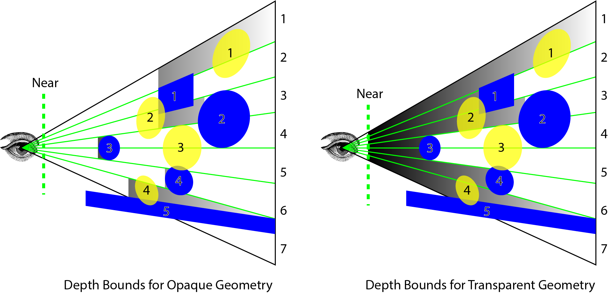

<div class="caption">

Depth Bounds for Opaque and Transparent Geometry

</div>

Before I discuss the light culling compute shader, I will discuss the method that is used to build the light lists in the compute shader.

#### Light List Data Structure

The data structure that is used to store the per-tile light lists is described in the paper titled “Tiled Shading” from Ola Olsson and Ulf Assarsson [\[5\]](#cite-5). Ola and Ulf describe a data structure in two parts. The first part is the **light grid** which is a 2D grid that stores an offset and a count of values stored in a **light index list**. This technique is similar to that of an index buffer which refers to the indices of vertices in an vertex buffer.

<span id="attachment-6985"></span>

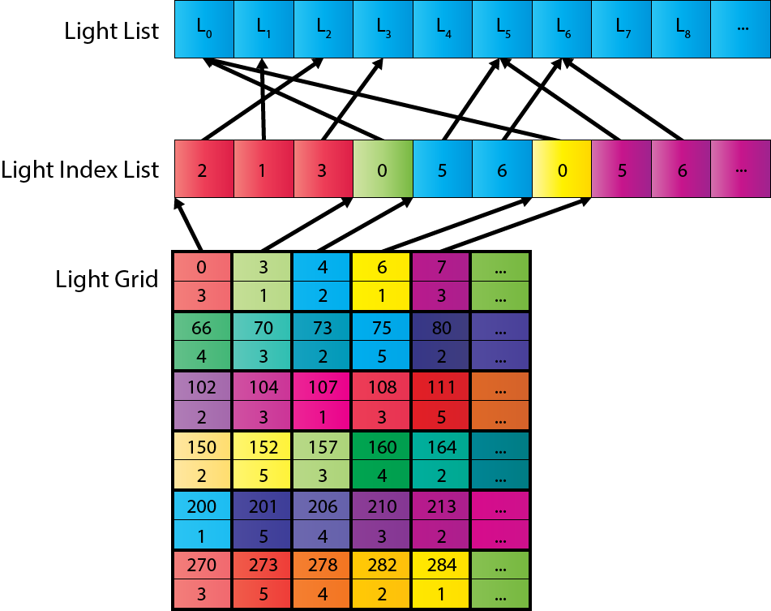

<div class="caption">

Light List Data Structure

</div>

The size of the light grid is based on the number of screen tiles that are used for light culling. The size of the light index list is based the expected average number of overlapping lights per tile. For example, for a screen resolution of 1280×720 and a tile size of 16×16 results in a 80×45 (3,600) light grid. Assuming an average of 200 lights per tile, this would require a light index list of 720,000 indices. Each light index cost 4 bytes (for a 32-bit unsigned integer) so the light list would consume 2.88 MB of GPU memory. Since we need a separate list for transparent and opaque geometry, this would consume a total of 5.76 MB. Although 200 lights may be an overestimation of the average number of overlapping lights per tile, the storage usage is not outrageous.

To generate the light grid and the light index list, a group-shared light index list is first generated in the compute shader. A global light index list counter is used to keep track of the current index into the global light index list. The global light index counter is atomically incremented so that no two thread groups can use the same range in the global light index list. Once the thread group has “reserved” space in the global light index list, the group-shared light index list is copied to the global light index list.

The following pseudo code demonstrates this technique.

```cpp title="Light Culling" showLineNumbers
function CullLights( L, C, G, I )
    Input: A set L of n lights.
    Input: A counter C of the current index into the global light index list.
    Input: A 2D grid G of index offset and count in the global light index list.
    Input: A list I of global light index list.
    Output: A 2D grid G with the current tiles offset and light count.
    Output: A list I with the current tiles overlapping light indices appended to it.

1.  let t be the index of the current tile  ; t is the 2D index of the tile.
2.  let i be a local light index list       ; i is a local light index list.
3.  let f <- Frustum(t)                     ; f is the frustum for the current tile.

4.  for l in L                      ; Iterate the lights in the light list.
5.      if Cull( l, f )             ; Cull the light against the tile frustum.
6.          AppendLight( l, i )     ; Append the light to the local light index list.
                    
7.  c <- AtomicInc( C, i.count )    ; Atomically increment the current index of the 
                                    ; global light index list by the number of lights
                                    ; overlapping the current tile and store the
                                    ; original index in c.
            
8.  G(t) <- ( c, i.count )          ; Store the offset and light count in the light grid.
        
9.  I(c) <- i                       ; Store the local light index list into the global 
                                    ; light index list.
```

On the first three lines, the index of the current tile in the grid is defined as **t**. The local light index list is defined as **i** and the tile frustum that is used to perform light culling for the current tile is defined as **f**.

Lines 4, 5, and 6 loop through the global light list and cull the lights against the current tile’s culling frustum. If the light is inside the frustum, the light index is added to the local light index list.

On line 7 the current index in the global light index list is incremented by the number of lights that are contained in the local light index list. The original value of the global light index list counter before being incremented is stored in the local counter variable **c**.

On line 8, the light grid **G** is updated with the current tile’s offset and count into the global light index list.

And finally, on line 9 the local light index list is copied to the global light index list.

The light grid and the global light index list is then used in the fragment shader to perform final shading.

### Frustum Culling

To perform frustum culling on the light volumes, two frustum culling methods will be presented:

1.  **Frustum-Sphere** culling for point lights
2.  **Frustum-Cone** culling for spot lights

The culling algorithm for spheres is fairly straightforward. The culling algorithm for cones is slightly more complicated. First I will describe the frustum-sphere algorithm and then I will describe the cone-culling algorithm.

#### Frustum-Sphere Culling

We have already seen the definition of the culling frustum in the previous section titled [Compute Grid Frustums](#grid-frustums-compute-shader). A sphere is defined as a center point in view space, and a radius.

```hlsl source="ForwardPlus-94f71f9/CommonInclude.hlsl#L114-L118"
```

A sphere is considered to be “inside” a plane if it is fully contained in the negative half-space of the plane. If a sphere is completly “inside” any of the frustum planes then it is outside of the frustum.

We can use the following formula to determine the signed distance of a sphere from a plane [\[18\]](#cite-18):

$$
l=\left(\mathbf{c}\cdot\mathbf{n}\right)-d
$$

Where $l$ is the signed distance from the sphere to the plane, $\mathbf{c}$ is the center point of the sphere, $\mathbf{n}$ is the unit normal to the plane, and $d$ is the distance from the plane to the origin.

If $l$ is less than $-r$ where $r$ is the radius of the sphere, then we know that the sphere is fully contained in the negative half-space of the plane.

```hlsl source="ForwardPlus-94f71f9/CommonInclude.hlsl#L233-L238"
```

Then we can iteratively apply **SphereInsidePlane** function to determine if the sphere is contained inside the culling frustum.

```hlsl source="ForwardPlus-94f71f9/CommonInclude.hlsl#L261-L284"
```

Since the sphere is described in view space, we can quickly determine if the light should be culled based on its z-position and the distance to the near and far clipping planes. If the sphere is either fully in front of the near clipping plane, or fully behind the far clipping plane, then the light can be discarded. Otherwise we have to check if the light is within the bounds of the culling frustum.

The **SphereInsideFrustum** assumes a right-handed coordinate system with the camera looking towards the negative z axis. In this case, the far plane is approaching negative infinity so we have to check if the sphere is further away (less than in the negative direction). For a left-handed coordinate system, the **zNear** and **zFar** variables should be swapped on line 268.

#### Frustum-Cone Culling

To perform frustum-cone culling, I will use the technique described by Christer Ericson in his book titled “Real-Time Collision Detection” [\[18\]](#cite-18). A cone can be defined by its tip $T$, a normalized direction vector $\mathbf{d}$, the height of the cone $h$ and the radius of the base $r$.

<span id="attachment-7214"></span>

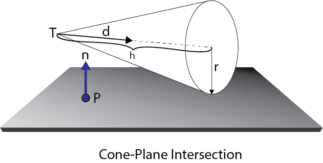

<div class="caption">

$T$ is the tip of the cone, $d$ is the direction, $h$ is the height and $r$ is the radius of the base of the cone.

</div>

In HLSL the cone is defined as

```hlsl source="ForwardPlus-94f71f9/CommonInclude.hlsl#L120-L126"
```

To test if a cone is completely contained in the negative half-space of a plane, only two points need to be tested.

1.  The tip $T$ of the cone
2.  The point $Q$ that is on the base of the cone that is farthest away from the plane in the direction of $\mathbf{n}$

If both of these points are contained in the negative half-space of any of the frustum planes, then the cone can be culled.

To determine the point $Q$ that is farthest away from the plane in the direction of $\mathbf{n}$ we will compute an intermediate vector $\mathbf{m}$ which is parallel but opposite to $\mathbf{n}$ and perpendicular to $\mathbf{d}$.

$$
\mathbf{m}=\left(\mathbf{n}\times\mathbf{d}\right)\times\mathbf{d}
$$

$Q$ is obtained by stepping from the tip $T$ along the cone axis $\mathbf{d}$ at a distance $h$ and then along the base of the cone away from the positive half-space of the plane $-\mathbf{m}$ at a factor of $r$.

$$
Q=T+h\mathbf{d}-r\mathbf{m}
$$

If $\mathbf{n}\times\mathbf{d}$ is zero, then the cone axis $\mathbf{d}$ is parallel to the plane normal $\mathbf{n}$ and $\mathbf{m}$ will be a zero vector. This special case does not need to be handled specifically because in this case the equation reduces to:

$$
Q=T+h\mathbf{d}
$$

Which results in the correct point that needs to be tested.

With points $T$ and $Q$ computed, we can test both points if they are in the negative half-space of the plane. If they are, we can conclude that the light can be culled. To test if a point is in the negative half-space of the plane, we can use the following equation:

$$
l=\left(\mathbf{n}\cdot{X}\right)-d
$$

Where $l$ is the signed distance from the point to the plane and $X$ is the point to be tested. If $l$ is negative, then the point is contained in the negative half-space of the plane.

In HLSL, the function **PointInsidePlane** is used to test if a point is inside the negative half-space of a plane.

```hlsl source="ForwardPlus-94f71f9/CommonInclude.hlsl#L240-L244"
```

And the **ConeInsidePlane** function is used to test if a cone is fully contained in the negative half-space of a plane.

```hlsl source="ForwardPlus-94f71f9/CommonInclude.hlsl#L246-L259"
```

The **ConeInsideFrustum** function is used to test if the cone is contained within the clipping frustum. This function will return **true** if the cone is inside the frustum or **false** if it is fully contained in the negative half-space of any of the clipping planes.

```hlsl source="ForwardPlus-94f71f9/CommonInclude.hlsl#L286-L309"
```

First we check if the cone is clipped by the near or far clipping planes. Otherwise we have to check the four planes of the culling frustum. If the cone is in the negative half-space of any of the clipping planes, the function will return false.

Now we can put this together to define the light culling compute shader.

### Light Culling Compute Shader

The purpose of the light culling compute shader is to update the global light index list and the light grid that is required by the fragment shader. Two lists need to be updated per frame:

1.  Light index list for opaque geometry
2.  Light index list for transparent geometry

To differentiate between the two lists in the HLSL compute shader, I will use the prefix “**o\_**” to refer to the opaque lists and “**t\_**” to refer to transparent lists. Both lists will be updated in the light culling compute shader.

First we will declare the resources that are required by the light culling compute shader.

```hlsl source="ForwardPlus-94f71f9/ForwardPlusRendering.hlsl#L29-L32"
```

In order to read the depth values that are generated the depth pre-pass, the resulting depth texture will need to be sent to the light culling compute shader. The **DepthTextureVS** texture contains the result of the depth pre-pass.

The **in\_Frustums** is the structured buffer that was computed in the compute frustums compute shader and was described in the section titled [Grid Frustums Compute Shader](#grid-frustums-compute-shader).

We also need to keep track of the index into the global light index lists.

```hlsl title="ForwardPlusRendering.hlsl" showLineNumbers startLineNumber=38
// Global counter for current index into the light index list.
// "o_" prefix indicates light lists for opaque geometry while 
// "t_" prefix indicates light lists for transparent geometry.
RWStructuredBuffer<uint> o_LightIndexCounter : register( u1 );
RWStructuredBuffer<uint> t_LightIndexCounter : register( u2 );
```

The **o\_LightIndexCounter** is the current index of the global light index list for opaque geometry and the **t\_LightIndexCounter** is the current index of the global light index list for transparent geometry.

Although the light index counters are of type **RWStructuredBuffer** these buffers only contain a single unsigned integer at index 0.

```hlsl source="ForwardPlus-94f71f9/ForwardPlusRendering.hlsl#L44-L48"
```

The light index lists are stored as a 1D array of unsigned integers but the light grids are stored as 2D textures where each “texel” is a 2-component unsigned integer vector. The light grid texture is created using the **R32G32\_UINT** format.

To store the min and max depth values per tile, we need to declare some group-shared variables to store the minimum and maximum depth values. The atomic increment functions will be used to make sure that only one thread in a thread group can change the min/max depth values but unfortunately, shader model 5.0 does not provide atomic functions for floating point values. To circumvent this limitation, the depth values will be stored as unsigned integers in group-shared memory which will be atomically compared and updated per thread.

```hlsl source="ForwardPlus-94f71f9/ForwardPlusRendering.hlsl#L51-L52"
```

Since the frustum used to perform culling will be the same frustum for all threads in a group, it makes sense to keep only one copy of the frustum for all threads in a group. Only thread 0 in the group will need to copy the frustum from the global memory buffer and we also reduce the amount of local register memory required per thread.

```hlsl source="ForwardPlus-94f71f9/ForwardPlusRendering.hlsl#L53-L53"
```

We also need to declare group-shared variables to create the temporary light lists. We will need a seperate list for opaque and transparent geometry.

```hlsl source="ForwardPlus-94f71f9/ForwardPlusRendering.hlsl#L55-L63"
```

The **LightCount** will keep track of the number of lights that are intersecting the current tile frustum.

The **LightIndexStartOffset** is the offset into the global light index list. This index will be written to the light grid and is used as the starting offset when copying the local light index list to global light index list.

The local light index list will allow us to store as many as 1024 lights in a single tile. This maximum value will almost never be reached (at least it shouldn’t be!). Keep in mind that when we allocated storage for the global light list, we accounted for an average of 200 lights per tile. It is possible that there are some tiles that contain more than 200 lights (as long as it is not more than 1024) and some tiles that contain less than 200 lights but we expect the average to be about 200 lights per tile. As previously mentioned, the estimate of an average of 200 lights per tile is probably an overestimation but since GPU memory is not a limiting constraint for this project, I can afford to be liberal with my estimations.

To update the local light counter and the light list, I will define a helper function called **AppendLight**. Unfortunately I have not yet figured out how to pass group-shared variables as arguments to a function so for now I will define two versions of the same function. One version of the function is used to update the light index list for opaque geometry and the other version is for transparent geometry.

```hlsl source="ForwardPlus-94f71f9/ForwardPlusRendering.hlsl#L65-L85"
```

:::caution
If you are reading this and you know how I can pass **groupshared** variables as arguments to a function in HSLS, please leave your solution in the comments below. (No guessing please. Make sure your solution works before suggesting it).
:::

The **InterlockedAdd** function guarantees that the group-shared light count variable is only updated by a single thread at a time. This way we avoid any race conditions that may occur when multiple threads try to increment the group-shared light count at the same time.

The value of the light count before it is incremented is stored in the **index** local variable and used to update the light index in the group-shared light index list.

The method to compute the minimum and maximum depth range per tile is taken from the presentation titled “DirectX 11 Rendering in Battlefield 3” by Johan Andersson in 2011 [\[19\]](#cite-19). Other components of the light culling compute shader were inspired in part by the articles titled “Forward+: A Step Toward Film-Style Shading in Real Time” by Takahiro Harada [\[3\]](#cite-3) and “Tiled Shading” by Ola Olsson and Ulf Assarsson [\[5\]](#cite-5).

The first thing we will do in the light culling compute shader is read the depth value for the current thread. Each thread in the thread group will sample the depth buffer only once for the current thread and thus all threads in a group will sample all depth values for a single tile.

```hlsl source="ForwardPlus-94f71f9/ForwardPlusRendering.hlsl#L87-L100"
```

Since we can only perform atomic operations on integers, on line 100 we reinterrpret the bits from the floating-point depth as an unsigned integer. Since we expect all depth values in the depth map to be stored in the range \[0…1\] (that is, all positive depth values) then reinturrpreting the float to an int will still allow us to correctly perform comparissons on these values. As long as we don’t try to preform any arithmetic operations on the unsigned integer depth values, we should get the correct minimum and maximum values.

```hlsl source="ForwardPlus-94f71f9/ForwardPlusRendering.hlsl#L102-L111"
```

Since we are setting group-shared variables, only one thread in the group needs to set them. In fact the HLSL compiler will generate a race-condition error if we don’t restrict the writing of these variables to a single thread in the group.

To make sure that every thread in the group has reached the same point in the compute shader, we invoke the **GroupMemoryBarrierWithGroupSync** function. This ensures that any writes to group shared memory have completed and the thread execution for all threads in a group have reached this point.

Next, we’ll determine the minimum and maximum depth values for the current tile.

```hlsl source="ForwardPlus-94f71f9/ForwardPlusRendering.hlsl#L113-L116"
```

The **InterlockedMin** and **InterlockedMax** methods are used to atomically update the **uMinDepth** and **uMaxDepth** group-shared variables based on the current threads depth value.

We again need to use the **GroupMemoryBarrierWithGroupSync** function to ensure all writes to group shared memory have been comitted and all threads in the group have reached this point in the compute shader.

After the minimum and maximum depth values for the current tile have been found, we can reinterrpret the unsigned integer back to a float so that we can use it to compute the view space clipping planes for the current tile.

```hlsl title="ForwardPlusRendering.hlsl" showLineNumbers startLineNumber=118
    float fMinDepth = asfloat( uMinDepth );
    float fMaxDepth = asfloat( uMaxDepth );

    // Convert depth values to view space.
    float minDepthVS = ClipToView( float4( 0, 0, fMinDepth, 1 ) ).z;
    float maxDepthVS = ClipToView( float4( 0, 0, fMaxDepth, 1 ) ).z;
    float nearClipVS = ClipToView( float4( 0, 0, 0, 1 ) ).z;

    // Clipping plane for minimum depth value 
    // (used for testing lights within the bounds of opaque geometry).
    Plane minPlane = { float3( 0, 0, -1 ), -minDepthVS };
```

On line 118 the minimum and maximum depth values as unsigned integers need to be reinterpret as floating point values so that they can be used to compute the correct points in view space.

The view space depth values are computed using the **ScreenToView** function and extracting the **z** component of the position in view space. We only need these values to compute the near and far clipping planes in view space so we only need to know the distance from the viewer.

When culling lights for transparent geometry, we don’t want to use the minimum depth value from the depth map. Instead we will clip the lights using the camera’s near clipping plane. In this case, we will use the **nearClipVS** value which is the distance to the camera’s near clipping plane in view space.

Since I’m using a right-handed coordinate system with the camera pointing towards the negative z axis in view space, the minimum depth clipping plane is computed with a normal $\mathbf{n}$ pointing in the direction of the negative z axis and the distance to the origin $d$ is **\-minDepth**. We can verify that this is correct by using the constant-normal form of a plane:

$$
(\mathbf{n}\cdot{X})-d=0
$$

By substituting $\mathbf{n}=(0,0,-1)$, $X=(x,y,z)$ and $d=-z_{min}$ we get:

$$
\begin{array}{rcl}\left((0,0,-1)\cdot(x,y,z)\right)-(-z_{min})&=&0\\0x+0y+(-1)z-(-z_{min})&=&0\\(-1)z-(-z_{min})&=&0\\-z&=&-z_{min}\\z&=&z_{min}\end{array}
$$

Which implies that $(0,0,z_{min})$ is a point on the minimum depth clipping plane.

```hlsl source="ForwardPlus-94f71f9/ForwardPlusRendering.hlsl#L130-L136"
```

If every thread in the thread group checks one light in the global light list at the same time, then we can check 16×16 (256) lights per iteration of the for-loop defined on line 132. The loop starts with $i = \text{groupIndex}$ and $i$ is incremented $\text{BLOCK\_SIZE}\times\text{BLOCK\_SIZE}$ for each iteration of the loop. This implies that for $\text{BLOCK\_SIZE}=16$, each thread in the thread group will check every 256th light until all lights have been checked.

-   **Thread 0 checks**: { 0, 256, 512, 768, … }
-   **Thread 1 checks**: { 1, 257, 513, 769, … }
-   **Thread 2 checks**: { 2, 258, 514, 770, … }
-   **…**
-   **Thread 255 checks**: { 255, 511, 767, 1023, … }

For 10,000 lights, the for loop only needs 40 iterations (per thread) to check all lights for a tile.

First we’ll check point lights using the **SphereInsideFrustum** function that was defined earlier.

```hlsl source="ForwardPlus-94f71f9/ForwardPlusRendering.hlsl#L138-L155"
```

On line 142 a sphere is defined using the position and range of the light.

First we check if the light is within the tile frustum using the near clipping plane of the camera and the maximum depth read from the depth buffer. If the light volume is in this range, it is added to the light index list for transparent geometry.

To check if the light should be added to the global light index list for opaque geometry, we only need to check the minimum depth clipping plane that was previously defined on line 128. If the light is within the culling frustum for transparent geometry and in front of the minimum depth clipping plane, the index of the light is added to the light index list for opaque geometry.

Next, we’ll check spot lights.

```hlsl source="ForwardPlus-94f71f9/ForwardPlusRendering.hlsl#L156-L172"
```

Checking cones is almost identical to checking spheres so I won’t go into any detail here. The radius of the base of the spotlight cone is not stored with the light so it needs to be calculated for the **ConeInsideFrustum** function. To compute the radius of the base of the cone, we can use the **tangent** of the spotlight angle multiplied by the height of the cone.

And finally we need to check directional lights. This is by far the easiest part of this function.

```hlsl source="ForwardPlus-94f71f9/ForwardPlusRendering.hlsl#L173-L186"
```

There is no way to reliably cull directional lights so if we encounter a directional light, we have no choice but to add it’s index to the light index list.

To ensure that all threads in the thread group have recorded their lights to the group-shared light index list, we will invoke the **GroupMemoryBarrierWithGroupSync** function to synchronize all threads in the group.

After we have added all non-culled lights to the group-shared light index lists we need to copy it to the global light index list. First, we’ll update the global light index list counter.

```hlsl source="ForwardPlus-94f71f9/ForwardPlusRendering.hlsl#L188-L201"
```

We will once again use the **InterlockedAdd** function to increment the global light index list counter by the number of lights that were appended to the group-shared light index list. On lines 194 and 198 the light grid is updated with the offset and light count of the global light index list.

To avoid race conditions, only the first thread in the thread group will be used to update the global memory.

On line 201, all threads in the thread group must be synced again before we can update the global light index list.

```hlsl title="ForwardPlusRendering.hlsl" showLineNumbers startLineNumber=203
    // Now update the light index list (all threads).
    // For opaque geometry.
    for ( i = IN.groupIndex; i < o_LightCount; i += BLOCK_SIZE * BLOCK_SIZE )
    {
        o_LightIndexList[o_LightIndexStartOffset + i] = o_LightList[i];
    }
    // For transparent geometry.
    for ( i = IN.groupIndex; i < t_LightCount; i += BLOCK_SIZE * BLOCK_SIZE )
    {
        t_LightIndexList[t_LightIndexStartOffset + i] = t_LightList[i];
    }
```

To update the opaque and transparent global light index lists, we will allow all threads to write a single index into the light index list using a similar method that was used to iterate the light list on lines 132-183 shown previously.

At this point both the light grid and the global light index list contain the necessary data to be used by the pixel shader to perform final shading.

### Final Shading

The last part of the Forward+ rendering technique is final shading. This method is no different from the standard forward rendering technique that was discussed in the section titled [Forward Rendering – Pixel Shader](#pixel-shader) except that instead of looping through the entire global light list, we use the light index list that was generated in the light culling phase.

In addition to the properties that were described in the section about standard forward rendering, the Forward+ pixel shader also needs to take the light index list and the light grid that was generated in the light culling phase.

```hlsl source="ForwardPlus-94f71f9/ForwardPlusRendering.hlsl#L287-L288"
```

When rendering opaque geometry, you must take care to bind the light index list and light grid for opaque geometry and when rendering transparent geometry, the light index list and light grid for transparent geometry. Of course this seems obvious but the only differentiating factor for the final shading pixel shader is the light index list and light grid that is bound to the pixel shader stage.

```hlsl title="ForwardPlusRendering.hlsl" showLineNumbers startLineNumber=290
[earlydepthstencil]
float4 PS_main( VertexShaderOutput IN ) : SV_TARGET
{
    // Compute ambient, emissive, diffuse, specular, and normal
    // similar to standard forward rendering.
    // That code is omitted here for brevity.
    
    // Get the index of the current pixel in the light grid.
    uint2 tileIndex = uint2( floor(IN.position.xy / BLOCK_SIZE) );

    // Get the start position and offset of the light in the light index list.
    uint startOffset = LightGrid[tileIndex].x;
    uint lightCount = LightGrid[tileIndex].y;

    LightingResult lit = (LightingResult)0; // DoLighting( Lights, mat, eyePos, P, N );

    for ( uint i = 0; i < lightCount; i++ )
    {
        uint lightIndex = LightIndexList[startOffset + i];
        Light light = Lights[lightIndex];

        LightingResult result = (LightingResult)0;

        switch ( light.Type )
        {
        case DIRECTIONAL_LIGHT:
        {
            result = DoDirectionalLight( light, mat, V, P, N );
        }
        break;
        case POINT_LIGHT:
        {
            result = DoPointLight( light, mat, V, P, N );
        }
        break;
        case SPOT_LIGHT:
        {
            result = DoSpotLight( light, mat, V, P, N );
        }
        break;
        }
        lit.Diffuse += result.Diffuse;
        lit.Specular += result.Specular;
    }
    
    diffuse *= float4( lit.Diffuse.rgb, 1.0f ); // Discard the alpha value from the lighting calculations.
    specular *= lit.Specular;

    return float4( ( ambient + emissive + diffuse + specular ).rgb, alpha * mat.Opacity );
}
```

Most of the code for this pixel shader is identical to that of the forward rendering pixel shader so it is omitted here for brevity. The primary concept here is shown on line 298 where the tile index into the light grid is computed from the screen space position. Using the tile index, the start offset and light count is read from the light grid on lines 301 and 302.

In the for-loop defined on line 306 loops over the light count and reads the light’s index from the light index list and uses that index to retrieve the light from the global light list.

<span id="attachment-7062"></span>

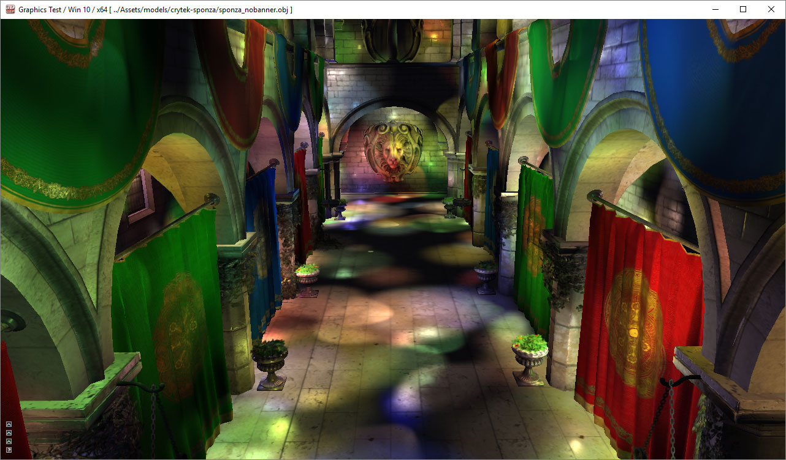

<div class="caption">

Forward+ with 10,000 lights

</div>

Now let’s see how the performance of the various methods compare.

## Experiment Setup and Performance Results

To measure the performance of the various rendering techniques, I used the Crytek Sponza scene [\[11\]](#cite-11) on an **NVIDIA GeForce GTX 680** GPU at a screen resolution of **1280×720**. The camera was placed close to the world origin and the lights were animated to rotate in a circle around the world origin.

I tested each rendering technique using two scenarios:

1.  Large lights with a range of 35-40 units
2.  Small lights with a range of 1-2 units

Having a few (2-3) large lights in the scene is a realistic scenario (for example key light, fill light, and back light [\[25\]](#cite-25)). These lights may be shadow casters that set the mood and create the ambient for the scene. Having many (more than 5) large lights that fill the screen is not necessarily a realistic scenario but I wanted to see how the various techniques scaled when using large, screen-filling lights.

Having many small lights is a more realistic scenario that might be commonly used in games. Many small lights can be used to simulate area lights or bounced lighting effects similar to the effects of global illumination algorithms that are usually only simulated using light maps or light probes as described in the section titled [Forward Rendering](#forward-rendering).

Although the demo supports directional lights I did not test the performance of rendering using directional lights. Directional lights are large screen filling lights that are similar to lights having a range of 35-40 units (the first scenario).

In both scenarios lights were randomly placed throughout the scene within the boundaries of the scene. The sponza scene was scaled down so that its bounds were approximately 30 units in the X and Z axes and 15 units in the Y axis.

Each graph displays a set of curves that represent the various phases of the rendering technique. The horizontal axis of the curve represents the number of lights in the scene and the vertical axis represents the running time measured in milliseconds. Each graph also displays a minimum and maximum threshold. The minimum threshold is displayed as a green horizontal line in the graph and represents the ideal frame-rate of 60 **Frames-Per Second** (**FPS**) or 16.6 ms. The maximum threshold is displayed as a red horizontal line in the graph and represents the lowest acceptable frame-rate of 30 FPS or 33.3 ms.

### Forward Rendering Performance

Let us first analyze the performance of the forward rendering technique using large lights.

#### Large Lights

The graph below shows the performance results of the forward rendering technique using large lights.

<span id="attachment-7136"></span>

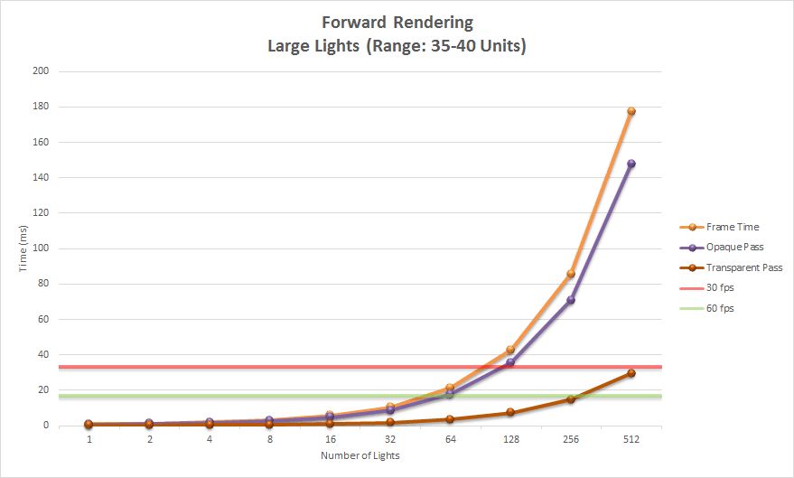

<div class="caption">

Forward Rendering (Light Range: 35-40 Units)

</div>

The graph displays the two primary phases of the forward rendering technique. The purple curve shows the opaque pass and the dark red curve shows the transparent pass. The orange line shows the total time to render the scene.

As can be seen by this graph, rendering opaque geometry takes the most amount of time and increases exponentially as the number of lights increases. The time to render transparent geometry also increases exponentially but there is much less transparent geometry in the scene than opaque geometry so the increase seems more gradual.

Even with very large lights, standard forward rendering is able to render 64 dynamic lights while still maintaining frame-rates below the maximum threshold of 30 FPS. With more than 512 lights, the frame time becomes immeasurably high.

From this we can conclude that if the scene contains more than 64 large visible lights, you may want to consider using a different rendering technique than forward rendering.

#### Small Lights

Forward rendering performs better when the scene contains many small lights. In this case, the rendering technique can handle twice as many lights while still maintaining acceptable performance. After more than 1024 lights, the frame time was so high, it was no longer worth measuring.

<span id="attachment-7138"></span>

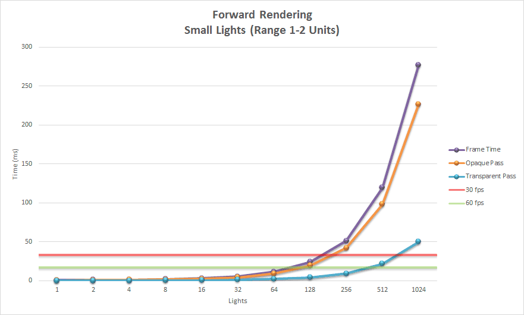

<div class="caption">

Forward Rendering (Light Range: 1-2 Units)

</div>

We see again that the most amount of time is spent rendering opaque geometry which is not surprising. The trends for both large and small lights are similar but when using small lights, we can create twice as many lights while achieving acceptable frame-rates.

Next I’ll analyze the performance of the deferred rendering technique.

### Deferred Rendering Performance

The same experiment was repeated but this time using the deferred rendering technique. Let’s first analyze the performance of using large screen-filling lights.

#### Large Lights

The graph below shows the performance results of deferred rendering using large lights.

<span id="attachment-7140"></span>

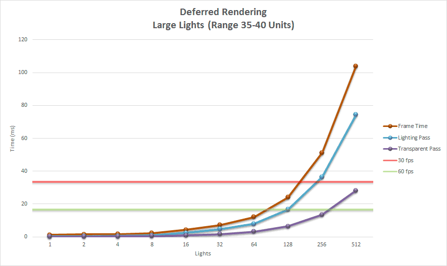

<div class="caption">

Deferred Rending (Large Lights)

</div>

Rendering large lights using deferred rendering proved to be only marginally better than forward rendering. Since rendering transparent geometry uses the exact same code paths as the forward rendering technique, the performance of rendering transparent geometry using forward versus deferred rendering are virtually identical. As expected, there is no performance benefit when rendering transparent geometry.

The marginal performance benefit of rendering opaque geometry using deferred rendering is primarily due to the reduced number of redundant lighting computations that forward rendering performs on occluded geometry. Redundant lighting computations that are performed when using forward rendering can be mitigated by using a depth pre-pass which would allow for early z-testing to reject fragments before performing expensive lighting calculations. Deferred rendering implicitly benefits from early z-testing and stencil operations that are not performed during forward rendering.

#### Small Lights

The graph below shows the performance results of deferred rendering using small lights.

<span id="attachment-7143"></span>

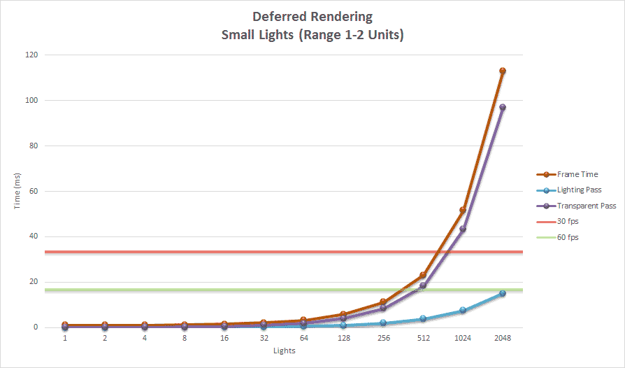

<div class="caption">

Deferred Rending (Small Lights)

</div>

The graph shows that deferred rendering is capable of rendering 512 small dynamic lights while still maintaining acceptable frame rates. In this case the time to render transparent geometry greatly exceeds that of rendering opaque geometry. If rendering only opaque objects, then the deferred rendering technique is capable of rendering 2048 lights while maintaining frame-rates below the minimum acceptable threshold of 60 FPS. Rendering transparent geometry greatly exceeds the maximum threshold after about 700 lights.

### Forward Plus Performance

The same experiment was repeated once again using tiled forward rendering. First we will analyze at the performance characteristics using large lights.

#### Large Lights

The graph below shows the performance results of tiled forward rendering using large scene lights.

<span id="attachment-7155"></span>

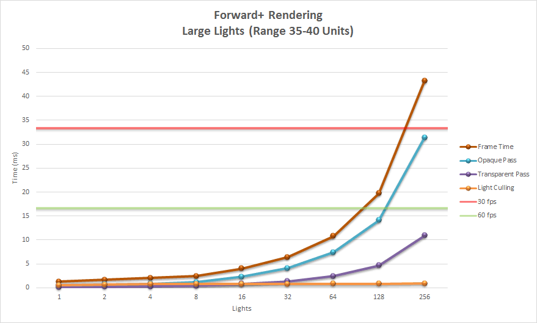

<div class="caption">

Forward Plus (Large Lights)

</div>

The graph shows that tiled forward rendering is not well suited for rendering scenes with many large lights. Rendering 512 screen filling lights in the scene caused issues because the demo only accounts for having an average of 200 lights per tile. With 512 large lights the 200 light average was exceeded and many tiles simply appeared black.

Using large lights, the light culling phase never exceeded 1 ms but the opaque pass and the transparent pass quickly exceeded the maximum frame-rate threshold of 30 FPS.

#### Small Lights

The graph shows the performance of tiled forward rendering using small lights.

<span id="attachment-7157"></span>

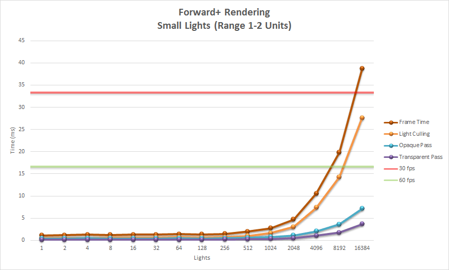

<div class="caption">

Forward Plus (Small Lights)

</div>

Forward plus really shines when using many small lights. In this case we see that the light culling phase (orange line) is the primary bottleneck of the rendering technique. Even with over 16,000 lights, rendering opaque (blue line) and transparent (purple line) geometry fall below the minimum threshold to achieve a desired frame-rate of 60 FPS. The majority of the frame time is consumed by the light culling phase.

Now lets see how the three techniques compare against each other.

### Techniques Compared

First we’ll look at how the three techniques compare when using large lights.

#### Large Lights

The graph below shows the performance of the three rendering techniques when using large lights.

<span id="attachment-7159"></span>

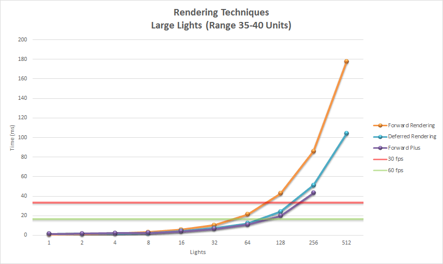

<div class="caption">

Rendering Techniques (Large Lights)

</div>

As expected, forward rendering is the most expensive rendering algorithm when rendering large lights. Deferred rendering and tiled forward rendering are comparable in performance. Even if we disregard rendering transparent geometry in the scene, deferred rendering and tiled forward rendering have similar performance characteristics.

If we consider scenes with only a few large lights there is still no discernible performance benefits between forward, deferred, or forward plus rendering.

If we consider the memory footprint required to perform forward rendering versus deferred rendering versus tiled forward rendering then traditional forward rendering has the smallest memory usage.

Regardless of the number of lights in the scene, deferred rendering requires about four bytes of GPU memory per pixel per additional G-buffer render target. Tiled forward rendering requires additional GPU storage for the light index list and the light grid which must be stored even when the scene contains only a few dynamic lights.

-   Deferred Rendering (Diffuse, Specular, Normal @ 1280×720): +11 MB
-   Tiled Forward Rendering (Light Index List, Light Grid @ 1280×720): +5.76 MB

The additional storage requirements for deferred rendering is based on an additional three full-screen buffers at 32-bits (4 bytes) per pixel. The depth/stencil buffer and the light accumulation buffers are not considered as additional storage because standard forward rendering uses these buffers as well.

The additional storage requirements for tiled forward rendering is based on two light index lists that have enough storage for an average of 200 lights per tile and two 80×45 light grids that store 2-component unsigned integer per grid cell.

If GPU storage is a rare commodity for the target platform and there is no need for many lights in the scene, traditional forward rendering is still the best choice.

#### Small Lights

The graph below shows the performance of the three rendering techniques when using small lights.

<span id="attachment-7161"></span>

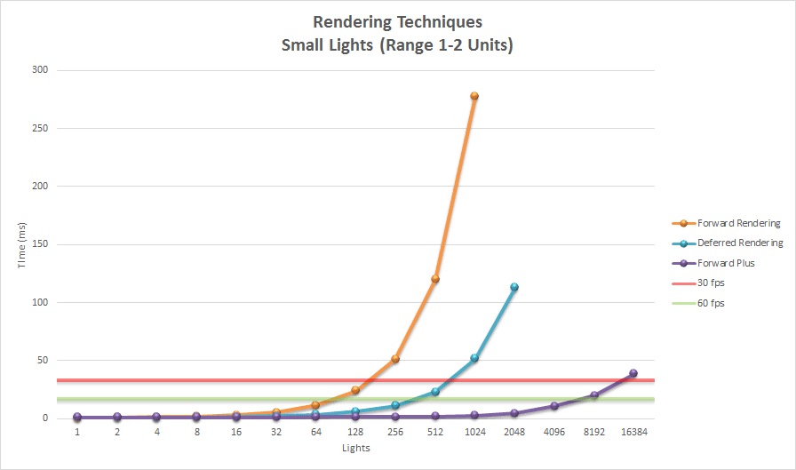

<div class="caption">

Rendering Techniques (Small Lights)

</div>

In the case of small lights, tiled forward rendering clearly comes out as the winner in terms of rendering times. Up until somewhere around 128 lights, deferred and tiled forward rendering are comparable in performance but quickly diverge when the scene contains many dynamic lights. Also we must consider the fact that a large portion of the deferred rendering technique is consumed by rendering transparent objects. If transparent objects are not a requirement, then deferred rendering may be a viable option.

Even with small lights, deferred rendering requires many more draw calls to render the geometry of the light volumes. Using deferred rendering, each light volume must be rendered at least twice, the first draw call updates the stencil buffer and the second draw call performs the lighting equations. If the graphics platform is very sensitive to excessive draw calls, then deferred rendering may not be the best choice.

Similar to the scenario with large lights, when rendering only a few lights in the scene then all three techniques have similar performance characteristics. In this case, we must consider the additional memory requirements that are imposed by deferred and tiled forward rendering. Again, if GPU memory is scarce and there is no need for many dynamic lights in the scene then standard forward rendering may be a viable solution.

## Future Considerations

While working on this project I have identified several issues that would benefit from consideration in the future.

1.  General Issues:
    -   Size of the light structure
2.  Forward Rendering:
    -   Depth pre-pass
    -   View frustum culling of visible lights
3.  Deferred Rendering:
    -   Optimize G-buffers
    -   Rendering of directional lights
4.  Tiled Forward Rendering
    -   Improve light culling

### General Considerations

For each of the rendering techniques used in this demo there is only a single global light list which stores directional, point, and spotlights in a single data structure. In order to store all of the properties necessary to perform correct lighting, each individual light structure requires 160 bytes of GPU memory. If we only store the absolute minimum amount of information needed to describe a light source we could take advantage of improved caching of the light data and potentially improve rendering performance across all rendering techniques. This may require having additional data structures to store only the relevant information that is needed by either the compute or the fragment shader or creating separate lists for directional, spot, and point lights so that no redundant information that is not relevant to the light source is stored in the data structure.

### Forward Rendering

This implementation of the forward rendering technique makes no attempt to optimize the forward rendering pipeline. Culling lights against the view frustum would be a reasonable method to improve the rendering performance of the forward renderer.

Performing a depth prepass as the first step of the forward rendering technique would allow us to take advantage of early z-testing to eliminate redundant lighting calculations.

### Deferred Rendering

When creating the implementation for the deferred rendering technique, I did not spend much time evaluating the performance of deferred rendering dependent on the format of the G-buffer textures used. The layout of the G-buffer was chosen for simplicity and ease of use. For example, the G-buffer texture to store view space normals uses a 4-component 32-bit floating-point buffer. Storing this render target as a 2-component 16-bit fixed-point buffer would not only reduce the buffer size by 75%, it would also improve texture caching. The only change that would need to be made to the shader is the method used to pack and unpack the normal data in the buffer. To pack the normal into the G-buffer, we would only need to cast the normalized 32-bit floating-point x and y values of the normal into 16-bit floating point values and store them in the render target. To unpack the normals in the lighting pass, we could read the 16-bit components from the buffer and compute the z-component of the normal by applying the following formula:

$$
z=\sqrt{1-(x^2+y^2)}
$$

This would result in the z-component of the normal always being positive in the range $\left[0\cdots 1\right]$. This is usually not a problem since the normals are always stored in view-space and if the normal’s z-component is negative, then it would be back-facing and back-facing polygons should be culled anyways.

Another potential area of improvement for the deferred renderer is the handling of directional lights. Currently the implementation renders directional lights as full-screen quads in the lighting pass. This may not be the best approach as even a few directional lights will cause severe overdraw and could become a problem on fill-rate bound hardware. To mitigate this issue, we could move the lighting computations for directional lights into the G-buffer pass and accumulate the lighting contributions from directional lights into the light accumulation buffer similar to how ambient and emissive terms are being applied.

This technique could be further improved by performing a depth-prepass before the G-buffer pass to allow for early z-testing to remove redundant lighting calculations.

One of the advantages of using deferred rendering is that shadow maps can be recycled because only a single light is being rendered in the lighting pass at a time so only one shadow map needs to be allocated. Moving the lighting calculations for directional lights to the G-buffer pass would require that any shadow maps used by the directional lights need to be available before the G-buffer pass. This is only a problem if there are a lot of shadow casting directional lights in the scene. If using a lot of shadow-casting directional lights, this method of performing lighting computations of directional lights in the G-buffer pass may not be feasible.

### Tiled Forward Rendering

As can be seen from the experiment results, the light culling stage takes a considerable amount of time to perform. If the performance of the light culling phase could be improved then we could gain an overall performance improvement of the tiled forward rendering technique. Perhaps we could perform an early culling step that eliminates lights that are not in the viewing frustum. This would require creating another compute shader that performs view frustum culling against all lights in the scene but instead of culling all lights against 3,600 frustums, only the view frustum needs to be checked. This way, each thread in the dispatch would only need to check a very small subset of the lights against the view frustum. After culling the lights against the larger view frustum, the per-tile light culling compute shader would only have to check the lights that are contained in the view frustum.

Another improvement to the light culling phase may be achievable using sparse octrees to store a light list at each node of the octree. A node is split if the nodes exceeds some maximum threshold for light counts. Nodes that don’t contain any lights in the octree can be removed from the octree and would not need to be considered during final rendering.

DirectX 12 introduces **Volume Tiled Resources** [\[20\]](#cite-20) which could be used to implement the sparse octree. Nodes in the octree that don’t have any lights would not need any backing memory. I’m not exactly sure how this would be implemented but it may be worth investigating.

Another area of improvement for the tiled forward rendering technique would be to improve the accuracy of the light culling. Frustum culling could result in a light being considered to be contained within a tile when in fact no part of the light volume is contained in the tile.

<span id="attachment-7172"></span>

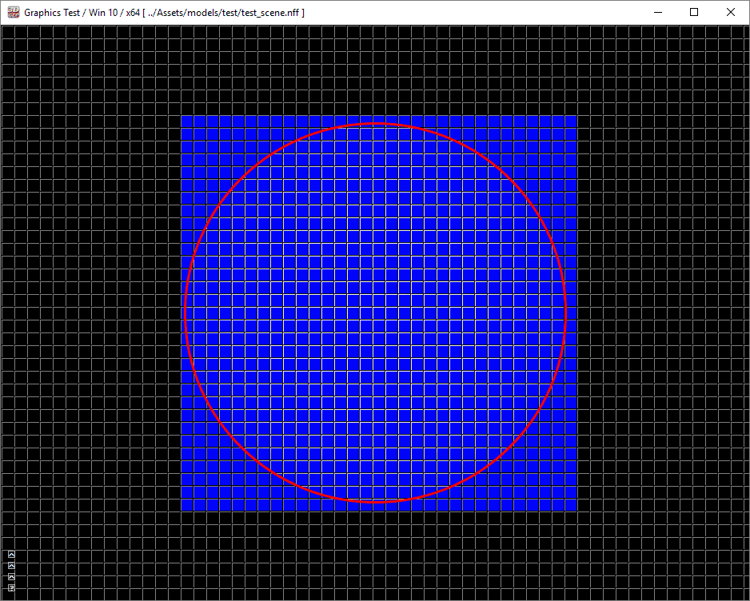

<div class="caption">

Tile Frustum Culling (Point Light)

</div>

As can be seen in the above image, a point light is highlighted with a red circle. The blue tiles in the image show which tiles detect that the circle is contained within the frustum of the tile. Of course the tiles inside the red circle should detect the point light but the tiles at the corners are false positives. This happens because the sphere cannot be totally rejected by any plane of the tile’s frustum.

<video class="embed-video-file" src="/videos/Tile-Frustum-Culling-Point-Light.mp4" width="584" height="584" loop controls preload="metadata" playsinline></video>

If we zoom-in to the top-left tile (highlighted green in the video above) we can inspect the top, left, bottom, and right frustum planes of the tile. If you play the video you will see that the sphere is partially contained in all four of the tile’s frustum planes and thus the light cannot be culled.

In a GDC 2015 presentation by Gareth Thomas [\[21\]](#cite-21) he presents several methods to improve the accuracy of tile-based compute rendering. He suggests using parallel reduction instead of atomic min/max functions in the light culling compute shader. His performance analyses shows that he was able to achieve an 11 – 14 percent performance increase by using parallel reduction instead of atomic min/max.

In order to improve the accuracy of the light culling, Gareth suggests using an axis-aligned bounding box (AABB) to approximate the tile frustum. Using AABB’s to approximate the size of the tile frustum proves to be a successful method for reducing the number of false positives without incurring an expensive intersection test. To perform the sphere-AABB intersection test, Gareth suggests using a very simple algorithm described by James Arvo in the first edition of the Graphics Gems series [\[22\]](#cite-22).

Another issue with tile-based light culling using the min/max depth bounds occurs in tiles with large depth discontinuities, for example when foreground geometry only partially overlaps a tile.

<span id="attachment-7178"></span>

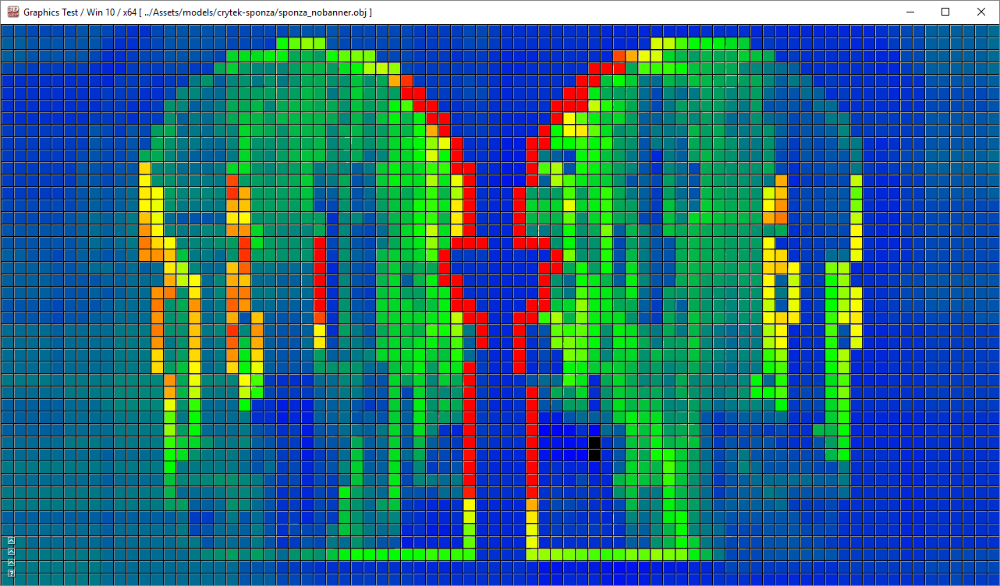

<div class="caption">

Depth Discontinuities

</div>

The blue and green tiles contain very few lights. In this case the minimum and maximum depth values are in close proximity. The red tiles indicate that the tile contains many lights due to a large depth disparity. In Gareth Thomas’s presentation [\[21\]](#cite-21) he suggests splitting the frustum in two halves and computing minimum and maximum depth values for each half of the split frustum. This implies that the light culling algorithm must perform twice as much work per tile but his performance analysis shows that total frame time is reduced by about 10 – 12 percent using this technique.

A more interesting performance optimization is a method called Clustered Shading presented by Ola Olsson, Markus Billeter, and Ulf Assarsson in their paper titled “Clustered Deferred and Forward Shading” [\[23\]](#cite-23). Their method groups view samples with similar properties (3D position and normals) into clusters. Lights in the scene are assigned to clusters and the per-cluster light lists are used in final shading. In their paper, they claim to be able to handle one million light sources while maintaining real-time frame-rates.

Other space partitioning algorithms may also prove to be successful at improving the performance of tile-based compute shaders. For example the use of Binary Space Partitioning (BSP) trees to split lights into the leaves of a binary tree. When performing final shading, only the lights in the leaf nodes of the BSP where the fragment exists needs to be considered for lighting.

Another possible data structure that could be used to reduce redundant lighting calculations is a sparse voxel octree as described by Cyril Crassin and Simon Green in OpenGL insights [\[24\]](#cite-24). Instead of using the octree to store material information, the data structure is used to store the light index lists of lights contained in each node. During final shading, the light index lists are queried from the octree depending on the 3D position of the fragment.

## Conclusion

In this article I described the implementation of three rendering techniques:

1.  Forward Rendering
2.  Deferred Rendering
3.  Tiled Forward (Forward+) Rendering

I have shown that traditional forward rendering is well suited for scenarios which require support for multiple shading models and semi-transparent objects. Forward rendering is also well suited for scenes that have only a few dynamic lights. The analysis shows that scenes that contain less than 100 dynamic scene lights still performs reasonably well on commercial hardware. Forward rendering also has a low memory footprint when multiple shadow maps are not required. When GPU memory is scarce and support for many dynamic lights is not a requirement (for example on mobile or embedded devices) traditional forward rendering may be the best choice.

Deferred rendering is best suited for scenarios that don’t have a requirement for multiple shading models or semi-transparent objects but do have a requirement of many dynamic scene lights. Deferred rendering is well suited for many shadow casting lights because a single shadow map can be shared between successive lights in the lighting pass. Deferred rendering is not well suited for devices with limited GPU memory. Amongst the three rendering techniques, deferred rendering has the largest memory footprint requiring an additional 4 bytes per pixel per G-buffer texture (~3.7 MB per texture at a screen resolution of 1280×720).

Tiled forward rendering has a small initial overhead required to dispatch the light culling compute shader but the performance of tiled forward rendering with many dynamic lights quickly supasses the performance of both forward and deferred rendering. Tiled forward rendering requires a small amount of additional memory. Approximately 5.7 MB of additional storage is required to store the light index list and light grid using 16×16 tiles at a screen resolution of 1280×720. Tiled forward rendering requires that the target platform has support for compute shaders. It is possible to perform the light culling on the CPU and pass the light index list and light grid to the pixel shader in the case that compute shaders are not available but the performance trad-off might negate the benefit of performing light culling in the first place.

Tiled forward shading supports both multi-material and semi-transparent materials natively (using two light index lists) and both opaque and semi-transparent materials can benefit from the performance gains offered by tiled forward shading.

Although tiled forward shading may seem like the answer to life, the universe and everything (actually, 42 is), there are improvements that can be made to this technique. Clustered deferred rendering [\[23\]](#cite-23) should be able to perform even better at the expense of additional memory requirements. Perhaps the memory requirements of clustered deferred rendering could be mitigated by the use of sparse volume textures [\[20\]](#cite-20) but that has yet to be seen.

## Download the Demo

The source code (including pre-built executables) can be download from GitHub using the link below. The repository is almost 1GB in size and contains all of the pre-built 3rd party libraries and the Crytek Sponza scene [\[11\]](#cite-11)

[Download from GitHub](https://github.com/3dgep/ForwardPlus)

## References

<span id="cite-1"></span>\[1\] T. Saito and T. Takahashi, ‘Comprehensible rendering of 3-D shapes’, ACM SIGGRAPH Computer Graphics, vol. 24, no. 4, pp. 197-206, 1990.

<span id="cite-2"></span>\[2\] T. Harada, J. McKee and J. Yang, ‘Forward+: Bringing Deferred Lighting to the Next Level’, Computer Graphics Forum, vol. 0, no. 0, pp. 1-4, 2012.

<span id="cite-3"></span>\[3\] T. Harada, J. McKee and J. Yang, ‘Forward+: A Step Toward Film-Style Shading in Real Time’, in GPU Pro 4, 1st ed., W. Engel, Ed. Boca Raton, Florida, USA: CRC Press, 2013, pp. 115-135.

<span id="cite-4"></span>\[4\] M. Billeter, O. Olsson and U. Assarsson, ‘Tiled Forward Shading’, in GPU Pro 4, 1st ed., W. Engel, Ed. Boca Raton, Florida, USA: CRC Press, 2013, pp. 99-114.

<span id="cite-5"></span>\[5\] O. Olsson and U. Assarsson, ‘Tiled Shading’, Journal of Graphics, GPU, and Game Tools, vol. 15, no. 4, pp. 235-251, 2011.

<span id="cite-6"></span>\[6\] Unity Technologies, ‘Unity – Manual: Light Probes’, Docs.unity3d.com, 2015. \[Online\]. Available: [https://docs.unity.com/en-us/engine/6000.6/manual/lighting-overview/direct-and-indirect-lighting/light-probes/light-probes](https://docs.unity.com/en-us/engine/6000.6/manual/lighting-overview/direct-and-indirect-lighting/light-probes/light-probes). \[Accessed: 04- Aug- 2015\].

<span id="cite-7"></span>\[7\] Assimp.sourceforge.net, ‘Open Asset Import Library’, 2015. \[Online\]. Available: [https://www.assimp.org/](https://www.assimp.org/). \[Accessed: 10- Aug- 2015\].

<span id="cite-8"></span>\[8\] Msdn.microsoft.com, ‘Semantics (Windows)’, 2015. \[Online\]. Available: [https://learn.microsoft.com/windows/win32/direct3dhlsl/dx-graphics-hlsl-semantics](https://learn.microsoft.com/windows/win32/direct3dhlsl/dx-graphics-hlsl-semantics). \[Accessed: 10- Aug- 2015\].

<span id="cite-9"></span>\[9\] Msdn.microsoft.com, ‘Variable Syntax (Windows)’, 2015. \[Online\]. Available: [https://learn.microsoft.com/windows/win32/direct3dhlsl/dx-graphics-hlsl-variable-syntax](https://learn.microsoft.com/windows/win32/direct3dhlsl/dx-graphics-hlsl-variable-syntax). \[Accessed: 10- Aug- 2015\].

<span id="cite-10"></span>\[10\] Msdn.microsoft.com, ‘earlydepthstencil (Windows)’, 2015. \[Online\]. Available: [https://learn.microsoft.com/windows/win32/direct3dhlsl/sm5-attributes-earlydepthstencil](https://learn.microsoft.com/windows/win32/direct3dhlsl/sm5-attributes-earlydepthstencil). \[Accessed: 11- Aug- 2015\].

<span id="cite-11"></span>\[11\] Crytek.com, ‘Crytek3 Downloads’, 2015. \[Online\]. Available: [https://web.archive.org/web/20151231130156/http://www.crytek.com/cryengine/cryengine3/downloads](https://web.archive.org/web/20151231130156/http://www.crytek.com/cryengine/cryengine3/downloads). \[Accessed: 12- Aug- 2015\].

<span id="cite-12"></span>\[12\] Graphics.cs.williams.edu, ‘Computer Graphics Data – Meshes’, 2015. \[Online\]. Available: [https://casual-effects.com/data/](https://casual-effects.com/data/). \[Accessed: 12- Aug- 2015\].

<span id="cite-13"></span>\[13\] M. van der Leeuw, ‘Deferred Rendering in Killzone 2’, SCE Graphics Seminar, Palo Alto, California, 2007.

<span id="cite-14"></span>\[14\] Msdn.microsoft.com, ‘D3D11\_DEPTH\_STENCIL\_DESC structure (Windows)’, 2015. \[Online\]. Available: [https://learn.microsoft.com/windows/win32/api/d3d11/ns-d3d11-d3d11_depth_stencil_desc](https://learn.microsoft.com/windows/win32/api/d3d11/ns-d3d11-d3d11_depth_stencil_desc). \[Accessed: 13- Aug- 2015\].

<span id="cite-15"></span>\[15\] Electron9.phys.utk.edu, ‘Coherence’, 2015. \[Online\]. Available: [https://web.archive.org/web/20151110114701/http://electron9.phys.utk.edu/optics421/modules/m5/Coherence.htm](https://web.archive.org/web/20151110114701/http://electron9.phys.utk.edu/optics421/modules/m5/Coherence.htm). \[Accessed: 14- Aug- 2015\].

<span id="cite-16"></span>\[16\] Msdn.microsoft.com, ‘Load (DirectX HLSL Texture Object) (Windows)’, 2015. \[Online\]. Available: [https://learn.microsoft.com/windows/win32/direct3dhlsl/dx-graphics-hlsl-to-load](https://learn.microsoft.com/windows/win32/direct3dhlsl/dx-graphics-hlsl-to-load). \[Accessed: 14- Aug- 2015\].

<span id="cite-17"></span>\[17\] Msdn.microsoft.com, ‘Compute Shader Overview (Windows)’, 2015. \[Online\]. Available: [https://learn.microsoft.com/windows/win32/direct3d11/direct3d-11-advanced-stages-compute-shader](https://learn.microsoft.com/windows/win32/direct3d11/direct3d-11-advanced-stages-compute-shader). \[Accessed: 04- Sep- 2015\].

<span id="cite-18"></span>\[18\] C. Ericson, Real-time collision detection. Amsterdam: Elsevier, 2005.

<span id="cite-19"></span>\[19\] J. Andersson, ‘DirectX 11 Rendering in Battlefield 3’, 2011.

<span id="cite-20"></span>\[20\] Msdn.microsoft.com, ‘Volume Tiled Resources (Windows)’, 2015. \[Online\]. Available: [https://learn.microsoft.com/windows/win32/direct3d12/volume-tiled-resources](https://learn.microsoft.com/windows/win32/direct3d12/volume-tiled-resources). \[Accessed: 29- Sep- 2015\].

<span id="cite-21"></span>\[21\] G. Thomas, ‘Advancements in Tiled-Based Compute Rendering’, San Francisco, California, USA, 2015.

<span id="cite-22"></span>\[22\] J. Arvo, ‘A Simple Method for Box-Sphere Intersection Testing’, in Graphics Gems, 1st ed., A. Glassner, Ed. Academic Press, 1990.

<span id="cite-23"></span>\[23\] O. Olsson, M. Billeter and U. Assarsson, ‘Clustered Deferred and Forward Shading’, High Performance Graphics, 2012.

<span id="cite-24"></span>\[24\] C. Crassin and S. Green, ‘Octree-Based Sparse Voxelization Using the GPU Hardware Rasterizer’, in OpenGL Insights, 1st ed., P. Cozzi and C. Riccio, Ed. CRC Press, 2012, p. Chapter 22.

<span id="cite-25"></span>\[25\] Mediacollege.com, ‘Three Point Lighting’, 2015. \[Online\]. Available: [https://www.mediacollege.com/lighting/three-point/](https://www.mediacollege.com/lighting/three-point/). \[Accessed: 02- Oct- 2015\].
