<span id="attachment-5754"></span>

In this article, I will introduce the reader to DirectX 11. We will create a simple demo application that can be used to create more complex DirectX examples and demos. After reading this article, you should be able to create a DirectX application and render geometry using a simple vertex shader and pixel shader.

## Introduction

**DirectX** is a collection of application programming interfaces (API). The components of the DirectX API provides low-level access to the hardware running on a Windows based Operating System [\[1\]](#ref-directx).

Prior to the release of Windows 95, application programmers had direct access to low-level hardware devices such as video, mouse, and keyboards. In Windows 95, access to these low-level hardware devices was restricted [\[2\]](#ref-windows-95). The developers at Microsoft realized that in order to facilitate access to these low-level devices, APIs needed to be developed to provide an abstract way to access these low-level hardware devices [\[1\]](#ref-directx).

The first version of DirectX was released in September 1995 shortly after the release of Windows 95 under the name **Windows Game SDK** [\[1\]](#ref-directx). Through the period of 1995-1997, the DirectX library went through several version changes to reach version 5. Subsequent major revisions saw a release on an annual schedule until DirectX 9 which wasn’t introduced until two years after DirectX 8 [\[1\]](#ref-directx).

Prior to **DirectX 8.0**, the graphics programmer was restricted to a fixed-function rendering pipeline. This meant that the implementation of the rendering algorithms were fixed in the graphics hardware. DirectX 8 introduced the first versions of a programmable shading language with [Shader Model 1](https://learn.microsoft.com/windows/win32/direct3dhlsl/dx-graphics-hlsl-sm1) \[4\]. Shader Model 1 featured a single shader profile for creating a very simple vertex shader and did not provide a shader profile for pixel shading.

**DirectX 9.0** was released in December 2002 [\[1\]](#ref-directx) and introduced [Shader Model 2.0](https://learn.microsoft.com/windows/win32/direct3dhlsl/dx-graphics-hlsl-sm2). Shader Model 2.0 introduced a new vertex shader profile as well as a pixel shader profile. Pixel shaders provided the ability to create per-pixel lighting.

**DirectX 9.0c** was released in August 2004 [\[1\]](#ref-directx) together with the introduction of [Shader Model 3.0](https://learn.microsoft.com/windows/win32/direct3dhlsl/dx-graphics-hlsl-sm3). Shader Model 3.0 extended the existing vertex shader and pixel shader profiles increasing the number of instructions and allowing for more complex shaders.

In November 2006, **DirectX 10** was released [\[1\]](#ref-directx) which introduced [Shader Model 4.0](https://learn.microsoft.com/windows/win32/direct3dhlsl/dx-graphics-hlsl-sm4). Shader Model 4.0 extended the functionality of the vertex shader and the pixel shader as well as introduced a new shader profile called the geometry shader. Shader Model 4.0 also introduced the Effect Framework which allowed the graphics programmer to create effect files (.fx) that combined vertex, pixel, and geometry shaders in a single file. Support for the effect files was subsequently dropped in later versions of the Direct3D API.

**DirectX 11** was released in October 2009 [\[1\]](#ref-directx) together with [Shader Model 5.0](https://learn.microsoft.com/windows/win32/direct3dhlsl/d3d11-graphics-reference-sm5). Shader Model 5.0 extended the vertex, pixel, and geometry shaders of Shader Model 4.0 as well as introduce tessellation and compute shader profiles. Tessellation shaders provide the functionality to progressively refine the detail of a mesh at run-time while the compute shaders provide a general-purpose compute language that is executed on the GPU instead of the CPU.

On March 20, 2014, Microsoft will announce the release of **DirectX 12** [\[5\]](#ref-directx12) which will no doubt require me to rewrite this entire article.

The table below shows the various releases of DirectX and the corresponding shader model and shader profiles [\[1\]](#ref-directx)[\[2\]](#ref-direct3d)[\[4\]](#ref-shadermodels).

| DirectX | Release Date | Shader Model | Shader Profile(s) |
| --- | --- | --- | --- |
| DirectX 8.0 | November 12, 2000 | Shader Model 1.0 | vs\_1\_1 |
| DirectX 9.0 | November 19, 2002 | Shader Model 2.0 | vs\_2\_0, vs\_2\_x, ps\_2\_0, ps\_2\_x |
| DirectX 9.0c | August 4, 2004 | Shader Model 3.0 | vs\_3\_0, ps\_3\_0 |
| DirectX 10.0 | November 30, 2006 | Shader Model 4.0 | vs\_4\_0, ps\_4\_0, gs\_4\_0 |
| DirectX 10.1 | February 4, 2008 | Shader Model 4.1 | vs\_4\_1, ps\_4\_1, gs\_4\_1 |
| DirectX 11.0 | October 22, 2009 | Shader Model 5.0 | vs\_5\_0, ps\_5\_0, gs\_5\_0, ds\_5\_0, hs\_5\_0, cs\_5\_0 |

## DirectX 11 Components

As previously mentioned, the DirectX SDK is actually a collection of programming API’s. The DirectX API that deals with hardware accelerated 3D graphics is the Direc3D API (and the subject of this article) however there are several more API’s which make up the DirectX SDK.

### Direct2D

**Direct2D** is a hardware accelerated 2D graphics API which provides high-performance and high-quality rendering for 2D geometry, bitmaps, and text [\[6\]](#ref-direct2d).

### Direct3D

**Direct3D** is a hardware accelerated 3D graphics API [\[7\]](#ref-direct3d-2). This API is the subject of this article.

### DirectWrite

**DirectWrite** API provides support for high-quality sub-pixel text rendering that can use **Direct2D**, **GDI** or application-specific rendering technology [\[8\]](#ref-directwrite).

### DirectXMath

The **DirectXMath** API provides SIMD-friendly C++ types and functions for common linear algebra and graphics math operations common to DirectX applications [\[9\]](#ref-directxmath). We will be using this math library for some simple math operations in the application code.

### XAudio2

**XAudio2** is a low-level audio API that provides signal processing and mixing foundation for developing high performance audio engines for games [\[10\]](#ref-xaudio2).

### XInput

XInput Game Controller API enables applications to receive input from the Xbox 360 Controller for Windows [\[11\]](#ref-xinput).

### DXGI

The purpose of the Microsoft DirectX Graphics Infrastructure (**DXGI**) is to manage low-level tasks that can be independent of the DirectX graphics runtime. You may want to work with DXGI directly if your application needs to enumerate devices or control how data is presented to an output [\[12\]](#ref-dxgi). In this article, we will be using DXGI to enumerate the display devices in order to determine the optimal refresh rate of the screen.

## DirectX 11 Pipeline

The DirectX 11 Graphics pipeline consists of several stages. The following diagram illustrates the different stages of the DirectX 11 rendering pipeline. The arrow indicates the flow of data from each stage as well as the flow of data from memory resources such as buffers, textures, and constant buffers that are available on the GPU.

<span id="attachment-5571"></span>

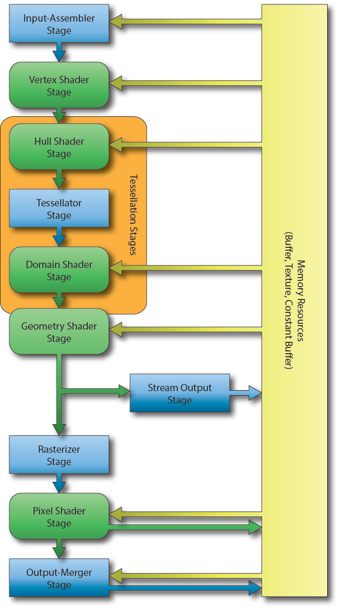

<div class="caption">

DirectX 11 Rendering Pipeline [\[13\]](#ref-directx-pipeline)

</div>

The image illustrates the 10 stages of the DirectX 11 rendering pipeline. The rectangular blocks are fixed-function stages and cannot be modified programmatically. The rounded-rectangular blocks indicate programmable stages of the pipeline.

### Input-Assembler Stage

The first stage of the DirectX graphics pipeline is the **Input-Assembler** (**IA**) stage. In this stage, the geometry is specified and the layout of the data which is expected by the vertex shader is configured [\[13\]](#ref-directx-pipeline).

### Vertex Shader Stage

The **Vertex Shader** (**VS**) stage is usually responsible for transforming the vertex position from object space into clip space but it can also be used for performing skinning of skeletal animated meshes or per-vertex lighting [\[13\]](#ref-directx-pipeline). The input to the vertex shader is a single vertex and the minimum output from the vertex shader is a single vertex position in clip-space (the transformation to clip-space can also be performed by the tessellation stage or the geometry shader if either is active).

### Hull Shader Stage

The **Hull Shader** (**HS**) stage is an optional shader stage and is responsible for determining how much an input control patch should be tessellated by the tessellation stage [\[14\]](#ref-tessellation).

### Tessellator Stage

The **Tessellator Stage** is a fixed-function stage that subdivides a patch primitive into smaller primitives according to the tessellation factors specified by the hull shader stage [\[14\]](#ref-tessellation).

### Domain Shader Stage

The **Domain Shader** (**DS**) stage is an optional shader stage and it computes the final vertex attributes based on the output control points from the hull shader and the interpolation coordinates from the tesselator stage [\[14\]](#ref-tessellation). The input to the domain shader is a single output point from the tessellator stage and the output is the computed attributes of the tessellated primitive.

### Geometry Shader Stage

The **Geometry Shader** (**GS**) stage is an optional shader stage that takes a single geometric primitive (a single vertex for a point primitive, three vertices for a triangle primitive, and two vertices for a line primitive) as input and can either discard the primitive, transform the primitive into another primitive type (for example a point to a quad) or generate additional primitives [\[13\]](#ref-directx-pipeline).

### Stream Output Stage

The **Stream Output** (**SO**) stage is an optional fixed-function stage that can be used to feed primitive data back into GPU memory. This data can be recirculated back to the rendering pipeline to be processed by another set of shaders [\[13\]](#ref-directx-pipeline). This is useful for spawning or terminating particles in a particle effect. The geometry shader can discard particles that should be terminated or generate new particles if particles should be spawned.

### Rasterizer Stage

The **Rasterizer Stage** (**RS**) stage is a fixed-function stage which will clip primitives into the view frustum and perform primitive culling if either front-face or back-face culling is enabled [\[13\]](#ref-directx-pipeline). The rasterizer stage will also interpolate the per-vertex attributes across the face of each primitive and pass the interpolated values to the pixel shader.

### Pixel Shader Stage

The **Pixel Shader** (**PS**) stage takes the interpolated per-vertex values from the rasterizer stage and produces one (or more) per-pixel color values [\[13\]](#ref-directx-pipeline). The pixel shader can also optionally output a depth value of the current pixel by mapping a single component 32-bit floating-point value to the **SV\_Depth** semantic but this is not a requirement of the pixel shader program. The pixel shader is invoked once for each pixel that is covered by a primitive [\[15\]](#ref-shader-stages).

### Output-Merger Stage

The **Output-Merger** (**OM**) stage combines the various types of output data (pixel shader output values, depth values, and stencil information) together with the contents of the currently bound render targets to produce the final pipeline result [\[13\]](#ref-directx-pipeline).

## DirectX Demo

Now that we have a little bit of background information regarding the different stages of DirectX 11 let’s try to put it together to create a simple DirectX application that is capable of rendering 3D geometry using a minimal vertex shader and pixel shader.

In this tutorial I will be using **Visual Studio 2012** to create a template project that can be used to create subsequent DirectX 11 demos in the future. Starting with Visual Studio 2012 and the [Windows 8 SDK](https://learn.microsoft.com/windows/apps/windows-sdk/downloads) the DirecX SDK is now part of the Windows SDK so you do not need to download and install the DirectX SDK seperatly. See [Where is the DirectX SDK?](https://learn.microsoft.com/windows/win32/directx-sdk--august-2009-) for more information.

Visual Studio 2012 also has the ability to compile your HLSL shader code as part of the regular compilation step and you can then load the precompiled shader code directly instead of compiling the shader code at runtime. This enables your application to load faster especially if you have many shaders. In this article I will show how you can setup your project to make use of shader compilation but I will also show you how you can load and compile your shader at runtime.

In this demo, I will not be using any 3rd party dependencies. All included headers and libraries are part of the Windows 8 SDK that comes with Visual Studio 2012 however you should make sure that you have applied the latest updates to Visual Studio 2012 so that you are working with the newest version of the Windows 8 SDK.

### DirectX Project

The first step to creating our DirectX demo is to setup an empty Win32 project in Visual Studio. First, let’s startup Visual Studio.

<span id="attachment-5580"></span>

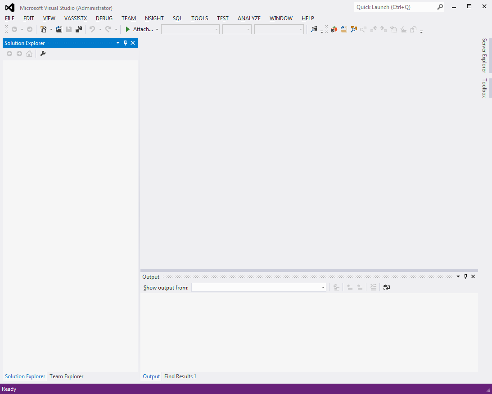

<div class="caption">

Visual Studio 2012

</div>

Select **File > New Project** from the main menu to bring up the **New Project** dialog box.

<span id="attachment-5581"></span>

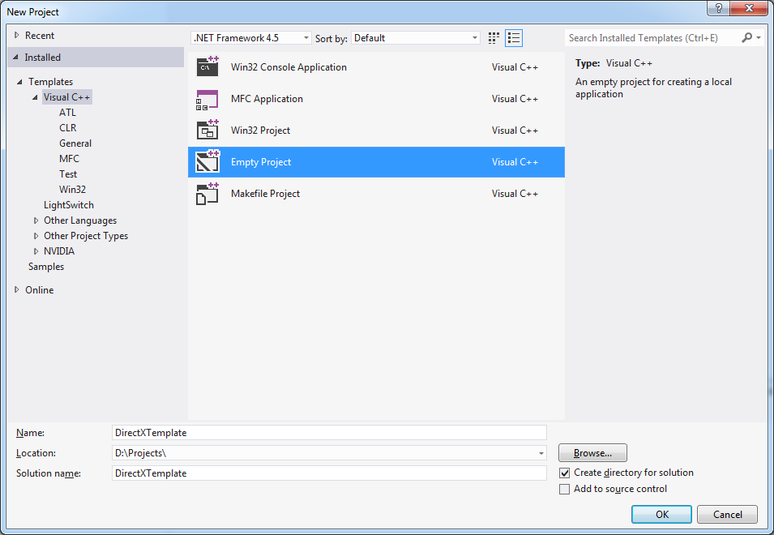

<div class="caption">

Visual Studio 2012 (New Project)

</div>

In the **New Project** dialog box, select the **Visual C++ > Empty Project** template. Choose a **Name**, **Location** and optionally a **Solution name** (or accept the default) for your new project and press the **OK** button to create the new project.

<span id="attachment-5583"></span>

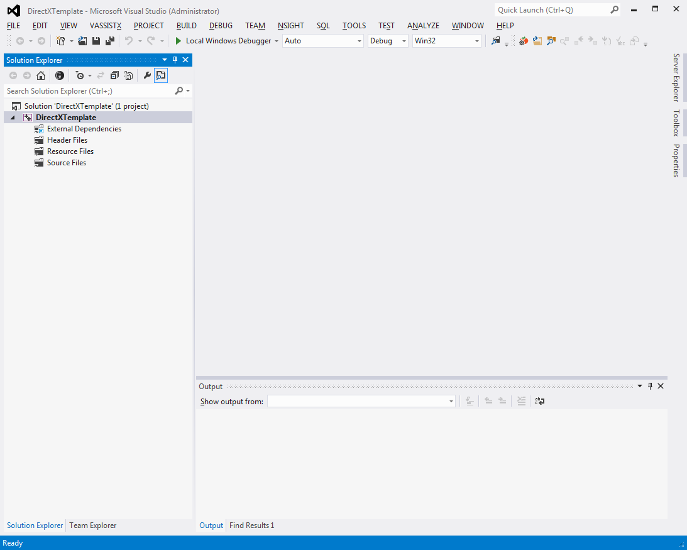

<div class="caption">

Visual Studio 2012 (DirectXTemplate)

</div>

Before we continue configuring the project, let’s create a single CPP source file.

Select **Project > Add New Item…** from the main menu.

<span id="attachment-5584"></span>

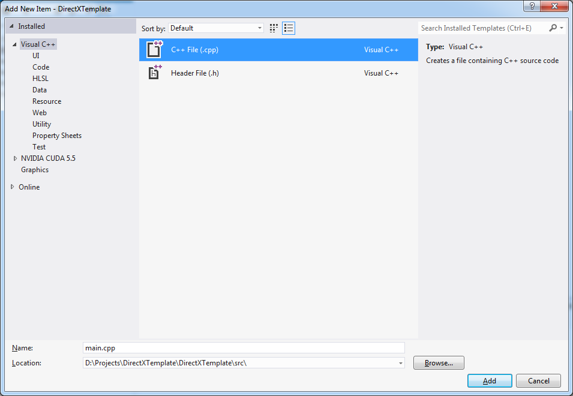

<div class="caption">

Visual Studio 2012 (Add New Item)

</div>

Select the **Visual C++ > C++ File (.cpp)** template and specify the name **main.cpp** and a location for the new source file. I prefer to put my C++ source files in subdirectory with the name **src** relative to the project folder. Press the OK button to create the file and add it to the project.

We need at least one CPP source file in the project in order to configure the project correctly. With the main.cpp file added to the project, we can now configure the project settings.

### Project Configuration

Open the project properties dialog by selecting **Project > Properties** from the main menu.

<span id="attachment-5585"></span>

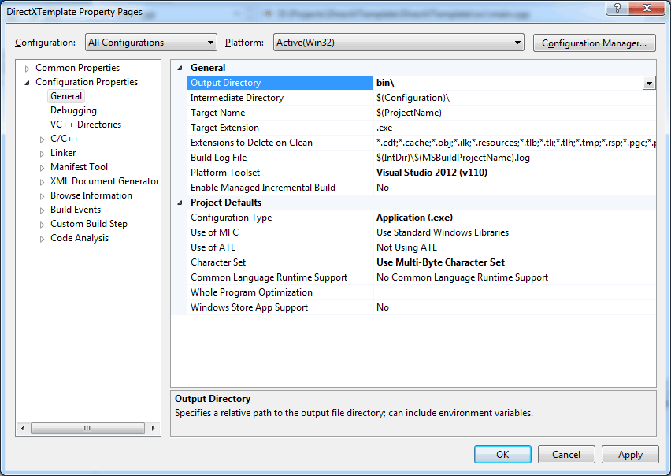

<div class="caption">

Visual Studio 2012 (Project Properties)

</div>

In the **Configuration** drop-down box, select **All Configurations**.

Select **Configuration Properties > General** and change the **Output Directory** to **bin\\**.

In the **Debug** configuration only, change the **Target Name** to **$(ProjectName)d**. With this configuration, both the debug and the release builds will go to the same folder. To ensure we don’t replace release builds with debug builds and visa-versa, we will append the letter “d” to the end of the debug builds.

Select **Configuration Properties > Debugging** and change the Working Directory to **$(OutDir)** for both the **Debug** and **Release** configurations. Doing this will ensure that the current working directory will be correctly set to the location of our executable file so that we can express paths in the application relative to the executable (instead of relative to the project folder which usually is a major cause of confusion for beginning programmers).

<span id="attachment-5587"></span>

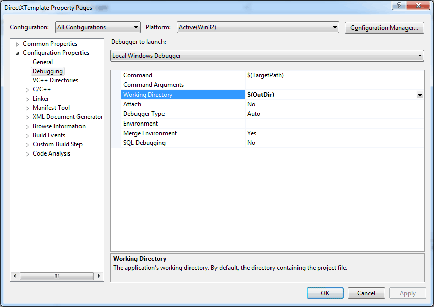

<div class="caption">

Visual Studio 2012 (Project Properties)

</div>

If you want to place your public include folders in a separate directory then we need to tell the C++ compiler where our include files are located. In the **C/C++ > General** options add the name of the public include folder to the **Additional Include Directories** options. In my case, I have a separate folder called **inc** relative to my project folder where I will keep the header files for the project.

<span id="attachment-5589"></span>

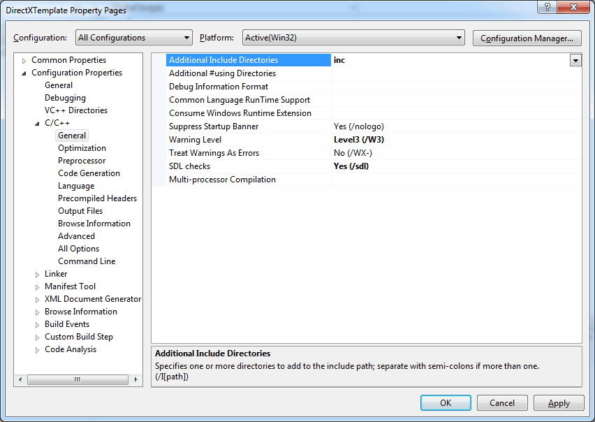

<div class="caption">

Visual Studio 2012 (Project Properties – C/C++)

</div>

You will notice that we do not need to specify the location of the DirectX headers and libraries when using Visual Studio 2012. These paths are automatically included when we create a new project in Visual Studio 2012.

### Precompiled Header

Although not absolutely necessary, I find using precompiled headers useful as it reduces the overall compile time of the project. For this small project, it may not be necessary to use precompiled headers but for large projects it is definitely useful to know how to setup precompiled headers.

For more information on creating and using precompiled header files for your Visual Studio project, please refer to [Creating Precompiled Header Files](https://learn.microsoft.com/cpp/build/creating-precompiled-header-files) in the MSDN documentation.

Create a new header file in your project with the name **DirectXTemplatePCH.h** or something similar. The **PCH** postfix indicates that this file will be used to generate the precompiled header file.

Create a new C++ file in your project with the name **DirectXTemplatePCH.cpp**. This file will be used to create the precompiled header.

The content of the **DirectXTemplatePCH.cpp** file should contain only a single include statement and nothing else! If you have other include directives in this file or any C++ code then you are doing it wrong.

```cpp source="LearningDirectX11-v1.0.0/DirectXTemplatePCH.cpp#L1-L1"
```

Now that we’ve added the initial files that will be used for precompiled headers, let’s configure our project to create and use the precompiled headers.

Select **Project > Properties** from the main menu.

<span id="attachment-5592"></span>

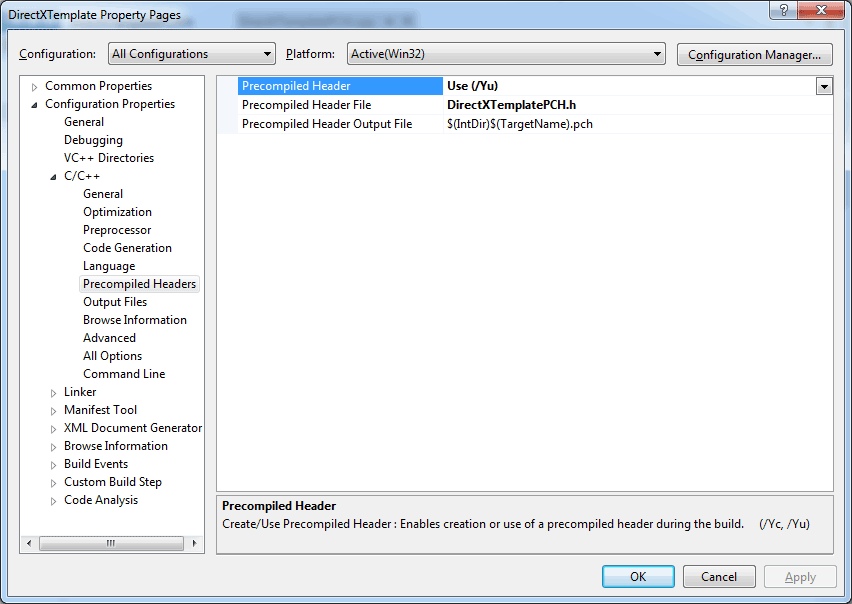

<div class="caption">

Visual Studio 2012 (Project Properties – Precompiled Headers)

</div>

Make sure that **All Configurations** is selected in the **Configuration** drop-down box.

Select **Configuration Properties > C/C++ > Precompiled Headers** and set the **Precompiled Header** option to **Use (/Yu)**.

Set the **Precompiled Header File** option to the name of the header file you created in the previous step. In my case the name of the precompiled header file is **DirectXTemlatePCH.h**.

Apply the settings and without closing the project properties dialog box, select the **DirectXTemplatePCH.cpp** source file in the **Solution Explorer**.

<span id="attachment-5593"></span>

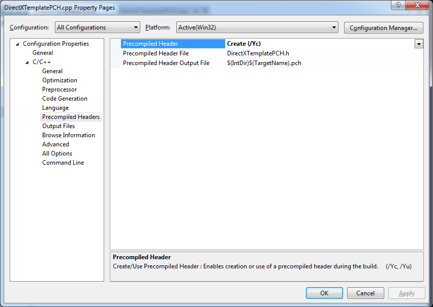

<div class="caption">

Visual Studio 2012 (Project Properties – DirectXTemplatePCH.cpp)

</div>

For the **DirectXTemplatePCH.cpp** source file only, change the **Precompiled Header** option to **Create (/Yc)** and the other options should be the same as we specified at the project level.

With these settings configured, let’s start writing some code!

### Global Header

The global header file will contain all of the external (non changing) include files. You should not include project specific header files in the global header file because they are changing often. If the contents of the global header file change often then we can no longer take advantage of precompiled headers.

```cpp title="DirectXTemplatePCH.h" showLineNumbers
// System includes
#include <windows.h>

// DirectX includes
#include <d3d11.h>
#include <d3dcompiler.h>
#include <DirectXMath.h>
#include <DirectXColors.h>

// STL includes
#include <iostream>
#include <string>
```

Since we are creating a Windows application, we first include the ubiquitous Windows header file. This header file contains all of the definitions for creating a Windows based application.

The next set of headers includes the Direct3D API. The **d3dcompiler** header file is required for loading and compiling HLSL shaders. The **DirectXMath** header file includes math primitives like vectors, matrices and quaternions as well as the functions to operate on those primitives. The **DirectXColors** header defines a set of commonly used colors.

```cpp source="LearningDirectX11-v1.0.0/DirectXTemplatePCH.h#L15-L19"
```

This set of statements will cause the library dependencies to be automatically linked in the linker stage. You can also specify these libraries in the **Additional Dependencies** property in the **Linker** options if you want but putting them here simplifies the project configuration settings. Also if you were creating a library project, this file could be included in the global header file of another project to perform automatic linking of the required library dependencies.

```cpp source="LearningDirectX11-v1.0.0/DirectXTemplatePCH.h#L21-L30"
```

The **SafeRelease** function can be used to safely release a COM object and set the COM pointer to NULL. This function allows us to safely release a COM object even if it has already been released before. Since we will be releasing COM objects a lot in this application, this function will also allow us to create neater code.

### Preamble

Before we get into the application code, we first need to define some global variables that will be used throughout the demo.

We first need to include the global header file that we created in the previous step.

```cpp title="main.cpp" showLineNumbers
#include <DirectXTemplatePCH.h>
using namespace DirectX;
```

On line 2 I include the **DirectX** namespace into the global namespace. All of the functions and types defined in the **DirectXMath** API are wrapped in the DirectX namespace. I got really tired of typing out the DirectX namespace every time I wanted to use a vector or a matrix so instead I just import the namespace.

The first set of globals define some properties for the application window.

```cpp title="main.cpp" showLineNumbers startLineNumber=9
const LONG g_WindowWidth = 1280;
const LONG g_WindowHeight = 720;
LPCSTR g_WindowClassName = "DirectXWindowClass";
LPCSTR g_WindowName = "DirectX Template";
HWND g_WindowHandle = 0;

const BOOL g_EnableVSync = TRUE;
```

The size of the window is defined by the **g\_WindowWidth**, and **g\_WindowHeight** variables. The actual window that we will create will be slightly larger than this because these variables actually define the size of the renderable area (or client area) of the window. The actual window size including the window frame will be computed before the actual window is created.

Before we can create a window instance, we need to create a window class. The window class should be unique for our application so we need to define a unique name for the class as well. The unique window class name is defined using the **g\_WindowClassName** global variable.

The **g\_WindowName** variable holds the name of the window that will be created from the window class. The window name will also be displayed in the top of the window frame.

The **g\_WindowHandle** is used to identify the instance of the window that will be created.

A regular LCD or LED computer monitor has a vertical refresh rate of 60 Hz. That means that the image displayed on the screen is presented 60 times per second. When rendering your 3D application, you can choose to let your application display the image at the same rate as the screen’s refresh rate. The advantage of synchronizing your applications display rate with the refresh rate of the screen is that it eliminates any visible artifacts known as [screen tearing](https://en.wikipedia.org/wiki/Screen_tearing). If you want to render your scene as fast as possible, you can set the **g\_EnableVSync** variable to **FALSE** and then your application will not wait for the vertical refresh of the screen to present the scene on the screen.

These are all of the variables that we need to define for the application window. The next set of variables will be DirectX specific.

```cpp source="LearningDirectX11-v1.0.0/main.cpp#L17-L33"
```

The **g\_d3dDevice**, **g\_d3dDeviceContext**, and **g\_d3dSwapChain** are the absolute minimum variables required for the most basic DirectX 11 application. A **ID3D11Device** instance is used for allocating GPU resources such as buffers, textures, shaders, and state objects (to name a few). The **ID3D11DeviceContext** is used to configure the rendering pipeline and draw geometry. The **IDXGISwapChain** stores the buffers that are used for rendering data. This interface is also used to determine how the buffers are swapped when the rendered image should be presented to the screen.

The **g\_d3dRenderTargetView** and the **g\_d3dDepthStencilView** variables are used to define the subresource view of the area of a buffer to which we will draw to. A resource view defines an area of a buffer that can be used for rendering. In this case we need two views, the **g\_d3dRenderTargetView** will refer to a subresource of a color buffer while the **g\_d3dDepthStencilView** will refer to a subresource of a depth/stencil buffer.

The **IDXGISwapChain** instance has only a single color buffer that will be used to store the final color that is to be presented on the screen. In order to store depth information, we must create a separate depth buffer. The **g\_d3dDepthStencilBuffer** will be used to refer to a 2D texture object that will be used to store the depth values so that objects close to the camera do not get overdrawn by objects that are farther away from the camera regardless of their drawing order.

We also need to define a few state variables for configuring the rasterizer and output-merger stages. The **g\_d3dDepthStencilState** will be used to store the depth and stencil states used by the output-merger stage and the **g\_d3dRasterizerState** variable will be used to store rasterizer state used by the rasterizer stage.

The **g\_Viewport** variable defines the size of the viewport rectangle. The viewport rectangle is also used by the rasterizer stage to determine the renderable area on screen. You can use multiple viewports to implement split-screen multiplayer games.

The next set of variables that will be declared are specific to this demo and not generic for DirectX initialization.

```cpp source="LearningDirectX11-v1.0.0/main.cpp#L35-L42"
```

The **g\_d3dInputLayout** variable will be used to describe the order and type of data that is expected by the vertex shader.

The **g\_d3dVertexBuffer** and **g\_d3dIndexBuffer** variables will be used to store the vertex data and the index list that defines the geometry which will be rendered. The vertex buffer stores the data for each unique vertex in the geometry. In this demo, each vertex will store it’s position in 3D space and the color of the vertex. The index buffer stores a list of indices into the vertex buffer. The order of the indices in the index buffer determines the order that vertices in the vertex buffer are sent to the GPU for rendering.

For this simple demo, we will have two shaders, a vertex shader and a pixel shader. The **g\_d3dVertexShader** variable will hold a reference to the vertex shader object and the **g\_d3dPixelShader** will store a reference to the pixel shader.

Next we’ll declare set of buffers that will be used to update the constant variables that are declared in the vertex shader.

```cpp title="main.cpp" showLineNumbers startLineNumber=44
// Shader resources
enum ConstantBuffer
{
    CB_Application,
    CB_Frame,
    CB_Object,
    NumConstantBuffers
};

ID3D11Buffer* g_d3dConstantBuffers[NumConstantBuffers];
```

Here we declare three constant buffers. Constant buffers are used to store shader variables that remain constant during current draw call. An example of a constant shader variable is the camera’s projection matrix. Since the projection matrix will be the same for every vertex of the object, this variable does not need to be passed to the shader using vertex data. Instead, we declare a constant buffer that stores the projection matrix of the camera and this shader variable only needs to be updated when the camera’s projection matrix is modified (which is to say, not often).

1.  **Application**: The application level constant buffer stores variables that rarely change. The contents of this constant buffer are being updated once during application startup and perhaps are not updated again. An example of an application level shader variable is the camera’s projection matrix. Usually the projection matrix is initialized once when the render window is created and only needs to be updated if the dimensions of the render window are changed (for example, if the window is resized).
2.  **Frame**: The frame level constant buffer stores variables that change each frame. An example of a frame level shader variable would be the camera’s view matrix which changes whenever the camera moves. This variable only needs to be updated once at the beginning of the render function and generally stays the same for all objects rendered that frame.
3.  **Object**: The object level constant buffer stores variables that are different for every object being rendered. An example of an object level shader variable is the object’s world matrix. Since each object in the scene will probably have a different world matrix this shader variable needs to be updated for every separate draw call.

This separation of shader variables is arbitrary and you can choose whatever method you would like to separate your constant buffers in your own shaders. Generally you should split up constant buffers in your shader based on the frequency the variables need to be updated.

The next set of variables define the variables that will be updated by the application and used to populate the variables in the constant buffers of the shader.

```cpp source="LearningDirectX11-v1.0.0/main.cpp#L55-L58"
```

We will only draw a single object on the screen in this demo. For this reason, we only need to keep track of a single world matrix which will transform the object’s vertices into world space. The **g\_WorldMatrix** is a 4×4 matrix which will be used to store the world matrix of the cube in our scene.

The **g\_ViewMatrix** only needs to be updated once per frame and is used to store the camera’s view matrix that will transform the object’s vertices from world space into view space.

The **g\_ProjectionMatrix** is updated once at the beginning of the application and is used to store the projection matrix of the camera. The projection matrix will transform the object’s vertices from view space into clip space (which is required by the rasterizer).

Next, we’ll define the geometry for the single object that will be rendered in our scene.

```cpp source="LearningDirectX11-v1.0.0/main.cpp#L60-L87"
```

The **VertexPosColor** struct defines the properties of a single vertex. In this case the **Position** member variable will be used to store the position of the vertex in 3D space and the **Color** member variable will be used to store the red, green, and blue components of the vertex’s color.

The cube geometry that we will render consists of 8 unique vertices (one for each corner of the cube). We cannot simply send the cube geometry directly to the rendering pipeline as-is because the rendering pipeline only knows about points, lines, and triangles (not cubes, spheres, or any other complex shape). In order to create a set of triangles we need to define an index list which determines the order the vertices are sent to the GPU for rendering. In this case, each face of the cube consists of two triangles, an upper and a lower triangle. The first face of the triangle consists of six vertices: { {0, 1, 2}, {0, 2, 3} }. You will notice that in order to create the face, we will duplicate vertex 0, and 2.

When creating the index buffer for our geometry, we must also take the winding order of the vertices into consideration. The winding order of front-facing triangles is determined by the rasterizer state and we can specify that the winding order should be either clock-wise or counter-clockwise. This choice is arbitrary but it will have an impact on the order of the indices in the index buffer. For this demo, we will consider front-facing triangles to be in a clock-wise winding order. The diagram below shows the winding order for the first face of the cube.

<span id="attachment-5603"></span>

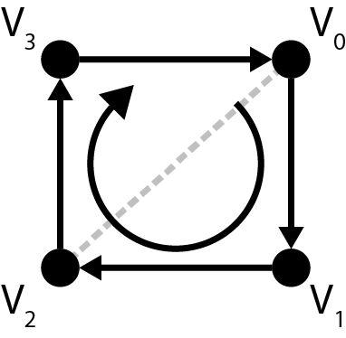

<div class="caption">

Clockwise Winding Order

</div>

The lower triangle of the face consists of vertices { 0, 1, 2 } and the upper triangle of the face consists of vertices { 0, 2, 3 }. The gray dashed line represents the triangle subdivision of the face.

The last part of the preamble is the function declarations.

```cpp source="LearningDirectX11-v1.0.0/main.cpp#L89-L100"
```

The **WndProc** function is the function that will handle any mouse, keyboard, and window events that are sent to our application window.

The **LoadShader** template function will be used to load and compile a shader at runtime. It’s templated on the type of shader that is being loaded.

The **LoadContent**, and **UnloadContent** functions will load the demo specific resources such as the vertex buffer and index buffer GPU resources for our cube geometry.

The **Update** function will be used to update any logic required by our demo.

The **Render** function will render the scene.

The **Cleanup** function is used to release any DirectX specific resources like the device, device context, and swap chain.

### The Main Window

The first thing our application will do is initialize and create the window. We will create a function called **InitApplication** for this purpose. First we’ll register a window class and then we’ll create a window using that window class.

```cpp title="main.cpp" showLineNumbers startLineNumber=102
/**
 * Initialize the application window.
 */
int InitApplication( HINSTANCE hInstance, int cmdShow )
{
    WNDCLASSEX wndClass = {0};
    wndClass.cbSize = sizeof( WNDCLASSEX );
    wndClass.style = CS_HREDRAW | CS_VREDRAW;
    wndClass.lpfnWndProc = &WndProc;
    wndClass.hInstance = hInstance;
    wndClass.hCursor = LoadCursor( nullptr, IDC_ARROW );
    wndClass.hbrBackground = (HBRUSH)(COLOR_WINDOW+1);
    wndClass.lpszMenuName = nullptr;
    wndClass.lpszClassName = g_WindowClassName;

    if ( !RegisterClassEx(&wndClass) )
    {
        return -1;
    }
```

The window class defines a set of attributes which define a window template. Each window your application creates must have a window class registered which is required to create the window.

The **WNDCLASSEX** structure has the following definition [\[16\]](#ref-wndclassex):

```cpp title="WNDCLASSEX structure" showLineNumbers
typedef struct tagWNDCLASSEX {
  UINT      cbSize;
  UINT      style;
  WNDPROC   lpfnWndProc;
  int       cbClsExtra;
  int       cbWndExtra;
  HINSTANCE hInstance;
  HICON     hIcon;
  HCURSOR   hCursor;
  HBRUSH    hbrBackground;
  LPCTSTR   lpszMenuName;
  LPCTSTR   lpszClassName;
  HICON     hIconSm;
} WNDCLASSEX, *PWNDCLASSEX;
```

And the members have the following definition:

-   **UINT cbSize**: The size, in bytes, of this structure. Set this member to sizeof(WNDCLASSEX).
-   **UINT style**: The class style. In this case we use the **CS\_HREDRAW** class style which causes the entire window to redraw if a movement or size adjustment changes the width of the client area and the **CS\_VREDRAW** class style which causes the entire window to redraw if a movement or a size adjustment changes the height of the client area.
-   **WNDPROC lpfnWndProc**: A pointer to the windows procedure that will handle window events for any windows created using this class. In this case we specify the yet undefined **WndProc** function which was declared earlier.
-   **int cbClsExtra**: The number of extra bytes to allocate following the window-class structure. This parameter is not used here and should be set to 0.
-   **int cpWndExtra**: The number of extra bytes to allocate following the window instance. This parameter is not used here and should be set to 0.
-   **HINSTANCE hInstance**: A handle to the instance of the module that owns this window class. This module instance handle is passed to the **WinMain** function which will be shown later.
-   **HICON hIcon**: A handle to the class icon. This icon will be used to represent a window created with this class in the task bar and in the top-left corner of the window’s title bar. You can load an icon from a resource file using the [LoadIcon](https://learn.microsoft.com/windows/win32/api/winuser/nf-winuser-loadicona) function. If this value is **NULL** (or **nullptr**) then the default application icon is used.
-   **HCURSOR hCursor**: A handle to the class cursor. This must be a handle to a valid cursor resource. For this demo, we will use the default arrow icon by specifying **LoadCursor( nullptr, IDC\_ARROW )**.
-   **HBRUSH hbrBackground**: A handle to the class background brush. This member can be a handle to the brush to be used for painting the background, or it can be a color value. A color value must be one of the following standard system colors (the value 1 must be added to the chosen color). If a color value is given, you must convert it to one of the following **HBRUSH** types:
    -   **COLOR\_ACTIVEBORDER**
    -   **COLOR\_ACTIVECAPTION**
    -   **COLOR\_APPWORKSPACE**
    -   **COLOR\_BACKGROUND**
    -   **COLOR\_BTNFACE**
    -   **COLOR\_BTNSHADOW**
    -   **COLOR\_BTNTEXT**
    -   **COLOR\_CAPTIONTEXT**
    -   **COLOR\_GRAYTEXT**
    -   **COLOR\_HIGHLIGHT**
    -   **COLOR\_HIGHLIGHTTEXT**
    -   **COLOR\_INACTIVEBORDER**
    -   **COLOR\_INACTIVECAPTION**
    -   **COLOR\_MENU**
    -   **COLOR\_MENUTEXT**
    -   **COLOR\_SCROLLBAR**
    -   **COLOR\_WINDOW**
    -   **COLOR\_WINDOWFRAME**
    -   **COLOR\_WINDOWTEXT**
-   **LPCTSTR lpszMenuName**: Pointer to a null-terminated character string that specifies the resource name of the class menu, as the name appears in the resource file. If this member is NULL, windows belonging to this class have no default menu.
-   **LPCTSTR lpszClassName**: A pointer to a null-terminated const string which is used to uniquely identify this window class. This class name will be used to create the window instance.
-   **HICON hIconSm**: A handle to a small icon that is associated with the window class. If this member is **NULL** (or nullptr), the system searches the icon resource specified by the **hIcon** member for an icon of the appropriate size to use as the small icon.

With the window class structure initialized, the window class is registered on line 114 using the [RegisterClassEx](https://learn.microsoft.com/windows/win32/api/winuser/nf-winuser-registerclassexa) function.

With the window class registered, we can create a window instance using this class.

```cpp source="LearningDirectX11-v1.0.0/main.cpp#L123-L141"
```

We want to create a window with a client area of **g\_WindowWidth** by **g\_WindowHeight** but if we create a window with those dimensions, the client are will be slightly smaller. In order to get a window with a client area the size we want, we can use the [AdjustWindowRect](https://learn.microsoft.com/windows/win32/api/winuser/nf-winuser-adjustwindowrect) function to adjust the inital window rectangle to account for the window style.

The window instance is created using the **CreateWindow** function. This function has the following signature [\[18\]](#ref-createwindow):

```cpp title="CreateWindow function" showLineNumbers
HWND WINAPI CreateWindow(
  _In_opt_  LPCTSTR lpClassName,
  _In_opt_  LPCTSTR lpWindowName,
  _In_      DWORD dwStyle,
  _In_      int x,
  _In_      int y,
  _In_      int nWidth,
  _In_      int nHeight,
  _In_opt_  HWND hWndParent,
  _In_opt_  HMENU hMenu,
  _In_opt_  HINSTANCE hInstance,
  _In_opt_  LPVOID lpParam
);
```

The **\_In\_**, **\_Out\_**, **\_Outptr\_**, **\_Inout\_** etc. macros are part of Microsoft’s Source-code Annotation Language (SAL) [\[17\]](#ref-sal) and primarily used to describe how a function uses its prameters. Any annotation which includes **\_opt\_** indicates that the parameter is optional and can be **NULL**.

And the properties to this function have the following definition:

-   **LPCTSTR lpClassName**: The name of the window class to use as a template to create the window instance. The class name must match one of the classes that were previously registered using **RegisterClass** or **RegisterClassEx** and associated to the **hInstance** module.
-   **LPCTSTR lpWindowName**: The name of the window instance. When creating a window with a title bar, the window name will be displayed in the title bar.
-   **DWORD dwStyle**: The style of the window being created. This parameter can be a combination of any of the [window styles](https://learn.microsoft.com/windows/win32/winmsg/window-styles).
-   **int x**: The initial horizontal position of the window. For an overlapped or pop-up window, the x parameter is the initial x-coordinate of the window’s upper-left corner, in screen coordinates. If this parameter is set to **CW\_USEDEFAULT**, the system selects the default position for the window’s upper-left corner and ignores the y parameter.
-   **int y**: The initial vertical position of the window. For an overlapped or pop-up window, the y parameter is the initial y-coordinate of the window’s upper-left corner, in screen coordinates. If an overlapped window is created with the **WS\_VISIBLE** style bit set and the x parameter is set to **CW\_USEDEFAULT**, then the y parameter determines how the window is shown. If the y parameter is **CW\_USEDEFAULT**, then the window manager calls [ShowWindow](https://learn.microsoft.com/windows/win32/api/winuser/nf-winuser-showwindow) with the **SW\_SHOW** flag after the window has been created. If the y parameter is some other value, then the window manager calls **ShowWindow** with that value as the **nCmdShow** parameter.
-   **int nWidth**: The width, in device units, of the window. For overlapped windows, nWidth is either the window’s width, in screen coordinates, or **CW\_USEDEFAULT**. If **nWidth** is **CW\_USEDEFAULT**, the system selects a default width and height for the window; the default width extends from the initial x-coordinate to the right edge of the screen, and the default height extends from the initial y-coordinate to the top of the icon area. **CW\_USEDEFAULT** is valid only for overlapped windows. In this case, we set the initial window width to the total width of the adjusted window rectangle.
-   **int nHeight**: The height, in device units, of the window. For overlapped windows, **nHeight** is the window’s height, in screen coordinates. If **nWidth** is set to **CW\_USEDEFAULT**, the system ignores **nHeight**. In this case, we set the initial window height to the total height of the adjusted window rectangle.
-   **HWND hWndParent**: A handle to the parent window. Since we are creating a top-level window, this parameter can be **NULL** (or nullptr).
-   **HMENU hMenu**: A handle to a window or NULL to use the menu that was specified in the window class template. If both the window class and this parameter are **NULL**, no menu will be created for this window.
-   **HINSTANCE hInstance**: A handle to the instance of the module to be associated with the window.
-   **LPVOID lpParam**: A pointer to a value to be passed to the window through the [CREATESTRUCT](https://learn.microsoft.com/windows/win32/api/winuser/ns-winuser-createstructa) structure (**lpCreateParams** member) pointed to by the lParam param of the [WM\_CREATE](https://learn.microsoft.com/windows/win32/winmsg/wm-create) message. This message is sent to the created window by this function before it returns.

If the window creation succeeded, the window is shown with the [ShowWindow](https://learn.microsoft.com/windows/win32/api/winuser/nf-winuser-showwindow) function and the [UpdateWindow](https://learn.microsoft.com/windows/win32/api/winuser/nf-winuser-updatewindow) function is called to force the client area of the window to be painted.

Before we continue, let’s take a look at what a minimum windows procedure function must contain.

### Windows Procedure Function

The windows procedure function is the function that is assigned to the [WNDCLASSEX](https://learn.microsoft.com/windows/win32/api/winuser/ns-winuser-wndclassexa) structure’s **lpfnWndProc** member variable when we registered the window class. All windows created with with the same class will have the same window procedure function.

The purpose of the windows procedure callback function to to process messages sent to the window.

The windows procedure callback function has the following signature [\[52\]](#ref-windowproc):

```cpp title="WindowProc callback function" showLineNumbers
LRESULT CALLBACK WindowProc(
  _In_  HWND hwnd,
  _In_  UINT uMsg,
  _In_  WPARAM wParam,
  _In_  LPARAM lParam
);
```

Where:

-   **HWND hwnd**: A handle to the window for which the event is intended.
-   **UINT uMsg**: The event message. For lists of the system-provided messages, see [System-Defined Messages](https://learn.microsoft.com/windows/win32/winmsg/about-messages-and-message-queues).
-   **WPARAM wParam**: Additional message information. The contents of this parameter depend on the value of the **uMsg** parameter.
-   **LPARAM lParam**: Additional message information. The contents of this parameter depend on the value of the **uMsg** parameter.

The return value is the result of the message processing and depends on the message sent [\[52\]](#ref-windowproc).

For this demo, we will implement a minimum message handling function that only responds to the [WM\_PAINT](https://learn.microsoft.com/windows/win32/gdi/wm-paint) and [WM\_DESTROY](https://learn.microsoft.com/windows/win32/winmsg/wm-destroy) windows messages. All other messages will be handled by the [DefWindowProc](https://learn.microsoft.com/windows/win32/api/winuser/nf-winuser-defwindowproca) function.

```cpp source="LearningDirectX11-v1.0.0/main.cpp#L779-L802"
```

At a minimum, the window procedure must respond to the [WM\_PAINT](https://learn.microsoft.com/windows/win32/gdi/wm-paint) window message. We don’t actually do any rendering with this message except erase the window’s background contents using the window class’s background brush (**hbrBackground** variable of the [WNDCLASSEX](https://learn.microsoft.com/windows/win32/api/winuser/ns-winuser-wndclassexa) structure).

In order to close the window, we will also respond to the [WM\_DESTROY](https://learn.microsoft.com/windows/win32/winmsg/wm-destroy) window message which simply calls the [PostQuitMessage](https://learn.microsoft.com/windows/win32/api/winuser/nf-winuser-postquitmessage) function which will be handled in **Run** function which we will define in the next section.

### The Run Method

Before we can display the window, we need to create our main game loop. To execute the main game loop, we will create a **Run** function which will continue to execute until the user decides to quit (by pressing the big red cross on the top-right side of the window).

```cpp title="main.cpp" showLineNumbers startLineNumber=705
/**
 * The main application loop.
 */
int Run()
{
    MSG msg = {0};

    static DWORD previousTime = timeGetTime();
    static const float targetFramerate = 30.0f;
    static const float maxTimeStep = 1.0f / targetFramerate;

    while ( msg.message != WM_QUIT )
    {
        if ( PeekMessage( &msg, 0, 0, 0, PM_REMOVE ) )
        {
            TranslateMessage( &msg );
            DispatchMessage( &msg );
        }
        else
        {
            DWORD currentTime = timeGetTime();
            float deltaTime = ( currentTime - previousTime ) / 1000.0f;
            previousTime = currentTime;

            // Cap the delta time to the max time step (useful if your 
            // debugging and you don't want the deltaTime value to explode.
            deltaTime = std::min<float>(deltaTime, maxTimeStep);

//            Update( deltaTime );
//            Render();
        }
    }

    return static_cast<int>(msg.wParam);
}
```

The **Run** function will continue to execute indefinitely until the [WM\_QUIT](https://learn.microsoft.com/windows/win32/winmsg/wm-quit) window message is posted to the window’s message queue.

The [PeekMessage](https://learn.microsoft.com/windows/win32/api/winuser/nf-winuser-peekmessagea) function will retrieve the next message from the message queue. The **PM\_REMOVE** indicates that the retrieved message should be removed from the window’s message queue. The [PeekMessage](https://learn.microsoft.com/windows/win32/api/winuser/nf-winuser-peekmessagea) function will return **FALSE** if there are no messages to process.

The [TranslateMessage](https://learn.microsoft.com/windows/win32/api/winuser/nf-winuser-translatemessage) function will translate virtual-key messages into character messages [\[53\]](#ref-translatemessage) and the [DispatchMessage](https://learn.microsoft.com/windows/win32/api/winuser/nf-winuser-dispatchmessage) function will dispatch the message to the appropriate window’s procedure function [\[54\]](#ref-dispatchmessage).

If there is no message to process, then we will call **Update** and **Render** which will update the game logic and render our scene. These functions are commented out now because they have not been defined yet.

When the game loop exits, the [MSG](https://learn.microsoft.com/windows/win32/api/winuser/ns-winuser-msg) structure’s **wParam** member will contain the return code which was specified as the only parameter to the [PostQuitMessage](https://learn.microsoft.com/windows/win32/api/winuser/nf-winuser-postquitmessage) in the **WndProc** function shown earlier.

Before we can execute our application, we must define the main entry point.

### The Main Function

The main entry point for our application is the **wWinMain** function. In this function we will initialize the window and start the main game loop. When the game loop exits, the return code from **Run** method will be returned to the process that invoked our application.

```cpp title="main.cpp" showLineNumbers startLineNumber=741
int WINAPI wWinMain( HINSTANCE hInstance, HINSTANCE prevInstance, LPWSTR cmdLine, int cmdShow )
{
    UNREFERENCED_PARAMETER( prevInstance );
    UNREFERENCED_PARAMETER( cmdLine );

    // Check for DirectX Math library support.
    if ( !XMVerifyCPUSupport() )
    {
        MessageBox( nullptr, TEXT("Failed to verify DirectX Math library support."), TEXT("Error"), MB_OK );
        return -1;
    }

    if( InitApplication(hInstance, cmdShow) != 0 )
    {
        MessageBox( nullptr, TEXT("Failed to create applicaiton window."), TEXT("Error"), MB_OK );
        return -1;
    }

    int returnCode = Run();

    return returnCode;
}
```

On line 747, the [XMVerifyCPUSupport](https://learn.microsoft.com/windows/win32/api/directxmath/nf-directxmath-xmverifycpusupport) function will return **true** if the **DirectXMath** library is supported on the current platform.

The **InitApplication** function will create the main window and show it on screen.

The **Run** function will kick-off the main game loop and only returns control back to the main function when the user closes the main window.

If we run our application now, we should see an empty game window that looks similar to the image below.

<span id="attachment-5701"></span>

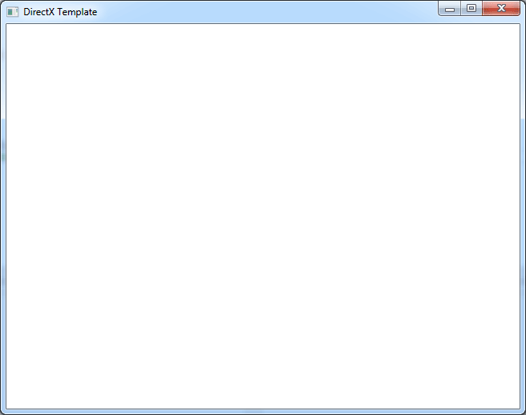

<div class="caption">

DirectX Template (Main Window)

</div>

It’s not very interesting to look at so let’s initialize a Direct3D 11.

### Initialize DirectX

In this function we will initialize the Direct3D 11 device, context and swap chain required for rendering graphics.

The process of initializing a Direct3D rendering device consists of several steps:

1.  Create the device and swap chain,
2.  Create a render target view of the swap chain’s back buffer,
3.  Create a texture for the depth-stencil buffer,
4.  Create a depth-stencil view from the depth-stencil buffer,
5.  Create a depth-stencil state object that defines the behaviour of the output merger stage,
6.  Create a rasterizer state object that defines the behaviour of the rasterizer stage.

#### Create Device and Swap Chain

To create the device and swap chain, we must first setup the swap chain description. The swap chain description defines the size and number of render buffers that will be used by the swap chain. It also associates the window to the swap chain which determines where the final image will be presented. The swap chain description also defines the quality of anti-aliasing (if any) that should be applied and how the back buffer is flipped during presentation.

```cpp source="LearningDirectX11-v1.0.0/main.cpp#L233-L262"
```

The **DXGI\_SWAP\_CHAIN\_DESC** has the following definition [\[19\]](#ref-dxgi-swap-chain-desc):

```cpp title="DXGI_SWAP_CHAIN_DESC structure" showLineNumbers
typedef struct DXGI_SWAP_CHAIN_DESC {
  DXGI_MODE_DESC   BufferDesc;
  DXGI_SAMPLE_DESC SampleDesc;
  DXGI_USAGE       BufferUsage;
  UINT             BufferCount;
  HWND             OutputWindow;
  BOOL             Windowed;
  DXGI_SWAP_EFFECT SwapEffect;
  UINT             Flags;
} DXGI_SWAP_CHAIN_DESC;
```

The members of the **DXGI\_SWAP\_CHAIN\_DESC** struct are defined as:

-   **DXGI\_MODE\_DESC BufferDesc**: This parameter is a type [DXGI\_MODE\_DESC](https://learn.microsoft.com/previous-versions/windows/desktop/legacy/bb173064(v=vs.85)) and has the following members:
    -   **UINT Width**: A value that describes the resolution width. If you specify the width as zero when you call the [IDXGIFactory::CreateSwapChain](https://learn.microsoft.com/windows/win32/api/dxgi/nf-dxgi-idxgifactory-createswapchain) method to create a swap chain, the runtime obtains the width from the output window and assigns this width value to the swap-chain description.
    -   **UINT Height**: A value describing the resolution height. If you specify the height as zero when you call the [IDXGIFactory::CreateSwapChain](https://learn.microsoft.com/windows/win32/api/dxgi/nf-dxgi-idxgifactory-createswapchain) method to create a swap chain, the runtime obtains the height from the output window and assigns this height value to the swap-chain description.
    -   **DXGI\_RATIONAL RefreshRate**: A [DXGI\_RATIONAL](https://learn.microsoft.com/windows/win32/api/dxgicommon/ns-dxgicommon-dxgi_rational) structure describing the refresh rate in hertz. We can use 0/1 to specify an unbounded refresh rate. This is useful if we don’t intend to synchronize the presentation of the scene with the refresh rate of the screen. If the window contents are to be displayed full-screen, then this should be the ideal refresh rate at the specified display resolution. If it is a windowed application, then it should be the refresh rate of the desktop.
    -   **DXGI\_FORMAT Format**: The pixel format of the display. For a list of possible display formats see [DXGI\_FORMAT](https://learn.microsoft.com/windows/win32/api/dxgiformat/ne-dxgiformat-dxgi_format). In this case we specify **DXGI\_FORMAT\_R8G8B8A8\_UNORM** which creates a 4-component 32-bit unsigned normalized integer format that supports 8 bits per channel including alpha [\[20\]](#ref-dxgi-format).
    -   **DXGI\_MODE\_SCANLINE\_ORDER ScanlineOrdering**: Describes the scan-line drawing mode and can be one of the following values [\[21\]](#ref-dxgi-mode-scanline-order):
        -   **DXGI\_MODE\_SCANLINE\_ORDER\_UNSPECIFIED** (Default): The scanline order is unspecified.
        -   **DXGI\_MODE\_SCANLINE\_ORDER\_PROGRESSIVE**: The image is created from the first scanline to the last without skipping any.
        -   **DXGI\_MODE\_SCANLINE\_ORDER\_UPPER\_FIELD\_FIRST**: The image is created beginning with the upper field.
        -   **DXGI\_MODE\_SCANLINE\_ORDER\_LOWER\_FIELD\_FIRST**: The image is created beginning with the lower field.
    -   **DXGI\_MODE\_SCALING Scaling**: This parameter describes the scaling mode and can be one of the following values [\[22\]](#ref-dxgi-mode-scaling):
        -   **DXGI\_MODE\_SCALING\_UNSPECIFIED** (Default): Unspecified scaling.
        -   **DXGI\_MODE\_SCALING\_CENTERED**: Specifies no scaling. The image is centered on the display. This flag is typically used for a fixed-dot-pitch display (such as an LED display).
        -   **DXGI\_MODE\_SCALING\_STRETCHED**: Specifies stretched scaling.
-   **DXGI\_SAMPLE\_DESC SampleDesc**: A **DXGI\_SAMPLE\_DESC** structure that describes multi-sampling parameters. The **DXGI\_SAMPLE\_DESC** structure has the following members [\[23\]](#ref-dxgi-sample-desc):
    -   **UINT Count**: The number of multisamples per pixel.
    -   **UINT Quality**: The image quality level. The higher the quality, the lower the performance. The valid range is between zero and one less than the level returned by [ID3D11Device::CheckMultisampleQualityLevels](https://learn.microsoft.com/windows/win32/api/d3d11/nf-d3d11-id3d11device-checkmultisamplequalitylevels). The default sampler mode, with no anti-aliasing, has a count of 1 and a quality level of 0.
-   **DXGI\_USAGE BufferUsage**: A member of the **DXGI\_USAGE** enumerated type that describes the surface usage and CPU access options for the back buffer. This parameter can be one of the following values [\[24\]](#ref-dxgi-usage):
    -   **DXGI\_USAGE\_BACK\_BUFFER**: The surface or resource is used as a back buffer. You don’t need to pass **DXGI\_USAGE\_BACK\_BUFFER** when you create a swap chain.
    -   **DXGI\_USAGE\_READ\_ONLY**: Use the surface or resource for reading only.
    -   **DXGI\_USAGE\_RENDER\_TARGET\_OUTPUT**: Use the surface or resource as an output render target.
    -   **DXGI\_USAGE\_SHADER\_INPUT**: Use the surface or resource as an input to a shader.
    -   **DXGI\_USAGE\_SHARED**: Share the surface or resource.
    -   **DXGI\_USAGE\_UNORDERED\_ACCESS**: Use the surface or resource for unordered access.
-   **UINT BufferCount**: A value that describes the number of buffers in the swap chain.
-   **HWND OutputWindow**: An **HWND** handle to the output window. This member must not be **NULL**.
-   **BOOL Windowed**: A Boolean value that specifies whether the output is in windowed mode.
-   **DXGI\_SWAP\_EFFECT SwapEffect**: A member of the [DXGI\_SWAP\_EFFECT](https://learn.microsoft.com/windows/win32/api/dxgi/ne-dxgi-dxgi_swap_effect) enumerated type that describes options for handling the contents of the presentation buffer after presenting a surface. This parameter can have one of the following values [\[25\]](#ref-dxgi-swap-effect):
    -   **DXGI\_SWAP\_EFFECT\_DISCARD** (Default): Use this flag to specify the bit-block transfer (bitblt) model and to specify that DXGI discard the contents of the back buffer after you call [IDXGISwapChain::Present](https://learn.microsoft.com/windows/win32/api/dxgi/nf-dxgi-idxgiswapchain-present). Use this flag to enable the display driver to select the most efficient presentation technique for the swap chain.
    -   **DXGI\_SWAP\_EFFECT\_SEQUENTIAL**: Use this flag to specify the bitblt model and to specify that DXGI persist the contents of the back buffer after you call [IDXGISwapChain::Present](https://learn.microsoft.com/windows/win32/api/dxgi/nf-dxgi-idxgiswapchain-present). Use this option to present the contents of the swap chain in order, from the first buffer (buffer 0) to the last buffer. This flag cannot be used with multisampling.
-   **UINT Flags**: A member of the [DXGI\_SWAP\_CHAIN\_FLAG](https://learn.microsoft.com/windows/win32/api/dxgi/ne-dxgi-dxgi_swap_chain_flag) enumerated type that describes options for swap-chain behavior.

The **QueryRefreshRate** function is used to query the ideal refresh rate given the specified screen dimensions. If the **vSync** flag is **FALSE** then this function simply returns 0/1 which indicates that the screen should be refreshed as quickly as possible without waiting for a vertical sync. You can see the implementation of the **QueryRefreshRate** function by downloading the demo available at the end of this article.

With the swap chain description initialized, we can create both the swap chain object and the Direct3D 11 device at the same time.

```cpp source="LearningDirectX11-v1.0.0/main.cpp#L264-L288"
```

The **createDeviceFlags** is a bitfield that defines a set of special parameters that are used to create the device [\[26\]](#ref-d3d11-create-device-flag). In this case we specify the **D3D11\_CREATE\_DEVICE\_DEBUG** flag to create a device that supports the [debug layer](https://learn.microsoft.com/windows/win32/direct3d11/overviews-direct3d-11-devices-layers). The debug layer provides additional checks for correctness and consistency and provides more robust feedback if we do something wrong. Adding this layer does incur some overhead so it is not recommended for production releases.

During device creation, we can specify which feature level we will support. The **featureLevels** array lists the various feature levels in order from the most desirable to least desirable. The device will be created with the highest feature level that is supported by the end-user’s hardware. To support the widest range of hardware, we will allow the feature level to fall back to 9\_1 which provides support for devices as of DirectX 9. For a full list of feature levels and what they each support, see [Direct3D feature levels](https://learn.microsoft.com/windows/win32/direct3d11/overviews-direct3d-11-devices-downlevel-intro). The **featureLevel** parameter defined on line 280 will contain the actual feature level that the Direct3D device was created with. We can also query the supported feature level of the device at a later time by using the [ID3D11Device::GetFeatureLevel](https://learn.microsoft.com/windows/win32/api/d3d11/nf-d3d11-id3d11device-getfeaturelevel) method or use the [ID3D11Device::CheckFeatureSupport](https://learn.microsoft.com/windows/win32/api/d3d11/nf-d3d11-id3d11device-checkfeaturesupport) method to check for a specific feature.

On line 282 we use the [D3D11CreateDeviceAndSwapChain](https://learn.microsoft.com/windows/win32/api/d3d11/nf-d3d11-d3d11createdeviceandswapchain) function to create the Direct3D device, context, and swap chain.

The [D3D11CreateDeviceAndSwapChain](https://learn.microsoft.com/windows/win32/api/d3d11/nf-d3d11-d3d11createdeviceandswapchain) function has the following signature [\[27\]](#ref-d3d11createdeviceandswapchain):

```cpp title="D3D11CreateDeviceAndSwapChain function" showLineNumbers
HRESULT D3D11CreateDeviceAndSwapChain(
  _In_   IDXGIAdapter *pAdapter,
  _In_   D3D_DRIVER_TYPE DriverType,
  _In_   HMODULE Software,
  _In_   UINT Flags,
  _In_   const D3D_FEATURE_LEVEL *pFeatureLevels,
  _In_   UINT FeatureLevels,
  _In_   UINT SDKVersion,
  _In_   const DXGI_SWAP_CHAIN_DESC *pSwapChainDesc,
  _Out_  IDXGISwapChain **ppSwapChain,
  _Out_  ID3D11Device **ppDevice,
  _Out_  D3D_FEATURE_LEVEL *pFeatureLevel,
  _Out_  ID3D11DeviceContext **ppImmediateContext
);
```

Which has the following properties:

-   **IDXGIAdapter \*pAdapter**: A pointer to the video adapter to use when creating a device. Pass **NULL** (or **nullptr**) to use the default adapter, which is the first adapter enumerated by the [IDXGIFactory::EnumAdapters](https://learn.microsoft.com/windows/win32/api/dxgi/nf-dxgi-idxgifactory-enumadapters) method.
-   **D3D\_DRIVER\_TYPE DriverType**: The Direct3D driver which implements the device. It must be one of the following values [\[28\]](#ref-d3d-driver-type):
    -   **D3D\_DRIVER\_TYPE\_UNKNOWN**: Unknown driver type. I’m not sure why or when you would ever use this value.
    -   **D3D\_DRIVER\_TYPE\_HARDWARE**: A hardware driver, which implements Direct3D features in hardware. This is the primary driver that you should use in your Direct3D applications because it provides the best performance.
    -   **D3D\_DRIVER\_TYPE\_REFERENCE**: A reference driver, which is a software implementation that supports every Direct3D feature. A reference driver is designed for accuracy rather than speed and as a result is slow but accurate. The rasterizer portion of the driver does make use of special CPU instructions whenever it can, but it is not intended for retail applications; use it only for feature testing, demonstration of functionality, debugging, or verifying bugs in other drivers.
    -   **D3D\_DRIVER\_TYPE\_NULL**: A NULL driver, which is a reference driver without render capability. This driver is commonly used for debugging non-rendering API calls, it is not appropriate for retail applications.
    -   **D3D\_DRIVER\_TYPE\_SOFTWARE**: A software driver, which is a driver implemented completely in software. The software implementation is not intended for a high-performance application due to its very slow performance.
    -   **D3D\_DRIVER\_TYPE\_WARP**: A WARP driver, which is a high-performance software rasterizer. The rasterizer supports feature levels 9\_1 through level 10\_1 with a high performance software implementation. For information about limitations creating a WARP device on certain feature levels, see [Limitations Creating WARP and Reference Devices](https://learn.microsoft.com/windows/win32/direct3d11/overviews-direct3d-11-devices-limitations).
-   **HMODULE Software**: A handle to a DLL that implements a software rasterizer. The value should be non-**NULL** when **D3D\_DRIVER\_TYPE** is **D3D\_DRIVER\_TYPE\_SOFTWARE** and **NULL** otherwise.
-   **UINT Flags**: The runtime layers to enable (see [D3D11\_CREATE\_DEVICE\_FLAG](https://learn.microsoft.com/windows/win32/api/d3d11/ne-d3d11-d3d11_create_device_flag)); values can be bitwise OR’d together.
-   **const D3D\_FEATURE\_LEVEL \*pFeatureLevels**: A pointer to an array of [D3D\_FEATURE\_LEVEL](https://learn.microsoft.com/windows/win32/api/d3dcommon/ne-d3dcommon-d3d_feature_level)s, which determine the order of feature levels to attempt to create.
-   **UINT FeatureLevels**: The number of elements in the **pFeatureLevels** array.
-   **UINT SDKVersion**: The SDK version. Since we are using the DirectX 11 SDK, this value must always be **D3D11\_SDK\_VERSION**.
-   **const DXGI\_SWAP\_CHAIN\_DESC \*pSwapChainDesc**: A pointer to a swap chain description which was created earlier.
-   **IDXGISwapChain \*\*ppSwapChain**: Returns the address of a pointer to the [IDXGISwapChain](https://learn.microsoft.com/windows/win32/api/dxgi/nn-dxgi-idxgiswapchain) object that represents the swap chain used for rendering.
-   **ID3D11Device \*\*ppDevice**: Returns the address of a pointer to an [ID3D11Device](https://learn.microsoft.com/windows/win32/api/d3d11/nn-d3d11-id3d11device) object that represents the device created.
-   **D3D\_FEATURE\_LEVEL \*pFeatureLevel**: Returns a pointer to a [D3D\_FEATURE\_LEVEL](https://learn.microsoft.com/windows/win32/api/d3dcommon/ne-d3dcommon-d3d_feature_level), which represents the first element in an array of feature levels supported by the device.
-   **ID3D11DeviceContext \*\*ppImmediateContext**: Returns the address of a pointer to an [ID3D11DeviceContext](https://learn.microsoft.com/windows/win32/api/d3d11/nn-d3d11-id3d11devicecontext) object that represents the device context.

If we execute the [D3D11CreateDeviceAndSwapChain](https://learn.microsoft.com/windows/win32/api/d3d11/nf-d3d11-d3d11createdeviceandswapchain) function on a computer with a video card driver that does not implement the Windows Display Driver Model version 1.2 ([WDDM 1.2](https://learn.microsoft.com/windows-hardware/drivers/display/what-s-new-for-windows-8-display-drivers)) or higher and we speicfy **D3D\_FEATURE\_LEVEL\_11\_1** in the feature levels array then this function will fail. The initial version of Windows 7 provided WDDM 1.1 which provides support for the **D3D\_FEATURE\_LEVEL\_11\_0** feature level and earlier but if we specify **D3D\_FEATURE\_LEVEL\_11\_1** then the **D3D11CreateDeviceAndSwapChain** function will fail. In fact, if you do not have the latest version of the Windows SDK, the **D3D\_FEATURE\_LEVEL\_11\_1** enumeration value may not even be defined and you won’t be able to compile this code. If this is the case for you, make sure you update Visual Studio 2012 to the latest version using the Windows Update utility. In the case this function does fail, we simply try again, but this time we remove the **D3D\_FEATURE\_LEVEL\_11\_1** value from the **featureLevels** array.

```cpp source="LearningDirectX11-v1.0.0/main.cpp#L290-L301"
```

The **D3D11CreateDeviceAndSwapChain** function is invoked again, this time without the **D3D\_FEATURE\_LEVEL\_11\_1** enumeration value.

On line 295, we check again if it still failed. If this is the case then it is likely that there is no compatible hardware for any of the feature levels we are requesting. In that case you might want to try one of the other driver types such as **D3D\_DRIVER\_TYPE\_WARP** but please consider [Limitations Creating WARP and Reference Devices](https://learn.microsoft.com/windows/win32/direct3d11/overviews-direct3d-11-devices-limitations) before trying this. I’ll leave this up to the reader to implement if they so desire.

If our program gets this far, then we have a valid **D3D11Device**, **D3D11DeviceContext**, and **DXGISwapChain** and we can continue to initialize the swap chain to prepare it for rendering graphics into.

#### Create a RenderTargetView

The first step is to create a render target view from the swap chain’s back buffer.

```cpp source="LearningDirectX11-v1.0.0/main.cpp#L305-L320"
```

On line 305, we use the swap chain’s **GetBuffer** method to retrieve a pointer to the swap chain’s single back buffer. The swap chain’s back buffer is automatically created based on the content of the **DXGI\_SWAP\_CHAIN\_DESC** variable that we passed to the **D3D11CreateDeviceAndSwapChain** function so we do not need to manually create a texture for this purpose. However we do need to associate the backbuffer to a render target view in order to render to the swap chain’s back buffer.

A render target view is used by the Output Merger (OM) stage to draw the final colors emitted by the pixel shader. A render target view allows you to specify an area of a resource which is suitable for rendering to. For example, you can create a larger resource and specify that a smaller region of that larger resource be used as the render target for the output merger stage by creating a render target view of the smaller sub resource.

On line 311 the render target view is created from the entire **backBuffer** resource by using the **ID3D11Device::CreateRenderTargetView** method.

The **ID3D11Device::CreateRenderTargetView** has the following signature [\[29\]](#ref-createrendertargetview):

```cpp title="ID3D11Device::CreateRenderTargetView method" showLineNumbers
HRESULT CreateRenderTargetView(
  [in]   ID3D11Resource *pResource,
  [in]   const D3D11_RENDER_TARGET_VIEW_DESC *pDesc,
  [out]  ID3D11RenderTargetView **ppRTView
);
```

Where:

-   **ID3D11Resource \*pResource**: Pointer to a [ID3D11Resource](https://learn.microsoft.com/windows/win32/api/d3d11/nn-d3d11-id3d11resource) that represents a render target. This resource must have been created with the [D3D11\_BIND\_RENDER\_TARGET](https://learn.microsoft.com/windows/win32/api/d3d11/ne-d3d11-d3d11_bind_flag) flag.
-   **const D3D11\_RENDER\_TARGET\_VIEW\_DESC \*pDesc**: Pointer to a [D3D11\_RENDER\_TARGET\_VIEW\_DESC](https://learn.microsoft.com/windows/win32/api/d3d11/ns-d3d11-d3d11_render_target_view_desc) that represents a render-target view description. Set this parameter to **NULL** to create a view that accesses all of the subresources in mipmap level 0.
-   **ID3D11RenderTargetView \*\*ppRTView**: Address of a pointer to an [ID3D11RenderTargetView](https://learn.microsoft.com/windows/win32/api/d3d11/nn-d3d11-id3d11rendertargetview). Set this parameter to **NULL** to validate the other input parameters (the method will return **S\_FALSE** if the other input parameters pass validation).

In this case, because we want to create a render target view from the entire back buffer resource, we can pass **NULL** (or **nullptr**) for the 2nd parameter to this method.

After creating the render target view, we can release the reference to the back buffer texture. On line 317, the reference to the backBuffer COM object is released.

Although the swap chain is automatically created with a color buffer, we cannot start rendering 3D graphics until we have created a depth buffer and a depth stencil view to refer to that depth buffer. The depth buffer is necessary when drawing 3D graphics so that objects that are drawn far away from the viewer do not appear to be drawn on top of objects that appear close to the viewer regardless of the order in which they are rendered.

#### Create a Depth-Stencil Buffer

Let’s first create a 2D texture that will be used as a depth (and stencil) buffer.

```cpp source="LearningDirectX11-v1.0.0/main.cpp#L322-L341"
```

To create the texture, we must first define a **D3D11\_TEXTURE2D\_DESC** variable that will be used to describe the texture we want to create.

The **D3D11\_TEXTURE2D\_DESC** structure has the following members [\[30\]](#ref-d3d11-texture2d-desc):

```cpp title="D3D11_TEXTURE2D_DESC structure" showLineNumbers
typedef struct D3D11_TEXTURE2D_DESC {
  UINT             Width;
  UINT             Height;
  UINT             MipLevels;
  UINT             ArraySize;
  DXGI_FORMAT      Format;
  DXGI_SAMPLE_DESC SampleDesc;
  D3D11_USAGE      Usage;
  UINT             BindFlags;
  UINT             CPUAccessFlags;
  UINT             MiscFlags;
} D3D11_TEXTURE2D_DESC;
```

Where:

-   **UINT Width**: Texture width (in texels). This should be the same width as the swap chain’s back buffer.
-   **UINT Height**: Texture height (in texels). This should be the same height as the swap chain’s back buffer.
-   **UINT MipLevels**: The maximum number of mipmap levels in the texture. See the remarks in [D3D11\_TEX1D\_SRV](https://learn.microsoft.com/windows/win32/api/d3d11/ns-d3d11-d3d11_tex1d_srv). Use 1 for a multisampled texture; or 0 to generate a full set of subtextures.
-   **UINT ArraySize**: Number of textures in the texture array. For single textures, use 1.
-   **DXGI\_FORMAT Format**: The texture format. For this texture, we use **DXGI\_FORMAT\_D24\_UNORM\_S8\_UINT** which is a 32-bit z-buffer format that supports 24 bits for depth and 8 bits for stencil. (See [DXGI\_FORMAT](https://learn.microsoft.com/windows/win32/api/dxgiformat/ne-dxgiformat-dxgi_format)).
-   **DXGI\_SAMPLE\_DESC SampleDesc**: Structure that specifies multisampling parameters for the texture. See [DXGI\_SAMPLE\_DESC](https://learn.microsoft.com/windows/win32/api/dxgicommon/ns-dxgicommon-dxgi_sample_desc). The value of the **SampleDesc** member should match the **SampleDesc** member of the [DXGI\_SWAP\_CHAIN\_DESC](https://learn.microsoft.com/windows/win32/api/dxgi/ns-dxgi-dxgi_swap_chain_desc) structure which was created earlier.
-   **D3D11\_USAGE Usage**: Value that identifies how the texture is to be read from and written to. It can be one of the following values [\[31\]](#ref-d3d11-usage):
    -   **D3D11\_USAGE\_DEFAULT** (Default): A resource that requires read and write access by the GPU. This is likely to be the most common usage choice.
    -   **D3D11\_USAGE\_IMMUTABLE**: A resource that can only be read by the GPU. It cannot be written by the GPU, and cannot be accessed at all by the CPU. This type of resource must be initialized when it is created, since it cannot be changed after creation.
    -   **D3D11\_USAGE\_DYNAMIC**: A resource that is accessible by both the GPU (read only) and the CPU (write only). A dynamic resource is a good choice for a resource that will be updated by the CPU at least once per frame. To update a dynamic resource, use a **Map** method.
    -   **D3D11\_USAGE\_STAGING**: A resource that supports data transfer (copy) from the GPU to the CPU.
-   **UINT BindFlags**: Identifies how to bind a resource to the pipeline (see [D3D11\_BIND\_FLAG](https://learn.microsoft.com/windows/win32/api/d3d11/ne-d3d11-d3d11_bind_flag)). In this case, we specify **D3D11\_BIND\_DEPTH\_STENCIL** which indicates that this buffer is to be used as a depth-stencil target for the output-merger stage.
-   **UINT CPUAccessFlags**: Specifies the types of CPU access allowed for a resource (see [D3D11\_CPU\_ACCESS\_FLAG](https://learn.microsoft.com/windows/win32/api/d3d11/ne-d3d11-d3d11_cpu_access_flag)). This value can be **0** in which case no CPU access is required for the resource.
-   **UINT MiscFlags**: Identifies additional options for resources (see [D3D11\_RESOURCE\_MISC\_FLAG](https://learn.microsoft.com/windows/win32/api/d3d11/ne-d3d11-d3d11_resource_misc_flag)).

With the **D3D11\_TEXTURE2D\_DESC** variable configured, we can create the texture resource with the **ID3D11Device::CreateTexture2D** method. This method has the following signature [\[32\]](#ref-createtexture2d):

```cpp title="ID3D11Device::CreateTexture2D method" showLineNumbers
HRESULT CreateTexture2D(
  [in]   const D3D11_TEXTURE2D_DESC *pDesc,
  [in]   const D3D11_SUBRESOURCE_DATA *pInitialData,
  [out]  ID3D11Texture2D **ppTexture2D
);
```

Where:

-   **const D3D11\_TEXTURE2D\_DESC \*pDesc**: A pointer to a [D3D11\_TEXTURE2D\_DESC](https://learn.microsoft.com/windows/win32/api/d3d11/ns-d3d11-d3d11_texture2d_desc) structure that describes a 2D texture resource.
-   **const D3D11\_SUBRESOURCE\_DATA \*pInitialData**: A pointer to an array of [D3D11\_SUBRESOURCE\_DATA](https://learn.microsoft.com/windows/win32/api/d3d11/ns-d3d11-d3d11_subresource_data) structures that describe subresources for the 2D texture resource. If the resource is multisampled, **pInitialData** must be **NULL** because multisampled resources cannot be initialized with data when they are created. If the resource is created using the **D3D11\_USAGE\_IMMUTABLE** usage flag, then **pInitialData** must be valid and cannot be **NULL**.
-   **ID3D11Texture2D \*\*ppTexture2D**: A pointer to a buffer that receives a pointer to a ID3D11Texture2D interface for the created texture.

#### Create a Depth-Stencil View

After we have created the depth/stencil buffer resource, we must create a **ID3D11DepthStencilView** before we can use this depth buffer for rendering. To do this, we will use the **ID3D11Device::CreateDepthStencilView** method.

```cpp source="LearningDirectX11-v1.0.0/main.cpp#L343-L347"
```

The **ID3D11Device::CreateDepthStencilView** method has the following signature [\[33\]](#ref-createdepthstencilview):

```cpp title="ID3D11Device::CreateDepthStencilView method" showLineNumbers
HRESULT CreateDepthStencilView(
  [in]   ID3D11Resource *pResource,
  [in]   const D3D11_DEPTH_STENCIL_VIEW_DESC *pDesc,
  [out]  ID3D11DepthStencilView **ppDepthStencilView
);
```

Where:

-   **ID3D11Resource \*pResource**: Pointer to the resource that will serve as the depth-stencil surface. This resource must have been created with the **D3D11\_BIND\_DEPTH\_STENCIL** flag.
-   **const D3D11\_DEPTH\_STENCIL\_VIEW\_DESC \*pDesc**: Pointer to a depth-stencil-view description (see [D3D11\_DEPTH\_STENCIL\_VIEW\_DESC](https://learn.microsoft.com/windows/win32/api/d3d11/ns-d3d11-d3d11_depth_stencil_view_desc)). Set this parameter to **NULL** to create a view that accesses mipmap level 0 of the entire resource (using the format the resource was created with).
-   **ID3D11DepthStencilView \*\*ppDepthStencilView**: Address of a pointer to an [ID3D11DepthStencilView](https://learn.microsoft.com/windows/win32/api/d3d11/nn-d3d11-id3d11depthstencilview).

Similar to the color buffer of the swap chain, we want to create a depth-stencil-view of the entire resource. In this case, we can simply supply **NULL** (or **nullptr**) for the 2nd parameter to the **CreateDepthStencilView** method.

At this point we have initialized the render buffers that are used by our DirectX application. Next we need to create a depth/stencil state object which controls how depth-stencil testing is performed by the output-merger stage and a rasterizer state object which controls how the rasterizer stage behaves.

#### Create a Depth-Stencil State Object

First let’s create the **ID3D11DepthStencilState** object. To do this, we first create a **D3D11\_DEPTH\_STENCIL\_DESC** variable that describes the **ID3D11DepthStencilState** object.

```cpp source="LearningDirectX11-v1.0.0/main.cpp#L349-L358"
```

The **D3D11\_DEPTH\_STENCIL\_DESC** is a structure with the following members [\[34\]](#ref-d3d11-depth-stencil-desc):

```cpp title="D3D11_DEPTH_STENCIL_DESC structure" showLineNumbers
typedef struct D3D11_DEPTH_STENCIL_DESC {
  BOOL                       DepthEnable;
  D3D11_DEPTH_WRITE_MASK     DepthWriteMask;
  D3D11_COMPARISON_FUNC      DepthFunc;
  BOOL                       StencilEnable;
  UINT8                      StencilReadMask;
  UINT8                      StencilWriteMask;
  D3D11_DEPTH_STENCILOP_DESC FrontFace;
  D3D11_DEPTH_STENCILOP_DESC BackFace;
} D3D11_DEPTH_STENCIL_DESC;
```

Where:

-   **BOOL DepthEnable**: Set to **TRUE** to enable depth testing, or set to **FALSE** to disable depth testing.
-   **D3D11\_DEPTH\_WRITE\_MASK DepthWriteMask**: Identify a portion of the depth-stencil buffer that can be modified by depth data. This variable can be one of the following values [\[35\]](#ref-d3d11-depth-write-mask):
    -   **D3D11\_DEPTH\_WRITE\_MASK\_ZERO**: Turn off writes to the depth-stencil buffer.
    -   **D3D11\_DEPTH\_WRITE\_MASK\_ALL**: Turn on writes to the depth-stencil buffer.
-   **D3D11\_COMPARISON\_FUNC DepthFunc**: A function that compares depth data against existing depth data. The function options are listed in [D3D11\_COMPARISON\_FUNC](https://learn.microsoft.com/windows/win32/api/d3d11/ne-d3d11-d3d11_comparison_func).
-   **BOOL StencilEnable**: Set to **TRUE** to enable stencil testing, or set to **FALSE** to disable stencil testing.
-   **UINT8 StencilReadMask**: Identify a portion of the depth-stencil buffer for reading stencil data.
-   **UINT8 StencilWriteMask**: Identify a portion of the depth-stencil buffer for writing stencil data.
-   **D3D11\_DEPTH\_STENCILOP\_DESC FrontFace**: Identify how to use the results of the depth test and the stencil test for pixels whose surface normal is facing towards the camera (see [D3D11\_DEPTH\_STENCILOP\_DESC](https://learn.microsoft.com/windows/win32/api/d3d11/ns-d3d11-d3d11_depth_stencilop_desc)).
-   **D3D11\_DEPTH\_STENCILOP\_DESC BackFace**: Identify how to use the results of the depth test and the stencil test for pixels whose surface normal is facing away from the camera (see [D3D11\_DEPTH\_STENCILOP\_DESC](https://learn.microsoft.com/windows/win32/api/d3d11/ns-d3d11-d3d11_depth_stencilop_desc)).

In this case, we enable depth testing and set the depth function to **D3D11\_COMPARISON\_LESS** which says that if the source data is less than the destination data (that is, the source data is closer to the eye), then the depth comparison passes.

If we wanted to render a transparent effect (such as a particle effect) but the transparent objects are not depth sorted, we would need to enable the depth test function so that the transparent object are still occluded by opaque object but disable depth writes by setting the **DepthWriteMask** member variable to **D3D11\_DEPTH\_WRITE\_MASK\_ZERO** so that the transparent objects do not occlude any other transparent objects.

Since we are not using the stencil testing for this demo, we simply set the **StencilEnable** flag to **FALSE** and forego setting any of the other stencil related variables.

With the **D3D11\_DEPTH\_STENCIL\_DESC** structure setup, we can create the **ID3D11DepthStencilState** object using the **ID3D11Device::CreateDepthStencilState** method.

The **ID3D11Device::CreateDepthStencilState** method has the following signature [\[36\]](#ref-createdepthstencilstate):

```cpp title="ID3D11Device::CreateDepthStencilState method" showLineNumbers
HRESULT CreateDepthStencilState(
  [in]   const D3D11_DEPTH_STENCIL_DESC *pDepthStencilDesc,
  [out]  ID3D11DepthStencilState **ppDepthStencilState
);
```

Where:

-   **const D3D11\_DEPTH\_STENCIL\_DESC \*pDepthStencilDesc**: Pointer to a depth-stencil state description (see [D3D11\_DEPTH\_STENCIL\_DESC](https://learn.microsoft.com/windows/win32/api/d3d11/ns-d3d11-d3d11_depth_stencil_desc)).
-   **ID3D11DepthStencilState \*\*ppDepthStencilState**: Address of a pointer to the depth-stencil state object created (see [ID3D11DepthStencilState](https://learn.microsoft.com/windows/win32/api/d3d11/nn-d3d11-id3d11depthstencilstate)).

#### Create a Rasterizer State Object

The final step in initializing the application for 3D rendering is setting up the rasterizer state object. Similar to the depth-stencil state object, we need to define a **D3D11\_RASTERIZER\_DESC** structure that defines how the rasterizer state object behaves.

```cpp source="LearningDirectX11-v1.0.0/main.cpp#L360-L380"
```

The **D3D11\_RASTERIZER\_DESC** structure has the following members [\[37\]](#ref-d3d11-rasterizer-desc):

```cpp title="D3D11_RASTERIZER_DESC structure" showLineNumbers
typedef struct D3D11_RASTERIZER_DESC {
  D3D11_FILL_MODE FillMode;
  D3D11_CULL_MODE CullMode;
  BOOL            FrontCounterClockwise;
  INT             DepthBias;
  FLOAT           DepthBiasClamp;
  FLOAT           SlopeScaledDepthBias;
  BOOL            DepthClipEnable;
  BOOL            ScissorEnable;
  BOOL            MultisampleEnable;
  BOOL            AntialiasedLineEnable;
} D3D11_RASTERIZER_DESC;
```

Where:

-   **D3D11\_FILL\_MODE FillMode**: Determines the fill mode to use when rendering and can be one of the following values [\[38\]](#ref-d3d11-fill-mode):
    -   **D3D11\_FILL\_WIREFRAME**: Draw lines connecting the vertices.
    -   **D3D11\_FILL\_SOLID**: Fill the triangles formed by the vertices.
-   **D3D11\_CULL\_MODE CullMode**: Indicates triangles facing the specified direction are not drawn. This variable can have one of the following values [\[39\]](#ref-d3d11-cull-mode):
    -   **D3D11\_CULL\_NONE**: Always draw all triangles.
    -   **D3D11\_CULL\_FRONT**: Do not draw triangles that are front-facing.
    -   **D3D11\_CULL\_BACK**: Do not draw triangles that are back-facing.
-   **BOOL FrontCounterClockwise**: Determines if a triangle is front- or back-facing. If this parameter is **TRUE**, a triangle will be considered front-facing if its vertices are counter-clockwise on the render target and considered back-facing if they are clockwise. If this parameter is **FALSE**, the opposite is true.
-   **INT DepthBias**: Depth value added to a given pixel. For info about depth bias, see [Depth Bias](https://learn.microsoft.com/windows/win32/direct3d11/d3d10-graphics-programming-guide-output-merger-stage-depth-bias).
-   **FLOAT DepthBiasClamp**: Maximum depth bias of a pixel. For info about depth bias, see [Depth Bias](https://learn.microsoft.com/windows/win32/direct3d11/d3d10-graphics-programming-guide-output-merger-stage-depth-bias).
-   **FLOAT SlopeScaledDepthBias**: Scalar on a given pixel’s slope. For info about depth bias, see [Depth Bias](https://learn.microsoft.com/windows/win32/direct3d11/d3d10-graphics-programming-guide-output-merger-stage-depth-bias).
-   **BOOL DepthClipEnable**: Enable clipping based on distance.  
    The hardware always performs x and y clipping of rasterized coordinates. When **DepthClipEnable** is set to the default–**TRUE**, the hardware also clips the z value. When you set **DepthClipEnable** to **FALSE**, the hardware skips the z clipping.
-   **BOOL ScissorEnable**: Enable scissor-rectangle culling. All pixels outside an active scissor rectangle are culled. Scissor rectangles can be specified using the [ID3D11DeviceContext::RSSetScissorRects](https://learn.microsoft.com/windows/win32/api/d3d11/nf-d3d11-id3d11devicecontext-rssetscissorrects) method.
-   **BOOL MultisampleEnable**: Specifies whether to use the quadrilateral or alpha line anti-aliasing algorithm on multisample antialiasing (MSAA) render targets. Set to **TRUE** to use the quadrilateral line anti-aliasing algorithm and to **FALSE** to use the alpha line anti-aliasing algorithm.
-   **BOOL AntialiasedLineEnable**: Specifies whether to enable line antialiasing; only applies if doing line drawing and **MultisampleEnable** is **FALSE**.

With the **D3D11\_RASTERIZER\_DESC** structure filled in, we can create the **ID3D11RasterizerState** object using the **ID3D11Device::CreateRasterizerState** method.

The **ID3D11Device::CreateRasterizerState** method has the following signature [\[40\]](#ref-createrasterizerstate):

```cpp title="ID3D11Device::CreateRasterizerState method" showLineNumbers
HRESULT CreateRasterizerState(
  [in]   const D3D11_RASTERIZER_DESC *pRasterizerDesc,
  [out]  ID3D11RasterizerState **ppRasterizerState
);
```

Where:

-   **const D3D11\_RASTERIZER\_DESC \*pRasterizerDesc**: Pointer to a rasterizer state description.
-   **ID3D11RasterizerState \*\*ppRasterizerState**: Address of a pointer to the rasterizer state object created (see [ID3D11RasterizerState](https://learn.microsoft.com/windows/win32/api/d3d11/nn-d3d11-id3d11rasterizerstate)).

#### Initialize the Viewport

Although not strictly considered part of the Direct3D initialization phase, setting up a viewport definition is a necessary component of initializing the rasterizer stage. The viewport defines the area in screen space where our final render will go. For this application, we will be rendering to the entire client area of the application window but we could also define two viewports if we wanted to implement split screen multiplayer or a picture-in-picture effect.

To configure the viewport, we need to know the width and height of the client area. We have already computed the width and height of the client rectangle on lines 246-247 of the **InitDirectX** function and we used the client area to determine the size of the swap chain’s back buffer and the depth-stencil buffer. We will set the viewport to the same dimensions.

```cpp source="LearningDirectX11-v1.0.0/main.cpp#L382-L391"
```

The **g\_Viewport** global variable is of type **D3D11\_VIEWPORT**. This structure has the following members [\[41\]](#ref-d3d11-viewport):

```cpp title="D3D11_VIEWPORT structure" showLineNumbers
typedef struct D3D11_VIEWPORT {
  FLOAT TopLeftX;
  FLOAT TopLeftY;
  FLOAT Width;
  FLOAT Height;
  FLOAT MinDepth;
  FLOAT MaxDepth;
} D3D11_VIEWPORT;
```

Where:

-   **FLOAT TopLeftX**: X position of the left hand side of the viewport.
-   **FLOAT TopLeftY**: Y position of the top of the viewport.
-   **FLOAT Width**: Width of the viewport.
-   **FLOAT Height**: Height of the viewport.
-   **FLOAT MinDepth**: Minimum depth of the viewport. Ranges between 0 and 1.
-   **FLOAT MaxDepth**: Maximum depth of the viewport. Ranges between 0 and 1.

Now that we have initialized Direct3D, let’s update the **wWinMain** to include this change.

### Update the Main Function

At this point we can update the main function to include the function to initialize Direct3D.

```cpp showLineNumbers startLineNumber=741
;"  title="main.cpp"]
int WINAPI wWinMain( HINSTANCE hInstance, HINSTANCE prevInstance, LPWSTR cmdLine, int cmdShow )
{
    UNREFERENCED_PARAMETER( prevInstance );
    UNREFERENCED_PARAMETER( cmdLine );

    // Check for DirectX Math library support.
    if ( !XMVerifyCPUSupport() )
    {
        MessageBox( nullptr, TEXT("Failed to verify DirectX Math library support."), TEXT("Error"), MB_OK );
        return -1;
    }

    if( InitApplication(hInstance, cmdShow) != 0 )
    {
        MessageBox( nullptr, TEXT("Failed to create applicaiton window."), TEXT("Error"), MB_OK );
        return -1;
    }

    if ( InitDirectX(hInstance, g_EnableVSync) != 0 )
    {
        MessageBox( nullptr, TEXT("Failed to create DirectX device and swap chain."), TEXT("Error"), MB_OK );
        return -1;
    }

    int returnCode = Run();

    return returnCode;
}
```

If we run the application again, we will still only see a blank window because we still haven’t rendered anything onto the screen.

Up until now, we have only seen the generic initialization code that is required for a minimum Direct3D application. Next we will look at the initialization code that is specific for this particular demo. Before we do that, I would like to diverge to the subject of shaders. First we will create a simple vertex shader and pixel shader that we can use to render our geometry.

## Shaders

Up until DirectX 9, the Direct3D API featured a fixed-function pipeline. Using the fixed-function pipeline the graphics programmer was not required to write shaders. As of DirectX 10, the fixed-function pipeline has been deprecated and replaced by a programmable shader pipeline. The minimum required shaders for a DirectX 10 or newer application are a vertex shader and a pixel shader. The vertex shader is responsible for transforming the incoming vertex position into clip-space as required by the rasterizer stage and the pixel shader is responsible for computing the final pixel color from the interpolated vertex attributes.

The shader language for DirectX is called High Level Shading Language (**HLSL**). HLSL is a C-like (and C++-like as of shader model 5.0) programming language that has support for variables, structs (and interfaces and classes as of shader model 5.0), functions, and various flow control constructs such as if, for, while, do, and switch.

HLSL has another kind of language syntax which is not used in C or C++ programming called **semantics**. A semantic is a name which is associated to a shader input or output variable. Semantics are required on all variables that are passed between shader stages. In the generic case, the value of the semantic is arbitrary. The only requirement is that there is a matching semantic associated to an output variable in the source shader stage with an input variable in the destination shader stage. For example, the vertex shader might declare an output variable called **out\_color** of type **float4** which is associated to the **COLOR** semantic and the pixel shader declares an input variable called **in\_color** of type **float4** which is also associated to the **COLOR** semantic. This will cause the value of the **out\_color** variable declared in the vertex shader to be connected to the value of the **in\_color** variable in the pixel shader.

<span id="attachment-5663"></span>

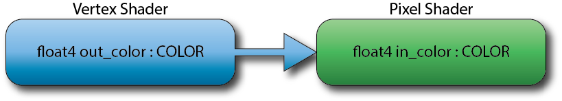

<div class="caption">

Shader Semantics

</div>

We will also use semantics to bind the geometry coming from the application to the input assembler and vertex shader stages in the following sections.

Besides these generic semantics, HLSL also defines a set of System-Value semantics [\[42\]](#ref-systemvaluesemantics) which you can associate to input and output variables that have a special meaning to the rendering pipeline. All system-value semantics begin with a **SV\_** prefix such as **SV\_Position**. As an example, the **SV\_Position** system-value semantic is used to associate a float4 output variable from the vertex shader with the homogeneous clip-space position required by the rasterizer.

For more information on HLSL syntax, please refer to the MSDN documentation on [HLSL Language Syntax](https://learn.microsoft.com/windows/win32/direct3dhlsl/dx-graphics-hlsl-language-syntax).

Since the vertex shader stage comes first in the rendering pipeline, let’s take a look at the vertex shader first.

### Vertex Shader

The vertex shader consumes vertex attributes from the Input Assembler stage and transforms the vertex position into homogeneous clip-space for the rasterizer stage. The vertex shader can also manipulate other vertex attributes (for example shift and scale texture coordinates) but this is optional in a vertex shader.

The input to the vertex shader is the object-space vertex position and any other vertex attributes that are passed by the application. At a minimum, We need to transform the object-space vertex position into homogeneous clip-space for use by the rasterizer. To perform this transformation, we will multiply the object-space vertex position by the model-view-projection matrix. The model-view-projection matrix is a combination of the geometry’s world matrix, the camera’s view matrix, and the camera’s projection matrix. We will need to pass these matrices to the vertex shader to perform the transformation. We will use constant buffers to store the matrices based on the frequency at which they are updated. Let’s see how we do this.

```hlsl source="LearningDirectX11-v1.0.0/SimpleVertexShader.hlsl#L1-L14"
```

First we declare three constant buffers using the **cbuffer** type. Each constant buffer is assigned to constant buffer registers by supplying the **b** register type. Explicitly assigning the constant buffer registers in this way is optional as the shader compiler will do this anyways if we don’t explicitly assign the registers but doing this provides more control over the placement of the buffers.

You will notice that we split the 3 matrices according to how frequently the matrix is updated. The projection matrix is usually updated when the application is started (in this demo anyways) and the view matrix is updated once per frame and the world matrix is updated for each separate object that will be rendered using this shader. By separating the variables in this way, we can reduce the amount of data that must be sent over the GPU bus. Of course this is an example showing the use of constant buffers. In your own shaders, you may want to compute the combined model-view-projection matrix in the application and only update a single uniform matrix variable in the shader.

Next we need to define a set of variables that will be passed from the application to the vertex shader. For this purpose, we will define a structure that will contain all of the input attributes for the vertex.

```hlsl source="LearningDirectX11-v1.0.0/SimpleVertexShader.hlsl#L16-L20"
```

The **AppData** struct is used to encapsulate all of the vertex attributes that are sent from the application (the code to map vertex attributes from the application to varying shader variables will be shown later). These are the varying input variables to the vertex shader.

Here we also see the first use of semantics. The **position** variable has the **POSITION** semantic and the color variable has the **COLOR** semantic. We will use these semantics to connect the application variables to the shader variables.

Similar to the input variables, we will define a struct which encapsulates the output variables. These variables are sent from the vertex shader to the pixel shader.

```hlsl source="LearningDirectX11-v1.0.0/SimpleVertexShader.hlsl#L22-L26"
```

The **VertexShaderOutput** defines the variables that will be output from the vertex shader. At a minimum, the vertex shader must output a **float4** variable bound to the **SV\_Position** system-value semantic as this is required by the rasterizer stage.

The **color** variable is bound to the **COLOR** semantic. The pixel shader will also need a matching **float4** input variable which is bound to the **COLOR** semantic to allow this variable to pass from the vertex shader stage to the pixel shader stage. In order for the color variable in the vertex shader to be correctly bound to the matching variable in the pixel shader, not only does the semantics need to match but the register they are bound to must also match. For this reason, I placed the **color** variable before the **position** variable in the **VertexShaderOutput** structure. This way, the first register will be assigned to the **color** variable in both the vertex shader and the pixel shader (as we will see briefly).

Now let’s see the entry point function of the vertex shader.

```hlsl source="LearningDirectX11-v1.0.0/SimpleVertexShader.hlsl#L28-L37"
```

The **SimpleVertexShader** function is the entry point for the vertex shader program. It takes an **AppData** struct variable as input and returns a **VertexShaderOutput** struct as output.

On line 32, the combined model-view-projection matrix is computed by multiplying the projection, view, and world matrix together. You will notice that we are post-multiplying the world matrix by the view matrix and the model-view matrix by the projection matrix. If you have done some programming with DirectX in the past, you may have used row-major matrix order in which case you would have swapped the order of multiplications. Since DirectX 10, the default order for matrices in HLSL is column-major so we will stick to this convention in this demo and future DirectX demos.

Using column-major matrices means that we have to post-multiply the vertex position by the model-view-projection matrix to correctly transform the vertex position from object-space to homogeneous clip-space.

On line 34 the vertex color is simply passed as-is to pixel shader.

Next we will create a pixel shader that will be used to determine the final pixel color of our geometry.

### Pixel Shader

The pixel shader for this demo is even simpler than the vertex shader. In this case we simply output the color value passed from the vertex shader to the currently bound render target by returning a value that is bound to the **SV\_Target** system value semantic.

```hlsl source="LearningDirectX11-v1.0.0/SimplePixelShader.hlsl#L1-L9"
```

The **PixelShaderInput** struct defines the input variables that we expect to be passed from the vertex shader stage. In this case, we only need the color value from the vertex shader which was bound to the **COLOR** semantic. We don’t need the **position** variable which was bound to the **SV\_Position** system-value semantic because that variable was only required by the rasterizer stage.

### Compiling Shaders

Now that we have defined the shaders we need to use them in our application. Before we can use them we must compile these shaders into a format that the GPU can understand. We can chose to precompile the shaders in the application’s compilation phase or we can load the HLSL shaders at runtime and compile them “on-the-fly”.

If we compile the shaders with the compilation phase of our application then we can distribute our shaders with the application in a pre-compiled format and we can load the shaders faster because they don’t require compilation during the loading of the application.

If we decide to compile the shaders at runtime then we may get noticeably slower load times if we have a lot of shaders to compile but we have more control over how the shader is loaded based on runtime logic.

#### Precompiled Shaders

As of Visual Studio 2012, files with the **hlsl** extension that are added to your project will be compiled by the **FXC.exe** HLSL shader compiler during the compilation phase of your project. The shader code can be compiled either into a byte array that you can include directly in your source code or you can compile to a compiled shader file which you can load at runtime.

Add the **SimpleVertexShader.hlsl** file and the **SimplePixelShader.hlsl** file to your project.

Right-click the **SimpleVertexShader.hlsl** file in the solution explorer and select Properties from the pop-up menu that appears.

<span id="attachment-5667"></span>

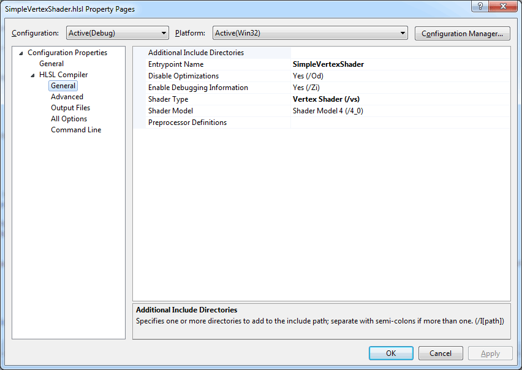

<div class="caption">

SimpleVertexShader Properties

</div>

For both Debug and Release builds, select the **HLSL Compiler > General** options and set the **Entrypoint Name** property to **SimpleVertexShader** to match the name of the entry point function defined in the shader.

Set the **Shader Type** to **Vertex Shader (/vs)** and set the **Shader Model** to the shader model you want to support.

Select the **HLSL Compiler > Output Files** node.

<span id="attachment-5669"></span>

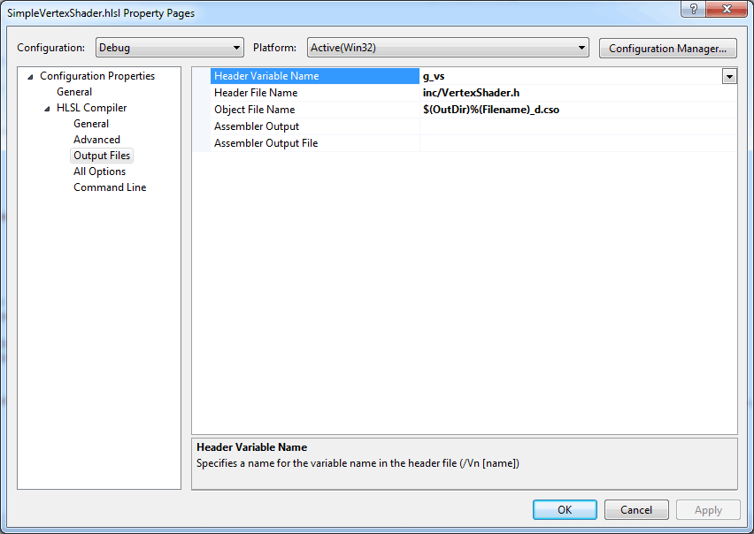

<div class="caption">

SimpleVertexShader Properties (2)

</div>

The **Header Variable Name** property determines the name of the global variable that is declared in the header file which is used to refer to the compiled byte array of your shader.

The **Header File Name** determines the location of the header file where the compiled shader byte array will be written to. The location of this property is relative to the folder where your project file is located.

The **Object File Name** determines the location of the the file that contains the compiled shader object file is written to.

Follow these steps for the pixel shader as well.

You do not need to specify both the **Header File Name** and the **Object File Name** because you will usually only use one or the other. In the next section I will show how you can use either of these options to load the precompiled shader object in the application.

#### Runtime Compiled Shader

The other way to compile your shaders is to compile them at runtime. Using this method requires the d3dcompiler runtime to be distributed with your application and if you are building a DirectX application for the Windows App store then you should not use this method. This method should only be used to test and debug your shaders or if you do not intend to distribute your DirectX application on the Windows App store and you don’t mind the extra load time of compiling your shaders at runtime.

To load the shader at runtime, we will define a template function called **LoadShader** to load a shader from a file path. Since the loading of the shader object is similar regardless of the type of the shader except for a few lines of code, the LoadShader function will be templated on the type of shader object we are loading.

We will probably also want to take the feature level of the end-users graphics hardware into consideration when loading our shaders. If the end-users computer only supports feature level 10\_0 we should not try to compile our shaders using Shader Model 5.0. The **GetLatestProfile** template function will return the latest shader profile based on the feature level of the end-users computer.

##### Get the Latest Profile

First let’s declare the **GetLatestProfile** template function.

```cpp source="LearningDirectX11-v1.0.0/main.cpp#L535-L537"
```

Next we will specialize this function based on the vertex shader type.

```cpp source="LearningDirectX11-v1.0.0/main.cpp#L539-L579"
```

This version of the template function returns the latest vertex shader profile that can be used to compile the vertex shader given the specific feature level supported by the end-user’s hardware.

And we will also provide a specialization for the pixel shader type.

```cpp source="LearningDirectX11-v1.0.0/main.cpp#L581-L619"
```

This version of the function returns the latest pixel shader profile that can be used to compile the pixel shader.

Feel free to implement template specializations for the geometry shader, hull shader and domain shader types. Keep in mind that geometry shaders are only supported as of feature level 10\_0 and hull and domain shaders are only supported as of feature level 11\_0 [\[43\]](#ref-featurelevels).

##### Create a Shader Object

Another function that should be specialized based on the shader type is a function that will create a shader object based on the shader type. This is the only part of the **LoadShader** function that is different depending on what kind of shader is being loaded.

First we will define a template function that will create the shader object.

```cpp source="LearningDirectX11-v1.0.0/main.cpp#L621-L622"
```

The **CreateShader** template function takes a binary object and the class linkage object and creates the appropriate shader object.

First let’s specialize this template function on the [ID3D11VertexShader](https://learn.microsoft.com/windows/win32/api/d3d11/nn-d3d11-id3d11vertexshader) type.

```cpp source="LearningDirectX11-v1.0.0/main.cpp#L625-L635"
```

This function uses the [ID3D11Device::CreateVertexShader](https://learn.microsoft.com/windows/win32/api/d3d11/nf-d3d11-id3d11device-createvertexshader) method to create the vertex shader object.

Next, we’ll specialize on the [ID3D11PixelShader](https://learn.microsoft.com/windows/win32/api/d3d11/nn-d3d11-id3d11pixelshader) shader type.

```cpp source="LearningDirectX11-v1.0.0/main.cpp#L637-L647"
```

Clearly this version of the template function is not much different than that of the vertex shader type except in the method that is used to create the shader object but we needed to do this to simplify the functionality of the **LoadShader** function which I will show next.

##### Load a Shader

The **LoadShader** template function takes the file path to a HLSL shader file, the entry point function in that file, and a compatible profile to compile the shader to and returns the initialized shader object.

```cpp source="LearningDirectX11-v1.0.0/main.cpp#L649-L660"
```

The **LoadShader** function accepts the profile to use to compile the shader but we can also use the special value **“latest”** profile value which specifies that the latest profile for the current feature level should be used.

The next step is to compile the HLSL shader into a Binary Large Object (BLOB) using the [D3DCompileFromFile](https://learn.microsoft.com/windows/win32/api/d3dcompiler/nf-d3dcompiler-d3dcompilefromfile) function.

```cpp source="LearningDirectX11-v1.0.0/main.cpp#L662-L683"
```

The **D3DCompileFromFile** function has the following signature [\[44\]](#ref-d3dcompilefromfile):

```cpp title="D3DCompileFromFile function" showLineNumbers
HRESULT WINAPI D3DCompileFromFile(
  in       LPCWSTR pFileName,
  in_opt   const D3D_SHADER_MACRO *pDefines,
  in_opt   ID3DInclude *pInclude,
  in       LPCSTR pEntrypoint,
  in       LPCSTR pTarget,
  in       UINT Flags1,
  in       UINT Flags2,
  out      ID3DBlob **ppCode,
  out_opt  ID3DBlob **ppErrorMsgs
);
```

Where:

-   **LPCWSTR pFileName**: A pointer to a constant null-terminated string that contains the name of the file that contains the shader code.
-   **const D3D\_SHADER\_MACRO \*pDefines**: An optional array of [D3D\_SHADER\_MACRO](https://learn.microsoft.com/windows/win32/api/d3dcommon/ns-d3dcommon-d3d_shader_macro) structures that define shader macros. Each macro definition contains a name and a NULL-terminated definition. If not used, set to **NULL**.
-   **ID3DInclude \*pInclude**: An optional pointer to an [ID3DInclude](https://learn.microsoft.com/windows/win32/api/d3dcommon/nn-d3dcommon-id3dinclude) interface that the compiler uses to handle include files. If you set this parameter to **NULL** and the shader contains a **#include** directive, a compile error occurs. You can pass the **D3D\_COMPILE\_STANDARD\_FILE\_INCLUDE** macro, which is a pointer to a default include handler. This default include handler includes files that are relative to the current directory.
-   **LPCSTR pEntrypoint**: A pointer to a constant null-terminated string that contains the name of the shader entry point function where shader execution begins.
-   **LPCSTR pTarget**: A pointer to a constant null-terminated string that specifies the shader target or set of shader features to compile against. The shader target can be a shader model (for example, shader model 2, shader model 3, shader model 4, or shader model 5 and later). The target can also be an effect type (for example, fx\_4\_1). For info about the targets that various profiles support, see [Specifying Compiler Targets](https://learn.microsoft.com/windows/win32/direct3dhlsl/specifying-compiler-targets).
-   **UINT Flags1**: A combination of shader [compile options](https://learn.microsoft.com/windows/win32/direct3dhlsl/d3dcompile-constants) that are combined by using a bitwise OR operation. The resulting value specifies how the compiler compiles the HLSL code.
-   **UINT Flags2**: A combination of [effect compile options](https://learn.microsoft.com/windows/win32/direct3dhlsl/d3dcompile-effect-constants) that are combined by using a bitwise OR operation. The resulting value specifies how the compiler compiles the effect. When you compile a shader and not an effect file, **D3DCompileFromFile** ignores **Flags2** and should be set to 0.
-   **ID3DBlob \*\*ppCode**: A pointer to a variable that receives a pointer to the [ID3DBlob](https://learn.microsoft.com/previous-versions/windows/desktop/legacy/ff728743(v=vs.85)) interface that you can use to access the compiled code.
-   **ID3DBlob \*\*ppErrorMsgs**: An optional pointer to a variable that receives a pointer to the [ID3DBlob](https://learn.microsoft.com/previous-versions/windows/desktop/legacy/ff728743(v=vs.85)) interface that you can use to access compiler error messages, or **NULL** if there are no errors.

If the shader compilation fails, (which is likely to happen if our shader contains a syntax error) [D3DCompileFromFile](https://learn.microsoft.com/windows/win32/api/d3dcompiler/nf-d3dcompiler-d3dcompilefromfile) returns a [Direct3D 11 error code](https://learn.microsoft.com/windows/win32/direct3d11/d3d11-graphics-reference-returnvalues) and we can use the error blob to determine the error that occured. The [OutputDebugString](https://learn.microsoft.com/windows/win32/api/debugapi/nf-debugapi-outputdebugstringa) function can be used to send the error message directly to the Visual Studio debug log.

At this point we only have the shader blob but we still need to create a shader object from the binary blob object. We can use the **CreateShader** template function we defined earlier.

```cpp source="LearningDirectX11-v1.0.0/main.cpp#L685-L691"
```

The compiled shader object is now ready for use by the rendering pipeline.

## DirectX Demo Cont…

Now that we have seen two simple HLSL shaders and we have compiled and loaded the shaders into shader objects let’s put them to good use in our application.

### Load Demo Content

The **LoadContent** function will be used to load demo specific content. The content that should be loaded in this function would be shaders that are specific to the demo, geometry that will be rendered in the scene, and textures or any other resources that are specific to this particular demo.

#### Vertex Buffer

In the **LoadContent** function, we’ll create two buffers. The first buffer will contain the vertex data that defines the geometry that will be rendered on the screen. The second buffer will contain the index data that defines the order to send the vertex data to the GPU for rendering.

```cpp source="LearningDirectX11-v1.0.0/main.cpp#L393-L415"
```

To create a buffer we need two things; a [D3D11\_BUFFER\_DESC](https://learn.microsoft.com/windows/win32/api/d3d11/ns-d3d11-d3d11_buffer_desc) structure that describes the buffer we are creating and a [D3D11\_SUBRESOURCE\_DATA](https://learn.microsoft.com/windows/win32/api/d3d11/ns-d3d11-d3d11_subresource_data) structure that defines the data to initialize the buffer with.

The [D3D11\_BUFFER\_DESC](https://learn.microsoft.com/windows/win32/api/d3d11/ns-d3d11-d3d11_buffer_desc) structure has the following definition [\[45\]](#ref-d3d11-buffer-desc):

```cpp title="D3D11_BUFFER_DESC structure" showLineNumbers
typedef struct D3D11_BUFFER_DESC {
  UINT        ByteWidth;
  D3D11_USAGE Usage;
  UINT        BindFlags;
  UINT        CPUAccessFlags;
  UINT        MiscFlags;
  UINT        StructureByteStride;
} D3D11_BUFFER_DESC;
```

Where:

-   **UINT ByteWidth**: The size of the buffer in bytes.
-   **D3D11\_USAGE Usage**: Identify how the buffer is expected to be read from and written to. Frequency of update is a key factor. The most common value is typically **D3D11\_USAGE\_DEFAULT**; see [D3D11\_USAGE](https://learn.microsoft.com/windows/win32/api/d3d11/ne-d3d11-d3d11_usage) for all possible values.
-   **UINT BindFlags**: Identify how the buffer will be bound to the pipeline (see [D3D11\_BIND\_FLAG](https://learn.microsoft.com/windows/win32/api/d3d11/ne-d3d11-d3d11_bind_flag)). Since this is a vertex buffer we specify the **D3D11\_BIND\_VERTEX\_BUFFER** which allows this buffer to be bound as a vertex buffer to the input-assembler stage.
-   **UINT CPUAccessFlags**: CPU access flags (see [D3D11\_CPU\_ACCESS\_FLAG](https://learn.microsoft.com/windows/win32/api/d3d11/ne-d3d11-d3d11_cpu_access_flag)) or 0 if no CPU access is necessary.
-   **UINT MiscFlags**: Miscellaneous flags (see [D3D11\_RESOURCE\_MISC\_FLAG](https://learn.microsoft.com/windows/win32/api/d3d11/ne-d3d11-d3d11_resource_misc_flag)) or 0 if unused.
-   **UINT StructureByteStride**: The size of each element in the buffer structure (in bytes) when the buffer represents a structured buffer. For more info about structured buffers, see [Structured Buffer](https://learn.microsoft.com/windows/win32/direct3d11/direct3d-11-advanced-stages-cs-resources).

The [D3D11\_SUBRESOURCE\_DATA](https://learn.microsoft.com/windows/win32/api/d3d11/ns-d3d11-d3d11_subresource_data) structure is used to specify the data that is used to initialize a buffer when it is created.

The [D3D11\_SUBRESOURCE\_DATA](https://learn.microsoft.com/windows/win32/api/d3d11/ns-d3d11-d3d11_subresource_data) structure has the following definition [\[46\]](#ref-d3d11-subresource-data):

```cpp title="D3D11_SUBRESOURCE_DATA structure" showLineNumbers
typedef struct D3D11_SUBRESOURCE_DATA {
  const void *pSysMem;
  UINT       SysMemPitch;
  UINT       SysMemSlicePitch;
} D3D11_SUBRESOURCE_DATA;
```

Where:

-   **const void \*pSysMem**: A pointer to the data to initialize the buffer with.
-   **UINT SysMemPitch**: The distance (in bytes) from the beginning of one line of a texture to the next line. System-memory pitch is used only for 2D and 3D texture data as it is has no meaning for the other resource types.
-   **UINT SysMemSlicePitch**: The distance (in bytes) from the beginning of one depth level to the next. System-memory-slice pitch is only used for 3D texture data as it has no meaning for the other resource types.

On line 406, we set the **pSysMem** member of the **resourceData** variable to the **g\_Vertices** array which was defined in the main preamble.

The [ID3D11Device::CreateBuffer](https://learn.microsoft.com/windows/win32/api/d3d11/nf-d3d11-id3d11device-createbuffer) method is used to create the vertex buffer which can be bound to the input-assembler stage to render the cube geometry.

The [ID3D11Device::CreateBuffer](https://learn.microsoft.com/windows/win32/api/d3d11/nf-d3d11-id3d11device-createbuffer) method has the following signature [\[47\]](#ref-createbuffer):

```cpp title="ID3D11Device::CreateBuffer method" showLineNumbers
HRESULT CreateBuffer(
  [in]             const D3D11_BUFFER_DESC *pDesc,
  [in, optional]   const D3D11_SUBRESOURCE_DATA *pInitialData,
  [out, optional]  ID3D11Buffer **ppBuffer
);
```

Where:

-   **const D3D11\_BUFFER\_DESC \*pDesc**: A pointer to a [D3D11\_BUFFER\_DESC](https://learn.microsoft.com/windows/win32/api/d3d11/ns-d3d11-d3d11_buffer_desc) structure that describes the buffer.
-   **const D3D11\_SUBRESOURCE\_DATA \*pInitialData**: A pointer to a [D3D11\_SUBRESOURCE\_DATA](https://learn.microsoft.com/windows/win32/api/d3d11/ns-d3d11-d3d11_subresource_data) structure that describes the initialization data; use **NULL** to allocate space only (with the exception that it cannot be **NULL** if the usage flag is **D3D11\_USAGE\_IMMUTABLE**).
-   **ID3D11Buffer \*\*ppBuffer**: Address of a pointer to the [ID3D11Buffer](https://learn.microsoft.com/windows/win32/api/d3d11/nn-d3d11-id3d11buffer) interface for the buffer object created.

Next, we’ll create an index buffer using a similar method.

#### Index Buffer

Similar to the vertex buffer, we’ll use the [ID3D11Device::CreateBuffer](https://learn.microsoft.com/windows/win32/api/d3d11/nf-d3d11-id3d11device-createbuffer) method to create and initialize the index buffer. The only difference between the vertex buffer and the index buffer is the bind flags of the index buffer will be [D3D11\_BIND\_INDEX\_BUFFER](https://learn.microsoft.com/windows/win32/api/d3d11/ne-d3d11-d3d11_bind_flag) and the data that is used to initialize the buffer.

```cpp source="LearningDirectX11-v1.0.0/main.cpp#L417-L431"
```

Now we need to define the three constant buffers that will be used to store the constant uniform variables used in the vertex shader.

#### Constant Buffers

Creating the constant buffers is very similar to creating the vertex and index buffers expect will will only initialize the size of the constant buffers but not the contents of the constant buffers. The contents of these constant buffers will be initialized later.

```cpp title="main.cpp" showLineNumbers startLineNumber=433
    // Create the constant buffers for the variables defined in the vertex shader.
    D3D11_BUFFER_DESC constantBufferDesc;
    ZeroMemory( &constantBufferDesc, sizeof(D3D11_BUFFER_DESC) );

    constantBufferDesc.BindFlags = D3D11_BIND_CONSTANT_BUFFER;
    constantBufferDesc.ByteWidth = sizeof( XMMATRIX );
    constantBufferDesc.CPUAccessFlags = 0;
    constantBufferDesc.Usage = D3D11_USAGE_DEFAULT;

    hr = g_d3dDevice->CreateBuffer( &constantBufferDesc, nullptr, &g_d3dConstantBuffers[CB_Application] );
    if ( FAILED(hr) )
    {
        return false;
    }
    hr = g_d3dDevice->CreateBuffer( &constantBufferDesc, nullptr, &g_d3dConstantBuffers[CB_Frame] );
    if ( FAILED(hr) )
    {
        return false;
    }
    hr = g_d3dDevice->CreateBuffer( &constantBufferDesc, nullptr, &g_d3dConstantBuffers[CB_Object] );
    if ( FAILED(hr) )
    {
        return false;
    }
```

In this case, we specify **D3D11\_BIND\_CONSTANT\_BUFFER** for the bind flags of the constant buffers and we use **nullptr** for the **D3D11\_SUBRESOURCE\_DATA** parameter to just allocate memory for the buffer but not initialize that memory.

Since we will need to update the contents of the constant buffer in the application, you may be tempted to set the buffer’s **Usage** property to **D3D11\_USAGE\_DYNAMIC** and the **CPUAccessFlags** to **D3D11\_CPU\_ACCESS\_WRITE**. You must resist this temptation! Later we will update the contents of this buffer using the [ID3D11DeviceContext::UpdateSubresource](https://learn.microsoft.com/windows/win32/api/d3d11/nf-d3d11-id3d11devicecontext-updatesubresource) method and this method expects constant buffers to be initialized with **D3D11\_USAGE\_DEFAULT** usage flag and buffers that are created with the **D3D11\_USAGE\_DEFAULT** flag must have their **CPUAccessFlags** set to 0.

Each of these three constant buffers only contains a single 4×4 matrix but a constant buffer may contain any number of matrices, vectors, or scalars. The only requirement is that the constant buffer is created the same size as the constant buffer defined in the shader in which it is used.

Now let’s load some shaders.

#### Load Shaders

As mentioned in the [Compiling Shaders](#compiling-shaders) section, there are several ways to load the shader at runtime.

1.  Load and compile the shader at runtime.
2.  Load a precompiled shader object.
3.  Create a shader from a byte array.

##### Load and Compile at Runtime

We can use the [LoadShader](#load-a-shader) template function described earlier to load and compile the HLSL shaders at runtime.

```cpp title="main.cpp" showLineNumbers startLineNumber=455
    // Load the shaders
    g_d3dVertexShader = LoadShader<ID3D11VertexShader>( L"../data/shaders/SimpleVertexShader.hlsl", "SimpleVertexShader", "latest" );
    g_d3dPixelShader = LoadShader<ID3D11PixelShader>( L"../data/shaders/SimplePixelShader.hlsl", "SimplePixelShader", "latest" );
```

##### Load a Precompiled Shader Object

If we want to load a precompiled shader object, we can use the [D3DReadFileToBlob](https://learn.microsoft.com/windows/win32/api/d3dcompiler/nf-d3dcompiler-d3dreadfiletoblob) function to load the precompiled shader directly to a [ID3DBlob](https://learn.microsoft.com/previous-versions/windows/desktop/legacy/ff728743(v=vs.85)) interface.

```cpp source="LearningDirectX11-v1.0.0/main.cpp#L462-L480"
```

How to create the compiled shader object (.cso) was explained in the [Precompiled Shaders](#precompiled-shaders) section of this article.

##### Load from Byte Array

And the final method which is probably the easiest and most portable way to load a precompiled shader is to load the shader from a byte array. The FXC.exe compiler can write the definition of the byte array to a header file which can be included in the application and use the byte array to create the shader. Suppose we configured the shader compiler to output the byte array for the vertex shader into a global variable named **g\_SimpleVertexShader** and the byte array for the pixel shader into a global variable named **g\_SimplePixelShader** then we could load the shaders in this way:

```cpp title="main.cpp" showLineNumbers startLineNumber=505
    hr = g_d3dDevice->CreateVertexShader( g_SimpleVertexShader, sizeof(g_SimpleVertexShader), nullptr, &g_d3dVertexShader );
    if ( FAILED( hr ) )
    {
        return false;
    }

    hr = g_d3dDevice->CreatePixelShader( g_SimplePixelShader, sizeof(g_SimplePixelShader), nullptr, &g_d3dPixelShader );
    if ( FAILED( hr ) )
    {
        return false;
    }
```

Now that we have seen multiple methods for loading a shader, we need to define an [ID3D11InputLayout](https://learn.microsoft.com/windows/win32/api/d3d11/nn-d3d11-id3d11inputlayout) interface object which maps the vertex buffer elements to the varying vertex attributes in the vertex shader.

#### Input Layout

The [ID3D11InputLayout](https://learn.microsoft.com/windows/win32/api/d3d11/nn-d3d11-id3d11inputlayout) interface is used to define how the vertex data attached to the input-assembler stage is layed out in memory. An instance of the [ID3D11InputLayout](https://learn.microsoft.com/windows/win32/api/d3d11/nn-d3d11-id3d11inputlayout) interface object is created using the [ID3D11Device::CreateInputLayout](https://learn.microsoft.com/windows/win32/api/d3d11/nf-d3d11-id3d11device-createinputlayout) method. This method has the following signature [\[48\]](#ref-createinputlayout):

```cpp title="ID3D11Device::CreateInputLayout method" showLineNumbers
HRESULT CreateInputLayout(
  [in]   const D3D11_INPUT_ELEMENT_DESC *pInputElementDescs,
  [in]   UINT NumElements,
  [in]   const void *pShaderBytecodeWithInputSignature,
  [in]   SIZE_T BytecodeLength,
  [out]  ID3D11InputLayout **ppInputLayout
);
```

Where:

-   **const D3D11\_INPUT\_ELEMENT\_DESC \*pInputElementDescs**: An array of the input-assembler stage input data types; each type is described by an element description (see [D3D11\_INPUT\_ELEMENT\_DESC](https://learn.microsoft.com/windows/win32/api/d3d11/ns-d3d11-d3d11_input_element_desc)). This structure will be described in the next section.
-   **UINT NumElements**: The number of input elements in the **pInputElementDescs** array.
-   **const void \*pShaderBytecodeWithInputSignature**: A pointer to the compiled shader. The compiled shader code contains a input signature which is validated against the array of elements.
-   **SIZE\_T BytecodeLength**: The size in bytes of the **pShaderBytecodeWithInputSignature** array.
-   **ID3D11InputLayout \*\*ppInputLayout**: A pointer to the input-layout object created (see [ID3D11InputLayout](https://learn.microsoft.com/windows/win32/api/d3d11/nn-d3d11-id3d11inputlayout)).

The input-layout is created from an array of [D3D11\_INPUT\_ELEMENT\_DESC](https://learn.microsoft.com/windows/win32/api/d3d11/ns-d3d11-d3d11_input_element_desc) structures. Each element in the array describes a single element of the vertex buffer that is bound to the input-assembler stage.

The **D3D11\_INPUT\_ELEMENT\_DESC** structure has the following definition [\[49\]](#ref-d3d11-input-element-desc):

```cpp title="D3D11_INPUT_ELEMENT_DESC structure" showLineNumbers
typedef struct D3D11_INPUT_ELEMENT_DESC {
  LPCSTR                     SemanticName;
  UINT                       SemanticIndex;
  DXGI_FORMAT                Format;
  UINT                       InputSlot;
  UINT                       AlignedByteOffset;
  D3D11_INPUT_CLASSIFICATION InputSlotClass;
  UINT                       InstanceDataStepRate;
} D3D11_INPUT_ELEMENT_DESC;
```

Where:

-   **LPCSTR SemanticName**: The HLSL semantic associated with this element in a shader input-signature.
-   **UINT SemanticIndex**: The semantic index for the element. A semantic index modifies a semantic, with an integer index number. A semantic index is only needed in a case where there is more than one element with the same semantic.
-   **DXGI\_FORMAT Format**: The data type of the element data. See [DXGI\_FORMAT](https://learn.microsoft.com/windows/win32/api/dxgiformat/ne-dxgiformat-dxgi_format). For example, if the element describes a 4-component floating point vector, the **Format** flag would be set to **DXGI\_FORMAT\_R32G32B32A32\_FLOAT**.
-   **UINT InputSlot**: If using a single vertex buffer with interleaved vertex attributes then the input slot should always be 0. If using several packed vertex buffers where each vertex buffer contains the vertex data for a single vertex attribute, then the input slot is the index of the vertex buffer that is attached to the input assembler stage.
-   **UINT AlignedByteOffset**: Offset (in bytes) between each element. Use **D3D11\_APPEND\_ALIGNED\_ELEMENT** for convenience to define the current element directly after the previous one, including any packing if necessary.
-   **D3D11\_INPUT\_CLASSIFICATION InputSlotClass**: Identifies the input data class for a single input slot. This member can have one of the following values [\[50\]](#ref-d3d11-input-classification):
    -   **D3D11\_INPUT\_PER\_VERTEX\_DATA**: Input data is per-vertex data.
    -   **D3D11\_INPUT\_PER\_INSTANCE\_DATA**: Input data is per-instance data.
-   **UINT InstanceDataStepRate**: The number of instances to draw using the same per-instance data before advancing in the buffer by one element. This value must be 0 for an element that contains per-vertex data (the slot class is set to **D3D11\_INPUT\_PER\_VERTEX\_DATA**).

Armed with this information, we can define the **D3D11\_INPUT\_ELEMENT\_DESC** array that defines the layout of our vertex data and create the [ID3D11InputLayout](https://learn.microsoft.com/windows/win32/api/d3d11/nn-d3d11-id3d11inputlayout) object.

```cpp source="LearningDirectX11-v1.0.0/main.cpp#L482-L495"
```

The vertex buffer for our cube geometry contains two attributes; the vertex position and the vertex color. Both the vertex position and the vertex color are passed to the vertex shader as a 3-component 32-bit floating-point vector. Since both attributes are stored interleaved in a single vertex buffer (instead of storing each attribute packed in separate vertex buffers) they both use the first (0) input slot. Since both of these attributes describe per-vertex (as apposed to per-instance) attributes, they use the **D3D11\_INPUT\_PER\_VERTEX\_DATA** input classification.

On line 489, the input layout object is created using the layout description.

With the input layout object created, we no longer need the shader blob so on line 495, the shader blob is released.

#### Load Pixel Shader

The pixel shader is loaded in a similar way to the vertex shader but there is no need to define the input layout for the pixel shader. The pixel shader is loaded from a precompiled shader object.

```cpp source="LearningDirectX11-v1.0.0/main.cpp#L497-L517"
```

This code snippet is very similar to the vertex shader loading so it will not be explained in detail.

#### Projection Matrix

One final thing we can do in the **LoadContent** method for this demo is setup the projection matrix and update the constant buffer that stores the value of the projection matrix in the shader.

```cpp source="LearningDirectX11-v1.0.0/main.cpp#L519-L533"
```

On line 528, the projection matrix is computed from the [XMMatrixPerspectiveFovLH](https://learn.microsoft.com/windows/win32/api/directxmath/nf-directxmath-xmmatrixperspectivefovlh) function and on line 530 the contents of the projection matrix are copied into the per-appliction constant buffer using the [ID3D11DeviceContext::UpdateSubresource](https://learn.microsoft.com/windows/win32/api/d3d11/nf-d3d11-id3d11devicecontext-updatesubresource) method.

The [ID3D11DeviceContext::UpdateSubresource](https://learn.microsoft.com/windows/win32/api/d3d11/nf-d3d11-id3d11devicecontext-updatesubresource) method has the following signature [\[51\]](#ref-updatesubresource):

```cpp title="ID3D11DeviceContext::UpdateSubresource method" showLineNumbers
void UpdateSubresource(
  [in]  ID3D11Resource *pDstResource,
  [in]  UINT DstSubresource,
  [in]  const D3D11_BOX *pDstBox,
  [in]  const void *pSrcData,
  [in]  UINT SrcRowPitch,
  [in]  UINT SrcDepthPitch
);
```

Where:

-   **ID3D11Resource \*pDstResource**: A pointer to the destination resource (see [ID3D11Resource](https://learn.microsoft.com/windows/win32/api/d3d11/nn-d3d11-id3d11resource)).
-   **UINT DstSubresource**: A zero-based index, that identifies the destination subresource. See [D3D11CalcSubresource](https://learn.microsoft.com/windows/win32/api/d3d11/nf-d3d11-d3d11calcsubresource) for more details.
-   **const D3D11\_BOX \*pDstBox**: A pointer to a box that defines the portion of the destination subresource to copy the resource data into. Coordinates are in bytes for buffers and in texels for textures. If NULL, the data is written to the destination subresource with no offset. The dimensions of the source must fit the destination (see [D3D11\_BOX](https://learn.microsoft.com/windows/win32/api/d3d11/ns-d3d11-d3d11_box)).
-   **const void \*pSrcData**: A pointer to the source data in memory.
-   **UINT SrcRowPitch**: The size of one row of the source data.
-   **UINT SrcDepthPitch**: The size of one depth slice of source data.

For a shader-constant buffer; set **pDstBox** to **NULL**. It is not possible to use this method to partially update a shader-constant buffer [\[51\]](#ref-updatesubresource).

Now that we have loaded the content that will be used by our demo, let’s implement the update and render functions so that we can see something interesting on the screen.

### The Update Function

First we’ll implement the update function. This function doesn’t do much except setup the camera’s view matrix and create a rotation matrix for our cube.

```cpp source="LearningDirectX11-v1.0.0/main.cpp#L804-L819"
```

On lines 807-810 we setup the view matrix by placing the camera 10 units back looking towards the origin.  
On line 810, the constant buffer which is used to store the view matrix is updated using the same method used to update the projection matrix.

On line 814-818 we create a rotation matrix that is used to rotate the cube and on line 819 the constant buffer that stores the object’s world matrix is updated using the same method that was used to update the view matrix and the projection matrix.

Before we can render we will define two helper functions. The first will clear the render target, and the depth and stencil buffers and the second will be used to present the contents of the swap chain’s back buffer to the screen.

### Clear

Before we can start rendering a new frame, we must clear the old contents of the back buffer and the depth/stencil buffers.

```cpp source="LearningDirectX11-v1.0.0/main.cpp#L821-L826"
```

The [ID3D11DeviceContext::ClearRenderTargetView](https://learn.microsoft.com/windows/win32/api/d3d11/nf-d3d11-id3d11devicecontext-clearrendertargetview) method is used to clear the back buffer to a particlular color and the [ID3D11DeviceContext::ClearDepthStencilView](https://learn.microsoft.com/windows/win32/api/d3d11/nf-d3d11-id3d11devicecontext-cleardepthstencilview) method is used to clear the depth and stencil buffer to a particular depth value and stencil value.

The back buffer of the swap chain and the depth/stencil buffer must be accessed using their views.

After everything has finished rendering, we must tell the swap chain to present the contents of the back buffer to the screen. For this we will create a **Present** helper function.

### Present

The **Present** function is called at the end of the drawing code and finalizes the frame.

```cpp source="LearningDirectX11-v1.0.0/main.cpp#L828-L838"
```

The [IDXGISwapChain::Present](https://learn.microsoft.com/windows/win32/api/dxgi/nf-dxgi-idxgiswapchain-present) method is used to flip the back buffer to the front for display in the application window. The [IDXGISwapChain::Present](https://learn.microsoft.com/windows/win32/api/dxgi/nf-dxgi-idxgiswapchain-present) method takes two parameters [\[55\]](#ref-present):

-   **UINT SyncInterval**: An integer that specifies how to synchronize presentation of a frame with the vertical blank. For the bit-block transfer (bitblt) model ([DXGI\_SWAP\_EFFECT\_DISCARD](https://learn.microsoft.com/windows/win32/api/dxgi/ne-dxgi-dxgi_swap_effect#constants) or [DXGI\_SWAP\_EFFECT\_SEQUENTIAL](https://learn.microsoft.com/windows/win32/api/dxgi/ne-dxgi-dxgi_swap_effect#constants)), values are:
    
    -   **0**: The presentation occurs immediately, there is no synchronization.
    -   **1,2,3,4**: Synchronize presentation after the **nth** vertical blank.
    
    For the flip model ([DXGI\_SWAP\_EFFECT\_FLIP\_SEQUENTIAL](https://learn.microsoft.com/windows/win32/api/dxgi/ne-dxgi-dxgi_swap_effect#constants)), values are:
    
    -   **0**: Cancel the remaining time on the previously presented frame and discard this frame if a newer frame is queued.
    -   **n > 0**: Synchronize presentation for at least **n** vertical blanks.
-   **UINT Flags**: An integer value that contains swap-chain presentation options. These options are defined by the [DXGI\_PRESENT](https://learn.microsoft.com/windows/win32/direct3ddxgi/dxgi-present) constants.

If vertical-sync is enabled, then the presentation of the back buffer will wait until the next vertical blank for the screen. If the vertical sync is not enabled, then the contents of the back buffer will be displayed immediately without synchronization.

And finally everything is in place for rendering the geometry to the screen.

### Render

In the render function, we’ll first clear the back buffer and the depth/stencil buffers. Then we’ll initialize each stage of the rendering pipeline and finally we’ll draw the geometry.

#### Clear the Screen

The first step of our render function (after checking our preconditions) is to clear the screen.

```cpp source="LearningDirectX11-v1.0.0/main.cpp#L840-L845"
```

On line 845, we call the **Clear** function to clear the contents of the back buffer and depth/stencil buffer.

#### Setup the Input Assembler Stage

The first stage of the rendering pipeline is the input assembler (**IA**).

```cpp source="LearningDirectX11-v1.0.0/main.cpp#L847-L853"
```

On line 850-853 we setup the various properties of the input assembler stage. On line 851, we bind the vertex buffer to to input assembler stage using the [ID3D11DeviceContext::IASetVertexBuffers](https://learn.microsoft.com/windows/win32/api/d3d11/nf-d3d11-id3d11devicecontext-iasetvertexbuffers) method. This method takes the following arguments [\[56\]](#ref-iasetvertexbuffers):

-   **UINT StartSlot**: The first input slot for binding. The first vertex buffer is explicitly bound to the start slot; this causes each additional vertex buffer in the array to be implicitly bound to each subsequent input slot. The maximum of 16 or 32 input slots (ranges from 0 to **D3D11\_IA\_VERTEX\_INPUT\_RESOURCE\_SLOT\_COUNT** – 1) are available; the [maximum number of input slots depends on the feature level](https://learn.microsoft.com/windows/win32/direct3d11/overviews-direct3d-11-devices-downlevel-intro).
-   **UINT NumBuffers**: The number of vertex buffers in the array. The number of buffers (plus the starting slot) can’t exceed the total number of IA-stage input slots (ranges from 0 to **D3D11\_IA\_VERTEX\_INPUT\_RESOURCE\_SLOT\_COUNT** – **StartSlot**).
-   **ID3D11Buffer \*const \*ppVertexBuffers**: A pointer to an array of vertex buffers (see [ID3D11Buffer](https://learn.microsoft.com/windows/win32/api/d3d11/nn-d3d11-id3d11buffer)). The vertex buffers must have been created with the [D3D11\_BIND\_VERTEX\_BUFFER](https://learn.microsoft.com/windows/win32/api/d3d11/ne-d3d11-d3d11_bind_flag) flag.
-   **const UINT \*pStrides**: Pointer to an array of stride values; one stride value for each buffer in the vertex-buffer array. Each stride is the size (in bytes) of the elements that are to be used from that vertex buffer.
-   **const UINT \*pOffsets**: Pointer to an array of offset values; one offset value for each buffer in the vertex-buffer array. Each offset is the number of bytes between the first element of a vertex buffer and the first element that will be used.

Since we only have a single vertex buffer, the **StartSlot** is always 0 and the **NumBuffers** is 1. The **StartSlot** argument should match the **InputSlot** of the [D3D11\_INPUT\_ELEMENT\_DESC](https://learn.microsoft.com/windows/win32/api/d3d11/ns-d3d11-d3d11_input_element_desc) elements that were configured in the **LoadContent** function.

On line 852 the input layout is specified for the input assembler stage using the [ID3D11DeviceContext::IASetInputLayout](https://learn.microsoft.com/windows/win32/api/d3d11/nf-d3d11-id3d11devicecontext-iasetinputlayout) method. The input layout object used must match the input signature of the vertex shader which is bound to the vertex shader stage while rendering.

On line 853 the index buffer is bound to the input assembler stage using the [ID3D11DeviceContext::IASetIndexBuffer](https://learn.microsoft.com/windows/win32/api/d3d11/nf-d3d11-id3d11devicecontext-iasetindexbuffer) method. This method takes the following arguments [\[57\]](#ref-iasetindexbuffer):

-   **ID3D11Buffer \*pIndexBuffer**: A pointer to an [ID3D11Buffer](https://learn.microsoft.com/windows/win32/api/d3d11/nn-d3d11-id3d11buffer) object, that contains indices. The index buffer must have been created with the [D3D11\_BIND\_INDEX\_BUFFER](https://learn.microsoft.com/windows/win32/api/d3d11/ne-d3d11-d3d11_bind_flag) flag.
-   **DXGI\_FORMAT Format**: A [DXGI\_FORMAT](https://learn.microsoft.com/windows/win32/api/dxgiformat/ne-dxgiformat-dxgi_format) that specifies the format of the data in the index buffer. The only formats allowed for index buffer data are 16-bit (**DXGI\_FORMAT\_R16\_UINT**) and 32-bit (**DXGI\_FORMAT\_R32\_UINT**) integers.
-   **UINT Offset**: Offset (in bytes) from the start of the index buffer to the first index to use.

And on line 853 the type of primitive that will be used for rendering is specified using the [ID3D11DeviceContext::IASetPrimitiveTopology](https://learn.microsoft.com/windows/win32/api/d3d11/nf-d3d11-id3d11devicecontext-iasetprimitivetopology) method. In this case we specify the **D3D11\_PRIMITIVE\_TOPOLOGY\_TRIANGLELIST** primitive type which indicates to the input assembler stage that we are rending with a list of discontinuous triangles.

#### Setup the Vertex Shader Stage

The next stage of the rendering pipeline is the vertex shader stage (**VS**). For the vertex shader stage we only have to specify the vertex shader which will be used to transform the object space vertices to homogeneous clip space and bind any constant buffers that are used by the vertex shader stage.

```cpp source="LearningDirectX11-v1.0.0/main.cpp#L855-L856"
```

The vertex shader is bound to the vertex shader stage using the [ID3D11DeviceContext::VSSetShader](https://learn.microsoft.com/windows/win32/api/d3d11/nf-d3d11-id3d11devicecontext-vssetshader) method. This method takes the following arguments [\[58\]](#ref-vssetshader):

-   **ID3D11VertexShader \*pVertexShader**: Pointer to a vertex shader (see [ID3D11VertexShader](https://learn.microsoft.com/windows/win32/api/d3d11/nn-d3d11-id3d11vertexshader)). Passing in **NULL** disables the shader for this pipeline stage.
-   **ID3D11ClassInstance \*const \*ppClassInstances**: A pointer to an array of class-instance interfaces (see [ID3D11ClassInstance](https://learn.microsoft.com/windows/win32/api/d3d11/nn-d3d11-id3d11classinstance)). Each interface used by a shader must have a corresponding class instance or the shader will get disabled. Set **ppClassInstances** to **NULL** if the shader does not use any interfaces.
-   **UINT NumClassInstances**: The number of class-instance interfaces in the **ppClassInstances** array.

On line 856 the constant buffers used by the vertex shader are bound to the vertex shader stage using the [ID3D11DeviceContext::VSSetConstantBuffers](https://learn.microsoft.com/windows/win32/api/d3d11/nf-d3d11-id3d11devicecontext-vssetconstantbuffers) method. This method takes the following arguments:

-   **UINT StartSlot**: Index into the device’s zero-based array to begin setting constant buffers to (ranges from 0 to **D3D11\_COMMONSHADER\_CONSTANT\_BUFFER\_API\_SLOT\_COUNT** – 1).
-   **UINT NumBuffers**: Number of buffers to set (ranges from 0 to **D3D11\_COMMONSHADER\_CONSTANT\_BUFFER\_API\_SLOT\_COUNT** – StartSlot).
-   **ID3D11Buffer \*const \*ppConstantBuffers**: Array of constant buffers (see [ID3D11Buffer](https://learn.microsoft.com/windows/win32/api/d3d11/nn-d3d11-id3d11buffer)) being given to the device.

#### Setup the Rasterizer Stage

After the vertex shader stage but before the pixel shader stage comes the rasterizer stage. The rasterizer stage is responsible for interpolating the various vertex attributes output from the vertex shader and invoking the pixel shader program for each screen pixel which is affected by the rendered geometry.

```cpp source="LearningDirectX11-v1.0.0/main.cpp#L858-L859"
```

On line 859 the rasterizer stage is initialized using the [ID3D11DeviceContext::RSSetState](https://learn.microsoft.com/windows/win32/api/d3d11/nf-d3d11-id3d11devicecontext-rssetstate) method. This method takes a pointer to a [ID3D11RasterizerState](https://learn.microsoft.com/windows/win32/api/d3d11/nn-d3d11-id3d11rasterizerstate) object which we created in the **InitDirectX** function.

The rasterizer stage also needs to know about any viewports that are used to map the clip space coordinates into screen space. All viewports are bound to the rasterizer stage using the [ID3D11DeviceContext::RSSetViewports](https://learn.microsoft.com/windows/win32/api/d3d11/nf-d3d11-id3d11devicecontext-rssetviewports) method. This takes the following arguments [\[59\]](#ref-rssetviewports):

-   **UINT NumViewports**: Number of viewports to bind.
-   **const D3D11\_VIEWPORT \*pViewports**: An array of D3D11\_VIEWPORT structures to bind to the device.

All viewports must be set atomically as one operation. Any viewports not defined by the call are disabled.  
Which viewport to use is determined by the **SV\_ViewportArrayIndex** semantic output by a geometry shader; if a geometry shader does not specify the semantic, Direct3D will use the first viewport in the array [\[59\]](#ref-rssetviewports).

#### Setup the Pixel Shader Stage

Next we’ll setup the pixel shader stage. For this stage, we only have to bind the pixel shader program to the pixel shader stage.

```cpp source="LearningDirectX11-v1.0.0/main.cpp#L861-L861"
```

The pixel shader is bound to the pixel shader stage using the [ID3D11DeviceContext::PSSetShader](https://learn.microsoft.com/windows/win32/api/d3d11/nf-d3d11-id3d11devicecontext-pssetshader) method. This method is similar to the method to set the vertex shader so I won’t detail the arguments here.

#### Setup the Output Merger Stage

The output merger stage (as it’s name suggests) merges the output from the pixel shader onto the color and depth buffers.

```cpp source="LearningDirectX11-v1.0.0/main.cpp#L863-L864"
```

The back buffer and depth/stencil buffer are bound to the output merger stage using the [ID3D11DeviceContext::OMSetRenderTargets](https://learn.microsoft.com/windows/win32/api/d3d11/nf-d3d11-id3d11devicecontext-omsetrendertargets) method. This method takes the following arguments [\[60\]](#ref-omsetrendertargets):

-   **UINT NumViews**: Number of render targets to bind (ranges between 0 and **D3D11\_SIMULTANEOUS\_RENDER\_TARGET\_COUNT**). If this parameter is nonzero, the number of entries in the array to which **ppRenderTargetViews** points must equal the number in this parameter.
-   **ID3D11RenderTargetView \*const \*ppRenderTargetViews**: Pointer to an array of [ID3D11RenderTargetView](https://learn.microsoft.com/windows/win32/api/d3d11/nn-d3d11-id3d11rendertargetview) that represent the render targets to bind to the device. If this parameter is **NULL** and NumViews is 0, no render targets are bound.
-   **ID3D11DepthStencilView \*pDepthStencilView**: Pointer to a [ID3D11DepthStencilView](https://learn.microsoft.com/windows/win32/api/d3d11/nn-d3d11-id3d11depthstencilview) that represents the depth-stencil view to bind to the device. If this parameter is **NULL**, the depth-stencil view is not bound.

You can render to multiple render targets by mapping multiple output values to the **SV\_Target\[n\]** (where **n** is between 0 and **D3D11\_SIMULTANEOUS\_RENDER\_TARGET\_COUNT**) semantic in the pixel shader. Currently, the maximum number of render target views that can be mapped to the output merger stage is eight (8).

On line 864, the [ID3D11DeviceContext::OMSetDepthStencilState](https://learn.microsoft.com/windows/win32/api/d3d11/nf-d3d11-id3d11devicecontext-omsetdepthstencilstate) method is used to map the [ID3D11DepthStencilState](https://learn.microsoft.com/windows/win32/api/d3d11/nn-d3d11-id3d11depthstencilstate) object that was created in the **InitDirectX** function. Setting the first argument of this method to **NULL** will use the default state listed in [D3D11\_DEPTH\_STENCIL\_DESC](https://learn.microsoft.com/windows/win32/api/d3d11/ns-d3d11-d3d11_depth_stencil_desc) [\[61\]](#ref-omsetdepthstencilstate).

#### Draw the Cube

Now that we have initialized the various stages of the rendering pipeline, we can render the cube geometry to the screen.

```cpp source="LearningDirectX11-v1.0.0/main.cpp#L866-L866"
```

The [ID3D11DeviceContext::DrawIndexed](https://learn.microsoft.com/windows/win32/api/d3d11/nf-d3d11-id3d11devicecontext-drawindexed) method is used to draw indexed primitives without instancing. The [ID3D11DeviceContext::DrawIndexed](https://learn.microsoft.com/windows/win32/api/d3d11/nf-d3d11-id3d11devicecontext-drawindexed) method takes the following arguments [\[62\]](#cite-62):

-   **UINT IndexCount**: Number of indices in the currently bound index buffer to draw.
-   **UINT StartIndexLocation**: The location of the first index read by the GPU from the index buffer.
-   **INT BaseVertexLocation**: A value added to each index before reading a vertex from the vertex buffer.

#### Present

The final step in the render function is to present the swap chain’s back buffer to the screen.

```cpp source="LearningDirectX11-v1.0.0/main.cpp#L868-L869"
```

### Cleanup

Because we are such tidy programmers, we should not forget to tidy up the resource before our application quits.

#### UnloadContent

The **UnloadContent** function is used for releasing the resources that were allocated in the **LoadContent** method.

```cpp source="LearningDirectX11-v1.0.0/main.cpp#L693-L703"
```

Since all of the resources we allocated are all COM objects, we can use the **SafeRelease** method to release the reference count of the COM objects. If the COM object’s reference count reaches 0, it will be automatically deleted by the system.

#### Cleanup

We should also not forget to cleanup the references to the resources allocated in the **InitDirectX** function.

```cpp source="LearningDirectX11-v1.0.0/main.cpp#L871-L881"
```

Now that we have defined all of the necessary functions let’s complete the main function.

### Update the Run Function

At this point we should update the **Run** to call the **Update** and **Render** functions.

```cpp showLineNumbers startLineNumber=705
"  title="main.cpp"]
/**
 * The main application loop.
 */
int Run()
{
    MSG msg = {0};

    static DWORD previousTime = timeGetTime();
    static const float targetFramerate = 30.0f;
    static const float maxTimeStep = 1.0f / targetFramerate;

    while ( msg.message != WM_QUIT )
    {
        if ( PeekMessage( &msg, 0, 0, 0, PM_REMOVE ) )
        {
            TranslateMessage( &msg );
            DispatchMessage( &msg );
        }
        else
        {
            DWORD currentTime = timeGetTime();
            float deltaTime = ( currentTime - previousTime ) / 1000.0f;
            previousTime = currentTime;

            // Cap the delta time to the max time step (useful if your 
            // debugging and you don't want the deltaTime value to explode.
            deltaTime = std::min<float>(deltaTime, maxTimeStep);

            Update( deltaTime );
            Render();
        }
    }

    return static_cast<int>(msg.wParam);
}
```

This function is identical to the **Run** function shown in the section titled [The Run Method](#the-run-method) except now we can compile the application with the **Update** and **Render** functions uncommented.

### Update the Main Function

And the final version of the main function which also loads the demo content and performs cleanup after the main window is closed.

```cpp showLineNumbers startLineNumber=741
;"  title="main.cpp"]
int WINAPI wWinMain( HINSTANCE hInstance, HINSTANCE prevInstance, LPWSTR cmdLine, int cmdShow )
{
    UNREFERENCED_PARAMETER( prevInstance );
    UNREFERENCED_PARAMETER( cmdLine );

    // Check for DirectX Math library support.
    if ( !XMVerifyCPUSupport() )
    {
        MessageBox( nullptr, TEXT("Failed to verify DirectX Math library support."), TEXT("Error"), MB_OK );
        return -1;
    }

    if( InitApplication(hInstance, cmdShow) != 0 )
    {
        MessageBox( nullptr, TEXT("Failed to create applicaiton window."), TEXT("Error"), MB_OK );
        return -1;
    }

    if ( InitDirectX(hInstance, g_EnableVSync) != 0 )
    {
        MessageBox( nullptr, TEXT("Failed to create DirectX device and swap chain."), TEXT("Error"), MB_OK );
        return -1;
    }

    if ( !LoadContent() )
    {
        MessageBox( nullptr, TEXT("Failed to load content."), TEXT("Error"), MB_OK );
        return -1;
    }

    int returnCode = Run();

    UnloadContent();
    Cleanup();

    return returnCode;
}
```

### Run the Demo

Now if we run the application again, we should see a rotating cube on a cornflower-blue background.

<iframe class="embed embed-video" src="https://www.youtube-nocookie.com/embed/M0zJFFwSxN0?rel=0" title="YouTube video" loading="lazy" allowfullscreen></iframe>

## Download the Demo

You can download the source code including the project files for this demo here:

[https://github.com/jpvanoosten/LearningDirectX11](https://github.com/jpvanoosten/LearningDirectX11/tree/v1.0.0)

## References

<span id="ref-directx"></span>\[1\] Wikipedia. (2014). Directx. \[online\] Retrieved from: [https://en.wikipedia.org/wiki/DirectX](https://en.wikipedia.org/wiki/DirectX) \[Accessed: 10 Mar 2014\].

<span id="ref-direct3d"></span>\[2\] Wikipedia. (2014). Direct3d. \[online\] Retrieved from: [https://en.wikipedia.org/wiki/Direct3D](https://en.wikipedia.org/wiki/Direct3D) \[Accessed: 10 Mar 2014\].

<span id="ref-windows-95"></span>\[3\] Wikipedia. (2014). Windows 95. \[online\] Retrieved from: [https://en.wikipedia.org/wiki/Windows_95](https://en.wikipedia.org/wiki/Windows_95) \[Accessed: 10 Mar 2014\].

<span id="ref-shadermodels"></span>\[4\] Msdn.microsoft.com. (2014). Shader models vs shader profiles (windows). \[online\] Retrieved from: [https://learn.microsoft.com/windows/win32/direct3dhlsl/dx-graphics-hlsl-models](https://learn.microsoft.com/windows/win32/direct3dhlsl/dx-graphics-hlsl-models) \[Accessed: 11 Mar 2014\].

<span id="ref-directx12"></span>\[5\] IGN. (2014). Gdc: microsoft to debut DirectX 12 on march 20 – ign. \[online\] Retrieved from: [https://www.ign.com/articles/2014/03/06/gdc-microsoft-to-debut-directx-12](https://www.ign.com/articles/2014/03/06/gdc-microsoft-to-debut-directx-12) \[Accessed: 11 Mar 2014\].

<span id="ref-direct2d"></span>\[6\] Msdn.microsoft.com. (2014). Direct2D (windows). \[online\] Retrieved from: [https://learn.microsoft.com/windows/win32/direct2d/direct2d-portal](https://learn.microsoft.com/windows/win32/direct2d/direct2d-portal) \[Accessed: 11 Mar 2014\].

<span id="ref-direct3d-2"></span>\[7\] Msdn.microsoft.com. (2014). Direct3D (windows). \[online\] Retrieved from: [https://learn.microsoft.com/windows/win32/direct3d](https://learn.microsoft.com/windows/win32/direct3d) \[Accessed: 11 Mar 2014\].

<span id="ref-directwrite"></span>\[8\] Msdn.microsoft.com. (2014). DirectWrite (windows). \[online\] Retrieved from: [https://learn.microsoft.com/windows/win32/directwrite/direct-write-portal](https://learn.microsoft.com/windows/win32/directwrite/direct-write-portal) \[Accessed: 11 Mar 2014\].

<span id="ref-directxmath"></span>\[9\] Msdn.microsoft.com. (2014). DirectXMath (windows). \[online\] Retrieved from: [https://learn.microsoft.com/windows/win32/dxmath/directxmath-portal](https://learn.microsoft.com/windows/win32/dxmath/directxmath-portal) \[Accessed: 11 Mar 2014\].

<span id="ref-xaudio2"></span>\[10\] Msdn.microsoft.com. (2014). Xaudio2 APIs (windows). \[online\] Retrieved from: [https://learn.microsoft.com/windows/win32/xaudio2/xaudio2-apis-portal](https://learn.microsoft.com/windows/win32/xaudio2/xaudio2-apis-portal) \[Accessed: 11 Mar 2014\].

<span id="ref-xinput"></span>\[11\] Msdn.microsoft.com. (2014). XInput game controller APIs (windows). \[online\] Retrieved from: [https://learn.microsoft.com/windows/win32/xinput/xinput-game-controller-apis-portal](https://learn.microsoft.com/windows/win32/xinput/xinput-game-controller-apis-portal) \[Accessed: 11 Mar 2014\].

<span id="ref-dxgi"></span>\[12\] Msdn.microsoft.com. (2014). DXGI overview (windows). \[online\] Retrieved from: [https://learn.microsoft.com/windows/win32/direct3ddxgi/d3d10-graphics-programming-guide-dxgi](https://learn.microsoft.com/windows/win32/direct3ddxgi/d3d10-graphics-programming-guide-dxgi) \[Accessed: 11 Mar 2014\].

<span id="ref-directx-pipeline"></span>\[13\] Msdn.microsoft.com. (2014). Graphics pipeline (windows). \[online\] Retrieved from: [https://learn.microsoft.com/windows/win32/direct3d11/overviews-direct3d-11-graphics-pipeline](https://learn.microsoft.com/windows/win32/direct3d11/overviews-direct3d-11-graphics-pipeline) \[Accessed: 11 Mar 2014\].

<span id="ref-tessellation"></span>\[14\] Msdn.microsoft.com. (2014). Tessellation overview (windows). \[online\] Retrieved from: [https://learn.microsoft.com/windows/win32/direct3d11/direct3d-11-advanced-stages-tessellation](https://learn.microsoft.com/windows/win32/direct3d11/direct3d-11-advanced-stages-tessellation) \[Accessed: 11 Mar 2014\].

<span id="ref-shader-stages"></span>\[15\] Msdn.microsoft.com. (2014). Shader stages (windows). \[online\] Retrieved from: [https://learn.microsoft.com/previous-versions/bb205146(v=vs.85)](https://learn.microsoft.com/previous-versions/bb205146(v=vs.85)) \[Accessed: 11 Mar 2014\].

<span id="ref-wndclassex"></span>\[16\] Msdn.microsoft.com. (2014). Wndclassex structure (windows). \[online\] Retrieved from: [https://learn.microsoft.com/windows/win32/api/winuser/ns-winuser-wndclassexa](https://learn.microsoft.com/windows/win32/api/winuser/ns-winuser-wndclassexa) \[Accessed: 14 Mar 2014\].

<span id="ref-sal"></span>\[17\] Msdn.microsoft.com. (2014). Annotating function parameters and return values. \[online\] Retrieved from: [https://learn.microsoft.com/previous-versions/visualstudio/visual-studio-2015/code-quality/annotating-function-parameters-and-return-values?view=vs-2015](https://learn.microsoft.com/previous-versions/visualstudio/visual-studio-2015/code-quality/annotating-function-parameters-and-return-values?view=vs-2015) \[Accessed: 14 Mar 2014\].

<span id="ref-createwindow"></span>\[18\] Msdn.microsoft.com. (2014). Createwindow function (windows). \[online\] Retrieved from: [https://learn.microsoft.com/windows/win32/api/winuser/nf-winuser-createwindowa](https://learn.microsoft.com/windows/win32/api/winuser/nf-winuser-createwindowa) \[Accessed: 14 Mar 2014\].

<span id="ref-dxgi-swap-chain-desc"></span>\[19\] Msdn.microsoft.com. (2014). Dxgi\_swap\_chain\_desc structure (windows). \[online\] Retrieved from: [https://learn.microsoft.com/windows/win32/api/dxgi/ns-dxgi-dxgi_swap_chain_desc](https://learn.microsoft.com/windows/win32/api/dxgi/ns-dxgi-dxgi_swap_chain_desc) \[Accessed: 14 Mar 2014\].

<span id="ref-dxgi-format"></span>\[20\] Msdn.microsoft.com. (2014). Dxgi\_format enumeration (windows). \[online\] Retrieved from: [https://learn.microsoft.com/windows/win32/api/dxgiformat/ne-dxgiformat-dxgi_format](https://learn.microsoft.com/windows/win32/api/dxgiformat/ne-dxgiformat-dxgi_format) \[Accessed: 14 Mar 2014\].

<span id="ref-dxgi-mode-scanline-order"></span>\[21\] Msdn.microsoft.com. (2014). Dxgi\_mode\_scanline\_order enumeration (windows). \[online\] Retrieved from: [https://learn.microsoft.com/previous-versions/windows/desktop/legacy/bb173067(v=vs.85)](https://learn.microsoft.com/previous-versions/windows/desktop/legacy/bb173067(v=vs.85)) \[Accessed: 14 Mar 2014\].

<span id="ref-dxgi-mode-scaling"></span>\[22\] Msdn.microsoft.com. (2014). Dxgi\_mode\_scaling enumeration (windows). \[online\] Retrieved from: [https://learn.microsoft.com/previous-versions/windows/desktop/legacy/bb173066(v=vs.85)](https://learn.microsoft.com/previous-versions/windows/desktop/legacy/bb173066(v=vs.85)) \[Accessed: 14 Mar 2014\].

<span id="ref-dxgi-sample-desc"></span>\[23\] Msdn.microsoft.com. (2014). Dxgi\_sample\_desc structure (windows). \[online\] Retrieved from: [https://learn.microsoft.com/windows/win32/api/dxgicommon/ns-dxgicommon-dxgi_sample_desc](https://learn.microsoft.com/windows/win32/api/dxgicommon/ns-dxgicommon-dxgi_sample_desc) \[Accessed: 14 Mar 2014\].

<span id="ref-dxgi-usage"></span>\[24\] Msdn.microsoft.com. (2014). Dxgi\_usage (windows). \[online\] Retrieved from: [https://learn.microsoft.com/windows/win32/direct3ddxgi/dxgi-usage](https://learn.microsoft.com/windows/win32/direct3ddxgi/dxgi-usage) \[Accessed: 14 Mar 2014\].

<span id="ref-dxgi-swap-effect"></span>\[25\] Msdn.microsoft.com. (2014). Dxgi\_swap\_effect enumeration (windows). \[online\] Retrieved from: [https://learn.microsoft.com/windows/win32/api/dxgi/ne-dxgi-dxgi_swap_effect](https://learn.microsoft.com/windows/win32/api/dxgi/ne-dxgi-dxgi_swap_effect) \[Accessed: 14 Mar 2014\].

<span id="ref-d3d11-create-device-flag"></span>\[26\] Msdn.microsoft.com. (2014). D3d11\_create\_device\_flag enumeration (windows). \[online\] Retrieved from: [https://learn.microsoft.com/windows/win32/api/d3d11/ne-d3d11-d3d11_create_device_flag](https://learn.microsoft.com/windows/win32/api/d3d11/ne-d3d11-d3d11_create_device_flag) \[Accessed: 17 Mar 2014\].

<span id="ref-d3d11createdeviceandswapchain"></span>\[27\] Msdn.microsoft.com. (2014). D3d11createdeviceandswapchain function (windows). \[online\] Retrieved from: https://learn.microsoft.com/windows/win32/api/d3d11/nf-d3d11-d3d11createdeviceandswapchain \[Accessed: 17 Mar 2014\].

<span id="ref-d3d-driver-type"></span>\[28\] Msdn.microsoft.com. (2014). D3d\_driver\_type enumeration (windows). \[online\] Retrieved from: [https://learn.microsoft.com/windows/win32/api/d3dcommon/ne-d3dcommon-d3d_driver_type](https://learn.microsoft.com/windows/win32/api/d3dcommon/ne-d3dcommon-d3d_driver_type) \[Accessed: 17 Mar 2014\].

<span id="ref-createrendertargetview"></span>\[29\] Msdn.microsoft.com. (2014). Id3d11device::createrendertargetview method (windows). \[online\] Retrieved from: [https://learn.microsoft.com/windows/win32/api/d3d11/nf-d3d11-id3d11device-createrendertargetview](https://learn.microsoft.com/windows/win32/api/d3d11/nf-d3d11-id3d11device-createrendertargetview) \[Accessed: 17 Mar 2014\].

<span id="ref-d3d11-texture2d-desc"></span>\[30\] Msdn.microsoft.com. (2014). D3d11\_texture2d\_desc structure (windows). \[online\] Retrieved from: [https://learn.microsoft.com/windows/win32/api/d3d11/ns-d3d11-d3d11_texture2d_desc](https://learn.microsoft.com/windows/win32/api/d3d11/ns-d3d11-d3d11_texture2d_desc) \[Accessed: 17 Mar 2014\].

<span id="ref-d3d11-usage"></span>\[31\] Msdn.microsoft.com. (2014). D3d11\_usage enumeration (windows). \[online\] Retrieved from: [https://learn.microsoft.com/windows/win32/api/d3d11/ne-d3d11-d3d11_usage](https://learn.microsoft.com/windows/win32/api/d3d11/ne-d3d11-d3d11_usage) \[Accessed: 17 Mar 2014\].

<span id="ref-createtexture2d"></span>\[32\] Msdn.microsoft.com. (2014). Id3d11device::createtexture2d method (windows). \[online\] Retrieved from: [https://learn.microsoft.com/windows/win32/api/d3d11/nf-d3d11-id3d11device-createtexture2d](https://learn.microsoft.com/windows/win32/api/d3d11/nf-d3d11-id3d11device-createtexture2d) \[Accessed: 17 Mar 2014\].

<span id="ref-createdepthstencilview"></span>\[33\] Msdn.microsoft.com. (2014). Id3d11device::createdepthstencilview method (windows). \[online\] Retrieved from: [https://learn.microsoft.com/windows/win32/api/d3d11/nf-d3d11-id3d11device-createdepthstencilview](https://learn.microsoft.com/windows/win32/api/d3d11/nf-d3d11-id3d11device-createdepthstencilview) \[Accessed: 17 Mar 2014\].

<span id="ref-d3d11-depth-stencil-desc"></span>\[34\] Msdn.microsoft.com. (2014). D3d11\_depth\_stencil\_desc structure (windows). \[online\] Retrieved from: [https://learn.microsoft.com/windows/win32/api/d3d11/ns-d3d11-d3d11_depth_stencil_desc](https://learn.microsoft.com/windows/win32/api/d3d11/ns-d3d11-d3d11_depth_stencil_desc) \[Accessed: 17 Mar 2014\].

<span id="ref-d3d11-depth-write-mask"></span>\[35\] Msdn.microsoft.com. (2014). D3d11\_depth\_write\_mask enumeration (windows). \[online\] Retrieved from: [https://learn.microsoft.com/windows/win32/api/d3d11/ne-d3d11-d3d11_depth_write_mask](https://learn.microsoft.com/windows/win32/api/d3d11/ne-d3d11-d3d11_depth_write_mask) \[Accessed: 17 Mar 2014\].

<span id="ref-createdepthstencilstate"></span>\[36\] Msdn.microsoft.com. (2014). Id3d11device::createdepthstencilstate method (windows). \[online\] Retrieved from: [https://learn.microsoft.com/windows/win32/api/d3d11/nf-d3d11-id3d11device-createdepthstencilstate](https://learn.microsoft.com/windows/win32/api/d3d11/nf-d3d11-id3d11device-createdepthstencilstate) \[Accessed: 17 Mar 2014\].

<span id="ref-d3d11-rasterizer-desc"></span>\[37\] Msdn.microsoft.com. (2014). D3d11\_rasterizer\_desc structure (windows). \[online\] Retrieved from: [https://learn.microsoft.com/windows/win32/api/d3d11/ns-d3d11-d3d11_rasterizer_desc](https://learn.microsoft.com/windows/win32/api/d3d11/ns-d3d11-d3d11_rasterizer_desc) \[Accessed: 17 Mar 2014\].

<span id="ref-d3d11-fill-mode"></span>\[38\] Msdn.microsoft.com. (2014). D3d11\_fill\_mode enumeration (windows). \[online\] Retrieved from: [https://learn.microsoft.com/windows/win32/api/d3d11/ne-d3d11-d3d11_fill_mode](https://learn.microsoft.com/windows/win32/api/d3d11/ne-d3d11-d3d11_fill_mode) \[Accessed: 17 Mar 2014\].

<span id="ref-d3d11-cull-mode"></span>\[39\] Msdn.microsoft.com. (2014). D3d11\_cull\_mode enumeration (windows). \[online\] Retrieved from: [https://learn.microsoft.com/windows/win32/api/d3d11/ne-d3d11-d3d11_cull_mode](https://learn.microsoft.com/windows/win32/api/d3d11/ne-d3d11-d3d11_cull_mode) \[Accessed: 17 Mar 2014\].

<span id="ref-createrasterizerstate"></span>\[40\] Msdn.microsoft.com. (2014). Id3d11device::createrasterizerstate method (windows). \[online\] Retrieved from: [https://learn.microsoft.com/windows/win32/api/d3d11/nf-d3d11-id3d11device-createrasterizerstate](https://learn.microsoft.com/windows/win32/api/d3d11/nf-d3d11-id3d11device-createrasterizerstate) \[Accessed: 17 Mar 2014\].

<span id="ref-d3d11-viewport"></span>\[41\] Msdn.microsoft.com. (2014). D3d11\_viewport structure (windows). \[online\] Retrieved from: [https://learn.microsoft.com/windows/win32/api/d3d11/ns-d3d11-d3d11_viewport](https://learn.microsoft.com/windows/win32/api/d3d11/ns-d3d11-d3d11_viewport) \[Accessed: 17 Mar 2014\].

<span id="ref-systemvaluesemantics"></span>\[42\] Msdn.microsoft.com. (2014). Semantics (windows). \[online\] Retrieved from: [https://learn.microsoft.com/windows/win32/direct3dhlsl/dx-graphics-hlsl-semantics](https://learn.microsoft.com/windows/win32/direct3dhlsl/dx-graphics-hlsl-semantics) \[Accessed: 18 Mar 2014\].

<span id="ref-featurelevels"></span>\[43\] Msdn.microsoft.com. (2014). Direct3D feature levels (Windows). \[online\] Retrieved from: [https://learn.microsoft.com/windows/win32/direct3d11/overviews-direct3d-11-devices-downlevel-intro](https://learn.microsoft.com/windows/win32/direct3d11/overviews-direct3d-11-devices-downlevel-intro) \[Accessed: 18 Mar 2014\].

<span id="ref-d3dcompilefromfile"></span>\[44\] Msdn.microsoft.com. (2014). D3DCompileFromFile function (Windows). \[online\] Retrieved from: [https://learn.microsoft.com/windows/win32/api/d3dcompiler/nf-d3dcompiler-d3dcompilefromfile](https://learn.microsoft.com/windows/win32/api/d3dcompiler/nf-d3dcompiler-d3dcompilefromfile) \[Accessed: 19 Mar 2014\].

<span id="ref-d3d11-buffer-desc"></span>\[45\] Msdn.microsoft.com. (2014). D3D11\_BUFFER\_DESC structure (Windows). \[online\] Retrieved from: [https://learn.microsoft.com/windows/win32/api/d3d11/ns-d3d11-d3d11_buffer_desc](https://learn.microsoft.com/windows/win32/api/d3d11/ns-d3d11-d3d11_buffer_desc) \[Accessed: 19 Mar 2014\].

<span id="ref-d3d11-subresource-data"></span>\[46\] Msdn.microsoft.com. (2014). D3D11\_SUBRESOURCE\_DATA structure (Windows). \[online\] Retrieved from: [https://learn.microsoft.com/windows/win32/api/d3d11/ns-d3d11-d3d11_subresource_data](https://learn.microsoft.com/windows/win32/api/d3d11/ns-d3d11-d3d11_subresource_data) \[Accessed: 19 Mar 2014\].

<span id="ref-createbuffer"></span>\[47\] Msdn.microsoft.com. (2014). ID3D11Device::CreateBuffer method (Windows). \[online\] Retrieved from: [https://learn.microsoft.com/windows/win32/api/d3d11/nf-d3d11-id3d11device-createbuffer](https://learn.microsoft.com/windows/win32/api/d3d11/nf-d3d11-id3d11device-createbuffer) \[Accessed: 19 Mar 2014\].

<span id="ref-createinputlayout"></span>\[48\] Msdn.microsoft.com. (2014). ID3D11Device::CreateInputLayout method (Windows). \[online\] Retrieved from: [https://learn.microsoft.com/windows/win32/api/d3d11/nf-d3d11-id3d11device-createinputlayout](https://learn.microsoft.com/windows/win32/api/d3d11/nf-d3d11-id3d11device-createinputlayout) \[Accessed: 19 Mar 2014\].

<span id="ref-d3d11-input-element-desc"></span>\[49\] Msdn.microsoft.com. (2014). D3D11\_INPUT\_ELEMENT\_DESC structure (Windows). \[online\] Retrieved from: [https://learn.microsoft.com/windows/win32/api/d3d11/ns-d3d11-d3d11_input_element_desc](https://learn.microsoft.com/windows/win32/api/d3d11/ns-d3d11-d3d11_input_element_desc) \[Accessed: 19 Mar 2014\].

<span id="ref-d3d11-input-classification"></span>\[50\] Msdn.microsoft.com. (2014). D3D11\_INPUT\_CLASSIFICATION enumeration (Windows). \[online\] Retrieved from: [https://learn.microsoft.com/windows/win32/api/d3d11/ne-d3d11-d3d11_input_classification](https://learn.microsoft.com/windows/win32/api/d3d11/ne-d3d11-d3d11_input_classification) \[Accessed: 19 Mar 2014\].

<span id="ref-updatesubresource"></span>\[51\] Msdn.microsoft.com. (2014). ID3D11DeviceContext::UpdateSubresource method (Windows). \[online\] Retrieved from: [https://learn.microsoft.com/windows/win32/api/d3d11/nf-d3d11-id3d11devicecontext-updatesubresource](https://learn.microsoft.com/windows/win32/api/d3d11/nf-d3d11-id3d11devicecontext-updatesubresource) \[Accessed: 20 Mar 2014\].

<span id="ref-windowproc"></span>\[52\] Msdn.microsoft.com. (2014). WindowProc callback function (Windows). \[online\] Retrieved from: [https://learn.microsoft.com/windows/win32/api/winuser/nc-winuser-wndproc](https://learn.microsoft.com/windows/win32/api/winuser/nc-winuser-wndproc) \[Accessed: 20 Mar 2014\].

<span id="ref-translatemessage"></span>\[53\] Msdn.microsoft.com. (2014). TranslateMessage function (Windows). \[online\] Retrieved from: [https://learn.microsoft.com/windows/win32/api/winuser/nf-winuser-translatemessage](https://learn.microsoft.com/windows/win32/api/winuser/nf-winuser-translatemessage) \[Accessed: 20 Mar 2014\].

<span id="ref-dispatchmessage"></span>\[54\] Msdn.microsoft.com. (2014). DispatchMessage function (Windows). \[online\] Retrieved from: [https://learn.microsoft.com/windows/win32/api/winuser/nf-winuser-dispatchmessage](https://learn.microsoft.com/windows/win32/api/winuser/nf-winuser-dispatchmessage) \[Accessed: 20 Mar 2014\].

<span id="ref-present"></span>\[55\] Msdn.microsoft.com. (2014). IDXGISwapChain::Present method (Windows). \[online\] Retrieved from: [https://learn.microsoft.com/windows/win32/api/dxgi/nf-dxgi-idxgiswapchain-present](https://learn.microsoft.com/windows/win32/api/dxgi/nf-dxgi-idxgiswapchain-present) \[Accessed: 21 Mar 2014\].

<span id="ref-iasetvertexbuffers"></span>\[56\] Msdn.microsoft.com. (2014). ID3D11DeviceContext::IASetVertexBuffers method (Windows). \[online\] Retrieved from: [https://learn.microsoft.com/windows/win32/api/d3d11/nf-d3d11-id3d11devicecontext-iasetvertexbuffers](https://learn.microsoft.com/windows/win32/api/d3d11/nf-d3d11-id3d11devicecontext-iasetvertexbuffers) \[Accessed: 21 Mar 2014\].

<span id="ref-iasetindexbuffer"></span>\[57\] Msdn.microsoft.com. (2014). ID3D11DeviceContext::IASetIndexBuffer method (Windows). \[online\] Retrieved from: [https://learn.microsoft.com/windows/win32/api/d3d11/nf-d3d11-id3d11devicecontext-iasetindexbuffer](https://learn.microsoft.com/windows/win32/api/d3d11/nf-d3d11-id3d11devicecontext-iasetindexbuffer) \[Accessed: 21 Mar 2014\].

<span id="ref-vssetshader"></span>\[58\] Msdn.microsoft.com. (2014). ID3D11DeviceContext::VSSetShader method (Windows). \[online\] Retrieved from: [https://learn.microsoft.com/windows/win32/api/d3d11/nf-d3d11-id3d11devicecontext-vssetshader](https://learn.microsoft.com/windows/win32/api/d3d11/nf-d3d11-id3d11devicecontext-vssetshader) \[Accessed: 21 Mar 2014\].

<span id="ref-rssetviewports"></span>\[59\] Msdn.microsoft.com. (2014). ID3D11DeviceContext::RSSetViewports method (Windows). \[online\] Retrieved from: [https://learn.microsoft.com/windows/win32/api/d3d11/nf-d3d11-id3d11devicecontext-rssetviewports](https://learn.microsoft.com/windows/win32/api/d3d11/nf-d3d11-id3d11devicecontext-rssetviewports) \[Accessed: 21 Mar 2014\].

<span id="ref-omsetrendertargets"></span>\[60\] Msdn.microsoft.com. (2014). ID3D11DeviceContext::OMSetRenderTargets method (Windows). \[online\] Retrieved from: [https://learn.microsoft.com/windows/win32/api/d3d11/nf-d3d11-id3d11devicecontext-omsetrendertargets](https://learn.microsoft.com/windows/win32/api/d3d11/nf-d3d11-id3d11devicecontext-omsetrendertargets) \[Accessed: 21 Mar 2014\].

<span id="ref-omsetdepthstencilstate"></span>\[61\] Msdn.microsoft.com. (2014). ID3D11DeviceContext::OMSetDepthStencilState method (Windows). \[online\] Retrieved from: [https://learn.microsoft.com/windows/win32/api/d3d11/nf-d3d11-id3d11devicecontext-omsetdepthstencilstate](https://learn.microsoft.com/windows/win32/api/d3d11/nf-d3d11-id3d11devicecontext-omsetdepthstencilstate) \[Accessed: 21 Mar 2014\].

<span id="cite-62"></span>\[62\] Msdn.microsoft.com. (2014). ID3D11DeviceContext::DrawIndexed method (Windows). \[online\] Retrieved from: [https://learn.microsoft.com/windows/win32/api/d3d11/nf-d3d11-id3d11devicecontext-drawindexed](https://learn.microsoft.com/windows/win32/api/d3d11/nf-d3d11-id3d11devicecontext-drawindexed) \[Accessed: 21 Mar 2014\].

<span id="ref-dx11-game-programming"></span>\[63\] Sherrod, A. & Jones, W. (2012). Beginning directx 11 game programming. Boston, MA: Course Technology.
