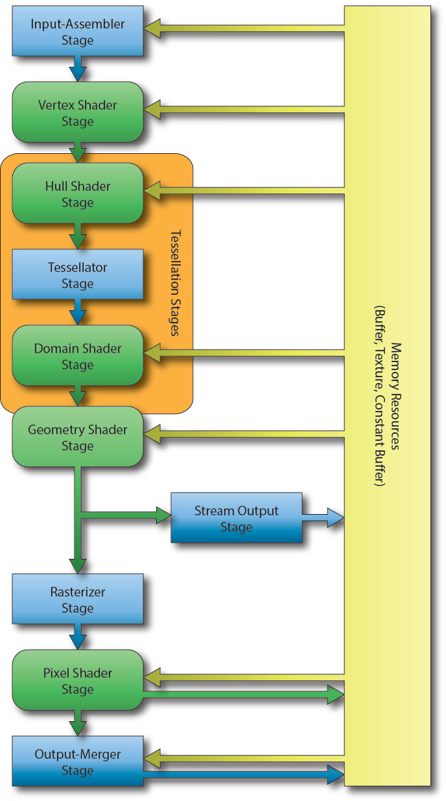
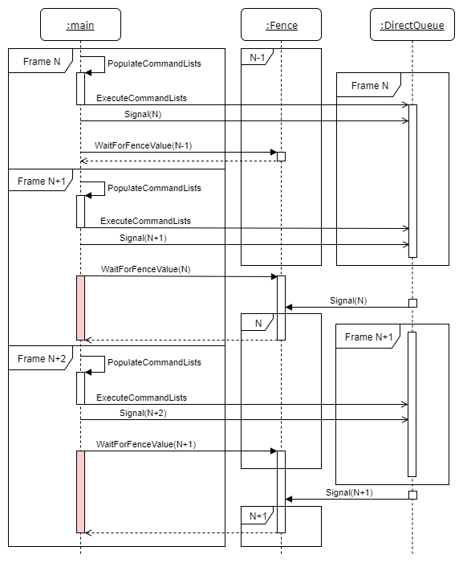
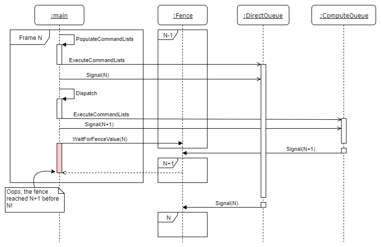
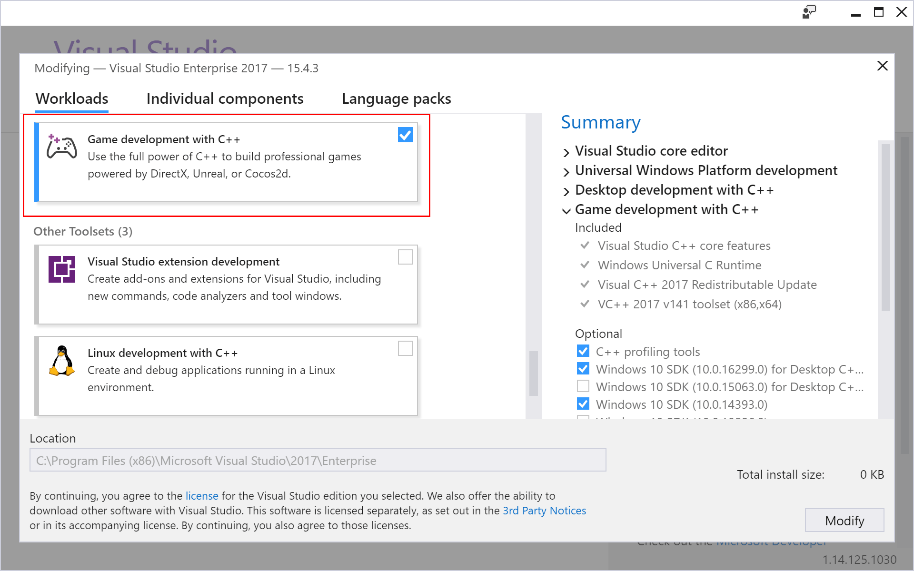
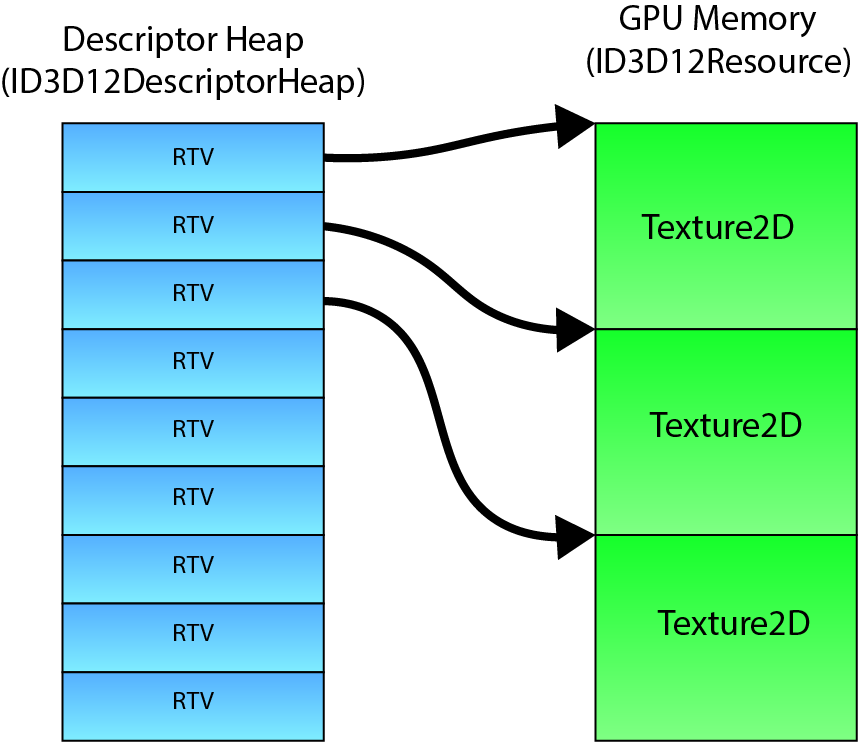
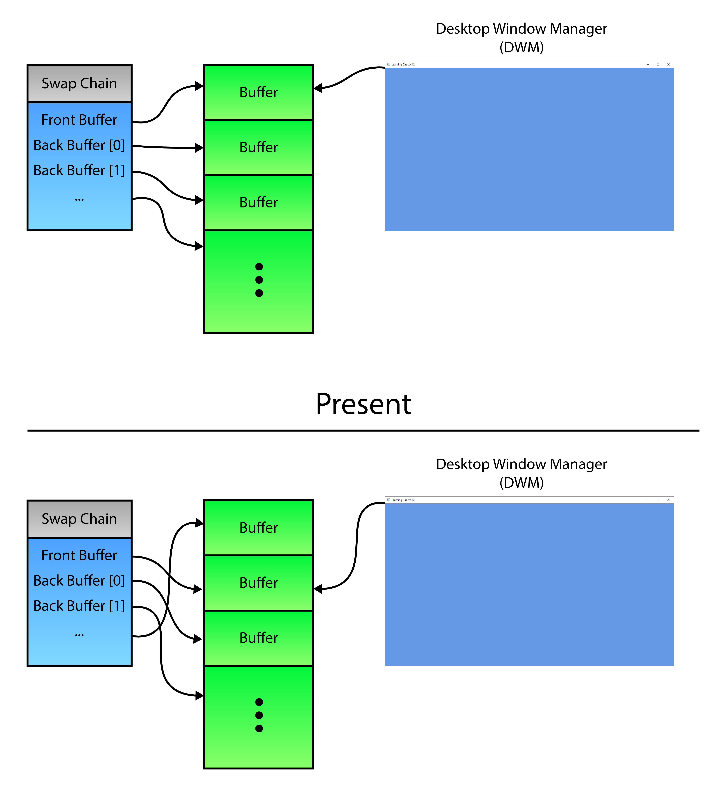
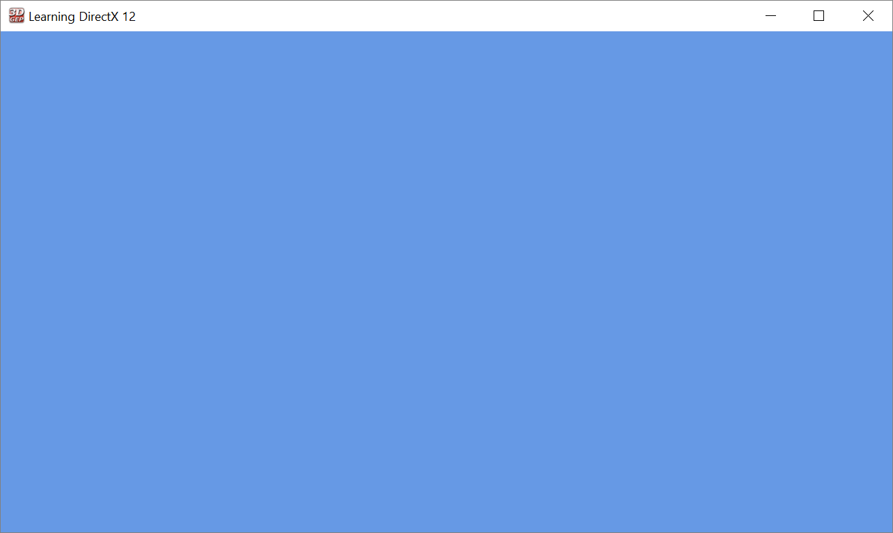

<span id="attachment-8103"></span>

This is the first lesson in a series of lessons to teach you how to create a DirectX 12 application from scratch. In this lesson, you will learn how to query for DirectX 12 capable display adapters that are available, create a DirectX 12 device, create a swap-chain, and you will also learn how to present the swap chain back buffer to the screen. In this lesson, you will also create a command queue and a command list and learn how to synchronize the CPU and GPU operations in order to correctly implement N-buffered rendering.

## Introduction

DirectX 12 is the successor of the DirectX 11 SDK and represents the largest architectural change to the SDK since the inception of DirectX. The primary reason for this change is the demand from the gaming industry to provide a rendering SDK that gives more power and control to the graphics programmer. Vendor-specific driver implementations were often complex and imposed a CPU performance overhead that the developer had no control over. Much of this overhead could be avoided if you give control back to the developers. One example of the driver overhead that is present in previous versions of the DirectX SDK is resource management. Drivers needed to track the lifetime of every resource that was used by the rendering pipeline. Tracking of resources by the driver is often unnecessary if it can be assumed that the application programmer can perform this task with much less overhead. Providing the developers with the tools to implement their own resource management takes that responsibility away from the driver implementation and often allows for performance improvements if done correctly.

But with great power, comes great responsibility. It is true that this increased complexity makes learning DirectX 12 harder than learning previous versions of the DirectX SDK. As with all things, the first time you encounter something it may seem daunting or too difficult to learn but if you are persistent in your desire to learn this new SDK, the rewards will be well worth it. The previous versions of the DirectX SDK will still work but if you are either looking for a job in the game industry or just trying to update your knowledge and skills in the area of graphics programming, it is required that you learn the DirectX 12 SDK. Most gaming studios will only hire you as a graphics programmer if you have some experience with at least one of the new graphics programming API’s (DirectX 12 or Vulkan).

Don’t worry if you are a total noob when it comes to graphics programming. This lesson is written with no assumptions about your current skill level and assumes you have never written a graphics application before. You should already have some experience programming with C++. In this lesson, you may encounter some C++11 (threading, lambdas, smart pointers) or C++17 features that will not be explained in detail. This lesson is not designed to teach you C++ programming; It is assumed that you already have developed this skill.

## DirectX API

DirectX is a collection of **Application Programming Interfaces** (APIs) developed by Microsoft. The various components of the DirectX API provide low-level access to the hardware running on Windows based operating systems [\[6\]](#cite-6).

The first version of DirectX was not released at the same time as Windows 95 but shortly after it in September 1995 [\[6\]](#cite-6). It was initially released under the name **Windows Game SDK**. **DirectX 2.0** was released in June 1996 and just four months later, the DirectX 3.0 APIs were released [\[7\]](#cite-7). Through the period of 1995-1997, the DirectX library went through several version changes to reach version 5. Subsequent major revisions were released on an annual basis until DirectX 9 which was released two years after DirectX 8 [\[6\]](#cite-6).

**DirectX 8.0** was released in November 2000 and introduced programmable vertex and pixel shaders giving the graphics programmer full control over the processing of the vertex and shading stages of the rendering pipeline. [Shader Model 1](https://learn.microsoft.com/windows/win32/direct3dhlsl/dx-graphics-hlsl-sm1) [\[9\]](#cite-9) was the first shader model which introduced vertex and pixel shaders to the programmable pipeline.

**DirectX 9.0** was released in December 2002 and introduced [Shader Model 2.0](https://learn.microsoft.com/windows/win32/direct3dhlsl/dx-graphics-hlsl-sm2) [\[7\]](#cite-7).

**DirectX 9.0c** was released in August 2004 and introduced [Shader Model 3.0](https://learn.microsoft.com/windows/win32/direct3dhlsl/dx-graphics-hlsl-sm3) [\[7\]](#cite-7). Shader Model 3.0 extended on Shader Model 2.0 by adding additional functions to the HLSL shader language and increased the instruction count for vertex and pixel shaders allowing for more complex shader programs.

In November 2006, **DirectX 10** was released featuring [Shader Model 4.0](https://learn.microsoft.com/windows/win32/direct3dhlsl/dx-graphics-hlsl-sm4) providing backward compatability with Shader Model 3.0 but deprecating Shader Model 1.0 [\[10\]](#cite-10). Shader Model 4.0 lifted the shader instruction limits and added the geometry shader profiles to the programmable shader pipeline. The geometry shader allows the graphics programmer to create new geometric primitives from simpler primitives (for example, take a single point as input to the geometry shader and produce a set of triangles).

**DirectX 11** was released in October 2009 and introduced [Shader Model 5.0](https://learn.microsoft.com/windows/win32/direct3dhlsl/d3d11-graphics-reference-sm5) [\[7\]](#cite-7). Shader Model 5.0 added support for tessellation shaders as well as computer shaders. Tessellation shaders provide the ability to dynamically refine the level of detail of a model by computing the triangle primitives from control points of a Bezier surface (for example, but other tessellation techniques can also be implemented in the tessellation shader). Compute shaders allow the graphics programmer to create general purpose programs that advantage of the massive parallelism of the Graphics Processing Unit (GPU).

On July 29, 2015, together with the launch of Windows 10, Microsoft released version 12 of the DirectX API. **DirectX 12** (and Direct3D 11.3) also introduced [Shader Model 5.1](https://learn.microsoft.com/windows/win32/direct3dhlsl/shader-model-5-1). Shader Model 5.1 did not add any new programmable stages to the shader pipeline but it added support for accessing resources by indexing into descriptor arrays. Texture arrays were already possible prior to Shader Model 5.1 but each texture in the array had to have the same size (width, height) and storage format. Using descriptor arrays allows texture of varying dimensions and storage formats to be accessed from a single shader variable. The only restriction is the variable type (for example Texture1D, Texture2D, or Texture3D).

On April 11, 2017, together with the Windows 10 creators update (version 1703), Shader Model 6.0 was introduced. [Shader Model 6.0](https://learn.microsoft.com/windows/win32/direct3dhlsl/hlsl-shader-model-6-0-features-for-direct3d-12) adds additional wave-level intrinsic functions in HLSL. The wave-level intrinsic functions added in [Shader Model 6.0](https://learn.microsoft.com/windows/win32/direct3dhlsl/hlsl-shader-model-6-0-features-for-direct3d-12) allow the shader programmer to eliminate barrier constructs when the scope of synchronization is within the width of the SIMD processor (32 lanes on NVidia GPUs and 16 on AMD GPUs or some other set of threads that are known to be atomic relative to each other) [\[7\]](#cite-7)[\[11\]](#cite-11).

### DirectX 12 Components

The DirectX SDK is actually a collection of Application Programming Interfaces (API’s). The API that is concerned with hardware accelerated 3D graphics rendering is called Direct3D and is the subject of this article. There are several more API’s which make up the DirectX SDK [\[12\]](#cite-12).

#### Direct2D

**Direct2D** is a hardware-accelerated, immediate-mode, 2D graphics API that provides high-performance and high-quality rendering for 2D geometry, bitmaps, and text. The Direct2D API is designed to interoperate with Direct3D.

#### Direct3D

**Direct3D** is a 3D graphics API that allows you to create high-performance rendering for 3D geometry. The Direct3D API also allows for the creation of high-performance general-purpose applications that can harness the parallelism of the GPU. Direct3D is the primary subject of this article. When the term DirectX 12 is used, it is often in reference to the Direct3D 12 graphics API.

#### DirectWrite

DirectWrite supports high-quality text rendering, resolution-independent outline fonts, and full Unicode text and layouts.

#### DirectXMath

DirectXMath provides an optimal and portable interface for arithmetic and linear algebra operations on single-precision floating-point vectors (2D, 3D, and 4D) or matrices (3×3 and 4×4).

#### XAudio2

Provides a signal processing and mixing foundation for games. XAudio2 replaces DirectSound.

#### XInput

Describes how to use the XInput API to interact with the Xbox Controller when it is connected to a Windows computer. XInput replaces DirectInput.

## DirectX 12 Graphics Pipeline

The DirectX 12 graphics pipeline consists of several stages. Some of the stages of the rendering pipeline are **fixed** which means that the stage is only configured through functions of the DirectX 12 API and does not have a “shader program”. Other stages are **programmable** and can be controlled by use of a “shader program”. The following diagram illustrates the various stages of the DirectX 12 graphics pipeline. The arrows indicate the flow of data from each stage of the graphics pipeline as well as from memory resources such as buffers, textures, and constant buffers that are available in high-speed GPU memory.

<span id="attachment-5571"></span>



<div class="caption">

DirectX 12 Graphics Pipeline [\[13\]](#cite-13)

</div>

The image illustrates the various stages of the DirectX 12 rendering pipeline. The blue rectangular blocks represent the fixed-function stages and cannot be modified programmatically. The green rounded-rectangular blocks represent the programmable stages of the graphics pipeline.

### Input-Assembler Stage

The first stage of the graphics pipeline is the **Input-Assembler** (**IA**) stage. The purpose of the input-assembler stage is to read primitive data from user-defined vertex and index buffers and assemble that data into geometric primitives (line lists, triangle strips, or primitives with adjacency data).

### Vertex Shader Stage

The **Vertex Shader** (**VS**) stage is responsible for transforming the vertex data from object-space into clip-space. The vertex shader can also be used for performing (skeletal) animation or computing per-vertex lighting. The vertex shader takes a single vertex as input and outputs the clip-space position of the vertex. The vertex shader is the only shader stage that is absolutely required in order to define a valid pipeline state object [\[15\]](#cite-15).

### Hull Shader Stage

The **Hull Shader** (**HS**) stage is an optional shader stage and is responsible for determining how much an input control patch should be tessellated by the tessellation stage [\[14\]](#cite-14).

### Tessellator Stage

The **Tessellator Stage** is a fixed-function stage that subdivides a patch primitive into smaller primitives according to the tessellation factors specified by the hull shader stage [\[14\]](#cite-14).

### Domain Shader Stage

The **Domain Shader** (**DS**) stage is an optional shader stage and it computes the final vertex attributes based on the output control points from the hull shader and the interpolation coordinates from the tesselator stage [\[14\]](#cite-14). The input to the domain shader is a single output point from the tessellator stage and the output is the computed attributes of the tessellated primitive.

### Geometry Shader Stage

The **Geometry Shader** (**GS**) stage is an optional shader stage that takes a single geometric primitive (a single vertex for a point primitive, three vertices for a triangle primitive, and two vertices for a line primitive) as input and can either discard the primitive, transform the primitive into another primitive type (for example a point to a quad) or generate additional primitives.

### Stream Output Stage

The **Stream Output** (**SO**) stage is an optional fixed-function stage that can be used to feed primitive data back into GPU memory. This data can be recirculated back to the rendering pipeline to be processed by another set of shaders. This is useful for spawning or terminating particles in a particle effect. The geometry shader can discard particles that should be terminated or generate new particles if particles should be spawned.

### Rasterizer Stage

The **Rasterizer Stage** (**RS**) stage is a fixed-function stage which will clip primitives into the view frustum and perform primitive culling if either front-face or back-face culling is enabled. The rasterizer stage will also interpolate the per-vertex attributes across the face of each primitive and pass the interpolated values to the pixel shader.

### Pixel Shader Stage

The **Pixel Shader** (**PS**) stage takes the interpolated per-vertex values from the rasterizer stage and produces one (or more) per-pixel color values. The pixel shader can also optionally output a depth value of the current pixel by mapping a single component 32-bit floating-point value to the [`SV_Depth`](https://learn.microsoft.com/windows/win32/direct3dhlsl/dx-graphics-hlsl-semantics) semantic but this is not a requirement of the pixel shader program. The pixel shader is invoked once for each pixel that is covered by a primitive [\[15\]](#cite-15).

### Output-Merger Stage

The **Output-Merger** (**OM**) stage combines the various types of output data (pixel shader output values, depth values, and stencil information) together with the contents of the currently bound render targets to produce the final pipeline result.

## GPU Synchronization

One of the more difficult concepts to understand for beginning DirectX 12 programmers is synchronization. In earlier versions of DirectX and in OpenGL there was no need to be concerned with GPU synchronization in order to get the GPU to render something, it was usually handled by the driver and required little to no intervention from the graphics programmer. In DirectX 12 the graphics programmer must perform explicit GPU synchronization. If GPU synchronization is not handled correctly the programmer will receive errors from the DirectX debug layer that will be difficult to understand and debug.

GPU synchronization is also very important to understand when performing resource management. Resources cannot be freed if they are currently being referenced in a command list that is being executed on a command queue. It is only safe to release those resources after the command queue has finished executing any command list that is referencing those resources.

Before going into too much detail about GPU synchronization, a few terms that may not be familiar are described.

### Fence

The **Fence** object is used to synchronize commands issued to the **Command Queue**. The fence stores a single value that indicates the last value that was used to **signal** the fence. Although it is possible to use the same fence object with multiple command queues, it is not reliable to ensure the proper synchronization of commands across command queues. Therefore, it is advised to create at least one fence object for each command queue. Multiple command queues can wait on a fence to reach a specific value, but the fence should only be allowed to be signaled from a single command queue. In addition to the fence object, the application must also track a **fence value** that is used to signal the fence. An example of performing CPU-GPU synchronization using fences will be shown in the following sections.

### Command List

A **Command List** is used to issue copy, compute (dispatch), or draw commands. In DirectX 12 commands issued to the command list are not executed immediately like they are with the DirectX 11 immediate context. All command lists in DirectX 12 are deferred; that is, the commands in a command list are only run on the GPU after they have been executed on a command queue.

### Command Queue

The **Command Queue** in DirectX 12 has a very simple interface. For most common cases only the [`ID3D12CommandQueue::ExecuteCommandLists`](https://learn.microsoft.com/windows/win32/api/d3d12/nf-d3d12-id3d12commandqueue-executecommandlists) method and the [`ID3D12CommandQueue::Signal`](https://learn.microsoft.com/windows/win32/api/d3d12/nf-d3d12-id3d12commandqueue-signal) method are used. Let’s look at a simple pseudo-code example of using a command queue.

```text title="Using Command Queues" showLineNumbers
method IsFenceComplete( _fenceValue )
    return fence->GetCompletedValue() >= _fenceValue
end method

method WaitForFenceValue( _fenceValue )
    if ( !IsFenceComplete( _fenceValue )
        fence->SetEventOnCompletion( _fenceValue, fenceEvent )
        WaitForEvent( fenceEvent )
    end if
end method

method Signal
    _fenceValue <- AtomicIncrement( fenceValue )
    commandQueue->Signal( fence, _fenceValue )
    return _fenceValue
end method

method Render( frameID )
    _commandList <- PopulateCommandList( frameID )
    commandQueue->ExecuteCommandList( _commandList )
    
    _nextFrameID <- Present()

    fenceValues[frameID] = Signal()
    WaitForFenceValue( fenceValues[_nextFrameID] )

    frameID <- _nextFrameID
end method
```

In the pseudo-code listing above, there are four methods defined:

1.  `IsFenceComplete`: Check to see if the fence’s completed value has been reached.
2.  `WaitForFenceValue`: Stall the CPU thread until the fence value has been reached.
3.  `Signal`: Insert a fence value into the command queue. The fence used to signal the command queue will have it’s completed value set when that value is reached in the command queue.
4.  `Render`: Render a frame. Do not move on to the next frame until that frame’s previous fence value has been reached.

The `Render` method is responsible for rendering the scene. It does this by first populating the command list that contain all of the draw (or compute) commands that are needed to render the scene. The resulting command list is then executed on the command queue using the `ExecuteCommandList` method. The call to to the `ExecuteCommandList` method will not block the calling thread. It does not wait for the commands in the command list to be executed on the GPU before it returns to the caller.

The `Signal` method will append a fence value to the end of the command queue. The fence object that is used to signal the command queue will have it’s completed value set to the value of the signal when processing has reached that point in the command queue. In other words, the completed value for the fence object will be set to the specified fence value only after all of the commands that were executed on the command queue prior to the `Signal` have finished executing on the GPU. The call to `Signal` does not block the calling thread but instead just returns the value to wait for before any (writable) GPU resources that are referenced in the command lists can be reused.

The `Present` method (on line 23) will cause the rendered result to be presented to the screen. The return value from the `Present` method (in this pseudo-code example) returns the index of the next backbuffer within the swap-chain to render to. When using the [`DXGI_SWAP_EFFECT_FLIP_DISCARD`](https://learn.microsoft.com/windows/win32/api/dxgi/ne-dxgi-dxgi_swap_effect) flip model, the `Present` method also does not block the main thread. For this reason, the back-buffer resource from the previous frame cannot be reused until the image has been presented to the screen.

To prevent the resource from being overwritten before they are presented to the screen, the CPU thread needs to wait for the fence value of the previous frame to be reached. The `WaitForFenceValue` method is used to block the CPU thread until the specified fence value has been reached.

It is important to understand that each command queue must track it’s own fence and fence value. DirectX 12 defines three different command queue types:

1.  **Copy**: Can be used to issue commands to copy resource data (CPU -> GPU, GPU -> GPU, GPU -> CPU).
2.  **Compute**: Can do everything a **Copy** queue can do and issue compute (dispatch) commands.
3.  **Direct**: Can do everything a **Copy** and a **Compute** queue can do and issue draw commands.

Although the DirectX 12 API defines these three different command queue types, it is not necessarily the case that the GPU in your computer actually has three physical work queues. It may also be the case that the GPU may have one dedicated work queue for each one of these types and it may even be the case that it has multiple work queues of each type. As far as I know, there doesn’t seem to be a reliable way of detecting how many queues the GPU has and what types. If you decide to create multiple queues in your own applications, you should allocate one fence object and track one fence value for each allocated command queue. Let’s take a look at a visual example to try to explain how to work with command queues.

<span id="attachment-8017"></span>



<div class="caption">

An example of performing GPU synchronization.

</div>

In the [image above](#attachment-8017) several commands are issued on the main thread. In this example, the first frame is denoted Frame N. The command lists are executed on the command queue. Immediately after executing the command lists, the queue is signaled with the value N. When the command queue reaches that point, the fence will be signaled with the specified value.

Right after the `Signal`, there is a `WaitForFenceValue` command which waits for the previous frame (Frame N-1) to be finished. Since there were no commands in the command queue in Frame N-1, execution continues without stalling the CPU thread.

Then Frame N+1 is built on the CPU thread and executed on the direct command queue. Before the CPU can continue, the command queue has to finish using the resources from Frame N. In this case, the CPU has to wait until signal N is reached which indicates that the command queue is finished with those resources.

After the command queue is finished with the resources from Frame N, Frame N+2 can be built and executed on the queue. If the queue is still processing the commands from Frame N+1, then the CPU has to wait again for those resources to be available before continuing.

This example demonstrates a typical double-buffered scenario. You might think that using triple-buffering for rendering will reduce the amount of time the CPU has to wait for the GPU to finish its work. This is a naïve solution to the problem. Whenever the CPU is faster at issuing commands than the command queue is at processing those commands, the CPU will have to stall at some point in order to allow the command queue to catch-up to the CPU.

It gets more complicated if you add an additional queue. In this case, you must be careful not to signal the second queue with a fence value that is larger than, but could be completed before, a fence value that was used on another queue using the same fence object. Doing so could result in the fence reaching the fence value from the other queue before the main queue has reached the earlier fence value.

<span id="attachment-8018"></span>



<div class="caption">

Incorrect Synchronization with multiple queues.

</div>

In the [image above](#attachment-8018) we see that the CPU executes the command list for Frame N and signals the `DirectQueue` with a value of N. Meanwhile, the CPU also issues a dispatch command to the `ComputeQueue` and signals that queue with a value N+1. If the `ComputeQueue` reaches signal N+1 before the `DirectQueue` reaches N then the fence’s completed value will be set to N+1. When the `DirectQueue` finally reaches the signal with value N, it will update the fence’s completed value to N. Since N is less than N+1, the fence’s completed value was decreased but the fence value should never be allowed to decrease!

The moral of the story is to make sure that every command queue tracks its own fence object and fence value and only signals its own fence object. To be safe, the fence value for a queue should never be allowed to decrease. If you are worried that the fence value will eventually overflow and reach 0 again, you must consider that a 64-bit unsigned integer value can have a maximum value of $2^{64}-1$. If the command queue is signaled 100 times per frame and your game is rendering at an average of 300 FPS (the queue is signaled 30,000 times per second), the game could run for about 19.5 million years before the 64-bit fence value will overflow and wrap to 0.

## Dependencies

In order to follow along with this tutorial series, you should ensure that you have the following software installed on your computer.

### Windows 10

 Since DirectX 12 only runs on the Windows 10 operating system, you must have access to a computer running Windows 10 in order to run the demo.

### Visual Studio 2017

 Visual Studio 2017 was used to develop this tutorial series. If you don’t have Visual Studio 2017 installed on your development machine, then head over to the [Visual Studio Download](https://visualstudio.microsoft.com/downloads/) page and download the latest version of Visual Studio. The **Community** edition is free for educational or open-source projects.

The DirectX 12 SDK comes included with the Windows 10 SDK which is part of the Visual Studio installation. Just make sure you install the **Game Development with C++** workload as shown in the following image.

<span id="attachment-7874"></span>



<div class="caption">

Game Development with C++ Workload.

</div>

### CMake

 Although using CMake is not strictly necessary to follow along with this tutorial, the solution and project files that were used to make this tutorial are generated using CMake. If you download the source code for this tutorial from GitHub, then you will need CMake to generate the solution and project files.

You can download the latest version of CMake from [https://cmake.org/download/](https://cmake.org/download/). Starting from Visual Studio 2017, CMake is integrated into the Visual Studio IDE. For more information on using CMake with Visual Studio, check out my previous article titled [CMake in Visual Studio 2017](https://web.archive.org/web/20191206080134/https://www.3dgep.com/cmake-visual-studio-2017/).

## DirectX 12 Demo

In the following sections, we will create the DirectX 12 demo application. In this tutorial, the demo will only create a window and clear the screen. Rendering of geometry will be handled in a later tutorial.

The following steps will be shown:

-   Register the window class
-   Create the window
-   Query the GPU adapters
-   Create a DirectX 12 device
-   Create a command queue
-   Create a swap chain
-   Create command allocator & command list
-   Handle GPU synchronization
-   Update & Render
-   Handle resizing
-   Handle full-screen toggling

### Preamble

The preamble of the source includes the header files that are required to create the demo. Any variables that are used for the demo are also declared in the preamble.

First, the required Windows header files are declared.

```cpp source="LearningDirectX12-v0.0.1/main.cpp#L1-L23"
```

Since this demo uses the Windows library functions, the ubiquitous `Windows.h` header file is included on line 2. In order to minimize the number of header files that are included in the `Windows.h` header, the [`WIN32_LEAN_AND_MEAN`](https://learn.microsoft.com/windows/win32/winprog/using-the-windows-headers) macro is defined just before the `Windows.h` include.

The `shellapi.h` header file included on line 3 contains the definition for the [`CommandLineToArgvW`](https://learn.microsoft.com/windows/win32/api/shellapi/nf-shellapi-commandlinetoargvw) function. This function will be used later to parse the command-line arguments passed to the application.

The `min` and `max` macros defined in the standard C library header file may conflict with the [`std::min`](https://en.cppreference.com/cpp/algorithm/min) and [`std::max`](https://en.cppreference.com/cpp/algorithm/max) functions defined in the [`algorithm`](https://en.cppreference.com/cpp/header/algorithm) STL header. To avoid any compiler errors, the `min` and `max` macros should be undefined and only the [`std::min`](https://en.cppreference.com/cpp/algorithm/min) and [`std::max`](https://en.cppreference.com/cpp/algorithm/max) functions should be used.

In the `Windows.h` header file, a macro called [`CreateWindow`](https://learn.microsoft.com/windows/win32/api/winuser/nf-winuser-createwindowa) is defined. Since a function with the same name is defined in this source file, the [`CreateWindow`](https://learn.microsoft.com/windows/win32/api/winuser/nf-winuser-createwindowa) macro is undefined on line 18. The [`CreateWindow`](https://learn.microsoft.com/windows/win32/api/winuser/nf-winuser-createwindowa) macro is not needed in this source file since the [`CreateWindowExW`](https://learn.microsoft.com/windows/win32/api/winuser/nf-winuser-createwindowexa) function is used instead to create the OS window.

The `wrl.h` header file included on line 22 contains the definition of the [`ComPtr`](https://learn.microsoft.com/cpp/cppcx/wrl/comptr-class?view=msvc-170) template class. The ComPtr template class provides smart pointer functionality for [COM objects](https://learn.microsoft.com/windows/win32/com/the-component-object-model). Please refer to [COM Coding Practices](https://learn.microsoft.com/windows/win32/learnwin32/com-coding-practices) for more information on proper use of COM pointers. Since all DirectX 12 objects are COM objects, the `ComPtr` template class is used to track the COM object lifetimes.

In the next section, the DirectX 12 specific header files are included.

```cpp source="LearningDirectX12-v0.0.1/main.cpp#L25-L32"
```

The Direct3D 12 header file is included on line 26. This header file contains all of the Direct3D 12 objects (Device, CommandQueue, CommandList, etc…).

The [Microsoft DirectX Graphics Infrastructure (DXGI)](https://learn.microsoft.com/windows/win32/direct3ddxgi/d3d10-graphics-programming-guide-dxgi) is used to manage the low-level tasks such as enumerating GPU adapters, presenting the rendered image to the screen, and handling full-screen transitions, that are not necessarily part of the DirectX rendering API. DXGI 1.6 adds functionality in order to detect HDR displays. HDR rendering will be discussed in another article.

The `d3dcompile.h` header file contains functions to compile HLSL code at runtime. It is recommended to compile HLSL shaders at compile time (when the application is compiled into an executable) but for demonstration purposes, it might be more convenient to allow runtime compilation of HLSL shaders. Shaders will be introduced in the next lesson.

:::caution
When using runtime compiled HLSL shaders using any of the [D3DCompiler](https://learn.microsoft.com/windows/win32/direct3dhlsl/dx-graphics-d3dcompiler-reference) functions, do not forget to link against the `d3dcompiler.lib` library and copy the `D3dcompiler_47.dll` to the same folder as the binary executable when distributing your project.

A redistributable version of the `D3dcompiler_47.dll` file can be found in the Windows 10 SDK installation folder at C:\\Program Files (x86)\\Windows Kits\\10\\Redist\\D3D\\.

For more information, refer to the MSDN blog post at: [https://walbourn.github.io/hlsl-fxc-and-d3dcompile/](https://walbourn.github.io/hlsl-fxc-and-d3dcompile/)
:::

The DirectX Math library provides SIMD-friendly C++ types and functions for commonly used for graphics related programming [\[16\]](#cite-16). The DirectX Math library will be used in the later tutorials.

The D3D12 extension library (`d3dx12.h` included on line 32) is not required to work with DirectX 12 but it provides some useful classes that will simplify some of the functions that will be used throughout this tutorial. The `d3dx12.h` header file is not included as part of the Windows 10 SDK and needs to be downloaded separately from the Microsoft DirectX repository on GitHub ([https://github.com/Microsoft/DirectX-Graphics-Samples/tree/master/Libraries/D3DX12)](https://github.com/Microsoft/DirectX-Graphics-Samples/tree/master/Libraries/D3DX12))

A few headers from the Standard Template Library (STL) are also included in the demo.

```cpp source="LearningDirectX12-v0.0.1/main.cpp#L34-L37"
```

The [`algorithm`](https://en.cppreference.com/cpp/header/algorithm) header contains math related functions such as [`std::min`](https://en.cppreference.com/cpp/algorithm/min) and [`std::max`](https://en.cppreference.com/cpp/algorithm/max).

The [`cassert`](https://en.cppreference.com/cpp/header/cassert) header contains the [`assert`](https://en.cppreference.com/cpp/error/assert) macro.

The [`chrono`](https://en.cppreference.com/cpp/header/chrono) header contains time related functions. The [`chrono::high_resolution_clock`](https://en.cppreference.com/cpp/chrono/high_resolution_clock) is used to perfom timing in between calls to the `Update` function.

The only header file that is local to the project is the `Helpers.h` header file.

```cpp source="LearningDirectX12-v0.0.1/main.cpp#L39-L40"
```

The `Helpers.h` header file contains functions and classes that provide helper functionality that may be useful in several source files. Currently, the contents of the `Helpers.h` header file is very simple.

```cpp source="LearningDirectX12-v0.0.1/Helpers.h#L31-L44"
```

The `Helpers.h` header file defines a single function that can be used to check the return value of a DirectX API function. If the function returns an fail code, an exception is thrown. This is useful for debugging the application and simplifies error checking in the main application code.

In the next section, the variables used by the application are defined. Tweak variables and variables that control the application initialization are defined first.

```cpp source="LearningDirectX12-v0.0.1/main.cpp#L42-L51"
```

The `g_NumFrames` constant variable defined on line 44 controls the number of back buffer surfaces for the swap chain. This value must not be less than 2 when using the flip presentation model. Details about the swap chain and flip models are discussed in more detail later.

The `g_UseWarp` variable controls whether to use a software rasterizer ([Windows Advanced Rasterization Platform](https://learn.microsoft.com/windows/win32/direct3darticles/directx-warp) – **WARP**) or not. The software rasterizer allows the graphics programmer to access the full set of advanced rendering features that may not be available in the hardware (for example, when running on older GPUs). The **WARP** device can also be used to verify the results of a rendering technique if the quality of the vendor supplied display driver is in question.

The `g_ClientWidth` and `g_ClientHeight` variables control the size of the client area when the window is first created.

The `g_IsInitialized` boolean variable is set to true only after all of the DirectX 12 objects have been created. This variable is used to prevent certain window messages (such as the window resize message) from being handled until after the device and swap chain have been fully created.

In the next section, the Windows and DirectX specific variables are defined.

```cpp source="LearningDirectX12-v0.0.1/main.cpp#L53-L67"
```

The `g_hWnd` variable stores a handle to the OS window that will be used to display the rendered image.

When switching to a full-screen window state, the previous size of the window needs to be stored so that when switching back to windowed mode, the window dimensions can be restored correctly. The `g_WindowRect` variable is used to store the previous window dimensions before going to fullscreen mode.

The DirectX 12 device object is stored in the `g_Device` variable. The command queue is stored in the `g_CommandQueue` variable.

The [`IDXGISwapChain4`](https://learn.microsoft.com/windows/win32/api/dxgi1_5/nn-dxgi1_5-idxgiswapchain4) interface defines the swap chain. The swap chain is responsible for presenting the rendered image to the window. The swap chain will be discussed in more detail later in the tutorial.

The swap chain will be created with a number of back buffer resources. In order to correctly transition the back buffer resources to the correct state, pointers to the back buffer resources will be tracked in the `g_BackBuffers` array variable. Although the back buffers of the swap chain are actually textures, all buffer and texture resources are referenced using the [`ID3D12Resource`](https://learn.microsoft.com/windows/win32/api/d3d12/nn-d3d12-id3d12resource) interface in DirectX 12.

GPU commands are first recorded into a [`ID3D12GraphicsCommandList`](https://learn.microsoft.com/windows/win32/api/d3d12/nn-d3d12-id3d12graphicscommandlist). Generally a single command list is needed to record GPU commands using a single thread. Since this demo uses the main thread to record all GPU commands, only a single command list is defined. The `g_CommandList` variable is used to store the pointer to the [`ID3D12GraphicsCommandList`](https://learn.microsoft.com/windows/win32/api/d3d12/nn-d3d12-id3d12graphicscommandlist).

The [`ID3D12CommandAllocator`](https://learn.microsoft.com/windows/win32/api/d3d12/nn-d3d12-id3d12commandallocator) serves as the backing memory for recording the GPU commands into a command list. Unlike the command list, a command allocator cannot be reused unless all of the commands that have been recorded into the command allocator have finished executing on the GPU. Attempting to reset a command allocator before the command queue has finished executing those commands will result in a `COMMAND_ALLOCATOR_SYNC` error by the debug layer. The `g_CommandAllocators` array variable is used to store the reference to the command allocators. There must be at least one command allocator per render frame that is “in-flight” (at least one per back buffer of the swap chain).

The back buffer textures of the swap chain are described using a **render target view** (**RTV**). The render target view describes the location of the texture resource in GPU memory, the dimensions (width and height) of the texture, as well as the format of the texture. The RTV is used to clear the back buffers of the render target. In a later tutorial, the RTV will be used to render geometry to the screen.

In previous versions of DirectX, RTVs were created one at a time. Since DirectX 12, RTVs are now stored in **descriptor heaps**. A descriptor heap can be visualized as an array of descriptors (views). A **view** simply describes a resource that resides in GPU memory.

<span id="attachment-7903"></span>



<div class="caption">

RTV Descriptor Heaps

</div>

A view in DirectX 12 is also called a descriptor. Similar to a view, a descriptor describes a resource. Since the swap chain contains multiple back buffer textures, one descriptor is needed to describe each back buffer texture. The `g_RTVDescriptorHeap` variable is used to store the descriptor heap that contains the render target views for the swap chain back buffers.

The size of a descriptor in a descriptor heap is vendor specific (Intel, NVidia, and AMD may store descriptors differently). In order to correctly offset the index into the descriptor heap, the size of a single element in the descriptor heap needs to be queried during initialization. The size of a single RTV descriptor is stored in the `g_RTVDescriptorSize` variable defined on line 66.

Depending on the flip model of the swap chain, the index of the current back buffer in the swap chain may not be sequential. The `g_CurrentBackBufferIndex` variable is used to store the index of the current back buffer of the swap chain.

A few variables that are used to perform correct GPU synchronization are defined.

```cpp source="LearningDirectX12-v0.0.1/main.cpp#L69-L73"
```

The `g_Fence` variable is used to store the fence object described in section [Fence](#fence) above.

The next fence value to signal the command queue next is stored in the `g_FenceValue` variable.

For each rendered frame that could be “in-flight” on the command queue, the fence value that was used to signal the command queue needs to be tracked to guarantee that any resources that are still being referenced by the command queue are not overwritten. The `g_FrameFenceValues` array variable is used to keep track of the fence values that were used to signal the command queue for a particular frame.

If the fence object’s completed value has not reached the fence value specified for the frame, then the CPU thread will stall until the fence value is reached. The `g_FenceEvent` variable is a handle to an OS event object that will be used to receive the notification that the fence has reached a specific value.

A few variables are defined to control the swap chain’s present method.

```cpp source="LearningDirectX12-v0.0.1/main.cpp#L75-L81"
```

The `g_VSync` variable controls whether the swap chain’s present method should wait for the next vertical refresh before presenting the rendered image to the screen. By default, the swap chain’s present method will block until the next vertical refresh of the screen. This will cap the framerate of the application to the refresh rate of the screen. Setting `g_VSync` variable to `false` will cause the swap chain to present the rendered image to the screen as fast as possible which will allow the application to render at an unthrottled frame rate but may cause visual artifacts in the form of [screen tearing](https://en.wikipedia.org/wiki/Screen_tearing).

Variable refresh rate displays ([NVidia’s G-Sync](https://developer.nvidia.com/g-sync) and [AMD’s FreeSync](https://www.amd.com/en.html)) eliminate screen tearing by allowing the graphics application to determine when the vertical refresh should occur.

:::note
Both the GPU and the display need to provide support for variable refresh rates.
:::

The `g_Fullscreen` variable tracks the fullscreen state of the render window.

The source code for the demo has been organized to minimize the number of functions that need to be forward declared. The windows message call back procedure is an exception and requires a forward declaration so that the callback function can be used to register the window class.

```cpp source="LearningDirectX12-v0.0.1/main.cpp#L83-L84"
```

In the next section, the various functions used by the demo application are defined.

### Parse Command-line Arguments

The `ParseCommandLineArguments` function allows a few of the globally defined variables to be overridden by supplying command-line arguments when the application is executed.

```cpp source="LearningDirectX12-v0.0.1/main.cpp#L86-L109"
```

:::note
You may notice that some functions are prefixed with the `::` operator. This notation is used to identify system functions that are defined in global scope. Functions that are defined in the scope of the source file do not use this notation. Using this notation it is easy to differentiate between locally defined functions and system functions.
:::

The table below describes the command-line arguments supported by the application.

| Argument | Description |
| --- | --- |
| `-w`, `--width` | Specify the width (in pixels) of the render window. |
| `-h`, `--height` | Specify the height (in pixels) of the render window. |
| `-warp`, `--warp` | Use the Windows Advanced Rasterization Platform (WARP) for device creation. |

Additional command-line arguments (for example, to specify the application start in fullscreen mode) can be handled by extending this function.

### Enable the Direct3D 12 Debug Layer

Before doing anything using either the DXGI or the Direct3D API, the debug layer should be enabled in debug builds.

:::caution
Enabling the debug layer after creating the [`ID3D12Device`](https://learn.microsoft.com/windows/win32/api/d3d12/nn-d3d12-id3d12device) will cause the runtime to remove the device.
:::

```cpp source="LearningDirectX12-v0.0.1/main.cpp#L111-L121"
```

:::note
The [`IID_PPV_ARGS`](https://learn.microsoft.com/windows/win32/api/combaseapi/nf-combaseapi-iid_ppv_args) macro shown here on line 118 is used to retrieve an interface pointer, supplying the IID value of the requested interface automatically based on the type of the interface pointer used.  
A common syntax in methods that retrieve an interface pointer includes two parameters:

-   An \[in\] parameter, normally of type `REFIID`, to specify the IID of the interface to retrieve.
-   An \[out\] parameter, normally of type `void**`, to receive the interface pointer.

This macro computes the IID based on the type of interface pointer, which prevents coding errors in which the IID and interface pointer type do not match. Windows developers should always use this macro with any method that requires separate IID and interface pointer parameters.
:::

Enabling the debug layer will help in identifying incorrect usage of the DirectX 12 API. The graphics programmer should strive to eliminate any and all errors and warnings that are reported by the debug layer.

### Register the Window Class

Before creating an instance of an OS window, the window class corresponding to that window must be registered. The window class will be automatically unregistered when the application terminates.

```cpp title="main.cpp" showLineNumbers startLineNumber=123
void RegisterWindowClass( HINSTANCE hInst, const wchar_t* windowClassName )
{
    // Register a window class for creating our render window with.
    WNDCLASSEXW windowClass = {};

    windowClass.cbSize = sizeof(WNDCLASSEX);
    windowClass.style = CS_HREDRAW | CS_VREDRAW;
    windowClass.lpfnWndProc = &WndProc;
    windowClass.cbClsExtra = 0;
    windowClass.cbWndExtra = 0;
    windowClass.hInstance = hInst;
    windowClass.hIcon = ::LoadIcon(hInst, NULL);
    windowClass.hCursor = ::LoadCursor(NULL, IDC_ARROW);
    windowClass.hbrBackground = (HBRUSH)(COLOR_WINDOW + 1);
    windowClass.lpszMenuName = NULL;
    windowClass.lpszClassName = windowClassName;
    windowClass.hIconSm = ::LoadIcon(hInst, NULL);

    static ATOM atom = ::RegisterClassExW(&windowClass);
    assert(atom > 0);
}
```

The [`RegisterClassEx`](https://learn.microsoft.com/windows/win32/api/winuser/nf-winuser-registerclassexa) function takes a pointer to a [`WNDCLASSEX`](https://learn.microsoft.com/windows/win32/api/winuser/ns-winuser-wndclassexa) structure as its only argument.

The [`WNDCLASSEX`](https://learn.microsoft.com/windows/win32/api/winuser/ns-winuser-wndclassexa) structure has the following definition [\[17\]](#cite-17):

```cpp title="WNDCLASSEXW structure" showLineNumbers
typedef struct tagWNDCLASSEXW {
    UINT        cbSize;
    UINT        style;
    WNDPROC     lpfnWndProc;
    int         cbClsExtra;
    int         cbWndExtra;
    HINSTANCE   hInstance;
    HICON       hIcon;
    HCURSOR     hCursor;
    HBRUSH      hbrBackground;
    LPCWSTR     lpszMenuName;
    LPCWSTR     lpszClassName;
    HICON       hIconSm;
} WNDCLASSEXW, *PWNDCLASSEXW;
```

Each member has the following definition:

-   `UINT cbSize`: The size, in bytes, of this structure. Set this member to `sizeof(WNDCLASSEXW)`.
-   `UINT style`: The class styles. In this case, the [`CS_HREDRAW`](https://learn.microsoft.com/windows/win32/winmsg/window-class-styles) class style specifies that the entire window is redrawn if a movement or size adjustment changes the width of the client area and the [`CS_VREDRAW`](https://learn.microsoft.com/windows/win32/winmsg/window-class-styles) class style specifies that the entire window is redrawn if a movement or size adjustment changes the height of the client area.
-   `WNDPROC lpfnWndProc`: A pointer to the windows procedure that will handle window messages for any window created using this window class. In this case we specify the yet undefined `WndProc` function that was declared earlier.
-   `int cbClsExtra`: The number of extra bytes to allocate following the window-class structure. This parameter is not used here and should be set to 0.
-   `int cpWndExtra`: The number of extra bytes to allocate following the window instance. This parameter is not used here and should be set to 0.
-   `HINSTANCE hInstance`: A handle to the instance that contains the window procedure for the class. This module instance handle is passed to the `WinMain` function which will be shown later.
-   `HICON hIcon`: A handle to the class icon. This icon will be used to represent a window created with this class in the taskbar and in the top-left corner of the window’s title bar. You can load an icon from a resource file using the [`LoadIcon`](https://learn.microsoft.com/windows/win32/api/winuser/nf-winuser-loadicona) function. If this value is `NULL` (or `nullptr`) then the default application icon is used.
-   `HCURSOR hCursor`: A handle to the class cursor. This must be a handle to a valid cursor resource. For this demo, we will use the default arrow icon by specifying `LoadCursor( nullptr, IDC_ARROW )`.
-   `HBRUSH hbrBackground`: A handle to the class background brush. This member can be a handle to the brush to be used for painting the background, or it can be a color value. A color value must be one of the following standard system colors (the value 1 must be added to the chosen color). If a color value is given, you must convert it to one of the following `HBRUSH` types:
    -   `COLOR_ACTIVEBORDER`
    -   `COLOR_ACTIVECAPTION`
    -   `COLOR_APPWORKSPACE`
    -   `COLOR_BACKGROUND`
    -   `COLOR_BTNFACE`
    -   `COLOR_BTNSHADOW`
    -   `COLOR_BTNTEXT`
    -   `COLOR_CAPTIONTEXT`
    -   `COLOR_GRAYTEXT`
    -   `COLOR_HIGHLIGHT`
    -   `COLOR_HIGHLIGHTTEXT`
    -   `COLOR_INACTIVEBORDER`
    -   `COLOR_INACTIVECAPTION`
    -   `COLOR_MENU`
    -   `COLOR_MENUTEXT`
    -   `COLOR_SCROLLBAR`
    -   `COLOR_WINDOW`
    -   `COLOR_WINDOWFRAME`
    -   `COLOR_WINDOWTEXT`
-   `LPCWSTR lpszMenuName`: Pointer to a null-terminated character string that specifies the resource name of the class menu, as the name appears in the resource file. If this member is `NULL`, windows belonging to this class have no default menu.
-   `LPCWSTR lpszClassName`: A pointer to a null-terminated const string which is used to uniquely identify this window class. This class name will be used to create the window instance.
-   `HICON hIconSm`: A handle to a small icon that is associated with the window class. If this member is `NULL` (or `nullptr`), the system searches the icon resource specified by the `hIcon` member for an icon of the appropriate size to use as the small icon.

With the window class registered, the OS window instance can be created.

### Create Window Instance

The `CreateWindow` function is used to create an instance of an OS window.

The window will be created in the center of the primary display device. Care must be taken to prevent the window from being created off-screen. Creating a window larger than the viewable area of the display will cause parts of the window to be offscreen. If the title bar and the window frame are offscreen, then it will not be possible to resize the window to fit in the screen.

```cpp source="LearningDirectX12-v0.0.1/main.cpp#L145-L159"
```

The [`GetSystemMetrics`](https://learn.microsoft.com/windows/win32/api/winuser/nf-winuser-getsystemmetrics) function retrieves specific system metric information. In this case, the [`SM_CXSCREEN`](https://learn.microsoft.com/windows/win32/api/winuser/nf-winuser-getsystemmetrics#SM_CXSCREEN) and [`SM_CYSCREEN`](https://learn.microsoft.com/windows/win32/api/winuser/nf-winuser-getsystemmetrics#SM_CYSCREEN) system metric are used to retrieve the width and height in pixels of the primary display monitor.

In order to calculate the required size of the window rectangle, based on the desired client-rectangle size, the [`AdjustWindowRect`](https://learn.microsoft.com/windows/win32/api/winuser/nf-winuser-adjustwindowrect) function is used. The [`WS_OVERLAPPEDWINDOW`](https://learn.microsoft.com/windows/win32/winmsg/window-styles) window style describes a window that can be minimized, and maximized, and has a thick window frame.

On lines 154-155, the dimensions of the adjusted window rectangle are used to compute the width and height of the window that is to be created.

The top-left corner point of the window is computed on lines 158-159 so that the window appears in the center of the screen. The window position should be clamped to $(0,0)$ to prevent the window from being positioned offscreen.

With the window dimensions known, the window instance can be created.

```cpp source="LearningDirectX12-v0.0.1/main.cpp#L161-L179"
```

The [`CreateWindowExW`](https://learn.microsoft.com/windows/win32/api/winuser/nf-winuser-createwindowexa) function has the following signature [\[18\]](#cite-18):

```cpp title="CreateWindowEx function" showLineNumbers
HWND WINAPI CreateWindowExW(
    _In_ DWORD dwExStyle,
    _In_opt_ LPCWSTR lpClassName,
    _In_opt_ LPCWSTR lpWindowName,
    _In_ DWORD dwStyle,
    _In_ int X,
    _In_ int Y,
    _In_ int nWidth,
    _In_ int nHeight,
    _In_opt_ HWND hWndParent,
    _In_opt_ HMENU hMenu,
    _In_opt_ HINSTANCE hInstance,
    _In_opt_ LPVOID lpParam
);
```

And each parameter has the following definition:

-   `DWORD dwExStyle`: The extended window style of the window being created. For a list of possible values,see [Extended Window Styles](https://learn.microsoft.com/windows/win32/winmsg/extended-window-styles).
-   `LPCWSTR lpClassName`: A null-terminated string or a class atom created by a previous call to the [`RegisterClass`](https://learn.microsoft.com/windows/win32/api/winuser/nf-winuser-registerclassa) or [`RegisterClassEx`](https://learn.microsoft.com/windows/win32/api/winuser/nf-winuser-registerclassexa) function. The atom must be in the low-order word of `lpClassName`; the high-order word must be 0. If `lpClassName` is a string, it specifies the window class name. The class name can be any name registered with [`RegisterClass`](https://learn.microsoft.com/windows/win32/api/winuser/nf-winuser-registerclassa) or [`RegisterClassEx`](https://learn.microsoft.com/windows/win32/api/winuser/nf-winuser-registerclassexa), provided that the module that registers the class is also the module that creates the window.
-   `LPCWSTR lpWindowName`: The window name. If the window style specifies a title bar, the window title pointed to by `lpWindowName` is displayed in the title bar.
-   `DWORD dwStyle`: The style of the window being created. This parameter can be a combination of the [window style values](https://learn.microsoft.com/windows/win32/winmsg/window-styles).
-   `int X`: The initial horizontal position of the window. For an overlapped or pop-up window, the `X` parameter is the initial x-coordinate of the window’s upper-left corner, in screen coordinates. If `X` is set to `CW_USEDEFAULT`, the system selects the default position for the window’s upper-left corner and ignores the `Y` parameter.
-   `int Y`: The initial vertical position of the window. For an overlapped or pop-up window, the `Y` parameter is the initial y-coordinate of the window’s upper-left corner, in screen coordinates. If an overlapped window is created with the `WS_VISIBLE` style bit set and the `X` parameter is set to `CW_USEDEFAULT`, then the `Y` parameter determines how the window is shown. If the `Y` parameter is `CW_USEDEFAULT`, then the window manager calls [`ShowWindow`](https://learn.microsoft.com/windows/win32/api/winuser/nf-winuser-showwindow) with the `SW_SHOW` flag after the window has been created. If the `Y` parameter is some other value, then the window manager calls [`ShowWindow`](https://learn.microsoft.com/windows/win32/api/winuser/nf-winuser-showwindow) with that value as the `nCmdShow` parameter.
-   `int nWidth`: The width, in device units, of the window. For overlapped windows, `nWidth` is the window’s width, in screen coordinates, or `CW_USEDEFAULT`. If `nWidth` is `CW_USEDEFAULT`, the system selects a default width and height for the window; the default width extends from the initial x-coordinates to the right edge of the screen; the default height extends from the initial y-coordinate to the top of the icon area.
-   `int nHeight`: The height, in device units, of the window. For overlapped windows, `nHeight` is the window’s height, in screen coordinates. If the `nWidth` parameter is set to `CW_USEDEFAULT`, the system ignores `nHeight`.
-   `HWND hWndParent`: A handle to the parent or owner window of the window being created. To create a child window or an owned window, supply a valid window handle. This parameter is optional for pop-up windows.
-   `HMENU hMenu`: A handle to a menu, or specifies a child-window identifier, depending on the window style. For an overlapped or pop-up window, `hMenu` identifies the menu to be used with the window; it can be `NULL` if the class menu is to be used.
-   `HINSTANCE hInstance`: A handle to the instance of the module to be associated with the window.
-   `LPVOID lpParam`: Pointer to a value to be passed to the window through the [`CREATESTRUCT`](https://learn.microsoft.com/windows/win32/api/winuser/ns-winuser-createstructa) structure (`lpCreateParams` member) pointed to by the `lParam` param of the `WM_CREATE` message. This message is sent to the created window by this function before it returns.

The window has been created but it has not yet been shown. The window is shown only after the DirectX 12 device and command queue have been created and initialized.

In the next section, the DXGI API is used to query for DirectX 12 capable GPU adapters.

### Query DirectX 12 Adapter

Before creating the DirectX 12 device, a compatible adapter must be present on the user’s computer. The `GetAdapter` function is used to query for a compatible adapter.

```cpp source="LearningDirectX12-v0.0.1/main.cpp#L181-L189"
```

Before querying for available adapters, a DXGI factory must be created. On line 189, the DXGI factor is created. Enabling the `DXGI_CREATE_FACTORY_DEBUG` flag during factory creation enables errors to be caught during device creation and while querying for the adapters. The `DXGI_CREATE_FACTORY_DEBUG` flag should not be used in production builds.

```cpp source="LearningDirectX12-v0.0.1/main.cpp#L191-L198"
```

In the case that a WARP device should be used, the [`IDXGIFactory4::EnumWarpAdapter`](https://learn.microsoft.com/windows/win32/api/dxgi1_4/nf-dxgi1_4-idxgifactory4-enumwarpadapter) method can be used to directly create the WARP adapter.

The [`IDXGIFactory4::EnumWarpAdapter`](https://learn.microsoft.com/windows/win32/api/dxgi1_4/nf-dxgi1_4-idxgifactory4-enumwarpadapter) method takes a pointer to a [`IDXGIAdapter1`](https://learn.microsoft.com/windows/win32/api/dxgi/nn-dxgi-idxgiadapter1) interface but the `GetAdapter` function returns a pointer to a [`IDXGIAdapter4`](https://learn.microsoft.com/windows/win32/api/dxgi1_6/nn-dxgi1_6-idxgiadapter4) interface. In order to cast a COM object to the correct type, the [`ComPtr::As`](https://learn.microsoft.com/cpp/cppcx/wrl/comptr-class?view=msvc-170) method should be used (as shown on line 198). When not using [`ComPtr`](https://learn.microsoft.com/cpp/cppcx/wrl/comptr-class?view=msvc-170), the [`QueryInterface`](https://learn.microsoft.com/windows/win32/api/unknwn/nf-unknwn-iunknown-queryinterface(q)) method should be used to query for the correct COM object type. For more information, see the reference documentation for [`QueryInterface`](https://learn.microsoft.com/cpp/atl/queryinterface?view=msvc-170).

:::danger
It is neither safe nor reliable to perform a [`static_cast`](https://en.cppreference.com/cpp/language/static_cast) on COM objects.
:::

```cpp source="LearningDirectX12-v0.0.1/main.cpp#L199-L222"
```

When not using a WARP adapter, the DXGI Factory is used to query for hardware adapters. The [`IDXGIFactory1::EnumAdapters1`](https://learn.microsoft.com/windows/win32/api/dxgi/nf-dxgi-idxgifactory1-enumadapters1) method is used to enumerate the available GPU adapters in the system. This method returns [`DXGI_ERROR_NOT_FOUND`](https://learn.microsoft.com/windows/win32/direct3ddxgi/dxgi-error#DXGI_ERROR_NOT_FOUND) if the adapter index is greater than or equal to the number of available adapters.

Since only hardware adapters should be considered, WARP adapters that have the [`DXGI_ADAPTER_FLAG_SOFTWARE`](https://learn.microsoft.com/windows/win32/api/dxgi/ne-dxgi-dxgi_adapter_flag) flag set, should be ignored.

To verify that the adapter returned from the [`IDXGIFactory1::EnumAdapters1`](https://learn.microsoft.com/windows/win32/api/dxgi/nf-dxgi-idxgifactory1-enumadapters1) method is a compatible DirectX 12 adapter, a (null) device is created using the [`D3D12CreateDevice`](https://learn.microsoft.com/windows/win32/api/d3d12/nf-d3d12-d3d12createdevice) function is used. If this function returns [`S_OK`](https://learn.microsoft.com/windows/win32/direct3d12/d3d12-graphics-reference-returnvalues), then the function succeeded and it is a DirectX 12 compatible adapter.

Generally speaking, the GPU with the largest amount of dedicated video memory (that is not shared with the CPU) is a good indicator of GPU performance. If there are more DirectX 12 compatible GPU adapters (for example, the integrated Intel GPU) in the system, then the one with the largest amount of dedicated video memory is favored.

On line 216, the GPU adapter is cast to a [`IDXGIAdapter4`](https://learn.microsoft.com/windows/win32/api/dxgi1_6/nn-dxgi1_6-idxgiadapter4) interface and retured to the caller.

If a valid GPU adapter is found, the actual DirectX 12 device is created.

### Create the DirectX 12 Device

After querying for a valid DirectX 12 compatible adapter, the DirectX 12 device is created.

The DirectX 12 device is used to create resources (such as textures and buffers, command lists, command queues, fences, heaps, etc…). The DirectX 12 device is not directly used for issuing draw or dispatch commands. The DirectX 12 device can be considered a memory context that tracks allocations in GPU memory. Destroying the DirectX 12 device will cause all of the resources allocated by the device to become invalid. If the device is destroyed before all of the resources that were created by the device, then the debug layer will issue warnings about those objects that are still being referenced.

```cpp source="LearningDirectX12-v0.0.1/main.cpp#L224-L227"
```

You have already seen the [`D3D12CreateDevice`](https://learn.microsoft.com/windows/win32/api/d3d12/nf-d3d12-d3d12createdevice) function being used in the `GetAdapter` funciton described ealier. In this case, the actual device is created and stored in the `d3d12Device2` argument.

The [`D3D12CreateDevice`](https://learn.microsoft.com/windows/win32/api/d3d12/nf-d3d12-d3d12createdevice) function has the following signature:

```cpp title="D3D12CreateDevice function" showLineNumbers
HRESULT WINAPI D3D12CreateDevice(
  _In_opt_  IUnknown          *pAdapter,
            D3D_FEATURE_LEVEL MinimumFeatureLevel,
  _In_      REFIID            riid,
  _Out_opt_ void              **ppDevice
);
```

And takes the following parameters:

-   `IUnknown *pAdapter`: A pointer to the video adapter to use when creating a device. Pass `NULL` (or `nullptr`) to use the default adapter, which is the first adapter that is enumerated by [`IDXGIFactory1::EnumAdapters`](https://learn.microsoft.com/windows/win32/api/dxgi/nf-dxgi-idxgifactory-enumadapters).
-   [`D3D_FEATURE_LEVEL`](https://learn.microsoft.com/windows/win32/api/d3dcommon/ne-d3dcommon-d3d_feature_level) `MinimumFeatureLevel`: The minimum [`D3D_FEATURE_LEVEL`](https://learn.microsoft.com/windows/win32/api/d3dcommon/ne-d3dcommon-d3d_feature_level) required for successful device creation.
-   `REFIID riid`: The globally unique identifier (`GUID`) for the device interface. This parameter, and `ppDevice`, can be addressed with the single macro [`IID_PPV_ARGS`](https://learn.microsoft.com/windows/win32/api/combaseapi/nf-combaseapi-iid_ppv_args).
-   `void **ppDevice`: A pointer to a memory block that receives a pointer to the device.

As was mentioned previously, the graphics programmer should try to fix any and all errors and warnings generated by the debug layer before releasing the DirectX 12 application to the general public. In order to facilitate diagnosing errors and warnings generated by the debug layer, the DirectX 12 device provides access to the [`ID3D12InfoQueue`](https://learn.microsoft.com/windows/win32/api/d3d12sdklayers/nn-d3d12sdklayers-id3d12infoqueue) interface. The [`ID3D12InfoQueue`](https://learn.microsoft.com/windows/win32/api/d3d12sdklayers/nn-d3d12sdklayers-id3d12infoqueue) interface is used to enable break points based on the severity of the message and the ability to filter certain messages from being generated.

```cpp source="LearningDirectX12-v0.0.1/main.cpp#L229-L236"
```

The [`ID3D12InfoQueue`](https://learn.microsoft.com/windows/win32/api/d3d12sdklayers/nn-d3d12sdklayers-id3d12infoqueue) interface is queried from the [`ID3D12Device`](https://learn.microsoft.com/windows/win32/api/d3d12/nn-d3d12-id3d12device) interface using the [`ComPtr::As`](https://learn.microsoft.com/cpp/cppcx/wrl/comptr-class?view=msvc-170) method described earlier.

The [`ID3D12InfoQueue::SetBreakOnSeverity`](https://learn.microsoft.com/windows/win32/api/d3d12sdklayers/nf-d3d12sdklayers-id3d12infoqueue-setbreakonseverity) method sets a message severity level to break on (while the application is attached to a debugger) when a message with that severity level passes through the storage filter. The [`D3D12_MESSAGE_SEVERITY_ERROR`](https://learn.microsoft.com/windows/win32/api/d3d12sdklayers/ne-d3d12sdklayers-d3d12_message_severity#constants) and the [`D3D12_MESSAGE_SEVERITY_WARNING`](https://learn.microsoft.com/windows/win32/api/d3d12sdklayers/ne-d3d12sdklayers-d3d12_message_severity#constants) messages are generated if an error or warning is generated by the debug layer. The [`D3D12_MESSAGE_SEVERITY_CORRUPTION`](https://learn.microsoft.com/windows/win32/api/d3d12sdklayers/ne-d3d12sdklayers-d3d12_message_severity#constants) message is generated if a memory corruption occurs.

While all DirectX 12 warnings and errors should be resolved before distributing the application, it may not be practical (or feasible) to address all of the possible warnings that can occur. In such a case, some warning messages can be ignored. A storage queue filter can be specified to ignore certain warning messages that are generated by the debug layer. Messages can be ignored by category, severity, or specific message IDs can be ignored.

```cpp source="LearningDirectX12-v0.0.1/main.cpp#L238-L267"
```

No messages are ignored based on their category but the code is left in on line 239 for demonstration purposes.

Since [`D3D12_MESSAGE_SEVERITY_INFO`](https://learn.microsoft.com/windows/win32/api/d3d12sdklayers/ne-d3d12sdklayers-d3d12_message_severity#constants) message severity is for information only, info messages are supressed.

The following warning messages are suppressed based on their [message ID](https://learn.microsoft.com/windows/win32/api/d3d12sdklayers/ne-d3d12sdklayers-d3d12_message_id):

-   `CLEARRENDERTARGETVIEW_MISMATCHINGCLEARVALUE`: This warning occurs when a render target is cleared using a clear color that is not the optimized clear color specified during resource creation. If you want to clear a render target using an arbitrary clear color, you should disable this warning.
-   `MAP_INVALID_NULLRANGE` and `UNMAP_INVALID_NULLRANGE`: These warnings occur when a frame is captured using the graphics debugger integrated in Visual Studio. Since I think this bug will never be fixed in the debugger, it’s best to just ignore this warning.

On lines 254-260 the info queue filter is defined and the filter is pushed on the info queue using the [`ID3D12InfoQueue::PushStorageFilter`](https://learn.microsoft.com/windows/win32/api/d3d12sdklayers/nf-d3d12sdklayers-id3d12infoqueue-pushstoragefilter) method.

On line 266, the DirectX 12 device is returned to the calling function.

Before creating the swap chain, the command queue must be created first.

### Create the Command Queue

The `CreateCommandQueue` function is used to create the command queue for the application.

```cpp source="LearningDirectX12-v0.0.1/main.cpp#L269-L282"
```

The command queue is created using the [`ID3D12Device::CreateCommandQueue`](https://learn.microsoft.com/windows/win32/api/d3d12/nf-d3d12-id3d12device-createcommandqueue) method. This method takes a [`D3D12_COMMAND_QUEUE_DESC`](https://learn.microsoft.com/windows/win32/api/d3d12/ns-d3d12-d3d12_command_queue_desc) structure as the first argument. The [`D3D12_COMMAND_QUEUE_DESC`](https://learn.microsoft.com/windows/win32/api/d3d12/ns-d3d12-d3d12_command_queue_desc) structure has the following definition:

```cpp title="D3D12_COMMAND_QUEUE_DESC structure" showLineNumbers
typedef struct D3D12_COMMAND_QUEUE_DESC {
  D3D12_COMMAND_LIST_TYPE   Type;
  INT                       Priority;
  D3D12_COMMAND_QUEUE_FLAGS Flags;
  UINT                      NodeMask;
} D3D12_COMMAND_QUEUE_DESC;
```

The members of the [`D3D12_COMMAND_QUEUE_DESC`](https://learn.microsoft.com/windows/win32/api/d3d12/ns-d3d12-d3d12_command_queue_desc) structure are:

-   [`D3D12_COMMAND_LIST_TYPE`](https://learn.microsoft.com/windows/win32/api/d3d12/ne-d3d12-d3d12_command_list_type) `Type`: Specifies the type of command queue to create and can be one of the following types:
    -   [`D3D12_COMMAND_LIST_TYPE_DIRECT`](https://learn.microsoft.com/windows/win32/api/d3d12/ne-d3d12-d3d12_command_list_type#constants): The command queue can be used to execute draw, compute, and copy commands. This is the most general type of command queue and will be used in most cases.
    -   [`D3D12_COMMAND_LIST_TYPE_COMPUTE`](https://learn.microsoft.com/windows/win32/api/d3d12/ne-d3d12-d3d12_command_list_type#constants): The command queue can be used to execute compute and copy commands.
    -   [`D3D12_COMMAND_LIST_TYPE_COPY`](https://learn.microsoft.com/windows/win32/api/d3d12/ne-d3d12-d3d12_command_list_type#constants): Command queue can be used to execute copy commands.
-   `INT Priority`: The priority for the command queue. Can be one of the following values:
    -   [`D3D12_COMMAND_QUEUE_PRIORITY_NORMAL`](https://learn.microsoft.com/windows/win32/api/d3d12/ne-d3d12-d3d12_command_queue_priority#constants): The command queue has normal priority.
    -   [`D3D12_COMMAND_QUEUE_PRIORITY_HIGH`](https://learn.microsoft.com/windows/win32/api/d3d12/ne-d3d12-d3d12_command_queue_priority#constants): The command queue has high priority.
    -   [`D3D12_COMMAND_QUEUE_PRIORITY_GLOBAL_REALTIME`](https://learn.microsoft.com/windows/win32/api/d3d12/ne-d3d12-d3d12_command_queue_priority#constants): The command queue has global realtime priority.
-   [`D3D12_COMMAND_QUEUE_FLAGS`](https://learn.microsoft.com/windows/win32/api/d3d12/ne-d3d12-d3d12_command_queue_flags) `Flags`: Specifies additional flags from the [`D3D12_COMMAND_QUEUE_FLAGS`](https://learn.microsoft.com/windows/win32/api/d3d12/ne-d3d12-d3d12_command_queue_flags) enumeratrion. Currently, the only additional flag is [`D3D12_COMMAND_QUEUE_FLAG_DISABLE_GPU_TIMEOUT`](https://learn.microsoft.com/windows/win32/api/d3d12/ne-d3d12-d3d12_command_queue_flags#constants) which indicates that the GPU timeout should be disabled for this command queue. Be careful when using this flag. If you encounter errors with GPU timeouts, you should probably address the error instead of using this flag.
-   `UINT NodeMask`: For single GPU operation, set this to zero. If there are multiple GPU nodes, set a bit to identify the node (the device’s physical adapter) to which the command queue applies. Each bit in the mask corresponds to a single node. Only 1 bit must be set. For more information refer to [Multi-Adapter](https://learn.microsoft.com/windows/win32/direct3d12/user-mode-heap-synchronization).

### Check for Tearing Support

Variable refresh rate displays ([NVidia’s G-Sync](https://developer.nvidia.com/g-sync) and [AMD’s FreeSync](https://www.amd.com/en.html)) require tearing to be enabled in the DirectX 12 application to function correctly. This feature is also known as “**vsync-off**” [\[19\]](#cite-19).

Screen tearing occurs when a moving image is presented to the screen out-of-sync with the vertical refresh rate of the screen. An example of screen tearing can be seen in the image below.


<div class="caption">

By Vanessaezekowitz (Own work) \[CC BY-SA 3.0 (<https://creativecommons.org/licenses/by-sa/3.0/>)\], via Wikimedia Commons

</div>

To create an application that supports variable refresh rate displays, the [`DXGI_FEATURE_PRESENT_ALLOW_TEARING`](https://learn.microsoft.com/windows/win32/api/dxgi1_5/ne-dxgi1_5-dxgi_feature#constants) feature must be supported and the [`DXGI_SWAP_CHAIN_FLAG_ALLOW_TEARING`](https://learn.microsoft.com/windows/win32/api/dxgi/ne-dxgi-dxgi_swap_chain_flag#constants) must be specified when creating the swap chain. Additionally, the [`DXGI_PRESENT_ALLOW_TEARING`](https://learn.microsoft.com/windows/win32/direct3ddxgi/dxgi-present#DXGI_PRESENT_ALLOW_TEARING) flag must be used when presenting the swap chain with a sync-interval of 0.

Support in in the [Windows Display Driver Model](https://en.wikipedia.org/wiki/Windows_Display_Driver_Model) (**WDDM**) for variable refresh rates was added in version [2.1](https://en.wikipedia.org/wiki/Windows_Display_Driver_Model#WDDM_2.1). WDDM 2.1 was added in the Windows 10 Anniversary Update (version 1607) which introduced the DXGI 1.5 API to the Windows 10 SDK. In order to make sure tearing is supported on the user’s computer, it must be queried using the [`IDXGIFactory5::CheckFeatureSupport`](https://learn.microsoft.com/windows/win32/api/dxgi1_5/nf-dxgi1_5-idxgifactory5-checkfeaturesupport) method.

```cpp source="LearningDirectX12-v0.0.1/main.cpp#L284-L308"
```

The [`IDXGIFactory5::CheckFeatureSupport`](https://learn.microsoft.com/windows/win32/api/dxgi1_5/nf-dxgi1_5-idxgifactory5-checkfeaturesupport) method has the following signature:

```cpp title="IDXGIFactory5::CheckFeatureSupport method" showLineNumbers
HRESULT CheckFeatureSupport(
            DXGI_FEATURE Feature,
  [in, out] void         *pFeatureSupportData,
            UINT         FeatureSupportDataSize
);
```

And takes the following parameters:

-   [`DXGI_FEATURE`](https://learn.microsoft.com/windows/win32/api/dxgi1_5/ne-dxgi1_5-dxgi_feature) `Feature`: Specifies one member of [`DXGI_FEATURE`](https://learn.microsoft.com/windows/win32/api/dxgi1_5/ne-dxgi1_5-dxgi_feature) to query support for. Currently, the following features can be queried:
    -   [`DXGI_FEATURE_PRESENT_ALLOW_TEARING`](https://learn.microsoft.com/windows/win32/api/dxgi1_5/ne-dxgi1_5-dxgi_feature#constants): The display supports tearing, a requirement of variable refresh rate displays.
-   `void *pFeatureSupportData`: Specifies a pointer to a buffer that will be filled with data that describes the feature support.
-   `UINT FeatureSupportDataSize`: The size, in bytes, of `pFeatureSupportData`.

The next step in initializing DirectX 12 is to create the swap chain.

### Create the Swap Chain

The primary purpose of the swap chain is to present the rendered image to the screen. The swap chain stores no less than two buffers that are used to render the scene. The buffer that is currently being rendered to is called the **back buffer** and the buffer that is currently being presented is called the **front buffer**. The back buffer is swapped with the front buffer using the [`IDXGISwapChain::Present`](https://learn.microsoft.com/windows/win32/api/dxgi/nf-dxgi-idxgiswapchain-present) method. In previous versions of DirectX, the DXGI presentation model used a bit-block transfer (**bitblt**) model to present the rendered image to the display. When using a bitblt presentation model, the Direct3D runtime copied the contents of the front buffer to a **Desktop Window Manager** (**DWM**) redirection surface. Only after the contents of the front buffer were fully copied to the redirection surface was the image presented to the screen.

Windows 8 and DXGI 1.2 introduced the **flip** presentation model. Using the flip presentation model, the Direct3D runtime passes the front buffer surface directly to the DWM for presentation to the screen. The flip presentation model provides a performance improvement in both space and speed since the redirection surface is no longer required and the front buffer does not need to be copied before it is presented to the screen.

<span id="attachment-7979"></span>



<div class="caption">

The swap chain stores pointers to a number of buffers in GPU memory. After a present, the pointers are updated to swap through the buffer chain.

</div>

The image above provides a visual example of the DXGI flip model [\[20\]](#cite-20). DirectX 12 does not support the bitblt presentation model and only supports the flip presentation model. There are two flip effects that can be used when creating the swap chain [\[21\]](#cite-21):

-   [`DXGI_SWAP_EFFECT_FLIP_SEQUENTIAL`](https://learn.microsoft.com/windows/win32/api/dxgi/ne-dxgi-dxgi_swap_effect#constants): Use this flag to specify the flip presentation model and to specify that DXGI persist the contents of the back buffer after you call [`IDXGISwapChain1::Present1`](https://learn.microsoft.com/windows/win32/api/dxgi1_2/nf-dxgi1_2-idxgiswapchain1-present1). This flag cannot be used with multisampling.
-   [`DXGI_SWAP_EFFECT_FLIP_DISCARD`](https://learn.microsoft.com/windows/win32/api/dxgi/ne-dxgi-dxgi_swap_effect#constants): Use this flag to specify the flip presentation model and to specify that DXGI discard the contents of the back buffer after you call [`IDXGISwapChain1::Present1`](https://learn.microsoft.com/windows/win32/api/dxgi1_2/nf-dxgi1_2-idxgiswapchain1-present1). This flag cannot be used with multisampling and partial presentation.

To achieve maximum frame rates while rendering with **vsync-off** [\[19\]](#cite-19), the [`DXGI_SWAP_EFFECT_FLIP_DISCARD`](https://learn.microsoft.com/windows/win32/api/dxgi/ne-dxgi-dxgi_swap_effect#constants) flip model should be used. The **discard** means that if the previously presented frame is still in the queue to be presented, then that frame will be discarded and the next frame will be put directly to the front of the presentation queue.

When using the [`DXGI_SWAP_EFFECT_FLIP_SEQUENTIAL`](https://learn.microsoft.com/windows/win32/api/dxgi/ne-dxgi-dxgi_swap_effect#constants) presentation model, the DXGI runtime will place the presented frame at the end of the presentation queue. Using this presentation model may cause presentation lag when there are no more buffers to utilize as the next back buffer (the [`IDXGISwapChain1::Present1`](https://learn.microsoft.com/windows/win32/api/dxgi1_2/nf-dxgi1_2-idxgiswapchain1-present1) method will likely block the calling thread until a buffer can be made available).

The `CreateSwapChain` function is used to create the swap chain.

```cpp source="LearningDirectX12-v0.0.1/main.cpp#L310-L321"
```

In the first part of the `CreateSwapChain` function, the DXGI factory is created. This code is similar to the the [`GetAdapter`](#query-directx-12-adapter) function shown earlier and is not described in detail here.

The [`DXGI_SWAP_CHAIN_DESC1`](https://learn.microsoft.com/windows/win32/api/dxgi1_2/ns-dxgi1_2-dxgi_swap_chain_desc1) structure is used to describe how the swap chain is created.

```cpp source="LearningDirectX12-v0.0.1/main.cpp#L323-L335"
```

The [`DXGI_SWAP_CHAIN_DESC1`](https://learn.microsoft.com/windows/win32/api/dxgi1_2/ns-dxgi1_2-dxgi_swap_chain_desc1) structure has the following definition [\[22\]](#cite-22):

```cpp title="DXGI_SWAP_CHAIN_DESC1 structure" showLineNumbers
typedef struct _DXGI_SWAP_CHAIN_DESC1 {
  UINT             Width;
  UINT             Height;
  DXGI_FORMAT      Format;
  BOOL             Stereo;
  DXGI_SAMPLE_DESC SampleDesc;
  DXGI_USAGE       BufferUsage;
  UINT             BufferCount;
  DXGI_SCALING     Scaling;
  DXGI_SWAP_EFFECT SwapEffect;
  DXGI_ALPHA_MODE  AlphaMode;
  UINT             Flags;
} DXGI_SWAP_CHAIN_DESC1;
```

And each member has the following definition:

-   `UINT Width`: A value that describes the resolution width. If you specify a width of 0 when you call the [`IDXGIFactory2::CreateSwapChainForHwnd`](https://learn.microsoft.com/windows/win32/api/dxgi1_2/nf-dxgi1_2-idxgifactory2-createswapchainforhwnd) method to create a swap chain, the runtime obtains the width from the output window and assigns this width value to the swap-chain description. You can subsequently call the [`IDXGISwapChain1::GetDesc1`](https://learn.microsoft.com/windows/win32/api/dxgi1_2/nf-dxgi1_2-idxgiswapchain1-getdesc1) method to retrieve the assigned width value.
-   `UINT Height`: A value that describes the resolution height. If you specify the height as zero when you call the [`IDXGIFactory2::CreateSwapChainForHwnd`](https://learn.microsoft.com/windows/win32/api/dxgi1_2/nf-dxgi1_2-idxgifactory2-createswapchainforhwnd) method to create a swap chain, the runtime obtains the height from the output window and assigns this height value to the swap-chain description. You can subsequently call the [`IDXGISwapChain1::GetDesc1`](https://learn.microsoft.com/windows/win32/api/dxgi1_2/nf-dxgi1_2-idxgiswapchain1-getdesc1) method to retrieve the assigned height value.
-   [`DXGI_FORMAT`](https://learn.microsoft.com/windows/win32/api/dxgiformat/ne-dxgiformat-dxgi_format) `Format`: A [`DXGI_FORMAT`](https://learn.microsoft.com/windows/win32/api/dxgiformat/ne-dxgiformat-dxgi_format) structure that describes the display format.
-   `BOOL Stereo`: Specifies whether the full-screen display mode or the swap-chain back buffer is stereo. `TRUE` if stereo; otherwise, `FALSE`. If you specify stereo, you must also specify a flip-model swap chain.
-   [`DXGI_SAMPLE_DESC`](https://learn.microsoft.com/windows/win32/api/dxgicommon/ns-dxgicommon-dxgi_sample_desc) `SampleDesc`: A [`DXGI_SAMPLE_DESC`](https://learn.microsoft.com/windows/win32/api/dxgicommon/ns-dxgicommon-dxgi_sample_desc) structure that describes multi-sampling parameters. This member is valid only with bit-block transfer (**bitblt**) model swap chains. When using **flip** model swap chain, this member must be specified as `{1, 0}`.
-   [`DXGI_USAGE`](https://learn.microsoft.com/windows/win32/direct3ddxgi/dxgi-usage) `BufferUsage`: A [`DXGI_USAGE`](https://learn.microsoft.com/windows/win32/direct3ddxgi/dxgi-usage)\-typed value that describes the surface usage and CPU access options for the back buffer. The back buffer can be used for shader input ([`DXGI_USAGE_SHADER_INPUT`](https://learn.microsoft.com/windows/win32/direct3ddxgi/dxgi-usage#DXGI_USAGE_SHADER_INPUT)) or render-target output ([`DXGI_USAGE_RENDER_TARGET_OUTPUT`](https://learn.microsoft.com/windows/win32/direct3ddxgi/dxgi-usage#DXGI_USAGE_RENDER_TARGET_OUTPUT)).
-   `UINT BufferCount`: A value that describes the number of buffers in the swap chain. When you create a full-screen swap chain, you typically include the front buffer in this value. The minimum number of buffers When using the flip presentation model is two.
-   [`DXGI_SCALING`](https://learn.microsoft.com/windows/win32/api/dxgi1_2/ne-dxgi1_2-dxgi_scaling) `Scaling`: A [`DXGI_SCALING`](https://learn.microsoft.com/windows/win32/api/dxgi1_2/ne-dxgi1_2-dxgi_scaling)\-typed value that identifies resize behavior if the size of the back buffer is not equal to the target output. This member can be one of the following values:
    -   [`DXGI_SCALING_STRETCH`](https://learn.microsoft.com/windows/win32/api/dxgi1_2/ne-dxgi1_2-dxgi_scaling#constants): Directs DXGI to make the back-buffer contents scale to fit the presentation target size. This is the implicit behavior of DXGI when you call the [`IDXGIFactory::CreateSwapChain`](https://learn.microsoft.com/windows/win32/api/dxgi/nf-dxgi-idxgifactory-createswapchain) method.
    -   [`DXGI_SCALING_NONE`](https://learn.microsoft.com/windows/win32/api/dxgi1_2/ne-dxgi1_2-dxgi_scaling#constants): Directs DXGI to make the back-buffer contents appear without any scaling when the presentation target size is not equal to the back-buffer size. The top edges of the back buffer and presentation target are aligned together. If the `WS_EX_LAYOUTRTL` style is associated with the [`HWND`](https://learn.microsoft.com/windows/win32/winprog/windows-data-types) handle to the target output window, the right edges of the back buffer and presentation target are aligned together; otherwise, the left edges are aligned together. All target area outside the back buffer is filled with window background color.  
        This value specifies that all target areas outside the back buffer of a swap chain are filled with the background color that you specify in a call to [`IDXGISwapChain1::SetBackgroundColor`](https://learn.microsoft.com/windows/win32/api/dxgi1_2/nf-dxgi1_2-idxgiswapchain1-setbackgroundcolor).
    -   [`DXGI_SCALING_ASPECT_RATIO_STRETCH`](https://learn.microsoft.com/windows/win32/api/dxgi1_2/ne-dxgi1_2-dxgi_scaling#constants): Directs DXGI to make the back-buffer contents scale to fit the presentation target size, while preserving the aspect ratio of the back-buffer. If the scaled back-buffer does not fill the presentation area, it will be centered with black borders. This constant is supported on Windows Phone 8 and Windows 10. This constant cannot be used with [`IDXGIFactory2::CreateSwapChainForHwnd`](https://learn.microsoft.com/windows/win32/api/dxgi1_2/nf-dxgi1_2-idxgifactory2-createswapchainforhwnd).
-   [`DXGI_SWAP_EFFECT`](https://learn.microsoft.com/windows/win32/api/dxgi/ne-dxgi-dxgi_swap_effect) `SwapEffect`: A `DXGI_SWAP_EFFECT`\-typed value that describes the presentation model that is used by the swap chain and options for handling the contents of the presentation buffer after presenting a surface. Valid values for this member are:
    -   [`DXGI_SWAP_EFFECT_FLIP_SEQUENTIAL`](https://learn.microsoft.com/windows/win32/api/dxgi/ne-dxgi-dxgi_swap_effect#constants): Use this flag to specify the flip presentation model and to specify that DXGI persist the contents of the back buffer after you call [`IDXGISwapChain1::Present1`](https://learn.microsoft.com/windows/win32/api/dxgi1_2/nf-dxgi1_2-idxgiswapchain1-present1). This flag cannot be used with multisampling.
    -   [`DXGI_SWAP_EFFECT_FLIP_DISCARD`](https://learn.microsoft.com/windows/win32/api/dxgi/ne-dxgi-dxgi_swap_effect#constants): Use this flag to specify the flip presentation model and to specify that DXGI discard the contents of the back buffer after you call [`IDXGISwapChain1::Present1`](https://learn.microsoft.com/windows/win32/api/dxgi1_2/nf-dxgi1_2-idxgiswapchain1-present1). This flag cannot be used with multisampling and partial presentation.
-   [`DXGI_ALPHA_MODE`](https://learn.microsoft.com/windows/win32/api/dxgi1_2/ne-dxgi1_2-dxgi_alpha_mode) `AlphaMode`: A [`DXGI_ALPHA_MODE`](https://learn.microsoft.com/windows/win32/api/dxgi1_2/ne-dxgi1_2-dxgi_alpha_mode)\-typed value that identifies the transparency behavior of the swap-chain back buffer. The following values are supported:
    -   [`DXGI_ALPHA_MODE_UNSPECIFIED`](https://learn.microsoft.com/windows/win32/api/dxgi1_2/ne-dxgi1_2-dxgi_alpha_mode#constants): Indicates that the transparency behavior is not specified.
    -   [`DXGI_ALPHA_MODE_PREMULTIPLIED`](https://learn.microsoft.com/windows/win32/api/dxgi1_2/ne-dxgi1_2-dxgi_alpha_mode#constants): Indicates that the transparency behavior is premultiplied. Each color is first scaled by the alpha value. The alpha value itself is the same in both straight and premultiplied alpha. Typically, no color channel value is greater than the alpha channel value. If a color channel value in a premultiplied format is greater than the alpha channel, the standard source-over blending math results in an additive blend.
    -   [`DXGI_ALPHA_MODE_STRAIGHT`](https://learn.microsoft.com/windows/win32/api/dxgi1_2/ne-dxgi1_2-dxgi_alpha_mode#constants): Indicates that the transparency behavior is not premultiplied. The alpha channel indicates the transparency of the color.
    -   [`DXGI_ALPHA_MODE_IGNORE`](https://learn.microsoft.com/windows/win32/api/dxgi1_2/ne-dxgi1_2-dxgi_alpha_mode#constants): Indicates to ignore the transparency behavior.
-   `UINT Flags`: A combination of [`DXGI_SWAP_CHAIN_FLAG`](https://learn.microsoft.com/windows/win32/api/dxgi/ne-dxgi-dxgi_swap_chain_flag)\-typed values that are combined by using a bitwise OR operation. The [`DXGI_SWAP_CHAIN_FLAG_ALLOW_TEARING`](https://learn.microsoft.com/windows/win32/api/dxgi/ne-dxgi-dxgi_swap_chain_flag#constants) flag should always be specified if tearing support is available. See [Check for Tearing Support](#check-for-tearing-support) for more information on detecting tearing support.

With the swap chain description specified, the swap chain can be created.

```cpp source="LearningDirectX12-v0.0.1/main.cpp#L337-L353"
```

The [`IDXGIFactory2::CreateSwapChainForHwnd`](https://learn.microsoft.com/windows/win32/api/dxgi1_2/nf-dxgi1_2-idxgifactory2-createswapchainforhwnd) method is used to create a swap chain that is associated with a OS window handle. This method has the following signature [\[23\]](#cite-23):

```cpp title="IDXGIFactory2::CreateSwapChainForHwnd method" showLineNumbers
HRESULT CreateSwapChainForHwnd(
  [in]                 IUnknown                        *pDevice,
  [in]                 HWND                            hWnd,
  [in]           const DXGI_SWAP_CHAIN_DESC1           *pDesc,
  [in, optional] const DXGI_SWAP_CHAIN_FULLSCREEN_DESC *pFullscreenDesc,
  [in, optional]       IDXGIOutput                     *pRestrictToOutput,
  [out]                IDXGISwapChain1                 **ppSwapChain
);
```

And takes the following arguments:

-   `IUnknown *pDevice`: For Direct3D 12 this is a pointer to a direct command queue (refer to [`ID3D12CommandQueue`](https://learn.microsoft.com/windows/win32/api/d3d12/nn-d3d12-id3d12commandqueue)). This parameter cannot be `NULL`.
-   [`HWND`](https://learn.microsoft.com/windows/win32/winprog/windows-data-types) `hWnd`: The [`HWND`](https://learn.microsoft.com/windows/win32/winprog/windows-data-types) handle that is associated with the swap chain that [`CreateSwapChainForHwnd`](https://learn.microsoft.com/windows/win32/api/dxgi1_2/nf-dxgi1_2-idxgifactory2-createswapchainforhwnd) creates. This parameter cannot be `NULL`.
-   [`DXGI_SWAP_CHAIN_DESC1`](https://learn.microsoft.com/windows/win32/api/dxgi1_2/ns-dxgi1_2-dxgi_swap_chain_desc1) `*pDesc`: A pointer to a [`DXGI_SWAP_CHAIN_DESC1`](https://learn.microsoft.com/windows/win32/api/dxgi1_2/ns-dxgi1_2-dxgi_swap_chain_desc1) structure for the swap-chain description. This parameter cannot be `NULL`.
-   [`DXGI_SWAP_CHAIN_FULLSCREEN_DESC`](https://learn.microsoft.com/windows/win32/api/dxgi1_2/ns-dxgi1_2-dxgi_swap_chain_fullscreen_desc) `*pFullscreenDesc`: A pointer to a [`DXGI_SWAP_CHAIN_FULLSCREEN_DESC`](https://learn.microsoft.com/windows/win32/api/dxgi1_2/ns-dxgi1_2-dxgi_swap_chain_fullscreen_desc) structure for the description of a full-screen swap chain. You can optionally set this parameter to create a full-screen swap chain. Set it to `NULL` to create a windowed swap chain.
-   [`IDXGIOutput`](https://learn.microsoft.com/windows/win32/api/dxgi/nn-dxgi-idxgioutput) `*pRestrictToOutput`: A pointer to the [`IDXGIOutput`](https://learn.microsoft.com/windows/win32/api/dxgi/nn-dxgi-idxgioutput) interface for the output to restrict content to. You must also pass the [`DXGI_PRESENT_RESTRICT_TO_OUTPUT`](https://learn.microsoft.com/windows/win32/direct3ddxgi/dxgi-present) flag in a [`IDXGISwapChain1::Present1`](https://learn.microsoft.com/windows/win32/api/dxgi1_2/nf-dxgi1_2-idxgiswapchain1-present1) call to force the content to appear blacked out on any other output. If you want to restrict the content to a different output, you must create a new swap chain. However, you can conditionally restrict content based on the [`DXGI_PRESENT_RESTRICT_TO_OUTPUT`](https://learn.microsoft.com/windows/win32/direct3ddxgi/dxgi-present) flag.  
    Set this parameter to `NULL` if you don’t want to restrict content to an output target.
-   [`IDXGISwapChain1`](https://learn.microsoft.com/windows/win32/api/dxgi1_2/nn-dxgi1_2-idxgiswapchain1) `**ppSwapChain`: A pointer to a variable that receives a pointer to the [`IDXGISwapChain1`](https://learn.microsoft.com/windows/win32/api/dxgi1_2/nn-dxgi1_2-idxgiswapchain1) interface for the swap chain that [`CreateSwapChainForHwnd`](https://learn.microsoft.com/windows/win32/api/dxgi1_2/nf-dxgi1_2-idxgifactory2-createswapchainforhwnd) creates.

Switching to a full screen state will be handled manually using a full-screen borderless window. In order to prevent DXGI from switching to a full screen state automatically when pressing the Alt+Enter key combination on the keyboard, the [`IDXGIFactory::MakeWindowAssociation`](https://learn.microsoft.com/windows/win32/api/dxgi/nf-dxgi-idxgifactory-makewindowassociation) method is used specifying the `DXGI_MWA_NO_ALT_ENTER` flag. This effectively prevents DXGI from responding to the Alt+Enter keyboard sequence.

On line 350, the swap chain is converted to the [`IDXGISwapChain4`](https://learn.microsoft.com/windows/win32/api/dxgi1_5/nn-dxgi1_5-idxgiswapchain4) interface type using the [`ComPtr::As`](https://learn.microsoft.com/cpp/cppcx/wrl/comptr-class?view=msvc-170) method and returned to the calling function.

To render to the swap chain’s back buffers, a **render target view** (**RTV**) needs to be created for each of the swap chain’s back buffers. In the next sections, a descriptor heap is created and the views for each back buffer are recorded into the descriptors of the descriptor heap.

### Create a Descriptor Heap

A **descriptor heap** can be considered an array of resource views. As of DirectX 12, before resource views can be created (such as **Render Target Views** (**RTV**), **Shader Resource Views** (**SRV**), **Unordered Access Views** (**UAV**), or **Constant Buffer Views** (**CBV**)), a descriptor heap needs to be created. Certain types of resource views (descriptors) can be created in the same heap. For example, CBV, SRV, and UAV can be stored in the same heap but RTV and Sampler views each require separate descriptor heaps. Descriptor heaps will be discussed in more detail in another lesson which deals with binding textures to the rendering pipeline. For now, a descriptor heap is created to store the render target views for the swap chain buffers.

```cpp source="LearningDirectX12-v0.0.1/main.cpp#L355-L367"
```

The `CreateDescriptorHeap` function described above is used to create a descriptor heap of a specific type. The descriptor heap is created based on the [`D3D12_DESCRIPTOR_HEAP_DESC`](https://learn.microsoft.com/windows/win32/api/d3d12/ns-d3d12-d3d12_descriptor_heap_desc) structure which has the following definition [\[24\]](#cite-24):

```cpp title="D3D12_DESCRIPTOR_HEAP_DESC structure" showLineNumbers
typedef struct D3D12_DESCRIPTOR_HEAP_DESC {
  D3D12_DESCRIPTOR_HEAP_TYPE  Type;
  UINT                        NumDescriptors;
  D3D12_DESCRIPTOR_HEAP_FLAGS Flags;
  UINT                        NodeMask;
} D3D12_DESCRIPTOR_HEAP_DESC;
```

The members of the [`D3D12_DESCRIPTOR_HEAP_DESC`](https://learn.microsoft.com/windows/win32/api/d3d12/ns-d3d12-d3d12_descriptor_heap_desc) structure are:

-   [`D3D12_DESCRIPTOR_HEAP_TYPE`](https://learn.microsoft.com/windows/win32/api/d3d12/ne-d3d12-d3d12_descriptor_heap_type) `Type`: A [`D3D12_DESCRIPTOR_HEAP_TYPE`](https://learn.microsoft.com/windows/win32/api/d3d12/ne-d3d12-d3d12_descriptor_heap_type)\-typed value that specifies the types of descriptors in the heap. The Type member can have one of the following values:
    -   [`D3D12_DESCRIPTOR_HEAP_TYPE_CBV_SRV_UAV`](https://learn.microsoft.com/windows/win32/api/d3d12/ne-d3d12-d3d12_descriptor_heap_type#constants): The descriptor heap for the combination of constant-buffer, shader-resource, and unordered-access views.
    -   [`D3D12_DESCRIPTOR_HEAP_TYPE_SAMPLER`](https://learn.microsoft.com/windows/win32/api/d3d12/ne-d3d12-d3d12_descriptor_heap_type#constants): The descriptor heap for the sampler.
    -   [`D3D12_DESCRIPTOR_HEAP_TYPE_RTV`](https://learn.microsoft.com/windows/win32/api/d3d12/ne-d3d12-d3d12_descriptor_heap_type#constants): The descriptor heap for the render-target view.
    -   [`D3D12_DESCRIPTOR_HEAP_TYPE_DSV`](https://learn.microsoft.com/windows/win32/api/d3d12/ne-d3d12-d3d12_descriptor_heap_type#constants): The descriptor heap for the depth-stencil view.
-   `UINT NumDescriptors`: The number of descriptors in the heap.
-   [`D3D12_DESCRIPTOR_HEAP_FLAGS`](https://learn.microsoft.com/windows/win32/api/d3d12/ne-d3d12-d3d12_descriptor_heap_flags) `Flags`: A combination of [`D3D12_DESCRIPTOR_HEAP_FLAGS`](https://learn.microsoft.com/windows/win32/api/d3d12/ne-d3d12-d3d12_descriptor_heap_flags)\-typed values that are combined by using a bitwise OR operation. The resulting value specifies options for the heap. Valid flags for the descriptor heap creation are:
    -   [`D3D12_DESCRIPTOR_HEAP_FLAG_NONE`](https://learn.microsoft.com/windows/win32/api/d3d12/ne-d3d12-d3d12_descriptor_heap_flags#constants): Indicates default usage of a heap.
    -   [`D3D12_DESCRIPTOR_HEAP_FLAG_SHADER_VISIBLE`](https://learn.microsoft.com/windows/win32/api/d3d12/ne-d3d12-d3d12_descriptor_heap_flags#constants): The flag [`D3D12_DESCRIPTOR_HEAP_FLAG_SHADER_VISIBLE`](https://learn.microsoft.com/windows/win32/api/d3d12/ne-d3d12-d3d12_descriptor_heap_flags#constants) can optionally be set on a descriptor heap to indicate that it can be bound on a command list for reference by shaders. Descriptor heaps created without this flag allow applications the option to stage descriptors in CPU memory before copying them to a shader visible descriptor heap, as a convenience. But it is also fine for applications to directly create descriptors into shader visible descriptor heaps with no requirement to stage anything on the CPU.  
        This flag only applies to CBV, SRV, UAV and samplers. It does not apply to other descriptor heap types since shaders do not directly reference the other types.
-   `UINT NodeMask`: For single-adapter operation, set this to zero. If there are multiple adapter nodes, set a bit to identify the node (one of the device’s physical adapters) to which the descriptor heap applies. Each bit in the mask corresponds to a single node. Only one bit must be set.

The descriptor heap is created on line 364 using the [`ID3D12Device::CreateDescriptorHeap`](https://learn.microsoft.com/windows/win32/api/d3d12/nf-d3d12-id3d12device-createdescriptorheap) method.

With the descriptor heap created, the render target views (RTV) for the swap chain’s buffers can be created.

### Create the Render Target Views

A render target view (RTV) describes a resource that can be attached to a bind slot of the output merger stage (see [Output Merger Stage](#output-merger-stage)). The render target view describes the resource that receives the final color computed by the pixel shader stage.

More complex usages of render targets will be discussed in the next lesson. For this lesson, the render target will only be cleared to a specific color.

For each back buffer of the swap chain, a single RTV is used to describe the resource.

```cpp source="LearningDirectX12-v0.0.1/main.cpp#L369-L387"
```

The size of a single descriptor in a descriptor heap is vendor specific and is queried on line 372 using the [`ID3D12Device::GetDescriptorHandleIncrementSize`](https://learn.microsoft.com/windows/win32/api/d3d12/nf-d3d12-id3d12device-getdescriptorhandleincrementsize) method.

In order to iterate the descriptors in a descriptor heap, a handle to the first descriptor in the heap is retrieved on line 374 using the [`ID3D12DescriptorHeap::GetCPUDescriptorHandleForHeapStart`](https://learn.microsoft.com/windows/win32/api/d3d12/nf-d3d12-id3d12descriptorheap-getcpudescriptorhandleforheapstart) method. This method returns a [`D3D12_CPU_DESCRIPTOR_HANDLE`](https://learn.microsoft.com/windows/win32/api/d3d12/ns-d3d12-d3d12_cpu_descriptor_handle) structure which is a very simple structure that aliases a pointer to a descriptor within a descriptor heap. The [`CD3DX12_CPU_DESCRIPTOR_HANDLE`](https://learn.microsoft.com/windows/win32/direct3d12/cd3dx12-cpu-descriptor-handle) structure (from the [`d3dx12.h`](https://learn.microsoft.com/windows/win32/direct3d12/helper-structures-for-d3d12) header file) extends the simple [`D3D12_CPU_DESCRIPTOR_HANDLE`](https://learn.microsoft.com/windows/win32/api/d3d12/ns-d3d12-d3d12_cpu_descriptor_handle) structure providing more functionality to iterate the descriptor heap.

A pointer to the swap chain’s back buffers is queried on line 379 using the [`IDXGISwapChain::GetBuffer`](https://learn.microsoft.com/windows/win32/api/dxgi/nf-dxgi-idxgiswapchain-getbuffer) method.

The [`ID3D12Device::CreateRenderTargetView`](https://learn.microsoft.com/windows/win32/api/d3d12/nf-d3d12-id3d12device-createrendertargetview) method is used to create the RTV. The first parameter to this method is the pointer to the resource that contains the render target texture. The second parameter is a pointer to a [`D3D12_RENDER_TARGET_VIEW_DESC`](https://learn.microsoft.com/windows/win32/api/d3d12/ns-d3d12-d3d12_render_target_view_desc) structure. A `NULL` description is used to create a default descriptor for the resource. In this case, the resource’s internal description is used to create the RTV. The third parameter to the [`ID3D12Device::CreateRenderTargetView`](https://learn.microsoft.com/windows/win32/api/d3d12/nf-d3d12-id3d12device-createrendertargetview) method is the handle to the descriptor where the view is placed.

A pointer to the buffer is also stored in the `g_BackBuffers` global variable so that the resource can be transitioned to the correct state as will be shown later. Resource transitions will be discussed in more detail later in this lesson.

On line 385, the descriptor handle is incremented to the next handle in the descriptor heap using the `Offset` method of the [`CD3DX12_CPU_DESCRIPTOR_HANDLE`](https://learn.microsoft.com/windows/win32/direct3d12/cd3dx12-cpu-descriptor-handle) structure.

In the next sections, the command allocator and command list is created. Command allocators and command lists are required to issue rendering commands to the GPU.

### Create a Command Allocator

A **command allocator** is the backing memory used by a **command list**. A command allocator is created using the [`ID3D12Device::CreateCommandAllocator`](https://learn.microsoft.com/windows/win32/api/d3d12/nf-d3d12-id3d12device-createcommandallocator) method and must specify the type of command list the allocator will be used with. The command allocator does not provide any functionality and can only be accessed indirectly through a command list. A command allocator can only be used by a single command list at a time but can be reused after the commands that were recorded into the command list have finished executing on the GPU.

The memory allocated by the command allocator is reclaimed using the [`ID3D12CommandAllocator::Reset`](https://learn.microsoft.com/windows/win32/api/d3d12/nf-d3d12-id3d12commandallocator-reset) method. A command allocator can only be reset after the commands recorded in the command list have finished executing on the GPU. A GPU fence is used to check if the GPU commands have finished executing on the GPU. Using GPU fences to synchronize GPU commands is shown in the following sections.

The `CreateCommandAllocator` function is used to create the command allocator for the application. In order to achieve maximum frame-rates for the application, one command allocator per “in-flight” command list should be created. The `CreateCommandAllocator` function shown here only creates a single command allocator but this function will be used later to create multiple allocators for the demo.

```cpp source="LearningDirectX12-v0.0.1/main.cpp#L389-L396"
```

The [`ID3D12Device::CreateCommandAllocator`](https://learn.microsoft.com/windows/win32/api/d3d12/nf-d3d12-id3d12device-createcommandallocator) method is used to create the command allocator. This method has the following signature [\[25\]](#cite-25):

```cpp title="ID3D12Device::CreateCommandAllocator method" showLineNumbers
HRESULT CreateCommandAllocator(
  [in]  D3D12_COMMAND_LIST_TYPE type,
        REFIID                  riid,
  [out] void                    **ppCommandAllocator
);
```

Where:

-   [`D3D12_COMMAND_LIST_TYPE`](https://learn.microsoft.com/windows/win32/api/d3d12/ne-d3d12-d3d12_command_list_type) `type`: A [`D3D12_COMMAND_LIST_TYPE`](https://learn.microsoft.com/windows/win32/api/d3d12/ne-d3d12-d3d12_command_list_type)\-typed value that specifies the type of command allocator to create. The type of command allocator can be the type that records either direct command lists or bundles. The command allocator can be one of the following types:
    -   [`D3D12_COMMAND_LIST_TYPE_DIRECT`](https://learn.microsoft.com/windows/win32/api/d3d12/ne-d3d12-d3d12_command_list_type#constants): Specifies a command buffer that the GPU can execute. A direct command list doesn’t inherit any GPU state.
    -   [`D3D12_COMMAND_LIST_TYPE_BUNDLE`](https://learn.microsoft.com/windows/win32/api/d3d12/ne-d3d12-d3d12_command_list_type#constants): Specifies a command buffer that can be executed only directly via a direct command list. A bundle command list inherits all GPU state (except for the currently set pipeline state object and primitive topology).
    -   [`D3D12_COMMAND_LIST_TYPE_COMPUTE`](https://learn.microsoft.com/windows/win32/api/d3d12/ne-d3d12-d3d12_command_list_type#constants): Specifies a command buffer for computing.
    -   [`D3D12_COMMAND_LIST_TYPE_COPY`](https://learn.microsoft.com/windows/win32/api/d3d12/ne-d3d12-d3d12_command_list_type#constants): Specifies a command buffer for copying.
-   `REFIID riid`: The globally unique identifier (**GUID**) for the command allocator interface ([`ID3D12CommandAllocator`](https://learn.microsoft.com/windows/win32/api/d3d12/nn-d3d12-id3d12commandallocator)). The **REFIID**, or **GUID**, of the interface to the command allocator can be obtained by using the [`__uuidof`](https://learn.microsoft.com/cpp/cpp/uuidof-operator?view=msvc-170) macro. For example, [`__uuidof`](https://learn.microsoft.com/cpp/cpp/uuidof-operator?view=msvc-170)`(`[`ID3D12CommandAllocator`](https://learn.microsoft.com/windows/win32/api/d3d12/nn-d3d12-id3d12commandallocator)`)` will get the **GUID** of the interface to a command allocator.
-   `void **ppCommandAllocator`: A pointer to a memory block that receives a pointer to the [`ID3D12CommandAllocator`](https://learn.microsoft.com/windows/win32/api/d3d12/nn-d3d12-id3d12commandallocator) interface for the command allocator.

The command list is created next.

### Create a Command List

A command list is used for recording commands that are executed on the GPU. Unlike previous versions of DirectX, execution of commands recorded into a command list are always deferred. That is, invoking draw or dispatch commands on a command list are not executed until the command list is sent to the command queue.

Unlike the command allocator, the command list can be reused immediately after it has been executed on the command queue. The only restriction is that the command list must be reset first before recording any new commands.

The `CreateCommandList` function is used to create a command list for the application.

```cpp source="LearningDirectX12-v0.0.1/main.cpp#L398-L407"
```

The command list is created on line 402 using the [`ID3D12Device::CreateCommandList`](https://learn.microsoft.com/windows/win32/api/d3d12/nf-d3d12-id3d12device-createcommandlist) method. This method has the following signature [\[26\]](#cite-26):

```cpp title="ID3D12Device::CreateCommandList method" showLineNumbers
HRESULT CreateCommandList(
  [in]           UINT                    nodeMask,
  [in]           D3D12_COMMAND_LIST_TYPE type,
  [in]           ID3D12CommandAllocator  *pCommandAllocator,
  [in, optional] ID3D12PipelineState     *pInitialState,
                 REFIID                  riid,
  [out]          void                    **ppCommandList
);
```

Where each parameter has the following definition:

-   `UINT nodeMask`: For single GPU operation, set this to zero. If there are multiple GPU nodes, set a bit to identify the node (the device’s physical adapter) for which to create the command list. Each bit in the mask corresponds to a single node. Only 1 bit must be set.
-   [`D3D12_COMMAND_LIST_TYPE`](https://learn.microsoft.com/windows/win32/api/d3d12/ne-d3d12-d3d12_command_list_type) `type`: A [`D3D12_COMMAND_LIST_TYPE`](https://learn.microsoft.com/windows/win32/api/d3d12/ne-d3d12-d3d12_command_list_type)\-typed value that specifies the type of command list to create. The command list can be one of the following types:
    -   [`D3D12_COMMAND_LIST_TYPE_DIRECT`](https://learn.microsoft.com/windows/win32/api/d3d12/ne-d3d12-d3d12_command_list_type#constants): Specifies a command buffer that the GPU can execute. A direct command list doesn’t inherit any GPU state.
    -   [`D3D12_COMMAND_LIST_TYPE_BUNDLE`](https://learn.microsoft.com/windows/win32/api/d3d12/ne-d3d12-d3d12_command_list_type#constants): Specifies a command buffer that can be executed only directly via a direct command list. A bundle command list inherits all GPU state (except for the currently set pipeline state object and primitive topology).
    -   [`D3D12_COMMAND_LIST_TYPE_COMPUTE`](https://learn.microsoft.com/windows/win32/api/d3d12/ne-d3d12-d3d12_command_list_type#constants): Specifies a command buffer for computing.
    -   [`D3D12_COMMAND_LIST_TYPE_COPY`](https://learn.microsoft.com/windows/win32/api/d3d12/ne-d3d12-d3d12_command_list_type#constants): Specifies a command buffer for copying.
-   [`ID3D12CommandAllocator`](https://learn.microsoft.com/windows/win32/api/d3d12/nn-d3d12-id3d12commandallocator) `*pCommandAllocator`: A pointer to the [`ID3D12CommandAllocator`](https://learn.microsoft.com/windows/win32/api/d3d12/nn-d3d12-id3d12commandallocator) object that the device creates command lists from.
-   [`ID3D12PipelineState`](https://learn.microsoft.com/windows/win32/api/d3d12/nn-d3d12-id3d12pipelinestate) `*pInitialState`: A pointer to the [`ID3D12PipelineState`](https://learn.microsoft.com/windows/win32/api/d3d12/nn-d3d12-id3d12pipelinestate) object that contains the initial pipeline state for the command list. This is optional and can be `NULL`. If `NULL`, the runtime sets a dummy initial pipeline state so that drivers don’t have to deal with undefined state. The overhead for this is low, particularly for a command list, for which the overall cost of recording the command list likely dwarfs the cost of one initial state setting. So there is little cost in not setting the initial pipeline state parameter if it isn’t convenient. Since pipeline state objects are not used in this lesson, the parameter can be `NULL`. Pipeline state objects will be introduced in the next lessons.
-   `REFIID riid`: The globally unique identifier (**GUID**) for the command list interface. The **REFIID**, or **GUID**, of the interface to the command list can be obtained by using the [`__uuidof`](https://learn.microsoft.com/cpp/cpp/uuidof-operator?view=msvc-170) macro. For example, [`__uuidof`](https://learn.microsoft.com/cpp/cpp/uuidof-operator?view=msvc-170)`(`[`ID3D12CommandList`](https://learn.microsoft.com/windows/win32/api/d3d12/nn-d3d12-id3d12commandlist)`)` will get the **GUID** of the interface to a command list.
-   `void **ppCommandList`: A pointer to a memory block that receives a pointer to the [`ID3D12CommandList`](https://learn.microsoft.com/windows/win32/api/d3d12/nn-d3d12-id3d12commandlist) or [`ID3D12GraphicsCommandList`](https://learn.microsoft.com/windows/win32/api/d3d12/nn-d3d12-id3d12graphicscommandlist) interface for the command list.

Command lists are created in the recording state. For consistency, the first operation that is performed on the command list in the render loop (which will be shown later) is a [`ID3D12GraphicsCommandList::Reset`](https://learn.microsoft.com/windows/win32/api/d3d12/nf-d3d12-id3d12graphicscommandlist-reset). Before the command list can be reset, it must first be closed. The command list is closed on line 404 so that it can be reset before recording commands in the render loop.

The next several functions deal with GPU synchronization.

### Create a Fence

The [`ID3D12Fence`](https://learn.microsoft.com/windows/win32/api/d3d12/nn-d3d12-id3d12fence) is an interface for a GPU / CPU synchronization object. Fences can be used to perform synchronization on either the CPU or the GPU.

Internally, a fence stores a single 64-bit unsigned integer value. The fence’s initial value is specified when the fence is created. The fence’s internal value is updated on the CPU using the [`ID3D12Fence::Signal`](https://learn.microsoft.com/windows/win32/api/d3d12/nf-d3d12-id3d12fence-signal) method and it is updated on the GPU using the [`ID3D12CommandQueue::Signal`](https://learn.microsoft.com/windows/win32/api/d3d12/nf-d3d12-id3d12commandqueue-signal) method.

To wait for a fence to reach a specific value on the CPU, use the [`ID3D12Fence::SetEventOnCompletion`](https://learn.microsoft.com/windows/win32/api/d3d12/nf-d3d12-id3d12fence-seteventoncompletion) method followed by a call to the [`WaitForSingleObject`](https://learn.microsoft.com/windows/win32/api/synchapi/nf-synchapi-waitforsingleobject) function. To wait for the fence to reach a specific value on the GPU, use the [`ID3D12CommandQueue::Wait`](https://learn.microsoft.com/windows/win32/api/d3d12/nf-d3d12-id3d12commandqueue-wait) method.

The following table summarizes the methods to use to synchronize with a fence object.

|  | CPU | GPU |
| --- | --- | --- |
| **Signal** | [`ID3D12Fence::Signal`](https://learn.microsoft.com/windows/win32/api/d3d12/nf-d3d12-id3d12fence-signal) | [`ID3D12CommandQueue::Signal`](https://learn.microsoft.com/windows/win32/api/d3d12/nf-d3d12-id3d12commandqueue-signal) |
| **Wait** | [`ID3D12Fence::SetEventOnCompletion`](https://learn.microsoft.com/windows/win32/api/d3d12/nf-d3d12-id3d12fence-seteventoncompletion), [`WaitForSingleObject`](https://learn.microsoft.com/windows/win32/api/synchapi/nf-synchapi-waitforsingleobject) | [`ID3D12CommandQueue::Wait`](https://learn.microsoft.com/windows/win32/api/d3d12/nf-d3d12-id3d12commandqueue-wait) |

Pseudo-code for using a fence object was shown previously in the section titled [GPU Synchronization](#gpu-synchronization).

As a rule-of-thumb, the fence object should be initialized with a value of zero and the fence value should only be allowed to increase. The fence is considered reached if it is equal to or greater than a specific fence value.

As previously explained when discussing [GPU Synchronization](#gpu-synchronization), each thread or GPU queue should have at least one fence object and a corresponding fence value. The same fence object should not be signaled from more than one thread or GPU queue but more than one thread or queue can wait on the same fence to be signaled.

The `CreateFence` function is used to create a fence object for the application.

```cpp source="LearningDirectX12-v0.0.1/main.cpp#L409-L416"
```

A [`ID3D12Fence`](https://learn.microsoft.com/windows/win32/api/d3d12/nn-d3d12-id3d12fence) object is created using the [`ID3D12Device::CreateFence`](https://learn.microsoft.com/windows/win32/api/d3d12/nf-d3d12-id3d12device-createfence) method. This method has the following signature [\[27\]](#cite-27):

```cpp title="ID3D12Device::CreateFence method" showLineNumbers
HRESULT CreateFence(
        UINT64            InitialValue,
        D3D12_FENCE_FLAGS Flags,
        REFIID            riid,
  [out] void              **ppFence
);
```

And takes the following arguments:

-   `UINT64 InitialValue`: The initial value for the fence. In most normal use-cases, the initial value of the fence should be 0.
-   [`D3D12_FENCE_FLAGS`](https://learn.microsoft.com/windows/win32/api/d3d12/ne-d3d12-d3d12_fence_flags) `Flags`: A combination of [`D3D12_FENCE_FLAGS`](https://learn.microsoft.com/windows/win32/api/d3d12/ne-d3d12-d3d12_fence_flags)\-typed values that are combined by using a bitwise OR operation. The resulting value specifies options for the fence. Valid fence flags are:
    -   [`D3D12_FENCE_FLAG_NONE`](https://learn.microsoft.com/windows/win32/api/d3d12/ne-d3d12-d3d12_fence_flags#constants): No options are specified.
    -   [`D3D12_FENCE_FLAG_SHARED`](https://learn.microsoft.com/windows/win32/api/d3d12/ne-d3d12-d3d12_fence_flags#constants): The fence is shared.
    -   [`D3D12_FENCE_FLAG_SHARED_CROSS_ADAPTER`](https://learn.microsoft.com/windows/win32/api/d3d12/ne-d3d12-d3d12_fence_flags#constants): The fence is shared with another GPU adapter.
    -   [`D3D12_FENCE_FLAG_NON_MONITORED`](https://learn.microsoft.com/windows/win32/api/d3d12/ne-d3d12-d3d12_fence_flags#constants): The fence is of the non-monitored type. Non-monitored fences should only be used when the adapter doesn’t support monitored fences, or when a fence is shared with an adapter that doesn’t support monitored fences.
-   `REFIID riid`: The globally unique identifier (**GUID**) for the fence interface ([`ID3D12Fence`](https://learn.microsoft.com/windows/win32/api/d3d12/nn-d3d12-id3d12fence)). The **REFIID**, or **GUID**, of the interface to the fence can be obtained by using the [`__uuidof`](https://learn.microsoft.com/cpp/cpp/uuidof-operator?view=msvc-170) macro. For example, [`__uuidof`](https://learn.microsoft.com/cpp/cpp/uuidof-operator?view=msvc-170)`(`[`ID3D12Fence`](https://learn.microsoft.com/windows/win32/api/d3d12/nn-d3d12-id3d12fence)`)` will get the **GUID** of the interface to a fence.
-   `void **ppFence`: A pointer to a memory block that receives a pointer to the [`ID3D12Fence`](https://learn.microsoft.com/windows/win32/api/d3d12/nn-d3d12-id3d12fence) interface that is used to access the fence.

An OS event handle is used to allow the CPU thread to wait until the fence has been signaled with a particular value. In the next section, the OS event handle is created.

### Create an Event

If the fence has not yet been signaled with specific value, the CPU thread will need to block any further processing until the fence has been signaled with that value. An OS event handle is used to block the CPU thread until the fence has been signaled. The `CreateEventHandle` function described next is used to create the OS event.

```cpp source="LearningDirectX12-v0.0.1/main.cpp#L418-L426"
```

The OS event handle is created using the [`CreateEvent`](https://learn.microsoft.com/windows/win32/api/synchapi/nf-synchapi-createeventa) function which has the following signature [\[28\]](#cite-28):

```cpp title="CreateEvent function" showLineNumbers
HANDLE WINAPI CreateEvent(
  _In_opt_ LPSECURITY_ATTRIBUTES lpEventAttributes,
  _In_     BOOL                  bManualReset,
  _In_     BOOL                  bInitialState,
  _In_opt_ LPCTSTR               lpName
);
```

And takes the following arguments:

-   [`LPSECURITY_ATTRIBUTES`](https://learn.microsoft.com/previous-versions/windows/desktop/legacy/aa379560(v=vs.85)) `lpEventAttributes`: A pointer to a [`SECURITY_ATTRIBUTES`](https://learn.microsoft.com/previous-versions/windows/desktop/legacy/aa379560(v=vs.85)) structure. If this parameter is `NULL`, the handle cannot be inherited by child processes.
-   `BOOL bManualReset`: If this parameter is `TRUE`, the function creates a manual-reset event object, which requires the use of the [`ResetEvent`](https://learn.microsoft.com/windows/win32/api/synchapi/nf-synchapi-resetevent) function to set the event state to nonsignaled. If this parameter is `FALSE`, the function creates an auto-reset event object, and system automatically resets the event state to nonsignaled after a single waiting thread has been released.
-   `BOOL bInitialState`: If this parameter is `TRUE`, the initial state of the event object is signaled; otherwise, it is non-signaled.
-   `LPCTSTR lpName`: The name of the event object. If `lpName` is `NULL`, the event object is created without a name.

The OS event is used to cause the CPU thread to stall using the [`WaitForSingleObject`](https://learn.microsoft.com/windows/win32/api/synchapi/nf-synchapi-waitforsingleobject) function which will be shown later.

### Signal the Fence

The `Signal` function is used to signal the fence from the GPU. It should be noted that when using the [`ID3D12CommandQueue::Signal`](https://learn.microsoft.com/windows/win32/api/d3d12/nf-d3d12-id3d12commandqueue-signal) method to signal a fence from the GPU, the fence is not signaled immediatly but is only signaled once the GPU command queue has reached that point during execution. Any commands that have been queued before the signal method was invoked must complete execution before the fence will be signaled.

```cpp source="LearningDirectX12-v0.0.1/main.cpp#L428-L435"
```

The fence is signaled after all of the commands that have been queued on the command queue have finished executing. The `Signal` function returns the fence value that the CPU thread should wait for before reusing any resources that are “in-flight” for that frame on the GPU.

The fence is signaled on the GPU using the [`ID3D12CommandQueue::Signal`](https://learn.microsoft.com/windows/win32/api/d3d12/nf-d3d12-id3d12commandqueue-signal) method. This method has the following signature [\[29\]](#cite-29):

```cpp title="ID3D12CommandQueue::Signal method" showLineNumbers
HRESULT Signal(
   ID3D12Fence *pFence,
   UINT64      Value
);
```

And takes the following arguments:

-   [`ID3D12Fence`](https://learn.microsoft.com/windows/win32/api/d3d12/nn-d3d12-id3d12fence) `*pFence`: A pointer to the [`ID3D12Fence`](https://learn.microsoft.com/windows/win32/api/d3d12/nn-d3d12-id3d12fence) object.
-   `UINT64 Value`: The value to signal the fence with when the GPU queue has finished processing any commands that have been queued prior to the signal.

In the next section, a function to wait until the fence is signaled with a particular value is described.

### Wait for Fence Value

It is possible that the CPU thread will need to stall to wait for the GPU queue to finish executing commands that write to resources before being reused. For example, before reusing a swap chain’s back buffer resource, any commands that are using that resource as a render target must be complete before that back buffer resource can be reused. Any resources that are never used as a writeable target (for example material textures) do not need to be double buffered and do not require stalling the CPU thread before being reused as read-only resources in a shader. Writable resource such as render targets do need to be synchronized to protect the resource from being modified by multiple queues at the same time.

```cpp source="LearningDirectX12-v0.0.1/main.cpp#L437-L445"
```

The `WaitForFenceValue` is used to stall the CPU thread if the fence has not yet reached (been signaled with) a specific value. The function will wait for a duration specified by the `duration` parameter which by default has a duration of about 584 million years. It is advisable to provide the correct fence value to wait on otherwise the end-user will be waiting a long time for the application to continue processing.

The currently completed fence value is queried on line 440. If the fence has not yet reached that value, an event object is registered with the fence and is in turn signaled once the fence has reached the specified value.

It is sometimes useful to wait until all previously executed commands have finished executing before doing something (for example, resizing the swap chain buffers requires any references to the buffers to be released). For this, the `Flush` function is used to ensure the GPU has finished processing all commands before continuing.

### Flush the GPU

The `Flush` function is used to ensure that any commands previously executed on the GPU have finished executing before the CPU thread is allowed to continue processing. This is useful for ensuring that any back buffer resources being referenced by a command that is currently “in-flight” on the GPU have finished executing before being resized. It is also strongly advisable to flush the GPU command queue before releasing any resources that might be referenced by a command list that is currently “in-flight” on the command queue (for example, before closing the application).

The `Flush` function is simply a [`Signal`](#signal-the-fence) followed by a [`WaitForFenceValue`](#wait-for-fence-value).

```cpp source="LearningDirectX12-v0.0.1/main.cpp#L447-L452"
```

On line 450, the fence is signaled on the GPU. The [`Signal`](#signal-the-fence) function returns the fence value to wait for. The [`WaitForFenceValue`](#wait-for-fence-value) function is used to wait for the fence to be signaled with a specified value. The `Flush` function will block the calling thread until the fence value has been reached. After this function returns, it is safe to release any resources that were referenced by the GPU.

In the next sections, the `Update` and `Render` functions are described.

### Update

For this lesson, the `Update` function is extremely simple. Its only purpose is to display the frame-rate each second in the debug output in Visual Studio.

First a few variables are declared and the time between subsequent calls to the `Update` function is computed using a C++11 high-resolution clock.

```cpp source="LearningDirectX12-v0.0.1/main.cpp#L454-L464"
```

The `frameCounter` variable is used to keep track of the number of times the a frame was rendered to the screen since the last time the frame-rate was printed. The `elapsedSeconds` variable stores the time in seconds since the last time the frame-rate was printed.

The `clock` variable is a [`high_resolution_clock`](https://en.cppreference.com/cpp/chrono/high_resolution_clock) which is used to sample time points ([`std::chrono::time_point`](https://en.cppreference.com/cpp/chrono/time_point)).

The `t0` variable is the initial point in time and is initialized to the current time.

Each frame, the `frameCounter` variable is incremented and the delta time is computed on line 463.

On line 464, `t0` is updated with the current time point to prepare it for the next frame.

```cpp source="LearningDirectX12-v0.0.1/main.cpp#L466-L477"
```

The `deltaTime` [`time_point`](https://en.cppreference.com/cpp/chrono/time_point) variable stores the number of nanoseconds since the previous call to the `Update` function. In order to convert the `deltaTime` from nanoseconds into seconds, it is multiplied by $1\times 10^{-9}$.

The frame-rate is printed to the debug output in Visual Studio only once per second. If the total elapsed time exceeds one second, then the frame-rate (in frames-per-second) is computed on line 470 and on line 472, it is printed to the debug output.

In order to compute the frame-rate for the next second, the `frameCounter` and `elapsedSeconds` variables are reset to 0.

Although this is a simple update function, it demonstrates how to create a simple game loop. See [Game Programming Patterns – Game Loop](http://gameprogrammingpatterns.com/game-loop.html) for more information.

In the next section, the `Render` function is described.

### Render

For this simple application, the `Render` function consists of two main parts:

1.  Clear the back buffer
2.  Present the rendered frame

In later lessons, the render loop will become more complicated.

In DirectX 12, it is the responsibility of the graphics programmer to ensure that resources are in the correct state before using them. Resources must be transitioned from one state to another using a **resource barrier** and inserting that resource barrier into the command list. For example, before you can use the swap chain’s back buffer as a render target, it must be transitioned to the [`RENDER_TARGET`](https://learn.microsoft.com/windows/win32/api/d3d12/ne-d3d12-d3d12_resource_states#constants) state and before it can be used for presenting the rendered image to the screen, it must be transitioned to the [`PRESENT`](https://learn.microsoft.com/windows/win32/api/d3d12/ne-d3d12-d3d12_resource_states#constants) state.

There are several types of resource barriers:

-   **Transition**: Transitions a (sub)resource to a particular state before using it. For example, before a texture can be used in a pixel shader, it must be transitioned to the [`PIXEL_SHADER_RESOURCE`](https://learn.microsoft.com/windows/win32/api/d3d12/ne-d3d12-d3d12_resource_states#constants) state.
-   **Aliasing**: Specifies that a resource is used in a placed or reserved heap when that resource is aliased with another resource in the same heap.
-   **UAV**: Indicates that all UAV accesses to a particular resource have completed before any future UAV access can begin. This is necessary when the UAV is transitioned for:
    -   **Read > Write**: Guarantees that all previous read operations on the UAV have completed before being written to in another shader.
    -   **Write > Read**: Guarantees that all previous write operations on the UAV have completed before being read from in another shader.
    -   **Write > Write**: Avoids race conditions that could be caused by different shaders in a different draw or dispatch trying to write to the same resource (does not avoid race conditions that could be caused in the same draw or dispatch call).
    -   A UAV barrier is not needed if the resource is being used as a read-only (Read > Read) resource between draw or dispatches.

For this lesson, only **transition** resource barriers are used. In a later lesson more complex usages of resource barriers will be shown.

Before any commands can be recorded into the command list, the command allocator and command list needs to be reset to its initial state.

```cpp source="LearningDirectX12-v0.0.1/main.cpp#L479-L485"
```

On lines 481-482, pointers to the command allocator and back buffer resource are retrieved according to the current back buffer index.

On lines 484-485 the command allocator and command list are reset. This prepares the command list for recording the next frame.

Usually the first operation that is performed on a render target resource is a clear.

#### Clear

Before the render target can be cleared, it must be transitioned to the [`RENDER_TARGET`](https://learn.microsoft.com/windows/win32/api/d3d12/ne-d3d12-d3d12_resource_states#constants) state.

```cpp source="LearningDirectX12-v0.0.1/main.cpp#L487-L493"
```

The [`CD3DX12_RESOURCE_BARRIER`](https://learn.microsoft.com/windows/win32/direct3d12/cd3dx12-resource-barrier) structure is a helper struct that allows for easy initializing of the various resource barriers. In this case the [`CD3DX12_RESOURCE_BARRIER::Transition`](https://learn.microsoft.com/windows/win32/direct3d12/cd3dx12-resource-barrier) method is used create a transition resource barrier. By default, this will transition all subresources to the same state.

The resource transition must specify both the before and after states of the (sub)resource. This implies that the before state of the resource must be known. The state of the resource cannot be queried from the resource itself which implies that the application developer must track the last know state of the resource. In a single-threaded application, tracking the last known state of the resource is relatively easy task but if the state of the resource needs to be tracked across multiple parallel threads, then it can get complicated. Methods to track the state of resources will be investigated in another lesson. In this lesson, the before and after states of the resource are known so they are hard-coded in the transition barrier structures.

If there is more than a single resource barrier to insert into the command list, it is recommended to store all barriers in a list and execute them all at the same time before an operation that requires the resource to be in a particular state is executed. In this case, there is only one barrier. Since the next operation requires the resource to be in the [`RENDER_TARGET`](https://learn.microsoft.com/windows/win32/api/d3d12/ne-d3d12-d3d12_resource_states#constants) state, the resource barrier is inserted directly into the command list on line 493.

Now the back buffer can be cleared.

```cpp source="LearningDirectX12-v0.0.1/main.cpp#L495-L500"
```

To clear the back buffer, a CPU descriptor handle to a render target view is stored in the `rtv` variable. The handle is offset from the beginning of the descriptor heap based on the current back buffer index and the size of the descriptor.

The render target is cleared using the [`ID3D12GraphicsCommandList::ClearRenderTargetView`](https://learn.microsoft.com/windows/win32/api/d3d12/nf-d3d12-id3d12graphicscommandlist-clearrendertargetview) method which has the following signature [\[31\]](#cite-31):

```cpp title="ID3D12GraphicsCommandList::ClearRenderTargetView method" showLineNumbers
void ClearRenderTargetView(
  [in]       D3D12_CPU_DESCRIPTOR_HANDLE RenderTargetView,
  [in] const FLOAT                       ColorRGBA[4],
  [in]       UINT                        NumRects,
  [in] const D3D12_RECT                  *pRects
);
```

And each parameter:

-   [`D3D12_CPU_DESCRIPTOR_HANDLE`](https://learn.microsoft.com/windows/win32/api/d3d12/ns-d3d12-d3d12_cpu_descriptor_handle) `RenderTargetView`: Specifies a [`D3D12_CPU_DESCRIPTOR_HANDLE`](https://learn.microsoft.com/windows/win32/api/d3d12/ns-d3d12-d3d12_cpu_descriptor_handle) structure that describes the CPU descriptor handle that represents the render target to be cleared.
-   `FLOAT ColorRGBA[4]`: A 4-component array that represents the color to fill the render target with.
-   `UINT NumRects`: The number of rectangles in the array that the pRects parameter specifies.
-   [`D3D12_RECT`](https://learn.microsoft.com/windows/win32/direct3d12/d3d12-rect) `*pRects`: An array of [`D3D12_RECT`](https://learn.microsoft.com/windows/win32/direct3d12/d3d12-rect) structures for the rectangles in the resource view to clear. If `NULL`, [`ClearRenderTargetView`](https://learn.microsoft.com/windows/win32/api/d3d12/nf-d3d12-id3d12graphicscommandlist-clearrendertargetview) clears the entire resource view.

After rendering the scene, the current back buffer is presented to the screen.

#### Present

The last operation performed during rendering is presenting the rendered image to the screen. Before presenting, the back buffer resource must be transitioned to the [`PRESENT`](https://learn.microsoft.com/windows/win32/api/d3d12/ne-d3d12-d3d12_resource_states#constants) state.

```cpp source="LearningDirectX12-v0.0.1/main.cpp#L502-L507"
```

Resource transitions are explained in the previous sections and aren’t repeated here. After transitioning to the correct state, the command list that contains the resource transition barrier must be executed on the command queue.

```cpp source="LearningDirectX12-v0.0.1/main.cpp#L509-L514"
```

The command list is closed on line 509 using the [`ID3D12GraphicsCommandList::Close`](https://learn.microsoft.com/windows/win32/api/d3d12/nf-d3d12-id3d12graphicscommandlist-close) method. This method must be called on the command list before being executed on the command queue.

The command list is executed on the command queue using the [`ID3D12CommandQueue::ExecuteCommandLists`](https://learn.microsoft.com/windows/win32/api/d3d12/nf-d3d12-id3d12commandqueue-executecommandlists) method which takes a list of command lists to be executed.

```cpp title="main.cpp" showLineNumbers startLineNumber=518
        UINT syncInterval = g_VSync ? 1 : 0;
        UINT presentFlags = g_TearingSupported && !g_VSync ? DXGI_PRESENT_ALLOW_TEARING : 0;
        ThrowIfFailed(g_SwapChain->Present(syncInterval, presentFlags));

        g_FrameFenceValues[g_CurrentBackBufferIndex] = Signal(g_CommandQueue, g_Fence, g_FenceValue);
```

The swap chain’s current back buffer is presented to the screen using the [`IDXGISwapChain::Present`](https://learn.microsoft.com/windows/win32/api/dxgi/nf-dxgi-idxgiswapchain-present) method. This method has the following signature [\[32\]](#cite-32):

```cpp title="IDXGISwapChain::Present method" showLineNumbers
HRESULT Present(
   UINT SyncInterval,
   UINT Flags
);
```

Where

-   `UINT SyncInterval`: An integer that specifies how to synchronize presentation of a frame with the vertical blank. Valid values are:
    -   `0`: Cancel the remaining time on the previously presented frame and discard this frame if a newer frame is queued.
    -   `1` through `4`: Synchronize presentation for at least $n$ vertical blanks.
-   `UINT Flags`: An integer value that contains swap-chain presentation options. These options are defined by the [`DXGI_PRESENT`](https://learn.microsoft.com/windows/win32/direct3ddxgi/dxgi-present) constants.

If tearing is supported, it is recommended to always use the [`DXGI_PRESENT_ALLOW_TEARING`](https://learn.microsoft.com/windows/win32/direct3ddxgi/dxgi-present#DXGI_PRESENT_ALLOW_TEARING) flag when presenting with a sync interval of 0. The requirements for using the [`DXGI_PRESENT_ALLOW_TEARING`](https://learn.microsoft.com/windows/win32/direct3ddxgi/dxgi-present#DXGI_PRESENT_ALLOW_TEARING) flag when presenting are:

-   The swap chain must be created with the [`DXGI_SWAP_CHAIN_FLAG_ALLOW_TEARING`](https://learn.microsoft.com/windows/win32/api/dxgi/ne-dxgi-dxgi_swap_chain_flag) flag.
-   The sync interval passed into [`Present`](https://learn.microsoft.com/windows/win32/api/dxgi/nf-dxgi-idxgiswapchain-present) (or [`Present1`](https://learn.microsoft.com/windows/win32/api/dxgi1_2/nf-dxgi1_2-idxgiswapchain1-present1)) must be 0.
-   The [`DXGI_PRESENT_ALLOW_TEARING`](https://learn.microsoft.com/windows/win32/direct3ddxgi/dxgi-present#DXGI_PRESENT_ALLOW_TEARING) flag cannot be used in an application that is currently in full screen exclusive mode (set by calling [`SetFullscreenState`](https://learn.microsoft.com/windows/win32/api/dxgi/nf-dxgi-idxgiswapchain-setfullscreenstate)`(TRUE)`). It can only be used in windowed mode. To use this flag in full screen Win32 apps, the application should present to a fullscreen borderless window and disable automatic Alt+Enter fullscreen switching using [`IDXGIFactory::MakeWindowAssociation`](https://learn.microsoft.com/windows/win32/api/dxgi/nf-dxgi-idxgifactory-makewindowassociation).

Immediately after presenting the rendered frame to the screen, a signal is inserted into the queue using the [`Signal`](#signal-the-fence) function described earlier. The fence value returned from the `Signal` function is used to stall the CPU thread until any (writeable – such as render targets) resources are finished being used.

After signaling the command queue, the index of the current back buffer is updated.

```cpp source="LearningDirectX12-v0.0.1/main.cpp#L522-L526"
```

When using the [`DXGI_SWAP_EFFECT_FLIP_DISCARD`](https://learn.microsoft.com/windows/win32/api/dxgi/ne-dxgi-dxgi_swap_effect) flip model, the order of back buffer indicies is not guaranteed to be sequential. The [`IDXGISwapChain3::GetCurrentBackBufferIndex`](https://learn.microsoft.com/windows/win32/api/dxgi1_4/nf-dxgi1_4-idxgiswapchain3-getcurrentbackbufferindex) method is used to get the index of the swap chain’s current back buffer.

Before overwriting the contents of the current back buffer with the content of the next frame, the CPU thread is stalled using the [`WaitForFenceValue`](#wait-for-fence-value) function described earlier.

In the next section window resizing and switching to full-screen mode is described.

### Resize

A resize event is triggered when the window is created the first time. It is also triggered when switching to full-screen mode or if the user resizes the window by dragging the window border frame while in windowed mode. The `Resize` function will resize the swap chain buffers if the client area of the window changes.

```cpp source="LearningDirectX12-v0.0.1/main.cpp#L528-L538"
```

In order to avoid superfluous resizes, the changes to the width and height of the client area are checked for changes. Any references to the swap chain’s back buffers need to be released before resizing the swap chain. Since there may be a command list that is “in-flight” on the GPU which references the swap chain’s back buffers, the GPU needs to be flushed using the [`Flush`](#flush-the-gpu) function described earlier.

```cpp source="LearningDirectX12-v0.0.1/main.cpp#L540-L546"
```

After flushing the GPU command queue, the local references to the swap chain’s back buffers are released on line 544. The per-frame fence values are also reset to the fence value of the current back buffer index.

```cpp source="LearningDirectX12-v0.0.1/main.cpp#L548-L557"
```

On line 549 the current swap chain description is queried so that the same color format and swap chain flags are used to recreate the swap chain buffers on line 550.

Since the index of back buffer may not be the same, it is important to update the current back buffer index as known by the application.

After the swap chain buffers have been resized, the descriptors that refer to those buffers needs to be updated. The RTV descriptors are updated on line 555 using the [`UpdateRenderTargetViews`](#create-the-render-target-views) method described earlier.

In the next section, toggling between fullscreen and windowed state is described.

### Fullscreen State

Since the swap chain’s swap effect is using a flip effect, it is not necessary for the window to obtain exclusive ownership of the screen in order to achieve maximum frame rates. Switching the back buffer to a full screen exclusive mode using the [`IDXGISwapChain::SetFullscreenState`](https://learn.microsoft.com/windows/win32/api/dxgi/nf-dxgi-idxgiswapchain-setfullscreenstate) method can be cumbersome and has the following drawbacks:

-   A [`DXGI_SWAP_CHAIN_FULLSCREEN_DESC`](https://learn.microsoft.com/windows/win32/api/dxgi1_2/ns-dxgi1_2-dxgi_swap_chain_fullscreen_desc) structure is required when creating the swap chain to switch to a full screen state.
-   The resolution and refresh rate must match one of the supported modes of the monitor. Providing incorrect resolution or refresh rate settings may cause the screen to go black for the end user.
-   Switching to full screen exclusive mode might cause any other monitors in a multi-monitor setup to turn black.
-   The mouse cursor is locked to the full screen display.
-   Switching to a full screen state will fail if the GPU that is rendering is is not directly connected to the display device. This is common in multi-GPU configurations (for example laptops with an integrated Intel graphics chip and a dedicated GPU).

To solve these issues with full screen exclusive mode, the window will be maximized using a **full screen borderless window** (**FSBW**) [\[33\]](#cite-33).

When using a full screen borderless window the window style is changed so that the window has no decorations (caption, minimize, maximize, close buttons, and frame). The window is then resized to the full screen dimensions of the nearest display. When using a multi-monitor setup, it is possible that the end user wants the game window to be on a different display other than the primary display. To facilitate this functionality, the window should be made full screen on the display that the application window is overlapping with the most. The nearest monitor relative to the application window can be queried using the [`MonitorFromWindow`](https://learn.microsoft.com/windows/win32/api/winuser/nf-winuser-monitorfromwindow) function. This function returns a handle to a monitor which can be used to query the monitor info using the [`GetMonitorInfo`](https://learn.microsoft.com/windows/win32/api/winuser/nf-winuser-getmonitorinfoa) function.

The `SetFullscreen` function is used to switch the window to a full screen borderless window.

```cpp source="LearningDirectX12-v0.0.1/main.cpp#L559-L569"
```

Before switching to a full screen state, the window rectangle is saved using the [`GetWindowRect`](https://learn.microsoft.com/windows/win32/api/winuser/nf-winuser-getwindowrect) function so that the window can be restored when switching back to windowed mode.

Next, the window style is changed to a borderless window.

```cpp source="LearningDirectX12-v0.0.1/main.cpp#L571-L575"
```

The [`SetWindowLong`](https://learn.microsoft.com/windows/win32/api/winuser/nf-winuser-setwindowlonga) function is used to set the borderless window style.

:::note
You might have noticed that the bit operations to compute the new window style on line 573 actually result in a window style value of **0**, unsetting every bit specified in the [`WS_OVERLAPPEDWINDOW`](https://learn.microsoft.com/windows/win32/winmsg/window-styles) constant. This code is explicitly removing all decorators on the window.
:::

In the next step, the dimensions of the nearest monitor to the application window is queried.

```cpp source="LearningDirectX12-v0.0.1/main.cpp#L577-L583"
```

The [`MonitorFromWindow`](https://learn.microsoft.com/windows/win32/api/winuser/nf-winuser-monitorfromwindow) function is used to retrieve a handle to the monitor that is nearest the window for the application.

The properties for the monitor are queried using the [`GetMonitorInfo`](https://learn.microsoft.com/windows/win32/api/winuser/nf-winuser-getmonitorinfoa) function. The structure returned from the [`GetMonitorInfo`](https://learn.microsoft.com/windows/win32/api/winuser/nf-winuser-getmonitorinfoa) function contains a rectangle structure that describes the full screen rectangle for the monitor.

```cpp title="main.cpp" showLineNumbers startLineNumber=585
            ::SetWindowPos(g_hWnd, HWND_TOP,
                monitorInfo.rcMonitor.left,
                monitorInfo.rcMonitor.top,
                monitorInfo.rcMonitor.right - monitorInfo.rcMonitor.left,
                monitorInfo.rcMonitor.bottom - monitorInfo.rcMonitor.top,
                SWP_FRAMECHANGED | SWP_NOACTIVATE);

            ::ShowWindow(g_hWnd, SW_MAXIMIZE);
        }
```

The [`SetWindowPos`](https://learn.microsoft.com/windows/win32/api/winuser/nf-winuser-setwindowpos) function is used to change the position, size and z-order (make sure it is above all other visible windows) of the window. This function has the following signature [\[34\]](#cite-34):

```cpp title="SetWindowPos function" showLineNumbers
BOOL WINAPI SetWindowPos(
  _In_     HWND hWnd,
  _In_opt_ HWND hWndInsertAfter,
  _In_     int  X,
  _In_     int  Y,
  _In_     int  cx,
  _In_     int  cy,
  _In_     UINT uFlags
);
```

Where

-   `HWND hWnd`: A handle to the window.
-   `HWND hWndInsertAfter`: A handle to the window to precede the positioned window in the Z order. This parameter must be a window handle or one of the following values:
    -   [`HWND_BOTTOM`](https://learn.microsoft.com/windows/win32/api/winuser/nf-winuser-setwindowpos#HWND_BOTTOM): Places the window at the bottom of the Z order. If the hWnd parameter identifies a topmost window, the window loses its topmost status and is placed at the bottom of all other windows.
    -   [`HWND_NOTOPMOST`](https://learn.microsoft.com/windows/win32/api/winuser/nf-winuser-setwindowpos#HWND_NOTOPMOST): Places the window above all non-topmost windows (that is, behind all topmost windows). This flag has no effect if the window is already a non-topmost window.
    -   [`HWND_TOP`](https://learn.microsoft.com/windows/win32/api/winuser/nf-winuser-setwindowpos#HWND_TOP): Places the window at the top of the Z order.
    -   [`HWND_TOPMOST`](https://learn.microsoft.com/windows/win32/api/winuser/nf-winuser-setwindowpos#HWND_TOPMOST): Places the window above all non-topmost windows. The window maintains its topmost position even when it is deactivated.
-   `int X`: The new position of the left side of the window, in client coordinates.
-   `int Y`: The new position of the top of the window, in client coordinates.
-   `int cx`: The new width of the window, in pixels.
-   `int cy`: The new height of the window, in pixels.
-   `UINT uFlags`: The window sizing and positioning flags. In this case, the following values are specified.
    -   [`SWP_FRAMECHANGED`](https://learn.microsoft.com/windows/win32/api/winuser/nf-winuser-setwindowpos#SWP_FRAMECHANGED): Applies new frame styles set using the [`SetWindowLong`](https://learn.microsoft.com/windows/win32/api/winuser/nf-winuser-setwindowlonga) function. Sends a [`WM_NCCALCSIZE`](https://learn.microsoft.com/windows/win32/winmsg/wm-nccalcsize) message to the window, even if the window’s size is not being changed. If this flag is not specified, [`WM_NCCALCSIZE`](https://learn.microsoft.com/windows/win32/winmsg/wm-nccalcsize) is sent only when the window’s size is being changed.
    -   [`SWP_NOACTIVATE`](https://learn.microsoft.com/windows/win32/api/winuser/nf-winuser-setwindowpos#SWP_NOACTIVATE): Does not activate the window. If this flag is not set, the window is activated and moved to the top of either the topmost or non-topmost group (depending on the setting of the `hWndInsertAfter` parameter).

The [`ShowWindow`](https://learn.microsoft.com/windows/win32/api/winuser/nf-winuser-showwindow) function is used on line 592 to show the window in a maximized state.

```cpp source="LearningDirectX12-v0.0.1/main.cpp#L594-L609"
```

If the window is being restored to a windowed state the window style is changed back to the [`WS_OVERLAPPEDWINDOW`](https://learn.microsoft.com/windows/win32/winmsg/window-styles) window style and the size and postion of the window is restored to its windowed size. The [`ShowWindow`](https://learn.microsoft.com/windows/win32/api/winuser/nf-winuser-showwindow) function is used again on line 606 to activate and display the window normally.

The only thing left to do is to define how the window reacts to window messages (such as key presses and resize events) and to put it all together with the main application glue.

### Window Message Procedure

The window message procedure is the `WndProc` function described next. The window procedure handles any window messages sent to the application. For this simple demo, the following messages are handled:

-   [`WM_PAINT`](https://learn.microsoft.com/windows/win32/gdi/wm-paint): Repaint a portion of the application’s window contents.
-   [`WM_SYSKEYDOWN`](https://learn.microsoft.com/windows/win32/inputdev/wm-syskeydown), [`WM_KEYDOWN`](https://learn.microsoft.com/windows/win32/inputdev/wm-keydown), and [`WM_SYSCHAR`](https://learn.microsoft.com/windows/win32/menurc/wm-syschar): Sent to the window with keybaord focus when a key is pressed on the keyboard.
-   [`WM_SIZE`](https://learn.microsoft.com/windows/win32/winmsg/wm-size): Sent to the window after its size has changed.

The [`WM_PAINT`](https://learn.microsoft.com/windows/win32/gdi/wm-paint) message handler is shown first.

```cpp source="LearningDirectX12-v0.0.1/main.cpp#L611-L620"
```

In order to prevent the application from handling events before the necessary DirectX 12 objects are created, the `g_IsInitialized` flag is checked. This flag is set to `true` in the initialization function after all of the required assets have been loaded. Trying to resize or render the screen before the swap chain, command list and command allocators have been created would be disastrous.

When the [`WM_PAINT`](https://learn.microsoft.com/windows/win32/gdi/wm-paint) message is sent to the window procedure, the [`Update`](#update) and [`Render`](#render) functions described earlier are invoked.

This [`WM_PAINT`](https://learn.microsoft.com/windows/win32/gdi/wm-paint) message handler does not call the [`BeginPaint`](https://learn.microsoft.com/windows/win32/api/winuser/nf-winuser-beginpaint) and [`EndPaint`](https://learn.microsoft.com/windows/win32/api/winuser/nf-winuser-endpaint) as doing so would prevent the [`WM_PAINT`](https://learn.microsoft.com/windows/win32/gdi/wm-paint) message from being called unless the window is resized, or partially occluded by another window. The [`WM_PAINT`](https://learn.microsoft.com/windows/win32/gdi/wm-paint) message should be sent to the window as often as possible and it will also be invoked while the window is being resized or moved (instead of blocking until the end user releases the mouse button).

Next a few keyboard keys are handled.

```cpp source="LearningDirectX12-v0.0.1/main.cpp#L621-L648"
```

The [`WM_SYSKEYDOWN`](https://learn.microsoft.com/windows/win32/inputdev/wm-syskeydown) message is sent to the window procedure function when the Alt key is held while pressing another key combination (for example, Alt+Enter). The [`WM_KEYDOWN`](https://learn.microsoft.com/windows/win32/inputdev/wm-keydown) message is sent when any non-system key is pressed (a key is pressed without Alt being held down).

The demo application handles the following keys:

| Key | Action |
| --- | --- |
| V | Toggle V-Sync. |
| Esc | Exit the application. |
| Alt+Enter, F11 | Toggle fullscreen mode. |

On line 647 the [`WM_SYSCHAR`](https://learn.microsoft.com/windows/win32/menurc/wm-syschar) message is also being handled but nothing is done with it. The [`WM_SYSCHAR`](https://learn.microsoft.com/windows/win32/menurc/wm-syschar) message is posted to the window when a [`WM_SYSKEYDOWN`](https://learn.microsoft.com/windows/win32/inputdev/wm-syskeydown) message is translated by the [`TranslateMessage`](https://learn.microsoft.com/windows/win32/api/winuser/nf-winuser-translatemessage) function. If the [`WM_SYSCHAR`](https://learn.microsoft.com/windows/win32/menurc/wm-syschar) message is not handled then the default window procedure will handle it and play an annoying system notification sound when pressing Alt+Enter while the window has keyboard focus.

<audio controls preload="none" src="/audio/Windows-Background.wav"></audio>

The [`WM_SIZE`](https://learn.microsoft.com/windows/win32/winmsg/wm-size) message is handled next.

```cpp source="LearningDirectX12-v0.0.1/main.cpp#L649-L659"
```

The client area of the window is queried using the [`GetClientRect`](https://learn.microsoft.com/windows/win32/api/winuser/nf-winuser-getclientrect) function. The client rectangle is used to compute the width and height to resize the swap chain buffers.

If the user clicks the ✖ in the top-right corner of the window, the [`WM_DESTROY`](https://learn.microsoft.com/windows/win32/winmsg/wm-destroy) message is sent to the window. Not responding to this message could cause the application instance to never quit.

```cpp source="LearningDirectX12-v0.0.1/main.cpp#L660-L673"
```

Clicking the ✖ in the top-right corner of the window will cause the [`WM_DESTROY`](https://learn.microsoft.com/windows/win32/winmsg/wm-destroy) message to be sent to the window procedure. Since the application creates only a single window, the [`WM_QUIT`](https://learn.microsoft.com/windows/win32/winmsg/wm-quit) message is sent using the [`PostQuitMessage`](https://learn.microsoft.com/windows/win32/api/winuser/nf-winuser-postquitmessage) method which will cause the application to terminate. The message loop for the application is shown in the next section.

If another windows message is sent other than one of the messages handled in the window procedure described here or the application is not yet initialized, the message is handled by the default window procedure [`DefWindowProc`](https://learn.microsoft.com/windows/win32/api/winuser/nf-winuser-defwindowproca).

The final function to be described in this lesson is the glue that puts it all together; the main entry point.

### The Main Entry Point

The main entry point for Win32 applications is the [`wWinMain`](https://learn.microsoft.com/windows/win32/learnwin32/winmain--the-application-entry-point) function. This function acts as the glue for all of the functions previously shown in this lesson. All of the functions described previously are utilized to create the basis of a functioning DirectX 12 application. The function begins by setting some context for the application and reads the command-line arguments.

```cpp source="LearningDirectX12-v0.0.1/main.cpp#L675-L685"
```

The [`SetThreadDpiAwarenessContext`](https://learn.microsoft.com/windows/win32/api/winuser/nf-winuser-setthreaddpiawarenesscontext) function sets the DPI awareness for the current thread. The [`DPI_AWARENESS_CONTEXT_PER_MONITOR_AWARE_V2`](https://learn.microsoft.com/windows/win32/hidpi/dpi-awareness-context#constants) is an improved per-monitor DPI awarenes mode which provides new DPI-related scaling behaviours on a per top-level window basis [\[35\]](#cite-35). Using this DPI awareness mode, the application is able to achieve 100% pixel scaling for the client area of the window while still allowing for DPI scaling for non-client areas (such as the title bar and menus). This means that the swap chain buffers will be resized to fill the total number of screen pixels (true 4K or 8K resolutions) when resizing the client area of the window instead of scaling the client area based on the DPI scaling settings.

For example, if you have a 4K UHD (3840×2160 or 2160p) monitor and you have configured your DPI scaling to 150% then the default behaviour would be to size the client area to 2560×1440. Specifying the DPI awareness of the application before creating the window fixes this issue while still allowing for DPI scaling on non-client areas (for example the title bar of the window will still be scaled according to the DPI settings).

The window class name used to register and create an instance of the window class for the application is specified on line 684 and the command-line arguments are parsed on line 685 using the [`ParseCommandLineArguments`](#parse-command-line-arguments) function described earlier.

Before doing anything DirectX related, it is highly advisable to enable the debug layer.

```cpp source="LearningDirectX12-v0.0.1/main.cpp#L686-L686"
```

The DirectX debug layer is enabled on line 686 using the [`EnableDebugLayer`](#enable-the-direct3d-12-debug-layer) function described previously. Attempting to enable the debug layer after the Direct3D 12 device context has been created will cause the device to be released.

```cpp source="LearningDirectX12-v0.0.1/main.cpp#L688-L695"
```

The tearing support for the application is queried on line 688 using the [`CheckTearingSupport`](#check-for-tearing-support) function described earlier.

On line 690 the window class is registered with the application instance and a window is created on lin 691 using the [`CreateWindow`](#create-window-instance) function described earlier.

On line 695 the window rectangle is queried to prepare the `**g_WindowRect**` variable for toggling the full screen state of the window.

Next the DirectX 12 objects are created.

```cpp source="LearningDirectX12-v0.0.1/main.cpp#L697-L711"
```

On line 697 the [`DXGIAdapter`](https://learn.microsoft.com/windows/win32/api/dxgi1_6/nn-dxgi1_6-idxgiadapter4) object is created using the [`GetAdapter`](#query-directx-12-adapter) function described earlier. The adapter is passed to the [`CreateDevice`](#create-the-directx-12-device) function to create the [ID3D12Device](https://learn.microsoft.com/windows/win32/api/d3d12/nn-d3d12-id3d12device2) object.

The direct command queue is created on line 701 and the swap chain is created on line 703.

The `g_CurrentBackBufferIndex` is initialized on line 706. The first back buffer index will very likely be 0 but to be sure it is queried directly from the swap chain instead of making assumptions about the current back buffer index.

On line 708 the RTV descriptor heap is created using the [`CreateDescriptorHeap`](#create-a-descriptor-heap) function described earlier and the RTV descriptor increment size is queried from the device on line 709.

On line 711 the render target views are fill into the descriptor heap using the [`UpdateRenderTargetViews`](#create-the-render-target-views) function described earlier.

The command list and command allocators are created next.

```cpp source="LearningDirectX12-v0.0.1/main.cpp#L713-L718"
```

Since there needs to be at least as many allocators as in-flight render frames, an allocator is created for the each frame (number of swap chain back buffers). However since a single command list is used to record all rendering commands for this simple demo, only a single command list is required. The allocator is created using the [`CreateCommandAllocator`](#create-a-command-allocator) function described earlier and the command list is created using the [`CreateCommandList`](#create-a-command-list) function.

The fence and fence event objects are created next.

```cpp source="LearningDirectX12-v0.0.1/main.cpp#L720-L721"
```

The fence object used to perform GPU synchronization is created on line 720 using the [`CreateFence`](#create-a-fence) function and the event handle used to block the CPU until a specific fence value has been reached is created on line 721 using the [`CreateEventHandle`](#create-an-event) function described earlier.

Everything needed to run the application is now initialized. It is safe to show the window and enter the application’s message loop.

```cpp source="LearningDirectX12-v0.0.1/main.cpp#L723-L735"
```

After everything is initialized, the `g_IsInitialized` flag is set to true and on line 725 the window is shown using the [`ShowWindow`](https://learn.microsoft.com/windows/win32/api/winuser/nf-winuser-showwindow) function.

The message loop on lines 728-735 is a standard message loop for a windows application. Messages are dispatched to the window procedure (the [`WndProc`](#window-message-procedure) function described earlier) until the [`WM_QUIT`](https://learn.microsoft.com/windows/win32/winmsg/wm-quit) message is posted to the message queue using the [`PostQuitMessage`](https://learn.microsoft.com/windows/win32/api/winuser/nf-winuser-postquitmessage) function (this happens on line 632 of the [`WndProc`](#window-message-procedure) function).

Before the application process can terminate, it is important to flush any pending command lists on the GPU.

```cpp source="LearningDirectX12-v0.0.1/main.cpp#L737-L743"
```

The [`Flush`](#flush-the-gpu) function is used on line 738 to ensure that any pending command lists have finished executing before exiting the application. It is important to make sure that any resources that may currently be “in-flight” on the GPU have finished processing before they are released. Since all DirectX 12 objects are held by [`ComPtr`](https://learn.microsoft.com/cpp/cppcx/wrl/comptr-class?view=msvc-170)‘s, they will automatically be cleaned up when the application exits but this cleanup should not occur until the GPU is no longer using them.

On line 740 the handle to the fence event object is released using the [`CloseHandle`](https://learn.microsoft.com/windows/win32/api/handleapi/nf-handleapi-closehandle) function.

And finally, the value 0 is returned to indicate that no errors occurred.

If everything is working correctly, you should see a window that is cleared with cornflower blue.

<span id="attachment-8112"></span>



<div class="caption">

Application window cleared to cornflower blue.

</div>

I know it’s not very exciting yet. In the next lesson, we’ll add some geometry to the scene.

## Conclusion

In this lesson you learned a little bit about the history of DirectX, the various components of the DirectX API and you learned about the various stages of the rendering pipeline. You also learned how to initialize a DirectX 12 application. You learned how to perform correct synchronization of the GPU command queue that is required to perform double-buffered rendering in DirectX 12. You learned how to register and create and window using the Windows (Win32) API and you also learned how to query for DirectX 12 compatible GPU adapters, create a Direct3D 12 device and how to create a swap chain that is associated with the window. You also learned about descriptor heaps, and how to create a render target view in that heap. Additionally, you learned how to use the command allocators and the command list to clear a render target using a clear color. You also learned how to present the rendered image to the screen taking advantage of variable refresh-rate displays. You also learned how to switch to a full screen state using a full screen borderless window (FSBW) taking into consideration the nearest display relative to the application window. You also learned how to handle a few messages using the windows procedure function and finally the application was put together in the main entry point of the application.

Phew! That was a lot of learning but this is only the tip of the iceberg! In future lessons you will learn how to load vertices and indices into index and vertex buffers, how to write and load shader programs, perform basic lighting equations in a pixel shader, and how to perform HDR rendering! So much more to learn… So stay tuned for the next lessons!

If you enjoyed this lesson (or even if you didn’t) please feel free to leave a comment and let me know how I can improve!

## Download the Source

The source code for this lesson is available on GitHub:

[https://github.com/jpvanoosten/LearningDirectX12](https://github.com/jpvanoosten/LearningDirectX12/tree/v0.0.1)

Or you can download a zip file of the source code from GitHub:

[Tutorial1.zip](https://github.com/jpvanoosten/LearningDirectX12/archive/v0.0.1.zip)

Or just download the precompiled executable:

[Tutorial1.exe](https://github.com/jpvanoosten/LearningDirectX12/releases/download/v0.0.1/Tutorial1.exe)

## References

<span id="cite-1"></span>\[1\] S. Meyers, Effective C++, 2nd ed. Indianapolis, IN: Addison-Wesley, 1998.

<span id="cite-2"></span>\[2\] S. Meyers, Effective Modern C++: 42 Specific Ways to Improve Your Use of C++11 and C++14, 1st ed. O’Reilly Media, 2014.

<span id="cite-3"></span>\[3\] Microsoft, “Learn to Develop with Microsoft Developer Network | MSDN”, Microsoft Developer Network, 2017. \[Online\]. Available: [https://learn.microsoft.com/](https://learn.microsoft.com/). \[Accessed: 13- Sep- 2017\].

<span id="cite-4"></span>\[4\] E. Gamma, R. Helm, R. Johnson and J. Vlissides, Design Patterns: Elements of Reusable Object-Oriented Software. Pearson Education, 1994.

<span id="cite-5"></span>\[5\] Boost, “Boost C++ Libraries”, Boost.org, 2017. \[Online\]. Available: [https://www.boost.org/](https://www.boost.org/). \[Accessed: 14- Sep- 2017\].

<span id="cite-6"></span>\[6\] Wikipedia, “DirectX”, en.wikipedia.org, 2017. \[Online\]. Available: [https://en.wikipedia.org/wiki/DirectX](https://en.wikipedia.org/wiki/DirectX). \[Accessed: 31- Oct- 2017\].

<span id="cite-7"></span>\[7\] Wikipedia, “Direct3D”, en.wikipedia.org, 2017. \[Online\]. Available: [https://en.wikipedia.org/wiki/Direct3D](https://en.wikipedia.org/wiki/Direct3D). \[Accessed: 31- Oct- 2017\].

<span id="cite-8"></span>\[8\] C. Eisler, “DirectX Then and Now (Part 1)”, Craig’s Musings, 2006. \[Online\]. Available: [http://craig.theeislers.com/2006/02/20/directx-then-and-now-part-1/](http://craig.theeislers.com/2006/02/20/directx-then-and-now-part-1/). \[Accessed: 01- Nov- 2017\].

<span id="cite-9"></span>\[9\] Microsoft, “Shader Model 1 (Windows)”, MSDN, 2017. \[Online\]. Available: [https://learn.microsoft.com/windows/win32/direct3dhlsl/dx-graphics-hlsl-sm1](https://learn.microsoft.com/windows/win32/direct3dhlsl/dx-graphics-hlsl-sm1). \[Accessed: 01- Nov- 2017\].

<span id="cite-10"></span>\[10\] Microsoft, “Shader Model 4 (Windows)”, MSDN, 2017. \[Online\]. Available: [https://learn.microsoft.com/windows/win32/direct3dhlsl/dx-graphics-hlsl-sm4](https://learn.microsoft.com/windows/win32/direct3dhlsl/dx-graphics-hlsl-sm4). \[Accessed: 01- Nov- 2017\].

<span id="cite-11"></span>\[11\] Microsoft, “HLSL Shader Model 6.0 (Windows)”, Msdn.microsoft.com, 2017. \[Online\]. Available: [https://learn.microsoft.com/windows/win32/direct3dhlsl/hlsl-shader-model-6-0-features-for-direct3d-12](https://learn.microsoft.com/windows/win32/direct3dhlsl/hlsl-shader-model-6-0-features-for-direct3d-12). \[Accessed: 10- Nov- 2017\].

<span id="cite-12"></span>\[12\] Microsoft, “DirectX Graphics and Gaming (Windows)”, Msdn.microsoft.com, 2017. \[Online\]. Available: [https://learn.microsoft.com/windows/win32/directx](https://learn.microsoft.com/windows/win32/directx). \[Accessed: 10- Nov- 2017\].

<span id="cite-13"></span>\[13\] Microsoft, “Pipelines and Shaders with Direct3D 12 (Windows)”, Msdn.microsoft.com, 2017. \[Online\]. Available: [https://learn.microsoft.com/windows/win32/direct3d12/pipelines-and-shaders-with-directx-12](https://learn.microsoft.com/windows/win32/direct3d12/pipelines-and-shaders-with-directx-12). \[Accessed: 10- Nov- 2017\].

<span id="cite-14"></span>\[14\] Microsoft, “Tessellation Stages (Windows)”, Msdn.microsoft.com, 2017. \[Online\]. Available: [https://learn.microsoft.com/windows/win32/direct3d11/direct3d-11-advanced-stages-tessellation](https://learn.microsoft.com/windows/win32/direct3d11/direct3d-11-advanced-stages-tessellation). \[Accessed: 10- Nov- 2017\].

<span id="cite-15"></span>\[15\] Microsoft, “Shader Stages (Windows)”, Msdn.microsoft.com, 2017. \[Online\]. Available: [https://learn.microsoft.com/previous-versions/bb205146(v=vs.85)](https://learn.microsoft.com/previous-versions/bb205146(v=vs.85)). \[Accessed: 10- Nov- 2017\].

<span id="cite-16"></span>\[16\] Microsoft, “DirectXMath (Windows)”, Msdn.microsoft.com, 2017. \[Online\]. Available: [https://learn.microsoft.com/windows/win32/dxmath/directxmath-portal](https://learn.microsoft.com/windows/win32/dxmath/directxmath-portal). \[Accessed: 20- Nov- 2017\].

<span id="cite-17"></span>\[17\] Microsoft, “WNDCLASSEX structure (Windows)”, Msdn.microsoft.com, 2017. \[Online\]. Available: [https://learn.microsoft.com/windows/win32/api/winuser/ns-winuser-wndclassexa](https://learn.microsoft.com/windows/win32/api/winuser/ns-winuser-wndclassexa). \[Accessed: 22- Nov- 2017\].

<span id="cite-18"></span>\[18\] Microsoft, “CreateWindowEx function (Windows)”, Msdn.microsoft.com, 2017. \[Online\]. Available: [https://learn.microsoft.com/windows/win32/api/winuser/nf-winuser-createwindowexa](https://learn.microsoft.com/windows/win32/api/winuser/nf-winuser-createwindowexa). \[Accessed: 24- Nov- 2017\].

<span id="cite-19"></span>\[19\] Microsoft, “Variable refresh rate displays (Windows)”, Msdn.microsoft.com, 2017. \[Online\]. Available: [https://learn.microsoft.com/windows/win32/direct3ddxgi/variable-refresh-rate-displays](https://learn.microsoft.com/windows/win32/direct3ddxgi/variable-refresh-rate-displays). \[Accessed: 24- Nov- 2017\].

<span id="cite-20"></span>\[20\] Microsoft, “DXGI flip model (Windows)”, Msdn.microsoft.com, 2017. \[Online\]. Available: [https://learn.microsoft.com/windows/win32/direct3ddxgi/dxgi-flip-model](https://learn.microsoft.com/windows/win32/direct3ddxgi/dxgi-flip-model). \[Accessed: 27- Nov- 2017\].

<span id="cite-21"></span>\[21\] Microsoft, “DXGI\_SWAP\_EFFECT enumeration (Windows)”, Msdn.microsoft.com, 2017. \[Online\]. Available: [https://learn.microsoft.com/windows/win32/api/dxgi/ne-dxgi-dxgi_swap_effect](https://learn.microsoft.com/windows/win32/api/dxgi/ne-dxgi-dxgi_swap_effect). \[Accessed: 27- Nov- 2017\].

<span id="cite-22"></span>\[22\] Microsoft, “DXGI\_SWAP\_CHAIN\_DESC1 structure (Windows)”, Msdn.microsoft.com, 2017. \[Online\]. Available: [https://learn.microsoft.com/windows/win32/api/dxgi1_2/ns-dxgi1_2-dxgi_swap_chain_desc1](https://learn.microsoft.com/windows/win32/api/dxgi1_2/ns-dxgi1_2-dxgi_swap_chain_desc1). \[Accessed: 27- Nov- 2017\].

<span id="cite-23"></span><span id="cite-24"></span>\[24\] Microsoft, “D3D12\_DESCRIPTOR\_HEAP\_DESC structure (Windows)”, Msdn.microsoft.com, 2017. \[Online\]. Available: [https://learn.microsoft.com/windows/win32/api/d3d12/ns-d3d12-d3d12_descriptor_heap_desc](https://learn.microsoft.com/windows/win32/api/d3d12/ns-d3d12-d3d12_descriptor_heap_desc). \[Accessed: 28- Nov- 2017\].

<span id="cite-25"></span>\[25\] Microsoft, “ID3D12Device::CreateCommandAllocator method (Windows)”, Msdn.microsoft.com, 2017. \[Online\]. Available: [https://learn.microsoft.com/windows/win32/api/d3d12/nf-d3d12-id3d12device-createcommandallocator](https://learn.microsoft.com/windows/win32/api/d3d12/nf-d3d12-id3d12device-createcommandallocator). \[Accessed: 29- Nov- 2017\].

<span id="cite-26"></span>\[26\] Microsoft, “ID3D12Device::CreateCommandList method (Windows)”, Msdn.microsoft.com, 2017. \[Online\]. Available: [https://learn.microsoft.com/windows/win32/api/d3d12/nf-d3d12-id3d12device-createcommandlist](https://learn.microsoft.com/windows/win32/api/d3d12/nf-d3d12-id3d12device-createcommandlist). \[Accessed: 29- Nov- 2017\].

<span id="cite-27"></span>\[27\] Microsoft, “ID3D12Device::CreateFence method (Windows)”, Msdn.microsoft.com, 2017. \[Online\]. Available: [https://learn.microsoft.com/windows/win32/api/d3d12/nf-d3d12-id3d12device-createfence](https://learn.microsoft.com/windows/win32/api/d3d12/nf-d3d12-id3d12device-createfence). \[Accessed: 30- Nov- 2017\].

<span id="cite-28"></span>\[28\] Microsoft, “CreateEvent function (Windows)”, Msdn.microsoft.com, 2017. \[Online\]. Available: [https://learn.microsoft.com/windows/win32/api/synchapi/nf-synchapi-createeventa](https://learn.microsoft.com/windows/win32/api/synchapi/nf-synchapi-createeventa). \[Accessed: 30- Nov- 2017\].

<span id="cite-29"></span>\[29\] Microsoft, “ID3D12CommandQueue::Signal method (Windows)”, Msdn.microsoft.com, 2017. \[Online\]. Available: [https://learn.microsoft.com/windows/win32/api/d3d12/nf-d3d12-id3d12commandqueue-signal](https://learn.microsoft.com/windows/win32/api/d3d12/nf-d3d12-id3d12commandqueue-signal). \[Accessed: 30- Nov- 2017\].

<span id="cite-30"></span>\[30\] R. Nystrom, Game programming patterns. \[Lieu de publication inconnu\]: Genever Benning, 2014.

<span id="cite-31"></span>\[31\] Microsoft, “ID3D12GraphicsCommandList::ClearRenderTargetView method (Windows)”, Msdn.microsoft.com, 2017. \[Online\]. Available: [https://learn.microsoft.com/windows/win32/api/d3d12/nf-d3d12-id3d12graphicscommandlist-clearrendertargetview](https://learn.microsoft.com/windows/win32/api/d3d12/nf-d3d12-id3d12graphicscommandlist-clearrendertargetview). \[Accessed: 08- Dec- 2017\].

<span id="cite-32"></span>\[32\] Microsoft, “IDXGISwapChain::Present method (Windows)”, Msdn.microsoft.com, 2017. \[Online\]. Available: [https://learn.microsoft.com/windows/win32/api/dxgi/nf-dxgi-idxgiswapchain-present](https://learn.microsoft.com/windows/win32/api/dxgi/nf-dxgi-idxgiswapchain-present). \[Accessed: 08- Dec- 2017\].

<span id="cite-33"></span>\[33\] D. Houlton, “Full-screen DirectX\* desktop apps using the Flip Presentation Model | Intel® Software”, Software.intel.com, 2017. \[Online\]. Available: [https://www.intel.com/content/www/us/en/developer/overview.html](https://www.intel.com/content/www/us/en/developer/overview.html). \[Accessed: 11- Dec- 2017\].

<span id="cite-34"></span>\[34\] Microsoft, “SetWindowPos function (Windows)”, Msdn.microsoft.com, 2017. \[Online\]. Available: [https://learn.microsoft.com/windows/win32/api/winuser/nf-winuser-setwindowpos](https://learn.microsoft.com/windows/win32/api/winuser/nf-winuser-setwindowpos). \[Accessed: 11- Dec- 2017\].

<span id="cite-35"></span>\[35\] Microsoft, “DPI\_AWARENESS\_CONTEXT handle (Windows)”, Msdn.microsoft.com, 2017. \[Online\]. Available: [https://learn.microsoft.com/windows/win32/hidpi/dpi-awareness-context](https://learn.microsoft.com/windows/win32/hidpi/dpi-awareness-context). \[Accessed: 11- Dec- 2017\].
