<span id="attachment-8103"></span>

This is the second lesson in a series of lessons to teach you how to create a DirectX 12 powered application from scratch. In this lesson, vertex and index data is uploaded to the Graphics Processing Unit (GPU) for rendering. Basic vertex and pixel shaders are described and how to create a Pipeline State Object (PSO) that utilizes those shaders is also described. A root signature defines the parameters that are used by the stages of the rendering pipeline. In this lesson a simple root signature is created that defines a single constant buffer that contains the Model-View-Projection (MVP) matrix that is used to rotate a model in the scene.

## Introduction

In the [previous lesson](/learning-directx-12-1/) you learned how to initialize a DirectX 12 application. You also learned how to synchronize the CPU and GPU operations in order to correctly implement N-buffered rendering. At the end of the previous lesson, you had a DirectX 12 application that performed a screen clear but nothing was rendered to the screen. In this lesson, you learn how to render a simple cube primitive. Texturing and lighting is the subject of a later lesson. This lesson assumes you have read and understand the concepts presented in the previous lesson. If not, please take the time to read the [first lesson](/learning-directx-12-1/) before reading this one.

It is important to understand a few new concepts when working with DirectX 12. One such concept is resource usage in DirectX 12. In previous versions of the DirectX API, there were different interfaces depending on the resource type. For example, a buffer and a texture (1D, 2D, and 3D) each had an interface to describe the resource type. In DirectX 12 the only interface used to describe a resource is the [`ID3D12Resource`](https://learn.microsoft.com/windows/win32/api/d3d12/nn-d3d12-id3d12resource) interface.

DirectX 12 also provides more control over the way the resource is stored in GPU memory. The [`ID3D12Heap`](https://learn.microsoft.com/windows/win32/api/d3d12/nn-d3d12-id3d12heap) interface allows for various memory mapping techniques to be implemented which may be used to optimize GPU memory utilization.

In order to provide better state management in DirectX 12, the **pipeline state object** (**PSO**) is used to describe the various stages of the rendering (and compute) pipeline. The PSO combines parts of the **input assembly** (**IA**), **vertex shader** (**VS**), **hull shader** (**HS**), **domain shader** (**DS**), **geometry shader** (**GS**), **stream output** (**SO**), **rasterizer stage** (**RS**), **pixel shader** (**PS**), and **output merger** (**OM**) stages of the rendering pipeline. A few properties of the rendering pipeline (such as viewport and scissor rectangle) require additional API calls but most of the configuration of the rendering pipeline is controlled by the PSO.

Another new concept in DirectX 12 is the **root signature**. A root signature describes the parameters that are passed to the various programmable shader stages of the rendering pipeline. Examples of parameters that are passed to the programmable shader stages are constant buffers, (read-write) textures, and (read-write) buffers. Texture samplers (an object that determines how the texels in a texture are sampled and filtered) are also defined in the root signature. In this lesson, a very simple root signature is created that uses a constant buffer parameter to rotate a cube in the scene. More complex uses of the root signature will be described in a later lesson.

At the end of this lesson you should have a better understanding of the following concepts:

-   Uploading Buffer Resources to the GPU
-   Heaps
-   Pipeline State Objects
-   Root signatures

## Heaps and Resources

In the [first lesson](/learning-directx-12-1/) a swap chain is created which internally contains one or more texture resources that are used to present the final rendered image to the screen. The creation of the texture resource for the swap chain is hidden in the [`IDXGIFactory2::CreateSwapChainForHwnd`](https://learn.microsoft.com/windows/win32/api/dxgi1_2/nf-dxgi1_2-idxgifactory2-createswapchainforhwnd) method. In this case, the graphics programmer has no control over how and where the resource is created. In this lesson, several buffer resources are required to render the scene. For these resources, the graphics programmer must decide how those buffer resources are created. There are several different ways that GPU resources are allocated within a **memory heap** ([`ID3D12Heap`](https://learn.microsoft.com/windows/win32/api/d3d12/nn-d3d12-id3d12heap)):

-   Committed Resources
-   Placed Resources
-   Reserved Resources

In the next section, the various resource allocation methods are described.

### Committed Resources

A committed resource is created using the [`ID3D12Device::CreateCommittedResource`](https://learn.microsoft.com/windows/win32/api/d3d12/nf-d3d12-id3d12device-createcommittedresource) method. This method creates both the resource and an implicit heap that is large enough to hold the resource. The resource is also mapped to the heap. Committed resources are easy to manage because the graphics programmer doesn’t need to be concerned with placing the resource within the heap.

<span id="attachment-8137"></span>

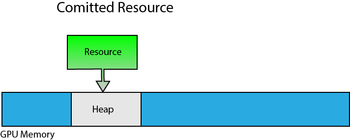

<div class="caption">

Committed resources are created in an implicit heap.

</div>

Committed resources are ideal for allocating large resources like textures or statically sized resources (the size of the resource does not change). Committed resource are also commonly used to create large resource in an upload heap that can be used for uploading dynamic vertex or index buffers (useful for UI rendering or uploading constant buffer data that is changing for each draw call).

### Placed Resources

A placed resource is explicitly placed in a heap at a specific offset within the heap. Before a placed resource can be created, first a heap is created using the [`ID3D12Device::CreateHeap`](https://learn.microsoft.com/windows/win32/api/d3d12/nf-d3d12-id3d12device-createheap) method. The placed resource is then created inside the heap using the [`ID3D12Device::CreatePlacedResource`](https://learn.microsoft.com/windows/win32/api/d3d12/nf-d3d12-id3d12device-createplacedresource) method.

<span id="attachment-8141"></span>

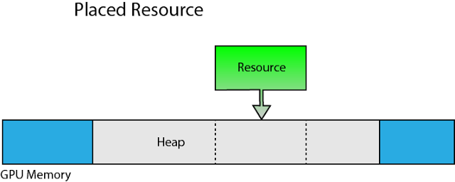

<div class="caption">

Placed resources are placed at a specific offset within a specific memory heap.

</div>

Although placed resource provide better performance because the heap does not need to be allocated from global GPU memory for each resource, using placed resources correctly does require some discipline from the graphics programmer. Placed resources provides more options for implementing various memory management techniques but with great power comes great responsibility. When using placed resources, there are some limitations that must be taken into consideration.

The size of the heap that will be used for placed resources must be known in advance. Creating larger than necessary heaps is not a good idea because the only way to reclaim the GPU memory used by the heap is to either evict the heap or completely destroy it. Since you can only evict an entire heap from GPU memory, any resources that are currently placed in the heap must not be referenced in a command list that is being executed on the GPU.

Depending on the GPU architecture, the type of resource that you can allocate within a particular heap may be limited. For example, buffer resources (vertex buffer, index buffer, constant buffer, structure buffer, etc..) can only be placed in a heap that was created with the [`ALLOW_ONLY_BUFFERS`](https://learn.microsoft.com/windows/win32/api/d3d12/ne-d3d12-d3d12_heap_flags#constants) heap flag. Render target and depth/stencil resources can only be placed in a heap that was created with the [`ALLOW_ONLY_RT_DS_TEXTURES`](https://learn.microsoft.com/windows/win32/api/d3d12/ne-d3d12-d3d12_heap_flags#constants) heap flag. Non render target textures can only be placed in a heap that was created with the [`ALLOW_ONLY_NON_RT_DS_TEXTURES`](https://learn.microsoft.com/windows/win32/api/d3d12/ne-d3d12-d3d12_heap_flags#constants) heap flag. Adapters that support [heap tier 2](https://learn.microsoft.com/windows/win32/api/d3d12/ne-d3d12-d3d12_resource_heap_tier) and higher can create heaps using the [`ALLOW_ALL_BUFFERS_AND_TEXTURES`](https://learn.microsoft.com/windows/win32/api/d3d12/ne-d3d12-d3d12_heap_flags#constants) heap flag to allow any resource type to be placed within that heap. Since the heap tier is dependent on the GPU architecture, most applications will probably be written assuming only [heap tier 1](https://learn.microsoft.com/windows/win32/api/d3d12/ne-d3d12-d3d12_resource_heap_tier#constants) support.

Multiple placed resources can be aliased in a heap as long as they don’t access the same aliased heap space at the same time.

<span id="attachment-8145"></span>

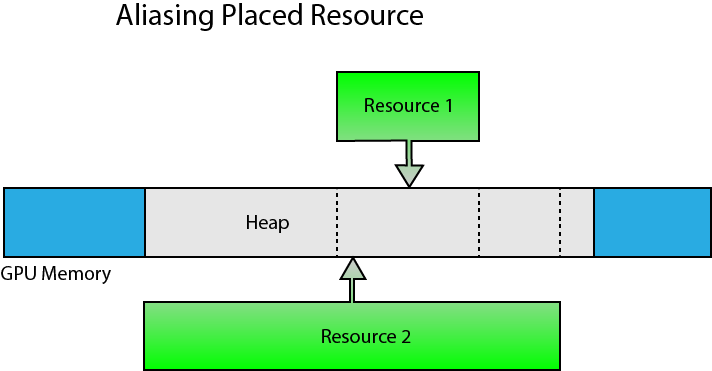

<div class="caption">

Placed resources can be aliased within the heap.

</div>

Aliasing can help to reduce oversubscribing GPU memory usage since the size of the heap can be limited to the size of the largest resource that will be placed in the heap at any moment in time. Aliasing can be used as long as the same space in the heap is not used by multiple aliasing resources at the same time. Aliased resources can be swapped using a [resource aliasing barrier](https://learn.microsoft.com/windows/win32/api/d3d12/ns-d3d12-d3d12_resource_aliasing_barrier).

### Reserved Resources

Reserved resources are created without specifying a heap to place the resource in. Reserved resources are created using the [`ID3D12Device::CreateReservedResource`](https://learn.microsoft.com/windows/win32/api/d3d12/nf-d3d12-id3d12device-createreservedresource) method. Before a reserved resource can be used, it must be mapped to a heap using the [`ID3D12CommandQueue::UpdateTileMappings`](https://learn.microsoft.com/windows/win32/api/d3d12/nf-d3d12-id3d12commandqueue-updatetilemappings) method.

<span id="attachment-8147"></span>

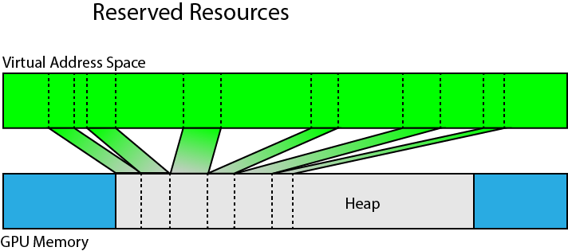

<div class="caption">

Portions of a reserved resource can be mapped to a heap in physical GPU memory.

</div>

Reserved resources can be created that are larger than can fit in a single heap. Portions of the reserved resource can be mapped (and unmapped) using one or more heaps residing in physical GPU memory.

Using reserved resources, a large volume texture can be created using virtual memory but only the resident spaces of the volume texture needs to be mapped to physical memory. This resource type provides options for implementing rendering techniques that use sparse voxel octrees [\[2\]](#cite-2) without exceeding GPU memory budgets.

## Pipeline State Object

The various stages of the rendering pipeline were briefly described in the [first lesson](/learning-directx-12-1/). Please refer to that lesson if you are not familiar with the stages of the rendering pipeline.

The **Pipeline State Object** (**PSO**) contains most of the state that is required to configure the rendering (or compute) pipeline. The graphics pipeline state object includes the following information [\[3\]](#cite-3):

-   Shader bytecode (vertex, pixel, domain, hull, and geometry shaders)
-   Vertex format input layout
-   Primitive topology type (point, line, triangle, or patch)
-   Blend state
-   Rasterizer state
-   Depth-stencil state
-   Number of render targets and render target formats
-   Depth-stencil format
-   Multisample description
-   Stream output buffer description
-   Root signature

The pipeline state object structure contains a lot of information and if any of the state needs to change between draw calls (for example, a different pixel shader or blend state is needed) then a new pipeline state object needs to be created.

Although the pipeline state object contains a lot of information, there are a few additional parameters that must be set outside of the pipeline state object.

-   Vertex and Index buffers
-   Stream output buffer
-   Render targets
-   Descriptor heaps
-   Shader parameters (constant buffers, read-write buffers, and read-write textures)
-   Viewports
-   Scissor rectangles
-   Constant blend factor
-   Stencil reference value
-   Primitive topology and adjacency information

The pipeline state object can *optionally* be specified for a graphics command list when the command list is reset using the [`ID3D12GraphicsCommandList::Reset`](https://learn.microsoft.com/windows/win32/api/d3d12/nf-d3d12-id3d12graphicscommandlist-reset) method but it can also be changed for the command list at any time using the [`ID3D12GraphicsCommandList::SetPipelineState`](https://learn.microsoft.com/windows/win32/api/d3d12/nf-d3d12-id3d12graphicscommandlist-setpipelinestate) method.

## Root Signatures

A root signature is similar to a C++ function signature, that is, it defines the **parameters** that are passed to the shader pipeline. The **values** that are bound to the pipeline are called the root **arguments**. The **arguments** that are passed to the shader can change without changing the root signature **parameters**.

:::note
A **root signature** is so similar in concept to a **function signature** that I prefer to call it a **shader signature** in my own classes.
:::

The root parameters in the root signature not only define the type of the parameters that are expected in the shader, they also define the shader registers and register spaces to bind the arguments to in the shader.

### Shader Register & Register Spaces

Shader parameters must be bound to a register. For example, constant buffers are bound to b registers (b0 – bN), shader resource views (textures and non-constant buffer types) are bound to t registers (t0 – tN), unordered access views (writeable textures and buffer types) are bound to u registers (u0 – uN), and texture samplers are bound to s registers (s0 – sN) where N is the maximum number of shader registers.

:::note
Shader Model 5.1 removes the limit to the number of shader registers that can be used. I think it is limited to $2^{32}-1$ but I haven’t tested this upper limit.
:::

In previous versions of DirectX, different resources could be bound to the same register slot if they were used in different shader stages of the rendering pipeline. For example, a constant buffer could be bound to register b0 in the vertex shader and a different constant buffer could be bound to register b0 in the pixel shader without causing overlap.

DirectX 12 root signatures require that all shader parameters be defined for all stages of the rendering pipeline and registers used across different shader stages may not overlap. In order to provide a work-around for legacy shaders that may violate this rule, Shader Model 5.1 introduces **register spaces**. Resources can overlap register slots as long as they don’t also overlap register spaces.

<span id="attachment-8165"></span>

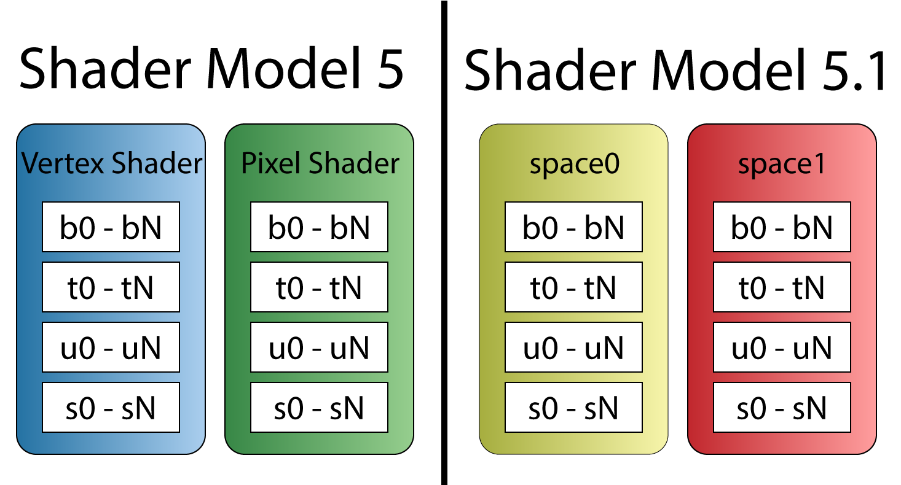

<div class="caption">

Prior to Shader Model 5.1, resource registers could overlap across shader stages (left). Shader Model 5.1 introduces shader spaces which can be used to overlap register slots (right).

</div>

It is important for the graphics programmer to understand the shader register and register spaces overlapping rules when porting legacy shaders to DirectX 12.

### Root Signature Parameters

A root signature can contain any number of parameters. Each parameter can be one of the following types:

-   [`D3D12_ROOT_PARAMETER_TYPE_32BIT_CONSTANTS`](https://learn.microsoft.com/windows/win32/api/d3d12/ne-d3d12-d3d12_root_parameter_type): 32-bit Root Constants
-   [`D3D12_ROOT_PARAMETER_TYPE_CBV`](https://learn.microsoft.com/windows/win32/api/d3d12/ne-d3d12-d3d12_root_parameter_type): Inline CBV Descriptor
-   [`D3D12_ROOT_PARAMETER_TYPE_SRV`](https://learn.microsoft.com/windows/win32/api/d3d12/ne-d3d12-d3d12_root_parameter_type): Inline SRV Descriptor
-   [`D3D12_ROOT_PARAMETER_TYPE_UAV`](https://learn.microsoft.com/windows/win32/api/d3d12/ne-d3d12-d3d12_root_parameter_type): Inline UAV Descriptor
-   [`D3D12_ROOT_PARAMETER_TYPE_DESCRIPTOR_TABLE`](https://learn.microsoft.com/windows/win32/api/d3d12/ne-d3d12-d3d12_root_parameter_type): Descriptor Table

#### 32-Bit Constants

Constant buffer data can be passed to the shader without the need to create a constant buffer resource by using the 32-bit constants. Dynamic indexing into the constant buffer data is not supported for constant data that is stored in the root signature space [\[4\]](#cite-4). For example, the following constant buffer definition can be mapped to 32-bit constants stored in the root signature:

```cpp showLineNumbers
cbuffer TransformsCB : register(b0, space0)
{
    matrix Model;
    matrix View;
    matrix Projection;
}
```

But, due to the array, the following constant buffer definition cannot be mapped to 32-bit constants in the root signature and instead requires either an inline descriptor or a descriptor heap to map the resource:

```cpp showLineNumbers
cbuffer TransformsCB : register(b0, space0)
{
    matrix MVPMatrices[3];
}
```

Each root constant in the root signature costs 1 DWORD (32-bits) [\[5\]](#cite-5).

#### Inline Descriptors

Descriptors can be placed directly in the root signature without requiring a descriptor heap [\[6\]](#cite-6). Only constant buffers (CBV), and buffer resources (SRV, UAV) resources containing 32-bit (`FLOAT`, `UINT`, or `SINT`) components can be accessed using inline descriptors in the root signature. Inline UAV descriptors for buffer resources cannot contain counters (for example, if a [`RWStructuredBuffers`](https://learn.microsoft.com/windows/win32/direct3dhlsl/sm5-object-rwstructuredbuffer) contains a counter resource, it may not be accessed through an inline descriptor in the root signature. Texture resources cannot be referenced using inline descriptors in the root signature and must be placed in a descriptor heap and referenced through a descriptor table.

Unlike root constants, constant buffers containing arrays may be accessed using inline descriptors in the root signature. For example, the following constant buffer can be referenced using inline descriptors:

```cpp showLineNumbers
cbuffer SceneData : register(b0, space0)
{
   uint foo;
   float bar[2];
   int moo;
};
```

Each inline descriptor in the root signature costs 2 DWORDs (64-bits) [\[5\]](#cite-5).

#### Descriptor Tables

A descriptor table defines several descriptor ranges that are placed consecutively in a GPU visible descriptor heap.

<span id="attachment-8180"></span>

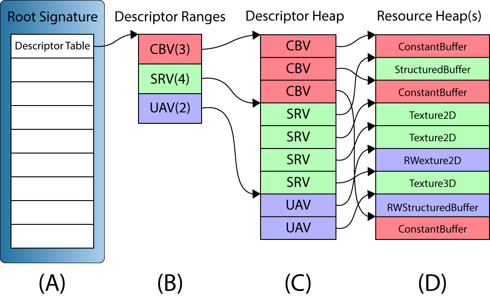

<div class="caption">

A descriptor table (A) in a root signature defines a set of one or more descriptor ranges (B). The descriptor ranges define a set of consecutive descriptors in a GPU visible descriptor heap (C). The descriptors are views to the GPU resources stored in one or more resource heaps (D).

</div>

The above image illustrates a root signature with a single descriptor table parameter (A). The descriptor table contains three descriptor ranges (B): 3 Constant Buffer Views (CBV), 4 Shader Resource Views (SRV), and 2 Unordered Access Views (UAV). CBV’s, SRV’s and UAV’s can be referenced in the same descriptor table since all three types of descriptors can be stored in the same descriptor heap. The GPU visible descriptors (C) must appear consecutively in a GPU visible descriptor heap but the resources that they refer to (D) may appear anywhere in GPU memory, even in different resource heaps.

The above image shows a simplified version of the descriptor table ranges. The descriptor ranges in a descriptor table also need to specify the register slots and spaces that the arguments will be bound to in the shaders. An example of configuring a root signature will be shown later in the lesson.

Each descriptor table in the root signature costs 1 DWORD (32-bits) [\[5\]](#cite-5).

### Static Samplers

A texture sampler describes how a texture should be sampled. It describes the filtering, addressing, and Level of Detail (LOD) to use while sampling from a texture. Using textures and texture samplers will be the topic of another lesson. In this lesson, it is important to understand that texture samplers can be defined directly in the root signature without the need of a descriptor heap. The [`D3D12_STATIC_SAMPLER_DESC`](https://learn.microsoft.com/windows/win32/api/d3d12/ns-d3d12-d3d12_static_sampler_desc) structure is used to define a texture sampler directly in the root signature.

Static samplers do not use any space in the root signature and do not count against the size limit of the root signature.

### Root Signature Constraints

Root signatures are limited to 64 DWORDs (2048-bits) [\[5\]](#cite-5). Each root parameter has a cost that counts towards the root signature limit:

-   32-bit constants each costs 1 DWORD
-   Inline descriptors each costs 2 DWORDs
-   Descriptor tables each costs 1 DWORD

Static samplers defined in the root signature do not count towards the size of the root signature.

The cost of accessing a root argument in a root signature in terms of levels of indirection is zero for 32-bit constants, 1 for inline descriptors, and 2 for descriptor tables [\[5\]](#cite-5).

The graphics programmer should strive to achieve a root signature that is as small as possible but balance the flexibility of using a larger root signature. Parameters in the root signature should be ordered based on the likelihood that the arguments will change. If the root arguments are changing often then they should appear first in the root signature. If the root arguments are not changing often, then they should be the last parameters that appear in the root signature. Since 32-bit constants and inline descriptors have better performance in terms of level of indirection, they should be favored over using descriptor tables as long as the size of the root signature does not become to large.

An example of a simple root signature is provided later in this lesson.

## DirectX 12 Demo

The [previous lesson](/learning-directx-12-1/) showed how to initialize a DirectX 12 application without using any C++ classes. Some of the source code from the [first lesson](/learning-directx-12-1/) was refactored in order to simplify the source code for this and future lessons. There are three primary classes that are used for this lesson:

1.  `Application`
2.  `Window`
3.  `CommandQueue`
4.  `Game`

The `Application` class is responsible for initializing application specific data such as the DirectX 12 device and command queues. The `Application` class is also responsible for creating the `Window` instances and it is also the owner of the `Window` instances (`Window` instances can only be created and destroyed using the `Application` class). The `Application` class also exposes a `Run` method which is used to run the game and execute the message loop. The `Quit` method is used to quit the running application.

The `Window` class creates the swap chain which contains the final rendered image that will be presented to the screen. The `Window` class also contains functions to resize the window and toggle vsync, and fullscreen state.

The source code for the `Application` and the `Window` classes are not discussed in this lesson. You are encouraged to go back to the [previous lesson](/learning-directx-12-1/) if you are not familiar with the functionality of these classes. You may also refer to the source code for [this lesson on GitHub](https://github.com/jpvanoosten/LearningDirectX12/tree/v0.0.2). A link to the source code for this lesson also is provided at the end of the tutorial.

The `CommandQueue` and the `Game` class on the other hand may not be immediately clear and therefore will be discussed in greater detail in this lesson.

If you would prefer to skip the discussion on refactoring of the `CommandQueue` and `Game` classes then you can continue directly to the section about [Shaders](#shaders). Be aware that you may see code later in the lesson that you are not familiar with if you skip these sections.

## The Command Queue Class

The `CommandQueue` class encapsulates the [`ID3D12CommandQueue`](https://learn.microsoft.com/windows/win32/api/d3d12/nn-d3d12-id3d12commandqueue) interface and the syncronization primitives that are used to perform GPU synchronization with the CPU. Most of the functionality of this class was discussed in the [previous lesson](/learning-directx-12-1/) so it should already be familiar but it is important to understand the specific choices that were made while creating the class before seeing it used in the demo.

### CommandQueue Header

The `CommandQueue` class must provide the following functionality:

-   Get a command list that can be used to record the draw commands
-   Execute the command list on the command queue
-   Signal a Fence in the command queue
-   Check to see if a particular fence value has been reached
-   Wait for a particular fence value to be reached
-   Flush any pending commands that are executing on the command queue

The class diagram for the `CommandQueue` class might look like this:

<span id="attachment-8212"></span>

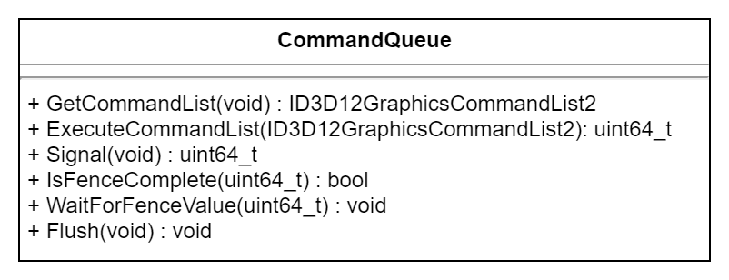

<div class="caption">

The public interface of the `CommandQueue` class.

</div>

#### CommandQueue Preamble

The `CommandQueue` has some dependencies on some system headers which are included first.

```cpp source="LearningDirectX12-v0.0.2/CommandQueue.h#L1-L11"
```

The [`d3d12.h`](https://learn.microsoft.com/windows/win32/api/d3d12/) header file is required for the [`ID3D12CommandQueue`](https://learn.microsoft.com/windows/win32/api/d3d12/nn-d3d12-id3d12commandqueue), [`ID3D12Device2`](https://learn.microsoft.com/windows/win32/api/d3d12/nn-d3d12-id3d12device2), and [`ID3D12Fence`](https://learn.microsoft.com/windows/win32/api/d3d12/nn-d3d12-id3d12fence) interfaces. The [`wrl.h`](https://learn.microsoft.com/cpp/cppcx/wrl/microsoft-wrl-namespace?view=msvc-170) header is required for the [`ComPtr`](https://learn.microsoft.com/cpp/cppcx/wrl/comptr-class?view=msvc-170) class. The [`cstdint`](https://en.cppreference.com/cpp/header/cstdint) header is used for the [`uint64_t`](https://en.cppreference.com/cpp/types/integer) integer type and the [`queue`](https://en.cppreference.com/cpp/header/queue) header is used for the [`std::queue`](https://en.cppreference.com/cpp/container/queue) template class.

#### CommandQueue Class Definition

The public methods of the class are shown first.

```cpp source="LearningDirectX12-v0.0.2/CommandQueue.h#L13-L31"
```

The parameterized constructor for the class takes the DirectX 12 device and the type of the command queue to create as arguments. Creation of the DirectX 12 device and the different types of command queues was discussed in the [previous lesson](/learning-directx-12-1/).

The `GetCommandList` method declared on line 20 returns a command list that can be used to issue drawing commands. The command list returned from this method will be in a state that it can immediately be used to issue commands. There is no need to reset the command list or to create a command allocator for the command list.

After the commands have been recorded into the command list, they can be executed on the command queue using the `ExecuteCommandList` method declared on line 24. The `ExecuteCommandList` method returns the fence value that can be used to check if the commands in the command list have finished executing on the command queue.

The functionality of the `Signal`, `IsFenceComplete`, `WaitForFenceValue`, and `Flush` methods declared on lines 26-29 have the same functionality as that described in the [previous lesson](/learning-directx-12-1/) and will not be discussed any further in this lesson.

The `GetD3D12CommandQueue` method defined on line 31 is used to get access to the underlying [`ID3D12CommandQueue`](https://learn.microsoft.com/windows/win32/api/d3d12/nn-d3d12-id3d12commandqueue) interface.

The protected methods are described next.

```cpp source="LearningDirectX12-v0.0.2/CommandQueue.h#L32-L35"
```

The `CreateCommandAllocator` and `CreateCommandList` methods are used to create a command allocator and command list if no command list or command allocator are currently available.

Data that is private to the CommandQueue class is described next.

```cpp source="LearningDirectX12-v0.0.2/CommandQueue.h#L37-L57"
```

The `CommandAllocatorEntry` structure defined on lines 39-43 is used to associate a fence value with a command allocator. As discussed in the [previous lesson](/learning-directx-12-1/), the command list can be reused immediately after it has been executed on the command queue, but the command allocator cannot be reused unless the commands stored in the command allocator have finished executing on the command queue. In order to guarantee that the command allocator is no longer “in-flight” on the command queue, a fence value is signaled on the command queue and that fence value (together with the associated command allocator) is stored for later reuse.

The `CommandAllocatorQueue` aliased on line 45 describes the [`std::queue`](https://en.cppreference.com/cpp/container/queue) object that is used to queue command allocators that are “in-flight” on the GPU queue. As soon as the fence value that is associated with the `CommandAllocatorEntry` has been reached, the command allocator can be reused.

Similar to the `CommandAllocatorEntry`, the `CommandListQueue` alias describes an [`std::queue`](https://en.cppreference.com/cpp/container/queue) object that is used to queue command lists that can be reused. There is no need to associate a fence value with the command lists since they can be reused right after they have been executed on the command queue.

Since there are several different types of command queues as described in the [previous lesson](/learning-directx-12-1/), the command queue (command list) type is stored in the `m_CommandListType` member variable defined on line 48.

The `m_d3d12Device` member variable defined on line 49 stores a pointer to the [`ID3D12Device2`](https://learn.microsoft.com/windows/win32/api/d3d12/nn-d3d12-id3d12device2) interface that is used to create the command queue, command lists, and command allocators used by this class.

The `m_d3d12CommandQueue` member variable declared on line 50 is used to store the pointer to the [`ID3D12CommandQueue`](https://learn.microsoft.com/windows/win32/api/d3d12/nn-d3d12-id3d12commandqueue) interface that is owned by this class.

The `m_d3d12Fence`, `m_FenceEvent`, and `m_FenceValue` member variables are the synchronization primitives required to perform CPU-GPU synchronization. These primitives were discussed in the [previous lesson](/learning-directx-12-1/) and will not be discussed any further in this lesson.

The `m_CommandAllocatorQueue` and `m_CommandListQueue` member variables define the command allocator queue and command list queue that are used to queue up command allocators and command lists that can be reused.

### CommandQueue Implementation

In this section, the implementations of the methods defined in the CommandQueue class are shown.

#### CommandQueue::CommandQueue

The `CommandQueue` constructor is used to create an instance of the `CommandQueue` class (obviously).

```cpp source="LearningDirectX12-v0.0.2/CommandQueue.cpp#L5-L21"
```

On lines 10-14 the [`D3D12_COMMAND_QUEUE_DESC`](https://learn.microsoft.com/windows/win32/api/d3d12/ns-d3d12-d3d12_command_queue_desc) structure is described and on line 16 the [`ID3D12CommandQueue`](https://learn.microsoft.com/windows/win32/api/d3d12/nn-d3d12-id3d12commandqueue) is created.

The fence object that is used to perform CPU-GPU synchronization is created on line 17 and the fence event is created on line 19.

#### CommandQueue::CreateCommandAllocator

The `CreateCommandAllocator` method is used to create a new instance of a [`ID3D12CommandAllocator`](https://learn.microsoft.com/windows/win32/api/d3d12/nn-d3d12-id3d12commandallocator).

```cpp source="LearningDirectX12-v0.0.2/CommandQueue.cpp#L53-L59"
```

The [`ID3D12Device::CreateCommandAllocator`](https://learn.microsoft.com/windows/win32/api/d3d12/nf-d3d12-id3d12device-createcommandallocator) method is used to create an instance of the [`ID3D12CommandAllocator`](https://learn.microsoft.com/windows/win32/api/d3d12/nn-d3d12-id3d12commandallocator) interface. This method was described in the [previous lesson](/learning-directx-12-1/).

#### CommandQueue::CreateCommandList

Similar to the `CreateCommandAllocator` method, the `CreateCommandList` method is used to create an instance of a [`ID3D12GraphicsCommandList2`](https://learn.microsoft.com/windows/win32/api/d3d12/nn-d3d12-id3d12graphicscommandlist2). In this case, the command list requires a pointer to a valid [`ID3D12CommandAllocator`](https://learn.microsoft.com/windows/win32/api/d3d12/nn-d3d12-id3d12commandallocator).

```cpp source="LearningDirectX12-v0.0.2/CommandQueue.cpp#L61-L67"
```

The [`ID3D12GraphicsCommandList2`](https://learn.microsoft.com/windows/win32/api/d3d12/nn-d3d12-id3d12graphicscommandlist2) is created on line 64 using the [`ID3D12Device::CreateCommandList`](https://learn.microsoft.com/windows/win32/api/d3d12/nf-d3d12-id3d12device-createcommandlist) method. This method was described in the [previous lesson](/learning-directx-12-1/).

#### CommandQueue::GetCommandList

One of the more interesting methods for the `CommandQueue` class is the `GetCommandList` method. This method returns a command list that can be directly used to issue GPU drawing (or dispatch) commands. The command list will be in the recording state so there is no need for the user to reset the command list before using it. A command allocator will already be associated with the command list but the `CommandQueue` class needs a way to keep track of which command allocator is associated with which command list. Since there is no way to directly query the for the command allocator that was used to reset the command list, a pointer to the command allocator is stored in the private data space of the command list.

```cpp source="LearningDirectX12-v0.0.2/CommandQueue.cpp#L69-L72"
```

Two temporary variables are defined on lines 71-72 to store the command allocator and command list.

Before the command list can be reset, an unused command allocator is required. The Command allocator can be reused as long as it is not currently “in-flight” on the command queue.

```cpp source="LearningDirectX12-v0.0.2/CommandQueue.cpp#L74-L84"
```

On line 74, the command allocator queue is checked to see if there are any valid items in the queue. If there is at least one item in the command allocator queue and the fence value associated with that command allocator has been reached, then it is popped off the front of the queue and reset. Otherwise, a new command allocator is created on line 83 using the [`CreateCommandAllocator`](#commandqueuecreatecommandallocator) method described earlier.

With a valid command allocator, the command list is created next.

```cpp source="LearningDirectX12-v0.0.2/CommandQueue.cpp#L86-L96"
```

The command list queue is checked to see if there are any command lists in the queue. If there is at least one, it is popped from the front of the queue and reset using the command allocator that was retrieved in the previous step.

If there are no command lists available in the command list queue, then a new one is created on line 95 using the [`CreateCommandList`](#commandqueuecreatecommandlist) method described earlier.

Before returning the command list to the calling function, the command allocator needs to be associated with the command list by assigning a pointer to the command allocator to the private data of the command list.

```cpp source="LearningDirectX12-v0.0.2/CommandQueue.cpp#L98-L103"
```

The command allocator is associated with the command list on line 100 by assigning it to the private data of the command list using the [`ID3D12Object::SetPrivateDataInterface`](https://learn.microsoft.com/windows/win32/api/d3d12/nf-d3d12-id3d12object-setprivatedatainterface) method. This is done so that the command allocator associated with the command list can be easily tracked outside of the `CommandQueue` class. When the command list is executed (which will be shown next), the command allocator can be retrieved from the command list and pushed to the back of the command allocator queue.

:::caution
It should be noted that when assigning a COM object to the private data of a [`ID3D12Object`](https://learn.microsoft.com/windows/win32/api/d3d12/nn-d3d12-id3d12object) object using the [`ID3D12Object::SetPrivateDataInterface`](https://learn.microsoft.com/windows/win32/api/d3d12/nf-d3d12-id3d12object-setprivatedatainterface) method, the internal reference counter of the assigned COM object is incremented. The ref counter of the assigned COM object is only decremented if either the owning [`ID3D12Object`](https://learn.microsoft.com/windows/win32/api/d3d12/nn-d3d12-id3d12object) object is destroyed or the instance of the COM object with the same interface is replaced with another COM object of the same interface or a `NULL` pointer.

I spent hours debugging what seemed like a COM pointer leak until I realized this.
:::

#### CommandQueue::ExecuteCommandList

The `ExecuteCommandList` method is used to execute a command list that was previously retrieved using the [`GetCommandList`](#commandqueuegetcommandlist) method described previously.

```cpp source="LearningDirectX12-v0.0.2/CommandQueue.cpp#L107-L123"
```

Before the command list can be executed, it must be closed. The command list is closed on line 109 using the [`ID3D12GraphicsCommandList::Close`](https://learn.microsoft.com/windows/win32/api/d3d12/nf-d3d12-id3d12graphicscommandlist-close) method.

The command allocator that was previously associated to the command list is retrieved from the private data of the command list on line 113 using the [`ID3D12Object::GetPrivateData`](https://learn.microsoft.com/windows/win32/api/d3d12/nf-d3d12-id3d12graphicscommandlist-close) method.

:::caution
You should be aware that retrieving a COM pointer of a COM object associated with the private data of the [`ID3D12Object`](https://learn.microsoft.com/windows/win32/api/d3d12/nn-d3d12-id3d12object) object will also increment the reference counter of that COM object.
:::

Since the [`ID3D12CommandQueue::ExecuteCommandLists`](https://learn.microsoft.com/windows/win32/api/d3d12/nf-d3d12-id3d12commandqueue-executecommandlists) method expects an array of [`ID3D12CommandList`](https://learn.microsoft.com/windows/win32/api/d3d12/nn-d3d12-id3d12commandlist), a temporary array is created on line 115 and passed to the [`ID3D12CommandQueue::ExecuteCommandLists`](https://learn.microsoft.com/windows/win32/api/d3d12/nf-d3d12-id3d12commandqueue-executecommandlists) method on line 119.

Immediately after executing the command list, the queue is signaled using the `Signal` method. This produces the fence value to wait for to ensure that the command allocators can be reused.

On lines 112-123 the command allocator and the command lists are pushed to the back of their respective queues so that they can be reused the next time the [`GetCommandList`](#commandqueuegetcommandlist) method is called.

```cpp source="LearningDirectX12-v0.0.2/CommandQueue.cpp#L125-L131"
```

Before leaving this function, the temporary pointer to the command allocator needs to be decremented by releasing the COM pointer using the [`IUnknown::Release`](https://learn.microsoft.com/windows/win32/api/unknwn/nf-unknwn-iunknown-release) method.

On line 130, the fence value that can be used to perform CPU-GPU synchronization is returned to the calling function.

This concludes the description of the refactored `CommandQueue` class that is used by the demo code that follows. There is also an `Application` class and a `Window` class that will be used but not described in detail since it is (almost) a direct copy of the source code shown in the [previous lesson](/learning-directx-12-1/).

In the next section, the `Game` class is described. The `Game` class provides a base class for the demo for this lesson and any future demos created in this series of lessons.

## The Game Class

The `Game` class serves as the abstract base class for the demos. The `Game` class should perform the following functions:

1.  Initialize the DirectX 12 Runtime (and create a window to render to)
2.  Load the content that is specific to the demo
3.  Unload the content including freeing any memory used by the demo
4.  Destroy any resources used by the DirectX 12 runtime (destroy the render window)
5.  Respond to window messages (like keyboard and mouse events)

A UML diagram for the `Game` class might look like this:

<span id="attachment-8243"></span>

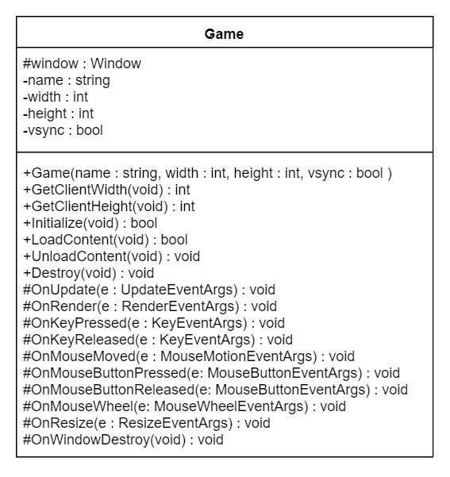

<div class="caption">

UML class diagram of the Game class.

</div>

The various functions of the `Game` class are described in the next section.

### The Game Header

In this section, the interface for the `Game` class is described.

```cpp title="Game.h" showLineNumbers
/**
 *   @brief The Game class is the abstract base class for DirecX 12 demos.
 */
#pragma once

#include <Events.h>

#include <memory> // for std::enable_shared_from_this
#include <string> // for std::wstring

class Window;
```

The [`Events.h`](https://github.com/jpvanoosten/LearningDirectX12/blob/v0.0.2/DX12Lib/inc/Events.h) header file included on line 6 contains structures that are used to relay window events back to the game class. An example of a window event that is fired on the `Game` class is the mouse and keyboard events that occur while the game’s window has focus.

The [`memory`](https://en.cppreference.com/cpp/header/memory) and [`string`](https://en.cppreference.com/cpp/header/string) standard headers are also included on lines 8-9 to provide the [`std::enable_shared_from_this`](https://en.cppreference.com/cpp/memory/enable_shared_from_this) template and the [`std::wstring`](https://en.cppreference.com/cpp/string/basic_string) classes from the Standard Template Library (STL).

On line 11, the `Window` class is forward-declared in order to avoid including the header file for that class.

```cpp source="LearningDirectX12-v0.0.2/Game.h#L13-L20"
```

The constructor for the `Game` class takes the window title (`name`), and `width` and `height` of the render window to create. The `vSync` option specifies whether rendering should be synchronized to the vertical refresh rate of the screen or not.

```cpp source="LearningDirectX12-v0.0.2/Game.h#L32-L50"
```

The `Game` class provides several methods that can be overridden by a child class. The `Game` class provides a default implementation for the `Initialize` method which just creates a Window to render the graphics to and registers the window callback functions. The default implementation of the `Destroy` method just destroys the window. The implementations of the `LoadContent` and `UnloadContent` must be provided by the child class (which is also the subject of this lesson).

The `Game` class also provides several callback functions for window events which can be overridden by a child class. The default implementations for the window callback functions is to do nothing.

```cpp source="LearningDirectX12-v0.0.2/Game.h#L52-L104"
```

The `OnUpdate` method declared on line 58 is invoked whenever the game logic should be updated. It is invoked when the [`WM_PAINT`](https://learn.microsoft.com/windows/win32/gdi/wm-paint) message is received by the `Window`.

The `OnRender` method is invoked whenever the screen should be redrawn. It is invoked immediately after the `OnUpdate` callback function.

The `OnKeyPressed` and `OnKeyReleased` callback functions are invoked whenever a key is pressed or released on the keyboard while the render window has focus.

The `OnMouseMoved`, On `MouseButtonPressed`, and `OnMouseButtonReleased` are invoked whenever the mouse moves, or any mouse button is pressed or released over the client area of the render window.

The `OnMouseWheel` callback function is invoked whenever the mouse wheel is scrolled while the mouse cursor is over the screen. In this case, the render windows does not need to have keyboard focus for this event to be dispatched to the window.

The `OnResize` method is invoked when the render window is resized. The implementation of the child class does not need to be concerned with resizing the swap chain buffers of the render window (this is handled automatically in the `Window` class) but does need to resize any resources that are allocated specifically by the derived class.

The `OnWindowDestroy` method is called when the render window is being destroyed. The default behaviour of this method is to call the `UnloadContent` method. A child class can override the `OnWindowDestroy` method if this is not intended behaviour.

The `Game` class also provides protected access to the window instance that is created by default in the `Game::Initialize` method.

```cpp source="LearningDirectX12-v0.0.2/Game.h#L106-L114"
```

Most of the methods of the `Game` class do nothing. They simply provide a means to invoke the window callbacks from the window message process. The only exception to this is the `Game::Initialize` and `Game::Destroy` methods which create and destroy the render window instance.

### Game::Initialize

The purpose of the `Game::Initialize` method is to initialize the game specific state. GPU resources should be allocated in the `LoadContent` method which should be provided by the child class.

```cpp source="LearningDirectX12-v0.0.2/Game.cpp#L20-L34"
```

Before utilizing any functions of the DirectX Math library, support for the CPU instruction sets on the end-users computer must be verified [\[7\]](#cite-7). On line 23 the [`XMVerifyCPUSupport`](https://learn.microsoft.com/windows/win32/api/directxmath/nf-directxmath-xmverifycpusupport) method is used to verify CPU support on the users computer. If CPU support is not available on the users computer, the function will return false and the Application’s `Run` method will return an error code.

On lines 29-30, a `Window` is created by the `Application` class and event callbacks are registered for the `Game` class.

Before the function returns, the `Window` is shown on line 31.

### Game::Destroy

The default implementation of the `Destroy` method is simply to tell the application to destroy the render window that was created in the `Game::Initialize` method.

```cpp source="LearningDirectX12-v0.0.2/Game.cpp#L36-L40"
```

The remaining methods of the `Game` class are empty and will be overridden by the demo class for this lesson.

Before delving into the details of the demo class for this lesson, it is important to understand some basic concepts about shaders.

## Shaders

In order to implement the demo for this lesson, two shaders are required to perform the rendering.

1.  Vertex Shader
2.  Pixel Shader

The **Vertex Shader** is responsible for transforming the vertices of the object being rendered from **object-space** to **clip-space**. The clip-space vertices are required by the (fixed-function) **Rasterizer Stage** of the rendering pipeline in order to clip the rendering primitives against the view frustum and to compute the per-pixel (or per-fragment) attributes across the face of the rendered primitives. The interpolated vertex attributes are passed to the **Pixel Shader** in order to compute the final color of the pixel.

The **Pixel Shader** is responsible for computing the final color of the pixel that is rendered to the screen (or an offscreen render target). It receives the interpolated vertex attributes that are computed by the **Rasterizer Stage** and usually outputs at least one color value that is written to a render target. In this lesson, a very simple pixel shader is shown. In later lessons, more complex lighting equations will be used to create a more realistic rendering of a scene.

### Vertex Shader

In this lesson, a simple **vertex shader** is discussed. This lesson is not intended to be an exhaustive description of how to write vertex shaders but to provide a basic understanding of how to write a simple vertex shader for the purpose of this lesson.

The basic concept of a vertex shader is that it receives the vertices that describe a model (expressed in object-space, or model-space) and performs zero or more transformations on the attributes of the vertices in order to produce the vertex attributes for the next stage of the rendering pipeline (this is usually the **rasterizer stage** but it could also be the **geometry** or **tessellation stages**).

<span id="attachment-8254"></span>

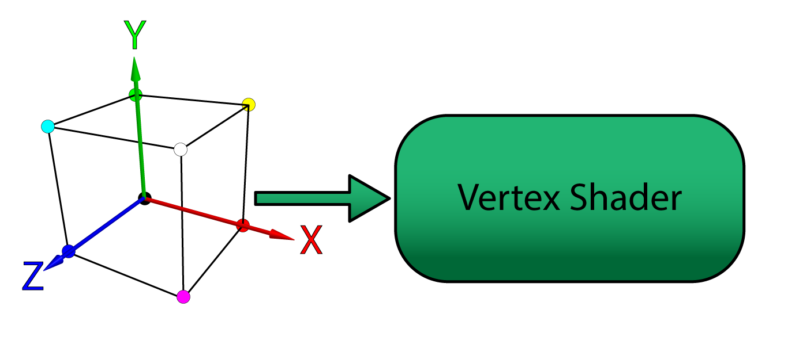

<div class="caption">

The model vertices in object-space are sent from the application to the vertex shader stage of the rendering pipeline.

</div>

A vertex can contain any number of attributes. For example, the vertex **position** is a possible attribute of a vertex. Vertex **color**, **normal**, or **texture coordinate** are other examples of vertex attributes. For this lesson, only vertex position and color are used as vertex attributes. In later lessons, the vertex normal and texture coordinates are used.

Vertex attributes can be sent to the GPU in either **packed** or **interleaved** format. Attributes that are stored in a packed format are usually stored in separate buffers (one buffer for position, another for color, etc..). Packed attributes are similar in concept to a [Struct of Arrays](https://en.wikipedia.org/wiki/AOS_and_SOA) ([SoA](https://en.wikipedia.org/wiki/AOS_and_SOA)).

Attributes that are stored in an interleaved format are usually stored in a single array. Interleaved attributes are similar in concept an [Array of Structs](https://en.wikipedia.org/wiki/AOS_and_SOA) ([AoS](https://en.wikipedia.org/wiki/AOS_and_SOA)). Although it is easier to think of vertices as an Array of Structs, it may actually be better for performance to store the attributes of a vertex as a Struct of Arrays especially if not all attributes are accessed in the vertex shader since fewer fetches to global memory are required and fetches can be better coalesced.

:::caution
Do not just take my word and make assumptions about the performance differences between packed and interleaved storage formats. Always do performance profiling on the target platform before deciding to use packed or interleaved vertex formats.
:::

<span id="attachment-2378"></span>

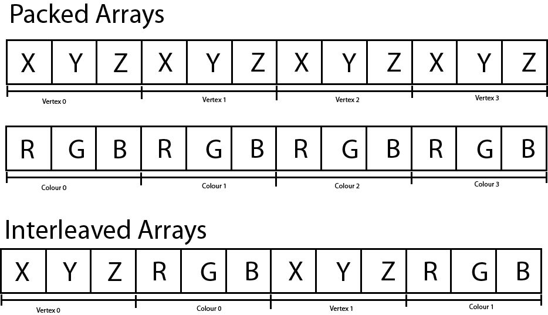

<div class="caption">

Packed versus Interleved arrays. Packed arrays store the vertex attributes in separate buffers while interleaved arrays store the vertex attributes interleaved in a single buffer.

</div>

How to specify the input layout of the vertex attributes is described later in the lesson.

#### Shader Symantics

The vertex shader can output one or more attributes to the next stage of the rendering pipeline but it must at least output a position attribute bound to the [`SV_Position`](https://learn.microsoft.com/windows/win32/direct3dhlsl/dx-graphics-hlsl-semantics) system value semantic. Semantics are a way to tell the **Input Assembler** how to link the buffer data supplied by the application to the input parameters expected by the shader. Semantics are also the language syntax used to link output parameters from one shader stage to the input parameters to another shader stage.

In an HLSL shader the semantic name for the variable follows the colon (`:`) character in a variable declaration.

```hlsl source="LearningDirectX12-v0.0.2/VertexShader.hlsl#L8-L12"
```

The snippet shows an example of a vertex definition in an HLSL shader. The **VertexPosColor** structure declares two member variables (vertex attributes):

1.  `Position`
2.  `Color`

The `Position` attribute is bound to the `POSITION` semantic and the `Color` attribute is bound to the `COLOR` semantic. These semantics will be used later to specify how the application data is bound to the vertex attributes in HLSL.

:::note
In DirectX 12 the names of the semantics are arbitrary (except for [system value semantics](https://learn.microsoft.com/windows/win32/direct3dhlsl/dx-graphics-hlsl-semantics) that are used by the fixed-function stages of the rendering pipeline). The `Position` and `Color` attributes could be bound to `FOO` and `BAR` semantics but this would not be very descriptive for anyone else trying to read your code. The only requirement is that the input and output semantics match (and the types have to be convertible).
:::

#### Transformation and Spaces

In order to animate the object in the scene, a basic understanding of transformation and spaces must be established. If a refresher on transformation and spaces is needed, please refer to the articles titled [Coordinate Systems](/3d-math-primer-for-game-programmers/), [Matrices](/3d-math-primer-for-game-programmers-matrices/), and [Understanding the View Matrix](/understanding-the-view-matrix/).

For this demo, an object is placed at the origin of the world and rotated. The camera is placed some distance away from the origin in order to view the object. The transformation matrix that rotates the object is called the **model matrix** and the transformation matrix to place the camera in the scene is called the **view matrix**. A final transformation called the **projection matrix** is also applied in order to transform the vertices from view space to clip space. These three matrices can be combined using matrix multiplication to produce a single matrix that can transform the vertices from objects space to clip space. This matrix is appropriately named the **model-view-projection** matrix or just **MVP** matrix.

The `MVP` matrix is required by the vertex shader to perform the transformations on the vertices of the model. This matrix is passed to the vertex shader using a `ConstantBuffer` object in HLSL.

```hlsl source="LearningDirectX12-v0.0.2/VertexShader.hlsl#L1-L6"
```

:::note
Shader Model 5.1 introduced the `ConstantBuffer` template construct in order to enable support for descriptor arrays. See [Resource Binding in HLSL](https://learn.microsoft.com/windows/win32/direct3d12/resource-binding-in-hlsl#constant-buffers) for more information.
:::

In HLSL the `matrix` type represents a 4×4 matrix (this is an alias of the `float4x4` type). The `ModelViewProjectionCB` shader variable is bound to the `b0` register. The b register type is reserved for constant buffer variables (see [Shader Register & Register Spaces](#shader-register--register-spaces)).

#### Vertex Shader Output

The vertex shader accepts vertex attributes passed from the application, transforms these inputs in zero or more ways (a vertex shader that performs no transformations on the input data is called a **pass-through** shader) and outputs the vertex attributes to be consumed by the next stage of the rendering pipeline. Just as the input attributes were bound to semantics, the output attributes are also bound to semantics.

```hlsl source="LearningDirectX12-v0.0.2/VertexShader.hlsl#L14-L18"
```

The `VertexShaderOutput` structure groups the vertex shader’s output attributes. The (arbitrarily named) `COLOR` semantic is used again to pass a `Color` attribute to the pixel shader stage.

The [`SV_Position`](https://learn.microsoft.com/windows/win32/direct3dhlsl/dx-graphics-hlsl-semantics) system value semantic is a required semantic to be output by the vertex shader and it is the only required parameter that must be passed to the rasterizer stage. The parameter bound to the [`SV_Position`](https://learn.microsoft.com/windows/win32/direct3dhlsl/dx-graphics-hlsl-semantics) system value semantic is not a required input parameter for the pixel shader and can be omitted from the pixel shader’s input parameters (as will be shown later). However, the byte offsets of the other parameters (in this case the `Color` parameter has an offset of 0 bytes within the `VertexShaderOutput` structure) must match between the outputs and inputs of linked shader stages. For this reason, the `Position` parameter is placed last in the `VertexShaderOutput` structure.

#### The Main Entry Point

The main entry point for the shader is a single function that takes the vertex attributes as input arguments and outputs the transformed vertex attributes.

```hlsl source="LearningDirectX12-v0.0.2/VertexShader.hlsl#L20-L28"
```

Unlike in GLSL, the name of the entry point function in HLSL is not required to be “**main**“. In fact, it is possible to define several entry-point functions in a single HLSL source file. The name of the entry point for the shader is specified when compiling the shader.

Each invocation of the vertex shader operates over a single vertex (as opposed to triangles or the entire mesh) and outputs the transformed vertex. Many vertices are processed in parallel and it is not possible to modify variables defined within the scope of the vertex shader and expect that other invocations of the vertex shader will see those changes (even if you declare the variable as static in the global scope of the vertex shader!). For example, you cannot declare a counter variable in the vertex shader and allow each invocation to increment that counter to see how many vertices were processed (you may be able to achieve this using atomic counters, but that is beyond the scope of this lesson).

On line 24, the vertex position is multiplied by the `MVP` matrix to produce the clip-space position. The input position must be cast to a `float4` using a function-style cast in order to perform the multiplication because the `MVP` matrix is a 4×4 matrix. A `1.0` is appended to the last component of the position to ensure the matrix translation is taken into consideration.

:::caution
If a `0.0` was used in the last component of the vector, then the vector would be rotated but not translated.

-   If the vertex attribute is a **position** vector, then the 4th component of the vector must be a **1**.
-   If the vertex attribute is a **normal** vector, then the 4th component of the vector must be a **0**.

**Positional** vectors are often referred to as **points** (because it represents a point in space). **Directional** vectors are simply referred to as **vectors**.
:::

On line 25 the input `Color` attribute is passed to the output `Color` attribute of the `OUT` variable. The output color also expects a `float4` to be used as output so the function-style cast is used again. In this case, the final component is set to `1.0`. The last component in a color value is often referred to as the alpha (α) which in most cases is interpreted as the opacity of the color (but this is not a requirement). Since alpha blending is not used for this example, the final component of the color attribute has absolutely no impact on the final output color of the pixel shader (try setting this value to `0.0` and observe the result).

On line 27, the `OUT` parameter is returned and the result is passed as input to the **Rasterizer** stage. The rasterizer will use the `Position` parameter to determine the pixel’s coordinates (in screen space, by applying the viewport), the depth value (in normalized-device coordinate space) which is written to the depth buffer, and the interpolated `Color` parameter is passed as input to the pixel shader stage.

The entire listing for the vertex shader is shown below.

```hlsl source="LearningDirectX12-v0.0.2/VertexShader.hlsl#L1-L28"
```

### Pixel Shader

The purpose of the pixel shader is to produce the final color that should be written to the currently bound render target(s). The pixel shader can write to a maximum of eight color targets and one depth target. For this example, only a single color render target and a single depth target are bound to the output merger stage.

The pixel shader takes the interpolated color value from the **Rasterizer** stage and outputs that color to the only bound render target using the [`SV_Target`](https://learn.microsoft.com/windows/win32/direct3dhlsl/dx-graphics-hlsl-semantics) system value semantic.

```hlsl source="LearningDirectX12-v0.0.2/PixelShader.hlsl#L1-L9"
```

You may notice that the pixel shader is not using the `Position` attribute that was computed in the vertex shader. Only the `Color` attribute is used and therefore the `Position` parameter can be omitted from the `PixelShaderInput` structure.

The main entry point for the pixel shader is called `main` (but it is not necessary to call the entry-point function main) and it takes the `PixelShaderInput` as an input parameter and outputs a single color. This is the simplest form of a pixel shader (actually, no pixel shader would be simpler – it is valid to define a graphics pipeline state without a pixel shader if you only need depth information).

## The Tutorial Class

The `Tutorial` class (actually `Tutorial2` since this is the 2nd tutorial in this series) is derived from the [`Game`](#the-game-class) class described earlier in this lesson. Besides overriding the `LoadContent` and `UnloadContent` pure virtual functions from the `Game` class, the `Tutorial2` class also provides a few helper functions in order to upload vertex and index data to the GPU and perform resource transitioning. Resource transitions have been introduced in the previous lesson but uploading resources to the GPU is a new concept that hasn’t been introduced yet. The `Tutorial2` class will also load the shaders, define the input layout, create the root signature and pipeline state object.

### The Tutorial Header

Before showing any source code, the `Tutorial2.h` header file is first described in order to provide some background for the functions that are described in more detail in the following sections.

```cpp source="LearningDirectX12-v0.0.2/Tutorial2.h#L1-L6"
```

The `Tutorial2` class has a dependency on the `Game` class which is declared in the `Game.h` header file included on line 3. The `Window` class is declared in the `Window.h` header file (not to be confused with the `Windows.h` header file which contains the Win32 programming APIs).

The `DirectXMath.h` header file is included in the Window 10 SDK and is considered to be part of the DirectX APIs [\[7\]](#cite-7). This header includes the vector and matrix definitions that are used to define the model, camera, and projection transformation matrices for the demo.

```cpp source="LearningDirectX12-v0.0.2/Tutorial2.h#L8-L22"
```

The constructor for the `Tutorial2` class declared on line 13 is similar to that of the `Game` class. The `name` parameter defines the window title for the render window. The `width` and `height` parameters define how large the window is when it is created. The `vSync` option determines if the renderer should synchronize with vertical refresh rate of the screen.

The `LoadContent` and `UnloadContent` functions override the pure virtual functions from the `Game` class that was described previously.

```cpp source="LearningDirectX12-v0.0.2/Tutorial2.h#L23-L46"
```

The `OnUpdate` method is invoked whenever the game logic needs to be updated and the `OnRender` method is invoked whenever the game screen needs to be drawn.

The `OnKeyPressed` and `OnMouseWheel` events are invoked from the `Window` class whenever a key is pressed, or the mouse wheel is moved while the game Window has focus.

The `OnResize` method is called whenever the render window is resized (for example, if the window is toggled between fullscreen states).

The `Tutorial2` class also defines a few helper functions.

```cpp source="LearningDirectX12-v0.0.2/Tutorial2.h#L48-L70"
```

The functionality of the `TransitionResource` and `ClearRTV` methods were described in the [previous lesson](/learning-directx-12-1/). The `ClearDepth` method is very similar to the `ClearRTV` method except it is used to clear a depth-stencil view (DSV) instead of a render target view (RTV).

The `UpdateBufferResource` method is used to both create a resource large enough to hold the buffer data, but it will also create an intermediate upload buffer that is used to transfer the buffer data from CPU memory into GPU memory. The intermediate upload buffer needs to be resident until the graphics command list is finished uploading that resource to the destination buffer in GPU memory. For that reason, the pointers returned by this function cannot be destroyed until the resource has been fully uploaded to the destination resource.

The `ResizeDepthBuffer` method is used to resize the depth buffer that is used by the demo. The depth buffer ensures that geometry that appears further away from the viewer is properly occluded by geometry that appears closer to the viewer. The depth buffer is not owned by the `Window` class (together with the swap chain) because the depth buffer is not a required resource in order to display the final rendered image on the screen.

<span id="attachment-8282"></span>


<div class="caption">

The depth buffer stores the depth of the pixel in normalized device coordinate space (0 – 1). Depth values far away appear white (1.0) and depth values close to the viewer appear darker (0.0).

</div>

The depth buffer stores the depth of the pixel in normalized device coordinate space (NDC). Only pixels that are not occluded based on the current value in the depth buffer are drawn. This ensures that primitives that are further away from the viewer are not drawn on top of primitives that are closer to the viewer.

```cpp source="LearningDirectX12-v0.0.2/Tutorial2.h#L72-L72"
```

In order to perform correct synchronization, the `Tutorial2` class needs to track the fence values for each rendered frame. The number of frames that need to be tracked is stored in the `Window::BufferCount` static constant.

In order to demonstrate a basic rendering pipeline, a cube is rendered using a vertex buffer and index buffer. For each of these resources, a view is created which describes the buffer resources to the rendering pipeline.

```cpp source="LearningDirectX12-v0.0.2/Tutorial2.h#L74-L79"
```

The `VertexBuffer` resource is used to store the vertex buffer geometry for the cube and the `IndexBuffer` resource is used to store the index data to render the cube.

```cpp source="LearningDirectX12-v0.0.2/Tutorial2.h#L81-L84"
```

The depth buffer is stored in the `m_DepthBuffer` member variable. Similar to the **render target views** for the swap chain, the depth buffer requires a **depth-stencil view**. The depth-stencil view is created in a **descriptor heap**.

```cpp source="LearningDirectX12-v0.0.2/Tutorial2.h#L86-L93"
```

The root signature describes the parameters passed to the various stages of the rendering pipeline and the pipeline state object describes the rendering pipeline itself.

The viewport and scissor rect variables are used to initialize the rasterizer stage of the rendering pipeline.

```cpp source="LearningDirectX12-v0.0.2/Tutorial2.h#L95-L102"
```

The `m_FoV` variable is used to store the current field of view of the camera. For this demo, the middle mouse wheel is used to “zoom-in” to the cube in the center of the scene.

The **model**, **view** and **projection** matrices are used to compute the **MVP** matrix that is used in the vertex shader to rotate the cube, position the camera, and project the vertices into clip-space.

The `m_ContentLoaded` is used to indicate when the game content has been loaded.

The implementation details for the `Tutorial2` class is described next.

### Tutorial2 Preamble

The preamble for the `Tutorial2` source file contains the required header files for the class.

```cpp title="Tutorial2.cpp" showLineNumbers
#include <Tutorial2.h>

#include <Application.h>
#include <CommandQueue.h>
#include <Helpers.h>
#include <Window.h>

#include <wrl.h>
using namespace Microsoft::WRL;

#include <d3dx12.h>
#include <d3dcompiler.h>

#include <algorithm> // For std::min and std::max.
#if defined(min)
    #undef min
#endif

#if defined(max)
    #undef max
#endif

using namespace DirectX;
```

The **Tutorial2.h** header file included on line 1 is described in the previous section.

The `Application.h` header file included on line 3 contains the definition of the `Application` class. The `Application` class was briefly described earlier in this post but not described in full details. The `Application` class is used to create `Window` instances for displaying the rendered image.

The `CommandQueue.h` header file contains the definition of the `CommandQueue` class that was described in detail in the section titled [Command Queue](#the-command-queue-class).

The `Helpers.h` header file contains helper functions and macros that are used throughout the demo source code.

The `Window.h` header file contains the `Window` class definition (not to be mistaken with the `Windows.h` WIN32 API header file).

The `wrl.h` header file contains the Windows Runtime C++ Template Library. It is required for the [ComPtr](https://learn.microsoft.com/cpp/cppcx/wrl/comptr-class?view=msvc-170) template class.

The `d3dx12.h` header file included on line 11 is not considered to be part of the standard DirectX 12 API and must be downloaded separately from the Microsoft GitHub page ([https://github.com/microsoft/DirectX-Headers/blob/main/include/directx/d3dx12.h)](https://github.com/microsoft/DirectX-Headers/blob/main/include/directx/d3dx12.h)).

The `d3dcompiler.h` header file contains functions that are required to load (precompiled) shaders from disc.

:::caution
When using runtime compiled HLSL shaders using any of the [`D3DCompiler`](https://learn.microsoft.com/windows/win32/direct3dhlsl/dx-graphics-d3dcompiler-reference) functions, do not forget to link against the `D3Dcompiler_47.lib` library and copy the `D3dcompiler_47.dll` to the same folder as the binary executable when distributing your project.

A redistributable version of the `D3dcompiler_47.dll` file can be found in the Windows 10 SDK installation folder at C:\\Program Files (x86)\\Windows Kits\\10\\Redist\\D3D\\.

For more information, refer to the MSDN blog post at: [https://walbourn.github.io/hlsl-fxc-and-d3dcompile/](https://walbourn.github.io/hlsl-fxc-and-d3dcompile/)
:::

The [`algorithm`](https://en.cppreference.com/cpp/header/algorithm) STL header file included on line 14 contains the [`std::min`](https://en.cppreference.com/cpp/algorithm/min) and [`std::max`](https://en.cppreference.com/cpp/algorithm/max) functions.

In order to disambiguate the `min` and `max` global macros defined in some Windows header file somewhere, the `min` and `max` macros are undefined on lines 15-21.

In order to avoid polluting the global namespace, all of the **DirectX Math** types are declared in the `DirectX` namespace. To avoid having to type “`DirectX::`” for all DirectX math types, the `DirectX` namespace is imported into the current source file on line 23.

:::note
Avoid importing namespaces in header files. Importing namespaces in your own C++ source files is okay because then you are only polluting your own compilation units. If you import namespaces in your header files, you are polluting everybody’s (who is dependent on your header files) compilation units.
:::

Starting with the C++17 standard, the [`algorithm`](https://en.cppreference.com/cpp/header/algorithm) header file also contains the [`clamp`](https://en.cppreference.com/cpp/algorithm/clamp) function. Until C++17 standard is fully implemented in Visual Studio, an implementation of the clamp function will need to be provided manually 😭.

```cpp source="LearningDirectX12-v0.0.2/Tutorial2.cpp#L26-L31"
```

For this lesson, each vertex will have only 2 attributes:

1.  Position
2.  Color

Both the `Position` and `Color` vertex attributes are stored as 3-component 32-bit floating-point vectors. Vertices are stored using an interleaved storage format ([described previously](#vertex-shader)).

```cpp source="LearningDirectX12-v0.0.2/Tutorial2.cpp#L33-L38"
```

The `VertexPosColor` structure is used to group the vertex attributes to be passed to the vertex shader.

:::tip
**Exercise**  
Try to convert this demo to using packed vertex formats instead of interleaved vertex formats. Try to draw the mesh 1,000 or 10,000 times. Do you notice a performance difference? Is it better or worse than using interleaved vertex formats?
:::

Next, the vertex data for the cube mesh is defined.

```cpp title="Tutorial2.cpp" showLineNumbers startLineNumber=40
static VertexPosColor g_Vertices[8] = {
    { XMFLOAT3(-1.0f, -1.0f, -1.0f), XMFLOAT3(0.0f, 0.0f, 0.0f) }, // 0
    { XMFLOAT3(-1.0f,  1.0f, -1.0f), XMFLOAT3(0.0f, 1.0f, 0.0f) }, // 1
    { XMFLOAT3( 1.0f,  1.0f, -1.0f), XMFLOAT3(1.0f, 1.0f, 0.0f) }, // 2
    { XMFLOAT3( 1.0f, -1.0f, -1.0f), XMFLOAT3(1.0f, 0.0f, 0.0f) }, // 3
    { XMFLOAT3(-1.0f, -1.0f,  1.0f), XMFLOAT3(0.0f, 0.0f, 1.0f) }, // 4
    { XMFLOAT3(-1.0f,  1.0f,  1.0f), XMFLOAT3(0.0f, 1.0f, 1.0f) }, // 5
    { XMFLOAT3( 1.0f,  1.0f,  1.0f), XMFLOAT3(1.0f, 1.0f, 1.0f) }, // 6
    { XMFLOAT3( 1.0f, -1.0f,  1.0f), XMFLOAT3(1.0f, 0.0f, 1.0f) }  // 7
};
```

The `g_Vertices` static arrays defines the unique vertices that make up the cube. The image below represents the various vertices for the mesh.

<span id="attachment-8324"></span>

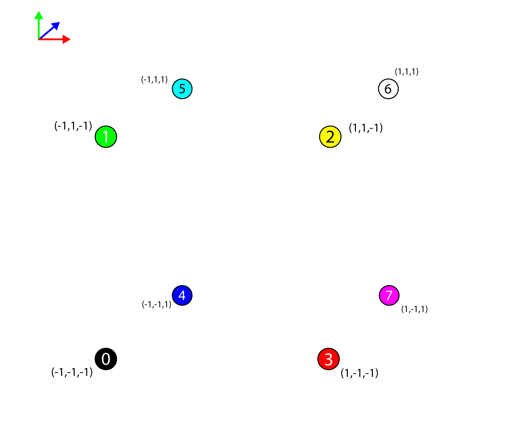

<div class="caption">

The 8 vertices of the cube mesh represented in 3D space.

</div>

The vertices by themselves are not sufficient to represent a solid cube mesh in 3D space. The **Input Assembler** stage of the rendering pipeline can render a set of one or more points, but points alone cannot be used to generate solid geometry.

The **Input Assembler** stage of the rendering pipeline understands the following primitive types [\[8\]](#cite-8):

<span id="attachment-8312"></span>

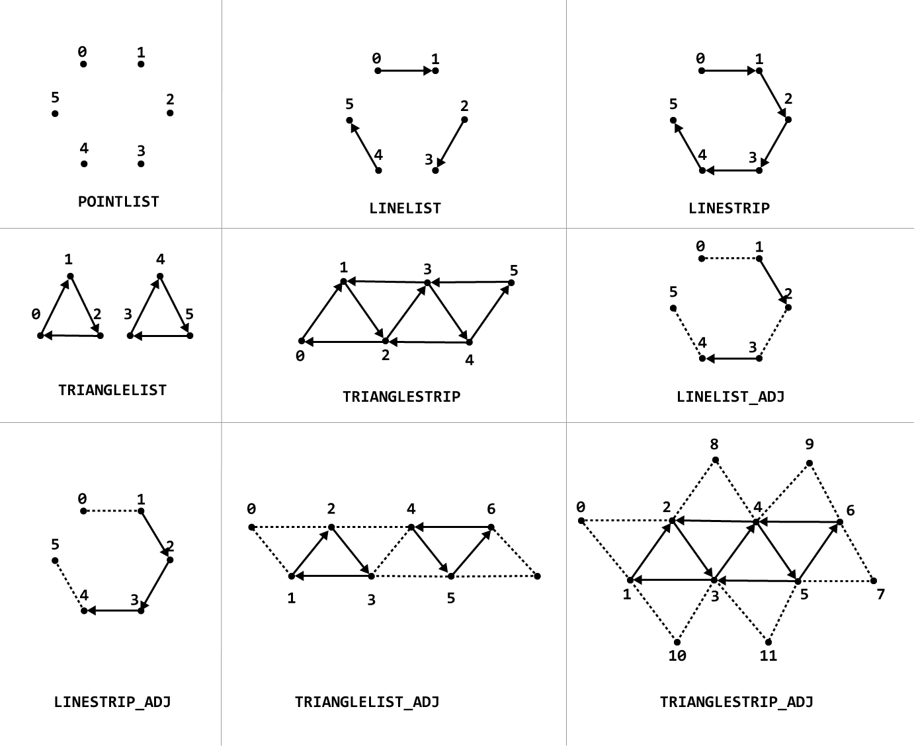

<div class="caption">

Primitive Topologies in DirectX 12

</div>

The [`D3D_PRIMITIVE_TOPOLOGY`](https://learn.microsoft.com/windows/win32/api/d3dcommon/ne-d3dcommon-d3d_primitive_topology) enumeration specifies how the **Input Assembler** stage interprets the vertex data that is bound to the rendering pipeline.

-   `D3D_PRIMITIVE_TOPOLOGY_POINTLIST`: A disconnected list of points.
-   `D3D_PRIMITIVE_TOPOLOGY_LINELIST`: A list of disconnected lines.
-   `D3D_PRIMITIVE_TOPOLOGY_LINESTRIP`: A list of connected lines.
-   `D3D_PRIMITIVE_TOPOLOGY_TRIANGLELIST`: A list of disconnected triangles.
-   `D3D_PRIMITIVE_TOPOLOGY_TRIANGLESTRIP`: A list of connected triangles. Vertex $n$ and vertex $n-2, \forall n>1$ are implicitly connected to form the triangles.
-   `D3D_PRIMITIVE_TOPOLOGY_LINELIST_ADJ`: A list of disconnected lines. Additional adjacency information is available to the Geometry shader stage.
-   `D3D_PRIMITIVE_TOPOLOGY_LINESTRIP_ADJ`: A list of connected lines. Additional adjacency information is available to the Geometry shader stage.
-   `D3D_PRIMITIVE_TOPOLOGY_TRIANGLELIST_ADJ`: A list of disconnected triangles. Additional adjacency information is available to the Geometry shader stage.

-   `D3D_PRIMITIVE_TOPOLOGY_TRIANGRIP_ADJ`: A list of connected triangles. Additional adjacency information is available to the Geometry shader stage.

Points and lines cannot be used to generate a solid mesh (where the faces of the mesh are shaded in). Only triangles (and patches) can be used to generate a shaded mesh. For this example, the mesh is going to be generated from a list of triangles. In order to tell the **Input Assembler** stage how to generate the triangles for the mesh, an index buffer is used.

```cpp source="LearningDirectX12-v0.0.2/Tutorial2.cpp#L51-L59"
```

The `g_Indicies` array defines the index buffer that is used to represent the triangles that are used to create the solid cube. The values in the index buffer represent the index of the vertex in the vertex buffer (the `g_Vertices` array). The cube consists of 6 faces. Each face is composed of 2 triangles. The `g_Indicies` array contains 36 indices (3 indices per triangle). The image below shows only the first two faces of the cube.

<span id="attachment-8325"></span>

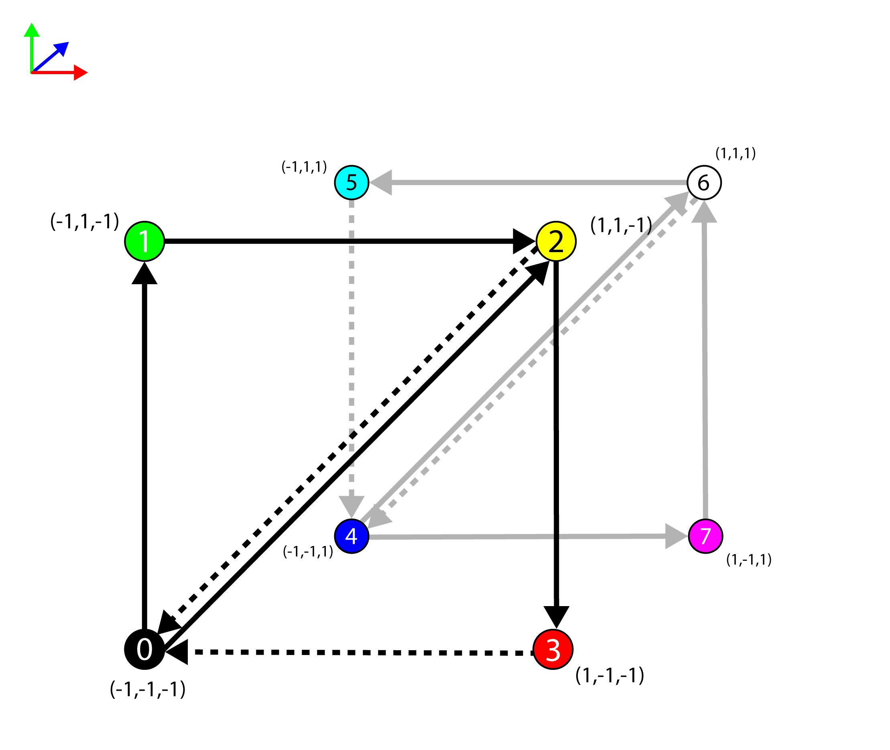

<div class="caption">

The vertices of the cube with the front and back faces shown with triangles.

</div>

Only the front and back sides of the cube are shown in the image above (the top, bottom, left, and right sides are excluded from the image to keep it more clear). The edges of the back facing triangles are shown in a light gray while the edges of the front facing triangles are shown in black. A **front-facing** polygon is said to be facing the viewer while a **back-facing** polygon is said to be facing away from the viewer.

Since **back-facing** polygons are generally not visible to the viewer (assuming the mesh is fully convex and the material is not transparent) then it is not efficient to shade the pixels that will not be visible in the final render. As an optimization, it is possible to tell the **Rasterizer** stage to cull (remove from the rendering pipeline) **back-facing** polygons.

The **winding-order** of the triangle is used to determine if it is **front-facing** or **back-facing**. The winding order is determined by the direction of the **normal** of the triangle (in projected clip-space). The normal for the triangle is based on the cross-product of two edges of the triangle. Winding order can be either **clockwise** or **counter-clockwise**. The default winding order for **front-facing** polygons in DirectX is **clockwise** (so **back-facing** polygons are **counter-clockwise**).

<span id="attachment-8329"></span>

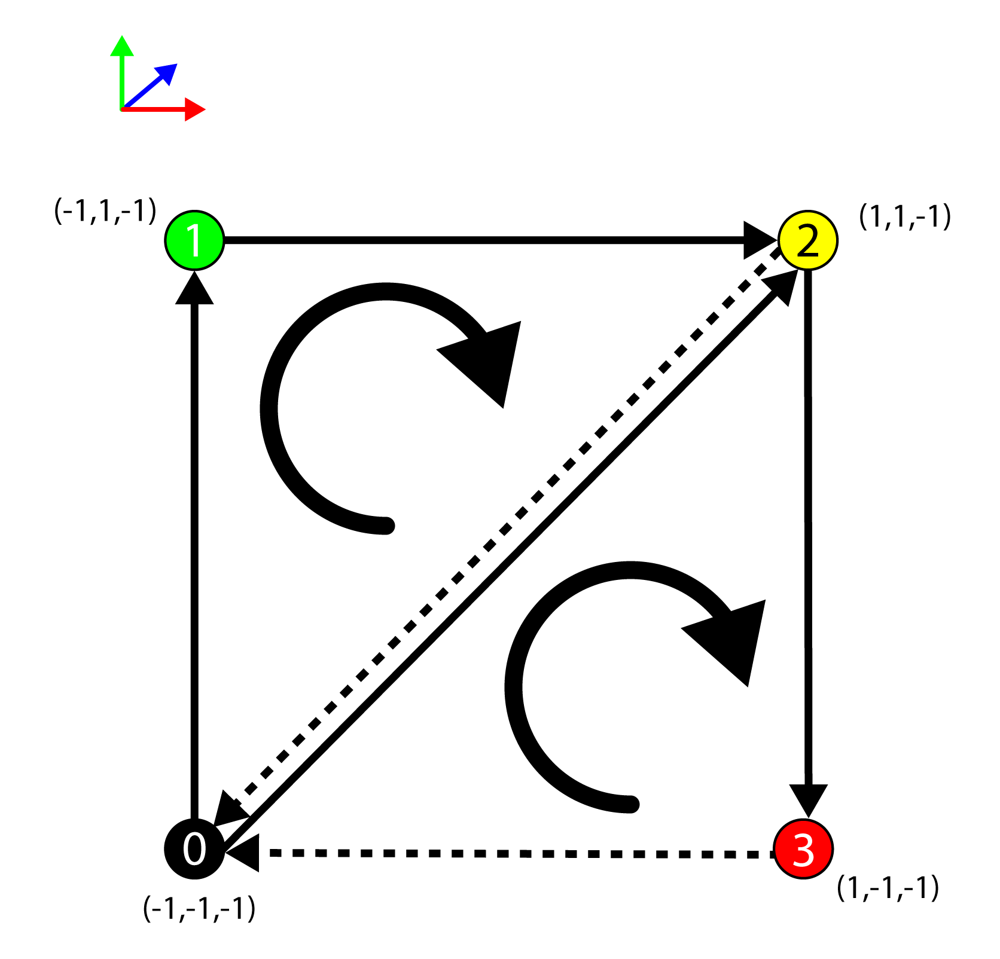

<div class="caption">

The winding order for front-facing polygons is clockwise.

</div>

To determine if a triangle is front-facing, the direction of the normal is computed by taking the cross product of the edges of the triangle (in projected clip-space). The normal $\mathbf{n}$ of the triangle formed by the vertices $\mathbf{a}$, $\mathbf{b}$, and $\mathbf{c}$ is:

$$
\begin{array}{rcl}
\mathbf{u} & = & \mathbf{b}-\mathbf{a} \\
\mathbf{v} & = & \mathbf{c}-\mathbf{a} \\
\mathbf{n} & = & \mathbf{u}\times\mathbf{v} \\
\end{array}
$$

In projected clip space, the $z$ component of the resulting normal is negative if it is facing the viewer. Since it is sufficient to know if the direction of the $z$ component of the normal is positive or negative, the equation can be reduced to:

$$
\mathbf{n}_z=(\mathbf{u}_x\mathbf{v}_y)-(\mathbf{u}_y\mathbf{v}_x)
$$

The triangle is **front-facing** if $\mathbf{n}_z\lt 0$ and **back-facing** otherwise.

### Tutorial2::Tutorial2

The constructor for the `Tutorial2` class simply passes the initialization variables to the parent class (`Game`). It also initializes the **scissor**, **viewport** and **field of view** (fov) variables.

```cpp title="Tutorial2.cpp" showLineNumbers startLineNumber=61
Tutorial2::Tutorial2( const std::wstring& name, int width, int height, bool vSync )
    : super(name, width, height, vSync)
    , m_ScissorRect(CD3DX12_RECT(0, 0, LONG_MAX, LONG_MAX))
    , m_Viewport(CD3DX12_VIEWPORT(0.0f, 0.0f, static_cast<float>(width), static_cast<float>(height)))
    , m_FoV(45.0)
    , m_ContentLoaded(false)
{
}
```

The `m_ScissorRect` is used to mask out a rectangular region of the screen that will allow for rendering. In previous versions of DirectX, it was not necessary to explicitly specify a scissor rectangle before rendering. Since DirectX 12, the programmer must explicitly specify a scissor rectangle. Initializing the scissor rectangle to `{0, 0, LONG_MAX, LONG_MAX}` ensures that the scissor rectangle covers the entire screen regardless of the size of the screen. If the screen is resized, the scissor rectangle does not need to be updated.

The `m_Viewport` specifies the viewable part of the screen to render to. The viewport can be smaller than the size of the screen (this is common when implementing split-screen rendering) but it should not be larger than the rendertarget that is bound to the **output merger** stage. The **viewport** is specified on the **rasterizer** stage and it is used to tell the rasterizer how to transform the vertices from normalized device coordinate space (NDC) into screen space which is required for the pixel shader.

:::note
More specifically, the viewport should not be larger than the currently bound render target. When using offscreen render targets, the currently bound render target is not necessarily the same size as the screen.
:::

The `m_FoV` variable represents the vertical field of view of the camera. It is initialized to 45° but it can be adjusted at runtime using the mouse wheel (as will be shown later).

### Tutorial2::UpdateBufferResource

The `UpdateBufferResource` method is used to create a [`ID3D12Resource`](https://learn.microsoft.com/windows/win32/api/d3d12/nn-d3d12-id3d12resource) that is large enough to store the buffer data passed to the function and to create an intermediate buffer that is used to copy the CPU buffer data to the GPU. For this demo, the `UpdateBufferResource` method is used to initialize the vertex buffer and index buffer resources.

```cpp title="Tutorial2.cpp" showLineNumbers startLineNumber=70
void Tutorial2::UpdateBufferResource(
    ComPtr<ID3D12GraphicsCommandList2> commandList,
    ID3D12Resource** pDestinationResource, 
    ID3D12Resource** pIntermediateResource,
    size_t numElements, size_t elementSize, const void* bufferData, 
    D3D12_RESOURCE_FLAGS flags )
{
```

The `commandList` argument is required to transfer the buffer data to the destination resource.

The `pDestinationResource` and the `pIntermediateResource` pointers are used to store the destination and intermediate resources that are created in this method.

The `numElements`, `elementSize`, and `bufferData` arguments refer to the CPU buffer data that is transferred to the GPU resource.

The `flags` argument is used to specify any additional flags that are required to create the buffer resource.

```cpp source="LearningDirectX12-v0.0.2/Tutorial2.cpp#L77-L79"
```

On line 75, the DirectX 12 device is queried from the `Application` class.

:::note
I didn’t show the implementation details of the application class, but this class can be viewed on GitHub: [https://github.com/jpvanoosten/LearningDirectX12/blob/v0.0.2/DX12Lib/src/Application.cpp](https://github.com/jpvanoosten/LearningDirectX12/blob/v0.0.2/DX12Lib/src/Application.cpp)
:::

The `bufferSize` variable is size of the buffer in bytes.

The next step is to create a GPU resource in committed memory that is large enough to store the buffer.

```cpp source="LearningDirectX12-v0.0.2/Tutorial2.cpp#L81-L88"
```

The [`ID3D12Device::CreateCommittedResource`](https://learn.microsoft.com/windows/win32/api/d3d12/nf-d3d12-id3d12device-createcommittedresource) method is used to create a resource and an implicit heap that is large enough to store the resource. The resource is also mapped to the implicit heap.

The [`ID3D12Device::CreateCommittedResource`](https://learn.microsoft.com/windows/win32/api/d3d12/nf-d3d12-id3d12device-createcommittedresource) has the following signature [\[9\]](#cite-9):

```cpp title="ID3D12Device::CreateCommittedResource method" showLineNumbers
HRESULT CreateCommittedResource(
  [in]            const D3D12_HEAP_PROPERTIES *pHeapProperties,
                        D3D12_HEAP_FLAGS      HeapFlags,
  [in]            const D3D12_RESOURCE_DESC   *pDesc,
                        D3D12_RESOURCE_STATES InitialResourceState,
  [in, optional]  const D3D12_CLEAR_VALUE     *pOptimizedClearValue,
                        REFIID                riidResource,
  [out, optional]       void                  **ppvResource
);
```

And takes the following arguments:

-   [`D3D12_HEAP_PROPERTIES`](https://learn.microsoft.com/windows/win32/api/d3d12/ns-d3d12-d3d12_heap_properties) `*pHeapProperties`: A pointer to a [`D3D12_HEAP_PROPERTIES`](https://learn.microsoft.com/windows/win32/api/d3d12/ns-d3d12-d3d12_heap_properties) structure that provides properties for the resource’s heap.
-   [`D3D12_HEAP_FLAGS`](https://learn.microsoft.com/windows/win32/api/d3d12/ne-d3d12-d3d12_heap_flags) `HeapFlags`: Heap options, as a bitwise-OR’d combination of [`D3D12_HEAP_FLAGS`](https://learn.microsoft.com/windows/win32/api/d3d12/ne-d3d12-d3d12_heap_flags) enumeration constants.
-   [`D3D12_RESOURCE_DESC`](https://learn.microsoft.com/windows/win32/api/d3d12/ns-d3d12-d3d12_resource_desc) `*pDesc`: A pointer to a [`D3D12_RESOURCE_DESC`](https://learn.microsoft.com/windows/win32/api/d3d12/ns-d3d12-d3d12_resource_desc) structure that describes the resource.
-   [`D3D12_RESOURCE_STATES`](https://learn.microsoft.com/windows/win32/api/d3d12/ne-d3d12-d3d12_resource_states) `InitialResourceState`: The initial state of the resource, as a bitwise-OR’d combination of [`D3D12_RESOURCE_STATES`](https://learn.microsoft.com/windows/win32/api/d3d12/ne-d3d12-d3d12_resource_states) enumeration constants.  
    When a resource is created together with a [`D3D12_HEAP_TYPE_UPLOAD`](https://learn.microsoft.com/windows/win32/api/d3d12/ne-d3d12-d3d12_heap_type#constants) heap, `InitialResourceState` must be [`D3D12_RESOURCE_STATE_GENERIC_READ`](https://learn.microsoft.com/windows/win32/api/d3d12/ne-d3d12-d3d12_resource_states#constants). When a resource is created together with a [`D3D12_HEAP_TYPE_READBACK`](https://learn.microsoft.com/windows/win32/api/d3d12/ne-d3d12-d3d12_heap_type#constants) heap, `InitialResourceState` must be [`D3D12_RESOURCE_STATE_COPY_DEST`](https://learn.microsoft.com/windows/win32/api/d3d12/ne-d3d12-d3d12_resource_states#constants).
-   [`D3D12_CLEAR_VALUE`](https://learn.microsoft.com/windows/win32/api/d3d12/ns-d3d12-d3d12_clear_value) `*pOptimizedClearValue`: Specifies a [`D3D12_CLEAR_VALUE`](https://learn.microsoft.com/windows/win32/api/d3d12/ns-d3d12-d3d12_clear_value) that describes the default value for a clear color.  
    `pOptimizedClearValue` specifies a value for which clear operations are most optimal. When the created resource is a texture with either the [`D3D12_RESOURCE_FLAG_ALLOW_RENDER_TARGET`](https://learn.microsoft.com/windows/win32/api/d3d12/ne-d3d12-d3d12_resource_flags#constants) or [`D3D12_RESOURCE_FLAG_ALLOW_DEPTH_STENCIL`](https://learn.microsoft.com/windows/win32/api/d3d12/ne-d3d12-d3d12_resource_flags#constants) flags, applications should choose the value that the clear operation will most commonly be called with. Clear operations can be called with other values, but those operations will not be as efficient as when the value matches the one passed into resource creation. `pOptimizedClearValue` must be `NULL` when used with [`D3D12_RESOURCE_DIMENSION_BUFFER`](https://learn.microsoft.com/windows/win32/api/d3d12/ne-d3d12-d3d12_resource_dimension#constants).
-   `REFIID riidResource`: The globally unique identifier (GUID) for the resource interface. This is an input parameter. The `REFIID`, or GUID, of the interface to the resource can be obtained by using the [`__uuidof`](https://learn.microsoft.com/cpp/cpp/uuidof-operator)`()` macro. For example, [`__uuidof`](https://learn.microsoft.com/cpp/cpp/uuidof-operator)`(`[`ID3D12Resource`](https://learn.microsoft.com/windows/win32/api/d3d12/nn-d3d12-id3d12resource)`)` will get the GUID of the interface to a resource.
-   `void **ppvResource`: A pointer to memory that receives the requested interface pointer to the created resource object. `ppvResource` can be `NULL`, to enable capability testing. When `ppvResource` is `NULL`, no object will be created and `S_FALSE` will be returned (when `pResourceDesc` is valid).

On lines 82-88, the default resource is created but the buffer data is not yet uploaded to that resource. The next step is to create another resource that is used to transfer the CPU buffer data into GPU memory. To perform the memory transfer, an intermediate buffer resource is created using an upload heap.

```cpp source="LearningDirectX12-v0.0.2/Tutorial2.cpp#L90-L99"
```

If the buffer data isn’t `NULL` then another committed resource is created using the [`ID3D12Device::CreateCommittedResource`](https://learn.microsoft.com/windows/win32/api/d3d12/nf-d3d12-id3d12device-createcommittedresource) method. In this case, the heap type is set to [`D3D12_HEAP_TYPE_UPLOAD`](https://learn.microsoft.com/windows/win32/api/d3d12/ne-d3d12-d3d12_heap_type#constants) and the resource state is initailly set to [`D3D12_RESOURCE_STATE_GENERIC_READ`](https://learn.microsoft.com/windows/win32/api/d3d12/ne-d3d12-d3d12_resource_states#constants).

:::note
Resources created in a [`D3D12_HEAP_TYPE_UPLOAD`](https://learn.microsoft.com/windows/win32/api/d3d12/ne-d3d12-d3d12_heap_type#constants) heap must be created with [`D3D12_RESOURCE_STATE_GENERIC_READ`](https://learn.microsoft.com/windows/win32/api/d3d12/ne-d3d12-d3d12_resource_states#constants) and cannot be changed away from this.
:::

With the destination and intermediate resources created, the CPU buffer data can be transferred to the GPU resources.

```cpp source="LearningDirectX12-v0.0.2/Tutorial2.cpp#L101-L110"
```

The [`D3D12_SUBRESOURCE_DATA`](https://learn.microsoft.com/windows/win32/api/d3d12/ns-d3d12-d3d12_subresource_data) structure is used to describe the subresource data that is to be uploaded to the GPU resource.

This structure has the following syntax [\[10\]](#cite-10):

```cpp title="D3D12_SUBRESOURCE_DATA structure" showLineNumbers
typedef struct D3D12_SUBRESOURCE_DATA {
  const void *pData;
  LONG_PTR   RowPitch;
  LONG_PTR   SlicePitch;
} D3D12_SUBRESOURCE_DATA;
```

And has the following members:

-   `void *pData`: A pointer to a memory block that contains the subresource data.
-   `LONG_PTR RowPitch`: The row pitch, or width, or physical size, in bytes, of the subresource data.
-   `LONG_PTR SlicePitch`: The depth pitch, or width, or physical size, in bytes, of the subresource data.

On line 106-109, the [`UpdateSubresources`](https://learn.microsoft.com/windows/win32/direct3d12/updatesubresources2) function is used to upload the CPU buffer data to the GPU resource in a default heap using an intermediate buffer in an upload heap.

The [`UpdateSubresources`](https://learn.microsoft.com/windows/win32/direct3d12/updatesubresources2) method has the following signature [\[11\]](#cite-11):

```cpp title="UpdateSubresources function" showLineNumbers
UINT64 inline UpdateSubresources(
  _In_ ID3D12GraphicsCommandList *pCmdList,
  _In_ ID3D12Resource            *pDestinationResource,
  _In_ ID3D12Resource            *pIntermediate,
       UINT64                    IntermediateOffset,
  _In_ UINT                      FirstSubresource,
  _In_ UINT                      NumSubresources,
  _In_ D3D12_SUBRESOURCE_DATA    *pSrcData
);
```

And takes the following arguments:

-   [`ID3D12GraphicsCommandList`](https://learn.microsoft.com/windows/win32/api/d3d12/nn-d3d12-id3d12graphicscommandlist) `*pCmdList`: A pointer to the [`ID3D12GraphicsCommandList`](https://learn.microsoft.com/windows/win32/api/d3d12/nn-d3d12-id3d12graphicscommandlist) interface for the command list.
-   [`ID3D12Resource`](https://learn.microsoft.com/windows/win32/api/d3d12/nn-d3d12-id3d12resource) `*pDestinationResource`: A pointer to the [`ID3D12Resource`](https://learn.microsoft.com/windows/win32/api/d3d12/nn-d3d12-id3d12resource) interface that represents the destination resource.
-   [`ID3D12Resource`](https://learn.microsoft.com/windows/win32/api/d3d12/nn-d3d12-id3d12resource) `*pIntermediate`: A pointer to the [`ID3D12Resource`](https://learn.microsoft.com/windows/win32/api/d3d12/nn-d3d12-id3d12resource) interface that represents the intermediate resource.
-   `UINT64 IntermediateOffset`: The offset, in bytes, to the intermediate resource.
-   `UINT FirstSubresource`: The index of the first subresource in the resource. The range of valid values is 0 to `D3D12_REQ_SUBRESOURCES`.
-   `UINT NumSubresources`: The number of subresources in the resource to be updated. The range of valid values is 0 to (`D3D12_REQ_SUBRESOURCES` – `FirstSubresource`).
-   [`D3D12_SUBRESOURCE_DATA`](https://learn.microsoft.com/windows/win32/api/d3d12/ns-d3d12-d3d12_subresource_data) `*pSrcData`: Pointer to an array (of length `NumSubresources`) of pointers to [`D3D12_SUBRESOURCE_DATA`](https://learn.microsoft.com/windows/win32/api/d3d12/ns-d3d12-d3d12_subresource_data) structures containing descriptions of the subresource data used for the update.

For buffer resources, the `FirstSubresource` is always 0 and the `NumSubresources` is always 1 (or 0, but then this function does nothing) because buffers only have a single subresource at index 0.

### Tutorial2::LoadContent

The `LoadContent` function is used to load all of the content that is required by the demo. In summary, the `LoadContent` function will perform the following steps:

1.  Upload the Vertex buffer data for a cube mesh
    -   Create a vertex buffer view
2.  Upload the index buffer data for a cube mesh
    -   Create an index buffer view
3.  Create a descriptor heap for the depth-stencil view
4.  Load the vertex shader
5.  Load the pixel shader
6.  Create the input layout for the vertex shader
7.  Create a root signature
8.  Create a graphics pipeline state object (PSO)
9.  Create a depth buffer

The vertex buffer data and index buffer data require a [`ID3D12GraphicsCommandList`](https://learn.microsoft.com/windows/win32/api/d3d12/nn-d3d12-id3d12graphicscommandlist) to perform the copy operation. Creating and retrieving command lists was described in the [Command Queue Class](#the-command-queue-class) section above. The `LoadContent` function uses the (copy) `CommandQueue` class to retrieve a command list that can be used to upload the buffer data to the GPU resources.

```cpp source="LearningDirectX12-v0.0.2/Tutorial2.cpp#L113-L117"
```

On line 116 the [`D3D12_COMMAND_LIST_TYPE_COPY`](https://learn.microsoft.com/windows/win32/api/d3d12/ne-d3d12-d3d12_command_list_type#constants) command queue is retrieved from the `Application` instance. On line 117 a [`ID3D12GraphicsCommandList`](https://learn.microsoft.com/windows/win32/api/d3d12/nn-d3d12-id3d12graphicscommandlist) is retrieved from the [`CommandQueue`](#the-command-queue-class).

Next, the buffer data is copied to the GPU resources.

#### Upload Vertex Buffer

The [`Tutorial2::UpdateBufferResource`](#tutorial2updatebufferresource) method described earlier is used to create the GPU resources and upload the vertex buffer data to the GPU.

```cpp title="Tutorial2.cpp" showLineNumbers startLineNumber=119
    // Upload vertex buffer data.
    ComPtr<ID3D12Resource> intermediateVertexBuffer;
    UpdateBufferResource(commandList.Get(),
        &m_VertexBuffer, &intermediateVertexBuffer,
        _countof(g_Vertices), sizeof(VertexPosColor), g_Vertices);
```

The `intermediateVertexBuffer` is the temporary vertex buffer resource that is used to transfer the CPU vertex buffer data to the GPU. The `m_VertexBuffer` member variable is the destination resource for the vertex buffer data and is used for rendering the cube geometry.

The `g_Vertices` global variable is declared on line 40 and contains the vertices in CPU memory for the cube geometry.

##### Vertex Buffer View

A [`D3D12_VERTEX_BUFFER_VIEW`](https://learn.microsoft.com/windows/win32/api/d3d12/ns-d3d12-d3d12_vertex_buffer_view) structure is used to tell the **Input Assembler** stage where the vertices are stored in GPU memory.

```cpp source="LearningDirectX12-v0.0.2/Tutorial2.cpp#L125-L128"
```

The `m_VertexBufferView` member variable is the [`D3D12_VERTEX_BUFFER_VIEW`](https://learn.microsoft.com/windows/win32/api/d3d12/ns-d3d12-d3d12_vertex_buffer_view) structure that describes the vertex buffer. The [`D3D12_VERTEX_BUFFER_VIEW`](https://learn.microsoft.com/windows/win32/api/d3d12/ns-d3d12-d3d12_vertex_buffer_view) structure has the following syntax [\[12\]](#cite-12):

```cpp title="D3D12_VERTEX_BUFFER_VIEW structure" showLineNumbers
typedef struct D3D12_VERTEX_BUFFER_VIEW {
  D3D12_GPU_VIRTUAL_ADDRESS BufferLocation;
  UINT                      SizeInBytes;
  UINT                      StrideInBytes;
} D3D12_VERTEX_BUFFER_VIEW;
```

And has the following members:

-   `D3D12_GPU_VIRTUAL_ADDRESS BufferLocation`: Specifies a `D3D12_GPU_VIRTUAL_ADDRESS` that identifies the address of the buffer.
-   `UINT SizeInBytes`: Specifies the size in bytes of the buffer.
-   `UINT StrideInBytes`: Specifies the size in bytes of each vertex entry.

The index buffer data is uploaded next.

#### Upload Index Buffer

Similar to the vertex buffer data, the [`Tutorial2::UpdateBufferResource`](#tutorial2updatebufferresource) method is used to create the GPU resources and upload the index buffer data to the GPU.

```cpp title="Tutorial2.cpp" showLineNumbers startLineNumber=130
    // Upload index buffer data.
    ComPtr<ID3D12Resource> intermediateIndexBuffer;
    UpdateBufferResource(commandList.Get(),
        &m_IndexBuffer, &intermediateIndexBuffer,
        _countof(g_Indicies), sizeof(WORD), g_Indicies);
```

The `intermediateIndexBuffer` is the temporary index buffer resource that is used to transfer the CPU index buffer data to the GPU. The `m_IndexBuffer` member variable is the destination resource for the index buffer data and is used for rendering the cube geometry.

The `g_Indicies` global variable is declared on line 51 and contains the indices for the cube geometry.

##### Index Buffer View

Similar to the [Vertex Buffer View](#vertex-buffer-view), the **Index Buffer View** is used to describe the index buffer to the **Input Assembler** stage of the rendering pipeline.

```cpp source="LearningDirectX12-v0.0.2/Tutorial2.cpp#L136-L139"
```

The `m_IndexBufferView` member variable is the [`D3D12_INDEX_BUFFER_VIEW`](https://learn.microsoft.com/windows/win32/api/d3d12/ns-d3d12-d3d12_index_buffer_view) structure that is used to describe the index buffer.

The [`D3D12_INDEX_BUFFER_VIEW`](https://learn.microsoft.com/windows/win32/api/d3d12/ns-d3d12-d3d12_index_buffer_view) structure has the following syntax [\[13\]](#cite-13):

```cpp title="D3D12_INDEX_BUFFER_VIEW structure" showLineNumbers
typedef struct D3D12_INDEX_BUFFER_VIEW {
  D3D12_GPU_VIRTUAL_ADDRESS BufferLocation;
  UINT                      SizeInBytes;
  DXGI_FORMAT               Format;
} D3D12_INDEX_BUFFER_VIEW;
```

And has the following members:

-   `D3D12_GPU_VIRTUAL_ADDRESS BufferLocation`: The GPU virtual address of the index buffer.
-   `UINT SizeInBytes`: The size in bytes of the index buffer.
-   [`DXGI_FORMAT`](https://learn.microsoft.com/windows/win32/api/dxgiformat/ne-dxgiformat-dxgi_format) `Format`: A [`DXGI_FORMAT`](https://learn.microsoft.com/windows/win32/api/dxgiformat/ne-dxgiformat-dxgi_format)\-typed value for the index-buffer format. In this case, the [`DXGI_FORMAT_R16_UINT`](https://learn.microsoft.com/windows/win32/api/dxgiformat/ne-dxgiformat-dxgi_format#constants) enumeration value is used to indicate that each value in the index buffer is a single component 16-bit unsigned integer.

#### DSV Descriptor Heap

In the [previous lesson](/learning-directx-12-1/), a swap-chain is created to be the target for the final rendered image that is presented to the user’s screen. The swap-chain can contain two or more texture buffers but it does not create a **depth buffer**. A **depth buffer** is not strictly required for rendering. When all of the elements in a scene are 2D (common for side-scrolling platform games), then the scene elements can be rendered from back-to-front and all elements will appear correctly. When rendering a 3D scene (even if the scene only contains a single geometric object) then a **depth buffer** is required for achieving correct rendering. The **depth buffer** stores the depth of a pixel in **normalized device coordinate space** (NDC). Each pixel stores a depth value in the range $\{0 \cdots 1\}$ where $0$ is closest to the viewer (near clipping plane) and $1$ is farthest away (far clipping plane).

<span id="attachment-8387"></span>

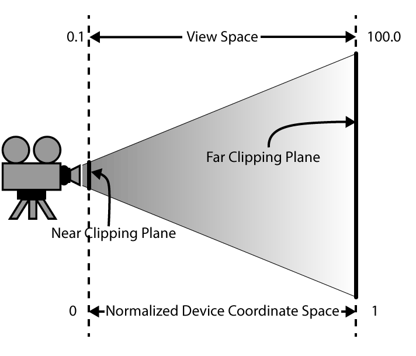

<div class="caption">

The depth buffer stores the depth of the current pixel in normalized device coordinate space (NDC)

</div>

Similar to the Render Target Views (RTV) that were created for the swap-chain buffers in the [previous lesson](/learning-directx-12-1/), the depth buffer requires a Depth-Stencil View (DSV). The DSV is stored in a [descriptor heap](https://learn.microsoft.com/windows/win32/api/d3d12/nn-d3d12-id3d12descriptorheap). A descriptor heap is an array of descriptors (resource views). A descriptor heap is required even if only a single DSV is needed.

```cpp source="LearningDirectX12-v0.0.2/Tutorial2.cpp#L141-L146"
```

The [`D3D12_DESCRIPTOR_HEAP_DESC`](https://learn.microsoft.com/windows/win32/api/d3d12/ns-d3d12-d3d12_descriptor_heap_desc) structure is used to describe the descriptor heap.

The [`D3D12_DESCRIPTOR_HEAP_DESC`](https://learn.microsoft.com/windows/win32/api/d3d12/ns-d3d12-d3d12_descriptor_heap_desc) structure has the following syntax:

```cpp title="D3D12_DESCRIPTOR_HEAP_DESC structure" showLineNumbers
typedef struct D3D12_DESCRIPTOR_HEAP_DESC {
  D3D12_DESCRIPTOR_HEAP_TYPE  Type;
  UINT                        NumDescriptors;
  D3D12_DESCRIPTOR_HEAP_FLAGS Flags;
  UINT                        NodeMask;
} D3D12_DESCRIPTOR_HEAP_DESC;
```

And has the following members:

-   [`D3D12_DESCRIPTOR_HEAP_TYPE`](https://learn.microsoft.com/windows/win32/api/d3d12/ne-d3d12-d3d12_descriptor_heap_type)`Type`: A [`D3D12_DESCRIPTOR_HEAP_TYPE`](https://learn.microsoft.com/windows/win32/api/d3d12/ne-d3d12-d3d12_descriptor_heap_type)\-typed value that specifies the types of descriptors in the heap.
-   `UINT NumDescriptors`: The number of descriptors in the heap. In this case, only one descriptor is needed.
-   [`D3D12_DESCRIPTOR_HEAP_FLAGS`](https://learn.microsoft.com/windows/win32/api/d3d12/ne-d3d12-d3d12_descriptor_heap_flags) `Flags`: A combination of [`D3D12_DESCRIPTOR_HEAP_FLAGS`](https://learn.microsoft.com/windows/win32/api/d3d12/ne-d3d12-d3d12_descriptor_heap_flags)\-typed values that are combined by using a bitwise OR operation. The resulting value specifies options for the heap. The following options are available for descriptor heaps:
    -   [`D3D12_DESCRIPTOR_HEAP_FLAG_NONE`](https://learn.microsoft.com/windows/win32/api/d3d12/ne-d3d12-d3d12_descriptor_heap_flags#constants): Indicates default usage of a heap.
    -   [`D3D12_DESCRIPTOR_HEAP_FLAG_SHADER_VISIBLE`](https://learn.microsoft.com/windows/win32/api/d3d12/ne-d3d12-d3d12_descriptor_heap_flags#constants): The flag [`D3D12_DESCRIPTOR_HEAP_FLAG_SHADER_VISIBLE`](https://learn.microsoft.com/windows/win32/api/d3d12/ne-d3d12-d3d12_descriptor_heap_flags#constants) can optionally be set on a descriptor heap to indicate it can be be bound on a command list for reference by shaders. Descriptor heaps created without this flag allow applications the option to stage descriptors in CPU memory before copying them to a shader visible descriptor heap, as a convenience. But it is also fine for applications to directly create descriptors into shader visible descriptor heaps with no requirement to stage anything on the CPU.  
           
        This flag only applies to CBV, SRV, UAV and samplers. It does not apply to other descriptor heap types (RTV, DSV) since shaders do not directly reference the other types.
-   `UINT NodeMask`: For single-adapter operation, set this to zero. If there are multiple adapter nodes, set a bit to identify the node (one of the device’s physical adapters) to which the descriptor heap applies. Each bit in the mask corresponds to a single node. Only one bit must be set.

The descriptor heap is created on line 146 using the [`ID3D12Device::CreateDescriptorHeap`](https://learn.microsoft.com/windows/win32/api/d3d12/nf-d3d12-id3d12device-createdescriptorheap) method.

#### Load the Shaders

If the Visual Studio project is configured correctly, then any HLSL shader file (any file with the **.hlsl** extension) that is added to the project will automatically be compiled into a shader object file that can be loaded by the application at runtime. By default, shaders are compiled into a **Compiled Shader Object** file (**.cso**) with the same name as the original .hlsl file. For example, `VertexShader.hlsl` will be compiled as `VertexShader.cso`. The CSO file can be loaded directly into a binary object using the [`D3DReadFileToBlob`](https://learn.microsoft.com/windows/win32/api/d3dcompiler/nf-d3dcompiler-d3dreadfiletoblob) function.

:::caution
When using the [`D3DReadFileToBlob`](https://learn.microsoft.com/windows/win32/api/d3dcompiler/nf-d3dcompiler-d3dreadfiletoblob) function, or any function in the [`D3DCompiler`](https://learn.microsoft.com/windows/win32/direct3dhlsl/dx-graphics-d3dcompiler-reference) API, do not forget to include the [`d3dcompiler.h`](https://learn.microsoft.com/windows/win32/direct3dhlsl/dx-graphics-d3dcompiler-reference) header file in your source and link against the `D3Dcompiler_47.lib` library and copy the `D3dcompiler_47.dll` file to the same folder as the binary executable when distributing your project.

A redistributable version of the `D3dcompiler_47.dll` file can be found in the Windows 10 SDK installation folder at C:\\Program Files (x86)\\Windows Kits\\10\\Redist\\D3D\\.

For more information, refer to the MSDN blog post at: [https://walbourn.github.io/hlsl-fxc-and-d3dcompile/](https://walbourn.github.io/hlsl-fxc-and-d3dcompile/)
:::

```cpp source="LearningDirectX12-v0.0.2/Tutorial2.cpp#L148-L154"
```

By default, the shader compiler ([FXC.exe](https://learn.microsoft.com/windows/win32/direct3dtools/fxc)) will generate the **.cso** file in the same directory as the output directory for the project. If the current working directory for the currently running process is configured to be the same folder where the executable is located, then it should be sufficient to load the shader from the .cso file using the path relative to the executable.

The [`D3DReadFileToBlob`](https://learn.microsoft.com/windows/win32/api/d3dcompiler/nf-d3dcompiler-d3dreadfiletoblob) function takes the path to the file (as a wide character string) to load and returns a pointer to a [`ID3DBlob`](https://learn.microsoft.com/previous-versions/windows/desktop/legacy/ff728743(v=vs.85)) object that stores the compiled shader in binary format.

:::note
There are methods to compile the HLSL shader files at runtime. For example, you can use the [`D3DCompileFromFile`](https://learn.microsoft.com/windows/win32/api/d3dcompiler/nf-d3dcompiler-d3dcompilefromfile) function to compile your HLSL shaders at runtime instead of using the FXC compiler integrated in Visual Studio.
:::

The compiled shader objects in binary form are used later to create the graphics pipeline state object. Before the graphics pipeline state object can be created, the input layout for the vertex shader is defined.

#### Input Layout

The **Input Layout** describes the layout of the vertex buffers that are bound to to the **Input Assembler** stage of the rendering pipeline. For example, the vertex attributes that are passed to the vertex shader could look like this in the HLSL shader file:

```hlsl source="LearningDirectX12-v0.0.2/VertexShader.hlsl#L8-L12"
```

These two attributes can be described in words as:

1.  The first parameter is a 3-component floating-point value bound to the `POSITION` semantic.
2.  The second parameter is a 3-component floating-point value bound to the `COLOR` semantic.

As described previously, vertex attributes can be passed to the vertex shader in either **packed** or **interleaved** buffer format. There is no way to specify whether the vertex attributes are passed as packed or interleaved formats in HLSL. The only way to specify the buffer format is by using the **Input Layout**.

The **Input Layout** is specified using an array of [`D3D12_INPUT_ELEMENT_DESC`](https://learn.microsoft.com/windows/win32/api/d3d12/ns-d3d12-d3d12_input_element_desc) structures. This structure has the following syntax [\[14\]](#cite-14):

```cpp title="D3D12_INPUT_ELEMENT_DESC structure" showLineNumbers
typedef struct D3D12_INPUT_ELEMENT_DESC {
  LPCSTR                     SemanticName;
  UINT                       SemanticIndex;
  DXGI_FORMAT                Format;
  UINT                       InputSlot;
  UINT                       AlignedByteOffset;
  D3D12_INPUT_CLASSIFICATION InputSlotClass;
  UINT                       InstanceDataStepRate;
} D3D12_INPUT_ELEMENT_DESC;
```

And has the following members:

-   `LPCSTR SemanticName`: The HLSL semantic associated with this element in a shader input-signature.
-   `UINT SemanticIndex`: The semantic index for the element. A semantic index modifies a semantic, with an integer index number. A semantic index is only needed in a case where there is more than one element with the same semantic. For example, a 4×4 matrix would have four components each with the semantic name matrix, however each of the four component would have different semantic indices (0, 1, 2, and 3).
-   [`DXGI_FORMAT`](https://learn.microsoft.com/windows/win32/api/dxgiformat/ne-dxgiformat-dxgi_format) `Format`: A [`DXGI_FORMAT`](https://learn.microsoft.com/windows/win32/api/dxgiformat/ne-dxgiformat-dxgi_format)\-typed value that specifies the format of the element data.
-   `UINT InputSlot`: An integer value that identifies the input-assembler. For more info, see [Input Slots](https://learn.microsoft.com/windows/win32/direct3d11/d3d10-graphics-programming-guide-input-assembler-stage-getting-started). Valid values are between 0 and 15.
-   `UINT AlignedByteOffset`: Offset, in bytes, between each element. Use `D3D12_APPEND_ALIGNED_ELEMENT` (`0xffffffff`) for convenience to define the current element directly after the previous one, including any packing if necessary.
-   [`D3D12_INPUT_CLASSIFICATION`](https://learn.microsoft.com/windows/win32/api/d3d12/ne-d3d12-d3d12_input_classification) `InputSlotClass`: A value that identifies the input data class for a single input slot. Valid values for **InputSlotClass** are:
    -   [`D3D12_INPUT_CLASSIFICATION_PER_VERTEX_DATA`](https://learn.microsoft.com/windows/win32/api/d3d12/ne-d3d12-d3d12_input_classification#constants): Input data is per-vertex data.
    -   [`D3D12_INPUT_CLASSIFICATION_PER_INSTANCE_DATA`](https://learn.microsoft.com/windows/win32/api/d3d12/ne-d3d12-d3d12_input_classification#constants): Input data is per-instance data.
-   `UINT InstanceDataStepRate`: The number of instances to draw using the same per-instance data before advancing in the buffer by one element. This value must be 0 for an element that contains per-vertex data (the slot class is set to [`D3D12_INPUT_CLASSIFICATION_PER_VERTEX_DATA`](https://learn.microsoft.com/windows/win32/api/d3d12/ne-d3d12-d3d12_input_classification#constants)).

The **Input Layout** for the simple vertex shader for this lesson is:

```cpp source="LearningDirectX12-v0.0.2/Tutorial2.cpp#L156-L160"
```

The first per-vertex attribute is bound to the `POSITION` semantic at index 0 in the HLSL shader. The data contains a 3-component floating-point format ([`DXGI_FORMAT_R32G32B32_FLOAT`](https://learn.microsoft.com/windows/win32/api/dxgiformat/ne-dxgiformat-dxgi_format#constants)) and the buffer is bound to input slot 0 of the **Input Assembler**. The offset to the first element in the buffer is 0 and the elements are automatically aligned using the `D3D12_APPEND_ALIGNED_ELEMENT` macro.

The second per-vertex attribute is bound to the `COLOR` semantic at index 0 in the HLSL shader. The data contains a 3-component floating-point format ([`DXGI_FORMAT_R32G32B32_FLOAT`](https://learn.microsoft.com/windows/win32/api/dxgiformat/ne-dxgiformat-dxgi_format#constants)) and is also bound to input slot 0 of the **Input Assembler**. The offset to the first element in the buffer is 0 (preceding the previous element in the same input slot) and elements in the buffer are automatically aligned after the previous element in the buffer using the `D3D12_APPEND_ALIGNED_ELEMENT` macro.

:::tip
**Exercise**  
It is possible to avoid the use of **Input Layouts** by storing the vertex buffer data in one or more [`StructuredBuffer`](https://learn.microsoft.com/windows/win32/direct3dhlsl/sm5-object-structuredbuffer)s in HLSL. Try changing the vertex shader in this demo to read from a [`StructuredBuffer`](https://learn.microsoft.com/windows/win32/direct3dhlsl/sm5-object-structuredbuffer) in HLSL instead of using a vertex buffer.
:::

#### Root Signature

The root signature describes the parameters that are passed to the programmable stages of the rendering (or compute) pipeline. Before the pipeline state object (PSO) can be created, the root signature needs to be defined. The various types of root signature parameters were described in the previous section titled [Root Signature Parameters](#root-signature-parameters). In this section, the source code to configure a simple root signature is shown.

For this simple demo, the root signature contains a single 32-bit constant parameter. More complex root signatures using inline descriptors and descriptor tables are described in later lessons.

Before creating the root signature, the highest supported version of the root signature is queried. Root signature version 1.1 should be preferred because it allows for driver level optimizations to be made. Root signature version 1.0 allowed both descriptors and the data pointed to by the descriptor to be changed after being recorded to a command list but before being executed on the command queue (the descriptors and data are volatile). Version 1.1 assumes that descriptors set on the root signature are static (that the descriptors won’t change after they have been recorded on the command list). The [`D3D12_DESCRIPTOR_RANGE_FLAG_DESCRIPTORS_VOLATILE`](https://learn.microsoft.com/windows/win32/api/d3d12/ne-d3d12-d3d12_descriptor_range_flags) flag must be specified on the descriptor range in the root signature if descriptors are updated after they have been recorded on the command list. The default behaviour of root signature version 1.1 allows the driver to make optimizations (for example, copy the descriptors or data to the GPU before the command list is even executed) if it will improve performance.

```cpp source="LearningDirectX12-v0.0.2/Tutorial2.cpp#L162-L168"
```

Root signature version 1.1 is preferred but the driver supported version on the end-user’s computer must be verified using the [`ID3D12Device::CheckFeatureSupport`](https://learn.microsoft.com/windows/win32/api/d3d12/nf-d3d12-id3d12device-checkfeaturesupport) method. If the check fails, the root signature version will fall-back to the root signature version 1.0.

Next, the root signature flags are defined.

```cpp source="LearningDirectX12-v0.0.2/Tutorial2.cpp#L170-L176"
```

The supported root signature flags are [\[16\]](#cite-16):

-   [`D3D12_ROOT_SIGNATURE_FLAG_NONE`](https://learn.microsoft.com/windows/win32/api/d3d12/ne-d3d12-d3d12_root_signature_flags#constants): The default behaviour.
-   [`D3D12_ROOT_SIGNATURE_FLAG_ALLOW_INPUT_ASSEMBLER_INPUT_LAYOUT`](https://learn.microsoft.com/windows/win32/api/d3d12/ne-d3d12-d3d12_root_signature_flags#constants): The app is opting in to using the Input Assembler (requiring an input layout that defines a set of vertex buffer bindings). Omitting this flag can result in one root argument space being saved on some hardware. Omit this flag if the Input Assembler is not required, though the optimization is minor.
-   [`D3D12_ROOT_SIGNATURE_FLAG_DENY_VERTEX_SHADER_ROOT_ACCESS`](https://learn.microsoft.com/windows/win32/api/d3d12/ne-d3d12-d3d12_root_signature_flags#constants): Denies the vertex shader access to the root signature.
-   [`D3D12_ROOT_SIGNATURE_FLAG_DENY_HULL_SHADER_ROOT_ACCESS`](https://learn.microsoft.com/windows/win32/api/d3d12/ne-d3d12-d3d12_root_signature_flags#constants): Denies the hull shader access to the root signature.
-   [`D3D12_ROOT_SIGNATURE_FLAG_DENY_DOMAIN_SHADER_ROOT_ACCESS`](https://learn.microsoft.com/windows/win32/api/d3d12/ne-d3d12-d3d12_root_signature_flags#constants): Denies the domain shader access to the root signature.
-   [`D3D12_ROOT_SIGNATURE_FLAG_DENY_GEOMETRY_SHADER_ROOT_ACCESS`](https://learn.microsoft.com/windows/win32/api/d3d12/ne-d3d12-d3d12_root_signature_flags#constants): Denies the geometry shader access to the root signature.
-   [`D3D12_ROOT_SIGNATURE_FLAG_DENY_PIXEL_SHADER_ROOT_ACCESS`](https://learn.microsoft.com/windows/win32/api/d3d12/ne-d3d12-d3d12_root_signature_flags#constants): Denies the pixel shader access to the root signature.
-   [`D3D12_ROOT_SIGNATURE_FLAG_ALLOW_STREAM_OUTPUT`](https://learn.microsoft.com/windows/win32/api/d3d12/ne-d3d12-d3d12_root_signature_flags#constants): The root signature allows stream output. This flag can be specified for root signatures authored in HLSL, similar to how the other flags are specified. [`ID3D12Device::CreateGraphicsPipelineState`](https://learn.microsoft.com/windows/win32/api/d3d12/nf-d3d12-id3d12device-creategraphicspipelinestate) will fail if the geometry shader contains stream output but the root signature does not have this flag set. Omit this flag if stream output is not required.

For this simple demo, only the vertex shader stage requires root signature access. Denying access to shader stages that do not require root signature access is a minor optimization on some hardware.

The root signature consists of a single 32-bit constant parameter.

```cpp source="LearningDirectX12-v0.0.2/Tutorial2.cpp#L178-L180"
```

The [`CD3DX12_ROOT_PARAMETER1`](https://learn.microsoft.com/windows/win32/direct3d12/cd3dx12-root-parameter1) is a helper structure from the `d3dx12.h` header file that allows for easy initialization of a [`D3D12_ROOT_PARAMETER1`](https://learn.microsoft.com/windows/win32/api/d3d12/ns-d3d12-d3d12_root_parameter1) structure. The `InitAsConstants` method takes the following parameters:

-   `UINT num32BitValues`: The number of 32-bit constants. In this case, the `XMMATRIX` structure contains 16 32-bit floating-point values.
-   `UINT shaderRegister`: The shader register to bind to. This parameter is bound to `b0` in the vertex shader.
-   `UINT registerSpace`: The register space to bind to. Since no shader register space was specified in the vertex shader, this defaults to `space0`.
-   [`D3D12_SHADER_VISIBILITY`](https://learn.microsoft.com/windows/win32/api/d3d12/ne-d3d12-d3d12_shader_visibility) `visibility`: Specifies the shader stages that are allowed to access the contents at that root signature slot. In this case, the visibility of the 32-bit constants is restricted to the vertex shader stage.

After describing the parameters (and samplers) that are used by the root signature, the next step is to create the the root signature description.

```cpp source="LearningDirectX12-v0.0.2/Tutorial2.cpp#L182-L183"
```

The [`CD3DX12_VERSIONED_ROOT_SIGNATURE_DESC`](https://learn.microsoft.com/windows/win32/direct3d12/cd3dx12-versioned-root-signature-desc) is a helper structure from the **d3dx12.h** header file that allows for easy initialization of a [`D3D12_VERSIONED_ROOT_SIGNATURE_DESC`](https://learn.microsoft.com/windows/win32/api/d3d12/ns-d3d12-d3d12_versioned_root_signature_desc) structure.

The `Init_1_1` method takes the following parameters:

-   `UINT numParameters`: The number of root parameters in the root signature. In this case, there is only a single root parameter.
-   [`D3D12_ROOT_PARAMETER1`](https://learn.microsoft.com/windows/win32/api/d3d12/ns-d3d12-d3d12_root_parameter1)`* _pParameters`: An array of **numParameters** root parameters. The array of root parameters contains only a single 32-bit root constant parameter.
-   `UINT numStaticSamplers`: The number of static samplers in the root signature.
-   [`D3D12_STATIC_SAMPLER_DESC`](https://learn.microsoft.com/windows/win32/api/d3d12/ns-d3d12-d3d12_static_sampler_desc)`* _pStaticSamplers`: An array of **numStaticSamplers** static samplers.
-   [`D3D12_ROOT_SIGNATURE_FLAGS`](https://learn.microsoft.com/windows/win32/api/d3d12/ne-d3d12-d3d12_root_signature_flags) `flags`: Flags that determine the root signature visibility to the various shader stages.

The final step for creating the root signature is to serialize the root signature description into a binary object that can be used to create the actual root signature.

```cpp source="LearningDirectX12-v0.0.2/Tutorial2.cpp#L185-L192"
```

On line 188 the root signature is serialized using the [`D3DX12SerializeVersionedRootSignature`](https://learn.microsoft.com/windows/win32/direct3d12/d3dx12serializeversionedrootsignature) function. This function is part of the `d3dx12.h` header file and provides a method to serialize any root signature version using a single code path. This function will rewrite the root signature description for hardware that only supports version 1.0 even if the application developer passes a version 1.1 root signature (as is done in this example).

Similar to pre-compiling HLSL shaders, it is also possible to pre-compile root signatures. Pre-compiling root signatures has the benefit of shorter load times when there are many shader combinations each requiring a unique root signature. For this demo, the root signature is serialized at runtime but for production code, it is advisable to serialize the root signatures during compilation and save them to disc and load the pre-serialized root signature at runtime. It is also possible to define the root signatures directly in HLSL code and read the serialized root signature directly from the compiled shader object. Specifying root signatures in HLSL is beyond the scope of this article, but anyone that is interested is encouraged to read [Specifying Root Signatures in HLSL](https://learn.microsoft.com/windows/win32/direct3d12/specifying-root-signatures-in-hlsl).

On line 191 the actual root signature object is created from the serialized root signature using the [`ID3D12Device::CreateRootSignature`](https://learn.microsoft.com/windows/win32/api/d3d12/nf-d3d12-id3d12device-createrootsignature) method.

#### Pipeline State Object

The next step is to create the **Pipeline State Object** (PSO). The PSO is described using a **Pipeline State Stream** structure. The **Pipeline State Stream** structure contains a set of stream **tokens** that describe how to configure the PSO. An example of a stream token for a **Pipeline State Stream** object is the **Vertex Shader** (VS), **Geometry Shader** (GS) or **Pixel Shader** (PS). You only need to specify stream tokens that will override the default values of that token. For example, if tessellation shaders (Hull and Domain Shaders) are not required for the PSO, then they do not need to be defined in the **Pipeline State Stream** structure.

For this simple demo, only the following stream tokens need to be defined in the **Pipeline State Stream** structure:

-   Root Signature
-   Input Layout
-   Primitive Topology
-   Vertex Shader
-   Pixel Shader
-   Depth-Stencil Format
-   Render Target Format(s)

The order that the stream tokens appear in the **Pipeline State Stream** structure are not important. When the **Pipeline State Stream** is parsed, the type of each token is used to determine how the PSO is created.

The `PipelineStateStream` structure defines the tokens that are used to define the PSO.

```cpp source="LearningDirectX12-v0.0.2/Tutorial2.cpp#L194-L203"
```

The `PipelineStateStream` structure is a user-defined structure that describes the stream tokens required to configure the PSO. The `d3dx12.h` header file defines a few helper classes that can be used to define the pipeline stream structure.

:::caution
Make sure you are always using the latest version of the `d3dx12.h` header file available here:  
[https://github.com/Microsoft/DirectX-Graphics-Samples/tree/master/Libraries/D3DX12](https://github.com/Microsoft/DirectX-Graphics-Samples/tree/master/Libraries/D3DX12)
:::

Currently the following helper classes are available in the `d3dx12.h` header file for defining the `PipelineStateStream` structure:

-   [`CD3DX12_PIPELINE_STATE_STREAM_FLAGS`](https://learn.microsoft.com/windows/win32/direct3d12/cd3dx12-pipeline-state-stream-flags): Wrapper for a [`D3D12_PIPELINE_STATE_FLAGS`](https://learn.microsoft.com/windows/win32/api/d3d12/ne-d3d12-d3d12_pipeline_state_flags) enumeration.
-   [`CD3DX12_PIPELINE_STATE_STREAM_NODE_MASK`](https://learn.microsoft.com/windows/win32/direct3d12/cd3dx12-pipeline-state-stream-node-mask): Describes the pipeline state node mask as a UINT, which is used to identify the nodes (physical adapters of the device) that the PSO applies to in Multi-Adapter scenarios; each bit in the mask corresponds to a single node. For single-adapter scenarios, set this value to 0.
-   [`CD3DX12_PIPELINE_STATE_STREAM_ROOT_SIGNATURE`](https://learn.microsoft.com/windows/win32/direct3d12/cd3dx12-pipeline-state-stream-root-signature): Wrapper for a pointer to a [`ID3D12RootSignature`](https://learn.microsoft.com/windows/win32/api/d3d12/nn-d3d12-id3d12rootsignature).
-   [`CD3DX12_PIPELINE_STATE_STREAM_INPUT_LAYOUT`](https://learn.microsoft.com/windows/win32/direct3d12/cd3dx12-pipeline-state-stream-input-layout): Wrapper for a [`D3D12_INPUT_LAYOUT_DESC`](https://learn.microsoft.com/windows/win32/api/d3d12/ns-d3d12-d3d12_input_layout_desc). Specifies the input layout for the input assembly stage.
-   [`CD3DX12_PIPELINE_STATE_STREAM_IB_STRIP_CUT_VALUE`](https://learn.microsoft.com/windows/win32/direct3d12/cd3dx12-pipeline-state-stream-ib-strip-cut-value): Wrapper for a [`D3D12_INDEX_BUFFER_STRIP_CUT_VALUE`](https://learn.microsoft.com/windows/win32/api/d3d12/ne-d3d12-d3d12_index_buffer_strip_cut_value) enumeration. Used to specify the index buffer value to split line strips or triangle strips.
-   [`CD3DX12_PIPELINE_STATE_STREAM_PRIMITIVE_TOPOLOGY`](https://learn.microsoft.com/windows/win32/direct3d12/cd3dx12-pipeline-state-stream-primitive-topology): Wrapper for a [`D3D12_PRIMITIVE_TOPOLOGY_TYPE`](https://learn.microsoft.com/windows/win32/api/d3d12/ne-d3d12-d3d12_primitive_topology_type) enumeration. Used to specify the primitive topology type (point, line, triangle or patch). Do not mistake this with the [`D3D_PRIMITIVE_TOPOLOGY`](https://learn.microsoft.com/windows/win32/api/d3dcommon/ne-d3dcommon-d3d_primitive_topology) enumeration!
-   [`CD3DX12_PIPELINE_STATE_STREAM_VS`](https://learn.microsoft.com/windows/win32/direct3d12/cd3dx12-pipeline-state-stream-vs): Wrapper for a [`D3D12_SHADER_BYTECODE`](https://learn.microsoft.com/windows/win32/api/d3d12/ns-d3d12-d3d12_shader_bytecode) structure. Used to specify the compiled **Vertex Shader** (VS).
-   [`CD3DX12_PIPELINE_STATE_STREAM_GS`](https://learn.microsoft.com/windows/win32/direct3d12/cd3dx12-pipeline-state-stream-gs): Wrapper for a [`D3D12_SHADER_BYTECODE`](https://learn.microsoft.com/windows/win32/api/d3d12/ns-d3d12-d3d12_shader_bytecode) structure. Used to specify the compiled **Geometry Shader** (GS).
-   [`CD3DX12_PIPELINE_STATE_STREAM_STREAM_OUTPUT`](https://learn.microsoft.com/windows/win32/direct3d12/cd3dx12-pipeline-state-stream-stream-output): Wrapper for a [`D3D12_STREAM_OUTPUT_DESC`](https://learn.microsoft.com/windows/win32/api/d3d12/ns-d3d12-d3d12_stream_output_desc) structure. Describes the streaming output buffers for the **Stream Output** (SO) stage.
-   [`CD3DX12_PIPELINE_STATE_STREAM_HS`](https://learn.microsoft.com/windows/win32/direct3d12/cd3dx12-pipeline-state-stream-hs): Wrapper for a [`D3D12_SHADER_BYTECODE`](https://learn.microsoft.com/windows/win32/api/d3d12/ns-d3d12-d3d12_shader_bytecode) structure. Used to specify the compiled **Hull Shader** (HS).
-   [`CD3DX12_PIPELINE_STATE_STREAM_DS`](https://learn.microsoft.com/windows/win32/direct3d12/cd3dx12-pipeline-state-stream-ds): Wrapper for a [`D3D12_SHADER_BYTECODE`](https://learn.microsoft.com/windows/win32/api/d3d12/ns-d3d12-d3d12_shader_bytecode) structure. Used to specify the compiled **Domain Shader** (DS).
-   [`CD3DX12_PIPELINE_STATE_STREAM_PS`](https://learn.microsoft.com/windows/win32/direct3d12/cd3dx12-pipeline-state-stream-ps): Wrapper for a [`D3D12_SHADER_BYTECODE`](https://learn.microsoft.com/windows/win32/api/d3d12/ns-d3d12-d3d12_shader_bytecode) structure. Used to specify the compiled **Pixel Shader** (PS).
-   [`CD3DX12_PIPELINE_STATE_STREAM_CS`](https://learn.microsoft.com/windows/win32/direct3d12/cd3dx12-pipeline-state-stream-cs): Wrapper for a [`D3D12_SHADER_BYTECODE`](https://learn.microsoft.com/windows/win32/api/d3d12/ns-d3d12-d3d12_shader_bytecode) structure. Used to specify the compiled **Compute Shader** (CS).
-   [`CD3DX12_PIPELINE_STATE_STREAM_BLEND_DESC`](https://learn.microsoft.com/windows/win32/direct3d12/cd3dx12-pipeline-state-stream-blend-desc): Wraper for a [`D3D12_BLEND_DESC`](https://learn.microsoft.com/windows/win32/api/d3d12/ns-d3d12-d3d12_blend_desc) structure. Used to describes the blend state.
-   [`CD3DX12_PIPELINE_STATE_STREAM_DEPTH_STENCIL`](https://learn.microsoft.com/windows/win32/direct3d12/cd3dx12-pipeline-state-stream-depth-stencil)Wrapper for a [`D3D12_DEPTH_STENCIL_DESC`](https://learn.microsoft.com/windows/win32/api/d3d12/ns-d3d12-d3d12_depth_stencil_desc) structure. Used to describe the depth-stencil state.
-   [`CD3DX12_PIPELINE_STATE_STREAM_DEPTH_STENCIL1`](https://learn.microsoft.com/windows/win32/direct3d12/cd3dx12-pipeline-state-stream-depth-stencil1): Wrapper for a [`D3D12_DEPTH_STENCIL_DESC1`](https://learn.microsoft.com/windows/win32/api/d3d12/ns-d3d12-d3d12_depth_stencil_desc1) structure. Used to describe the depth-stencil state. This version adds the ability to enable depth-bounds testing.
-   [`CD3DX12_PIPELINE_STATE_STREAM_DEPTH_STENCIL_FORMAT`](https://learn.microsoft.com/windows/win32/direct3d12/cd3dx12-pipeline-state-stream-depth-stencil-format): Wrapper for a [`DXGI_FORMAT`](https://learn.microsoft.com/windows/win32/api/dxgiformat/ne-dxgiformat-dxgi_format) enumeration. Describes the format of the depth-stencil buffer.
-   [`CD3DX12_PIPELINE_STATE_STREAM_RASTERIZER`](https://learn.microsoft.com/windows/win32/direct3d12/cd3dx12-pipeline-state-stream-rasterizer): Wrapper for the [`D3D12_RASTERIZER_DESC`](https://learn.microsoft.com/windows/win32/api/d3d12/ns-d3d12-d3d12_rasterizer_desc) structure. Used to describe the **Rasterizer State** (RS)
-   [`CD3DX12_PIPELINE_STATE_STREAM_RENDER_TARGET_FORMATS`](https://learn.microsoft.com/windows/win32/direct3d12/cd3dx12-pipeline-state-stream-render-target-formats): Wrapper for the [`D3D12_RT_FORMAT_ARRAY`](https://learn.microsoft.com/windows/win32/api/d3d12/ns-d3d12-d3d12_rt_format_array) structure which is a wrapper for an array of render target formats.
-   [`CD3DX12_PIPELINE_STATE_STREAM_SAMPLE_DESC`](https://learn.microsoft.com/windows/win32/direct3d12/cd3dx12-pipeline-state-stream-sample-desc): Wrapper for the [`DXGI_SAMPLE_DESC`](https://learn.microsoft.com/windows/win32/api/dxgicommon/ns-dxgicommon-dxgi_sample_desc) structure. Used to describe the multi-sampling. The render targets must also be created with multisampling enabled.
-   [`CD3DX12_PIPELINE_STATE_STREAM_SAMPLE_MASK`](https://learn.microsoft.com/windows/win32/direct3d12/cd3dx12-pipeline-state-stream-sample-mask): A `UINT` that describes the sample mask for the blend state.
-   [`CD3DX12_PIPELINE_STATE_STREAM_CACHED_PSO`](https://learn.microsoft.com/windows/win32/direct3d12/cd3dx12-pipeline-state-stream-cached-pso): A wrapper for the [`D3D12_CACHED_PIPELINE_STATE`](https://learn.microsoft.com/windows/win32/api/d3d12/ns-d3d12-d3d12_cached_pipeline_state) structure. The cached PSO can be used to quickly load the PSO after it has been created. Using cached PSO’s can improve load times.
-   `CD3DX12_PIPELINE_STATE_STREAM_VIEW_INSTANCING`: A wrapper for a [`D3D12_VIEW_INSTANCING_DESC`](https://learn.microsoft.com/windows/win32/api/d3d12/ns-d3d12-d3d12_view_instancing_desc) structure. Allows shaders to render to multiple views with a single draw call. Useful for stereo vision or cubemap generation.

The helper classes listed are the ones that are available at the time this article was written but more could become available at any time. For example, the DirectX 12 Raytracing API was recently announced ([Announcing Microsoft DirectX Raytracing!](https://devblogs.microsoft.com/directx/announcing-microsoft-directx-raytracing/)) which will no doubt introduce more Pipeline State Stream Tokens to the rendering pipeline.

Before the Pipeline State Object can be created, the number of render targets and the render target formats are defined.

```cpp source="LearningDirectX12-v0.0.2/Tutorial2.cpp#L205-L207"
```

The [`D3D12_RT_FORMAT_ARRAY`](https://learn.microsoft.com/windows/win32/api/d3d12/ns-d3d12-d3d12_rt_format_array) structure is used to describe the number of render targtes and the formats of those render targets.

The PSO can now be described.

```cpp source="LearningDirectX12-v0.0.2/Tutorial2.cpp#L209-L215"
```

The properties of the PSO are now being filled in with the various objects that have already been described earlier. The **pipelineStateStream** structure is now complete and the actual Pipeline State Object can be created.

```cpp source="LearningDirectX12-v0.0.2/Tutorial2.cpp#L217-L220"
```

To create the pipeline state object, the `PipelStateStream` object must be wrapped in a [`D3D12_PIPELINE_STATE_STREAM_DESC`](https://learn.microsoft.com/windows/win32/api/d3d12/ns-d3d12-d3d12_pipeline_state_stream_desc) structure. This is in-turn passed to the [`ID3D12Device2::CreatePipelineState`](https://learn.microsoft.com/windows/win32/api/d3d12/nf-d3d12-id3d12device2-createpipelinestate) method to create the final [`ID3D12PipelineState`](https://learn.microsoft.com/windows/win32/api/d3d12/nn-d3d12-id3d12pipelinestate) object which is what is required for rendering.

Before leaving the `LoadContent` method, the command list must be executed on the command queue to ensure that the index and vertex buffers are uploaded to the GPU resources before rendering.

```cpp source="LearningDirectX12-v0.0.2/Tutorial2.cpp#L222-L225"
```

On line 222 the command list is executed on the command queue. The `CommandQueue::ExecuteCommandList` returns the fence value that is used to indicate when the command list is finished executing on the command queue. On line 223 the CPU thread is stalled until the fence value has been reached. At this point, it is safe to render the frame.

The `m_ContentLoaded` flag is set to `true` which indicates that other functions that rely on the content being loaded can run.

#### Depth Buffer

The depth buffer has been mentioned earlier in this article, but the creation of the depth buffer has not yet been described. The creation (or resizing) of the depth buffer has a dependency on the depth-stencil descriptor heap that was created on lines 142-146. Once the descriptor heap has been created, it is now safe to create the depth buffer.

```cpp source="LearningDirectX12-v0.0.2/Tutorial2.cpp#L227-L231"
```

The `ResizeDepthBuffer` method is described next. It will either create the depth buffer for the first time, or it will create a new depth buffer that matches the size of the client area and replace the previous depth buffer.

### Tutorial2::ResizeDepthBuffer

The `ResizeDepthBuffer` method is used to create (or resize) the depth buffer. It is important to make sure that there are no command lists that are currently referencing the depth buffer before the previous depth buffer is released. To ensure that the depth buffer is not being referenced by any command lists being executed on the command queue, each command queue owned by the application is flushed.

```cpp source="LearningDirectX12-v0.0.2/Tutorial2.cpp#L233-L243"
```

The `ResizeDepthBuffer` function takes the width and height of the back buffer as arguments. To ensure that the depth buffer is resized (due to a resize event generated by the Window) before the depth-stencil descriptor heap is created, the `m_ContentLoaded` flag is checked. This flag is set at the end of the `LoadContent` method so it will only be true after the descriptor heap has been created.

The `Application::Flush` method is used to ensure that there are no command lists that could be referencing the current depth buffer are “in-flight” on the command queue.

If the window is minimized, it is possible that either the width or the height of the client area of the window becomes 0. Creating a resource with a 0 size is an error so to prevent the buffer from being created with a 0 size, the width and height are clamped to a size of at least 1 in both dimensions.

The `Application` class has ownership of the DirectX 12 device. On line 243 the device is retrieved from the `Application` class.

```cpp source="LearningDirectX12-v0.0.2/Tutorial2.cpp#L245-L259"
```

The [`ID3D12Device::CreateCommittedResource`](https://learn.microsoft.com/windows/win32/api/d3d12/nf-d3d12-id3d12device-createcommittedresource) method was previously described in the [`Tutorial2::UpdateBufferResource`](#tutorial2updatebufferresource) method. The only difference in this case is the [`ID3D12Device::CreateCommittedResource`](https://learn.microsoft.com/windows/win32/api/d3d12/nf-d3d12-id3d12device-createcommittedresource) method is being used to create a texture instead of a buffer.

The [`D3D12_CLEAR_VALUE`](https://learn.microsoft.com/windows/win32/api/d3d12/ns-d3d12-d3d12_clear_value) structure is used to describe the optimized clear color for the depth-stencil buffer. This structure is used for both depth-stencil and color textures.

The [`CD3DX12_RESOURCE_DESC::Tex2D`](https://learn.microsoft.com/windows/win32/direct3d12/cd3dx12-resource-desc) method is a helper function used to create a [`D3D12_RESOURCE_DESC`](https://learn.microsoft.com/windows/win32/api/d3d12/ns-d3d12-d3d12_resource_desc) structure. The [`CD3DX12_RESOURCE_DESC::Tex2D`](https://learn.microsoft.com/windows/win32/direct3d12/cd3dx12-resource-desc) method takes the following arguments [\[17\]](#cite-17):

-   [`DXGI_FORMAT`](https://learn.microsoft.com/windows/win32/api/dxgiformat/ne-dxgiformat-dxgi_format) `format`: The format of the texture.
-   `UINT64 width`: Width of the texture in pixels.
-   `UINT height`: The height of the texture in pixels.
-   `UINT16 arraySize`: The number of texture elements. For a single texture this value must be 1.
-   `UINT16 mipLevels`: The number of mip levels. A value of 0 will cause the number of mip levels to be calculated automatically based on the maximum of either the width or the height of the texture.
-   `UINT sampleCount`: The number of milti-samples per pixel. The default value for `sampleCount` is 1.
-   `UINT sampleQuality`: The quality level for multi-sampling. The default value for `sampleQuality` is 0.
-   [`D3D12_RESOURCE_FLAGS`](https://learn.microsoft.com/windows/win32/api/d3d12/ne-d3d12-d3d12_resource_flags) `flags`: A bitwise combination of [`D3D12_RESOURCE_FLAGS`](https://learn.microsoft.com/windows/win32/api/d3d12/ne-d3d12-d3d12_resource_flags) enumeration values. Since this is a depth-stencil buffer, the [`D3D12_RESOURCE_FLAG_ALLOW_DEPTH_STENCIL`](https://learn.microsoft.com/windows/win32/api/d3d12/ne-d3d12-d3d12_resource_flags#constants) flag must be specified.
-   [`D3D12_TEXTURE_LAYOUT`](https://learn.microsoft.com/windows/win32/api/d3d12/ne-d3d12-d3d12_texture_layout) `layout`: Specifies the texture layout options. The default value is [`D3D12_TEXTURE_LAYOUT_UNKNOWN`](https://learn.microsoft.com/windows/win32/api/d3d12/ne-d3d12-d3d12_texture_layout#constants) which allows the driver to choose the most optimized layout based on the properties of the texture.
-   `UINT64 alignment`: Specify the alignment of the texture. This can be 4KB, 64KB, or 4MB. The default value of 0 can be used to allow the API to automatically choose the alignment based on the texture properties. Multi-sample textures will be created with 4MB alignment and 64KB for single-sample textures. Smaller alignments are used if the texture is sufficiently small (if the number of 4KB tiles is less than 16 for the highest (largest) mip level of the texture).

Textures will be revisited in the following lessons.

The depth-stencil view for the depth buffer is created next.

```cpp source="LearningDirectX12-v0.0.2/Tutorial2.cpp#L261-L271"
```

The [`D3D12_DEPTH_STENCIL_VIEW_DESC`](https://learn.microsoft.com/windows/win32/api/d3d12/ns-d3d12-d3d12_depth_stencil_view_desc) structure is used to describe a depth-stencil resource. The [`D3D12_DEPTH_STENCIL_VIEW_DESC`](https://learn.microsoft.com/windows/win32/api/d3d12/ns-d3d12-d3d12_depth_stencil_view_desc) has the following syntax [\[18\]](#cite-18):

```cpp title="D3D12_DEPTH_STENCIL_VIEW_DESC structure" showLineNumbers
typedef struct D3D12_DEPTH_STENCIL_VIEW_DESC {
  DXGI_FORMAT         Format;
  D3D12_DSV_DIMENSION ViewDimension;
  D3D12_DSV_FLAGS     Flags;
  union {
    D3D12_TEX1D_DSV         Texture1D;
    D3D12_TEX1D_ARRAY_DSV   Texture1DArray;
    D3D12_TEX2D_DSV         Texture2D;
    D3D12_TEX2D_ARRAY_DSV   Texture2DArray;
    D3D12_TEX2DMS_DSV       Texture2DMS;
    D3D12_TEX2DMS_ARRAY_DSV Texture2DMSArray;
  };
} D3D12_DEPTH_STENCIL_VIEW_DESC;
```

And has the following members:

-   [`DXGI_FORMAT`](https://learn.microsoft.com/windows/win32/api/dxgiformat/ne-dxgiformat-dxgi_format) `Format`: The depth-stencil format. This should be the same format that was used to create the texture but it could be a different format if the view is for a Shader Resource.
-   [`D3D12_DSV_DIMENSION`](https://learn.microsoft.com/windows/win32/api/d3d12/ne-d3d12-d3d12_dsv_dimension) `ViewDimension`: One value from the [`D3D12_DSV_DIMENSION`](https://learn.microsoft.com/windows/win32/api/d3d12/ne-d3d12-d3d12_dsv_dimension) enumeration. In this case, it is a 2D texture.
-   [`D3D12_DSV_FLAGS`](https://learn.microsoft.com/windows/win32/api/d3d12/ne-d3d12-d3d12_dsv_flags) `Flags`: A combination of [`D3D12_DSV_FLAGS`](https://learn.microsoft.com/windows/win32/api/d3d12/ne-d3d12-d3d12_dsv_flags) enumeration constants that are combined by using a bitwise OR operation. The resulting value specifies whether the texture is read only. Pass 0 to specify that it isn’t read only; otherwise, pass one or more of the members of the [`D3D12_DSV_FLAGS`](https://learn.microsoft.com/windows/win32/api/d3d12/ne-d3d12-d3d12_dsv_flags) enumerated type.
-   One of the following is specified depending on the value of the `ViewDimension` member:
    -   [`D3D12_TEX1D_DSV`](https://learn.microsoft.com/windows/win32/api/d3d12/ns-d3d12-d3d12_tex1d_dsv) `Texture1D`: A [`D3D12_TEX1D_DSV`](https://learn.microsoft.com/windows/win32/api/d3d12/ns-d3d12-d3d12_tex1d_dsv) structure that specifies a 1D texture subresource.
    -   [`D3D12_TEX1D_ARRAY_DSV`](https://learn.microsoft.com/windows/win32/api/d3d12/ns-d3d12-d3d12_tex1d_array_dsv) `Texture1DArray`: A [`D3D12_TEX1D_ARRAY_DSV`](https://learn.microsoft.com/windows/win32/api/d3d12/ns-d3d12-d3d12_tex1d_array_dsv) structure that specifies an array of 1D texture subresources.
    -   [`D3D12_TEX2D_DSV`](https://learn.microsoft.com/windows/win32/api/d3d12/ns-d3d12-d3d12_tex2d_dsv) `Texture2D`: A [`D3D12_TEX2D_DSV`](https://learn.microsoft.com/windows/win32/api/d3d12/ns-d3d12-d3d12_tex2d_dsv) structure that specifies a 2D texture subresource.
    -   [`D3D12_TEX2D_ARRAY_DSV`](https://learn.microsoft.com/windows/win32/api/d3d12/ns-d3d12-d3d12_tex2d_array_dsv) `Texture2DArray`: A [`D3D12_TEX2D_ARRAY_DSV`](https://learn.microsoft.com/windows/win32/api/d3d12/ns-d3d12-d3d12_tex2d_array_dsv) structure that specifies an array of 2D texture subresources.
    -   [`D3D12_TEX2DMS_DSV`](https://learn.microsoft.com/windows/win32/api/d3d12/ns-d3d12-d3d12_tex2dms_dsv) `Texture2DMS`: A [`D3D12_TEX2DMS_DSV`](https://learn.microsoft.com/windows/win32/api/d3d12/ns-d3d12-d3d12_tex2dms_dsv) structure that specifies a multisampled 2D texture.
    -   [`D3D12_TEX2DMS_ARRAY_DSV`](https://learn.microsoft.com/windows/win32/api/d3d12/ns-d3d12-d3d12_tex2dms_array_dsv) `Texture2DMSArray`: A [`D3D12_TEX2DMS_ARRAY_DSV`](https://learn.microsoft.com/windows/win32/api/d3d12/ns-d3d12-d3d12_tex2dms_array_dsv) structure that specifies an array of multisampled 2D textures.

On line 268, the depth-stencil view is created using the [`ID3D12Device::CreateDepthStencilView`](https://learn.microsoft.com/windows/win32/api/d3d12/nf-d3d12-id3d12device-createdepthstencilview) method. The [`ID3D12Device::CreateDepthStencilView`](https://learn.microsoft.com/windows/win32/api/d3d12/nf-d3d12-id3d12device-createdepthstencilview) method has the following syntax [\[19\]](#cite-19):

```cpp title="ID3D12Device::CreateDepthStencilView method" showLineNumbers
void CreateDepthStencilView(
  [in, optional]       ID3D12Resource                *pResource,
  [in, optional] const D3D12_DEPTH_STENCIL_VIEW_DESC *pDesc,
  [in]                 D3D12_CPU_DESCRIPTOR_HANDLE   DestDescriptor
);
```

And has the following parameters:

-   [`ID3D12Resource`](https://learn.microsoft.com/windows/win32/api/d3d12/nn-d3d12-id3d12resource) `*pResource`: A pointer to the [`ID3D12Resource`](https://learn.microsoft.com/windows/win32/api/d3d12/nn-d3d12-id3d12resource) object that represents the depth stencil buffer.  
       
    At least one of `pResource` or `pDesc` must be provided. A null `pResource` is used to initialize a null descriptor, which guarantees D3D11-like null binding behavior (reading 0s, writes are discarded), but must have a valid `pDesc` in order to determine the descriptor type.
-   [`D3D12_DEPTH_STENCIL_VIEW_DESC`](https://learn.microsoft.com/windows/win32/api/d3d12/ns-d3d12-d3d12_depth_stencil_view_desc) `*pDesc`: A pointer to a [`D3D12_DEPTH_STENCIL_VIEW_DESC`](https://learn.microsoft.com/windows/win32/api/d3d12/ns-d3d12-d3d12_depth_stencil_view_desc) structure that describes the depth-stencil view.  
       
    A null `pDesc` is used to initialize a default descriptor, if possible. This behavior is identical to the D3D11 null descriptor behavior, where defaults are filled in. This behavior inherits the resource format and dimension (if not typeless) and DSVs target the first mip and all array slices. Not all resources support null descriptor initialization.
-   [`D3D12_CPU_DESCRIPTOR_HANDLE`](https://learn.microsoft.com/windows/win32/api/d3d12/ns-d3d12-d3d12_cpu_descriptor_handle) `DestDescriptor`: Describes the CPU descriptor handle that represents the start of the heap that holds the depth-stencil view.

### Tutorial2::OnResize

The `OnResize` method is invoked by the `Window` class whenever the client area of window is resized. This happens if either the edge of the window is dragged with the mouse, or the fullscreen state of the window is toggled. This method is very simple and only needs to handle resizing of the `m_Viewport` member variable. Resizing of the swap-chain back buffers is automatically handled by the `Window` class itself.

```cpp source="LearningDirectX12-v0.0.2/Tutorial2.cpp#L273-L284"
```

The `m_Viewport` member variable must match the dimensions of the rederable area of the render target. The [`CD3DX12_VIEWPORT`](https://learn.microsoft.com/windows/win32/direct3d12/cd3dx12-viewport) structure provides a convenient method to initialize the viewport.

The `ResizeDepthBuffer` method was described in the previous section. That method ensures that the depth buffer is resized to the same dimensions as the client area of the window.

### Tutorial2::OnUpdate

The `OnUpdate` method is called before the screen is rendered. This method is used to update the model, view and projection matrices. The cube mesh is rotated 90° per second and the field of view of the camera is also adjusted using the scroll wheel of the mouse. When the field of view of the camera changes, the projection matrix needs to be recomputed.

The frame-rate is also computed and printed to the debug output in Visual Studio.

```cpp source="LearningDirectX12-v0.0.2/Tutorial2.cpp#L291-L311"
```

In the first part of the `OnUpdate` method the frame-rate is computed and output to the debug output in Visual Studio. The `UpdateEventArgs` passed to the `OnUpdate` method contains the time that has elapsed since the previous call to the `OnUpdate` function. The `ElapsedTime` value is accumulated and the number of frames is incremented. If the total time exceeds 1 second, the frames per second is computed by dividing the number of frames by the accumulated time. The frame-rate is printed to the output window and the frame and total time counters are reset for the next sample.

```cpp source="LearningDirectX12-v0.0.2/Tutorial2.cpp#L313-L316"
```

The `m_ModelMatrix` is used to store a rotation matrix that rotates the cube about an axis. The DirectX Math library contains several functions that can be used to compute various types of matrices. A rotation matrix can be computed from an angle and a axis of rotation using the [`XMMatrixRotationAxis`](https://learn.microsoft.com/windows/win32/api/directxmath/nf-directxmath-xmmatrixrotationaxis) function.

```cpp source="LearningDirectX12-v0.0.2/Tutorial2.cpp#L318-L322"
```

A left-handed view matrix can be computed using the [`XMMatrixLookAtLH`](https://learn.microsoft.com/windows/win32/api/directxmath/nf-directxmath-xmmatrixlookatlh) function from the position of the camera (`eyePosition`), a point to look at (`focusPoint`) and a local up vector (`upDirection`).

```cpp source="LearningDirectX12-v0.0.2/Tutorial2.cpp#L324-L327"
```

A left-handed projection matrix can be computed from the field of view (`m_FoV`) in radians, the aspect ratio of the screen (`aspectRatio`), the distance to the near clipping plane (`0.1f`) and the distance to the far clipping plane (`100.0f`).

:::note
See the article titled [Coordinate Systems](/3d-math-primer-for-game-programmers/) for more information on left, and right-handed coordinate system.  
See the article titled [Understanding the View Matrix](/understanding-the-view-matrix/) for more information about building view matrices.
:::

### Tutorial2::TransitionResource

The `TransitionResource` is a helper function to create a resource barrier on a command list. Resource barriers were discussed in the [previous lesson](/learning-directx-12-1/) and are not discussed in detail here.

```cpp source="LearningDirectX12-v0.0.2/Tutorial2.cpp#L329-L339"
```

The [`CD3DX12_RESOURCE_BARRIER`](https://learn.microsoft.com/windows/win32/direct3d12/cd3dx12-resource-barrier) structure is a helper structure to enable easy initialization of a [`D3D12_RESOURCE_BARRIER`](https://learn.microsoft.com/windows/win32/api/d3d12/ns-d3d12-d3d12_resource_barrier) structure.

The [`ID3D12GraphicsCommandList::ResourceBarrier`](https://learn.microsoft.com/windows/win32/api/d3d12/nf-d3d12-id3d12graphicscommandlist-resourcebarrier) method is used to exectue the resource barrier on the command list. This method can accept an array of resource barriers but for this simple example, one barrier is pushed to the command list at a time.

:::note
It is good practice to store resource barriers until a copy, draw or dispatch command needs to execute. Before executing a copy, draw, or dispatch, push all staged resource barriers to the command list.
:::

### Tutorial2::ClearRTV

I’m not sure the `ClearRTV` method provides any added value. It exists purely to make the code more readable.

```cpp source="LearningDirectX12-v0.0.2/Tutorial2.cpp#L341-L346"
```

The `ClearRTV` method just forwards the function arguments to the more verbosely named [`ID3D12GraphicsCommandList::ClearRenderTargetView`](https://learn.microsoft.com/windows/win32/api/d3d12/nf-d3d12-id3d12graphicscommandlist-clearrendertargetview) method. That method was also described in the [previous lesson](/learning-directx-12-1/) and is not described in detail here.

### Tutorial2::ClearDepth

Similar to the `ClearRTV` method, the `ClearDepth` method only serves to provide better code readability.

```cpp source="LearningDirectX12-v0.0.2/Tutorial2.cpp#L348-L352"
```

The [`ID3D12GraphicsCommandList::ClearDepthStencilView`](https://learn.microsoft.com/windows/win32/api/d3d12/nf-d3d12-id3d12graphicscommandlist-cleardepthstencilview) method is used to clear the depth-stencil view specified by the `dsv` parameter.

### Tutorial2::OnRender

The method that performs all of the rendering for the scene is the `OnRender` method. The basic steps to rendering are as follows:

-   Clear the color and depth buffers
-   For each object in the scene:

-   Transition any resources to the required state
-   Bind the Pipeline State Object (PSO)
-   Bind the Root Signature
-   Bind any resources (CBV, UAV, SRV, Samplers, etc..) to the shader stages
-   Set the primitive topology for the Input Assembler (IA)
-   Bind the vertex buffer to the IA
-   Bind the index buffer to the IA
-   Set the viewport(s) for the Rasterizer Stage (RS)
-   Set the scissor rectangle(s) for the RS
-   Bind the color and depth-stencil render targets to the Output Merger (OM)
-   Draw the geometry

-   Present the rendered image to the screen

Not every step needs to be repeated for each scene object. For example, if the PSO doesn’t change between draw calls, then it doesn’t need to be bound again. Resources only need to be bound if either the root signature has changed between draw calls or resources (textures or constant buffers) need to be swapped. It is also possible to leave the vertex and index buffers in place between draw calls if different objects share the same vertex and index buffers (but have a different start vertex within the vertex buffer).

```cpp source="LearningDirectX12-v0.0.2/Tutorial2.cpp#L354-L364"
```

The first thing the `OnRender` method needs to do is retrieve the `CommandQueue` from the `Application` class. In the [`LoadContent`](#tutorial2loadcontent) method, a copy queue ([`D3D12_COMMAND_LIST_TYPE_COPY`](https://learn.microsoft.com/windows/win32/api/d3d12/ne-d3d12-d3d12_command_list_type#constants)) was used since only commands to copy resources to the GPU were used. In this case, the [`D3D12_COMMAND_LIST_TYPE_DIRECT`](https://learn.microsoft.com/windows/win32/api/d3d12/ne-d3d12-d3d12_command_list_type#constants) queue is required to perform the draw command.

On line 359, the command list is retrieved from the command queue. The command list returned from the command queue is already in a state to accept commands and doesn’t need to be reset.

The current back buffer index is retrieved from the `Window` class. The index is used to store the fence value for the current frame in an array which is used to perform GPU synchronization (as will be shown later).

On line 362 the current back buffer resource is retrieved from the `Window` class. The back buffer resource is required to transition it to the correct state before being cleared or before presenting the rendered image to the screen.

The **Render Target View** (RTV) for the current back buffer resource is also retrieved from the `Window` class.

The **Depth Stencil View** (DSV) is retrieved from the depth-stencil descriptor heap. Since there is only a single depth-stencil buffer, the first (and only) handle in the descriptor heap is retrieved using the [`ID3D12DescriptorHeap::GetCPUDescriptorHandleForHeapStart`](https://learn.microsoft.com/windows/win32/api/d3d12/nf-d3d12-id3d12descriptorheap-getcpudescriptorhandleforheapstart) method.

:::tip
**Exercise**  
Try to reason about why the **swap chain** requires multiple back buffers (at least 2) but only a single **depth-stencil** buffer is needed for correct rendering. Does the **depth-stencil** buffer ever need to be in both a *read* and *write* state at the same time?
:::

#### Clear the Render Targets

Before the scene can be rendered, the previous contents of the color and depth-stencil buffers needs to be cleared.

```cpp source="LearningDirectX12-v0.0.2/Tutorial2.cpp#L366-L375"
```

Before clearing, the back buffer resource needs to be transitioned from the [`D3D12_RESOURCE_STATE_PRESENT`](https://learn.microsoft.com/windows/win32/api/d3d12/ne-d3d12-d3d12_resource_states#constants) state to the [`D3D12_RESOURCE_STATE_RENDER_TARGET`](https://learn.microsoft.com/windows/win32/api/d3d12/ne-d3d12-d3d12_resource_states#constants) state using the [`TransitionResource`](#tutorial2transitionresource) method described earlier.

The color buffer is cleared using the [`ClearRTV`](#tutorial2clearrtv) method and the depth-stencil buffer is cleared using the [`ClearDepth`](#tutorial2cleardepth) method.

#### Set Pipeline State and Root Signature

The next step is to prepare the rendering pipeline for rendering.

```cpp source="LearningDirectX12-v0.0.2/Tutorial2.cpp#L377-L378"
```

The [`ID3D12GraphicsCommandList::SetPipelineState`](https://learn.microsoft.com/windows/win32/api/d3d12/nf-d3d12-id3d12graphicscommandlist-setpipelinestate) method is used to bind the PSO to the rendering pipeline. This single function call is all that is required to set the various programmable shader stages, input layout, depth-stencil state, and blend state (to name a few things that are defined in the PSO).

Despite already setting the root signature on the PSO during PSO creation (see [Pipeline State Object](#pipeline-state-object-1)), the root signature must be explicitly set on the command list using the [`ID3D12GraphicsCommandList::SetGraphicsRootSignature`](https://learn.microsoft.com/windows/win32/api/d3d12/nf-d3d12-id3d12graphicscommandlist-setgraphicsrootsignature) method before binding any resources (CBV, UAV, SRV, or Sampler descriptors). Not explicitly setting the root signature on the command list will result in a runtime error while trying to bind resources.

#### Setup the Input Assembler

The primitive topology (described earlier) instructs the **Input Assembler** (IA) how to interpret the vertex and index data that represents the geometry being rendered.

```cpp source="LearningDirectX12-v0.0.2/Tutorial2.cpp#L380-L382"
```

The **primitive topology type** (point, line, triangle, or patch) was specified in the PSO but the **primitive topology** (for example triangle list, or triangle strip) also needs to be configured using the [`ID3D12GraphicsCommandList::IASetPrimitiveTopology`](https://learn.microsoft.com/windows/win32/api/d3d12/nf-d3d12-id3d12graphicscommandlist-iasetprimitivetopology) method.

The vertex buffer is bound to the Input Assembler using the [`ID3D12GraphicsCommandList::IASetVertexBuffers`](https://learn.microsoft.com/windows/win32/api/d3d12/nf-d3d12-id3d12graphicscommandlist-iasetvertexbuffers) method. This method takes the following parameters [\[20\]](#cite-20):

-   `UINT StartSlot`: Index into the device’s zero-based array to begin setting vertex buffers. In this case, only a single vertex buffer is bound to slot 0.
-   `UINT NumViews`: The number of views in the `pViews` array. In this case, there is only a single vertex buffer.
-   [`D3D12_VERTEX_BUFFER_VIEW`](https://learn.microsoft.com/windows/win32/api/d3d12/ns-d3d12-d3d12_vertex_buffer_view)`* pViews`: Specifies the vertex buffer views in an array of [`D3D12_VERTEX_BUFFER_VIEW`](https://learn.microsoft.com/windows/win32/api/d3d12/ns-d3d12-d3d12_vertex_buffer_view) structures.

The index buffer is bound to the Input Assembler using the [`ID3D12GraphicsCommandList::IASetIndexBuffer`](https://learn.microsoft.com/windows/win32/api/d3d12/nf-d3d12-id3d12graphicscommandlist-iasetindexbuffer) method. Only a single index buffer can be bound to the Input Assembler at at time.

#### Setup the Rasterizer State

The viewport and scissor rectangle are set on the **Rasterizer State** (RS).

```cpp source="LearningDirectX12-v0.0.2/Tutorial2.cpp#L384-L385"
```

The viewport is specified using the [`ID3D12GraphicsCommandList::RSSetViewports`](https://learn.microsoft.com/windows/win32/api/d3d12/nf-d3d12-id3d12graphicscommandlist-rssetviewports) method. This method takes the following parameters [\[21\]](#cite-21):

-   `UINT NumViewports`: The number of viewports to bind. The range of valid values is (0 to [`D3D12_VIEWPORT_AND_SCISSORRECT_OBJECT_COUNT_PER_PIPELINE`](https://learn.microsoft.com/windows/win32/direct3d12/constants)). Currently, the maximum number of viewports that can be bound is 16.
-   [`D3D12_VIEWPORT`](https://learn.microsoft.com/windows/win32/api/d3d12/ns-d3d12-d3d12_viewport)`* pViewports`: An array of [`D3D12_VIEWPORT`](https://learn.microsoft.com/windows/win32/api/d3d12/ns-d3d12-d3d12_viewport) structures to bind to the device.

The viewport to render to is determined by the [`SV_ViewportArrayIndex`](https://learn.microsoft.com/windows/win32/direct3dhlsl/dx-graphics-hlsl-semantics) semantic output by the geometry shader. If the geometry shader does not specify the semantic, the first viewport in the array is used.

Since DirectX 12, the scissor rectangle must be explicitly specified using the [`ID3D12GraphicsCommandList::RSSetScissorRects`](https://learn.microsoft.com/windows/win32/api/d3d12/nf-d3d12-id3d12graphicscommandlist-rssetscissorrects) method. Not specifying a scissor rectangle before rendering could result in a empty screen (only the clear color is visible). This method’s paramereters are similar to that of the [`ID3D12GraphicsCommandList::RSSetViewports`](https://learn.microsoft.com/windows/win32/api/d3d12/nf-d3d12-id3d12graphicscommandlist-rssetviewports) method.

#### Bind the Render Targets

The render targets must be bound to the **Output Merger** (OM) stage before drawing.

```cpp source="LearningDirectX12-v0.0.2/Tutorial2.cpp#L387-L387"
```

Render targets are bound to the Output Merger stage of the rendering pipeline using the [`ID3D12GraphicsCommandList::OMSetRenderTargets`](https://learn.microsoft.com/windows/win32/api/d3d12/nf-d3d12-id3d12graphicscommandlist-omsetrendertargets) method. This method has the following syntax [\[22\]](#cite-22):

```cpp title="ID3D12GraphicsCommandList::OMSetRenderTargets" showLineNumbers
void OMSetRenderTargets(
  [in]                 UINT                        NumRenderTargetDescriptors,
  [in, optional] const D3D12_CPU_DESCRIPTOR_HANDLE *pRenderTargetDescriptors,
  [in]                 BOOL                        RTsSingleHandleToDescriptorRange,
  [in, optional] const D3D12_CPU_DESCRIPTOR_HANDLE *pDepthStencilDescriptor
);
```

And has the the following parameters:

-   `UINT NumRenderTargetDescriptors`: The number of entries in the `pRenderTargetDescriptors` array.
-   [`D3D12_CPU_DESCRIPTOR_HANDLE`](https://learn.microsoft.com/windows/win32/api/d3d12/ns-d3d12-d3d12_cpu_descriptor_handle)`* pRenderTargetDescriptors`: Specifies an array of [`D3D12_CPU_DESCRIPTOR_HANDLE`](https://learn.microsoft.com/windows/win32/api/d3d12/ns-d3d12-d3d12_cpu_descriptor_handle) structures that describe the CPU descriptor handles that represents the start of the heap of render target descriptors.
-   `BOOL RTsSingleHandleToDescriptorRange`: `TRUE` means the handle passed in is the pointer to a contiguous range of `NumRenderTargetDescriptors` descriptors. This case is useful if the set of descriptors to bind already happens to be contiguous in memory (so all that’s needed is a handle to the first one). `FALSE` means that the pointer is the first element of an array of discontiguous `NumRenderTargetDescriptors` handles. The false case allows an application to bind a set of descriptors from different locations at once.
-   [`D3D12_CPU_DESCRIPTOR_HANDLE`](https://learn.microsoft.com/windows/win32/api/d3d12/ns-d3d12-d3d12_cpu_descriptor_handle)`* pDepthStencilDescriptor`: A pointer to a [`D3D12_CPU_DESCRIPTOR_HANDLE`](https://learn.microsoft.com/windows/win32/api/d3d12/ns-d3d12-d3d12_cpu_descriptor_handle) structure that describes the descriptor handle that represents the start of the heap that holds the depth-stencil descriptor.

#### Update the Root Parameters

Whenever the root signature changes, the arguments that were previously bound to the pipeline need to be rebound. Any root arguments that have changed between draw calls also need to updated. For this demo, the transformation matrix that places the object in the scene needs to be updated. In this case, the matrix is being sent to the vertex shader as a set of 32-bit constants.

```cpp source="LearningDirectX12-v0.0.2/Tutorial2.cpp#L389-L392"
```

The model, view and projection matrices were update in the [`OnUpdate`](#tutorial2onupdate) method shown previously. The three matrices are concatenated together into a single transformation matrix using matrix multiply and passed to the constant buffer in the vertex shader as a set of 32-bit constants. The [`ID3D12GraphicsCommandList::SetGraphicsRoot32BitConstants`](https://learn.microsoft.com/windows/win32/api/d3d12/nf-d3d12-id3d12graphicscommandlist-setgraphicsroot32bitconstants) method is used to upload the matrix to the GPU. This method has the following syntax [\[23\]](#cite-23):

```cpp title="ID3D12GraphicsCommandList::SetGraphicsRoot32BitConstants" showLineNumbers
void SetGraphicsRoot32BitConstants(
  [in]       UINT RootParameterIndex,
  [in]       UINT Num32BitValuesToSet,
  [in] const void *pSrcData,
  [in]       UINT DestOffsetIn32BitValues
);
```

And takes the following parameters:

-   `UINT RootParameterIndex`: The slot number for binding. This value corresponds to the index in the root parameters array that was used to create the root signature.
-   `UINT Num32BitValuesToSet`: The number of 32-bit constants to set in the root signature.
-   `void* pSrcData`: A pointer to the source data for the group of constants to set.
-   `UINT DestOffsetIn32BitValues`: The offset, in 32-bit values, to set the first constant of the group in the root signature.

At this point, the pipeline is setup and ready to draw the cube.

#### Draw

The last step in the rendering process is to execute (one of) the **draw** method on the command list. This causes the vertices bound to the **Input Assembler** stage to be pushed through the graphics rendering pipeline that has previously been configured. The result will be the final rendered geometry being recorded into the render targets bound to the output merger stage.

```cpp source="LearningDirectX12-v0.0.2/Tutorial2.cpp#L394-L394"
```

The geometry is drawn using the [`ID3D12GraphicsCommandList::DrawIndexedInstanced`](https://learn.microsoft.com/windows/win32/api/d3d12/nf-d3d12-id3d12graphicscommandlist-drawindexedinstanced) method. This method has the following syntax [\[24\]](#cite-24):

```cpp title="ID3D12GraphicsCommandList::DrawIndexedInstanced method" showLineNumbers
void DrawIndexedInstanced(
  [in] UINT IndexCountPerInstance,
  [in] UINT InstanceCount,
  [in] UINT StartIndexLocation,
  [in] INT  BaseVertexLocation,
  [in] UINT StartInstanceLocation
);
```

And takes the following arguments:

-   `UINT IndexCountPerInstance`: Number of indices read from the index buffer for each instance.
-   `UINT InstanceCount`: Number of instances to draw.
-   `UINT StartIndexLocation`: The location of the first index read by the GPU from the index buffer.
-   `INT BaseVertexLocation`: A value added to each index before reading a vertex from the vertex buffer.
-   `UINT StartInstanceLocation`: A value added to each index before reading per-instance data from a vertex buffer.

#### Present

The final step after all of the objects have been rendered is to present the rendered image to the screen.

```cpp source="LearningDirectX12-v0.0.2/Tutorial2.cpp#L396-L407"
```

Before presenting, the back buffer resource needs to be transitioned back to the [`D3D12_RESOURCE_STATE_PRESENT`](https://learn.microsoft.com/windows/win32/api/d3d12/ne-d3d12-d3d12_resource_states#constants) state.

On line 401, the command list is executed on the command queue. The [`CommandQueue::ExecuteCommandList`](#commandqueueexecutecommandlist) method returns the fence value to wait for which is saved in the `m_FenceValues` array for the next frame.

On line 403, the back buffer contents are presented to the screen using the `Window::Present` method. This method returns the back buffer index for the next frame. Before reusing the back buffer for the next frame, the fence value for that index is checked for completion. If the fence has not yet been reached, then the `CommandQueue::WaitForFenceValue` method will stall the CPU thread until the fence has been reached. After the `CommandQueue::WaitForFenceValue` returns, then it is safe to render the next frame.

At this point, there should be a cube rendered to the screen. The last two methods handle the mouse and keyboard events that are dispatched from the `Window` class.

<span id="attachment-8490"></span>

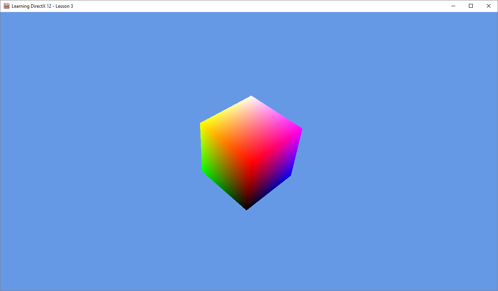

<div class="caption">

Screenshot of Tutorial 2

</div>

### Tutorial2::OnKeyPressed

The `OnKeyPressed` method is called on the `Game` class whenever the user presses a key on the keyboard while the render window has focus. The method provides a `KeyEventArgs` structure which contains the key code that was pressed.

```cpp source="LearningDirectX12-v0.0.2/Tutorial2.cpp#L409-L429"
```

Admittedly this not a very interesting function but keyboard events need to be handled somewhere. The following keyboard keys are handled:

-   <kbd>Esc</kbd>: Pressing <kbd>Esc</kbd> causes the application to quit.
-   <kbd>Alt</kbd>+<kbd>Enter</kbd>, <kbd>F11</kbd>: Pressing either <kbd>Alt</kbd>+<kbd>Enter</kbd> or <kbd>F11</kbd> toggles the fullscreen state of the window.
-   <kbd>V</kbd>: Pressing <kbd>V</kbd> toggles V-sync mode.

In addition to handling keyboard events, the mouse scroll wheel events are also handled.

```cpp source="LearningDirectX12-v0.0.2/Tutorial2.cpp#L431-L439"
```

The `WheelDelta` contains the normalized rotation of the mouse wheel. This value is used to increase or decrease the field of view of the camera. To prevent weird distortion of the camera, the field of view should not be allowed to become too small or too large. The field of view is clamped to the range $\{12^{\circ} \cdots 90^{\circ}\}$

The new field of view is printed to the debug output in Visual Studio so that it is easy to see what the effect is for the current field of view.

## Run the Demo

If you run the demo application, you should see something similar to what is shown below:

  

<iframe class="embed embed-demo" src="/demos/rotating_cube_smooth_shading.html" title="Interactive demo" loading="lazy" allowfullscreen></iframe>

<div class="caption">

Rotating Cube - Click & Drag to rotate cube

</div>

## Conclusion

Although the result is not that amazing, what you have learned is! Let’s recap what you have learned in this lesson. You learned about **resource heaps**. You learned the difference between **committed**, **placed**, and **reserved** resources. You learned (more) about the various stages of the **rendering pipeline** and you’ve learned how to create a **Pipeline State Object** (PSO) for a graphics pipeline. You’ve also learned about **root signatures**. You’ve learned about the various types of **root parameters** (**constants**, **inline descriptors**, and **descriptor tables**). You’ve also been introduced to **static samplers** that can be written directly into the root signature. To facilitate the DirectX 12 demo application, I’ve also suggested a **command queue class** that encapsulates all of the synchronization primitives and helper functionality to make working with DirectX 12 command queues easier. You’ve also seen how to create simple **vertex** and **pixel shaders** for rendering a cube. Uploading **vertex buffer** and **index buffer** data to the GPU has also been described. You were also exposed to the **depth buffer** and how to bind it to the graphics pipeline as a **render target**. You’ve also seen how to bind **32-bit constants** as a **root parameter argument**. And finally, you’ve seen how to render geometry using a **draw** command.

In the next lesson, I will introduce you to **textures** and I will show you how to implement the basic **lighting equation** with diffuse and specular components. You will also see more advanced applications of binding resources using descriptors and sending dynamic constant buffer data to the GPU.

## Download the Source

The source code for this lesson is available on GitHub:

 [ https://github.com/jpvanoosten/LearningDirectX12](https://github.com/jpvanoosten/LearningDirectX12/tree/v0.0.2)

You can also download the source zip file directly from GitHub:

[Source Code.zip](https://github.com/jpvanoosten/LearningDirectX12/archive/v0.0.2.zip)

Or you can also download the precompiled binaries:

[Tutorial2.zip](https://github.com/jpvanoosten/LearningDirectX12/releases/download/v0.0.2/Tutorial2.zip)

## References

<span id="cite-1"></span>\[1\] J. van Oosten, “A Journey Through DirectX 12 Dynamic Memory Allocations”, 3dgep.blogspot.nl, 2016. \[Online\]. Available: [https://3dgep.blogspot.com/2016/02/a-journey-through-directx-12-dynamic.html](https://3dgep.blogspot.com/2016/02/a-journey-through-directx-12-dynamic.html). \[Accessed: 10- Jan- 2018\].

<span id="cite-2"></span>\[2\] C. Crassin, “Dynamic Sparse Voxel Octrees for Next-Gen Real-Time Rendering”, Icare3d.org, 2012. \[Online\]. Available: [https://www.icare3d.org/research-cat/publications/dynamic-sparse-voxel-octrees-for-next-gen-real-time-rendering.html](https://www.icare3d.org/research-cat/publications/dynamic-sparse-voxel-octrees-for-next-gen-real-time-rendering.html). \[Accessed: 10- Jan- 2018\].

<span id="cite-3"></span>\[3\] Microsoft, “Managing Graphics Pipeline State in Direct3D 12 (Windows)”, Msdn.microsoft.com, 2018. \[Online\]. Available: [https://learn.microsoft.com/windows/win32/direct3d12/managing-graphics-pipeline-state-in-direct3d-12](https://learn.microsoft.com/windows/win32/direct3d12/managing-graphics-pipeline-state-in-direct3d-12). \[Accessed: 10- Jan- 2018\].

<span id="cite-4"></span>\[4\] Microsoft, “Using Constants Directly in the Root Signature (Windows)”, Msdn.microsoft.com, 2018. \[Online\]. Available: [https://learn.microsoft.com/windows/win32/direct3d12/using-constants-directly-in-the-root-signature](https://learn.microsoft.com/windows/win32/direct3d12/using-constants-directly-in-the-root-signature). \[Accessed: 23- Jan- 2018\].

<span id="cite-5"></span>\[5\] Microsoft, “Root Signature Limits (Windows)”, Msdn.microsoft.com, 2018. \[Online\]. Available: [https://learn.microsoft.com/windows/win32/direct3d12/root-signature-limits](https://learn.microsoft.com/windows/win32/direct3d12/root-signature-limits). \[Accessed: 23- Jan- 2018\].

<span id="cite-6"></span>\[6\] Microsoft, “Using Descriptors Directly in the Root Signature (Windows)”, Msdn.microsoft.com, 2018. \[Online\]. Available: [https://learn.microsoft.com/windows/win32/direct3d12/using-descriptors-directly-in-the-root-signature](https://learn.microsoft.com/windows/win32/direct3d12/using-descriptors-directly-in-the-root-signature). \[Accessed: 23- Jan- 2018\].

<span id="cite-7"></span>\[7\] Microsoft, “DirectXMath (Windows)”, Msdn.microsoft.com, 2018. \[Online\]. Available: [https://learn.microsoft.com/windows/win32/dxmath/directxmath-portal](https://learn.microsoft.com/windows/win32/dxmath/directxmath-portal). \[Accessed: 21- Feb- 2018\].

<span id="cite-8"></span>\[8\]Microsoft, “Primitive Topologies (Windows)”, Msdn.microsoft.com, 2018. \[Online\]. Available: [https://learn.microsoft.com/windows/win32/direct3d11/d3d10-graphics-programming-guide-primitive-topologies](https://learn.microsoft.com/windows/win32/direct3d11/d3d10-graphics-programming-guide-primitive-topologies). \[Accessed: 01- Mar- 2018\].

<span id="cite-9"></span>\[9\] Microsoft, “ID3D12Device::CreateCommittedResource method (Windows)”, Msdn.microsoft.com, 2018. \[Online\]. Available: [https://learn.microsoft.com/windows/win32/api/d3d12/nf-d3d12-id3d12device-createcommittedresource](https://learn.microsoft.com/windows/win32/api/d3d12/nf-d3d12-id3d12device-createcommittedresource). \[Accessed: 13- Mar- 2018\].

<span id="cite-10"></span>\[10\] Microsoft, “D3D12\_SUBRESOURCE\_DATA structure (Windows)”, Msdn.microsoft.com, 2018. \[Online\]. Available: [https://learn.microsoft.com/windows/win32/api/d3d12/ns-d3d12-d3d12_subresource_data](https://learn.microsoft.com/windows/win32/api/d3d12/ns-d3d12-d3d12_subresource_data). \[Accessed: 13- Mar- 2018\].

<span id="cite-11"></span>\[11\] Microsoft, “UpdateSubresources (heap-allocating) function (Windows)”, Msdn.microsoft.com, 2018. \[Online\]. Available: [https://learn.microsoft.com/windows/win32/direct3d12/updatesubresources2](https://learn.microsoft.com/windows/win32/direct3d12/updatesubresources2). \[Accessed: 13- Mar- 2018\].

<span id="cite-12"></span>\[12\] Microsoft, “D3D12\_VERTEX\_BUFFER\_VIEW structure (Windows)”, Msdn.microsoft.com, 2018. \[Online\]. Available: [https://learn.microsoft.com/windows/win32/api/d3d12/ns-d3d12-d3d12_vertex_buffer_view](https://learn.microsoft.com/windows/win32/api/d3d12/ns-d3d12-d3d12_vertex_buffer_view). \[Accessed: 13- Mar- 2018\].

<span id="cite-13"></span>\[13\]Microsoft, “D3D12\_INDEX\_BUFFER\_VIEW structure (Windows)”, Msdn.microsoft.com, 2018. \[Online\]. Available: [https://learn.microsoft.com/windows/win32/api/d3d12/ns-d3d12-d3d12_index_buffer_view](https://learn.microsoft.com/windows/win32/api/d3d12/ns-d3d12-d3d12_index_buffer_view). \[Accessed: 13- Mar- 2018\].

<span id="cite-14"></span>\[14\] Microsoft, “D3D12\_INPUT\_ELEMENT\_DESC structure (Windows)”, Msdn.microsoft.com, 2018. \[Online\]. Available: [https://learn.microsoft.com/windows/win32/api/d3d12/ns-d3d12-d3d12_input_element_desc](https://learn.microsoft.com/windows/win32/api/d3d12/ns-d3d12-d3d12_input_element_desc). \[Accessed: 13- Mar- 2018\].

<span id="cite-15"></span>\[15\] Microsoft, “Root Signature Version 1.1 (Windows)”, Msdn.microsoft.com, 2018. \[Online\]. Available: [https://learn.microsoft.com/windows/win32/direct3d12/root-signature-version-1-1](https://learn.microsoft.com/windows/win32/direct3d12/root-signature-version-1-1). \[Accessed: 15- Mar- 2018\].

<span id="cite-16"></span>\[16\] Microsoft, “D3D12\_ROOT\_SIGNATURE\_FLAGS enumeration (Windows)”, Msdn.microsoft.com, 2018. \[Online\]. Available: [https://learn.microsoft.com/windows/win32/api/d3d12/ne-d3d12-d3d12_root_signature_flags](https://learn.microsoft.com/windows/win32/api/d3d12/ne-d3d12-d3d12_root_signature_flags). \[Accessed: 19- Mar- 2018\].

<span id="cite-17"></span>\[17\] Microsoft, “D3D12\_RESOURCE\_DESC structure (Windows)”, Msdn.microsoft.com, 2018. \[Online\]. Available: [https://learn.microsoft.com/windows/win32/api/d3d12/ns-d3d12-d3d12_resource_desc](https://learn.microsoft.com/windows/win32/api/d3d12/ns-d3d12-d3d12_resource_desc). \[Accessed: 24- Mar- 2018\].

<span id="cite-18"></span>\[18\] Microsoft, “D3D12\_DEPTH\_STENCIL\_VIEW\_DESC structure (Windows)”, Msdn.microsoft.com, 2018. \[Online\]. Available: [https://learn.microsoft.com/windows/win32/api/d3d12/ns-d3d12-d3d12_depth_stencil_view_desc](https://learn.microsoft.com/windows/win32/api/d3d12/ns-d3d12-d3d12_depth_stencil_view_desc). \[Accessed: 24- Mar- 2018\].

<span id="cite-19"></span>\[19\] Microsoft, “ID3D12Device::CreateDepthStencilView method (Windows)”, Msdn.microsoft.com, 2018. \[Online\]. Available: [https://learn.microsoft.com/windows/win32/api/d3d12/nf-d3d12-id3d12device-createdepthstencilview](https://learn.microsoft.com/windows/win32/api/d3d12/nf-d3d12-id3d12device-createdepthstencilview). \[Accessed: 24- Mar- 2018\].

<span id="cite-20"></span>\[20\] Microsoft, “ID3D12GraphicsCommandList::IASetVertexBuffers method (Windows)”, Msdn.microsoft.com, 2018. \[Online\]. Available: [https://learn.microsoft.com/windows/win32/api/d3d12/nf-d3d12-id3d12graphicscommandlist-iasetvertexbuffers](https://learn.microsoft.com/windows/win32/api/d3d12/nf-d3d12-id3d12graphicscommandlist-iasetvertexbuffers). \[Accessed: 28- Mar- 2018\].

<span id="cite-21"></span>\[21\] Microsoft, “ID3D12GraphicsCommandList::RSSetViewports method (Windows)”, Msdn.microsoft.com, 2018. \[Online\]. Available: [https://learn.microsoft.com/windows/win32/api/d3d12/nf-d3d12-id3d12graphicscommandlist-rssetviewports](https://learn.microsoft.com/windows/win32/api/d3d12/nf-d3d12-id3d12graphicscommandlist-rssetviewports). \[Accessed: 28- Mar- 2018\].

<span id="cite-22"></span>\[22\] Microsoft, “ID3D12GraphicsCommandList::OMSetRenderTargets method (Windows)”, Msdn.microsoft.com, 2018. \[Online\]. Available: [https://learn.microsoft.com/windows/win32/api/d3d12/nf-d3d12-id3d12graphicscommandlist-omsetrendertargets](https://learn.microsoft.com/windows/win32/api/d3d12/nf-d3d12-id3d12graphicscommandlist-omsetrendertargets). \[Accessed: 29- Mar- 2018\].

<span id="cite-23"></span>\[23\] Microsoft, “ID3D12GraphicsCommandList::SetGraphicsRoot32BitConstants method (Windows)”, Msdn.microsoft.com, 2018. \[Online\]. Available: [https://learn.microsoft.com/windows/win32/api/d3d12/nf-d3d12-id3d12graphicscommandlist-setgraphicsroot32bitconstants](https://learn.microsoft.com/windows/win32/api/d3d12/nf-d3d12-id3d12graphicscommandlist-setgraphicsroot32bitconstants). \[Accessed: 29- Mar- 2018\].

<span id="cite-24"></span>\[24\] Microsoft, “ID3D12GraphicsCommandList::DrawIndexedInstanced method (Windows)”, Msdn.microsoft.com, 2018. \[Online\]. Available: [https://learn.microsoft.com/windows/win32/api/d3d12/nf-d3d12-id3d12graphicscommandlist-drawindexedinstanced](https://learn.microsoft.com/windows/win32/api/d3d12/nf-d3d12-id3d12graphicscommandlist-drawindexedinstanced). \[Accessed: 04- Apr- 2018\].
