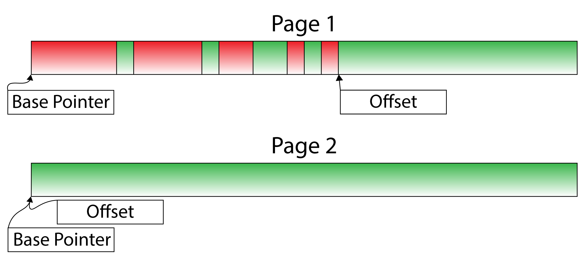
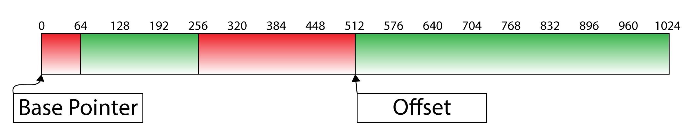
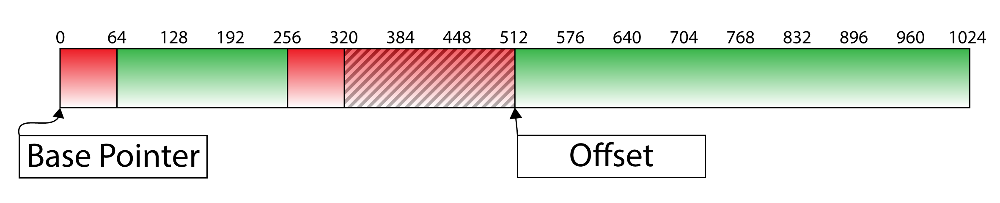
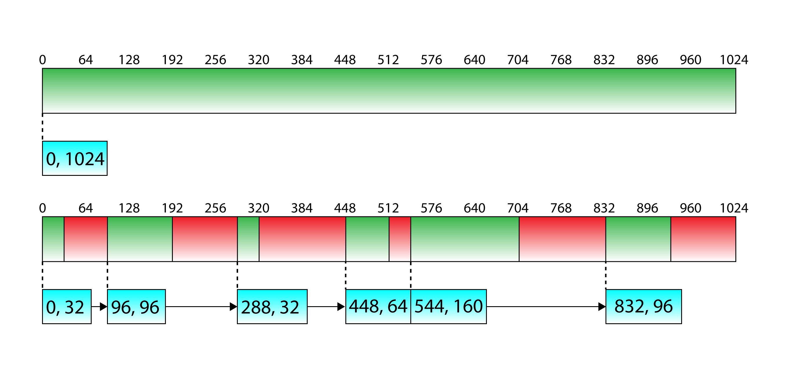
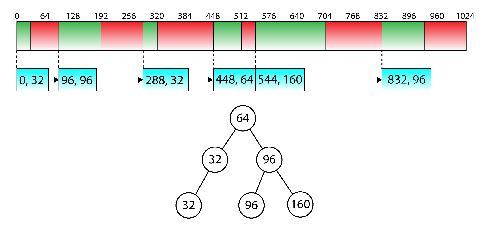
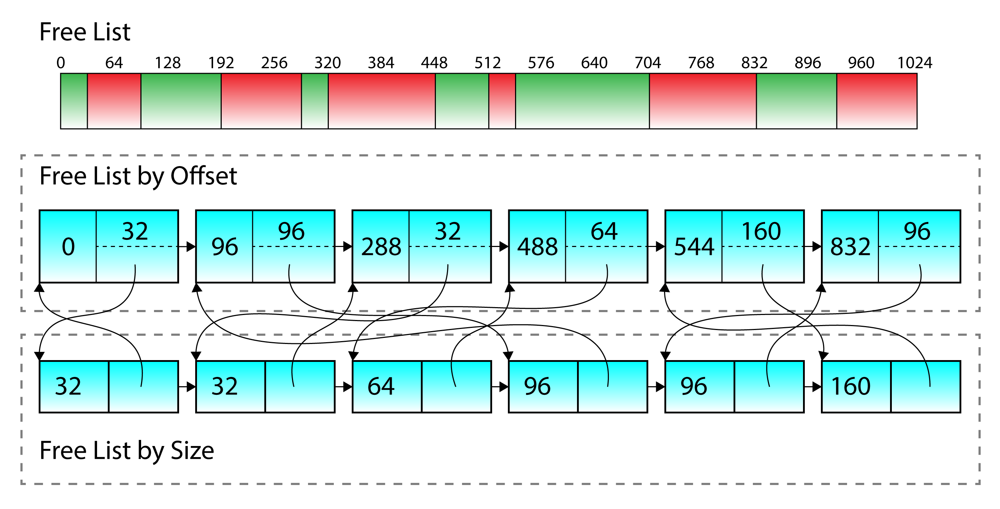
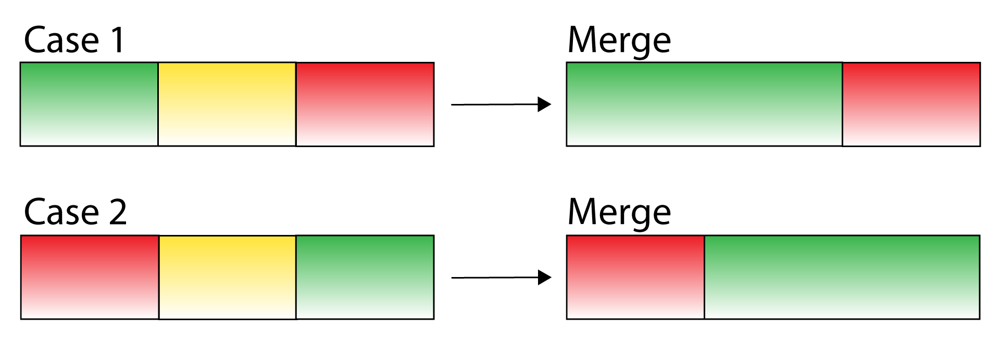
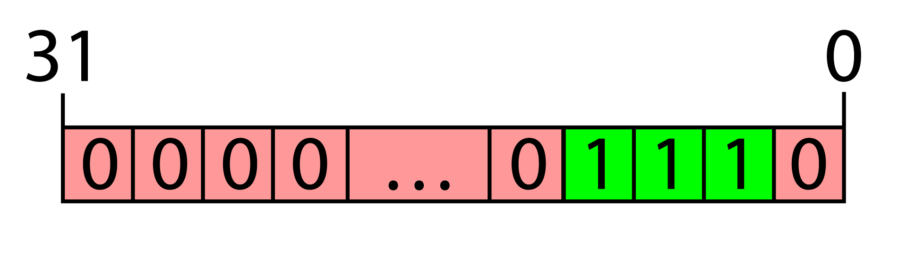
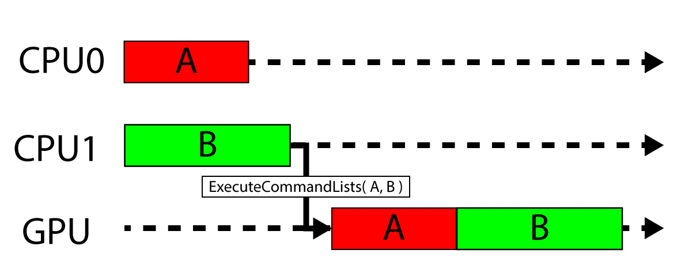
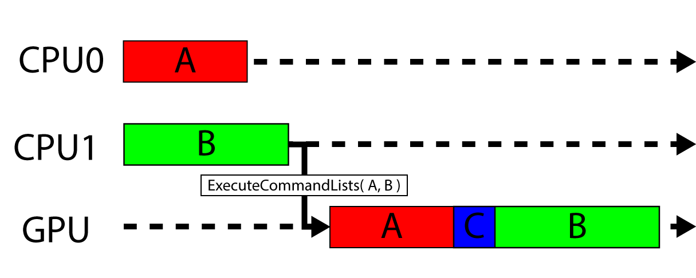

<span id="attachment-8103"></span>

In this tutorial, you will be introduced to several classes that will help you to create a robust and flexible framework for building DirectX 12 applications. Some of the problems that are solved with the classes introduced in this lesson are managing CPU descriptors, copying CPU descriptors to GPU visible descriptor heaps, managing resource state across multiple threads, and uploading dynamic buffer data to the GPU. To automatically manage the state and descriptors for resources, a custom command list class is also provided.

:::caution
This lesson is very heavy on C++ source code and may be difficult to digest for some readers. I feel it is necessary to show the implementation details of these classes here before going on to later lessons since they are used to create the demos in those lessons. Without some introduction to these classes, the reader may feel lost or frustrated if they don’t understand how the demos are built if they don’t see the underlying source code.

The design of these classes prioritizes convenience for the graphics programmer when creating demos (for research purposes ) but may not reflect the most optimized implementations that would be used in production game engines. Feel free to share your thoughts in the comments below about how to improve the design of the classes shown here.
:::

## Introduction

As you have learned in the previous lessons, compared to DirectX 11 or OpenGL, DirectX 12 introduces a few architectural changes that creates some challenges for the graphics programmer. These architectural changes provide a lower-level rendering API but also require a lot of additional code to be written just to get anything to appear on screen. When I first started working with DirectX 12, I really struggled with issues such as memory management, descriptors, and resource state management. What’s the best memory management scheme to use to store resources? How do I make sure I have enough descriptors to render a frame?

In this lesson, I will introduce several classes that will greatly simplify the development of DirectX 12 applications. The first of these classes is the `UploadBuffer`. The `UploadBuffer` is a *linear allocator* that creates resources in an *Upload Heap*. The purpose of this class is to provide the ability to upload dynamic constant, vertex, and index buffer data (or any buffer data for that matter) to the GPU. The most common use-case for the `UploadBuffer` class is to upload uniform data to a `ConstantBuffer` used in a shader. Another typical use-case for the `UploadBuffer` is for particle effects. If the particles are simulated on the CPU, the computed particle attributes need to be uploaded to the GPU every frame. Instead of creating a new upload buffer every frame, the `UploadBuffer` is used to upload the particle data to the GPU. Another use-case for the `UploadBuffer` is rendering a **User Interface** (**UI**). If the UI is dynamic (for example if you want to show run-time performance profiling) then the UI needs to be generated every frame with the new output. For each of these use cases, it is ideal to create a large resource in an upload heap, map a CPU pointer to the underlying resource, and copy the required data (using a [`memcpy`](https://en.cppreference.com/cpp/string/byte/memcpy) for example).

The next class that I will discuss is the `DescriptorAllocator` class that is used to allocate a number of CPU visible descriptors. CPU visible descriptors are used for **Render Target Views** (**RTV**) and **Depth-Stencil Views** (**DSV**). CPU visible descriptors are also used to create **Constant Buffer Views** (**CBV**), **Shader Resource Views** (**SRV**), **Unordered Access Views** (**UAV**), and creating **Samplers** but CBVs, SRVs, UAVs, and Samplers require a corresponding GPU visible descriptor before they can be used in a shader.

Whenever a `Draw` or `Dispatch` command is executed on a command list, any resource that is read from or written to in the shader needs to be bound to the graphics or compute pipeline using a GPU visible descriptor. Although buffer resources can be bound to the GPU using *inline descriptors* (see [Lesson 2](/learning-directx-12-2/)), texture resources cannot be bound using inline descriptors and *must* be bound to the GPU using a descriptor table. If the shader uses a lot of textures (this is the case if you are doing *Physically Based Rendering* for example), then all of the textures needed during the draw or dispatch call must be bound to the graphics, or compute pipelines at the same time. Usually all of the SRV’s for the textures are bound in a contiguous block of GPU visible descriptors in a single descriptor table range. But if textures are loaded in random order, or the same texture is being used for multiple draw calls then how can one ensure that all of the textures are bound in a contiguous block of GPU visible descriptors? Another issue is that only a single descriptor heap of the same type ([`CBV_SRV_UAV`](https://learn.microsoft.com/windows/win32/api/d3d12/ne-d3d12-d3d12_descriptor_heap_type), or [`SAMPLER`](https://learn.microsoft.com/windows/win32/api/d3d12/ne-d3d12-d3d12_descriptor_heap_type)) can be bound on the command list at any moment. So all GPU visible descriptors must come from a single descriptor heap (the descriptor heaps can only be changed between `Draw` or `Dispatch` calls)! Yet another issue arises since descriptors cannot be reused until the command list that is using them has completed executing on the GPU. So how do you know how many GPU visible descriptors need to be allocated up-front? In all but the most simple case, it is impossible to know how many GPU visible descriptors will ever be needed for an entire frame (or 3 frames in the case of triple-buffering). The `DynamicDescriptorHeap` class described in this lesson solves the problem of ensuring that all of the GPU visible descriptors are copied to a single GPU visible descriptor heap before a `Draw` or `Dispatch` command is executed on the GPU.

Another tricky problem to solve in a DirectX 12 renderer is ensuring that resources are always in the correct state when they need to be. In order to perform a resource transition, both the *before* and *after* states of the resource need to be specified in the transition barrier. But if a resource is being used in different states in multiple command lists, then the graphics programmer needs to know exactly what state it was used in the previous command list that was executed. A naïve approach would be to create a class that stores both the resource and the current state of that resource. Anytime a transition barrier is performed on the resource, the current resource state is checked and used as the *before* state. This approach would work in a single-threaded renderer but wouldn’t work if the command lists are being built on different threads! In this case, there is no way to guarantee the state of the resource across multiple threads. The graphics programmer should only be concerned with implementing the graphics application and not concerned with synchronizing the state of a resource across multiple command lists, multiple command queues, and multiple threads! The `ResourceStateTracker` class introduced in this lesson strives to solve the problem of tracking the resource state in a multi-threaded renderer.

In order to bring everything together and make the life of a graphics programmer as easy as possible, a custom `CommandList` class is introduced which uses the aforementioned classes to simplify loading of texture and buffer resources, tracking resource state and minimizing transition barriers, and ensuring that all of the resources used in a shader are correctly bound to GPU visible descriptors. The goal of the custom `CommandList` class described in this lesson is to abstract all of the complications of using DirectX 12 away and reduce the game specific code from thousands of lines of (user) code to just a few hundred.

## Upload Buffer

The `UploadBuffer` class provides a simple wrapper around a resource that is created in an *upload heap*. The `UploadBuffer` is implemented as a *linear allocator* that allocates *chunks* or *blocks* of memory from memory **pages**. If a memory page cannot satisfy an allocation request, a new page is created and added to a list of available pages. A linear allocator can’t grow indefinitely so when a page of memory is no longer in use (for example, the command list that uses an allocation from that page is finished executing on the GPU) then the page can be returned to the list of available pages in the heap. The image below shows an example of a linear allocator.

<span id="attachment-8517"></span>



<div class="caption">

The image shows two pages from a linear allocator. The green blocks are free allocations while the red blocks are allocated. The green blocks in the first page before the offset pointer represent internal fragmentation created by aligned allocations.

</div>

A linear allocator is probably the simplest allocator to implement since it only needs to store two pointers per memory page (the base pointer, and the current offset in the page). The above image shows an example of a linear allocator after several allocations have been made. The red blocks represent allocated blocks while the green blocks represent free blocks within the page. Allocated blocks are not freed or returned back to the memory page but once all of the allocations are no longer being used, then the entire page of memory can be returned to the available pages for the allocator and the offset pointer within the page is reset to the base pointer. The green chunks of free memory between the allocated blocks are a result of external fragmentation created by the alignment of allocated blocks. For example, if the first allocation is a block of 64 bytes and the next allocation needs to be aligned to 256-bytes (constant buffers are required to be aligned to 256-bytes) then there are 192 bytes of unused space in the memory page between the first and second allocations.

<span id="attachment-8519"></span>



<div class="caption">

The example shows a memory page with two allocations. The first of 64 bytes and the second allocation is 256 byte aligned. This results in 192 bytes of external fragmentation between the two allocations.

</div>

The linear allocator also suffers from internal fragmentation when a block of memory is requested but the size of the allocation is smaller than the requested alignment. For example, a block of 64 bytes of memory is 256-byte aligned (this is typical of a constant buffer that contains only a single 4×4 matrix). The allocation returns 256 bytes even if only 64 bytes will ever be used.

<span id="attachment-8522"></span>



<div class="caption">

The following image shows the result of internal fragmentation caused by allocations that are smaller than their alignment. The shaded area in the second allocation is wasted since the allocation only required 64 bytes but 256 bytes are allocated because of the alignment requirements resulting in 192 bytes of internal fragmentation.

</div>

The shaded area in the second allocation shown in the image above is unused memory resulting in internal fragmentation since only 64 bytes was allocated but it required 256 byte alignment so 192 bytes remain unused.

Regardless of the internal and external fragmentation issues, the linear allocator is ideal due to its simplicity and speed. Allocating from the linear allocator only requires the offset pointer to be updated which can be performed in constant time ($\mathcal{O}(1)$).

### UploadBuffer Class

As mentioned in the introduction, the `UploadBuffer` class is used to satisfy requests for memory that must be uploaded to the GPU. When the data in the upload buffer is no longer required, the memory pages can be reused. A page only becomes available again when the command list that is using memory from a page of memory in the upload buffer is finished executing on the GPU. In order to simplify the implementation of the `UploadBuffer` class, it is assumed that each `UploadBuffer` instance is associated to a single command list/allocator. In the [first tutorial](/learning-directx-12-1/), you learned that a command allocator can’t be reset unless it is no longer “in-flight” on the command queue. Similar to the command allocator, the `UploadBuffer` is only reset when any memory allocations from the `UploadBuffer` are no longer “in-flight” on the command queue. This is shown later in this lesson when describing the custom `CommandList` class.

The implementation of this `UploadBuffer` class is inspired by the implementation of the [`LinearAllocator`](https://github.com/Microsoft/DirectX-Graphics-Samples/blob/master/MiniEngine/Core/LinearAllocator.h) class in the MiniEngine provided with the [DirectX-Graphics-Samples](https://github.com/Microsoft/DirectX-Graphics-Samples) repository available on [GitHub](https://github.com/) [\[1\]](#cite-1).

The `UploadBuffer` class provides the following functionality:

-   `Allocate`: Allocates a chunk of memory that can be used to upload data to the GPU.
-   `Reset`: Release all allocations for reuse.

This provides a very simple interface definition for the `UploadBuffer` class.

The header file for the `UploadBuffer` class is shown next.

#### UploadBuffer Header

The `UploadBuffer` header file defines the public, and private members of the class. The preamble is shown first which defines the header file dependencies for the class.

```cpp title="UploadBuffer.h" showLineNumbers startLineNumber=28
/**
 * An UploadBuffer provides a convenient method to upload resources to the GPU.
 */
#pragma once

#include <Defines.h>

#include <wrl.h>
#include <d3d12.h>

#include <memory>
#include <deque>
```

The [`Defines.h`](https://github.com/jpvanoosten/LearningDirectX12/blob/v0.0.3/DX12Lib/inc/Defines.h) header file included on line 33 contains a few useful macro definitions. This file is local to the project but the contents are not shown here for brevity. The source code for this file is available on GitHub here: [Defines.h](https://github.com/jpvanoosten/LearningDirectX12/blob/v0.0.3/DX12Lib/inc/Defines.h)

The [`wrl.h`](https://learn.microsoft.com/cpp/cppcx/wrl/windows-runtime-cpp-template-library-wrl?view=msvc-170) header file provides access to the [`ComPtr`](https://learn.microsoft.com/cpp/cppcx/wrl/comptr-class?view=msvc-170) template class.

The [`d3d12.h`](https://learn.microsoft.com/windows/win32/direct3d12/directx-12-programming-guide) header file contains the interfaces for the DirectX 12 API.

The [`memory`](https://en.cppreference.com/cpp/header/memory) header contains the [`std::shared_ptr`](https://en.cppreference.com/cpp/memory/shared_ptr) which is used to track the lifetime of memory pages in the allocator. The [`deque`](https://en.cppreference.com/cpp/header/deque) header contains the [`std::deque`](https://en.cppreference.com/cpp/container/deque) container class which is used to store a pool of memory pages.

```cpp source="LearningDirectX12-v0.0.3/UploadBuffer.h#L41-L49"
```

The `Allocation` structure defined on line 45 is used to return an allocation from the `UploadBuffer::Allocate` method which is shown later.

```cpp source="LearningDirectX12-v0.0.3/UploadBuffer.h#L51-L54"
```

The `UploadBuffer` class declares only a single constructor which takes the size of a memory page as its only argument. The default size of a page of memory is 2MB. 2MB should be sufficient for most cases, depending on usage. The size of a memory page should be approximately large enough to contain all of the allocations for a single command list. If a lot of dynamic memory allocations are made in the command list, then it may be worthwhile to make larger pages. It is important to understand that the memory pages are never returned to the system. Once a page is allocated, it is never deallocated unless the `UploadBuffer` instance is destructed. The intention of the `UploadBuffer` is that it is reused each frame so the same allocations will likely be made the next frame, but the data will be different. If the pages are never freed, then the cost of creating the pages each frame can be avoided.

```cpp source="LearningDirectX12-v0.0.3/UploadBuffer.h#L58-L61"
```

The `GetPageSize` method simply returns the size of a single page of the allocator. This can be used to check if an allocation can be satisfied by the `UploadBuffer`. If an allocation can’t be satisfied (if the page size is too small for example) then this might be an indication that the page size needs to be larger.

```cpp source="LearningDirectX12-v0.0.3/UploadBuffer.h#L63-L70"
```

The `Allocate` method allocates a chunk of memory with the specified allocation. The `Allocation` structure returned from this method is used to copy the CPU memory into the GPU virtual address space.

```cpp source="LearningDirectX12-v0.0.3/UploadBuffer.h#L72-L76"
```

The `Reset` method is used to reset any allocations so that the memory can be reused for the next frame.

To keep track of the memory pages, an internal `Page` struct is defined. The `Page` struct stores a base CPU pointer, the offset within the page, and the [`ID3D12Resource`](https://learn.microsoft.com/windows/win32/api/d3d12/nn-d3d12-id3d12resource) that holds the GPU memory.

```cpp source="LearningDirectX12-v0.0.3/UploadBuffer.h#L78-L82"
```

The `Page` structure has only a single constructor which takes the size of the page as its only arguments. This is the same as the `pageSize` argument that is passed to the constructor of the `UploadBuffer` class.

```cpp source="LearningDirectX12-v0.0.3/UploadBuffer.h#L85-L87"
```

The `Page::HasSpace` method is used to check if the page can satisfy the requested allocation. If the allocation cannot be satisfied by the current page, the current page is retired and a new page is created.

```cpp source="LearningDirectX12-v0.0.3/UploadBuffer.h#L89-L93"
```

The `Page::Allocate` method is used to perform the actual allocation with the memory page.

```cpp source="LearningDirectX12-v0.0.3/UploadBuffer.h#L95-L96"
```

The `Page::Reset` method is used to reset the page for reuse. This resets the offset within the page to 0.

```cpp source="LearningDirectX12-v0.0.3/UploadBuffer.h#L98-L110"
```

The data that is private to the `Page` structure is the [`ID3D12Resource`](https://learn.microsoft.com/windows/win32/api/d3d12/nn-d3d12-id3d12resource) that contains the GPU memory for the page, the CPU and GPU base pointers, and the current offset within the page. The `m_PageSize` variable is also stored to make sure the requested allocation can be satisfied.

The `UploadBuffer` class needs to keep track of a pool of pages and provide a method to create new pages as required.

```cpp source="LearningDirectX12-v0.0.3/UploadBuffer.h#L112-L113"
```

The `PagePool` type alias defines a [`std::deque`](https://en.cppreference.com/cpp/container/deque) container that stores pointers to the memory pages.

```cpp source="LearningDirectX12-v0.0.3/UploadBuffer.h#L115-L117"
```

The `RequestPage` private method is used to provide an available memory page if one is available. If there are no more available pages, a new one is created and added to the page pool.

```cpp source="LearningDirectX12-v0.0.3/UploadBuffer.h#L119-L120"
```

The `m_PagePool` member variable is a `PagePool` used to hold all of the pages that have ever been created by the `UploadBuffer` class. The `m_AvailablePages` member variable on the other hand, is a pool of pages that are available for allocation.

```cpp source="LearningDirectX12-v0.0.3/UploadBuffer.h#L122-L127"
```

The `m_CurrentPage` member variable is used to store a pointer to the current memory page. The `m_PageSize` variable stores the size of a memory page. This is set to the `pageSize` constructor argument and is used for allocating new pages.

[View the full source code for UploadBuffer.h](https://github.com/jpvanoosten/LearningDirectX12/blob/v0.0.3/DX12Lib/inc/UploadBuffer.h)

#### UploadBuffer Preamble

The preamble for the source file of the `UploadBuffer` class contains the header file dependencies that are specific to the implementation of the class.

```cpp title="UploadBuffer.cpp" showLineNumbers
#include <DX12LibPCH.h>

#include <UploadBuffer.h>

#include <Application.h>
#include <Helpers.h>

#include <d3dx12.h>

#include <new> // for std::bad_alloc
```

The `DX12LibPCH.h` header file is the precompiled header file for the `DX12Lib` project. All of the classes described in this article are part of the **DX12Lib** project.

The `UploadBuffer.h` is the header file that was just described in the previous section.

The `Helpers.h` header file contains some helper functions that are used by the `UploadBuffer` class. The source code for this file can be retrieved here: [Helpers.h](https://github.com/jpvanoosten/LearningDirectX12/blob/v0.0.3/DX12Lib/inc/Helpers.h).

The [`d3dx12.h`](https://github.com/microsoft/DirectX-Headers/blob/main/include/directx/d3dx12.h) provides some helper functions and structs specific for DirectX 12. This file is hosted on [GitHub](https://github.com/) and not distributed with the Windows 10 SDK. It is good practice to check GitHub if there is a new version of this file and always use the latest version in your own projects.

The [`new`](https://en.cppreference.com/cpp/header/new) header contains the [`std::bad_alloc`](https://en.cppreference.com/cpp/memory/new/bad_alloc) exception class which is thrown if an allocation larger than the size of a page is requested.

#### UploadBuffer::UploadBuffer

The `UploadBuffer` class provides a single parameterized constructor. The constructor takes the size of a memory page as its only argument.

```cpp source="LearningDirectX12-v0.0.3/UploadBuffer.cpp#L8-L10"
```

Besides setting the `m_PageSize` member variable, the constructor does nothing. Memory pages will only be allocated if an allocation is requested. The `UploadBuffer` class is intended to be used as an internal class for the custom `CommandList` class (that is shown later in the lesson). If dynamic allocations are not required by the command list, then no pages will be allocated. This is a typical example of [Lazy Initialization](https://en.wikipedia.org/wiki/Lazy_initialization).

#### UploadBuffer::Allocate

The `Allocate` method is used to allocate a chunk (or block) of memory from a memory page. This method returns an `UploadBuffer::Allocation` struct that was defined in the header file.

```cpp source="LearningDirectX12-v0.0.3/UploadBuffer.cpp#L15-L30"
```

The `Allocate` method takes two arguments:

-   `size_t sizeInBytes`: The size of the allocation in bytes.
-   `size_t alignment`: The memory alignment of the allocation in bytes. For example, allocations for constant buffers must be aligned to 256 bytes.

If the size of the allocation exceeds the size of a memory page, the method throws a [std::bad\_alloc](https://en.cppreference.com/cpp/memory/new/bad_alloc) exception.

If there is either no memory page (this is the case when the `UploadBuffer` is first created) or the current page cannot satisfy the request, a new page is requested.

On line 29, the actual allocation is made from the current memory page and the resulting allocation is returned to the caller.

#### UploadBuffer::RequestPage

If either the allocator does not have a page to make an allocation from, or the current page does not have the available space to satisfy the allocation request, a new page must be retrieved from the list of available pages or a new page must be created. The `RequestPage` method will return a memory page that can be used to satisfy allocation requests.

```cpp source="LearningDirectX12-v0.0.3/UploadBuffer.cpp#L32-L48"
```

If there are pages available in the `m_AvailablePages` queue, the the `Page` at the front of the queue is retrieved an popped off the queue.

If there are no available pages, then a new page is created and pushed to the back the `m_PagePool` queue. The `m_PagePool` queue stores all of the pages created by the allocator. In this case, the page is not added to the `m_AvailablePages` queue because it is going to be used to satisfy the allocation request. When the `UploadBuffer` is reset, the `m_PagePool` queue is used reset the `m_AvailablePages` queue (which is shown later when the [`Reset`](#uploadbufferreset) function is described).

#### UploadBuffer::Reset

The `Reset` method is used to reset all of the memory allocations so that they can be reused for the next frame (or more specifically, the next command list recording).

```cpp source="LearningDirectX12-v0.0.3/UploadBuffer.cpp#L50-L61"
```

The `Reset` method makes all of the pages available again by copying the `m_PagePool` to the **m\_AvailablePages** queue.

On line 60, the available pages are reset to prepare them for new allocations.

:::caution
The **UploadBuffer** can only be reset if all of the allocations made from it are no longer “in-flight” on the command queue. Resetting the **UploadBuffer** is controlled by the custom **CommandList** class that is shown later.
:::

#### UploadBuffer::Page::Page

The constructor for a **Page** takes the size of the page as its only argument.

```cpp source="LearningDirectX12-v0.0.3/UploadBuffer.cpp#L63-L82"
```

The `Page` constructor also creates the [`ID3D12Resource`](https://learn.microsoft.com/windows/win32/api/d3d12/nn-d3d12-id3d12resource) as a committed resource in an upload heap. The creation of committed resource is described in [Lesson 2](/learning-directx-12-2/#tutorial2updatebufferresource) and for brevity is not described again here.

After the resource is created, the GPU and CPU addresses are retrieved using the [`ID3D12Resource::GetGPUVirtualAddress`](https://learn.microsoft.com/windows/win32/api/d3d12/nf-d3d12-id3d12resource-getgpuvirtualaddress) and [`ID3D12Resource::Map`](https://learn.microsoft.com/windows/win32/api/d3d12/nf-d3d12-id3d12resource-map) methods respectively. As long as the resource is created in an upload heap, it is safe to leave the resource mapped until the resource is no longer needed.

#### UploadBuffer::Page::~Page

The destructor for the `Page` struct unmaps the resource memory using the [`ID3D12Resource::Unmap`](https://learn.microsoft.com/windows/win32/api/d3d12/nf-d3d12-id3d12resource-unmap) method and resets the CPU and GPU pointers to 0. Since the `m_d3d12Resource` is stored using a [`ComPtr`](https://learn.microsoft.com/cpp/cppcx/wrl/comptr-class?view=msvc-170) there is no need to explicitly release it since it will be automatically released after the `Page` is destructed.

```cpp source="LearningDirectX12-v0.0.3/UploadBuffer.cpp#L84-L89"
```

Before allocating memory from a `Page`, the `Page` must have enough space to satisfy the allocation request. The `Page::HasSpace` method is used to check if the page can satisfy the requested allocation.

#### UploadBuffer::Page::HasSpace

The `Page::HasSpace` method checks to see if the page can satisfy the requested allocation. This method returns `true` if the allocation can be satisfied, or `false` if the allocation cannot be satisfied.

```cpp source="LearningDirectX12-v0.0.3/UploadBuffer.cpp#L91-L97"
```

The `HasSpace` method must take the alignment into consideration. If the requested aligned allocation can be satisfied, this method returns `true`.

#### UploadBuffer::Page::Allocate

The `Page::Allocate` method is where the actual allocation occurs. This method returns an `Allocation` structure that can be used to directly copy (using [`memcpy`](https://en.cppreference.com/cpp/string/byte/memcpy) for example) CPU data to the GPU and bind that GPU address to the pipeline.

```cpp source="LearningDirectX12-v0.0.3/UploadBuffer.cpp#L99-L117"
```

If the `Page` does not have enough space to satisfy the allocation request, this method will throw a [`std::bad_alloc`](https://en.cppreference.com/cpp/memory/new/bad_alloc) exception.

:::note
Since the [UploadBuffer::Allocate](#uploadbufferallocate) method already performs a check that the page can satisfy the request, it may be considered redundant to perform the check again in the `Page::Allocate` method shown here on lines 105 – 109. Feel free to remove this check in your own implementation.
:::

Both the size and the starting address of an allocation should be aligned to the requested alignment. In most cases the size of the allocation will already be aligned to the requested alignment (for example, when allocating memory for a vertex or index buffer) but to ensure correctness, the requested allocation size is explicitly aligned up to the requested alignment on line 111.

On line 112, the current offset within the page must also be aligned to the requested alignment.

On line 114 – 115 the aligned CPU and GPU addresses are written to the `Allocation` structure that is returned by this method.

On line 114, the page’s pointer offset is incremented by the aligned size of the allocation.

On line 116, the `Allocation` structure is returned to the caller.

:::danger
You may have noticed that the `Page::Allocate` method is not thread safe! If you require thread safety for this method then you may want to insert a [`std::lock_guard`](https://en.cppreference.com/cpp/thread/lock_guard) before line 105 of this method. Since I do not use the same instance of an `UploadBuffer` class across multiple threads, I consider this to be unnecessary overhead (there is some cost associated with locking and unlocking mutexes that I do not want to pay for here).
:::

#### UploadBuffer::Page::Reset

The `Page::Reset` method simply resets the page’s pointer offset to 0 so that it can be used to make new allocations.

```cpp source="LearningDirectX12-v0.0.3/UploadBuffer.cpp#L119-L122"
```

This concludes the implementation of the `UploadBuffer` class. In the next section, the `DescriptorAllocator` class is described. As the name implies, the `DescriptorAllocator` class is used to allocate (CPU visible) descriptors. CPU visible descriptors are used to create *views* for resources (for example **Render Target Views** (**RTV**), **Depth-Stencil Views** (**DSV**), **Constant Buffer Views** (**CBV**), **Shader Resource Views** (**SRV**), **Unordered Access Views** (**UAV**), and **Samplers**). Before a **CBV**, **SRV**, **UAV**, or **Sampler** can be used in a shader, it must be copied to a GPU visible descriptor. The `DynamicDescriptorHeap` class handles copying of CPU visible descriptors to GPU visible descriptor heaps. The `DynamicDescriptorHeap` class is the subject of the next following sections.

[View the full source code for UploadBuffer.cpp](https://github.com/jpvanoosten/LearningDirectX12/blob/v0.0.3/DX12Lib/src/UploadBuffer.cpp)

## Descriptor Allocator

The `DescriptorAllocator` class is used to allocate descriptors from a CPU visible descriptor heap. CPU visible descriptors are useful for “staging” resource descriptors in CPU memory and later copied to a GPU visible descriptor heap for use in a shader.

CPU visible descriptors are used for describing:

-   Render Target Views (RTV)
-   Depth-Stencil Views (DSV)
-   Constant Buffer Views (CBV)
-   Shader Resource Views (SRV)
-   Unordered Access Views (UAV)
-   Samplers

The `DescriptorAllocator` class is used to allocate descriptors to the application when loading new resources (like textures). In a typical game engine, resources may need to be loaded and unloaded from memory at sporadic moments while the player moves around the level. To support large dynamic worlds, it may be necessary to initially load some resources, unload them from memory, and reload different resources. The `DescriptorAllocator` manages all of the descriptors that are required to describe those resources. Descriptors that are no longer used (for example, when a resource is unloaded from memory) will be automatically returned back to the descriptor heap for reuse.

The `DescriptorAllocator` class uses a *free list* memory allocation scheme inspired by the [Variable Sized Memory Allocations Manager](http://diligentgraphics.com/diligent-engine/architecture/d3d12/variable-size-memory-allocations-manager/) by [Diligent Graphics](https://diligentgraphics.com/) [\[2\]](#cite-2) to manage the descriptors. A *free list* keeps track of a list of available allocations. Each entry of the free list stores the available allocations from a page of memory. Each entry of the free list stores the offset from the beginning of the memory page and the size of the available allocation. In order to satisfy the allocation, the free list is searched for an entry that is large enough to satisfy the allocation request. If the allocation cannot be satisfied by the current page, a new page is created in memory.

<span id="attachment-8573"></span>



<div class="caption">

The image shows two pages of a free list allocator. The top image shows a memory page with no allocations. In this case, there is only a single entry in the free list which contains the entire page of memory. The bottom image shows the memory page after several allocations have been made.

</div>

The above image shows an example of pages of memory that are allocated using a free list allocation strategy. The top image shows the initial state of the page before any allocations are made. In this case, the free list contains only a single entry which refers to the entire memory page. The bottom image shows an example of a memory page after several allocations have been made. In this case, the free list contains several entries which represent the available blocks of memory in the page.

To make a new allocation from the page, all of the entries in the free list are searched and the first block that is large enough to satisfy the request is used. If there are no free blocks that can satisfy the request, then a new page is allocated.

This strategy for allocating memory is called *first-fit* (find the first free block that fits) and is the easiest strategy to implement since it only consists of a linear search through the free list but it is not the most efficient method to use for allocation. A linear search has $\mathcal{O}(n)$ (worst case) complexity (where $n$ is the number of entries in the free list).

A better technique would be to sort the free blocks by their size and perform a binary-search through the sizes to find a block that is large enough to satisfy the request. If you remember for your algorithm analysis class, a binary search has $\mathcal{O}(log_2n)$ complexity (where $n$ is the number of values to search) which is better than $\mathcal{O}(n)$.

<span id="attachment-8579"></span>



<div class="caption">

The image shows an example of a memory page after several allocations using a free list allocation strategy. The binary tree represents the entries of the free list sorted by size.

</div>

The above image shows a memory page after several allocations have been made. The binary tree in the bottom of the image represents the entries of the free list sorted by size. Using the binary tree, an allocation of 160 bytes can be satisfied by searching just three nodes. Using the linear list would require five entries to be searched before the allocation could be satisfied. With only six entries in the free list, this may not seem like a significant performance improvement, but with thousands (or millions) of entries, the performance improvement is significant.

Three different classes are used to implement this strategy:

1.  `DescriptorAllocator`: This is the main interface to the application for requesting descriptors. The `DescriptorAllocator` class manages the descriptor pages.
2.  `DescriptorAllocatorPage`: This class is a wrapper for a [`ID3D12DescriptorHeap`](https://learn.microsoft.com/windows/win32/api/d3d12/nn-d3d12-id3d12descriptorheap). The `DescriptorAllocatorPage` also keeps track of the free list for the page.
3.  `DescriptorAllocation`: This class wraps an allocation that is returned from the `DescriptorAllocator::Allocate` method. The `DescriptorAllocation` class also stores a pointer back to the page it came from and will automatically free itself if the descriptor(s) are no longer required.

The `DescriptorAllocator` class is described first.

### DescriptorAllocator Class

The implementation of the `DescriptorAllocator` class is very similar to the `UploadBuffer` class shown in the previous section. The `DescriptorAllocator` class stores a pool of `DescriptorAllocatorPage`s. If there are no pages that can satisfy a request, a new page is created and added to the pool. Similar to the `UploadBuffer` class, the `DescriptorAllocator` class has a very simple public interface and only provides a method to allocate descriptors.

#### DescriptorAllocator Header

The header file for the `DescriptorAllocator` class declares the public and private members of the class. The preamble for the header file is shown first which includes the dependencies for the class.

```cpp source="LearningDirectX12-v0.0.3/DescriptorAllocator.h#L40-L50"
```

The `DescriptorAllocator::Allocate` method returns a `DescriptorAllocation` by value which requires the `DescriptorAllocation.h` header file to be included (on line 40) in this file.

:::note
In order to improve compilation speed, you should try to minimize header file dependencies without introducing external prerequisites (header files should be self-sufficient and not require additional header files to be included first in order to compile). If a dependency can be forward-declared then that should be prefered over including the header file.
:::

The ubiquitous `d3dx12.h` header file included on line 42 is required for the DirectX 12 API and helper structures and functions.

The [`cstdint`](https://en.cppreference.com/cpp/header/cstdint) header file included on line 44 is required for the fixed-width integer types (`uint32_t`, and `uint64_t`).

The [`mutex`](https://en.cppreference.com/cpp/header/mutex) header file is included for the [`std::mutex`](https://en.cppreference.com/cpp/thread/mutex) synchronization primitive. The [`mutex`](https://en.cppreference.com/cpp/thread/mutex) is used in the `Allocate` method to allow allocations to be safely made across multiple threads.

The [`memory`](https://en.cppreference.com/cpp/header/memory) header file is required for the [`std::shared_ptr`](https://en.cppreference.com/cpp/memory/shared_ptr) pointer class. Shared pointers are used to track the lifetime of the pages. Each allocation also stores a shared pointer back to the page it came from.

The [`set`](https://en.cppreference.com/cpp/header/set) header file includes the [`std::set`](https://en.cppreference.com/cpp/container/set) container class. A [`set`](https://en.cppreference.com/cpp/container/set) is used to store an ordered list of indices to the available pages in the page pool.

The [`vector`](https://en.cppreference.com/cpp/header/vector) header file includes the [`std::vector`](https://en.cppreference.com/cpp/container/vector) container class.

The `DescriptorAllocatorPage` class is used by the `DescriptorAllocator` class but the header file does not need to be included since the `DescriptorAllocatorPage` class is only used as a pointer within the `DescriptorAllocator` class. In this case, it is sufficient to provide a forward-declaration of the class (on line 50) without the need to include the header file.

The `DescriptorAllocator` class defines two public member functions:

1.  `DescriptorAllocator::Allocate`: Allocates a number of contiguous descriptors from a CPU visible descriptor heap.
2.  `DescriptorAllocator::ReleaseStaleDescriptors`: Frees any stale descriptors that can be returned to the list of available descriptors for reuse. This method should only be called after any of the descriptors that were freed are no longer being referenced by the command queue.

The definition of these methods is shown later. The declaration of these methods is made in the header file for the `DescriptorAllocator` class.

```cpp source="LearningDirectX12-v0.0.3/DescriptorAllocator.h#L52-L69"
```

The `DescriptorAllocator` constructor declared on line 55 takes two parameters. The first is the type of descriptors that the `DescriptorAllocator` will allocate. This can be one of the [`CBV_SRV_UAV`](https://learn.microsoft.com/windows/win32/api/d3d12/ne-d3d12-d3d12_descriptor_heap_type), [`SAMPLER`](https://learn.microsoft.com/windows/win32/api/d3d12/ne-d3d12-d3d12_descriptor_heap_type), [`RTV`](https://learn.microsoft.com/windows/win32/api/d3d12/ne-d3d12-d3d12_descriptor_heap_type), or [`DSV`](https://learn.microsoft.com/windows/win32/api/d3d12/ne-d3d12-d3d12_descriptor_heap_type) types.

The second parameter to the constructor is the number of descriptors per descriptor heap. By default, descriptor heaps will be created with 256 descriptors. This value is arbitrary and only needs to be as large as the maximum number of contiguous descriptors that will ever be needed. If all of the descriptors in a descriptor heap have been exhausted, a new heap will be created to satisfy the allocation request.

The `DescriptorAllocator::Allocate` method allocates a number contiguous descriptors from a descriptor heap. By default, only a single descriptor is allocated. The `numDescriptors` argument can be specified if more than one descriptor is required. This method returns a `DescriptorAllocation` which is a wrapper for the allocated descriptor. The `DescriptorAllocation` class is described later.

```cpp source="LearningDirectX12-v0.0.3/DescriptorAllocator.h#L71-L85"
```

The `DescriptorHeapPool` defined on line 72 is a type alias of a [`std::vector`](https://en.cppreference.com/cpp/container/vector) of `DescriptorAllocatorPage`s.

The `DescriptorAllocator::CreateAllocatorPage` method declared on line 75 is an internal method that is used to create a new allocator page if there are no pages in the page pool that can satisfy the allocation request.

The `m_HeapType` variable stores the type of descriptors to allocate. This variable is also used to create new descriptor heaps.

The `m_NumDescriptorsPerHeap` variable stores the number of descriptors to create per descriptor heap.

The `m_HeapPool` is a [`std::vector`](https://en.cppreference.com/cpp/container/vector) of `DescriptorAllocatorPage`s. This variable is used to keep track of all allocated pages.

The `m_AvailableHeaps` is a [`std::set`](https://en.cppreference.com/cpp/container/set) of indices of available pages in the `m_HeapPool` vector. If all of the descriptors in a `DescriptorAllocatorPage` have been exhausted, then the index of that page in the `m_HeapPool` vector is removed from the `m_AvailableHeaps` set. This ensures that empty pages are skipped when looking for a `DescriptorAllocatorPage` that can satisfy the allocation request.

Since the `DescriptorAllocator` class is intended to be thread safe, a [`std::mutex`](https://en.cppreference.com/cpp/thread/mutex) is used to guard against multiple threads allocating or deallocating from the `DescriptorAllocator` at the same time.

In the next sections, the implementation of the `DescriptorAllocator` is shown.

[View the full source code for DescriptorAllocator.h](https://github.com/jpvanoosten/LearningDirectX12/blob/v0.0.3/DX12Lib/inc/DescriptorAllocator.h)

#### DescriptorAllocator Preamble

Before defining the methods of the `DescriptorAllocator` class, a few header files used by the class need to be included.

```cpp source="LearningDirectX12-v0.0.3/DescriptorAllocator.cpp#L1-L4"
```

The `DX12LibPCH.h` is the precompiled header file for the `DX12Lib` project.

The `DescriptorAllocator.h` header file included on line 3 was just described in the previous section and the `DescriptorAllocatorPage.h` header file contains the declaration of the `DescriptorAllocatorPage` class (which will be shown later).

#### DescriptorAllocator::DescriptorAllocator

Similar to the constructor for the `UploadBuffer` class shown previously, the constructor for the `DescriptorAllocator` class does very little except initializing the class’s member variables.

```cpp source="LearningDirectX12-v0.0.3/DescriptorAllocator.cpp#L6-L10"
```

The `m_HeapType` and `m_NumDescriptorsPerHeap` member variables are initialized based on the arguments passed to the constructor.

#### DescriptorAllocator::CreateAllocatorPage

The `CreateAllocatorPage` method is used to create a new page of descriptors. The `DescriptorAllocatorPage` class (which will be shown later) is a wrapper for the [`ID3D12DescriptorHeap`](https://learn.microsoft.com/windows/win32/api/d3d12/nn-d3d12-id3d12descriptorheap) and manages the actual descriptors.

```cpp source="LearningDirectX12-v0.0.3/DescriptorAllocator.cpp#L15-L23"
```

The `DescriptorAllocator::CreateAllocatorPage` is very simple. On line 17 a new `DescriptorAllocatorPage` is created and added to the pool. On line 20, the index of the page in the pool is added to the `m_AvailableHeaps` set.

On line 22, the new page is returned to the calling function.

#### DescriptorAllocator::Allocate

The `Allocate` method allocates a contiguous block of descriptors from a descriptor heap. The method iterates through the available descriptor heap (pages) and tries to allocate the requested number of descriptors until a descriptor heap (page) is able to fulfill the requested allocation. If there are no descriptor heaps that can fulfill the request, then a new descriptor heap (page) is created that can fulfill the request.

```cpp source="LearningDirectX12-v0.0.3/DescriptorAllocator.cpp#L25-L47"
```

Before allocating any descriptors, the `m_AllocationMutex` mutex is locked to ensure the current thread has exclusive access to the allocator.

The result of the allocation is stored in the `allocation` variable defined on line 29.

On lines 31-47, the available descriptor heaps are iterated and on line 35 an allocation of the requested number of descriptors is made. If the allocator page was able to satisfy the requested number of descriptors, then a valid descriptor allocation is returned. If the allocation resulted in the allocator page becoming empty (the number of free descriptor handles reaches 0) then the index of the current page is removed from the set of available heaps (on line 39).

If a valid descriptor handle was allocated from the allocator page (the descriptor handle is not null) then the loop breaks on line 45.

If there were no available allocator pages (which is the case when the `DescriptorAllocator` is created) or none of the available allocator pages could satisfy the request, then a new allocator page is created.

```cpp source="LearningDirectX12-v0.0.3/DescriptorAllocator.cpp#L49-L59"
```

On line 50, the descriptor allocation is checked for validity. If it is still an invalid descriptor (a null descriptor) then a new descriptor page, that is at least as large as the number of requested descriptors, is created on line 53 using the [`DescriptorAllocator::CreateAllocatorPage`](#descriptorallocatorcreateallocatorpage) method described earlier.

On line 55, the requested allocation is made (which should be guaranteed to succeed) and the resulting allocation is returned to the caller on line 58.

#### DescriptorAllocator::ReleaseStaleDescriptors

The last method of the `DescriptorAllocator` class is the `ReleaseStaleDescriptors` method. The `ReleaseStaleDescriptors` method iterates over all of the descriptor heap pages and calls the page’s `ReleaseStaleDescriptors` method. If, after releasing the stale descriptors, the page has free handles, it’s added to the list of available heaps.

```cpp source="LearningDirectX12-v0.0.3/DescriptorAllocator.cpp#L61-L76"
```

In order to prevent modifications of the `DescriptorAllocator` in other threads, the `m_AllocationMutex` mutex is locked on line 63.

On lines 65-75, the pages of heap pool are iterated calling the page’s `ReleaseStaleDescriptors` method. The implementation of the `DescriptorAllocatorPage::ReleaseStaleDescriptors` method is shown in the following sections.

Pages that have free descriptor handles are added to the set of available heaps on line 73. It’s okay to add the same index to the set multiple times since the [`std::set`](https://en.cppreference.com/cpp/container/set) is guaranteed to only store unique values.

[View the full source code for DescriptorAllocator.cpp](https://github.com/jpvanoosten/LearningDirectX12/blob/v0.0.3/DX12Lib/src/DescriptorAllocator.cpp)

### DescriptorAllocatorPage Class

The purpose of the `DescriptorAllocatorPage` class is to provide the free list allocator strategy for an [`ID3D12DescriptorHeap`](https://learn.microsoft.com/windows/win32/api/d3d12/nn-d3d12-id3d12descriptorheap). The `DescriptorAllocatorPage` class is not intended to be used outside of the `DescriptorAllocator` class so the library end user doesn’t necessarily need to know the details of this class. Knowing the details of this class is more interesting to someone who is writing their own DirectX 12 library or to someone who wants to understand the implementation details provided by the [DX12Lib](https://github.com/jpvanoosten/LearningDirectX12) project that has been created for the purpose of these tutorials. As previously mentioned, the implementation of this class is heavily inspired by [Variable Size Memory Allocations Manager](http://diligentgraphics.com/diligent-engine/architecture/d3d12/variable-size-memory-allocations-manager/) from [Diligent Graphics](https://diligentgraphics.com/) [\[2\]](#cite-2).

The `DescriptorAllocatorPage` class must be able to satisfy descriptor allocation requests but it also needs to provide some functions to query the number of free handles and to check to see if it has sufficient space to satisfy a request. The `DescriptorAllocatorPage` provides the following (public) methods:

-   `HasSpace`: Check to see if the `DescriptorAllocatorPage` has a contiguous block of descriptors that is large enough to satisfy a request.
-   `NumFreeHandles`: Returns the number of available descriptor handles in the descriptor heap. Note that due to fragmentation of the free list, allocations that are less than or equal to the number of free handles could still fail.
-   `Allocate`: Allocates a number of contiguous descriptors from the descriptor heap. If the `DescriptorAllocatorPage` is not able to satisfy the request, this function will return a null `DescriptorAllocation`
-   `Free`: Returns a `DescriptorAllocation` back to the heap. Since descriptors can’t be reused until the command list that is referencing them has finished executing on the command queue, the descriptors are not returned directly to the heap until the render frame has finished executing.
-   `ReleaseStaleDescriptors`: Returns any free’d descriptors back to the descriptor heap for reuse.

#### DescriptorAllocatorPage Header

The declaration of the `DescriptorAllocatorPage` class is slightly more elaborate than the [`DescriptorAllocator`](#descriptorallocator-class) class described in the previous section. The `DescriptorAllocatorPage` class is not only a wrapper for a [`ID3D12DescriptorHeap`](https://learn.microsoft.com/windows/win32/api/d3d12/nn-d3d12-id3d12descriptorheap) but also implements a *free list* allocator to manage the descriptors in the heap.

```cpp source="LearningDirectX12-v0.0.3/DescriptorAllocatorPage.h#L37-L46"
```

Since the `DescriptorAllocatorPage::Allocate` method (shown later) returns a `DescriptorAllocation` object by value, the header file for `DescriptorAllocation` class needs to be included on line 37 (a forward declaration is not sufficient).

The `d3d12.h` header file is required for the [`ID3D12DescriptorHeap`](https://learn.microsoft.com/windows/win32/api/d3d12/nn-d3d12-id3d12descriptorheap).

The `wrl.h` header file included on line 41 is required for the [`ComPtr`](https://learn.microsoft.com/cpp/cppcx/wrl/comptr-class?view=msvc-170) template class.

The [`map`](https://en.cppreference.com/cpp/header/map), [`memory`](https://en.cppreference.com/cpp/header/memory), [`mutex`](https://en.cppreference.com/cpp/header/mutex), and [`queue`](https://en.cppreference.com/cpp/header/queue) headers are required for the STL types that are used by the `DescriptorAllocatorPage` class.

```cpp title="DescriptorAllocatorPage.h" showLineNumbers startLineNumber=48
class DescriptorAllocatorPage : public std::enable_shared_from_this<DescriptorAllocatorPage>
{
public:
    DescriptorAllocatorPage( D3D12_DESCRIPTOR_HEAP_TYPE type, uint32_t numDescriptors );

    D3D12_DESCRIPTOR_HEAP_TYPE GetHeapType() const;

    /**
     * Check to see if this descriptor page has a contiguous block of descriptors
     * large enough to satisfy the request.
     */
    bool HasSpace( uint32_t numDescriptors ) const;
```

The `DescriptorAllocatorPage` class publically inherits from the [`std::enable_shared_from_this`](https://en.cppreference.com/cpp/memory/enable_shared_from_this) template class. The [`std::enable_shared_from_this`](https://en.cppreference.com/cpp/memory/enable_shared_from_this) template class provides the [`shared_from_this`](https://en.cppreference.com/cpp/memory/enable_shared_from_this/shared_from_this) member function which enables the `DescriptorAllocatorPage` class to retrieve a [`std::shared_ptr`](https://en.cppreference.com/cpp/memory/shared_ptr) from itself (which will be used in the `DescriptorAllocatorPage::Allocate` method shown later). This requires the `DescriptorAllocatorPage` class to be created from a shared pointer using either [`std::make_shared`](https://en.cppreference.com/cpp/memory/shared_ptr/make_shared) or [`std::shared_ptr`](https://en.cppreference.com/cpp/memory/shared_ptr)`<T>( new T(...) )`. This requirement is acceptable in this case since the `DescriptorAllocatorPage` class should only be used by the `DescriptorAllocator` class. On line 17 of the [`DescriptorAllocator::CreateAllocatorPage`](#descriptorallocatorcreateallocatorpage) method shown previously, the `DescriptorAllocatorPage` is created using the [`std::make_shared`](https://en.cppreference.com/cpp/memory/shared_ptr/make_shared) method.

The parameterized constructor for the `DescriptorAllocatorPage` class is declared on line 51. The constructor takes two arguments: the type of descriptor heap to create and the number of descriptors to allocate in the descriptor heap.

The `GetHeapType`method declared on line 53 simply returns the descriptor heap type that was used to construct the `DescriptorAllocatorPage`.

The `HasSpace` method declared on line 59 is used to check if the `DescriptorAllocatorPage` has a contiguous block of descriptors in the descriptor heap that is large enough to satisfy a request. It is often more efficient to first check if an allocation request will succeed first before making an allocation request and then checking for failure.

```cpp title="DescriptorAllocatorPage.h" showLineNumbers startLineNumber=61
    /**
     * Get the number of available handles in the heap.
     */
    uint32_t NumFreeHandles() const;

    /**
     * Allocate a number of descriptors from this descriptor heap.
     * If the allocation cannot be satisfied, then a NULL descriptor
     * is returned.
     */
    DescriptorAllocation Allocate( uint32_t numDescriptors );
```

The `NumFreeHandles` method defined on line 64 checks how many descriptor handles the `DescriptorAllocatorPage` still has available. Due to fragmentation of the free list, an allocation request of a contiguous block of descriptors that is less than the total number of free handles could still fail. For example, the fragmented free list shown in the [previous image](#attachment-8573) has 544 free descriptors but the largest contiguous block is only 128 descriptors wide.

The `Allocate` method defined on line 71 is used to allocate a number of descriptors from the descriptor heap. If the allocation fails, this method returns a null descriptor. This method returns a `DescriptorAllocation`. To check if the descriptor is valid, the `DescriptorAllocation::IsNull` method is used. This method is shown later in the section about the `DescriptorAllocation` class.

```cpp title="DescriptorAllocatorPage.h" showLineNumbers startLineNumber=73
    /**
     * Return a descriptor back to the heap.
     * @param frameNumber Stale descriptors are not freed directly, but put
     * on a stale allocations queue. Stale allocations are returned to the heap
     * using the DescriptorAllocatorPage::ReleaseStaleAllocations method.
     */
    void Free( DescriptorAllocation&& descriptorHandle, uint64_t frameNumber );

    /**
     * Returned the stale descriptors back to the descriptor heap.
     */
    void ReleaseStaleDescriptors( uint64_t frameNumber );
```

The `Free` method declared on line 79 is used to free a `DescriptorAllocation` that was previously allocated using the `DescriptorAllocatorPage::Allocate` method. It is not required to call this method directly since the `DescriptorAllocation` class will automatically free itself back to the `DescriptorAllocatorPage` it came from if it is no longer in use. This method takes the `DescriptorAllocation` as an [r-value reference](https://en.cppreference.com/cpp/language/reference) which implies that the `DescriptorAllocation` is moved into the function leaving the original `DescriptorAllocation` invalid.

The `ReleaseStaleDescriptors` method defined on line 84 releases the stale descriptors back to the descriptor heap for reuse. This method take the *completed* frame number as its only argument. All of the descriptors that were released during that frame will be returned to the heap.

The `DescriptorAllocatorPage` defines a few additional methods that are internal to this class.

```cpp source="LearningDirectX12-v0.0.3/DescriptorAllocatorPage.h#L86-L97"
```

The `ComputeOffset` method computes the number of descriptors from the base descriptor to the specified descriptor handle. This method is used to determine where a descriptor needs to be placed back in heap when the descriptor is free’d.

The `AddNewBlock` method adds a block of descriptors to the free list. This method is used to initialize the free list (with a single block containing all descriptors), when splitting a block of descriptors during allocation, and for merging neighboring blocks when descriptors are free’d.

The `FreeBlock` method is used to free a block of descriptors. This method is used by the `ReleaseStaleDescriptors` method to commit the stale descriptors back to the descriptor heap. The `FreeBlock` method also checks if neighboring blocks in the free list can be merged. Merging free blocks in the free list reduces the fragmentation in the free list.

The `DescriptorAllocatorPage` class also defines some private data members.

```cpp source="LearningDirectX12-v0.0.3/DescriptorAllocatorPage.h#L99-L103"
```

In order to improve code readability and reduce ambiguity, the `OffsetType` type alias is defined to refer to an offset (in descriptors) within the descriptor heap. The `SizeType` type alias is defined to refer to the number of descriptors in a block (in the free list).

```cpp source="LearningDirectX12-v0.0.3/DescriptorAllocatorPage.h#L105-L121"
```

The `FreeBlockInfo` struct is forward declared on line 105 and defined on line 113. The forward declaration of the `FreeBlockInfo` struct is required to create the `FreeListByOffset` type alias on line 107. The `FreeListByOffset` type is an alias of a [`std::map`](https://en.cppreference.com/cpp/container/map) which maps `FreeBlockInfo` to the offset of the free block within the free list.

The `FreeListBySize` type is an alias of a [`std::multimap`](https://en.cppreference.com/cpp/container/multimap) that provides a mechanisim to quickly find the first block in the free list that can satisfy an allocation request. The `FreeListBySize` type needs to be a [`std::multimap`](https://en.cppreference.com/cpp/container/multimap) since there can be many blocks in the free list with the same size.

The `FreeBlockInfo` struct simply stores the size of the block in the free list and a reference (iterator) to its entry in the `FreeListBySize` map. The `FreeBlockInfo` struct stores the iterator to its entry in the `FreeListBySize` map so that the entry can be quickly removed (without searching) when merging neighboring blocks in the free list.

<span id="attachment-8710"></span>



<div class="caption">

The image shows an example of a free list after several allocations have been made. The `FreeListByOffset` data structure (top) stores a reference to the corresponding entry in the `FreeListBySize` map (bottom). Similarly, the `FreeListBySize` map stores a pointer back to the corresponding entry in the `FreeListByOffset` map.

</div>

The [image above](#attachment-8710) shows an example of a free list after several allocations have been made. The `FreeListByOffset` data structure stores a reference to the corresponding entry in the `FreeListBySize` map. Similarly, each entry in the `FreeListBySize` map stores a reference by to the corresponding entry in the `FreeListByOffset` map. This solution resembles a bi-directional map ([Bimap in Boost](https://www.boost.org/doc/libs/1_68_0/libs/bimap/doc/html/index.html)) which provides optimized searching on both offset and size of each entry in the free list.

The `StaleDescriptorInfo` struct is used to keep track of descriptors in the descriptor heap that have been freed but can’t be reused until the frame in which they were freed is finished executing on the GPU.

```cpp source="LearningDirectX12-v0.0.3/DescriptorAllocatorPage.h#L123-L137"
```

The `StaleDescriptorInfo` struct tracks the offset of the first descriptor and the number of descriptors in the descriptor range. The `FrameNumber` parameter stores the frame that the descriptors were freed.

```cpp source="LearningDirectX12-v0.0.3/DescriptorAllocatorPage.h#L139-L145"
```

The `StaleDescriptorQueue` is a type alias for a queue of `StaleDescriptorInfo`s.

The `m_FreeListByOffset`, `m_FreeListBySize`, and `m_StaleDescriptors` member variables are the necessary data structures to track the state of the free list.

```cpp source="LearningDirectX12-v0.0.3/DescriptorAllocatorPage.h#L147-L155"
```

On line 147, the underlying [`ID3D12DescriptorHeap`](https://learn.microsoft.com/windows/win32/api/d3d12/nn-d3d12-id3d12descriptorheap) interface is defined.

The `m_HeapType` variable defines the type of descriptor heap used by the `DescriptorAllocatorPage` class.

Since the increment size of a descriptor within a descriptor heap is vendor specific, it must be queried at runtime (see [Tutorial 1](/learning-directx-12-1/) for more information on descriptor heaps). The descriptor increment size is stored in the `m_DescriptorHandleIncrementSize` member variable.

The total number of descriptors in the descriptor heap is saved in the `m_NumDescriptorsInHeap` member variable and the total number of remaining descriptors in the heap is stored in the `m_NumFreeHandles` member variable.

The `m_AllocationMutex` defined on line 154 is used to ensure safe access allocations and deallocations across multiple threads.

[View the full source code for DescriptorAllocatorPage.h](https://github.com/jpvanoosten/LearningDirectX12/blob/v0.0.3/DX12Lib/inc/DescriptorAllocatorPage.h)

#### DescriptorAllocatorPage Preamble

The `DescriptorAllocatorPage` class requires a few additional headers in order to compile.

```cpp source="LearningDirectX12-v0.0.3/DescriptorAllocatorPage.cpp#L1-L4"
```

The `DX12LibPCH.h` provides a precompiled header file for the `DX12Lib` project.

The `DescriptorAllocatorPage.h` header file is described in the previous section.

The `Application.h` header file provides access to the `Application` class. The `Application` class was briefly described in [Tutorial 2](/learning-directx-12-2/#directx-12-demo). The `Application` class is used to get access to the [`ID3D12Device`](https://learn.microsoft.com/windows/win32/api/d3d12/nn-d3d12-id3d12device) object.

#### DescriptorAllocatorPage::DescriptorAllocatorPage

The parameratized constructor for the `DescriptorAllocatorPage` class takes the heap type and the number of descriptors to allocate in the heap as arguments.

```cpp source="LearningDirectX12-v0.0.3/DescriptorAllocatorPage.cpp#L6-L24"
```

On line 10, a pointer to the [`ID3D12Device`](https://learn.microsoft.com/windows/win32/api/d3d12/nn-d3d12-id3d12device) is retrieved from the `Application` class.

Before creating the [`ID3D12DescriptorHeap`](https://learn.microsoft.com/windows/win32/api/d3d12/nn-d3d12-id3d12descriptorheap) object, it must be described. The [`D3D12_DESCRIPTOR_HEAP_DESC`](https://learn.microsoft.com/windows/win32/api/d3d12/ns-d3d12-d3d12_descriptor_heap_desc) is used to describe the [`ID3D12DescriptorHeap`](https://learn.microsoft.com/windows/win32/api/d3d12/nn-d3d12-id3d12descriptorheap) and has the following members [\[3\]](#cite-3):

-   [`D3D12_DESCRIPTOR_HEAP_TYPE`](https://learn.microsoft.com/windows/win32/api/d3d12/ne-d3d12-d3d12_descriptor_heap_type) `Type`: Specifies the types of descriptors in the heap.
-   `UINT NumDescriptors`: The number of descriptors in the heap.
-   [`D3D12_DESCRIPTOR_HEAP_FLAGS`](https://learn.microsoft.com/windows/win32/api/d3d12/ne-d3d12-d3d12_descriptor_heap_flags) `Flags`: A combination of [`D3D12_DESCRIPTOR_HEAP_FLAGS`](https://learn.microsoft.com/windows/win32/api/d3d12/ne-d3d12-d3d12_descriptor_heap_flags) values that are combined by using a bitwise OR operation. The following flags are currently available:
    -   `D3D12_DESCRIPTOR_HEAP_FLAG_NONE`: Indicates default usage of a heap.
    -   `D3D12_DESCRIPTOR_HEAP_FLAG_SHADER_VISIBLE`: This flag can optionally be set on a descriptor heap to indicate it is be bound on a command list for reference by shaders. Descriptor heaps created without this flag allow applications the option to stage descriptors in CPU memory before copying them to a shader visible descriptor heap, as a convenience. But it is also fine for applications to directly create descriptors into shader visible descriptor heaps with no requirement to stage anything on the CPU.  
        This flag only applies to CBV, SRV, UAV and samplers. It does not apply to other descriptor heap types since shaders do not directly reference the other types.
-   `UINT NodeMask`: For single-adapter operation, set this to zero. If there are multiple adapter nodes, set a bit to identify the node (one of the device’s physical adapters) to which the descriptor heap applies. Each bit in the mask corresponds to a single node. Only one bit must be set.

On line 16, the actual [`ID3D12DescriptorHeap`](https://learn.microsoft.com/windows/win32/api/d3d12/nn-d3d12-id3d12descriptorheap) is created using the [`ID3D12Device::CreateDescriptorHeap`](https://learn.microsoft.com/windows/win32/api/d3d12/nf-d3d12-id3d12device-createdescriptorheap) method.

On line 18, the `m_BaseDescriptor` member variable is initialized to the first descriptor handle in the heap and on line 19 the increment size of a descriptor in the descriptor heap is queried using the [`ID3D12Device::GetDescriptorHandleIncrementSize`](https://learn.microsoft.com/windows/win32/api/d3d12/nf-d3d12-id3d12device-getdescriptorhandleincrementsize) method. On line 20, the number of free handles in the `DescriptorAllocatorPage` is initialized to the number of handles in the [`ID3D12DescriptorHeap`](https://learn.microsoft.com/windows/win32/api/d3d12/nn-d3d12-id3d12descriptorheap).

On line 23 a single block of descriptors is added to the free list using the `AddNewBlock` method. The new block has an offset of 0 and a size of `m_NumFreeHandles`.

#### DescriptorAllocatorPage::GetHeapType

The `GetHeapType` method is simply a *getter* method that returns the heap type.

```cpp source="LearningDirectX12-v0.0.3/DescriptorAllocatorPage.cpp#L26-L29"
```

#### DescriptorAllocatorPage::NumFreeHandles

The `NumFreeHandles` method is simply a getter method that returns the number of free handles that are currently available in the heap.

```cpp source="LearningDirectX12-v0.0.3/DescriptorAllocatorPage.cpp#L31-L34"
```

#### DescriptorAllocatorPage::HasSpace

The `HasSpace` method is used to check if the `DescriptorAllocatorPage` has a free block of descriptors that is large enough to satisfy a request for a particular number of descriptors.

```cpp source="LearningDirectX12-v0.0.3/DescriptorAllocatorPage.cpp#L36-L39"
```

The [`std::map::lower_bound`](https://en.cppreference.com/cpp/container/map/lower_bound) method is used to find the first entry in the free list that is *not less than* (in other words: *greater than or equal to*) the requested number of descriptors. If no such element exists that is *not less than* `numDescriptors`, then the *past-the-end* iterator is returned which indicates that the free list cannot satisfy the requested number of descriptors. If the `DescriptorAllocatorPage` is not able to satisfy the request, then the `DescriptorAllocator` will create a new page (as was shown previously in the [`DescriptorAllocator::Allocate`](#descriptorallocatorallocate) method).

#### DescriptorAllocatorPage::AddNewBlock

The `AddNewBlock` method adds a block to the free list. The block is added to both the `FreeListByOffset` map and the `FreeListBySize` map. Both lists are linked to create the bi-directional map for optimized lookups.

```cpp source="LearningDirectX12-v0.0.3/DescriptorAllocatorPage.cpp#L41-L46"
```

On line 43, the [`std::map::emplace`](https://en.cppreference.com/cpp/container/map/emplace) method is used to emplace an element into the `m_FreeListByOffset` map. This method returns a [`std::pair`](https://en.cppreference.com/cpp/utility/pair) where the first element is an iterator to the inserted element. The iterator to the inserted element is used to add an entry to the `m_FreeListBySize` [`multimap`](https://en.cppreference.com/cpp/container/multimap) on line 44.

On line 45, the `FreeBlockInfo`‘s `FreeListBySizeIt` member variable needs to be patched to point to the corresponding iterator in the `m_FreeListBySize` [`multimap`](https://en.cppreference.com/cpp/container/multimap).

#### DescriptorAllocatorPage::Allocate

The `Allocate` method is used to allocate descriptors from the free list. When a block of descriptors is allocated from the free list, it is possible that the existing free block needs to be split and the remaining descriptors are “returned” to the free list. For example, if only a single descriptor is requested by the caller and the free list has a free block of 100 descriptors, then the free block of 100 descriptors is removed from the heap, 1 descriptor allocated from that block, and a free block of 99 descriptors is added back to the free list.

```cpp source="LearningDirectX12-v0.0.3/DescriptorAllocatorPage.cpp#L48-L50"
```

In order to prevent any race conditions that may occur by multiple threads making allocations on the same `DescriptorAllocatorPage`, the `m_AllocationMutex` is locked line 50.

```cpp source="LearningDirectX12-v0.0.3/DescriptorAllocatorPage.cpp#L52-L65"
```

On lines 54 and 61 the free list is checked to make sure that there are enough free descriptor handles to satisfy the request. If there are not enough descriptor handles, a default (null) `DescriptorAllocation` is returned to the calling function. If these checks pass, then `smallestBlockIt` contains an iterator to the first entry in the `FreeListBySize` [`multimap`](https://en.cppreference.com/cpp/container/multimap) that is *not less than* the requested number of descriptors.

```cpp source="LearningDirectX12-v0.0.3/DescriptorAllocatorPage.cpp#L67-L74"
```

The `smallestBlockIt` is used to retrieve the size of the free block and get the iterator to the corresponding entry in the `FreeListByOffset` map in $\mathcal{O}(1)$ *constant* time (which is better than $\mathcal{O}(\log_2{n})$ *logarithmic* time complexity of the [`std::map::find`](https://en.cppreference.com/cpp/container/map/find) method).

The free block that was found needs to be removed from the free list and a new block that results from splitting the free block needs to be added back to the free list.

```cpp source="LearningDirectX12-v0.0.3/DescriptorAllocatorPage.cpp#L76-L89"
```

On lines 77-78 the free block that was found is removed from the free list.

On lines 81-82 the size and offset of the the new free block that resulted from splitting the current block is computed and if the size is not 0, the new block is added to the free list using the [`AddNewBlock`](#descriptorallocatorpageaddnewblock) method on line 88.

```cpp source="LearningDirectX12-v0.0.3/DescriptorAllocatorPage.cpp#L91-L97"
```

The total number of free handles is decremented by the number of requested descriptors on line 92 and the resulting `DescriptorAllocation` is returned to the calling function on line 94.

#### DescriptorAllocatorPage::ComputeOffset

The `ComputeOffset` method is used to compute the offset (in descriptor handles) from the base descriptor (first descriptor in the descriptor heap) to a given descriptor.

```cpp source="LearningDirectX12-v0.0.3/DescriptorAllocatorPage.cpp#L99-L102"
```

The `ComputeOffset` method is used by the `Free` method (shown next) in order to compute the offset of a descriptor in the descriptor heap. Since a [`D3D12_CPU_DESCRIPTOR_HANDLE`](https://learn.microsoft.com/windows/win32/api/d3d12/ns-d3d12-d3d12_cpu_descriptor_handle) is just a structure that contains a single `SIZE_T` member variable, computing the offset of a descriptor in a descriptor heap is a matter of simple arithmetic.

#### DescriptorAllocatorPage::Free

The `Free` method returns a block of descriptors back to the free list. Descriptors are not immediately returned to the free list but instead are added to a queue of stale descriptors. Descriptors are only returned to the free list once the frame they were freed in is finished executing on the GPU. This ensures that descriptors are not reused until they are no longer being referenced by a GPU command.

```cpp source="LearningDirectX12-v0.0.3/DescriptorAllocatorPage.cpp#L104-L113"
```

The `DescriptorAllocation` doesn’t store the offset of the descriptor within the descriptor heap but the offset can be computed using the `ComputeOffset` method.

In order to guarantee the `m_StaleDescriptors` queue is only modified on a single thread at a time, the `m_AllocationMutex` [`mutex`](https://en.cppreference.com/cpp/thread/mutex) is locked on line 109 and the `StaleDescriptorInfo` is added to the `m_StaleDescriptors` queue on line 112.

#### DescriptorAllocatorPage::FreeBlock

The `FreeBlock` method is executed when the stale descriptors are added back to the free list. When adding a block back to the free list, neighboring blocks should be merged to minimize fragmentation of the free list. Two cases need to be considered when adding a block back to the free list:

1.  **Case 1**: There is a block in the free list that is immediately preceding the block being freed.
2.  **Case 2**: There is a block in the free list that is immediately following the block being freed.
3.  **Case 3**: There is both a block in the free list immediately preceding and immediately following the block being freed.
4.  **Case 4**: There is neither a block in the free list immediately preceding nor immediately following the block being freed.

If **Case 1** is true then the previous block in the free list needs to be merged with the block being freed. If **Case 2** is true then the next block in the free list needs to be merged with the block being freed.

<span id="attachment-8754"></span>



<div class="caption">

The previous block in the free list is merged (top). The next block in the free list is merged (bottom). A free block is green, the block being freed is yellow, and an allocated block is red.

</div>

The above image shows the two cases that can occur when returning a block back to the free list. **Case 3** and **Case 4** do not need to be handled in any special way since those cases are already handled implicitly.

```cpp source="LearningDirectX12-v0.0.3/DescriptorAllocatorPage.cpp#L115-L139"
```

On line 119, the block that comes after the block being freed is queried from the `FreeListByOffset` map using the [`std::map::upper_bound`](https://en.cppreference.com/cpp/container/map/upper_bound) method. The [`upper_bound`](https://en.cppreference.com/cpp/container/map/upper_bound) method returns the first element whos key is strictly greater than the specified key. If no such element exists, this method returns the *past-the-end* ([`end`](https://en.cppreference.com/cpp/container/map/end)) iterator.

The previous block in the free list (`prevBlockIt`) is the one that appears just before the block being freed. The previous block is initialized on line 122 to be the same as the next block (`nextBlockIt`) and if it is not the first element in the free list, then it is decremented on line 127 to point to the previous element. If the free list is completely empty (**Case 4**), then the `nextBlockIt`, `prevBlockIt`, and [`begin`](https://en.cppreference.com/cpp/container/map/begin) iterator will all point to the *past-the-end* ([`end`](https://en.cppreference.com/cpp/container/map/end)) iterator.

If there is only a single item in the free list then it either comes before or after the element being freed. If it comes after the block being freed, then `nextBlockIt` will point to that element and `prevBlockIt` will be set to the [`end`](https://en.cppreference.com/cpp/container/map/end) iterator on line 133. If it comes before the block being freed then `nextBlockIt` will point to the [`end`](https://en.cppreference.com/cpp/container/map/end) iterator and the `prevBlockIt` will point to that element after being decremented on line 127.

The number of free handles is incremented by the number of handles being freed on line 139.

First **Case 1** is checked (the previous block is immediately preceding the block being freed).

```cpp source="LearningDirectX12-v0.0.3/DescriptorAllocatorPage.cpp#L141-L158"
```

If there is a block immediately preceding the block being freed then that block is merged with the block being freed.

**Case 2** is checked next (the next block in the free list is following the block being freed).

```cpp source="LearningDirectX12-v0.0.3/DescriptorAllocatorPage.cpp#L160-L175"
```

Again, the block immediately following the block being freed is merged with the block being freed.

**Case 3** and **Case 4** do not need to be handled explicitly since they are being implicitly handled.

The final step is to add the new (merged) block back into the free list.

```cpp source="LearningDirectX12-v0.0.3/DescriptorAllocatorPage.cpp#L177-L179"
```

On line 178 the new block is added back into the free list using the [`AddNewBlock`](#descriptorallocatorpageaddnewblock) method.

#### DescriptorAllocatorPage::ReleaseStaleDescriptors

Stale descriptors are returned to the free list using the `ReleaseStaleDescriptors` method when the frame that they were freed in is finished executing on the GPU.

```cpp source="LearningDirectX12-v0.0.3/DescriptorAllocatorPage.cpp#L181-L198"
```

To ensure the `m_StaleDescriptors` [`queue`](https://en.cppreference.com/cpp/container/queue) is not being modified on any other thread, the `m_AllocationMutex` [`mutex`](https://en.cppreference.com/cpp/thread/mutex) is locked on line 181.

On lines 183-195, the `m_StaleDescriptors` [`queue`](https://en.cppreference.com/cpp/container/queue) is checked for any entries. If there is an entry for which the frame number is less than (or equal to) the completed frame number, its entry is popped off the queue and the block is returned back to the free list using the [`FreeBlock`](#descriptorallocatorpagefreeblock) method described in the previous section.

The final class in the triad of classes that constitute the descriptor allocation scheme used by the DX12Lib project is the `DescriptorAllocation` class and is the subject of the next section.

[View the full source code for DescriptorAllocatorPage.cpp](https://github.com/jpvanoosten/LearningDirectX12/blob/v0.0.3/DX12Lib/src/DescriptorAllocatorPage.cpp)

### DescriptorAllocation Class

The `DescriptorAllocation` class is used by the `DescriptorAllocator` to represent a single allocation of contiguous descriptors in a descriptor heap. The `DescriptorAllocation` class is a move-only self-freeing type that is used as a wrapper for a [`D3D12_CPU_DESCRIPTOR_HANDLE`](https://learn.microsoft.com/windows/win32/api/d3d12/ns-d3d12-d3d12_cpu_descriptor_handle). The reason why the `DescriptorAllocation` must be a move-only class is to ensure there is only a single instance of a particular allocation. This guarantees that if the descriptor is destroyed or replaced, the original descriptor will be returned back to the descriptor heap (from) whence it came.

The `DescriptorAllocation` class provides the following (public) method:

-   `IsNull`: Check to see if the `DescriptorAllocation` contains a valid descriptor handle.
-   `GetDescriptorHandle`: Get the descriptor handle to the underlying [`D3D12_CPU_DESCRIPTOR_HANDLE`](https://learn.microsoft.com/windows/win32/api/d3d12/ns-d3d12-d3d12_cpu_descriptor_handle)
-   `GetNumHandles`: Gets the number of consecutive descriptors in the `DescriptorAllocation`.

#### DescriptorAllocation Header

The header file is used to declare the `DescriptorAllocation` class. Additional header files that are necessary to compile the `DescriptorAllocation` are shown first.

```cpp source="LearningDirectX12-v0.0.3/DescriptorAllocation.h#L37-L42"
```

The `d3d12.h` header is necessary for the [`D3D12_CPU_DESCRIPTOR_HANDLE`](https://learn.microsoft.com/windows/win32/api/d3d12/ns-d3d12-d3d12_cpu_descriptor_handle) type.

The [`cstdint`](https://en.cppreference.com/cpp/header/cstdint) header file is included to provide the [`uint32_t`](https://en.cppreference.com/cpp/types/integer) type.

The [`memory`](https://en.cppreference.com/cpp/header/memory) header file is included to provide access to the [`std::shared_ptr`](https://en.cppreference.com/cpp/memory/shared_ptr) type.

The [`DescriptorAllocatorPage`](#descriptorallocatorpage-class) is forward declared on line 42 to avoid including the header file for that class. The [`DescriptorAllocatorPage`](#descriptorallocatorpage-class) is used as a template argument for a [`std::shared_ptr`](https://en.cppreference.com/cpp/memory/shared_ptr) which doesn’t require a complete type.

```cpp source="LearningDirectX12-v0.0.3/DescriptorAllocation.h#L44-L53"
```

The `DescriptorAllocation` class provides a default constructor which initializes the descriptor as a *null* descriptor.

The parameterized constructor declared on line 50 is used by the [`DescriptorAllocatorPage::Allocate`](#descriptorallocatorpageallocate) method to construct a valid `DescriptorAllocation`.

The destructor declared on line 53 is necessary to ensure the allocation is returned to the [`DescriptorAllocatorPage`](#descriptorallocatorpage-class) that it came from.

```cpp source="LearningDirectX12-v0.0.3/DescriptorAllocation.h#L55-L61"
```

It is not allowed to make copies of the `DescriptorAllocation` to prevent any accidental copies, the copy constructor and copy assignment operator are deleted from the class to prevent the compiler from auto generating them.

Moving the `DescriptorAllocation` to another `DescriptorAllocation` is allowed (and in fact, required). Both the move constructor and the move assignment operator are declared on lines 60 and 61.

```cpp showLineNumbers startLineNumber=63
    // Check if this a valid descriptor.
    bool IsNull() const;
```

The `IsNull` method is used to check if the `DescriptorAllocation` contains a valid descriptor.

```cpp source="LearningDirectX12-v0.0.3/DescriptorAllocation.h#L66-L67"
```

The `DescriptorAllocation` can contain a block of consecutive descriptors in a descriptor heap. The `GetDescriptorHandle` method is used to get the underlying [`D3D12_CPU_DESCRIPTOR_HANDLE`](https://learn.microsoft.com/windows/win32/api/d3d12/ns-d3d12-d3d12_cpu_descriptor_handle) at a particular offset within the contigious block of descriptors.

```cpp source="LearningDirectX12-v0.0.3/DescriptorAllocation.h#L69-L70"
```

The `GetNumHandles` is used to get the number of consecutive descriptor handles that are contained in the `DescriptorAllocation`.

```cpp source="LearningDirectX12-v0.0.3/DescriptorAllocation.h#L72-L74"
```

The `GetDescriptorAllocatorPage` method is used to query the [`DescriptorAllocatorPage`](#descriptorallocatorpage-class) where the `DescriptorAllocation` came from.

```cpp source="LearningDirectX12-v0.0.3/DescriptorAllocation.h#L76-L89"
```

The `Free` method is used by the `DescriptorAllocation` class to return itself back to the [`DescriptorAllocatorPage`](#descriptorallocatorpage-class) it came from. This method is used if the `DescriptorAllocation` is destructed or when another `DescriptorAllocation` is being (move) assigned to it.

The `m_Descriptor` member variable is the handle to the first [`D3D12_CPU_DESCRIPTOR_HANDLE`](https://learn.microsoft.com/windows/win32/api/d3d12/ns-d3d12-d3d12_cpu_descriptor_handle) in the allocation.

The `m_NumHandles` member variable stores the total number of descriptors in the `DescriptorAllocation`.

The `m_DescriptorSize` member variable stores the increment size for each descriptor. This is used to compute the offset of a particular descriptor within the allocation.

The `m_Page` member variable stores a [`std::shared_ptr`](https://en.cppreference.com/cpp/memory/shared_ptr) back to the [`DescriptorAllocatorPage`](#descriptorallocatorpage-class) that the `DescriptorAllocation` came from.

[View the full source code for DescriptorAllocation.h](https://github.com/jpvanoosten/LearningDirectX12/blob/v0.0.3/DX12Lib/inc/DescriptorAllocation.h)

#### DescriptorAllocation Preamble

The implementation of the `DescriptorAllocation` class is fairly simple as it acts as a wrapper class for the underlying [`D3D12_CPU_DESCRIPTOR_HANDLE`](https://learn.microsoft.com/windows/win32/api/d3d12/ns-d3d12-d3d12_cpu_descriptor_handle) and provides a few accessor methods that describe the allocation.

```cpp source="LearningDirectX12-v0.0.3/DescriptorAllocation.cpp#L1-L6"
```

The `DX12LibPCH.h` header file provides the precompiled header file for the `DX12Lib` project and must be the first include that appears in the implementation file.

The `DescriptorAllocation.h` header is included next and provides the declaration of the `DescriptorAllocation` class that was shown in the previous section.

The `Application.h` header provides the declaration of the `Application` class. When freeing a `DescriptorAllocation` it is necessary to provide the current frame of execution which is provided by the `Application` class.

The `DescriptorAllocatorPage.h` header file is necessary to be able to call the [`DescriptorAllocatorPage::Free`](#descriptorallocatorpagefree) method when freeing the `DescriptorAllocation`.

#### DescriptorAllocation Default Constructor

The default constructor for the `DescriptorAllocation` class simply initializes it as a *null* descriptor.

```cpp source="LearningDirectX12-v0.0.3/DescriptorAllocation.cpp#L8-L13"
```

#### DescriptorAllocation Parameratized Constructor

The parameterized constructor for the `DescriptorAllocation` class initializes it as a valid descriptor (assuming the parameters are valid).

```cpp source="LearningDirectX12-v0.0.3/DescriptorAllocation.cpp#L15-L20"
```

The member variables being initialized here are described in the [DescriptorAllocation Header](#descriptorallocation-header) section and shouldn’t require additional explanation.

#### DescriptorAllocation Destructor

The destructor for the `DescriptorAllocation` class must ensure that the descriptor is freed back to the [`DescriptorAllocatorPage`](#descriptorallocatorpage-class) it came from by calling the `Free` method.

```cpp source="LearningDirectX12-v0.0.3/DescriptorAllocation.cpp#L23-L26"
```

#### DescriptorAllocation Move Constructor

The move constructor allows the `DescriptorAllocation` to be *moved*. The original `DescriptorAllocation` must be made invalid but the allocation should not be *freed*.

```cpp source="LearningDirectX12-v0.0.3/DescriptorAllocation.cpp#L28-L37"
```

#### DescriptorAllocation Move Assignment

The move assignment operator behaves similar to the move constructor except the original descriptor must be freed using the `Free` method before moving another descriptor into the current one.

```cpp source="LearningDirectX12-v0.0.3/DescriptorAllocation.cpp#L39-L54"
```

#### DescriptorAllocation::Free

If the `DescriptorAllocation` either goes out of scope or is replaced by another descriptor, it must be freed. The `Free` method is used to return the `DescriptorAllocation` back to the [`DescriptorAllocatorPage`](#descriptorallocatorpage-class) it came from.

```cpp source="LearningDirectX12-v0.0.3/DescriptorAllocation.cpp#L56-L67"
```

If the `DescriptorAllocation` is valid (not *null*) then it is returned back to the [`DescriptorAllocatorPage`](#descriptorallocatorpage-class) it came from using the [`DescriptorAllocatorPage::Free`](#descriptorallocatorpagefree) method.

#### DescriptorAllocation::IsNull

The `IsNull` method check to see if the underlying [`D3D12_CPU_DESCRIPTOR_HANDLE`](https://learn.microsoft.com/windows/win32/api/d3d12/ns-d3d12-d3d12_cpu_descriptor_handle) is valid.

```cpp source="LearningDirectX12-v0.0.3/DescriptorAllocation.cpp#L69-L73"
```

#### DescriptorAllocation::GetDescriptorHandle

The `GetDescriptorHandle` method returns a [`D3D12_CPU_DESCRIPTOR_HANDLE`](https://learn.microsoft.com/windows/win32/api/d3d12/ns-d3d12-d3d12_cpu_descriptor_handle) for the descriptor at a particular offset within the `DescriptorAllocation`.

```cpp source="LearningDirectX12-v0.0.3/DescriptorAllocation.cpp#L75-L80"
```

#### DescriptorAllocation::GetNumHandles

The `GetNumHandles` method returns the number of descriptor handles in the `DescriptorAllocation`.

```cpp source="LearningDirectX12-v0.0.3/DescriptorAllocation.cpp#L82-L85"
```

#### DescriptorAllocation::GetDescriptorAllocatorPage

The `GetDescriptorAllocatorPage` method returns the [`std::shared_ptr`](https://en.cppreference.com/cpp/memory/shared_ptr) to the [`DescriptorAllocatorPage`](#descriptorallocatorpage-class) where the `DescriptorAllocation` originated from.

```cpp source="LearningDirectX12-v0.0.3/DescriptorAllocation.cpp#L87-L90"
```

This concludes the description of the classes that are used to implement the descriptor allocation strategy used by the DX12Lib project. The [`DescriptorAllocator`](#descriptorallocator-class) class provides a simple interface for allocating and freeing descriptors using a *free list* memory management scheme. The `DescriptorAllocatorPage` class is used internally to manage allocations and the `DescriptorAllocation` class is used to represent a single allocation from the descriptor heap.

The `DynamicDescriptorHeap` class provides a flexible solution for ensuring the CPU visible descriptors are copied to the correct location in a GPU visible descriptor heap for rendering on the GPU. The `DynamicDescriptorHeap` class is the subject of the next section.

[View the full source code for DescriptorAllocation.cpp](https://github.com/jpvanoosten/LearningDirectX12/blob/v0.0.3/DX12Lib/src/DescriptorAllocation.cpp)

## Dynamic Descriptor Heap

The purpose of the `DynamicDescriptorHeap` class is to allocate GPU visible descriptors that are used for binding CBV, SRV, UAV, and Samplers to the GPU pipeline for rendering or compute invocations. This is necessary since the descriptors provided by the `DescriptorAllocator` class shown in the previous section are CPU visible and cannot be used to bind resources to the GPU rendering pipeline. The `DynamicDescriptorHeap` class provides a staging area for CPU visible descriptors that are committed to GPU visible descriptor heaps when a `Draw` or `Dispatch` method is invoked on the command list.

Since only a single [`CBV_SRV_UAV`](https://learn.microsoft.com/windows/win32/api/d3d12/ne-d3d12-d3d12_descriptor_heap_type) descriptor heap and a single [`SAMPLER`](https://learn.microsoft.com/windows/win32/api/d3d12/ne-d3d12-d3d12_descriptor_heap_type) descriptor heap can be bound to the command list at the same time, the `DynamicDescriptorHeap` class also ensures that the currently bound descriptor heap has a sufficient number of descriptors to commit all of the staged descriptors before a `Draw` or `Dispatch` command is executed. If the currently bound descriptor heap runs out of descriptors, then a new descriptor heap is bound to the command list.

:::note
It should be noted that dynamic descriptor indexing and unbounded descriptor arrays were added in Shader Model 5.1. See [Dynamic Indexing using HLSL 5.1](https://learn.microsoft.com/windows/win32/direct3d12/dynamic-indexing-using-hlsl-5-1) for more information. The `DynamicDescriptorHeap` class shown in this article is designed to provide functionality similar to that of DirectX 11 where dynamic descriptor indexing wasn’t supported.
:::

The `DynamicDescriptorHeap` class caches staged descriptors in a descriptor cache that is configured to match the layout of the root signature. For example, if the root signature has the following layout:

| Index | Type | Range Type | Num Desriptors |
| --- | --- | --- | --- |
| 0 | CBV | – | – |
| 1 | DESCRIPTOR\_TABLE | SRV | 6 |
| 2 | DESCRIPTOR\_TABLE | CBV | 3 |
| 3 | DESCRIPTOR\_TABLE | UAV | 3 |
| 4 | DESCRIPTOR\_TABLE | SAMPLER | 4 |

Then the descriptor table cache for the [`CBV_SRV_UAV`](https://learn.microsoft.com/windows/win32/api/d3d12/ne-d3d12-d3d12_descriptor_heap_type) dynamic descriptor heap would look like this:

<span id="attachment-8808"></span>


<div class="caption">

The image shows the layout of the [`CBV_SRV_UAV`](<https://learn.microsoft.com/windows/win32/api/d3d12/ne-d3d12-d3d12_descriptor_heap_type>) descriptor table cache. Each entry in the descriptor table cache stores the number descriptors and a pointer to the descriptors in the descriptor handle cache. Descriptors are committed to the corresponding entries in the root signature before a `Draw` or `Dispatch` command is executed.

</div>

There are a few interesting things to note in the [image above](#attachment-8808). The first entry (root index 0) in the descriptor table cache is empty because the root signature contains an inline **Constant Buffer View** (**CBV**). Since an inline **CBV** does not require a descriptor, there is no reason to allocate any space for it in the descriptor handle cache.

The second entry in the descriptor table cache has six **SRV** descriptors and a pointer to the first entry in the descriptor handle cache. Similarly, the third and fourth entries in the descriptor table cache each have three descriptors and a pointer to their corresponding entry in the descriptor handle cache.

The fourth entry in the descriptor table cache is empty despite the fact that the root signature layout has a descriptor table that contains four [`SAMPLER`](https://learn.microsoft.com/windows/win32/api/d3d12/ne-d3d12-d3d12_descriptor_heap_type)s. Since [`CBV_SRV_UAV`](https://learn.microsoft.com/windows/win32/api/d3d12/ne-d3d12-d3d12_descriptor_heap_type) descriptors and [`SAMPLER`](https://learn.microsoft.com/windows/win32/api/d3d12/ne-d3d12-d3d12_descriptor_heap_type) descriptors cannot be stored in the same descriptor heap, there is a seperate `DynamicDescriptorHeap` for each [`CBV_SRV_UAV`](https://learn.microsoft.com/windows/win32/api/d3d12/ne-d3d12-d3d12_descriptor_heap_type) and [`SAMPLER`](https://learn.microsoft.com/windows/win32/api/d3d12/ne-d3d12-d3d12_descriptor_heap_type) descriptor types.

### DynamicDescriptorHeap Class

The design of the `DynamicDescriptorHeap` class is heavily based on the [DynamicDescriptorHeap](https://github.com/Microsoft/DirectX-Graphics-Samples/blob/master/MiniEngine/Core/DynamicDescriptorHeap.h) implementation from [Microsoft’s DirectX Samples on GitHub](https://github.com/Microsoft/DirectX-Graphics-Samples) [\[1\]](#cite-1).

The `DynamicDescriptorHeap` class provides the following functionality:

-   **Stage Descriptors**: Stage CPU visible descriptors to the descriptor table cache.
-   **Commit Staged Descriptors**: Commit the staged descriptors to a GPU visible descriptor heap.
-   **Copy a Descriptor**: Directly copy a CPU visible descriptor to a GPU visible descriptor heap. This is useful for the [`ID3D12GraphicsCommandList::ClearUnorderedAccessViewFloat`](https://learn.microsoft.com/windows/win32/api/d3d12/nf-d3d12-id3d12graphicscommandlist-clearunorderedaccessviewfloat) and the [`ID3D12GraphicsCommandList::ClearUnorderedAccessViewUint`](https://learn.microsoft.com/windows/win32/api/d3d12/nf-d3d12-id3d12graphicscommandlist-clearunorderedaccessviewuint) methods.

#### DynamicDescriptorHeap Header

In this section the declaration of the `DynamicDescriptorHeap` class is described. The `DynamicDescriptorHeap` class provides methods for staging CPU visible descriptors and committing those descriptors to a GPU visible descriptor heap before a `Draw` or `Dispatch` command is executed. The `DynamicDescriptorHeap` class also provides a method to copy a single CPU visible descriptor to a GPU visible descriptor heap. Copying of single descriptors is required for the [`ID3D12GraphicsCommandList::ClearUnorderedAccessViewFloat`](https://learn.microsoft.com/windows/win32/api/d3d12/nf-d3d12-id3d12graphicscommandlist-clearunorderedaccessviewfloat) and the [`ID3D12GraphicsCommandList::ClearUnorderedAccessViewUint`](https://learn.microsoft.com/windows/win32/api/d3d12/nf-d3d12-id3d12graphicscommandlist-clearunorderedaccessviewuint) methods. These methods require both a CPU and a GPU visible descriptor for the resource to be cleared.

A method to parse the root signature and configure the descriptor table cache is also provided. The DX12Lib project provides a `RootSignature` class for the purpose of determining the layout of the root signature but this class is not described here. The `RootSignature` class is a wrapper for a [`ID3D12RootSignature`](https://learn.microsoft.com/windows/win32/api/d3d12/nn-d3d12-id3d12rootsignature). For more information on the `RootSignature` class, refer to the GitHub repository ([RootSignature.h](https://github.com/jpvanoosten/LearningDirectX12/blob/v0.0.3/DX12Lib/inc/RootSignature.h), and [RootSignature.cpp](https://github.com/jpvanoosten/LearningDirectX12/blob/v0.0.3/DX12Lib/src/RootSignature.cpp)).

```cpp source="LearningDirectX12-v0.0.3/DynamicDescriptorHeap.h#L37-L46"
```

The `d3dx12.h` header file provides some helper types for working with DirectX 12. The `d3dx12.h` header file also includes the `d3d12.h` file so it does not need to be included directly.

The `wrl.h` header file includes the [`ComPtr`](https://learn.microsoft.com/cpp/cppcx/wrl/comptr-class?view=msvc-170&viewFallbackFrom=vs-2017) template class.

The [`cstdint`](https://en.cppreference.com/cpp/header/cstdint) header provides access to the standard integer types (such as `uint32_t`). The [`memory`](https://en.cppreference.com/cpp/header/memory) header file is required for the [`std::unique_ptr`](https://en.cppreference.com/cpp/memory/unique_ptr) and the [`queue`](https://en.cppreference.com/cpp/header/queue) header file is required for the [`std::queue`](https://en.cppreference.com/cpp/container/queue) container class.

The `CommandList` and `RootSignature` classes are forward declared on lines 45 and 46. The header files are only required in the implementation file for the `DynamicDescriptorHeap` class.

```cpp source="LearningDirectX12-v0.0.3/DynamicDescriptorHeap.h#L48-L55"
```

The `DynamicDescriptorHeap` class has a single constructor which takes a [`D3D12_DESCRIPTOR_HEAP_TYPE`](https://learn.microsoft.com/windows/win32/api/d3d12/ne-d3d12-d3d12_descriptor_heap_type) argument and the number of descriptors to allocate per heap.

On line 55, the destructor for the `DynamicDescriptorHeap` class is declared.

```cpp source="LearningDirectX12-v0.0.3/DynamicDescriptorHeap.h#L57-L62"
```

CPU visible descriptors are *staged* to the `DynamicDescriptorHeap` using the `StageDescriptors` method. This method has the following arguments:

-   `uint32_t rootParameterIndex`: The index of root parameter to copy the descriptors to. This must be configured as a [`DESCRIPTOR_TABLE`](https://learn.microsoft.com/windows/win32/api/d3d12/ne-d3d12-d3d12_root_parameter_type) in the currently bound root signature.
-   `uint32_t offset`: The offset within the descriptor table to copy the descriptors to. This value can span descriptor ranges within the table but `offset` + `numDescriptors` must not exceed the total number of descriptors in the descriptor table.
-   `uint32_t numDescriptors`: The number of contiguous descriptors to copy starting from `srcDescriptors`.
-   `const` [`D3D12_CPU_DESCRIPTOR_HANDLE`](https://learn.microsoft.com/windows/win32/api/d3d12/ns-d3d12-d3d12_cpu_descriptor_handle) `srcDescriptors`: The base descriptor to start copying descriptors from.

The `StageDescriptors` method is used to copy any number of contiguous CPU visible descriptors to the `DynamicDescriptorHeap`. Using this method, only the descriptor handles are copied to the `DynamicDescriptorHeap` but not the contents of the descriptor. For this reason, the CPU visible descriptors cannot be reused or overwritten (using [`ID3D12Device::CreateShaderResourceView`](https://learn.microsoft.com/windows/win32/api/d3d12/nf-d3d12-id3d12device-createshaderresourceview) for example) until the `CommitStagedDescriptors` method is invoked.

```cpp source="LearningDirectX12-v0.0.3/DynamicDescriptorHeap.h#L64-L77"
```

The `CommitStagedDescriptors` family of methods is used to commit any staged descriptors to the GPU visible descriptor heaps. The `CommitStagedDescriptorsForDraw` uses the [`ID3D12GraphicsCommandList::SetGraphicsRootDescriptorTable`](https://learn.microsoft.com/windows/win32/api/d3d12/nf-d3d12-id3d12graphicscommandlist-setgraphicsrootdescriptortable) method to bind the descriptors to the graphics pipeline while the `CommitStagedDescriptorsForDispatch` method uses the [`ID3D12GraphicsCommandList::SetComputeRootDescriptorTable`](https://learn.microsoft.com/windows/win32/api/d3d12/nf-d3d12-id3d12graphicscommandlist-setcomputerootdescriptortable) method to bind the descriptors to the compute pipeline.

```cpp source="LearningDirectX12-v0.0.3/DynamicDescriptorHeap.h#L79-L94"
```

When clearing a UAV resources using either the [`ID3D12GraphicsCommandList::ClearUnorderedAccessViewFloat`](https://learn.microsoft.com/windows/win32/api/d3d12/nf-d3d12-id3d12graphicscommandlist-clearunorderedaccessviewfloat) or the [`ID3D12GraphicsCommandList::ClearUnorderedAccessViewUint`](https://learn.microsoft.com/windows/win32/api/d3d12/nf-d3d12-id3d12graphicscommandlist-clearunorderedaccessviewuint) method, both a CPU and a GPU visible descriptor are required. The `CopyDescriptor` method is used to copy a single CPU visible descriptor into a GPU visible descriptor heap. This method accepts a `CommandList` as its only argument in case the currently bound descriptor heap needs to be updated on the command list as a result of copying the descriptor.

```cpp source="LearningDirectX12-v0.0.3/DynamicDescriptorHeap.h#L96-L101"
```

Using the `ParseRootSignature` method, the the `DynamicDescriptorHeap` is informed of any changes to the currently bound root signature on the command list. This method updates the layout of the descriptors in the descriptor cache to match the descriptor layout in the root signature (as described in the [introduction to this section](#dynamic-descriptor-heap)).

```cpp source="LearningDirectX12-v0.0.3/DynamicDescriptorHeap.h#L103-L108"
```

The `Reset` method is used to reset the allocated descriptor heaps and descriptor cache. This should only be done when the command queue is finished processing any commands that are referencing any descriptors in the `DynamicDescriptorHeap`.

```cpp source="LearningDirectX12-v0.0.3/DynamicDescriptorHeap.h#L112-L116"
```

The `RequestDescriptorHeap` method is used to get an available descriptor heap. If there are no available descriptor heaps, then a new descriptor heap is created using the `CreateDescriptorHeap` method.

```cpp source="LearningDirectX12-v0.0.3/DynamicDescriptorHeap.h#L118-L120"
```

The `ComputeStaleDescriptorCount` method returns the number of CPU visible descriptors that need to be copied to the GPU visible descriptor heap.

```cpp source="LearningDirectX12-v0.0.3/DynamicDescriptorHeap.h#L122-L127"
```

The `MaxDescriptorTables` constant represents the maximum number of descriptor tables that can exist in the root signature. The limit of 32 descriptor tables was chosen since a 32-bit bitmask is used to indicate which entries of the root signature uses a descriptor table.

```cpp source="LearningDirectX12-v0.0.3/DynamicDescriptorHeap.h#L129-L150"
```

The `DescriptorTableCache` struct represents a single entry in the `DescriptorTableCache` array. Each entry in the descriptor cache stores the number of descriptors in the descriptor table and a pointer to the descriptor handle in the descriptor handle cache. By default, each entry in the descriptor table cache is empty (0 descriptors and a null pointer) which indicates that that entry in the currently bound root signature does not use a descriptor table.

```cpp source="LearningDirectX12-v0.0.3/DynamicDescriptorHeap.h#L152-L165"
```

The `m_DescriptorHeapType` member variable stores the type of descriptor heap the `DynamicDescriptorHeap` uses. This can be either [`D3D12_DESCRIPTOR_HEAP_TYPE_CBV_SRV_UAV`](https://learn.microsoft.com/windows/win32/api/d3d12/ne-d3d12-d3d12_descriptor_heap_type) or [`D3D12_DESCRIPTOR_HEAP_TYPE_SAMPLER`](https://learn.microsoft.com/windows/win32/api/d3d12/ne-d3d12-d3d12_descriptor_heap_type).

The `m_NumDescriptorsPerHeap` variable indicates how many descriptors to allocate for each descriptor heap.

The `m_DescriptorHandleIncrementSize` variable indicates the offset between descriptors in the descriptor heap. Since the increment size of a descriptor within a descriptor heap is vendor specific, it must be queried at runtime.

```cpp source="LearningDirectX12-v0.0.3/DynamicDescriptorHeap.h#L167-L171"
```

The `m_DescriptorHandleCache` variable is an array of [`D3D12_CPU_DESCRIPTOR_HANDLE`](https://learn.microsoft.com/windows/win32/api/d3d12/ns-d3d12-d3d12_cpu_descriptor_handle)s. The number of descriptors that can be cached is determined by the `numDescriptors` argument passed to the paramertized constructor of the `DynamicDescriptorHeap` class.

The `m_DescriptorTableCache` variable is an array of `DescriptorTableCache` structs. This array is statically sized to the maximum number of descriptor tables that can appear in a root signature (`MaxDescriptorTables`). The layout of the `m_DescriptorTableCache` array is configured in the `ParseRootSignature` method shown later.

```cpp source="LearningDirectX12-v0.0.3/DynamicDescriptorHeap.h#L173-L179"
```

The `m_DescriptorTableBitMask` variable indicates which entries in the currently bound root signature contains a descriptor table. The `m_StaleDescriptorTableBitMask` variable is used to indicate which descriptor table entries have been modified since the previous commit. If a root signature has multiple descriptor table entries (as is shown in the example in the [introduction to this section](#dynamic-descriptor-heap)) but only one of the descriptor tables is modified between draw (or dispatch) commands, then only the modified descriptor table needs to be copied the GPU visible descriptor heap. Any unmodified descriptor tables can be left as-is.

```cpp source="LearningDirectX12-v0.0.3/DynamicDescriptorHeap.h#L181-L184"
```

The `DescriptorHeapPool` is an alias type for a [`std::queue`](https://en.cppreference.com/cpp/container/queue) of [`ID3D12DescriptorHeap`](https://learn.microsoft.com/windows/win32/api/d3d12/nn-d3d12-id3d12descriptorheap)s.

The `m_DescriptorHeapPool` variable stores all of the descriptor heaps created by the `DynamicDescriptorHeap` class and the `m_AvailableDescriptorHeaps` variable stores only the descriptor heaps that still contain descriptors. When a descriptor heap does not contain enough descriptors to commit all staged descriptors to the descriptor heap then it is removed from the `m_AvailableDescriptorHeaps` queue until the `DynamicDescriptorHeap` is reset.

```cpp source="LearningDirectX12-v0.0.3/DynamicDescriptorHeap.h#L186-L192"
```

The `m_CurrentDescriptorHeap` variable points to the current descriptor heap that is bound to the command list.

The `m_CurrentGPUDescriptorHandle` and `m_CurrentCPUDescriptorHandle` variables store the current GPU and CPU descriptor handles within the `m_CurrentDescriptorHeap` descriptor heap.

The `m_NumFreeHandles` variable stores the number of descriptor handles that are still available in the currently bound descriptor heap.

[View the full source code for DynamicDescriptorHeap.h](https://github.com/jpvanoosten/LearningDirectX12/blob/v0.0.3/DX12Lib/inc/DynamicDescriptorHeap.h)

#### DynamicDescriptorHeap Preamble

The preamble for the `DynamicDescriptorHeap` implementation file contains the additional headers that are required to compile the class.

```cpp source="LearningDirectX12-v0.0.3/DynamicDescriptorHeap.cpp#L1-L7"
```

The `DX12LibPCH.h` header file is the *precompiled header file* for the DX12Lib project.

The `DynamicDescriptorHeap.h` header file contains the declaration for the `DynamicDescriptorHeap` class. This header file is described in the previous section.

The `Application.h` header file is required to get access to the [`ID2D12Device`](https://learn.microsoft.com/windows/win32/api/d3d12/nn-d3d12-id3d12device) which is owned by the `Application` class.

The `CommandList.h` header file contains the declaration of the `CommandList` class and the `RootSignature.h` header file contains the declaration of the `RootSignature` class. These classes are part of the DX12Lib project but are not described in detail in this lesson.

#### DynamicDescriptorHeap::DynamicDescriptorHeap

The constructor for the `DynamicDescriptorHeap` initializes the variables for the `DynamicDescriptorHeap` and allocates storage for the descriptor handle cache based on the maximum number of descriptors per descriptor heap.

```cpp source="LearningDirectX12-v0.0.3/DynamicDescriptorHeap.cpp#L9-L22"
```

Since the increment size of a descriptor in a descriptor heap is vendor specific, it must be queried at runtime. The increment size of a descriptor is queried on line 18.

On line 21, the descriptor handle cache is created based on the maximum number of descriptors that can be copied to the GPU visible descriptor heap.

#### DynamicDescriptorHeap::ParseRootSignature

Before any descriptors can be staged to the `DynamicDescriptorHeap` the layout of the descriptor tables in the root signature must be known. The `ParseRootSignature` method is used to configure the layout of the descriptor cache whenever the root signature is changed on the command list.

```cpp source="LearningDirectX12-v0.0.3/DynamicDescriptorHeap.cpp#L27-L33"
```

The only argument to the `ParseRootSignature` method is a reference to a `RootSignature`. The `RootSignature` class is part of the DX12Lib project but is not described in any detail in this lesson. The `RootSignature` class provides a wrapper for a [`ID3D12RootSignature`](https://learn.microsoft.com/windows/win32/api/d3d12/nn-d3d12-id3d12rootsignature) with some additional methods to query the layout of the root signature.

Whenever the root signature changes on the command list, any stale descriptors that were staged but not committed should be bound again to the graphics or compute pipelines. The `m_StaleDescriptorTableBitMask` variable is reset on line 31 to indicate that no descriptors should be copied to a GPU visible descriptor heap until new descriptors are staged to the `DynamicDescriptorHeap`.

The [root signature description](https://learn.microsoft.com/windows/win32/api/d3d12/ns-d3d12-d3d12_root_signature_desc1) used to create the root signature is cached in the `RootSignature` class. This value is queried on line 33 so that the layout of the root signature can be determined.

```cpp source="LearningDirectX12-v0.0.3/DynamicDescriptorHeap.cpp#L35-L38"
```

A bitmask that represents the indices of the root signature that has a descriptor table for a particular descriptor heap type is queried on line 37. The bitmask for the root signature described in [the example above](#dynamic-descriptor-heap) looks like this:

<span id="attachment-8842"></span>



<div class="caption">

The `m_DescriptorTableBitMask` variable indicates the indices of the root signature that has a descriptor table for a particular descriptor heap type.

</div>

The above image shows an example of a descriptor table bitmask for the [`CBV_SRV_UAV`](https://learn.microsoft.com/windows/win32/api/d3d12/ne-d3d12-d3d12_descriptor_heap_type) descriptor heap type shown in [the example above](#dynamic-descriptor-heap). In this case, the parameters at root indices 1, 2, and 3 have a descriptor table matching the heap type.

A copy of the descriptor table bitmask is initialized on line 38 so it can be scanned and cleared without modifying the class member variable.

```cpp source="LearningDirectX12-v0.0.3/DynamicDescriptorHeap.cpp#L40-L54"
```

While there are bits enabled in the `descriptorTableBitMask` bitmask variable, each index of the root signature is queried on line 44 for the number of descriptors in the descriptor table. The corresponding entry of the descriptor table cache is retrieved on line 46 and the number of descriptors and a pointer to the entry in the descriptor handle cache are stored on lines 47-48.

The [`_BitScanForward`](https://learn.microsoft.com/cpp/intrinsics/bitscanforward-bitscanforward64?view=msvc-170) function is actually a compiler intrinsic that scans a bitfield from least-significant bit (LSB) to most-significant bit (MSB) and stores the position of the first set bit in the index argument. Compiler intrinsics are usually faster than calling an equivalent function because intrinsics usually boil down to a single CPU instruction in the compiled executable.

The current offset in the descriptor handle cache is updated on line 50 by the number of descriptors in the descriptor table.

On line 53, the bit in the `descriptorTableBitMask` is flipped to 0 so that the current index is not scanned again in the `while` loop.

```cpp source="LearningDirectX12-v0.0.3/DynamicDescriptorHeap.cpp#L56-L58"
```

Before leaving the `ParseRootSignature` method, the post condition that the total number of descriptors of the root signature does not exceed the maximum number of descriptors that can be copied to the GPU visible descriptor heap is checked.

#### DynamicDescriptorHeap::StageDescriptors

The `StageDescriptors` method is used to copy the CPU descriptor handles to prepare them for committing them to the GPU visible descriptor heap later.

```cpp source="LearningDirectX12-v0.0.3/DynamicDescriptorHeap.cpp#L60-L67"
```

Before copying any descriptors, the preconditions of the arguments are checked to ensure the user is not able to copy more descriptors than can fit in a descriptor heap or tries to set descriptors at an invalid index in the descriptor table cache. If either of these is the case, a [`std::bad_alloc`](https://en.cppreference.com/cpp/memory/new/bad_alloc) exception is thrown.

```cpp source="LearningDirectX12-v0.0.3/DynamicDescriptorHeap.cpp#L69-L76"
```

A reference to the corresponding entry in the descriptor table cache is retrieved on line 69 and an additional check to ensure the user isn’t copying more descriptors than the current descriptor table is configured for is made on lines 73-76. If the user tries to copy a descriptor beyond the number of descriptors in the descriptor table, an [`std::length_error`](https://en.cppreference.com/cpp/error/length_error) exception is thrown.

```cpp source="LearningDirectX12-v0.0.3/DynamicDescriptorHeap.cpp#L78-L82"
```

A pointer to the descriptor handle at a particular offset in the descriptor table cache is retrieved on line 78.

On lines 79-82 the descriptor handles are copied to the descriptor handle cache.

```cpp source="LearningDirectX12-v0.0.3/DynamicDescriptorHeap.cpp#L84-L87"
```

To ensure the staged descriptors are committed to the GPU visible descriptor heap when the `CommitStagedDescriptors` method is invoked, the corresponding bit in the `m_StaleDescriptorTableBitMask` variable is set to 1 on line 86.

#### DynamicDescriptorHeap::ComputeStaleDescriptorCount

The `ComputeStaleDescriptorCount` method is used to determine the number of descriptors that need to be committed to the GPU visible descriptor heap.

```cpp source="LearningDirectX12-v0.0.3/DynamicDescriptorHeap.cpp#L89-L102"
```

The `ComputeStaleDescriptorCount` method is fairly simple. It counts the number of descriptors in any descriptor table cache whose corresponding bit in the `m_StaleDescriptorTableBitMask` is set.

#### DynamicDescriptorHeap::RequestDescriptorHeap

The `RequestDescriptorHeap` method retrieves a descriptor heap from the list of availble descriptor heaps. If there are no descriptor heaps available, a new one is created.

```cpp source="LearningDirectX12-v0.0.3/DynamicDescriptorHeap.cpp#L104-L119"
```

If the `m_AvailableDescriptorHeaps` queue is not empty, then the first element is popped off the queue. If the `m_AvailableDescriptorHeaps` queue is empty, then a new descriptor heap is created on 114 and added to the `m_DescriptorHeapPool`.

#### DynamicDescriptorHeap::CreateDescriptorHeap

If the `m_AvailableDescriptorHeaps` queue is empty, then a new descriptor heap is crated using the `CreateDescriptorHeap` method.

```cpp source="LearningDirectX12-v0.0.3/DynamicDescriptorHeap.cpp#L121-L134"
```

Descriptor heap creation is described in detail in the [first lesson in this series](/learning-directx-12-1/#create-a-descriptor-heap). What is interesting to note here is that the descriptor heap is created with the [`D3D12_DESCRIPTOR_HEAP_FLAG_SHADER_VISIBLE`](https://learn.microsoft.com/windows/win32/api/d3d12/ne-d3d12-d3d12_descriptor_heap_flags) flag which enables these descriptors to be mapped to the command list and used to access resources in a HLSL shader.

#### DynamicDescriptorHeap::CommitStagedDescriptors

Arguably the most interesting (and most complex) method of the `DynamicDescriptorHeap` class is the `CommitStagedDescriptors` method. This method copies the staged descriptors in the descriptor table cache to the GPU visible descriptor heap and binds the descriptors to the command list using the appropriate method.

```cpp source="LearningDirectX12-v0.0.3/DynamicDescriptorHeap.cpp#L136-L139"
```

The `CommitStagedDescriptors` method takes two parameters: the command list used to bind the descriptors and a setter function that is either [`ID3D12GraphicsCommandList::SetGraphicsRootDescriptorTable`](https://learn.microsoft.com/windows/win32/api/d3d12/nf-d3d12-id3d12graphicscommandlist-setgraphicsrootdescriptortable) or [`ID3D12GraphicsCommandList::SetComputeRootDescriptorTable`](https://learn.microsoft.com/windows/win32/api/d3d12/nf-d3d12-id3d12graphicscommandlist-setcomputerootdescriptortable) depending on the command being executed on the command list.

:::caution
The `DynamicDescriptorHeap::CommitStagedDescriptors` method should not be called directly. The `DynamicDescriptorHeap::CommitStagedDescriptorsForDraw` and the `DynamicDescriptorHeap::CommitStagedDescriptorsForDispatch` should be used instead.
:::

The number of descriptors that need to be committed is computed on line 139 using the [`ComputeStaleDescriptorCount`](#dynamicdescriptorheapcomputestaledescriptorcount) method described earlier.

```cpp source="LearningDirectX12-v0.0.3/DynamicDescriptorHeap.cpp#L141-L145"
```

If there are no descriptors to commit, the `CommitStagedDescriptors` method should do nothing. The [`ID3D12Device`](https://learn.microsoft.com/windows/win32/api/d3d12/nn-d3d12-id3d12device) is retrieved from the `Application` class on line 143 and a pointer to the [`ID3D12GraphicsCommandList`](https://learn.microsoft.com/windows/win32/api/d3d12/nn-d3d12-id3d12graphicscommandlist) is retrieved on 144. On line 145, the pointer to the [`ID3D12GraphicsCommandList`](https://learn.microsoft.com/windows/win32/api/d3d12/nn-d3d12-id3d12graphicscommandlist) is checked to make sure it is not null.

```cpp source="LearningDirectX12-v0.0.3/DynamicDescriptorHeap.cpp#L147-L160"
```

If either the `m_CurrentDescriptorHeap` is null (which is the case when the `DynamicDescriptorHeap` is first created or after it has been reset) or there are not enough free handles to commit to the descriptor heap, a new heap retrieved using the `RequestDescriptorHeap` method on line 149.

On lines 150-151 the CPU and GPU descriptor handles are set to the first descriptors in the new heap and the number of free handles is reset to the total number of descriptors in the descriptor heap.

The `CommandList::SetDescriptorHeap` method is used to ensure the command list has the new descriptor heap bound.

When changing descriptor heaps, it is necessary to copy *all* of the staged descriptors to the descriptor heap (not just the ones that have been updated since the last time the descriptors were committed). Resetting the `m_StaleDescriptorTableBitMask` variable to the value of the `m_DescriptorTableBitMask` on line 159 ensures that all of the staged descriptors are copied to the new descriptor heap.

```cpp source="LearningDirectX12-v0.0.3/DynamicDescriptorHeap.cpp#L162-L167"
```

The [`_BitScanForward`](https://learn.microsoft.com/cpp/intrinsics/bitscanforward-bitscanforward64?view=msvc-170) intrinsic method is used to iterate the stale descriptor tables that need to be committed to the GPU visible desccriptor heap.

On lines 166-165, the number of descriptors and the pointer to the CPU visible descriptors in the descriptor table cache is retrieved.

```cpp source="LearningDirectX12-v0.0.3/DynamicDescriptorHeap.cpp#L169-L176"
```

Before the descriptors are copied to the GPU visible descriptor heap, it is necssary to configure an array that contains the destination descriptor handles and an array that contains the destination descriptor ranges.

```cpp source="LearningDirectX12-v0.0.3/DynamicDescriptorHeap.cpp#L178-L180"
```

The CPU descriptor handles are copied to the GPU visible descriptor heap on line 178 using the [`ID3D12Device::CopyDescriptors`](https://learn.microsoft.com/windows/win32/api/d3d12/nf-d3d12-id3d12device-copydescriptors) method. This method has the following signature [\[4\]](#cite-4):

```cpp title="ID3D12Device::CopyDescriptors method" showLineNumbers
void CopyDescriptors(
  UINT                              NumDestDescriptorRanges,
  const D3D12_CPU_DESCRIPTOR_HANDLE *pDestDescriptorRangeStarts,
  const UINT                        *pDestDescriptorRangeSizes,
  UINT                              NumSrcDescriptorRanges,
  const D3D12_CPU_DESCRIPTOR_HANDLE *pSrcDescriptorRangeStarts,
  const UINT                        *pSrcDescriptorRangeSizes,
  D3D12_DESCRIPTOR_HEAP_TYPE        DescriptorHeapsType
);
```

And takes the following arguments:

-   `UINT NumDestDescriptorRanges`: The number of destination descriptor ranges to copy to. In this case, there is only 1 destintion descriptor range.
-   `const` [`D3D12_CPU_DESCRIPTOR_HANDLE`](https://learn.microsoft.com/windows/win32/api/d3d12/ns-d3d12-d3d12_cpu_descriptor_handle) `*pDestDescriptorRangeStarts`: An array of [`D3D12_CPU_DESCRIPTOR_HANDLE`](https://learn.microsoft.com/windows/win32/api/d3d12/ns-d3d12-d3d12_cpu_descriptor_handle)s to copy to.
-   `const UINT *pDestDescriptorRangeSizes`: An array of destination descriptor range sizes to copy to.
-   `UINT NumSrcDescriptorRanges`: The number of source descriptor ranges to copy from. There is no requirement that the source descriptors appear contigiously in the same CPU visible descriptor heap (or that they come from the same descriptor heap) the number of source ranges is equal to the number of descriptors to copy. That is, the size of each source descriptor range is 1.
-   `const` [`D3D12_CPU_DESCRIPTOR_HANDLE`](https://learn.microsoft.com/windows/win32/api/d3d12/ns-d3d12-d3d12_cpu_descriptor_handle) `*pSrcDescriptorRangeStarts`: An array of [`D3D12_CPU_DESCRIPTOR_HANDLE`](https://learn.microsoft.com/windows/win32/api/d3d12/ns-d3d12-d3d12_cpu_descriptor_handle)s to copy from.
-   `const UINT *pSrcDescriptorRangeSizes`: An array of source descriptor range sizes to copy from. This parameter is optional and if null, then each descriptor range size is considered to be 1 and the descriptors are copied one at a time. Since the source descriptors do not appear in a consecutive range in the source descriptor heaps, this behaviour is exactly what is required.
-   [`D3D12_DESCRIPTOR_HEAP_TYPE`](https://learn.microsoft.com/windows/win32/api/d3d12/ne-d3d12-d3d12_descriptor_heap_type) `DescriptorHeapsType`: Specifies the type of descriptor heap to copy with.

```cpp source="LearningDirectX12-v0.0.3/DynamicDescriptorHeap.cpp#L182-L183"
```

Using the setter function passed to the `CommitStagedDescriptors` method, the GPU visible descriptors are set on the command list.

```cpp source="LearningDirectX12-v0.0.3/DynamicDescriptorHeap.cpp#L185-L188"
```

The current CPU and GPU descriptor handles are incremented on lines 186-187 by the number of descriptors that were copied and the number of free handles in the current descriptor heap is decremented on line 188.

```cpp source="LearningDirectX12-v0.0.3/DynamicDescriptorHeap.cpp#L190-L194"
```

To ensure the current descriptor table is not copied again (unless the descriptors are updated) the corresponding bit in the `m_StaleDescriptorTableBitMask` bitmask is inverted on line 191.

#### DynamicDescriptorHeap::CommitStagedDescriptorsForDraw

The `CommitStagedDescriptorsForDraw` method is a helper method that forwards the [`ID3D12GraphicsCommandList::SetGraphicsRootDescriptorTable`](https://learn.microsoft.com/windows/win32/api/d3d12/nf-d3d12-id3d12graphicscommandlist-setgraphicsrootdescriptortable) method to the [`CommitStagedDescriptors`](#dynamicdescriptorheapcommitstageddescriptors) method.

```cpp source="LearningDirectX12-v0.0.3/DynamicDescriptorHeap.cpp#L196-L199"
```

#### DynamicDescriptorHeap::CommitStagedDescriptorsForDispatch

The `CommitStagedDescriptorsForDispatch` method is a helper method that forwards the [`ID3D12GraphicsCommandList::SetComputeRootDescriptorTable`](https://learn.microsoft.com/windows/win32/api/d3d12/nf-d3d12-id3d12graphicscommandlist-setcomputerootdescriptortable) method to the [`CommitStagedDescriptors`](#dynamicdescriptorheapcommitstageddescriptors) method.

```cpp source="LearningDirectX12-v0.0.3/DynamicDescriptorHeap.cpp#L201-L204"
```

#### DynamicDescriptorHeap::CopyDescriptor

The `CopyDescriptor` method is used to copy a single CPU visible descriptor to a GPU visible descriptor heap.

```cpp source="LearningDirectX12-v0.0.3/DynamicDescriptorHeap.cpp#L206-L221"
```

Similar to the `CommitStagedDescriptors` method, there must be at least one descriptor avaiable in the currently bound descriptor heap. If the current descriptor heap is not valid or there are no free descriptors in the descirptor heap, a new descriptor heap is requested on line 210. If the current descriptor heap changes, then the new descriptor heap must be updated on the command list. It is also important to reset the `m_StaleDescriptorTableBitMask` to ensure that all descriptors are copied to the new GPU visible descriptor heap before a draw or dispatch command is executed on the command list.

```cpp source="LearningDirectX12-v0.0.3/DynamicDescriptorHeap.cpp#L223-L233"
```

Since only a single descriptor is being copied from the source descriptor to the destination descriptor the [`ID3D12Device::CopyDescriptorsSimple`](https://learn.microsoft.com/windows/win32/api/d3d12/nf-d3d12-id3d12device-copydescriptorssimple) method is used. This method has the following signature [\[5\]](#cite-5):

```cpp title="ID3D12Device::CopyDescriptorsSimple method" showLineNumbers
void CopyDescriptorsSimple(
  UINT                        NumDescriptors,
  D3D12_CPU_DESCRIPTOR_HANDLE DestDescriptorRangeStart,
  D3D12_CPU_DESCRIPTOR_HANDLE SrcDescriptorRangeStart,
  D3D12_DESCRIPTOR_HEAP_TYPE  DescriptorHeapsType
);
```

And takes the following parameters:

-   `UINT NumDescriptors`: The number of descriptors to copy. Both source and destination descriptors are considered to be consecutively ordered in the descriptor heap.
-   [`D3D12_CPU_DESCRIPTOR_HANDLE`](https://learn.microsoft.com/windows/win32/api/d3d12/ns-d3d12-d3d12_cpu_descriptor_handle) `DestDescriptorRangeStart`: A [`D3D12_CPU_DESCRIPTOR_HANDLE`](https://learn.microsoft.com/windows/win32/api/d3d12/ns-d3d12-d3d12_cpu_descriptor_handle) that describes the destination descriptors to start to copy to.
-   [`D3D12_CPU_DESCRIPTOR_HANDLE`](https://learn.microsoft.com/windows/win32/api/d3d12/ns-d3d12-d3d12_cpu_descriptor_handle) `SrcDescriptorRangeStart`: A [`D3D12_CPU_DESCRIPTOR_HANDLE`](https://learn.microsoft.com/windows/win32/api/d3d12/ns-d3d12-d3d12_cpu_descriptor_handle) that describes the source descriptors to start to copy from.
-   [`D3D12_DESCRIPTOR_HEAP_TYPE`](https://learn.microsoft.com/windows/win32/api/d3d12/ne-d3d12-d3d12_descriptor_heap_type) `DescriptorHeapsType`: Specifies the type of descriptor heap to copy with.

After copying the descriptor to the GPU visible descriptor heap, the current CPU and GPU handles are incremented, the number free handles is decremented, and the GPU descriptor handle is returned on line 232.

#### DynamicDescriptorHeap::Reset

The `Reset` method is called on the `DynamicDescriptorHeap` class when the commands that are referencing any descriptor in the `DynamicDescriptorHeap` have finished executing on the GPU. When the `DynamicDescriptorHeap` is reset, all of the descriptor heaps are made avaiable again and the descriptor table cache is reset.

```cpp source="LearningDirectX12-v0.0.3/DynamicDescriptorHeap.cpp#L235-L250"
```

On line 237 the `m_DescriptorHeapPool` (which is a [`queue`](https://en.cppreference.com/cpp/container/queue) that contains all of the descriptor heaps created by the `DynamicDescriptorHeap` class) is copied to the `m_AvailableDescriptorHeaps` [`queue`](https://en.cppreference.com/cpp/container/queue) effectively making all of the descriptor heaps avaialable again and ready for new allocations.

On line 238 the ([`ComPtr`](https://learn.microsoft.com/cpp/cppcx/wrl/comptr-class?view=msvc-170)) for the current descriptor heap is reset. This ensures that a request for an available descriptor heap is made when descriptors are copied (using either the [`CommitStagedDescriptors`](#dynamicdescriptorheapcommitstageddescriptors) method or the [`CopyDescriptor`](#dynamicdescriptorheapcopydescriptor) method).

On lines 239-243, the descriptor handles, number of free descriptors, and descriptor table bit masks are all reset.

On lines 246-249, the descriptor table cache is reset (removing all descriptor table entries from the descriptor table cache). Before any new descriptors can be stagged to the `DynamicDescriptorHeap`, a root signature must be parsed using the [`ParseRootSignature`](#dynamicdescriptorheapparserootsignature) method.

This concludes the description of the `DynamicDescriptorHeap` class. In the next section, the `ResourceStateTracker` is described. The `ResourceStateTracker` class is used to track state transitions for (sub)resources.

[View the full source code for DynamicDescriptorHeap.cpp](https://github.com/jpvanoosten/LearningDirectX12/blob/v0.0.3/DX12Lib/src/DynamicDescriptorHeap.cpp)

## Resource State Tracking

:::note
Resource barriers are briefly discussed in [Lesson 1](/learning-directx-12-1/#render). If you are unsure what a resource barrier is, please read that section first.
:::

In previous version of DirectX, the state of a resource was automatically tracked by the graphics driver. Since DirectX 12, it is the responsibility of the graphics programmer to transition resources to the correct state before using the resource on the command list.

Certain operations can only be performed on a resource if the resource is in the correct state. For example, before a resource can be used for reading in a pixel shader, the resource must be in the [`D3D12_RESOURCE_STATE_PIXEL_SHADER_RESOURCE`](https://learn.microsoft.com/windows/win32/api/d3d12/ne-d3d12-d3d12_resource_states) state and before a resource can be written to in a compute shader, the resource must be in the [`D3D12_RESOURCE_STATE_UNORDERED_ACCESS`](https://learn.microsoft.com/windows/win32/api/d3d12/ne-d3d12-d3d12_resource_states) state. In a single-threaded environment, keeping track of the state of a resource is trivial since all operations on a resource generally occur in linear order. In a multi-threaded environment however it is possible that a resource must be in the [`D3D12_RESOURCE_STATE_DEPTH_WRITE`](https://learn.microsoft.com/windows/win32/api/d3d12/ne-d3d12-d3d12_resource_states) state in one thread but needs to be in the [`D3D12_RESOURCE_STATE_PIXEL_SHADER_RESOURCE`](https://learn.microsoft.com/windows/win32/api/d3d12/ne-d3d12-d3d12_resource_states) in another thread at the same time (this is common for performing shadow mapping for example).

When transitioning a resource to another state, both the *before* and *after* states must be known. It becomes even more complicated since each subresource of a resource can be in a different state. For example, when performing mipmapping in a compute shader, the first subresource of a texture should be in the [`D3D12_RESOURCE_STATE_NON_PIXEL_SHADER_RESOURCE`](https://learn.microsoft.com/windows/win32/api/d3d12/ne-d3d12-d3d12_resource_states) so that it can be read from in a compute shader and the other subresoruces should be in the [`D3D12_RESOURCE_STATE_UNORDERED_ACCESS`](https://learn.microsoft.com/windows/win32/api/d3d12/ne-d3d12-d3d12_resource_states) state so that they can be written to in a compute shader.

Tracking the state of a resource (and all of its subresources) across multiple command lists and multiple threads can be tedious and error prone. The purpose of the `ResourceStateTracker` class is to track the state of a resource within a command list and to ensure correct resource state transitions even when the resource is being used in different states on different threads.

:::caution
The `ResourceStateTracker` class tracks the state of a resource within a command list. The class shown here is intended to be used by the custom `CommandList` class that is described later in this lesson. It is not intended to be used outside of the `CommandList` class and certain assumptions have been made in the design of the `ResourceStateTracker` class. For example, while it is possible to build different command lists across different threads, a single command list will not be shared across multiple threads (command list building is a single-threaded operation). This allows for some simplifying assumptions such as the state of a resource will not be modified by multiple threads *within the same command list*.
:::

The design of the `ResourceStateTracker` class described here is influenced by “the inimitable” Sebastian Merry in [his YouTube video about resource barriers and resource state tracking](https://www.youtube.com/watch?v=nmB2XMasz2o&feature=youtu.be) which can be seen here: [https://www.youtube.com/watch?v=nmB2XMasz2o&feature=youtu.be](https://www.youtube.com/watch?v=nmB2XMasz2o&feature=youtu.be).

When submitting a resource state transition barrier to the `ResourceStateTracker`, it first checks if the resource has been used on the current command list before. If the resource has not been used on the command list yet, it adds the transition barrier to a list of *pending* barriers (which are not directly added to the command list) and it adds the *after* state of the resource to a list of “known state” for that resource. The next time a transition barrier is sent to the `ResourceStateTracker` for the same resource, it uses the known state of the resource as the *before* state for the transition and adds the barrier to the command list.

When submitting the command list to the command queue for execution, the *pending* barriers are compared against the *global state* of the resource. If the *global state* and the *pending state* are different, then the pending barrier is added to another command list that is inserted into the command queue before the command list that is being executed.

<span id="attachment-8872"></span>



<div class="caption">

Command List (A) is built on CPU thread 0 and Command List (B) is built on CPU thread 1. Both Command List (A) and Command List (B) are executed sequentially on the GPU.

</div>

The image above depicts two command lists (A and B) being built on seperate threads. Both command lists are accessing the same resource but each command lists requires the resource to be in a different state. In this case, Command List B does not know what state Command List A left the resource in. To ensure the resource is transitioned to the correct state required by Command List B, an intermediate Command List (C) is injected into the command queue between A and B.

<span id="attachment-8874"></span>



<div class="caption">

An intermediate Command List (C) is injected into the Command Queue ensuring resources used by Command List B are in the correct state.

</div>

The singular purpose of the intermediate Command List (C) is to ensure that any resources used by Command List B are in the correct state before executing the command list on the command queue.

To implement this strategy, several data structures are required:

1.  **Pending Resource Transition Barriers Array**: If, during command list building, a resource is being bound on a command list for the first time, its previous state is unknown and a transition barrier to transition the resource into the expected state is added to the **Pending Resource Transition Barriers Array**. Pending resource transition barriers should not be confused with [split barriers](https://learn.microsoft.com/windows/win32/direct3d12/using-resource-barriers-to-synchronize-resource-states-in-direct3d-12#split-barriers). Split barriers are not used by the `ResourceStateTracker` class.
2.  **Final Resource State Map**: After a resource has been used on the command list at least once, its *final known* state is added to the **Final Resource State Map** indexed by a pointer to the resource.
3.  **Resource Transition Barriers Array**: If the state of a resource is known (it has an entry in the **Final Resource State Map**) then any resource state transition is added to the **Resource Transition Barriers Array** and added directly to the command list before a draw or dispatch command is executed (or any command that requires transition barriers to be committed to the command list).
4.  **Global Resource State Map**: A command list may contain any number of state transitions for a resource. When a command list is executed on the command queue, the last known state of the resource is committed to the **Global Resource State Map**. It is the **Global Resource State Map** that is used to determine if a Pending Resource Transition Barrier is added to the intermediate command list or not.

### ResourceStateTracker Class

The interface of the `ResourceStateTracker` class is fairly simple. It provides a method to add a resource barrier to the state tracker and several helper methods that allow specific barrier types (transition, UAV, or alias) to be added to the resource state tracker. The `ResourceStateTracker` class also provides a method to flush any pending resource barriers. Flushing of pending resource barriers is only needs to be done when the command list is executed on the command queue. Flushing of pending resource barriers is handled automatically by the `CommandList` class which is described later in this lesson.

The `ResourceStateTracker` class also provides a method to flush *non-pending* resource barriers to the command list. A *non-pending* resource barrier is any UAV, aliasing, or transition barrier where the *before* state of the resource is already known.

The `ResourceStateTracker` class also exposes a few methods to commit the final resource states to the global resource state map and to register and unregister resources to the *global resource state map* (when a resource is created, it is added to the global resource state map and when it is destroyed, it is removed from the global resource state map).

#### ResourceStateTracker Header

The `ResourceStateTracker` has a few dependencies on external libraries. Those dependencies are included first.

```cpp source="LearningDirectX12-v0.0.3/ResourceStateTracker.h#L47-L55"
```

The `d3d12.h` header file is included on line 47 for the [`D3D12_RESOURCE_STATES`](https://learn.microsoft.com/windows/win32/api/d3d12/ne-d3d12-d3d12_resource_states), [`D3D12_RESOURCE_BARRIER`](https://learn.microsoft.com/windows/win32/api/d3d12/ns-d3d12-d3d12_resource_barrier), and [`ID3D12Resource`](https://learn.microsoft.com/windows/win32/api/d3d12/nn-d3d12-id3d12resource) types.

The [`mutex`](https://en.cppreference.com/cpp/header/mutex) header file is required for the [`std::mutex`](https://en.cppreference.com/cpp/thread/mutex) type which is used to syncronize access to the *global resource state map*.

The [`map`](https://en.cppreference.com/cpp/header/map) and [`unordered_map`](https://en.cppreference.com/cpp/header/unordered_map) header files are required for the [`std::map`](https://en.cppreference.com/cpp/container/map) and [`std::unordered_map`](https://en.cppreference.com/cpp/container/unordered_map) types used for the *global resource state map*.

The [`vector`](https://en.cppreference.com/cpp/header/vector) header file is required for the [`std::vector`](https://en.cppreference.com/cpp/container/vector) type that is used for the *pending* and *non-pending resource barriers*.

Since the `CommandList` and `Resource` types are only used as pointer or reference types in the header, it is sufficient to forward-declare these types in the header file for the `ResourceStateTracker` class.

```cpp source="LearningDirectX12-v0.0.3/ResourceStateTracker.h#L57-L61"
```

The declaration for the `ResourceStateTracker` class starts with the constructor and destructor declared on lines 60-61.

```cpp source="LearningDirectX12-v0.0.3/ResourceStateTracker.h#L63-L68"
```

The `ResourceBarrier` method is used to push any type of resource barrier (transition, UAV, or alias) to the `ResourceStateTracker`. The `ResourceStateTracker` also has a few methods to push specific barrier types.

```cpp source="LearningDirectX12-v0.0.3/ResourceStateTracker.h#L70-L79"
```

The `TransitionResource` methods are used to forward a *transition* resource barrrier to the `ResourceBarrier` method. By default, all subresources of a resource are transitioned to the same state. Notice that the `TransitionResource` method does not need to know the *before* state of the transition barrier. This is because the `ResourceStateTracker` is able to resolve the *before* state of the (sub)resource before the resource barrier is added to the command list.

```cpp source="LearningDirectX12-v0.0.3/ResourceStateTracker.h#L81-L87"
```

The `UAVBarrier` method is used to add a UAV barrier to the resource state tracker. UAV barriers are briefly discussed in [Lesson 1](/learning-directx-12-1/#render).

```cpp source="LearningDirectX12-v0.0.3/ResourceStateTracker.h#L89-L98"
```

The `AliasBarrier` method is used to add an aliasing barrier to the resource state tracker. Neither UAV nor aliasing barriers need to track the state of a resource so it is not strictly necessary to use the `ResourceStateTracker` class for those barrier types. The `UAVBarrier` and `AliasBarrier` methods are provided by the `ResourceStateTracker` class so that resource barriers are managed in a consistent way and to ensure that resource barriers are aggregated to minimize the number of calls to the [`ID3D12GraphicsCommandList::ResourceBarrier`](https://learn.microsoft.com/windows/win32/api/d3d12/nf-d3d12-id3d12graphicscommandlist-resourcebarrier) method (which is recommended).

```cpp source="LearningDirectX12-v0.0.3/ResourceStateTracker.h#L100-L105"
```

The `FlushPendingResourceBarriers` method is used to flush any pending resource barriers to the specified command list. This method is called just after the command list is closed and just before it is executed on the command queue.

```cpp source="LearningDirectX12-v0.0.3/ResourceStateTracker.h#L107-L111"
```

The `FlushResourceBarriers` method is used to flush any non-pending resource barriers to the specified command list.

```cpp source="LearningDirectX12-v0.0.3/ResourceStateTracker.h#L113-L117"
```

The `CommitFinalResourceStates` method is used to update the global resource state map with the final known states of the resources.

```cpp source="LearningDirectX12-v0.0.3/ResourceStateTracker.h#L119-L122"
```

The `Reset` method is called on the `ResourceStateTracker` whenever the command list that owns the `ResourceStateTracker` is reset. This ensures the pending, non-pending, and final resource state arrays are all reset.

```cpp source="LearningDirectX12-v0.0.3/ResourceStateTracker.h#L124-L136"
```

In order to ensure consistent resource state across multiple threads, the global resource state map must be locked before pending resource barriers are flushed (since this requires reading from the global resource state map) and before flushing the final resource states to the global resource state map. The `Lock` method ensures that the current thread has exclusive ownership of the global resource state map and the `Unlock` method releases control allowing other threads to access the global resource state map. A [`std::mutex`](https://en.cppreference.com/cpp/thread/mutex) is used to ensure exclusive ownership of the global resource state map.

```cpp source="LearningDirectX12-v0.0.3/ResourceStateTracker.h#L138-L148"
```

The `AddGlobalResourceState` method is used to register a resoruce and its initial state with the *global resource state map*. This is done whenever a new resource is created. Just before a resource is destroyed, the `RemoveGlobalResourceState` can be used to remove the resource from the *global resource state map*.

:::note
When using [`ComPtr`](https://learn.microsoft.com/cpp/cppcx/wrl/comptr-class?view=msvc-170)s it is often difficult (or impossible) to know when a resource is about to be released. For this reason, resources are stored as raw pointers in the *global resource state map* and their ref counter is not increased and won’t prevent the resource from being released. Although the [Windows Runtime Library](https://learn.microsoft.com/cpp/cppcx/wrl/wrl-reference?view=msvc-170) provides a [`WeakRef`](https://learn.microsoft.com/cpp/cppcx/wrl/weakref-class?view=msvc-170) class, its usage seems unintuitive and did not add much value for this use case (since having dangling pointers in the *global resource state map* does not cause any problems).
:::

```cpp source="LearningDirectX12-v0.0.3/ResourceStateTracker.h#L152-L154"
```

`ResourceBarriers` is a type alias for a [`vector`](https://en.cppreference.com/cpp/container/vector) array of [`D3D12_RESOURCE_BARRIER`](https://learn.microsoft.com/windows/win32/api/d3d12/ns-d3d12-d3d12_resource_barrier)s.

```cpp source="LearningDirectX12-v0.0.3/ResourceStateTracker.h#L156-L162"
```

The `m_PendingResourceBarriers` member variable is used to store *pending* resource barriers and the `m_ResourceBarriers` member variable is used to store *non-pending* resource barriers.

The `ResourceState` struct is an internal struct that is used to track the state of the *subresources* of a resource.

```cpp source="LearningDirectX12-v0.0.3/ResourceStateTracker.h#L164-L170"
```

The `ResourceState` struct is used by the `ResourceStateTracker` to track the state of a resource and all of its subresources. By default, a resource (and all of its subresources) is initialized to the [`D3D12_RESOURCE_STATE_COMMON`](https://learn.microsoft.com/windows/win32/api/d3d12/ne-d3d12-d3d12_resource_states) state.

```cpp source="LearningDirectX12-v0.0.3/ResourceStateTracker.h#L172-L184"
```

The `ResourceState::SetSubresourceState` method is used to set the state of a (sub)resource. If [`D3D12_RESOURCE_BARRIER_ALL_SUBRESOURCES`](https://learn.microsoft.com/windows/win32/api/d3d12/ns-d3d12-d3d12_resource_transition_barrier) is specified as the subresource index, then the state of the entire resource is updated and the `SubresourceState` map (defined later) is cleared. Otherwise, the subresource index is used to update the state of the subresource within the `SubresourceState` [`map`](https://en.cppreference.com/cpp/container/map) on line 182.

```cpp source="LearningDirectX12-v0.0.3/ResourceStateTracker.h#L186-L199"
```

The `ResourceState::GetSubresourceState` method is used to query the state of the (sub)resource. If the subresource index is not found in the `SubresourceState` [`map`](https://en.cppreference.com/cpp/container/map), the state of the entire resource (`State`) is returned.

```cpp source="LearningDirectX12-v0.0.3/ResourceStateTracker.h#L201-L205"
```

The `SubresourceState` [`map`](https://en.cppreference.com/cpp/container/map) is used to store the current state of a subresource. If the `SubresourceState` [`map`](https://en.cppreference.com/cpp/container/map) is empty, then the resource and all of its subresources are in the state defined by the `State` variable.

```cpp source="LearningDirectX12-v0.0.3/ResourceStateTracker.h#L207-L207"
```

`ResourceStateMap` is a type alias of a [`std::unordered_map`](https://en.cppreference.com/cpp/container/unordered_map) which maps a resource (pointer) to its `ResourceState`.

```cpp source="LearningDirectX12-v0.0.3/ResourceStateTracker.h#L209-L212"
```

The `m_FinalResourceState` member variable stores the final known state of a resource in the `ResourceStateTracker`.

```cpp source="LearningDirectX12-v0.0.3/ResourceStateTracker.h#L214-L216"
```

The `ms_GlobalResourceState` static member variable is used to store the global state of a resource. The **global resource state map** is updated whenever a command list is closed (just before it is executed on the command queue).

```cpp source="LearningDirectX12-v0.0.3/ResourceStateTracker.h#L218-L221"
```

The `ms_GlobalMutex` and `ms_IsLocked` static member variables are used to synchronize access to the *global resource state map* across multiple threads.

[View the full source code for ResourceStateTracker.h](https://github.com/jpvanoosten/LearningDirectX12/blob/v0.0.3/DX12Lib/inc/ResourceStateTracker.h)

#### ResourceStateTracker Preamble

Besides the header file for the `ResourceStateTracker` class, several other header files are included in the implementation file.

```cpp source="LearningDirectX12-v0.0.3/ResourceStateTracker.cpp#L1-L6"
```

The `DX12LibPCH.h` header file is the precompiled header file for the DX12Lib project.

The `ResourceStateTracker.h` header file contains the declaration for the `ResourceStateTracker` class. This header file is described in the previous section.

The `CommandList` and `Resource` classes were only forward-declared in the `ResourceStateTracker.h` header file their headers are included here so the `ResourceStateTracker` can use those classes.

```cpp source="LearningDirectX12-v0.0.3/ResourceStateTracker.cpp#L8-L11"
```

Static member variables that are declared in the header file need to be defined to allocate space for them in static memory.

#### ResourceStateTracker::ResourceBarrier

The `ResourceBarrier` method is used to add a resource barrier to the `ResourceStateTracker`.

```cpp source="LearningDirectX12-v0.0.3/ResourceStateTracker.cpp#L19-L20"
```

The `ResourceBarrier` method takes a single [`D3D12_RESOURCE_BARRIER`](https://learn.microsoft.com/windows/win32/api/d3d12/ns-d3d12-d3d12_resource_barrier) as its only argument.

```cpp source="LearningDirectX12-v0.0.3/ResourceStateTracker.cpp#L21-L23"
```

Since only *transition* barriers need to resove the *before* state of the resource, transition barriers are handled seperatly from UAV or alias barriers.

On line 23, the [`D3D12_RESOURCE_TRANSITION_BARRIER`](https://learn.microsoft.com/windows/win32/api/d3d12/ns-d3d12-d3d12_resource_transition_barrier) is queried from the [`D3D12_RESOURCE_BARRIER`](https://learn.microsoft.com/windows/win32/api/d3d12/ns-d3d12-d3d12_resource_barrier) structure.

```cpp source="LearningDirectX12-v0.0.3/ResourceStateTracker.cpp#L25-L30"
```

If the resource has been used on the command list before, then its previous state is known by the `ResourceStateTracker` and that state is stored in the `m_FinalResourceState` map.

```cpp source="LearningDirectX12-v0.0.3/ResourceStateTracker.cpp#L31-L47"
```

The iterator that is retrieved on line 28 stores the `ResourceState` struct of the resource. The `ResourceState` struct contains a [`map`](https://en.cppreference.com/cpp/container/map) of subresource states. If the transition barrier is transitioning all subresources (`D3D12_RESOURCE_BARRIER_ALL_SUBRESOURCES`) *and* there are subresources that are in a *different* state then a transition barrier for each subresource that is not in the correct state is added to the `m_ResourceBarriers` array.

```cpp source="LearningDirectX12-v0.0.3/ResourceStateTracker.cpp#L48-L58"
```

Else, if the transition barrier is transitioning only a single subresource, or all subresources are in the same state (the `SubresourceState` [`map`](https://en.cppreference.com/cpp/container/map) is empty) and the current (final) state of the (sub)resource is different than the requested state, then a single transition barrier is added to the `m_ResourceBarriers` array on line 56.

```cpp source="LearningDirectX12-v0.0.3/ResourceStateTracker.cpp#L60-L65"
```

If the resource is being used on the command list for the first time (the resource was not found in the `m_FinalResourceState` map) then the resource barrier is added to the `m_PendingResourceBarriers` array and the *before* state will be resolved later (before the command list is executed on the command queue).

```cpp source="LearningDirectX12-v0.0.3/ResourceStateTracker.cpp#L67-L69"
```

Whether the resource has been seen on the command list before or not, its final state is added to the `m_FinalResourceState` map, possibly replacing the previously known state of the (sub)resource.

```cpp source="LearningDirectX12-v0.0.3/ResourceStateTracker.cpp#L70-L75"
```

UAV and aliasing barriers ([`D3D12_RESOURCE_BARRIER_TYPE_UAV`](https://learn.microsoft.com/windows/win32/api/d3d12/ne-d3d12-d3d12_resource_barrier_type), and [`D3D12_RESOURCE_BARRIER_TYPE_ALIASING`](https://learn.microsoft.com/windows/win32/api/d3d12/ne-d3d12-d3d12_resource_barrier_type)) do not require any special treatment and are simply pushed to the back of the `m_ResourceBarriers` array.

#### ResourceStateTracker::TransitionResource

The `TransitionResource` method is simply a helper method to forward a transition barrier to the [`ResourceBarrier`](#resourcestatetrackerresourcebarrier) method described above.

```cpp source="LearningDirectX12-v0.0.3/ResourceStateTracker.cpp#L77-L88"
```

There are two versions of the `TransitionResource` method shown here. One that takes a *raw pointer* to a [`ID3D12Resource`](https://learn.microsoft.com/windows/win32/api/d3d12/nn-d3d12-id3d12resource) and the other takes a *const reference* to a `Resource` object (which is a type provided by the DX12Lib framework project). The `Resource` class simply provides a wrapper for a [`ID3D12Resource`](https://learn.microsoft.com/windows/win32/api/d3d12/nn-d3d12-id3d12resource) and it also serves as the base class for other resource types in the DX12Lib framwork.

#### ResourceStateTracker::UAVBarrier

The `UAVBarrier` method is used to add a [`D3D12_RESOURCE_BARRIER_TYPE_UAV`](https://learn.microsoft.com/windows/win32/api/d3d12/ne-d3d12-d3d12_resource_barrier_type) typed [`D3D12_RESOURCE_BARRIER`](https://learn.microsoft.com/windows/win32/api/d3d12/ns-d3d12-d3d12_resource_barrier) to the command list.

```cpp source="LearningDirectX12-v0.0.3/ResourceStateTracker.cpp#L90-L95"
```

When submitting a UAV barrier to a command list, the specified resource can be null. If the specified resource is null, then all UAV operations must complete before any UAV operation can be performed. This can cause pipeline stalls and should be avoided. UAV barriers should only be used to synchronize read/write operations on the same UAV resource.

#### ResourceStateTracker::AliasBarrier

The `AliasBarrier` barrier method is used to add a [`D3D12_RESOURCE_BARRIER_TYPE_ALIASING`](https://learn.microsoft.com/windows/win32/api/d3d12/ne-d3d12-d3d12_resource_barrier_type) typed [`D3D12_RESOURCE_BARRIER`](https://learn.microsoft.com/windows/win32/api/d3d12/ns-d3d12-d3d12_resource_barrier) to the command list.

```cpp source="LearningDirectX12-v0.0.3/ResourceStateTracker.cpp#L97-L103"
```

Aliasing barriers are used to transition two resources that have mappings into the same heap. This is commonly used with *placed* or *reserved* resources that have overlapping mappings into the same heap. One or both resources can be null which indicates that accessing any placed or reserved resource could cause aliasing.

#### ResourceStateTracker::FlushResourceBarriers

The `FlushResourceBarriers` method is used to push the *non-pending* resource barriers to the specified command list.

```cpp source="LearningDirectX12-v0.0.3/ResourceStateTracker.cpp#L105-L114"
```

The `FlushResourceBarriers` method is straightforward. It simply checks if the `m_ResourceBarriers` array contains any barriers. If so, the resource barriers are added to the command list using the [`ID3D12GraphicsCommandList::ResourceBarrier`](https://learn.microsoft.com/windows/win32/api/d3d12/nf-d3d12-id3d12graphicscommandlist-resourcebarrier) method.

After adding the resource barriers to the command list, the `m_ResourceBarriers` (vector) array is cleared.

#### ResourceStateTracker::FlushPendingResourceBarriers

The `FlushPendingResourceBarriers` method is not so straightforward as the `FlushResourceBarriers` method. This method adds only the resource barriers that are required to transition the resources into the correct state required by the command list. The `FlushPendingResourceBarriers` method adds the transition barriers to the intermediate command list (C) depicted in the [image above](#attachment-8874). In order to determine if a pending transition needs to be added to the intermediate command list, its *global* state is compared against the *pending* state. If the *pending* state is different than the *global* state, then a transition barrier is added to the intermediate command list.

```cpp source="LearningDirectX12-v0.0.3/ResourceStateTracker.cpp#L116-L125"
```

In order to gurantee the consistency of the *global* resource state map, access to the global map must be exclusive to the current thread. If access to the global resource state map is not locked, the assert on line 118 fails.

The `resourceBarriers` local variable is a vector that is used to add any pending resource barriers to the command list. The size of the `resourceBarriers` (vector) array will be (at most) the size of the `m_PendingResourceBarriers` (vector) array. As an optimization, the worst-case size for the `resourceBarriers` (vector) array is pre-allocated on line 125.

```cpp source="LearningDirectX12-v0.0.3/ResourceStateTracker.cpp#L127-L131"
```

Only pending resource barriers of type [`D3D12_RESOURCE_BARRIER_TYPE_TRANSITION`](https://learn.microsoft.com/windows/win32/api/d3d12/ne-d3d12-d3d12_resource_barrier_type) need to be checked (in fact, the `m_PendingResourceBarriers` array should only contain *transition* barriers) and UAV and alias barriers are ignored.

On line 131, the [`D3D12_RESOURCE_TRANSITION_BARRIER`](https://learn.microsoft.com/windows/win32/api/d3d12/ne-d3d12-d3d12_resource_barrier_type) structure is retrieved from the pending resource barrier.

```cpp source="LearningDirectX12-v0.0.3/ResourceStateTracker.cpp#L133-L135"
```

The globally known state of the resource is queried from the `ms_GlobalResourceState` state array.

```cpp source="LearningDirectX12-v0.0.3/ResourceStateTracker.cpp#L136-L153"
```

If the pending resource barrier is transitioning *all* subresources (`D3D12_RESOURCE_BARRIER_ALL_SUBRESOURCES`) *and* there are some subresources that are in a different state (the `SubresourceState` [`map`](https://en.cppreference.com/cpp/container/map) is not empty) then every subresource that is in a different state needs an explicit transition to the correct state.

```cpp source="LearningDirectX12-v0.0.3/ResourceStateTracker.cpp#L154-L164"
```

Otherwise either only a single subresource is being transitioned or there are no subresources that are in a different state, then only a single transition barrier is required. If the (sub)resource is not in the correct *after* state (according to its *global* state), then a transition barrier is added to the `resourceBarriers` array. The current *global* state of the resource is used to *fix-up* the *before* state of the transition barrier.

```cpp source="LearningDirectX12-v0.0.3/ResourceStateTracker.cpp#L165-L179"
```

And finally, the resource barriers (if any) are added to the (intermediate) command list on line 173.

After comitting all of the pending resource barriers to the command list, the `m_PendingResourceBarriers` (vector) array is cleared.

The number of barriers (`numBarriers`) that were generated is returned to the calling function. If the number of resource barriers is 0, then there is no need to execute the intermediate command list on the command queue.

#### ResourceStateTracker::CommitFinalResourceStates

The purpose of the `CommitFinalResourceStates` method is to ensure that the *final* state of the resource is committed to the static *global* state map.

```cpp source="LearningDirectX12-v0.0.3/ResourceStateTracker.cpp#L181-L192"
```

The `CommitFinalResourceStates` method simply merges the entries of the `m_FinalResourceState` [`map`](https://en.cppreference.com/cpp/container/map) with the `ms_GlobalResourceState` [`map`](https://en.cppreference.com/cpp/container/map). After merging the final state of the resources into the global state map, the final state map is cleared on line 191.

#### ResourceStateTracker::Reset

The `ResourceStateTracker` is reset whenver the command list that owns the `ResourceStateTracker` is reset.

```cpp source="LearningDirectX12-v0.0.3/ResourceStateTracker.cpp#L194-L200"
```

The `Reset` method simply clears the `m_PendingResourceBarriers`, `m_ResourceBarriers` ([`vector`](https://en.cppreference.com/cpp/container/vector)) arrays, and the `m_FinalResourceState` [`map`](https://en.cppreference.com/cpp/container/map).

:::note
If the `ResourceStateTracker` is used correctly, then the calling the `Reset` method should be superfluous.
:::

#### ResourceStateTracker::Lock

The `Lock` (static) method is used to lock the mutex which ensures only the current thread has access to the `ms_GlobalResourceState` array.

```cpp source="LearningDirectX12-v0.0.3/ResourceStateTracker.cpp#L202-L206"
```

#### ResourceStateTracker::Unlock

Similar to the `Lock` method, the `Unlock` method unlocks the global mutex.

```cpp title="ResourceStateTracker.cpp" showLineNumbers startLineNumber=208
void ResourceStateTracker::Unlock()
{
    ms_IsLocked = false;
    ms_GlobalMutex.unlock();
}
```

#### ResourceStateTracker::AddGlobalResourceState

The `AddGlobalResourceState` method is used whenever a new resource is created using [`ID3D12Device::CreateCommittedResource`](https://learn.microsoft.com/windows/win32/api/d3d12/nf-d3d12-id3d12device-createcommittedresource), [`ID3D12Device::CreatePlacedResource`](https://learn.microsoft.com/windows/win32/api/d3d12/nf-d3d12-id3d12device-createplacedresource), or [`ID3D12Device::CreateReservedResource`](https://learn.microsoft.com/windows/win32/api/d3d12/nf-d3d12-id3d12device-createreservedresource).

```cpp source="LearningDirectX12-v0.0.3/ResourceStateTracker.cpp#L214-L221"
```

The resource and the initial resource state is added to the `ms_GlobalResourceState` [`map`](https://en.cppreference.com/cpp/container/map) on line 219.

#### ResourceStateTracker::RemoveGlobalResourceState

Similar to the `AddGlobalResourceState`, the `RemoveGlobalResourceState` removes the resource from the `ms_GlobalResourceState` [`map`](https://en.cppreference.com/cpp/container/map).

```cpp source="LearningDirectX12-v0.0.3/ResourceStateTracker.cpp#L223-L230"
```

[View the full source code for ResourceStateTracker.cpp](https://github.com/jpvanoosten/LearningDirectX12/blob/v0.0.3/DX12Lib/src/ResourceStateTracker.cpp)

## Custom Command List

In order to provide a simple interface to the end user for the [`UploadBuffer`](#upload-buffer), [`DescriptorAllocator`](#descriptor-allocator), [`DynamicDescriptorHeap`](#dynamic-descriptor-heap), and the [`ResourceStateTracker`](#resource-state-tracking) classes described in this article, the DX12Lib project provides a custom `CommandList` class. The `CommandList` class is one of the largest classes in the DX12Lib project and won’t be described in complete detail in this article. Only the methods of the `CommandList` class that utialize one of the classes described here are shown.

### CommandList Class

The `CommandList` class is a wrapper for the [`ID3D12GraphicsCommandList`](https://learn.microsoft.com/windows/win32/api/d3d12/nn-d3d12-id3d12graphicscommandlist) type. Almost all of the command list functionality that is required for the DirectX 12 tutorials in this series is implemented in the custom `CommandList` class and there should be little to no reason to access the underlying [`ID3D12GraphicsCommandList`](https://learn.microsoft.com/windows/win32/api/d3d12/nn-d3d12-id3d12graphicscommandlist). The custom `CommandList` class handles resource barriers, copying (CPU and GPU) resources, texture loading, mipmap generation (mipmap generation is explained in a later lesson), binding resources to the pipeline, descriptor heaps, draw, and dispatch commands.

#### CommandList::TransitionBarrier

The `TransitionBarrier` method is used to forward a [`D3D12_RESOURCE_TRANSITION_BARRIER`](https://learn.microsoft.com/windows/win32/api/d3d12/ns-d3d12-d3d12_resource_transition_barrier) structure to the [`ResourceStateTracker::ResourceBarrier`](#resourcestatetrackerresourcebarrier) method.

```cpp source="LearningDirectX12-v0.0.3/CommandList.cpp#L49-L63"
```

The `TransitionBarrier` method takes a *const reference* to a `Resource`, the [`D3D12_RESOURCE_STATES`](https://learn.microsoft.com/windows/win32/api/d3d12/ne-d3d12-d3d12_resource_states), the subresource to transition (which defaults to `D3D12_RESOURCE_BARRIER_ALL_SUBRESOURCES`), and a boolean indicating if the resource barriers should be flushed to the command list as arguments to the method.

It is interesting to note that the `TransitionBarrier` method does not need the *before state* of the resource since the `ResourceStateTracker` will resolve the before state when comitting the resource barriers.

If the resource barriers should be committed to the command list, then the `FlushResourceBarriers` method is used which in-turn calls the [`ResourceStateTracker::FlushResourceBarriers`](#resourcestatetrackerflushresourcebarriers) method.

There are also `CommandList::UAVBarrier` and `CommandList::AliasingBarrier` methods that add resource barriers of those types to the `ResourceStateTracker`. The description of those methods is not shown here for brevity.

#### CommandList::CopyResource

The `CopyResource` is used to copy one GPU resource to another (copying of resources is a common operation in rendering pipelines). This method is shown here since it provides a good example of transitioning resources to the correct state before performing an operation that requires the resources to be in a specific state.

```cpp source="LearningDirectX12-v0.0.3/CommandList.cpp#L97-L108"
```

Before copying the contents of one resource to another, the destination needs to be in the [`D3D12_RESOURCE_STATE_COPY_DEST`](https://learn.microsoft.com/windows/win32/api/d3d12/ne-d3d12-d3d12_resource_states) state and the source resource needs to be in the [`D3D12_RESOURCE_STATE_COPY_SOURCE`](https://learn.microsoft.com/windows/win32/api/d3d12/ne-d3d12-d3d12_resource_states) state. The resources are transitioned to the correct state on lines 99-100. Before issuing the [`ID3D12GraphicsCommandList::CopyResource`](https://learn.microsoft.com/windows/win32/api/d3d12/nf-d3d12-id3d12graphicscommandlist-copyresource) method, the resource barriers need to be comitted to the command list. This is accomplished using the `FlushResourceBarriers` method.

On line 104, the source resource is copied to the destination resource using the [`ID3D12GraphicsCommandList::CopyResource`](https://learn.microsoft.com/windows/win32/api/d3d12/nf-d3d12-id3d12graphicscommandlist-copyresource) method.

To ensure neither the source nor the destination resources go out of scope while the resource is still being referenced by the command list, the resources are added to a list of *tracked* objects using the `TrackResource` method on lines 106-107. Using the `TrackResource` method, short lived (temporary) resoruces can be used on a command list without having to track their lifetime outside of the command list. This is useful for generating mipmaps on texture resources when the original texture resource doesn’t support UAV writes, a temporary resource object is created which supports UAV writes. The temporary resource will stay in scope until the command list is reset (when it is finished executing on the command queue).

#### CommandList::SetGraphicsDynamicConstantBuffer

The `SetGraphicsDynamicConstantBuffer` method uses the [`UploadBuffer`](#upload-buffer) class to update a constant buffer that needs to change often (for example, the *world matrix* for a model that is changed for every model drawn). For smaller constant buffers (less than 16 32-bit constants) the [`ID3D12GraphicsCommandList::SetGraphicsRoot32BitConstants`](https://learn.microsoft.com/windows/win32/api/d3d12/nf-d3d12-id3d12graphicscommandlist-setgraphicsroot32bitconstants) method can also be used to update dynamic constatnt buffer data, but for larger constant buffers, it is probably better to use an upload heap.

```cpp source="LearningDirectX12-v0.0.3/CommandList.cpp#L782-L789"
```

The `SetGraphicsDynamicConstantBuffer` method takes the root parameter index, the size of the constant buffer, and a pointer to the constant buffer data in host (CPU) memory as arguments to the method.

On line 785, an allocation for the requested size and required alignment (constant buffers are required to be aligned to 256 bytes) is made using the [`UploadBuffer::Allocate`](#uploadbufferallocate) method. This method returns a `UploadBuffer::Allocation` struct which just contains the CPU and GPU pointers to the memory in the upload heap.

The buffer data is copied to the upload heap using a simple [`memcpy`](https://en.cppreference.com/c/string/byte/memcpy) function on line 786.

The location of the data in GPU memory is then set using the [`ID3D12GraphicsCommandList::SetGraphicsRootConstantBufferView`](https://learn.microsoft.com/windows/win32/api/d3d12/nf-d3d12-id3d12graphicscommandlist-setgraphicsrootconstantbufferview) method.

:::caution
The root parameter at index `rootParameterIndex` must be set to [`D3D12_ROOT_PARAMETER_TYPE_CBV`](https://learn.microsoft.com/windows/win32/api/d3d12/ne-d3d12-d3d12_root_parameter_type) to use the `SetGraphicsDynamicConstantBuffer` method described here.
:::

#### CommandList::SetShaderResourceView

The `SetShaderResourceView` method uses the [`DynamicDescriptorHeap`](#dynamic-descriptor-heap) class to stage an SRV to a GPU visible descriptor heap. This method also transitions the resource to the correct state for use as an SRV on the graphics or compute pipelines.

```cpp source="LearningDirectX12-v0.0.3/CommandList.cpp#L931-L954"
```

As can be seen from the code snippet above, the `SetShaderResourceView` method takes a lot of arguments:

-   `uint32_t rootParameterIndex`: The root parameter index to assign the SRV to. The root parameter must be of type [`D3D12_ROOT_PARAMETER_TYPE_DESCRIPTOR_TABLE`](https://learn.microsoft.com/windows/win32/api/d3d12/ne-d3d12-d3d12_root_parameter_type) and the `descriptorOffset` must refer to a descriptor in a [`D3D12_DESCRIPTOR_RANGE`](https://learn.microsoft.com/windows/win32/api/d3d12/ns-d3d12-d3d12_descriptor_range) of type [`D3D12_DESCRIPTOR_RANGE_TYPE_SRV`](https://learn.microsoft.com/windows/win32/api/d3d12/ne-d3d12-d3d12_descriptor_range_type).
-   `uint32_t descriptorOffset`: The offset starting from the first descriptor in the [`D3D12_ROOT_DESCRIPTOR_TABLE`](https://learn.microsoft.com/windows/win32/api/d3d12/ns-d3d12-d3d12_root_descriptor_table)`.`
-   `const Resource& resource`: The `Resource` to bind.
-   [`D3D12_RESOURCE_STATES`](https://learn.microsoft.com/windows/win32/api/d3d12/ne-d3d12-d3d12_resource_states) `stateAfter`: The required state of the resource. If the resource is being bound for reading in a pixel shader, it should be transitioned to the [`D3D12_RESOURCE_STATE_PIXEL_SHADER_RESOURCE`](https://learn.microsoft.com/windows/win32/api/d3d12/ne-d3d12-d3d12_resource_states) state, otherwise it should be transitioned to the [`D3D12_RESOURCE_STATE_NON_PIXEL_SHADER_RESOURCE`](https://learn.microsoft.com/windows/win32/api/d3d12/ne-d3d12-d3d12_resource_states) state. The default value for this argument is [`D3D12_RESOURCE_STATE_PIXEL_SHADER_RESOURCE`](https://learn.microsoft.com/windows/win32/api/d3d12/ne-d3d12-d3d12_resource_states)`|`[`D3D12_RESOURCE_STATE_NON_PIXEL_SHADER_RESOURCE`](https://learn.microsoft.com/windows/win32/api/d3d12/ne-d3d12-d3d12_resource_states) which allows the resource to be used in either a pixel shader or a non-pixel shader (but it may not be optimal to rely on the combined state).
-   `UINT firstSubresource`: The first subresource to transition to the requested state. The default value for this argument is 0.
-   `UINT numSubresources`: The number of subresoruces to transition. The default value for this argument is `D3D12_RESOURCE_BARRIER_ALL_SUBRESOURCES`.
-   `const` [`D3D12_SHADER_RESOURCE_VIEW_DESC`](https://learn.microsoft.com/windows/win32/api/d3d12/ns-d3d12-d3d12_shader_resource_view_desc)`* srv`: The SRV description to use for the resource in the shader. By default, this value is `nullptr` which uses the default SRV for the resource. It is necessary to specify the SRV description for the resource when a depth buffer resource needs to be read in a pixel shader (for example, when performing shadow mapping).

On lines 939-949 of the `SetShaderResourceView` method, the subresources are transitioned to the reqeusted state using the [`TransitionBarrier`](#commandlisttransitionbarrier) method described earlier.

The SRV matching the SRV description is retrieved from the resource using the `Resource::GetShaderResourceView` method (not shown here) and staged to the [`DynamicDescriptorHeap`](#dynamic-descriptor-heap) using the [`DynamicDescriptorHeap::StageDescriptors`](#dynamicdescriptorheapstagedescriptors) described earlier.

To ensure the lifetime of the resource, it is added to a list of tracked resources using the `TrackResource` method on line 953.

There is also a similar `SetUnorderedAccessView` method which performs the same function for UAVs as the `SetShaderResourceView` does for SRVs. The `SetUnorderedAccessView` method is not described here for brevity.

#### CommandList::Draw

The `Draw` method is used to render geometry to the currently bound render target. Before executing a `Draw` command on the command list, all resource barriers must be flushed to the command list using the `FlushResourceBarriers` method and any resource descriptors that were staged to the `DynamicDescriptorHeap` need to be committed.

```cpp source="LearningDirectX12-v0.0.3/CommandList.cpp#L1020-L1030"
```

The `Draw` method takes the same parameters as the [`ID3D12GraphicsCommandList::DrawInstanced`](https://learn.microsoft.com/windows/win32/api/d3d12/nf-d3d12-id3d12graphicscommandlist-drawinstanced) method. Since this method was already described in the [previous article](/learning-directx-12-2/#draw), it isn’t described here again.

The `FlushResourceBarriers` method is used on line 1022 to ensure that any *non-pending* resource barriers are flushed to the command list before executing the `Draw` command.

On lines 1024-1027, the [`DynamicDescriptorHeap::CommitStagedDescriptorsForDraw`](#dynamicdescriptorheapcommitstageddescriptors) method is use to ensure all of the resource descriptors are bound to the graphics pipeline.

The actual draw command is executed on line 1029 using the [`ID3D12GraphicsCommandList::DrawInstanced`](https://learn.microsoft.com/windows/win32/api/d3d12/nf-d3d12-id3d12graphicscommandlist-drawinstanced) method.

This are also `DrawIndexed` and `Dispatch` (for compute shaders) methods in the `CommandList` class that look similar to the `Draw` method shown here.

[View the full source code for CommandList.cpp](https://github.com/jpvanoosten/LearningDirectX12/blob/v0.0.3/DX12Lib/src/CommandList.cpp)

## Conclusion

In this lesson, I described several classes that you can use in your own projects to create a DirectX 12 framework. The `UploadBuffer` class provides a simple method to upload dynamic buffer data (vertex, index, constant, and structured buffers) to the graphics or compute pipeline. The `DescriptorAllocator` class is used to allocate (and deallocate) CPU visible descriptors for use with render target views (RTV), depth-stencil views (DSV), shader resource views (SRV), constant buffer views (CBV), and unordered access views (UAV). The `DynamicDescriptorHeap` class provides a mechanism to copy CPU visible descriptors to a GPU visible descriptor heap for use in shaders. The `CommandList` class brings these classes together to make DirectX 12 graphics programming as easy as possible.

In the next lesson I’ll show you how to add textures to the scene. I’ll also show you how to perform mipmapping in DirectX 12 using a compute shader.

## Download the Source

The source code for this project is available on GitHub:

[GitHub/LearningDirectX12](https://github.com/jpvanoosten/LearningDirectX12/tree/v0.0.3)

You can also download the source code in Zip format directly from GitHub:

[Souce Code.zip](https://github.com/jpvanoosten/LearningDirectX12/archive/v0.0.3.zip)

Or you can download the precompiled binaries for this project:

[Tutorial3.zip](https://github.com/jpvanoosten/LearningDirectX12/releases/download/v0.0.3/Tutorial3.zip)

## References

<span id="cite-1"></span>\[1\] Microsoft, “Microsoft/DirectX-Graphics-Samples”, GitHub, 2018. \[Online\]. Available: [https://github.com/Microsoft/DirectX-Graphics-Samples](https://github.com/Microsoft/DirectX-Graphics-Samples). \[Accessed: 22- May- 2018\].

<span id="cite-2"></span>\[2\] D. Graphics, “Variable Size Memory Allocations Manager”, Diligent Graphics, 2018. \[Online\]. Available: [http://diligentgraphics.com/diligent-engine/architecture/d3d12/variable-size-memory-allocations-manager/](http://diligentgraphics.com/diligent-engine/architecture/d3d12/variable-size-memory-allocations-manager/). \[Accessed: 06- Jun- 2018\].

<span id="cite-3"></span>\[3\] “D3D12\_DESCRIPTOR\_HEAP\_DESC”, Windows Dev Center, 2018. \[Online\]. Available: [https://learn.microsoft.com/windows/win32/api/d3d12/ns-d3d12-d3d12_descriptor_heap_desc](https://learn.microsoft.com/windows/win32/api/d3d12/ns-d3d12-d3d12_descriptor_heap_desc). \[Accessed: 15- Nov- 2018\].

<span id="cite-4"></span>\[4\] Microsoft, “ID3D12Device::CopyDescriptors method”, Windows Dev Center, 2018. \[Online\]. Available: [https://learn.microsoft.com/windows/win32/api/d3d12/nf-d3d12-id3d12device-copydescriptors](https://learn.microsoft.com/windows/win32/api/d3d12/nf-d3d12-id3d12device-copydescriptors). \[Accessed: 23- Nov- 2018\].

<span id="cite-5"></span>\[5\] Microsoft, “ID3D12Device::CopyDescriptorsSimple method”, Windows Dev Center, 2018. \[Online\]. Available: [https://learn.microsoft.com/windows/win32/api/d3d12/nf-d3d12-id3d12device-copydescriptorssimple](https://learn.microsoft.com/windows/win32/api/d3d12/nf-d3d12-id3d12device-copydescriptorssimple). \[Accessed: 26- Nov- 2018\].
