<span id="attachment-8103"></span>

In this lesson, you learn how to load textures into your DirectX 12 powered applications. You learn how to use the compute pipeline to generate mipmaps for textures. You also learn about texture samplers and how to specify a texture sampler in the root signature. A texture sampler is used to control how the texels are read in a shader.

## Introduction

Texturing is the process of mapping a 1D, 2D or 3D image onto a 3D object. Textures can be used to store more than just (albedo) color information about an object. Textures can be used to store any type of information that is useful for the graphics programmer. For example, in a *physically based renderer* (PBR) textures are used to store how “metalic” the object is is or how “rough” the surface is. Thanks to the power of the programmable pixel shader, the texture information can be interpreted any way the graphics programmer desires.

When loading a texture, it may be necessary to generate the *mipmaps* for the texture. A mipmap is a smaller version of the original texture. The first mipmap (at level 0) is the original texture. The mipmap at level 1 is half the size of the mipmap at level 0 and at level 2 is half the size of level 1 and so on. DirectX 12 no longer provides a method to automatically generate the mipmaps for a texture. It is the responsibility of the graphics programmer to generate the mipmaps for a texture. In this lesson, a compute shader is used to generate the mipmaps for a texture when the texture is loaded.

Before textures can be applied to the geometry in the scene, they must be loaded into a GPU texture object. There are many C/C++ libraries that can be used to load the texture data. For example, **[stb\_image](https://github.com/nothings/stb)** is a single-file C header that can be used to load JPG, PNG, TGA, BMP, PSD, GIF, HDR, and PIC textures. **[FreeImage](https://freeimage.sourceforge.io/)** is another open-source project that can be used to load about 50 different texture formats including BMP, DDS, JPG, TGA, PSD, PNG, and many more. The **[DirectXTex](https://github.com/Microsoft/DirectXTex)** library provides functions for loading BMP, JPEG, PNG, TIFF, HDR, and TGA texture formats. It is also possible to combine several libraries to handle texture loading. For example, **[stb\_image](https://github.com/nothings/stb)** could be used to load some texture formats while **[DirectXTex](https://github.com/Microsoft/DirectXTex)** library could be used to load DDS textures.

This lesson shows how to load textures using the **[DirectXTex](https://github.com/Microsoft/DirectXTex)** library. The DirectXTex library was chosen for its simplicity in loading texture files. The functions provided by the DirectXTex library provide direct access to the [`DXGI_FORMAT`](https://learn.microsoft.com/windows/win32/api/dxgiformat/ne-dxgiformat-dxgi_format) of the loaded texture which requires less code to convert the format of the texture from the library specific format to the DXGI equivalent. In my experience, the DirectXTex library is also the only library that can handle almost all DDS formats with (preprocessed) mipmaps and cubemaps (and cubemaps with mipmaps). Other texture libraries require that the compressed image format to be decompressed before the pixel data can be stored in a GPU texture object. When a texture is used only for reading (like an albedo texture on a 3D model) then the uncompressed pixel data is usually not the best way to store the pixel data on the GPU. Refer to the [Block Compression](https://learn.microsoft.com/windows/win32/direct3d11/texture-block-compression-in-direct3d-11) article on the Windows Developer website for more information on the texture compression method used for DDS textures.

For other compressed texture formats such as JPG and PNG, it is required to uncompress the pixel data before storing it in a GPU texture. The GPU is not capable of directly sampling from a compressed JPG or PNG texture since it only knows about the block compressed formats that are used for DDS textures. For this reason, it is generally a good idea to preprocess the textures into a DDS format with a full mipmap chain. Block compressed textures will consume less space in GPU memory and loading the preprocessed mipmap chain directly from the texture file is usually faster (and easier) than generating it on the GPU during load.

## Textures

Before delving into the details of loading textures in the application, it is important to establish the terminology that is used in computer graphics when dealing with textures.

A *pixel* is commonly refers to a *picture element*. In computer graphics, a *pixel* usually refers to a single point on the screen (and digital screens are usually measured by their *pixel* resolution). A *texel* is a *texture element* and refers to a single point in a texture.

When rendering 3D objects to the screen, it is usually not the case that a single *texel* in texture space maps to a single *pixel* in screen space. *Sampling* from a texture is the process of reading the texture data in a (programmable) shader. When *sampling* from a texture, it is usually not the case that only a single *texel* from the texture is being read. When *texture filtering* is applied, it is possible that 4, 8, or 16 texels from the texture are read and blended together to produce the final *sampled* color.

A *texture coordinate* is used to determine the position within the texture to sample from. When sampling from the texture, the *texture coordinate* (in each dimension of the texture) is usually normalized in the range $[0 \cdots 1]$ where $(0, 0)$ is the top-left of the texture and $(1, 1)$ is the bottom-right of the texture. The *address mode* determines how the texture is sampled when the texture coordinate is outside the range $[0 \cdots 1]$.

In the next sections, these terms are discussed in more detail.

### Texture Coordinates

In order to properly apply a texture to a 3D object, at least one texture coordinate set must be applied to the vertices of the mesh. The texture coordinates for a mesh are usually determined using a process called [UV mapping](https://en.wikipedia.org/wiki/UV_mapping). A visual artist uses 3D content creation software such as [Autodesk’s 3D Studio Max](https://www.autodesk.com/products/3ds-max/overview) or [Maya](https://www.autodesk.com/products/maya/overview), or [Blender](https://www.blender.org/) to map the 2D texture onto a 3D model.

In order to map a 2D texture to the vertices of the mesh, then each vertex must define two components for the texture coordinates. These components are usually referred to the **UV** texture coordinates ( or **S**, and **T** in other graphics APIs). The **U** texture coordinate defines the position along the horizontal axis (or width) of the texture while the **V** texture coordinate defines the position along the vertical axis (or height) of the texture.

As previously mentioned, texture coordinates are usually expressed in *normalized texture space* where the texture coordinate of the top-left texel is at $(0, 0)$ and the texture coordinate of the bottom-right texel is $(1, 1)$.

:::note
OpenGL flips the **V** texture coordinate. The bottom-left of the texture is at $(0, 0)$ and the top-right is at $(1, 1)$ in OpenGL.
:::

<span id="attachment-8974"></span>

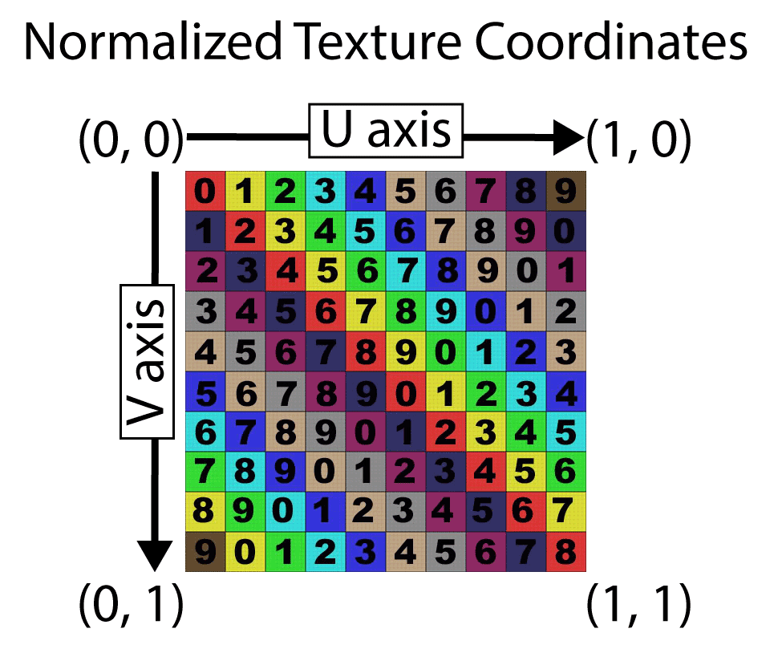

<div class="caption">

The image shows an example of normalized texture coordinates. The top-left image has texture coordinate (0, 0) and the bottom-right has texture coordinate (1, 1).

</div>

Normalized texture coordinates can be mapped to the vertices of a mesh without the need consider the dimensions of the texture that is applied to the mesh during rendering. Using normalized texture coordinates allows resolution of the texture to change without the need to adjust the texture coordinates. This is important when *mipmapping* is used.

### Mipmapping

Mipmapping is the process of generating a series of images from a texture where each images in the series is half the size of the previous image. This is also referred to as a *mipmap chain*.

<span id="attachment-8976"></span>

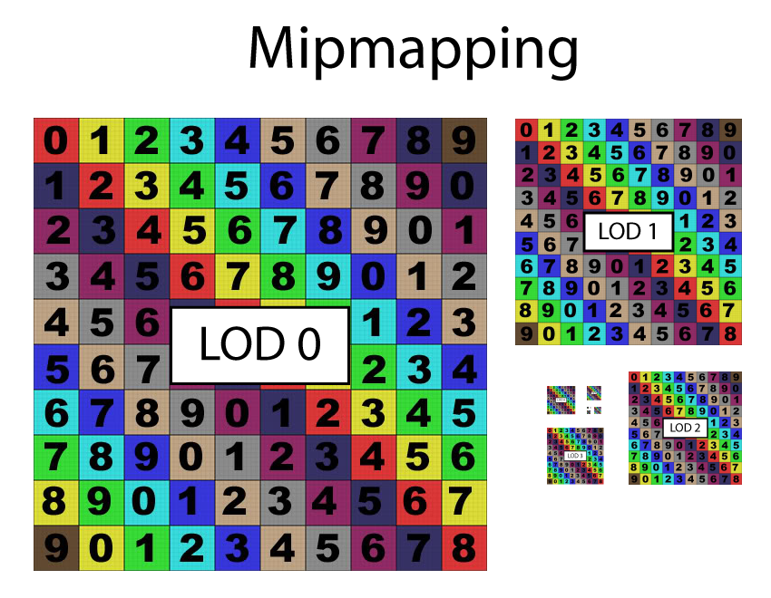

<div class="caption">

Mipmapping is the process of generating a series of images where each image in the series is half the size of the previous image.

</div>

As can be seen in the image above, the first *Level of Detail* (**LOD**) image is LOD 0. This is the first mipmap in the mipmap chain and represents the original image. The second image in the mipmap chain is LOD 1 and it is half of the size of LOD 0 (in both the width and height. The number of images in the mipmap chain is $\log_2(n)$ where $n$ is the number of texels on the longest dimension (maximum of either width or height) of the original texture. The halving of image stops when both the width and height of the resulting LOD level is 1. That is, the resolution of the image at the highest LOD level is 1×1.

Mipmapping works best with *power of two* textures. A power of two texture has dimensions that are powers of two in both the width and height of the texture. A power of two value can be halved until it reaches 1 without getting any odd or fractional values. For example, a texture that is 1024×1024 ($2^{10}$) can be halved exactly 10 times before reaching the highest LOD level resulting in a total of 11 mips (LOD 0 – 10).

| Dimension | LOD |
| --- | --- |
| 1024×1024 | 0 |
| 512×512 | 1 |
| 256×256 | 2 |
| 128×128 | 3 |
| 64×64 | 4 |
| 32×32 | 5 |
| 16×16 | 6 |
| 8×8 | 7 |
| 4×4 | 8 |
| 2×2 | 9 |
| 1×1 | 10 |

When a texture is not exactly a power of two, then at least one LOD in the mipmap chain will have an odd size (for example 5×5) which results in the next image in the mipmap chain being less than half of the previous image (in this case, the next image in the mipmap chain will have a size of 2×2). If this is not taken into consideration during mipmap generation then the resulting mipmap could contain visual artifacts that will cascade into higher level mipmaps. This issue will be addressed in the compute shader that performs mipmap generation.

The primary benefit of mipmapping is seen in the improved filtering when viewing the texture from far away. Without mipmapping, visible artifacts appear in the rendered image in the form of noise.

<span id="attachment-5782"></span>

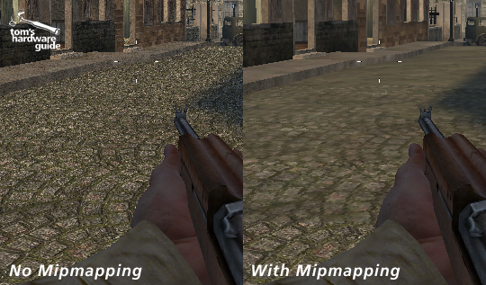

<div class="caption">

Without mipmapping (left) visible noise will be present in objects far away from the screen. With mipmapping (right) the image is pre-filtered to provide a more accurate result.

</div>

The above image demonstrates the result of not mipmapping the textures. In this case, the rendered image on the left appears noisy due to the texture being undersampled. Undersampling occurs when a single screen pixel maps to multiple texels in the texture. If all of the texels that are covering the screen pixel are not taken into consideration during rendering, then the image will appear noisy since neighboring pixels in screen space can be far apart in texture space resulting in a rapid changes in color across neighboring screen pixels.

<span id="attachment-8986"></span>

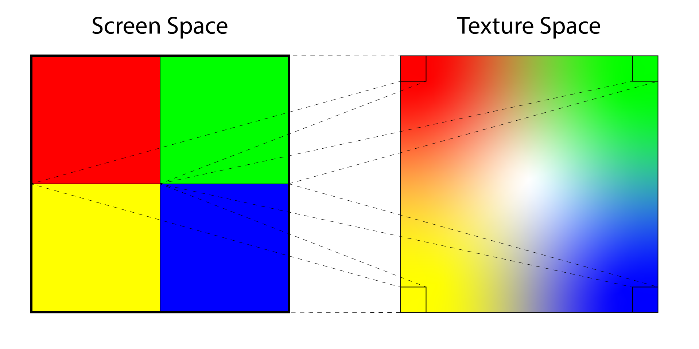

<div class="caption">

Undersampling occurs when a single screen pixel (left) maps to multiple texels in texture space (right). The result is noise in the rendered image.

</div>

The image above demonstrates the issue that occurs when the texture is not mipmapped. On the left side of the image are four screen pixels. On the right is the texture that is being sampled to produce the color of each pixel. If the texture is sufficiently far away from the viewer then the resulting pixel colors will be very different from each other resulting in visible noise in the rendered image. Without mipmapping, the only way to resolve this issue is to sample more texels per screen pixel and blend the sampled texels to produce the final color. But how many texels from the texture should be sampled? The number of texels to sample from the texture to produce the correct color is dependent on the area of the texture that is being covered by the screen pixel. If the entire texture can fit in a the space of a single screen pixel (this can happen if the object being rendered is very far away from the viewer) then every single texel in the texture needs to be sampled to produce the correct result. A 512×512 texture would require 262,144 samples (for each screen pixel) to produce the correct color. Obviously this is not practical so pre-filtering the texture using mipmapping provides a solution to this problem.

Besides the improved image quality the other benefit of mipmapping is texture caching. When multiple screen pixels all sample from the same area in texture space then the results can be cached in high speed memory. When the pixels are sampling from a higher mipmap level (depending on the amount of cache memory) then the entire mipmap level can be stored in high speed cache and future samples from that texture are extremely fast relative to sampling from global texture memory. If the texture is not mipmapped then it can be the case that different pixels are sampling from the texture that are not close together (as demonstrated in the image above) and in that case, every sample from the texture will invalidate the cache forcing the texture sampler to fetch data from the global texture memory.

### Texture Sampler

In the previous section, the term *sample* is used to indicate that the texels from a texture are being read. In this section, *sampling* is further defined. There are several options that the graphics programmer can specify which have an impact on how the texture is sampled. These options include *filtering*, *address modes*, *LOD bias* and *LOD clamping*, *comparison function*, and *border color*.

#### Filter

The filter option of the texture sampler determines how the fetched texel is blended with its neighboring pixels to produce the final color. There are three filtering methods: *point*, *linear*, and *anisotropic*. Point filtering will return the color of the closest texel to the point being sampled. This is the cheapest sampling method because it only performs a single read from the texture and does not perform any blending between neighboring texels. Linear filtering will apply a bi-linear blend between the closest texels to the sampled sub-texel using the distance to the center of the texel as the weight used to blend the texels to obtain the final texel. Anisotropic filtering samples the texels in the texture using a sampling pattern that more closely matches the pixel coverage in texture space. If a rendered triangle appears at an oblique angle to the viewer then more texels that appear further away from the viewer are sampled than the ones that are close to the viewer. Anisotropic filtering is relatively expensive and should only be used when rendering surfaces that appear at oblique angles to the viewer such as ground and terrain textures.

<span id="attachment-8991"></span>

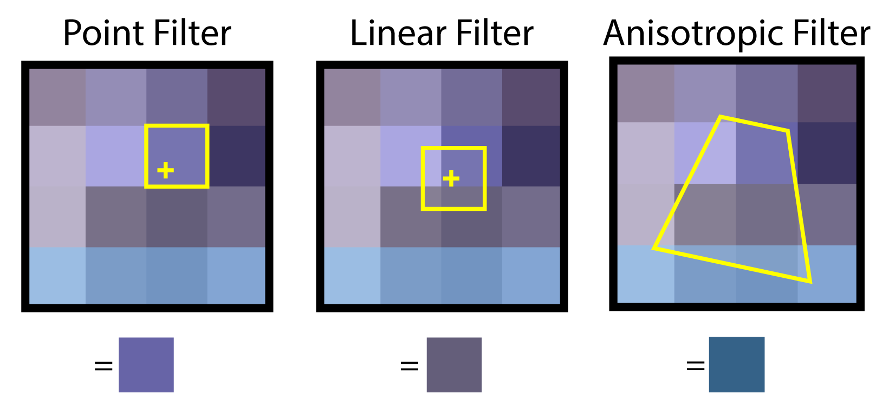

<div class="caption">

Point filtering (left) reads a single texel. Linear filtering reads several texels and blends the result. Anisotropic filtering reads (4, 8 or 16) texels in a pattern that matches the covered area in texture space.

</div>

Anisotropic filtering can produce a better result than point and linear filtering at the cost of being more expensive to compute. The image below shows an example of using anisotropic filtering to improve the visual quality of the ground textures.

<span id="attachment-5833"></span>

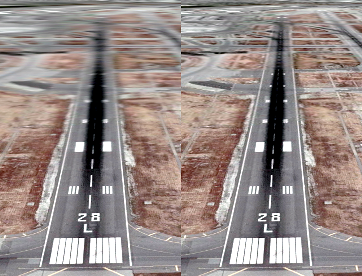

<div class="caption">

Linear filtering (left) produces noticeable blurring on surfaces that appear at oblique angles to the viewer. Anisotropic filtering (right) can improve the appearance of surfaces that appear at oblique angles to the viewer.

</div>

#### Mipmap Filtering

Mipmap filtering determines how the different mipmaps in a mipmap chain are sampled to produce the final color. Neighboring mipmaps in the mipmap chain can also be blended using point, linear, or anisotropic filtering.

<span id="attachment-8994"></span>

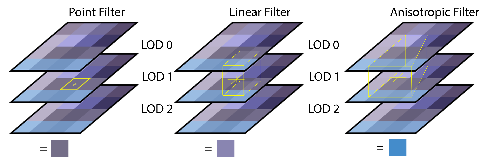

<div class="caption">

Point mipmap filtering (left) samples from the closest mipmap. Linear mipmap filtering (middle) samples from the two closest mipmaps. Anisotropic mipmap filtering samples from the two closest mipmaps using a pattern that matches the covered texels.

</div>

#### Address Mode

Texture addressing modes allows you to specify how to handle texture coordinates that are outside of the range $[0 \cdots 1]$. There are currently five different address modes in DirectX 12; *wrap*, *mirror*, *clamp*, *border*, and *mirror once*.

##### Wrap

The *wrap* address mode will tile the texture at whole number boundaries. This is performed by simply taking the fractional component of the texture coordinate. If the texture coordinate is negative, then the fractional component is subtracted from 1. For example, the texture coordinate of $(3.25, 3.75)$ becomes $(0.25, 0.75)$ and the texture coordinate $(-0.01, -2.25)$ becomes $(0.99, 0.75)$.

The following pseudocode algorithm helps to explain this technique.

```cpp title="Wrap Address Mode" showLineNumbers
if texCoord > 1 then
    texCoord = frac(texCoord)
else if texCoord < 0 then
    texCoord = 1 - frac(texCoord)
end if
```

Where `frac` returns the fractional part of the texture coordinate.

The image below shows an example of using wrap addressing mode. The yellow lines show the texture coordinate integer boundaries.

<span id="attachment-5816"></span>

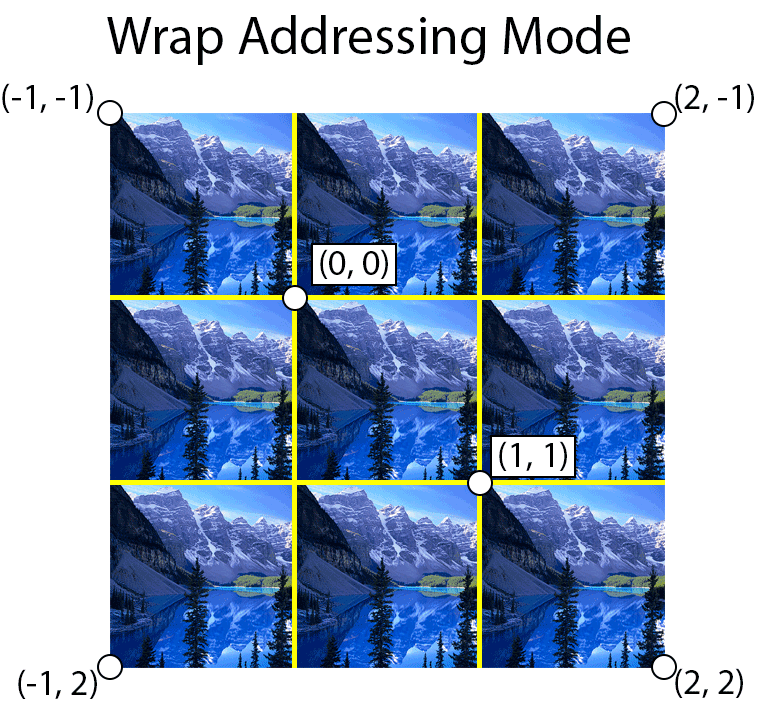

<div class="caption">

Using wrap address mod, the texture is tiled at integer boundaries.

</div>

##### Mirror

The *mirror* texture address mode will flip the UV coordinates at every integer boundary. For example, texture coordinates in the range $[0 \cdots 1]$ are treated normally but texture coordinates in the range $(1 \cdots 2]$ are flipped (by subtracting the fractional part of the texture coordinate by 1) and texture coordinates in the range $(2 \cdots 3]$ will be treated normally again.

The following pseudocode algorithm helps to explain this technique.

```cpp title="Mirror Address Mode" showLineNumbers
if texCoord is odd then
    texCoord = 1 - frac(texCoord)
else
    texCoord = frac(texCoord)
end if
```

The image below shows an example of using mirror addressing mode. The yellow lines show the texture coordinate integer boundaries.

<span id="attachment-5817"></span>

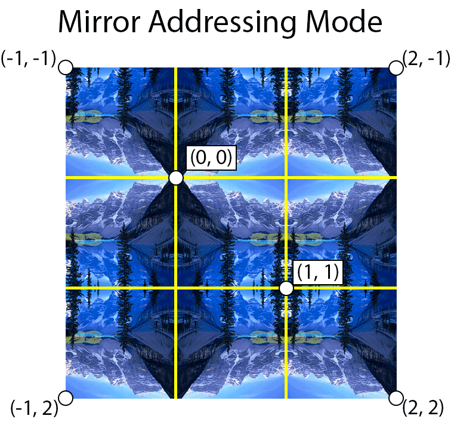

<div class="caption">

Mirror address mode mirrors the texture along integer boundaries.

</div>

##### Clamp

Using *clamp* address mode, texture coordinates are clamped in the range $[0 \cdots 1]$.

The following pseudo code demonstrates this technique.

```cpp title="Clamp Address Mode" showLineNumbers
if texCoord > 1 then
    texCoord = 1
else if texCoord < 0 then
    texCoord = 0
end if
```

The picture below demonstrates clamp addressing mode. The yellow lines show the texture coordinate integer boundaries.

<span id="attachment-5824"></span>

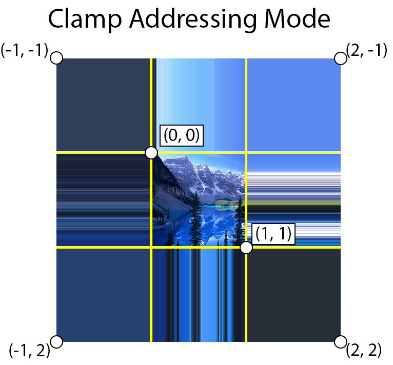

<div class="caption">

Using clamp address mode, texture coordinates are clamped to the range $[ 0 \cdots 1 ]$

</div>

##### Border

*Border* addressing mode uses a specified border color when the texture coordinates are outside of the range $[0 \cdots 1]$.

The following pseudocode demonstrates this technique.

```cpp title="Border Address Mode" showLineNumbers
if texCoord < 0 or texCoord > 1 then
    return borderColor
end if
```

Suppose we set the border color is set to magenta, then the image below demonstrates *border* addressing mode. The yellow lines show the texture coordinate integer boundaries.

<span id="attachment-5826"></span>

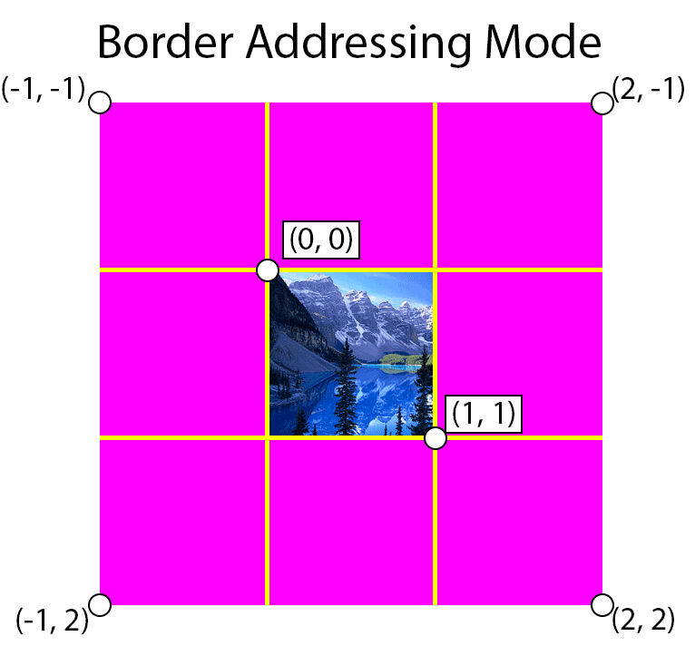

<div class="caption">

Border address mode returns the border color when the texture coordinate is outside the range $[0 \cdots 1]$.

</div>

##### Mirror Once

The *mirror once* address mode takes the absolute value of the texture coordinate and clamps the value to 1.

The following pseudocode demonstrates this technique.

```cpp title="Mirror Once Address Mode" showLineNumbers
texCoord = abs(texCoord)
if texCoord > 1 then
    texCoord = 1
end if
```

The image below demonstrates the mirror once address mode.

<span id="attachment-9003"></span>

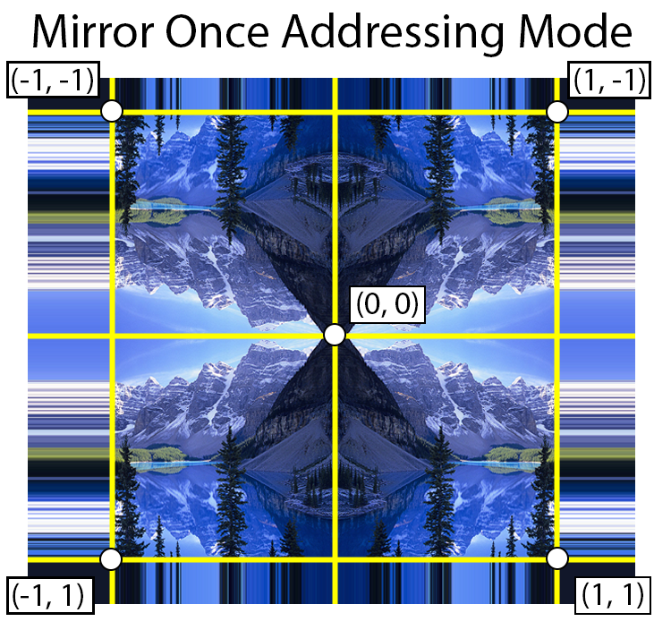

<div class="caption">

Mirror once address mode takes the absolute value of the texture coordinate and clamps the resulting value to 1.

</div>

##### Mipmap LOD Levels

It is also possible to specify the minimum and maximum mipmap LOD levels in a texture sampler.

Recall that the mipmap LOD level of the most detailed (highest resolution) texture is 0 and the smallest mipmap LOD level is $\log_2(n)$ where $n$ is the number of texels on the longest edge of the image. By specifying the `MinLOD` and `MaxLOD` values in a texture sampler, we can limit the range of texture LOD levels that will be used while sampling from the texture.

By default, the `MinLOD` parameter is set to `-FLT_MAX` and the `MaxLOD` parameter is set to `FLT_MAX` which disables any LOD limits.

We can also specify a LOD bias which will offset the computed LOD when sampling the texture. For example, if we have a LOD bias of 1 and the computed LOD level is 3, then the mipmap texture at LOD level 4 will actually be used to sample the texture. This is useful in cases where you would like to force the graphics program to use a lower (or higher if you use a negative LOD bias) LOD level which may help improve quality or performance of your graphics application.

By default the LOD bias parameter is set to 0 which disables the LOD bias.

##### Border Color

The texture sampler also provides a property to specify the border color of the texture. If the [`D3D12_TEXTURE_ADDRESS_MODE_BORDER`](https://learn.microsoft.com/windows/win32/api/d3d12/ne-d3d12-d3d12_texture_address_mode) texture address mode is used to sample the texture, then the border color will be returned when the texture coordinates are out of the range $[0 \cdots 1]$. (See [Border](#border) address mode).

Sampling from textures in a shader is applied in the next lesson. For now it is sufficient to have a basic understanding of the various terms used when discussing textures. Loading the texture data into GPU memory is the subject of the next sections.

## Loading Textures

A new method for loading textures is added to the [`CommandList`](/learning-directx-12-3/#custom-command-list) class that is described in the [previous lesson](/learning-directx-12-3/). As mentioned in the introduction of this lesson, the [DirectXTex](https://github.com/Microsoft/DirectXTex) library is used to perform texture loading. The DirectXTex library provides several functions for loading textures from disk depending of the format of the image file.

-   [`LoadFromDDSFile`](https://github.com/Microsoft/DirectXTex/wiki/DDS-I-O-Functions#loadfromddsmemory-loadfromddsfile): Loads DDS files from disk. This function supports loading of many legacy Direct3D 9 and all Direct3D 10/11 DDS encoded files.
-   [`LoadFromHDRFile`](https://github.com/Microsoft/DirectXTex/wiki/HDR-I-O-Functions#loadfromhdrmemory-loadfromhdrfile): Loads HDR files from disk. This function supports loading of [RGBE](https://en.wikipedia.org/wiki/RGBE_image_format) (Radiance HDR) files.
-   [`LoadFromTGAFile`](https://github.com/Microsoft/DirectXTex/wiki/TGA-I-O-Functions#loadfromtgamemory-loadfromtgafile): Loads HDR files from disk. This function supports loading of [Targa Truvision](https://en.wikipedia.org/wiki/Truevision_TGA) (TGA) files.
-   [`LoadFromWICFile`](https://github.com/Microsoft/DirectXTex/wiki/WIC-I-O-Functions#loadfromwicmemory--loadfromwicfile): Loads BMP, PNG, GIF, TIFF, JPEG, and JPEG-XR / HD Photo images using the Windows Imaging Component (WIC) library. This function is used when the file extension is not DDS, HDR, or TGA.

The [`CommandList`](/learning-directx-12-3/#custom-command-list) class provides a single `LoadTextureFromFile` method to generalize texture loading. The file extension of the file being loaded is used to determine which method to use to load the actual file.

### CommandList::LoadTextureFromFile

The `LoadTextureFromFile` method is used to load a texture file and store the result in a GPU texture. The `DirectXLib` project used throughout these lessons defines a [`Texture`](https://github.com/jpvanoosten/LearningDirectX12/blob/v0.0.4/DX12Lib/inc/Texture.h) class that is used to hold the [`ID3D12Resource`](https://learn.microsoft.com/windows/win32/api/d3d12/nn-d3d12-id3d12resource) for the texture in GPU memory. The details of the `Texture` class is not described here but the source code is available on [GitHub](https://github.com/jpvanoosten/LearningDirectX12).

```cpp source="LearningDirectX12-v0.0.4/CommandList.cpp#L223-L229"
```

The `LoadTextureFromFile` method defined on line 223 takes the following parameters:

-   [`Texture`](https://github.com/jpvanoosten/LearningDirectX12/blob/v0.0.4/DX12Lib/inc/Texture.h)`& texture`: The texture object that will store the loaded texture resource.
-   `const` [`std::wstring`](https://en.cppreference.com/cpp/string/basic_string)`& fileName`: The absolute or relative path the to texture file.
-   [`TextureUsage`](https://github.com/jpvanoosten/LearningDirectX12/blob/v0.0.4/DX12Lib/inc/TextureUsage.h) `textureUsage`: Describes how the texture will be used. Depending how the texture is used, it may require special handling. For example an albedo texture usually requires gamma correction to be applied before sampling. A normal map or heightmap texture should not require gamma correction to be applied before sampling from the texture. The [`TextureUsage`](https://github.com/jpvanoosten/LearningDirectX12/blob/v0.0.4/DX12Lib/inc/TextureUsage.h) type is an enumeration. The source code for the [`TextureUsage`](https://github.com/jpvanoosten/LearningDirectX12/blob/v0.0.4/DX12Lib/inc/TextureUsage.h) type can be see on [GitHub here](https://github.com/jpvanoosten/LearningDirectX12/blob/v0.0.4/DX12Lib/inc/TextureUsage.h).

The [`std::filesystem`](https://en.cppreference.com/cpp/filesystem) library is aliased as `fs` and the [`fs::path`](https://en.cppreference.com/cpp/filesystem/path) class is used on line 225 to represent the path to the texture file. On line 226 the file path is checked for validity. If the file could not be found, then a `std::exception` is thrown.

```cpp source="LearningDirectX12-v0.0.4/CommandList.cpp#L231-L239"
```

To avoid loading the same texture multiple times (this could happen if multiple model or materials all reference the same texture file) a texture cache is used. The `ms_TextureCache` is a [`std::map`](https://en.cppreference.com/cpp/container/map) that maps the texture filename to a texture resource. The `ms_TextureCache` is a simplified version of a resource manager class. For this project, a complicated resource manager is not required.

Since the texture cache is a global variable, access to the texture cache needs to be protected from being read or written to by multiple threads at the same time. The `ms_TextureCacheMutex` ([`std::mutex`](https://en.cppreference.com/cpp/thread/mutex)) is used on line 231 to ensure that only a single thread is able to read or write from the texture cache at the same time.

If the texture is found in the texture cache, then the texture’s usage and resource are assigned to the passed-in texture object. The `Texture::CreateViews` method ensures that any resource views are created for the texture instance. On line 238, the file name of the texture is assigned to the resource in case the texture needs to be identified later.

If the texture is not found in the texture cache, then the texture needs to be loaded from disk.

```cpp title="CommandList.cpp" showLineNumbers startLineNumber=240
    else
    {
        TexMetadata metadata;
        ScratchImage scratchImage;

        if ( filePath.extension() == ".dds" )
        {
            ThrowIfFailed( LoadFromDDSFile( 
                fileName.c_str(),
                DDS_FLAGS_FORCE_RGB, 
                &metadata,
                scratchImage));
        }
        else if ( filePath.extension() == ".hdr" )
        {
            ThrowIfFailed( LoadFromHDRFile( 
                fileName.c_str(), 
                &metadata, 
                scratchImage ) );
        }
        else if ( filePath.extension() == ".tga" )
        {
            ThrowIfFailed( LoadFromTGAFile( 
                fileName.c_str(), 
                &metadata, 
                scratchImage ) );
        }
        else
        {
            ThrowIfFailed( LoadFromWICFile( 
                fileName.c_str(), 
                WIC_FLAGS_FORCE_RGB, 
                &metadata, 
                scratchImage ) );
        }
```

The `LoadFromDDSFile`, `LoadFromHDRFile`, `LoadFromTGAFile`, and `LoadFromWICFile` functions all take a pointer to a `TexMetadata` structure and a reference to a `ScratchImage` class as arguments. Both the `TexMetadata` structure and the `ScratchImage` class are provided by the [DirectXTex](https://github.com/Microsoft/DirectXTex) library. If the texture is loaded successfully, the `TexMetadata` structure contains the width, height, and (depth for 3D textures) as well as the [`DXGI_FORMAT`](https://learn.microsoft.com/windows/win32/api/dxgiformat/ne-dxgiformat-dxgi_format) of the loaded texture. The `ScratchImage` class contains the pixel data for the texture.

:::note
The `DDS_FLAGS_FORCE_RGB` and `WIC_FLAGS_FORCE_RGB` flags cause BGR texture formats to be converted to RGB. RGB texture formats are more common and easier to use for mipmap generation.
:::

```cpp title="CommandList.cpp" showLineNumbers startLineNumber=260
        if ( textureUsage == TextureUsage::Albedo )
        {
            metadata.format = MakeSRGB( metadata.format );
        }
```

On line 260, the texture usage is checked. If the texture is intended to be used as an albedo texture (to be applied to a model for rendering), then the texture format returned in the `TexMetadata` structure is converted to an sRGB format (if it isn’t already). Converting the texture format to an sRGB format does not change the way the texture is stored. Textures with an sRGB format will have gamma correction applied on them before being read in the shader. This alleviates the need to perform gamma correction on the texture before applying lighting calculations. Gamma correction is discussed in more detail later in the lesson. The `MakeSRGB` method is provided by the [DirectXTex](https://github.com/Microsoft/DirectXTex) library.

The next step is to describe the GPU resource based on the `TexMetadata` that was returned from one of the previous load functions.

```cpp source="LearningDirectX12-v0.0.4/CommandList.cpp#L276-L302"
```

The description of the resource is created based on the texture dimension (1D, 2D, or 3D) using the static helper methods of the [`CD3DX12_RESOURCE_DESC`](https://learn.microsoft.com/windows/win32/direct3d12/cd3dx12-resource-desc) structure provided by the [`d3dx12.h`](https://github.com/Microsoft/DirectX-Graphics-Samples/tree/master/Libraries/D3DX12) header file.

With the texture description defined, the GPU resource for the texture can now be created.

```cpp source="LearningDirectX12-v0.0.4/CommandList.cpp#L304-L322"
```

On line 304, a pointer to the [ID3D12Device](https://learn.microsoft.com/windows/win32/api/d3d12/nn-d3d12-id3d12device) is retrieved from the `Application` class.

On line 307 the texture is created as a committed resource using the [`ID3D12Device::CreateCommittedResource`](https://learn.microsoft.com/windows/win32/api/d3d12/nf-d3d12-id3d12device-createcommittedresource) method. The details of the [`ID3D12Device::CreateCommittedResource`](https://learn.microsoft.com/windows/win32/api/d3d12/nf-d3d12-id3d12device-createcommittedresource) method is described in [Lesson 2](/learning-directx-12-2/) and for reasons of brevity is not described again here.

On lines 304-307 the newly created texture resource is assigned to the `texture` object that is passed to the function.

The [`ResourceTracker`](/learning-directx-12-3/#resource-state-tracking) class is described in detail in [Lesson 3](/learning-directx-12-3/). The [`ResourceStateTracker::AddGlobalResourceState`](/learning-directx-12-3/#resourcestatetrackeraddglobalresourcestate) method is also described in that lesson. In this case, the newly created resource is added to the resource state tracker to ensure the resource is transitioned to the correct state as needed.

The [`ID3D12Device::CreateCommittedResource`](https://learn.microsoft.com/windows/win32/api/d3d12/nf-d3d12-id3d12device-createcommittedresource) method is used to allocate the texture resource in GPU memory. With the texture resource created, the loaded texture data is copied to the resource in GPU memory.

```cpp source="LearningDirectX12-v0.0.4/CommandList.cpp#L324-L338"
```

The pixel data for the texture is stored in the `ScratchImage` class provided by the [DirectXTex](https://github.com/microsoft/DirectXTex) library. This class provides the `ScratchImage::GetImageCount` and `ScratchImage::GetImages` methods that are used to gain access to the underlying pixel data for the (sub)resources of the texture (for example, the mipmaps if they are already available).

On lines 326-332 the (sub)images of the texture are loaded into an array of [`D3D12_SUBRESOURCE_DATA`](https://learn.microsoft.com/windows/win32/api/d3d12/ns-d3d12-d3d12_subresource_data) structures. The pixel data is copied to the GPU resource using the [`CopyTextureSubresource`](#commandlistcopytexturesubresource) method. The [`CopyTextureSubresource`](#commandlistcopytexturesubresource) method is described in the next section.

```cpp source="LearningDirectX12-v0.0.4/CommandList.cpp#L340-L343"
```

If the number of subresource found in the image is less than the number of mip levels of the texture, then the mipmaps for the texture are generated on line 342 using the `GenerateMips` method. The `GenerateMips` method is described in the next, next section.

```cpp source="LearningDirectX12-v0.0.4/CommandList.cpp#L345-L348"
```

At this point, the texture should be loaded (or will be loaded once the command list is executed on the command queue). On line 346 the texture resource is added to to the `ms_TextureCache` map to ensure the texture is not loaded twice.

In the next section the `CopyTextureSubresource` method is described in more detail.

### CommandList::CopyTextureSubresource

The `CopyTextureSubresource` method is used to copy the pixel data from the [`D3D12_SUBRESOURCE_DATA`](https://learn.microsoft.com/windows/win32/api/d3d12/ns-d3d12-d3d12_subresource_data) array into the specified subresource of the texture.

The pixel data cannot be copied directly to the destination texture resource. Instead, an intermediate buffer that is large enough to hold all of the subresource is created in an upload heap. The pixel data is first copied to the intermediate buffer then a GPU command to copy the data from the intermediate buffer to the texture resource is issued on the command list. It is important to realize that the destination resource will only receive the pixel data after the command list has been executed on the GPU. This is important to understand when generating mipmaps using a compute shader on the GPU. The resource must be available in the texture before trying to read the data from the texture in a compute shader!.

```cpp source="LearningDirectX12-v0.0.4/CommandList.cpp#L691-L694"
```

The `CopyTextureSubresource` method takes the following parameters:

-   `Texture& texture`: The texture to copy the pixel data to.
-   `uint32_t firstSubresource`: The first subresource of the texture to start copying to.
-   `uint32_t numSubresources`: The total number of subresources to copy. This should be the number of resources in the `subresourceData` array.
-   [`D3D12_SUBRESOURCE_DATA`](https://learn.microsoft.com/windows/win32/api/d3d12/ns-d3d12-d3d12_subresource_data)`* subresourceData`: An array of [`D3D12_SUBRESOURCE_DATA`](https://learn.microsoft.com/windows/win32/api/d3d12/ns-d3d12-d3d12_subresource_data) structs. These structures contain a pointer to the pixel data that is to be copied.

On lines 693 the [`ID3D12Device`](https://learn.microsoft.com/windows/win32/api/d3d12/nn-d3d12-id3d12device) is retrieved from the `Application` class. On line 694 the [`ID3D12Resource`](https://learn.microsoft.com/windows/win32/api/d3d12/nn-d3d12-id3d12resource) is retrieved from the passed-in `texture` object.

```cpp source="LearningDirectX12-v0.0.4/CommandList.cpp#L696-L700"
```

Before the texture resource can be used as a destination for a copy operation, it must be transitioned to the [`COPY_DEST`](https://learn.microsoft.com/windows/win32/api/d3d12/ne-d3d12-d3d12_resource_states) state. In order to transition the resource to the correct state, the [`CommandList::TransitionBarrier`](/learning-directx-12-3/#commandlisttransitionbarrier) method is used. The [`TransitionBarrier`](/learning-directx-12-3/#commandlisttransitionbarrier) method is described in [Lesson 3](/learning-directx-12-3/).

The `FlushResourceBarriers` method will flush any pending resource barriers to the command list. The resource barriers must be flushed to the command list before issuing the copy on the command list.

```cpp source="LearningDirectX12-v0.0.4/CommandList.cpp#L702-L713"
```

On line 702 the size of the intermediate buffer that is necessary to copy the subresources to the texture is computed using the [`GetRequiredIntermediateSize`](https://learn.microsoft.com/windows/win32/direct3d12/getrequiredintermediatesize) fuction. This function is provided by the [`d3dx12.h`](https://github.com/microsoft/DirectX-Headers/blob/main/include/directx/d3dx12.h) header file.

The intermediate buffer is created using the [`ID3D12Device::CreateCommittedResource`](https://learn.microsoft.com/windows/win32/api/d3d12/nf-d3d12-id3d12device-createcommittedresource) method. This method is used in [lesson 2](/learning-directx-12-2/#tutorial2updatebufferresource) to create the vertex and index buffers for the scene geometry and isn’t explained again here.

```cpp title="CommandList.cpp" showLineNumbers startLineNumber=776
        UpdateSubresources( m_d3d12CommandList.Get(), destinationResource.Get(), intermediateResource.Get(), 0, firstSubresource, numSubresources, subresourceData );

        TrackObject(intermediateResource);
        TrackObject(destinationResource);
    }
}
```

The pixel data is copied to the destination texture (via the intermediate resource) using the [`UpdateSubresources`](https://learn.microsoft.com/windows/win32/direct3d12/updatesubresources2) function. This function is provided by the [`d3dx12.h`](https://github.com/microsoft/DirectX-Headers/blob/main/include/directx/d3dx12.h) header file.

The [`UpdateSubresources`](https://learn.microsoft.com/windows/win32/direct3d12/updatesubresources2) function takes the following parameters:

-   [`ID3D12GraphicsCommandList`](https://learn.microsoft.com/windows/win32/api/d3d12/nn-d3d12-id3d12graphicscommandlist)`* pCmdList`: The command list to use to perform the copy operation.
-   [`ID3D12Resource`](https://learn.microsoft.com/windows/win32/api/d3d12/nn-d3d12-id3d12resource)`* pDestinationResource`: The resource that will receive the pixel data after the copy operation has completed execution on the command queue.
-   [`ID3D12Resource`](https://learn.microsoft.com/windows/win32/api/d3d12/nn-d3d12-id3d12resource)`* pIntermediate`: An intermediate resource in an upload heap to transfer the pixel data to the destination texture.
-   `UINT64 IntermediateOffset`: The offset, in bytes, to the intermediate resource. If the same intermediate resource is being used used to copy multiple resources, then the copy operation could be instructed to start at a particular byte offset from the beginning of the intermediate resource.
-   `UINT FirstSubresource`: The first subresource of the destination resource to start copying to.
-   `UINT NumSubresources`: The total number of subresources to copy to the destination resource.
-   [`D3D12_SUBRESOURCE_DATA`](https://learn.microsoft.com/windows/win32/api/d3d12/ns-d3d12-d3d12_subresource_data)`* pSrcData`: Pointer to an array (of length `NumSubresources`) of pointers to [`D3D12_SUBRESOURCE_DATA`](https://learn.microsoft.com/windows/win32/api/d3d12/ns-d3d12-d3d12_subresource_data) structures containing descriptions of the subresource data used for the copy.

In order to ensure that the intermediate resource does not get released until after the pixel data is finished copying to the destination texture, both the intermediate resource and the destination resource are added to a list of tracked objects using the `CommandList::TrackObject` method. This method simply adds the object to a vector and ensures that the resources are not released until the command list has finished executing on the command queue. Thanks to the power of the [ComPtr](https://learn.microsoft.com/cpp/cppcx/wrl/comptr-class?view=msvc-170) class, when the vector of tracked objects is cleared, any resource not being referenced elsewhere will automatically be released back to the system.

Before continuing on to explain how mipmapping works, it is important to understand compute shaders in DirectX 12. In the next section, compute shaders are explained.

## Compute Shaders

A **Compute Shader** is a programmable shader stage but it cannot be used in a *graphics pipeline*. Instead, a compute shader must be configured as the only stage of a *compute pipeline*. Similar to vertex and pixel shaders, a compute shader is defined using HLSL in DirectX but a compute shader does not operate on vertices or pixels. A compute shader is used to create a general purpose program. A compute shader can operate on any data. One of the challenges of writing a compute shader is determining how to organize the data (both input and output) that a compute shader operates on.

### Dispatch

A compute shader is executed as a *dispatch*. The *dispatch* can be considered the *execution domain* of the compute shader. A dispatch is executed using the [`ID3D12GraphicsCommandList::Dispatch`](https://learn.microsoft.com/windows/win32/api/d3d12/nf-d3d12-id3d12graphicscommandlist-dispatch) method. The command list type must be either [`D3D12_COMMAND_LIST_TYPE_COMPUTE`](https://learn.microsoft.com/windows/win32/api/d3d12/ne-d3d12-d3d12_command_list_type) or [`D3D12_COMMAND_LIST_TYPE_DIRECT`](https://learn.microsoft.com/windows/win32/api/d3d12/ne-d3d12-d3d12_command_list_type). A dispatch cannot be executed on a *copy* command list.

The [`ID3D12GraphicsCommandList::Dispatch`](https://learn.microsoft.com/windows/win32/api/d3d12/nf-d3d12-id3d12graphicscommandlist-dispatch) method accepts three parameters: `ThreadGroupCountX`, `ThreadGroupCountY`, and `ThreadGroupCountZ`. This implies that the dispatch defines a 3D domain. The maximum number of thread groups that can be dispatched is 65,535 in each the X, Y, and Z dimension [\[1\]](#cite-1). The name *thread group* implies that what is being dispatched is a group of threads. The number of threads in a thread group is determined by the [`numthreads`](https://learn.microsoft.com/windows/win32/direct3dhlsl/sm5-attributes-numthreads) attribute defined in HLSL. A thread group can have a maximum of 1,024 threads ([`D3D12_CS_THREAD_GROUP_MAX_THREADS_PER_GROUP`](https://learn.microsoft.com/windows/win32/direct3d12/constants)) and a maximum of 1,024 threads in the X, and Y dimensions but only 64 threads in the Z dimension.

Thread groups are further divided into *waves* when executed on the GPU. The threads within a *wave* are executed in *lockstep* which means that the instructions in a *wave* are all executed in parallel on a single streaming multiprocessor. The number of threads in a *wave* is dependent on the GPU vendor. The number of threads in a *wave* on a NVidia GPU is typically 32 and 64 on an AMD GPU[\[2\]](#cite-2).

There are several [System Value Semantics](https://learn.microsoft.com/windows/win32/direct3dhlsl/dx-graphics-hlsl-semantics) that can be used to query the index of a thread within a compute shader.

-   [`SV_GroupID`](https://learn.microsoft.com/windows/win32/direct3dhlsl/dx-graphics-hlsl-semantics): The 3D index of the thread group within the dispatch.
-   [`SV_GroupThreadID`](https://learn.microsoft.com/windows/win32/direct3dhlsl/dx-graphics-hlsl-semantics): The 3D index of the thread within a thread group.
-   [`SV_DispatchThreadID`](https://learn.microsoft.com/windows/win32/direct3dhlsl/dx-graphics-hlsl-semantics): The 3D index of the thread within the dispatch.
-   [`SV_GroupIndex`](https://learn.microsoft.com/windows/win32/direct3dhlsl/dx-graphics-hlsl-semantics): The flattened 1D index of the thread within the thread group.

Unfortunately, it is not possible to query the total number of thread groups in a dispatch or the total number of threads in a thread group. The number of groups in a dispatch must be sent as an argument to the compute shader (using a constant buffer or 32-bit constants).

<span id="attachment-9060"></span>

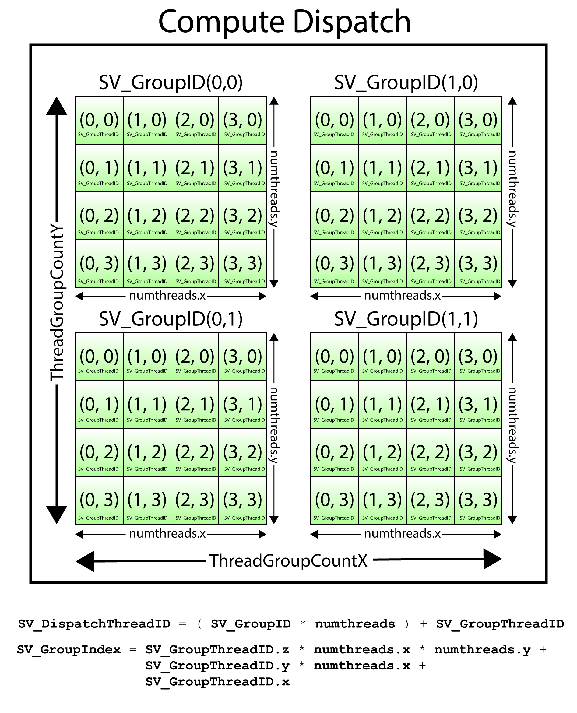

<div class="caption">

A Dispatch consists of a grid of thread groups. Each thread group consists of a grid of threads.

</div>

The `SV_DispatchThreadID` is computed by the sum of `SV_GroupID` ˣ `numthreads` and `SV_GroupThreadID`.

$$
DispatchThreadID = ( GroupID \cdot numthreads ) + GroupThreadID
$$

Where $numthreads$ is the number of threads in a thread group.

The `SV_GroupIndex` is computed using the following formula:

$$
\begin{array}{rcl}
GroupIndex & = & GroupThreadID.z \cdot numthreads.x \cdot numthreads.y \\
& + & GroupThreadID.y \cdot numthreads.x \\
& + & GroupThreadID.x
\end{array}
$$

The above image depicts a Dispatch of $(2, 2, 1)$ thread groups. Each thread group has $(4, 4, 1)$ threads. In this example, the `SV_DispatchThreadID` of the last thread in the dispatch is:

$$
\begin{array}{rcl}
& = & (1, 1, 0) \cdot (4, 4, 1) + (3, 3, 0) \\
& = & (4, 4, 0) + (3, 3, 0) \\
& = & (7, 7, 0)
\end{array}
$$

And the `SV_GroupIndex` of the last thread in the dispatch is:

$$
\begin{array}{rcl}
& = & (0 \cdot 4 \cdot 4) + (3 \cdot 4) + 3 \\
& = & 0 + 12 + 3 \\
& = & 15
\end{array}
$$

### Group Shared Memory

Group shared memory is memory that is shared among all threads in a thread group. According to Microsoft’s documentation, group shared memory is limited to 16KB for D3D10 level hardware and 32KB for D3D11 level hardware[\[3\]](#cite-3)[\[4\]](#cite-4). There is no specification for the amount of shared memory that is available for D3D12. The amount of shared memory actually available to the thread group is dependent on the GPU architecture. For example, the TU102 Turing GPU (RTX 2080 Ti) from NVidia has 96KB of (configurable) shared memory available to compute units[\[5\]](#cite-5).

:::caution
In order to maintain maximum thread occupancy, a compute shader should not declare more than 16KB of group shared memory. In order to mitigate latency incurred by fetches to global memory, a streaming multiprocessor will queue multiple thread groups. If a thread group declares more than the maximum amount of shared memory that can be satisfied by all of the queued thread groups, the thread scheduler will reduce the number of thread groups until the utilized shared memory can be satisfied.
:::

Group shared memory is split into (16 or 32 depending on GPU architecture) equally sized memory banks whose addresses are 32-bit interleaved. The interleaved addresses allow each thread in a *wave* to access a different memory banks without causing bank conflicts. Bank conflicts occur when different threads in *wave* access the same memory bank but not the same address. Bank conflicts can occur more frequently when the access stride between threads in a wave are not increments of 32-bits. When a bank conflict does occur, the memory controller is required to perform multiple reads from shared memory to satisfy all read requests. When no bank conflict occurs, then the memory controller can satisfy all reads from group shared memory in the same amount of time as a single read (reading data from shared memory can be coalesced).

<span id="attachment-2178"></span>

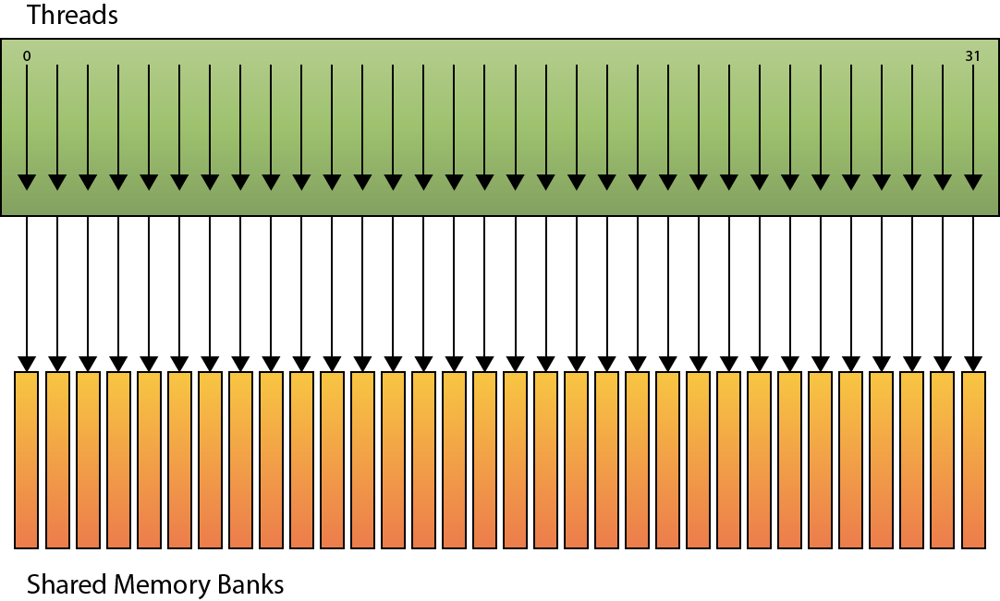

<div class="caption">

Linear Addressing (no bank conflicts)

</div>

It is recommended to ensure that threads in a *wave* access shared memory addresses that are at 32-bit offsets relative to the index of the thread within the thread group (`SV_GroupIndex`). It is also recommended to split memory declared in group shared memory by 32-bit values. For example, it is more efficient to declare four arrays of floats than a single array of 4-component floats.

With a basic understanding of how compute shaders are executed and how memory is organized in group shared memory, a compute shader to generate the mipmaps of a texture can be further defined.

## Generate Mipmaps Compute Shader

Generating mipmaps is the process of computing an image that is half the size of the original image. The process is repeated until a 1×1 image is generated. For the remainder of the discussion, the term *source mip* is used to refer to the mip level that is used as the source of the next mip in the chain and the term *destination mip* is used to refer to the mip that is being generated.

Undersampling occurs when texels from the source mip are not used during downsampling. In order to avoid undersampling from textures with an odd dimension, multiple samples need to be read from the source mip.

Since sRGB textures are not supported for UAV writes, a UAV compatible copy of the original texture is used to perform the mipmapping. Gamma correction must be applied when the original texture has an sRGB format.

Undersampling non power of two textures and sRGB texture formats are discussed in the next sections.

### Non Power of Two

Care must be taken when the image that is being mipmapped is not a *power of two*. As mentioned in the introduction, mipmapping works best on *power of two* textures (textures whose width and height are a *power of two*). *Power of two* textures can be halved all the way to a 1×1 dimension without resulting in a odd value in either the width or height. Halving *non power of two* values will always eventually result in an odd size. Halving an odd number results in a fractional number. *Power of two* textures are not a strict requirement in order to perform mipmapping so this case must be taken into consideration when generating mipmaps.

For example, a 5×5 texture reduces to a size of 2.5×2.5. Of course, it is not possible to have a fraction of a pixel in a texture so the 0.5 must be truncated from the texture’s dimension. If only a single sample is taken from the source mip to generate the destination mip, then the resulting mip will be *undersampled* resulting in a slightly incorrect color in the final mip. If several mip levels are undersampled, noticeable artifacts can appear in the rendered image. In order to avoid undersampling the texture, several samples are taken from the source mip and blended together to produce the destination mip color.

<span id="attachment-9080"></span>

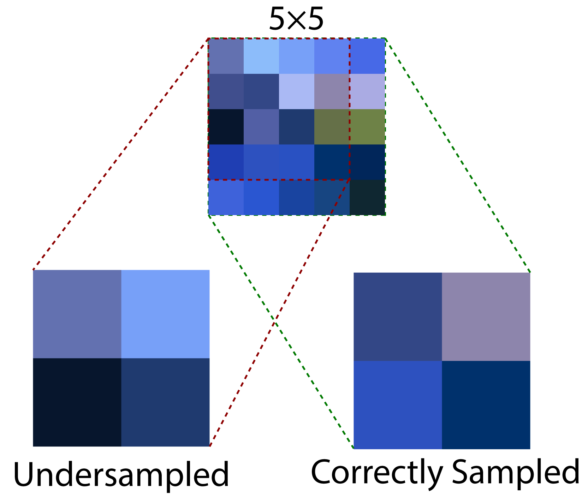

<div class="caption">

Multiple samples need to be read to correctly downsample textures with an odd dimension.

</div>

### sRGB

*sRGB* (standard red, green, and blue) is an RGB color space developed by HP and Microsoft in 1996 for use on monitors, printers, and the internet[\[6\]](#cite-6). sRGB colors are encoded using a transfer function (gamma curve) that was typical of the gamma response of CRT monitors at the time. The sRGB transfer function is still used in current (low dynamic range) LCD screens which is why image compression formats (such as JPEG, and PNG) will typically still encode images in an sRGB format.

<span id="attachment-9084"></span>

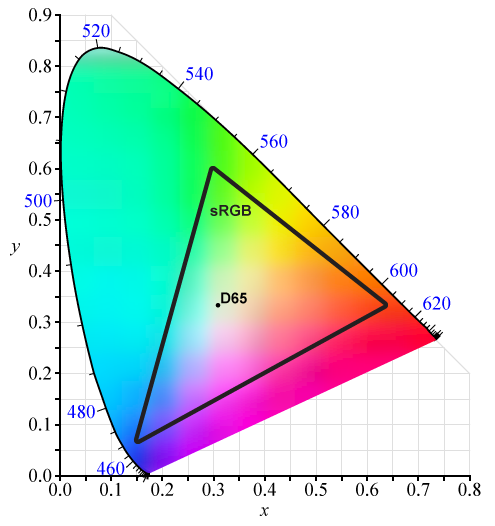

<div class="caption">

CIE 1931 xy chromaticity diagram showing the gamut of the sRGB color space and location of the primaries.

</div>

The sRGB gamma curve is not linear. Instead, it resembles an inverse power function over the domain $[0, 1]$. The following formula is used to convert an sRGB color value into the equivalent linear color[\[7\]](#cite-7):

$$
C_{linear} = \begin{cases} \begin{array}{cr} \frac{C_{sRGB}}{12.92} & C_{sRGB} \leq 0.04045 \\
\left(\frac{C_{sRGB} + 0.055}{1.055}\right)^{2.4} & C_{sRGB} > 0.04045 \end{array} \end{cases}
$$

Where $C_{sRGB}$ is the sRGB color value (read from the texture) and $C_{linear}$ is the linear color value.

<iframe class="embed embed-desmos" src="https://www.desmos.com/calculator/swnathc6og?embed" title="Desmos graph" style="max-width: 500px; aspect-ratio: 500 / 500" loading="lazy" allowfullscreen></iframe>

The red solid line in the graph above is the exact sRGB curve[\[7\]](#cite-7). The red dotted line is the 2.2 gamma curve. The sRGB transfer function is used to avoid slopes approaching $\infty$ near 0.

And the following formula is used to convert the linear color to the sRGB equivalent:

$$
C_{sRGB} = \begin{cases} \begin{array}{cr} 12.92 \cdot C_{linear} & C_{linear} \leq 0.0031308 \\
(1.055 \cdot C_{linear})^{1/2.4}-0.055 & C_{linear} > 0.0031308 \end{array} \end{cases}
$$

Since sRGB image formats are not compatible with UAV loads and stores[\[8\]](#cite-8), a resource with a UAV compatible format is created in order to perform the mipmapping. If the original texture contains a sRGB image format, then the texels sampled from the texture must be linearized (using the sRGB to Linear equation shown above) before blending. When storing the blended texel to the destination mip, the blended texel must be converted back to sRGB (using the Linear to sRGB equation shown above).

Non power of two textures as well sRGB image formats are handled in the compute shader described in the next section.

### The Compute Shader

The compute shader to generate mipmaps is based on [`GenerateMipsCS.hlsli`](https://github.com/Microsoft/DirectX-Graphics-Samples/blob/master/MiniEngine/Core/Shaders/GenerateMipsCS.hlsli) compute shader from the [Microsoft DirectX Samples](https://github.com/Microsoft/DirectX-Graphics-Samples) that are available on [GitHub](https://github.com/). The compute shader shown here is slightly modified to work with the tutorial code shown later in this lesson.

```hlsl source="LearningDirectX12-v0.0.4/GenerateMips_CS.hlsl#L1-L6"
```

The `BLOCK_SIZE` macro defines the size of a thread group in a single dimension (width and height). The size of the thread group must be hard-coded in the shader during shader compilation. If the size of a thread group is known at compile time, the compute shader can be written for this specific group size. In this case, thread groups will have a size of 8×8 for a total of 64 threads per group. This is a good choice for a thread group size because it is evenly divisible by 32 (the size of a *warp* on a NVidia GPU) and 64 (the size of a *wavefront* on an AMD GPU).

```hlsl title="GenerateMips_CS.hlsl" showLineNumbers startLineNumber=16
#define WIDTH_HEIGHT_EVEN 0     // Both the width and the height of the texture are even.
#define WIDTH_ODD_HEIGHT_EVEN 1 // The texture width is odd and the height is even.
#define WIDTH_EVEN_HEIGHT_ODD 2 // The texture width is even and the height is odd.
#define WIDTH_HEIGHT_ODD 3      // Both the width and height of the texture are odd.
```

The macros defined on lines 16-19 are used to determine the code path to follow depending on the size of the source mip. As previously mentioned, if the dimension of the source mip is odd (not evenly divisible by 2) then more samples need to be read from the source texture to generate the destination mip.

```hlsl source="LearningDirectX12-v0.0.4/GenerateMips_CS.hlsl#L21-L27"
```

The `ComputeShaderInput` structure is used to capture all of the system value semantic values that are passed to a compute shader.

:::note
The `ComputeShaderInput` structure shown here defines more parameters than are actually used in the shader shown in this lesson. I use this structure as an input parameter to all compute shaders I write (as a convention).
:::

```hlsl source="LearningDirectX12-v0.0.4/GenerateMips_CS.hlsl#L29-L36"
```

The `GenerateMipsCB` constant buffer is used to define all of the constant parameters that are sent to the compute shader. The `SrcMipLevel` is the mip level of the source texture.

The `NumMipLevels` is the number of mips to generate. A maximum of four mips can be generated in a single dispatch of the compute shader but in some cases, less than four mips are generated.

The `SrcDimension` is a bitmask that is used to determine if the source mip is odd in either the width or the height (or both) according to the following table.

| Bitmask | Description |
| --- | --- |
| `0b00` (0) | Both width and height are even. |
| `0b01` (1) | Width is odd, height is even. |
| `0b10` (2) | Width is even, height is odd. |
| `0b11` (3) | Both width and height are odd. |

The `IsSRGB` variable is `true` if the original texture is an sRGB texture. Since sRGB textures can’t be used for UAV stores, then a non sRGB texture is used when performing mipmapping. If the original texture is an sRGB texture, then gamma correction must be applied in the compute shader when reading / writing the UAV compatible texture.

The `TexelSize` parameter is used to compute the offset of a single texel (using normalized texture coordinates) in the destination mip. This is used to compute the texture coordinate offset for multiple samples in the case of an odd dimension.

```hlsl source="LearningDirectX12-v0.0.4/GenerateMips_CS.hlsl#L38-L48"
```

The `SrcMip` is the source mip level from the texture to perform sampling on. The `OutMip` parameters are the destination mips being generated. Each `OutMip` parameter refers to a successive mip after the source mip. For example, if mip level 5 of the original texture is used for the `SrcMip`, then `OutMip1` is mip level 6 of the original texture, `OutMip2` is mip level 7, and so forth.

The `LinearClampSampler` is used to sample the texture using *linear* filtering and a *clamp* addressing mode. Texture filtering and texture address modes are discussed in the [Texture Sampler](#texture-sampler) section above.

```hlsl source="LearningDirectX12-v0.0.4/GenerateMips_CS.hlsl#L50-L59"
```

The root signature for a programmable shader can be specified directly in the HLSL code using a string macro. This root signature defines an inline constant buffer at index 0. Index 1 and 2 of the root signature defines descriptor tables. The first descriptor table is used to pass the shader resource view (SRV) for the *source mip* (`SrcMip`). The second descriptor table is used to pass the unordered access views (UAV) for the destination mips (`OutMip1`–`OutMip4`).

The `LinearClampSampler` is defined as a static sampler directly in the root signature on line 55.

```hlsl source="LearningDirectX12-v0.0.4/GenerateMips_CS.hlsl#L61-L67"
```

In order to avoid memory bank conflicts (as described in the [Group Shared Memory](#group-shared-memory) section above), group shared memory is split into four arrays of 32-bit values. When downsampling more than once (more than a single mip level) then samples from other threads in a thread group can be shared in group shared memory in order to avoid threads needing to sample from global texture memory more than once.

```hlsl source="LearningDirectX12-v0.0.4/GenerateMips_CS.hlsl#L69-L75"
```

The `StoreColor` method is used to swizzel a four-component color value to the separate memory banks in shared memory.

```hlsl source="LearningDirectX12-v0.0.4/GenerateMips_CS.hlsl#L77-L80"
```

The `LoadColor` swizzels the color value from shared memory into a single four-component color value.

```hlsl source="LearningDirectX12-v0.0.4/GenerateMips_CS.hlsl#L82-L86"
```

The `ConvertToLinear` method converts an sRGB color value to its linear equivalent using the method described in the [sRGB](#srgb) section above.

```hlsl source="LearningDirectX12-v0.0.4/GenerateMips_CS.hlsl#L88-L92"
```

The `ConvertToSRB` method converts a linear color value to its sRGB equivalent using the method described in the [sRGB](#srgb) section above.

```hlsl source="LearningDirectX12-v0.0.4/GenerateMips_CS.hlsl#L94-L106"
```

The `PackColor` method converts the four-component color value to sRGB only if the original texture is an sRGB color. If the original texture uses a non-sRGB color format, the `PackColor` method simply returns the original color value.

```hlsl source="LearningDirectX12-v0.0.4/GenerateMips_CS.hlsl#L108-L112"
```

The main entry point for the GenerateMips compute shader is defined on line 110. The `RootSignature` attribute is used to assign the string macro that defines the root signature for the shader.

:::note
It is not required to specify the root signature in HLSL. It is also possible to specify the root signature programmatically in the C++ code and use the C++ code to attach the root signature when creating the pipeline state object. The root signature is declared in HLSL here for illustrative purposes.
:::

The [`numthreads`](https://learn.microsoft.com/windows/win32/direct3dhlsl/sm5-attributes-numthreads) attribute defines the number of threads to be executed in a single thread group when a compute shader is dispatched (described in the [Dispatch](#dispatch) section above).

The `Src1` variable defined on line 112 is used to store the color value of the mip level currently being generated.

```hlsl source="LearningDirectX12-v0.0.4/GenerateMips_CS.hlsl#L114-L128"
```

The `SrcDimension` value comes from the `GenerateMipsCB` constant buffer described earlier. The case where both the width and height of the source mip is handled first.

```hlsl source="LearningDirectX12-v0.0.4/GenerateMips_CS.hlsl#L129-L135"
```

When both the width and height of the source mip are even, then only a single sample from the source mip needs to be taken into consideration. The sample is taken at an offset of a single pixel in the source mip. Using a linear filter in the sampler will cause the four corner pixels at the sample location to be evenly blended (in both the U and V texture coordinates) to produce the blended color.

<span id="attachment-9129"></span>

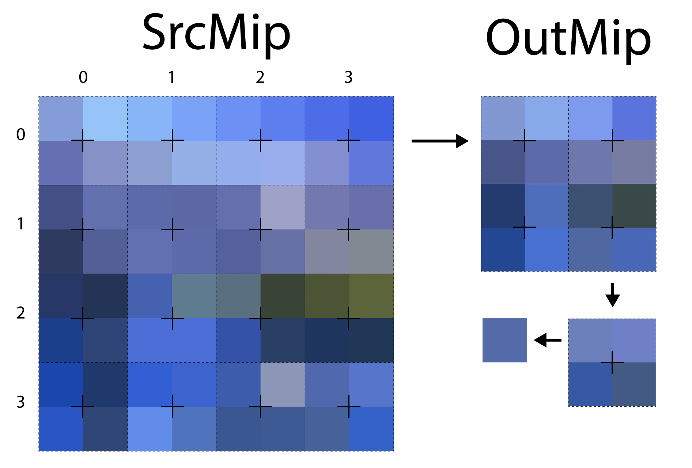

<div class="caption">

The image shows the sampling pattern that is used when both the width and height of the source mip are even.

</div>

The image above shows the sampling pattern that is used to sample the source mip when both the width and height of the source mip are even. The dotted outlines show the threads that are participating in the mipmap generation. For illustrative purposes, the size of the thread group represented in the image is $(4, 4, 1)$. In this case, the source mip is perfectly sampled and no undersampling occurs.

```hlsl source="LearningDirectX12-v0.0.4/GenerateMips_CS.hlsl#L136-L147"
```

In the case where the width of the source mip is odd and the height is even, then multiple samples in the *U* texture coordinate axis of the source mip are taken.

<span id="attachment-9132"></span>

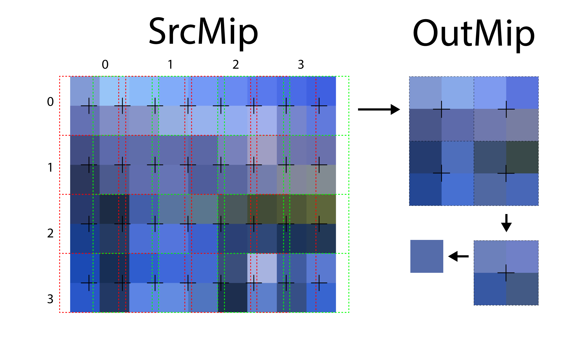

<div class="caption">

When mipmapping a texture with an odd width, multiple samples are taken in the *U* texture coordinate axis and blended together to produce the final color.

</div>

The above image shows the sampling pattern that is used when the width of the source mip is odd. In this case, two samples in the *U* texture coordinate axis are read and blended together to produce the final color. The red dotted outline indicates the first sample taken, and the green dotted outline indicates the second sample taken.

```hlsl source="LearningDirectX12-v0.0.4/GenerateMips_CS.hlsl#L148-L159"
```

In the case where the width of the source mip is even and the height is odd, then multiple samples in the *V* texture coordinate axis of the source mip are taken.

<span id="attachment-9136"></span>

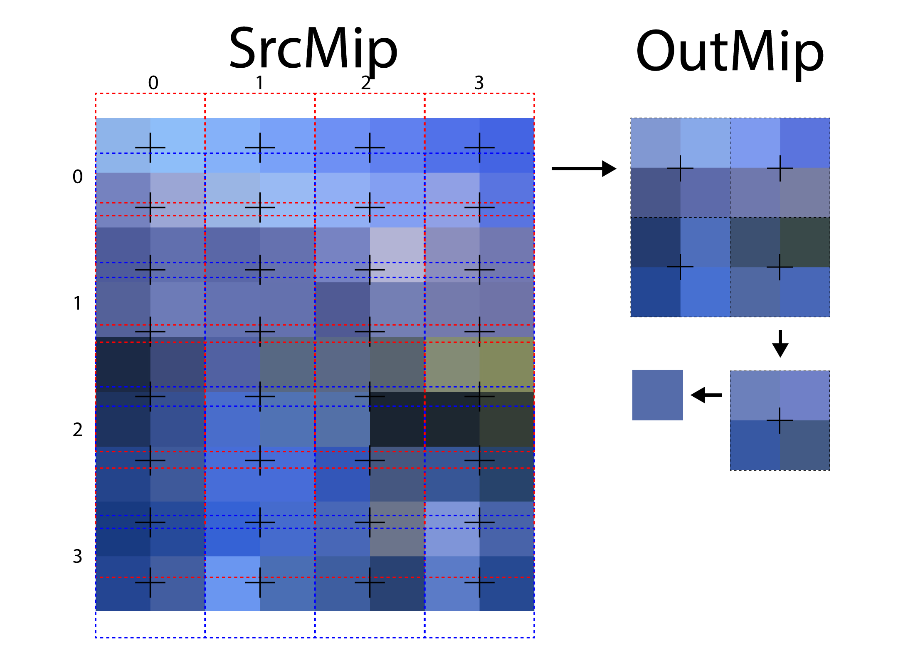

<div class="caption">

When downsampling a texture with an odd height, multiple samples in the *V* texture coordinate axis are blended to produce the final result.

</div>

The image shows the sampling pattern that is used when the height of the texture is odd. In this case, multiple samples are taken in the *V* texture coordinate axis and blended together to produce the final color. The red dotted outline indicates the first sample that is taken, and the blue dotted outline represents the second sample taken.

```hlsl source="LearningDirectX12-v0.0.4/GenerateMips_CS.hlsl#L160-L175"
```

In the case where both the width and height are odd, then four samples are taken and blended together.

<span id="attachment-9139"></span>

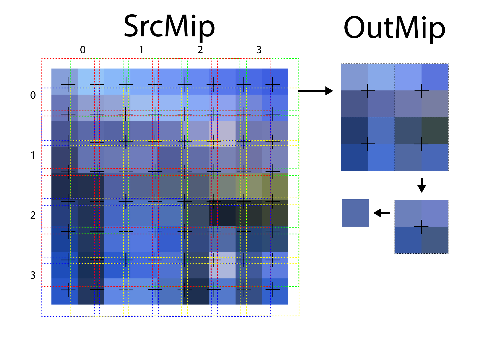

<div class="caption">

When downsampling from a texture with both an odd width and odd height, four samples are taken and blended together to produce the final final.

</div>

The image above shows the sampling pattern when both the width and height of the source mip are odd. In this case, four samples are taken from the source mip to produce a single pixel in the destination mip.

The result of the `Src1` is the linear color value that is written to the first destination mip.

```hlsl source="LearningDirectX12-v0.0.4/GenerateMips_CS.hlsl#L177-L177"
```

The `PackColor` method is used to convert the color value back to the sRGB range (if the original texture is an sRGB texture).

If only a single mip is being generated, then the process is complete. If more mip levels can be generated, then the color value is written to group shared memory and the next mip level is generated.

```hlsl source="LearningDirectX12-v0.0.4/GenerateMips_CS.hlsl#L179-L190"
```

If the number of mips to generate is one, then nothing more needs to be done and the compute shader can exit. Otherwise, the `Src1` color is stored in group shared memory.

In order to ensure that all threads in the thread group have written their value to group shared memory, the [`GroupMemoryBarrierWithGroupSync`](https://learn.microsoft.com/windows/win32/direct3dhlsl/groupmemorybarrierwithgroupsync) function is used. This function provides a way to synchronize thread access to group shared memory. All threads in a thread group must finish writing to group shared memory before any thread is allowed to read from it.

```hlsl source="LearningDirectX12-v0.0.4/GenerateMips_CS.hlsl#L192-L203"
```

In order to generate the 2nd mip level, only 1/4 of the threads (half in the width and half in the height) in the thread group need to participate (since only 1/4 as many texels are being written to the 2nd mip level). The flattened thread ID of the thread within the thread group is masked with 9 (`0b001001`) which ensures that only the evenly numbered threads are executed.

<span id="attachment-9142"></span>

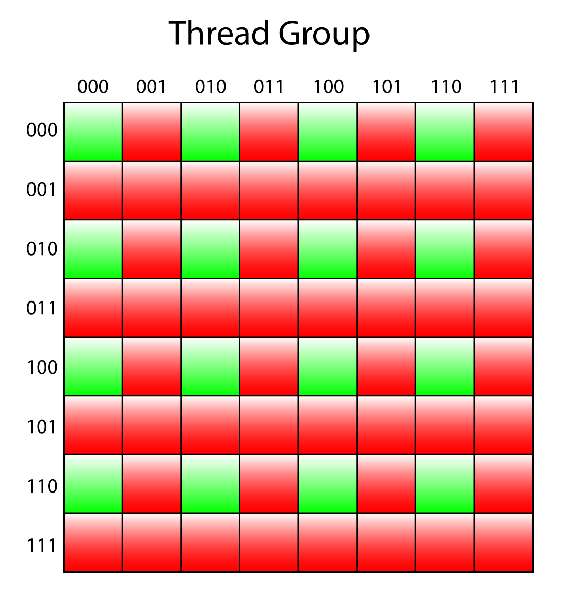

<div class="caption">

Only the even numbered threads are executed.

</div>

The above image indicates the threads in the thread group that are active to generate the 2nd mip level. The green squares represent active threads in the thread group and the red squares are inactive.

The blended color value is computed on lines 196-199. The `Src2` color value receives the color immediately to the right of the current thread, `Src3` receives the color below the current thread, and `Src4` receives the color below and to the right of the current thread.

The blended color is assigned to `Src1` and the gamma corrected color is written to the destination mip.

On line 202, the newly computed blended color value is written to group shared memory in case another mip needs to be generated.

```hlsl source="LearningDirectX12-v0.0.4/GenerateMips_CS.hlsl#L205-L208"
```

If the number of mip levels to generate is two, then the compute shader can exit. Otherwise, another thread group barrier is used to ensure all of the threads in the thread group have finished writing to group shared memory (from line 202).

```hlsl source="LearningDirectX12-v0.0.4/GenerateMips_CS.hlsl#L210-L220"
```

Only 1/16 of the threads in the thread group (1/4 in the width and 1/4 in the height) are required to generate the 3rd mip level. The flattened thread ID within the thread group is masked with 27 (`0x1B` in hex and `0b011011` in binary) which ensures that only threads that are multiples of 4 (in the X and Y grid) are executed.

<span id="attachment-9144"></span>

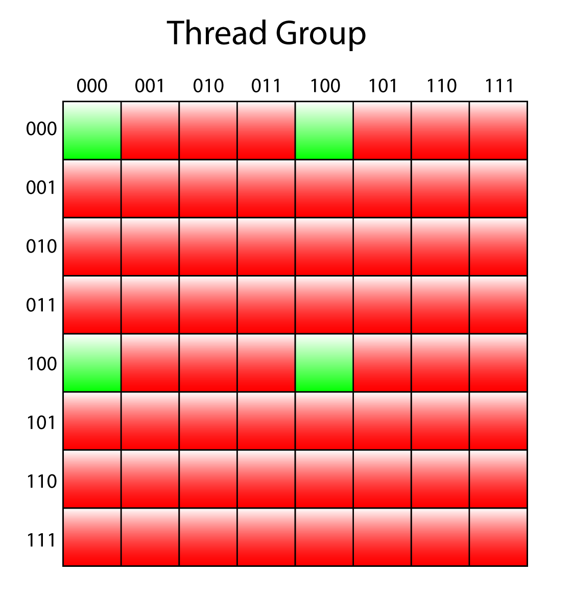

<div class="caption">

Only 1/16 of the threads in the thread group are used to generate the 3rd mip.

</div>

On lines 213-216 the color for the destination mip is computed from the results of the previous mip. On line 218 the gamma correct value is written to the destination mip and the blended color is written to group shared memory on line 219.

```hlsl source="LearningDirectX12-v0.0.4/GenerateMips_CS.hlsl#L222-L225"
```

If the number of mips to generate is 3, then the compute shader can exit. Otherwise, another group synchronization barrier is issued to ensure all of the writes to group shared memory (on line 219) have completed before generating the final mip.

```hlsl source="LearningDirectX12-v0.0.4/GenerateMips_CS.hlsl#L227-L238"
```

Only the first thread in the thread group needs to participate in the creation of the 4th mip level. In this case, the results from the 3rd mip level are read from group shared memory, blended together and the gamma corrected color value is written to the destination mip.

<span id="attachment-9146"></span>

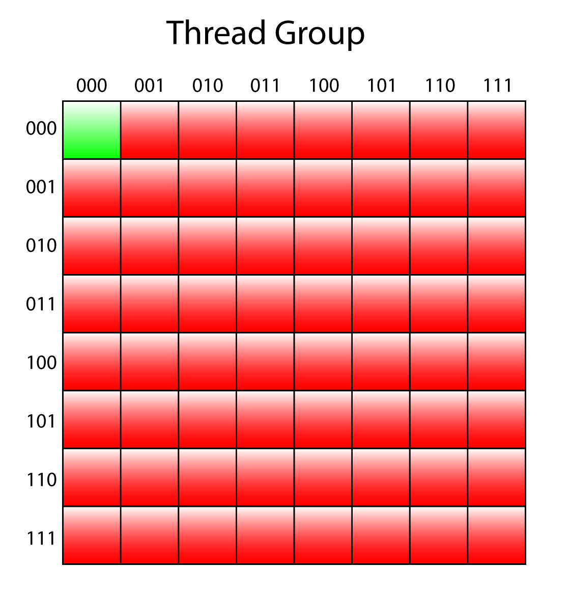

<div class="caption">

Only the thread with ID (0,0) needs to be active to produce the 4th mip level.

</div>

At this point, a maximum of 4 mip maps are generated for the texture. For larger textures (larger than 16×16 texels) several dispatches of this compute shader are required to generate the full mipmap chain. In the next sections, the `CommandList::GenerateMips` method is described.

## Generate Mips Pipeline State Object

The `GenerateMipsPSO` class is used to encapsulate the required state and properties necessary to manage the Pipeline State Object (PSO) for the `GenerateMips` compute shader that is described in the previous section. The `GenerateMipsPSO` class is a container for the root signature, pipeline state object, and a (set of) (null) descriptors that are used to pad the root signature arguments when generating less than four mipmaps.

:::note
Padding the root signature arguments with default UAV’s is necessary to ensure that all root signature arguments have a valid descriptor bound. Without specifying an argument in the root signature will cause the debug layer to report an issue (even if the argument is not actually referenced in a particular dispatch).
:::

### GenerateMipsPSO Header File

The `GenerateMipsPSO` class uses the [`RootSignature`](/learning-directx-12-3/#dynamicdescriptorheapparserootsignature) class and the [`DescriptorAllocation`](/learning-directx-12-3/#descriptorallocation-class) class that is described in [Lesson 3](/learning-directx-12-3/). The equivalent C++ `GenerateMipsCB` structure that matches the layout of the like-named structure `GenerateMips` compute shader is also defined in the header file for the `GenerateMipsPSO` class.

```cpp source="LearningDirectX12-v0.0.4/GenerateMipsPSO.h#L33-L38"
```

As was mentioned, the `GenerateMipsPSO` class has a dependency on the [`RootSignature`](/learning-directx-12-3/#dynamicdescriptorheapparserootsignature) class and the [`DescriptorAllocation`](/learning-directx-12-3/#descriptorallocation-class) class. The header files for those classes are included first.

The `GenerateMipsPSO` class also has a dependency on the [Direct3D 12](https://learn.microsoft.com/windows/win32/direct3d12/direct3d-12-graphics) API and the [DirectX Math](https://learn.microsoft.com/windows/win32/dxmath/directxmath-portal) libraries. The [`wrl.h`](https://learn.microsoft.com/cpp/cppcx/wrl/windows-runtime-cpp-template-library-wrl?view=msvc-170) header file provides access to the [`ComPtr`](https://learn.microsoft.com/cpp/cppcx/wrl/comptr-class?view=msvc-170) template class that is used to track lifetimes of Windows COM objects.

```cpp source="LearningDirectX12-v0.0.4/GenerateMipsPSO.h#L41-L48"
```

The `GenerateMipsCB` structure defines the C++ equivalent to the like named structure defined in the HLSL shader file. This structure is described in the [previous section](#the-compute-shader).

:::note
The `GenerateMipsCB::IsSRGB` member variable is a boolean value but in HLSL booleans are stored as 32-bit unsigned integers. In order to guarantee the correct alignment of the variables in both C++ and HLSL, booleans must be stored as 32-bit integers in C++.
:::

```cpp title="GenerateMipsPSO.h" showLineNumbers startLineNumber=50
// I don't use scoped enums to avoid the explicit cast that is required to 
// treat these as root indices.
namespace GenerateMips
{
    enum
    {
        GenerateMipsCB,
        SrcMip,
        OutMip,
        NumRootParameters
    };
}
```

Since [scoped enums](https://en.cppreference.com/cpp/language/enum) don’t allow implicit cast to unsigned integers the enum defined on lines 52-61 provide semantic names for the indices of the the root parameters. To avoid polluting the global namespace with the enum names, the enum is wrapped in a namespace.

:::note
Using an enum to specify the indices of the root parameters in the root signature is purely [syntactic sugar](https://en.wikipedia.org/wiki/Syntactic_sugar) to make the code more readable. It also has the added benefit of being able to change the number or order of root parameters with a minimal amount of refactoring (since the root parameter indices are updated everywhere they are used).
:::

The `GenerateMipsPSO` class itself is pretty simple. Since it’s just a wrapper for a `RootSignature` and a [`ID3D12PipelineState`](https://learn.microsoft.com/windows/win32/api/d3d12/nn-d3d12-id3d12pipelinestate) object. In this case, it only needs to initialize these objects and provide getters for them.

```cpp source="LearningDirectX12-v0.0.4/GenerateMipsPSO.h#L63-L90"
```

The only thing that needs explanation for this class definition is the `m_DefaultUAV` member variable. As was previously mentioned, when generating less than four mips then some of the `OutMip` UAVs defined in the compute shader will not have a valid descriptor bound to them. It is recommended to always provide a valid descriptor for all arguments in a shader even if the argument is not being referenced for a particular draw or dispatch. For this reason, the `m_DefaultUAV` member variable is used to provide *default* (null) UAVs that are used to pad the unused UAV descriptors in the root signature.

In the next section, the implementation of the `GenerateMipsPSO` is described.

### GenerateMipsPSO Preamble

As usual, the implementation file for the `GenerateMipsPSO` class contains a small preamble that includes the header file dependencies.

```cpp source="LearningDirectX12-v0.0.4/GenerateMipsPSO.cpp#L1-L10"
```

The `DX12LibPCH.h` header file is the precompiled header file for the DX12Lib project.

The `GenerateMipsPSO.h` header file contains the declaration of the `GenerateMipsPSO` class that is described in the previous section.

The `GenerateMips_CS.h` header file contains the compiled compute shader that is described in the [Compute Shader](#the-compute-shader) section above.

:::note
See [CMakeLists.txt](https://github.com/jpvanoosten/LearningDirectX12/blob/v0.0.4/DX12Lib/CMakeLists.txt#L135-L165) to see how the HLSL shaders are configured to generate the compiled header files.
:::

The `Application.h` header file provides access to the [`ID3D12Device`](https://learn.microsoft.com/windows/win32/api/d3d12/nn-d3d12-id3d12device) which is owned by the `Application` class.

The `Helpers.h` header file provides access to the `ThrowIfFailed` function.

The [`d3dx12.h`](https://github.com/microsoft/DirectX-Headers/blob/main/include/directx/d3dx12.h) header file contains a few helper structures and functions that facilitate slightly more succint source code than using the D3D12 API directly.

### GenerateMipsPSO::GenerateMipsPSO

The constructor for the `GenerateMipsPSO` class initializes the root signature, pipeline state object, and the default UAVs (that are used to pad the UAV descriptors).

```cpp source="LearningDirectX12-v0.0.4/GenerateMipsPSO.cpp#L12-L14"
```

The [`ID3D12Device`](https://learn.microsoft.com/windows/win32/api/d3d12/nn-d3d12-id3d12device) is queried from the `Application` class on line 14.

```cpp source="LearningDirectX12-v0.0.4/GenerateMipsPSO.cpp#L16-L21"
```

The creation of a root signature is described in [Lesson 2](/learning-directx-12-2/). The same technique is used here. [Root signature version 1.1](https://learn.microsoft.com/windows/win32/direct3d12/root-signature-version-1-1) was added to the D3D12 API after the initial release of DirectX 12. In order to maintain backward compatibility with older GPU driver versions, the highest supported root signature version must be queried using the [`ID3D12Device::CheckFeatureSupport`](https://learn.microsoft.com/windows/win32/api/d3d12/nf-d3d12-id3d12device-checkfeaturesupport) method. If the check fails, then it is likely due to the fact that the end user’s GPU driver doesn’t support root signature version 1.1. In this case, the root signature version will fallback to version 1.0. The root signature is described using the 1.1 syntax and (if necessary) the conversion to the 1.0 description is handled by the `RootSignature` class.

```cpp source="LearningDirectX12-v0.0.4/GenerateMipsPSO.cpp#L23-L29"
```

The root signature for the `GenerateMips` compute shader has three parameters. The first root parameter is a set of 32-bit constants. The second root parameter is a descriptor table that contains a single shader resource view (SRV) starting at shader register 0. The third and final root parameter is a descriptor table that contains four UAVs starting at register 0. The [`D3D12_DESCRIPTOR_RANGE_FLAG_DESCRIPTORS_VOLATILE`](https://learn.microsoft.com/windows/win32/api/d3d12/ne-d3d12-d3d12_descriptor_range_flags) flag indicates that the descriptor argument will not change after it has been bound to the command list but the what the desriptor points to will change (the data will be modified). This flag is necessary for the `GenerateMips` compute shader since generating mips necessarily requires the data to change.

Root signatures are discussed in more detail in [Lesson 2](/learning-directx-12-2/) and are not described again here.

The `LinearClampSampler` that is defined on line 48 in the compute shader is defined as a static sampler in the root signature.

```cpp source="LearningDirectX12-v0.0.4/GenerateMipsPSO.cpp#L31-L37"
```

The `linearClampSampler` defines a static sampler that uses a [linear filter](#filter) and a [clamp addressing mode](#clamp) for reading the texels of the source mip in the compute shader.

```cpp source="LearningDirectX12-v0.0.4/GenerateMipsPSO.cpp#L39-L47"
```

The root signature description is configured on line 39 and on line 44, the root signature description is assigned to the `m_RootSignature` member variable.

```cpp source="LearningDirectX12-v0.0.4/GenerateMipsPSO.cpp#L49-L54"
```

The method used to generate the pipeline state object (PSO) for the compute shader is similar to the technique used to generate the graphics pipeline state object in [Lesson 2](/learning-directx-12-2/#pipeline-state-object-1). The `PipelineStateStream` structure defines a custom pipeline state description for the compute pipeline state object. In this case, only two stream tokens are required to generate the PSO.

1.  [`CD3DX12_PIPELINE_STATE_STREAM_ROOT_SIGNATURE`](https://learn.microsoft.com/windows/win32/direct3d12/cd3dx12-pipeline-state-stream-root-signature) `pRootSignature`: A pointer to a [`ID3D12RootSignature`](https://learn.microsoft.com/windows/win32/api/d3d12/nn-d3d12-id3d12rootsignature) that defines the root parameters for the compute shader.
2.  [`CD3DX12_PIPELINE_STATE_STREAM_CS`](https://learn.microsoft.com/windows/win32/direct3d12/cd3dx12-pipeline-state-stream-cs) `CS`: The compute shader for the pipeline state object. This is a wrapper for a [`D3D12_SHADER_BYTECODE`](https://learn.microsoft.com/windows/win32/api/d3d12/ns-d3d12-d3d12_shader_bytecode) structure.

```cpp source="LearningDirectX12-v0.0.4/GenerateMipsPSO.cpp#L56-L57"
```

The root signature is retrieved from the `m_RootSignature` variable and the compute shader is provided by the `GenerateMips_CS.h` header file that is generated by the shader compiler and imported in the preamble.

To create the actual pipeline state object, the `PipelineStateStream` object is wrapped in a [`D3D12_PIPELINE_STATE_STREAM_DESC`](https://learn.microsoft.com/windows/win32/api/d3d12/ns-d3d12-d3d12_pipeline_state_stream_desc).

```cpp source="LearningDirectX12-v0.0.4/GenerateMipsPSO.cpp#L59-L63"
```

The `PipelineStateStream` object is wrapped in a [`D3D12_PIPELINE_STATE_STREAM_DESC`](https://learn.microsoft.com/windows/win32/api/d3d12/ns-d3d12-d3d12_pipeline_state_stream_desc) on line 59 and passed to the [`ID3D12Device2::CreatePipelineState`](https://learn.microsoft.com/windows/win32/api/d3d12/nf-d3d12-id3d12device2-createpipelinestate) method (similar to the method shown in [Lesson 2](/learning-directx-12-2/#pipeline-state-object-1)).

The last thing the constructor for the `GenerateMipsPSO` needs to do is create a set of default UAVs that can be used when the number of UAVs to generate is less than 4.

```cpp source="LearningDirectX12-v0.0.4/GenerateMipsPSO.cpp#L65-L66"
```

The `Application::AllocateDescriptors` method is used to allocate four CPU visible descriptors using the [`DescriptorAllocator`](/learning-directx-12-3/#descriptor-allocator) described in [Lesson 3](/learning-directx-12-3/).

```cpp source="LearningDirectX12-v0.0.4/GenerateMipsPSO.cpp#L68-L81"
```

For each of the newly allocated descriptors, a *default* unordered access view (UAV) is created. Since there is no actual backing resource for the UAV, the resource (and the counter resource) are specified as `nullptr`. The view dimension of the UAV is important (it can only be bound to a `RWTexture2D` in HLSL) but the the DXGI format of the UAV is not important since these it will not be accessed at runtime anyways.

:::note
Reading and writing to a *null* resource is valid in HLSL. Reading from a SRV/UAV mapped to a null resource will return black and writing to a UAV mapped to a null resource will have no effect.
:::

With an understanding of loading the texture data, using a compute shader to generate mipmaps, creating the root signature, pipeline state object, and wrapping it all up in a class that encapsulates the pipeline state object and root signature it is time to look at the implementation of the `CommandList::GenerateMips` method that is used to dispatch the GenerateMips compute shader. But before doing that, it is important to understand the limitations of UAV resources and how to handle those limitations.

## Limitations of Unordered Access Views

In order to generate mipmaps for a texture, the format of the texture must support typed UAV load and store operations. There is a small subset of texture formats that are required to support UAV loads and stores by DirectX 12 certified hardware[\[9\]](#cite-9):

-   [`R32G32B32A32_FLOAT`](https://learn.microsoft.com/windows/win32/api/dxgiformat/ne-dxgiformat-dxgi_format)
-   [`R32G32B32A32_UINT`](https://learn.microsoft.com/windows/win32/api/dxgiformat/ne-dxgiformat-dxgi_format)
-   [`R32G32B32A32_SINT`](https://learn.microsoft.com/windows/win32/api/dxgiformat/ne-dxgiformat-dxgi_format)
-   [`R16G16B16A16_FLOAT`](https://learn.microsoft.com/windows/win32/api/dxgiformat/ne-dxgiformat-dxgi_format)
-   [`R16G16B16A16_UINT`](https://learn.microsoft.com/windows/win32/api/dxgiformat/ne-dxgiformat-dxgi_format)
-   [`R16G16B16A16_SINT`](https://learn.microsoft.com/windows/win32/api/dxgiformat/ne-dxgiformat-dxgi_format)
-   [`R8G8B8A8_UNORM`](https://learn.microsoft.com/windows/win32/api/dxgiformat/ne-dxgiformat-dxgi_format)
-   [`R8G8B8A8_UINT`](https://learn.microsoft.com/windows/win32/api/dxgiformat/ne-dxgiformat-dxgi_format)
-   [`R8G8B8A8_SINT`](https://learn.microsoft.com/windows/win32/api/dxgiformat/ne-dxgiformat-dxgi_format)
-   [`R16_FLOAT`](https://learn.microsoft.com/windows/win32/api/dxgiformat/ne-dxgiformat-dxgi_format)
-   [`R16_UINT`](https://learn.microsoft.com/windows/win32/api/dxgiformat/ne-dxgiformat-dxgi_format)
-   [`R16_SINT`](https://learn.microsoft.com/windows/win32/api/dxgiformat/ne-dxgiformat-dxgi_format)
-   [`R8_UNORM`](https://learn.microsoft.com/windows/win32/api/dxgiformat/ne-dxgiformat-dxgi_format)
-   [`R8_UINT`](https://learn.microsoft.com/windows/win32/api/dxgiformat/ne-dxgiformat-dxgi_format)
-   [`R8_SINT`](https://learn.microsoft.com/windows/win32/api/dxgiformat/ne-dxgiformat-dxgi_format)

Support for UAV loads and stores of any other texture format must be queried using the [`ID3D12Device::CheckFeatureSupport`](https://learn.microsoft.com/windows/win32/api/d3d12/nf-d3d12-id3d12device-checkfeaturesupport) method. For example, in order to generate the mipmaps for an [`R8G8B8A8_UNORM_SRGB`](https://learn.microsoft.com/windows/win32/api/dxgiformat/ne-dxgiformat-dxgi_format) or a [`B8G8R8A8_UNORM_SRGB`](https://learn.microsoft.com/windows/win32/api/dxgiformat/ne-dxgiformat-dxgi_format) texture format, it must first be copied to one of the previously listed formats. See [Format Support for Direct3D Feature Level 12.1 Hardware](https://learn.microsoft.com/windows/win32/direct3ddxgi/hardware-support-for-direct3d-12-1-formats) for a full list of features that are required to be supported for each DXGI texture format enumeration.

If the format of the original texture is in the same *format family* as a UAV compatible texture format then it is sufficient to simply interpret the original texture using one of the UAV compatible formats when creating the UAV. It is not strictly necessary that the format of the UAV have the same format as the original texture resource but it is required to be in the same *format family*. For example, if the texture format of the original texture is [`R8G8B8A8_UNORM_SRGB`](https://learn.microsoft.com/windows/win32/api/dxgiformat/ne-dxgiformat-dxgi_format) then it is possible to create a UAV for the texture resource using the [`R8G8B8A8_UNORM`](https://learn.microsoft.com/windows/win32/api/dxgiformat/ne-dxgiformat-dxgi_format) format.

If the format of the original texture is not in the same *format family* as a UAV compatible texture format then attempting to create a UAV for a resource using a different *format family* will cause an error (when the debug layer is enabled). For example, if the original texture format is [`B8G8R8A8_UNORM_SRGB`](https://learn.microsoft.com/windows/win32/api/dxgiformat/ne-dxgiformat-dxgi_format) (notice the blue channel is first in this texture format) then trying to create a UAV for this resource using the [`R8G8B8A8_UNORM`](https://learn.microsoft.com/windows/win32/api/dxgiformat/ne-dxgiformat-dxgi_format) format (notice the red channel is first in this texture format) will fail validation. In order to generate mips for the BGR format family, a BGR resource is *placed* in a resource heap and a RGB resource is aliased in the same heap. The original BGR texture is copied to the BGR resource alias and the RGB texture is aliased back and the mipmaps are generated on the RGB texture. After mipmap generation, the BGR resource is aliased back to the heap and then copied back to the original BGR texture. This technique is illustrated in the image below.

<span id="attachment-9173"></span>


<div class="caption">

1) A BGR resource is placed in a heap and the original BGR resource is copied to the alias  
2) An RGB resource is placed in the same heap  
3) Mipmaps are generated on the RGB resource  
4) The BGR resource is aliased back  
5) The BGR alias is copied back to the original resource

</div>

It is not possible to create UAVs for a multi-sampled textures. Before generating mipmaps for a multi-sample texture, the multi-sample texture must be resolved to a non-multi-sampled texture using the [`ID3D12GraphicsCommandList::ResolveSubresource`](https://learn.microsoft.com/windows/win32/api/d3d12/nf-d3d12-id3d12graphicscommandlist-resolvesubresource) method. Since it is not possible to copy the resulting mipmaps back to the original multi-sampled texture, this case is not handled in this lesson.

Resource that will be used as a UAV must be created using the [`D3D12_RESOURCE_FLAG_ALLOW_UNORDERED_ACCESS`](https://learn.microsoft.com/windows/win32/api/d3d12/ne-d3d12-d3d12_resource_flags) flag and may not have the [`D3D12_RESOURCE_FLAG_ALLOW_RENDER_TARGET`](https://learn.microsoft.com/windows/win32/api/d3d12/ne-d3d12-d3d12_resource_flags) nor the [`D3D12_RESOURCE_FLAG_ALLOW_DEPTH_STENCIL`](https://learn.microsoft.com/windows/win32/api/d3d12/ne-d3d12-d3d12_resource_flags) flags set. It is also not recommended to create resources using the [`ALLOW_UNORDERED_ACCESS`](https://learn.microsoft.com/windows/win32/api/d3d12/ne-d3d12-d3d12_resource_flags) if it will rarely be used as a UAV in a shader since some adapter architectures must resort to less efficient texture layouts in order to provide UAV functionality[\[10\]](#cite-10). In order to generate mipmaps for non-UAV resources, a UAV compatible resource is created and the original texture is copied to the UAV compatible resource before generating the mipmap chain.

With the exception of multi-sampled textures, the limitations of using UAVs are addressed in the next sections.

## GenerateMips in C++

In this section, the source code for the `CommandList::GenerateMips` method is described. With the exception of multi-sampled textures, the limitations of using UAVs are addressed in the following technique. The steps of the technique to generate the mips are as follows:

1.  If the resource is not UAV compatible:

1.  Create a copy of the original resource *placed* in a heap
2.  Create a UAV compatible *alias* resource (in the same heap) as the placed resource
3.  Copy the original texture to the *placed* resource
4.  Alias the UAV compatible resource in the heap (so that it is the “active” resource in the heap)

3.  Generate the mipmap chain on the UAV compatible resource
4.  If the original resource is not UAV compatible:

1.  Alias the *placed* resource back to the heap
2.  Copy the placed resource back to the original resource

The C++ implementation of this technique is described in the next section.

### CommandList::GenerateMips

The `CommandList::GenerateMips` method ensures that the resource that is used to generate the mipmap chain is a UAV compatible resource. The task of executing the dispatch for the compute shader (that actually generates the mipmaps) is handled by the `CommandList::GenerateMips_UAV` method which is shown later in this lesson.

The `CommandList::GenerateMips` method takes the original texture as the only argument to the function. It is common that resource loading is done with a copy command list but a [`Dispatch`](https://learn.microsoft.com/windows/win32/api/d3d12/nf-d3d12-id3d12graphicscommandlist-dispatch) command can only be executed on a compute or direct command list.

```cpp source="LearningDirectX12-v0.0.4/CommandList.cpp#L350-L360"
```

If the current command list is a *copy* command list, a *compute* command list is retrieved from the *compute* command queue and the same method is executed on the *compute* command list instead.

:::note
When the *copy* command list is executed on the *copy* command queue, the *compute* command list will also be executed on the *compute* command queue. This requires a modified version of the [`CommandQueue::ExecuteCommandList`](/learning-directx-12-2/#commandqueueexecutecommandlist) method that is described in [Lesson 2](/learning-directx-12-2/). The modified version of the [`CommandQueue::ExecuteCommandList`](https://github.com/jpvanoosten/LearningDirectX12/blob/7cf0abd4f41ec7064287c24930608d1bf303c875/DX12Lib/src/CommandQueue.cpp#L111-L172) is not described here but the source code for the CommandQueue class is available on GitHub.

[CommandQueue class on GitHub](https://github.com/jpvanoosten/LearningDirectX12/blob/v0.0.4/DX12Lib/src/CommandQueue.cpp)
:::

```cpp source="LearningDirectX12-v0.0.4/CommandList.cpp#L362-L366"
```

On line 362 the [`ID3D12Resource`](https://learn.microsoft.com/windows/win32/api/d3d12/nn-d3d12-id3d12resource) is retieved from the `Texture` object.

If the underlying resource is invalid, the function returns immediately, otherwise the resource description is queried from the original resource.

```cpp source="LearningDirectX12-v0.0.4/CommandList.cpp#L368-L377"
```

If the original texture is created with only a single mip level (which can be the case for 1×1 textures or textures that were created with explicitly stating the number of mips to allocate for the resource is 1), then nothing needs to be done and the function exits immediately. The method described in this lesson requires the original resource to be a non-multi-sampled 2D texture. Multi-sampled textures, 1D, 3D, and 1D or 2D texture arrays are (currently) not supported for mipmap generation.

```cpp source="LearningDirectX12-v0.0.4/CommandList.cpp#L379-L384"
```

As previously mentioned, if the original resource is not a UAV compatible resource, then a UAV compatible copy of the original texture is used to generate the mipmaps. By default, it is assumed that the original texture is a UAV compatible texture. The `aliasResource` declared on line 384 is only used if the original resource needs to be copied to the UAV compatible resource. The UAV compatibility of the original resource is checked next.

```cpp source="LearningDirectX12-v0.0.4/CommandList.cpp#L386-L391"
```

The `Texture::CheckUAVSupport` method is used to check if the current GPU can support UAV loads and stores for the texture’s format. This method is not shown here but in essence it uses the [`ID3D12Device::CheckFeatureSupport`](https://learn.microsoft.com/windows/win32/api/d3d12/nf-d3d12-id3d12device-checkfeaturesupport) method to check for the [`D3D12_FORMAT_SUPPORT1_TYPED_UNORDERED_ACCESS_VIEW`](https://learn.microsoft.com/windows/win32/api/d3d12/ne-d3d12-d3d12_format_support1), [`D3D12_FORMAT_SUPPORT2_UAV_TYPED_LOAD`](https://learn.microsoft.com/windows/win32/api/d3d12/ne-d3d12-d3d12_format_support2), and the [`D3D12_FORMAT_SUPPORT2_UAV_TYPED_STORE`](https://learn.microsoft.com/windows/win32/api/d3d12/ne-d3d12-d3d12_format_support2) format support flags.

Regardless if the texture’s format is a UAV compatible format or not, if the resource was not created with the [`D3D12_RESOURCE_FLAG_ALLOW_UNORDERED_ACCESS`](https://learn.microsoft.com/windows/win32/api/d3d12/ne-d3d12-d3d12_resource_flags) flag during resource creation, then a UAV compatible resource needs to be created.

```cpp source="LearningDirectX12-v0.0.4/CommandList.cpp#L392-L403"
```

On line 392, the [`ID3D12Device`](https://learn.microsoft.com/windows/win32/api/d3d12/nn-d3d12-id3d12device) is retrieved from the `Application` class.

The `aliasDesc` defined on line 395 must match the original resource exactly. The only difference between the `aliasDesc` and the original resource description are the resource creation flags. The alias resource must have the [`D3D12_RESOURCE_FLAG_ALLOW_UNORDERED_ACCESS`](https://learn.microsoft.com/windows/win32/api/d3d12/ne-d3d12-d3d12_resource_flags) and must not have the [`D3D12_RESOURCE_FLAG_ALLOW_RENDER_TARGET`](https://learn.microsoft.com/windows/win32/api/d3d12/ne-d3d12-d3d12_resource_flags) nor the [`D3D12_RESOURCE_FLAG_ALLOW_DEPTH_STENCIL`](https://learn.microsoft.com/windows/win32/api/d3d12/ne-d3d12-d3d12_resource_flags) flags set.

The `uavDesc` defined on line 395 is used to describe the UAV compatible resource that is used to generate the mipmap chain. The `uavDesc` must match the `aliasDesc` exactly except the format must be a UAV compatible format.

With the descriptions for both the alias and the UAV compatible resource setup, the next step is create a heap where both the alias and the UAV compatible resources are placed.

```cpp source="LearningDirectX12-v0.0.4/CommandList.cpp#L405-L411"
```

The [`ID3D12Device::GetResourceAllocationInfo`](https://learn.microsoft.com/windows/win32/api/d3d12/nf-d3d12-id3d12device-getresourceallocationinfo(uint_uint_constd3d12_resource_desc)) method is used to query the required size (in bytes) of a heap that is large enough to store the largest resource given a list of resource descriptions. In this case, the function returns the size of a heap that is required to store the largest of either the alias resource or the UAV compatible resource.

:::caution
Before creating a heap for the purpose of using it for placed resources, all resource descriptions for resources that may be placed in the heap must be passed to the [`ID3D12Device::GetResourceAllocationInfo`](https://learn.microsoft.com/windows/win32/api/d3d12/nf-d3d12-id3d12device-getresourceallocationinfo(uint_uint_constd3d12_resource_desc)) method. The size of a resource is dependent on the GPU architecture and (due to *pitch* and *alignment* requirements or differing resource creation flags) two texture resources with the same dimensions and same texel stride may not necessarily consume the same amount of space in a heap.
:::

```cpp source="LearningDirectX12-v0.0.4/CommandList.cpp#L413-L422"
```

The [`ID3D12Device::GetResourceAllocationInfo`](https://learn.microsoft.com/windows/win32/api/d3d12/nf-d3d12-id3d12device-getresourceallocationinfo(uint_uint_constd3d12_resource_desc)) method returns a [`D3D12_RESOURCE_ALLOCATION_INFO`](https://learn.microsoft.com/windows/win32/api/d3d12/ns-d3d12-d3d12_resource_allocation_info) structure which stores both the requried size (in bytes) and the alignment of the heap.

As described in [Lesson 2](/learning-directx-12-2/#placed-resources), when the GPU architecture supports [heap tier 1](https://learn.microsoft.com/windows/win32/api/d3d12/ne-d3d12-d3d12_resource_heap_tier#constants), non render target or depth/stecil textures can only be placed in a heap that specifies the [`D3D12_HEAP_FLAG_ALLOW_ONLY_NON_RT_DS_TEXTURES`](https://learn.microsoft.com/windows/win32/api/d3d12/ne-d3d12-d3d12_heap_flags) heap flag.

The heap is created on line 422 using the [`ID3D12Device::CreateHeap`](https://learn.microsoft.com/windows/win32/api/d3d12/nf-d3d12-id3d12device-createheap) method. This method takes a pointer to a [`D3D12_HEAP_DESC`](https://learn.microsoft.com/windows/win32/api/d3d12/ns-d3d12-d3d12_heap_desc) structure and a pointer (to a pointer) to a [`ID3D12Heap`](https://learn.microsoft.com/windows/win32/api/d3d12/nn-d3d12-id3d12heap) object.

```cpp source="LearningDirectX12-v0.0.4/CommandList.cpp#L424-L426"
```

In order to ensure the heap does not go out of scope and get destroyed until the command list is finished executing on the command queue, the heap object is added to a list of objects tracked by the command list using the `CommandList::TrackResource` method. As soon as the command list is finished executing on the command queue, the heap is released.

```cpp source="LearningDirectX12-v0.0.4/CommandList.cpp#L428-L442"
```

The aliased resource is created on line 431 using the [`ID3D12Device::CreatePlacedResource`](https://learn.microsoft.com/windows/win32/api/d3d12/nf-d3d12-id3d12device-createplacedresource) method. The [`ID3D12Device::CreatePlacedResource`](https://learn.microsoft.com/windows/win32/api/d3d12/nf-d3d12-id3d12device-createplacedresource) method is similar to the [`ID3D12Device::CreateCommittedResource`](https://learn.microsoft.com/windows/win32/api/d3d12/nf-d3d12-id3d12device-createcommittedresource) method that is described in [Lesson 2](/learning-directx-12-2/#tutorial2updatebufferresource) and previously in this lesson (in the [`CommandList::LoadTextureFromFile`](#commandlistloadtexturefromfile) method). The primary difference when creating a *placed* resource is the heap object must be specified explicitly as opposed to creating a committed resource the heap is created implicitly.

On line 440, the resource and its initial state is added to the [`ResourceStateTracker`](/learning-directx-12-3/#resource-state-tracking) (as described in [Lesson 3](/learning-directx-12-3/)).

To ensure the lifetime of the alias resource, it is also added to a list of objects tracked by the command list using the `CommandList::TrackResource` method on line 442.

```cpp source="LearningDirectX12-v0.0.4/CommandList.cpp#L444-L457"
```

The UAV compatible resource is created in the same heap as the alias resource. Similar to the alias resource, the UAV resource is added to the [`ResourceStateTracker`](/learning-directx-12-3/#resource-state-tracking) and the list of tracked resources for the command list.

Next, the original resource is copied to the alias resource.

```cpp source="LearningDirectX12-v0.0.4/CommandList.cpp#L459-L469"
```

Before copying the original resource to the alias resource, the alias resource is made active in the heap using an aliasing barrier on line 460.

The copy operation performed on line 464 ensures the original resource is copied to the alias resource.

The UAV resource is set as the active resource using another aliasing barrier on line 468.

At this point, the `uavResource` now contains a UAV compatible copy of the original texture and is ready for mipmap generation.

```cpp title="CommandList.cpp" showLineNumbers startLineNumber=471
    // Generate mips with the UAV compatible resource.
    GenerateMips_UAV(Texture(uavResource, texture.GetTextureUsage()), Texture::IsSRGBFormat(resourceDesc.Format) );
```

The UAV compatible resource is passed to the `CommandList::GenerateMips_UAV` method (the subject of the next section) to have the actual mipmaps generated.

```cpp source="LearningDirectX12-v0.0.4/CommandList.cpp#L474-L480"
```

If the `aliasResource` exists then is is aliased back into the heap and copied back to the original texture.

In the next section the `GenerateMips_UAV` method is described. This method takes a texture resource that is assumed to be a UAV compatible resource and dispatches the `GenerateMips` compute shader until all of the mips in the mip chain are generated.

### CommandList::GenerateMips\_UAV

The maximum number of mip levels that are generated during a single compute dispatch is four. If the texture is larger than $2^4$ (16×16) then it will inevitably require more than a single dispatch to generate all of the mip levels for the entire mipmap chain of the texture.

The `GenerateMips_UAV` method loops through the mip levels of the original texture and dispatches the `GenerateMips` compute shader until all of the mips are generated.

```cpp title="CommandList.cpp" showLineNumbers startLineNumber=482
void CommandList::GenerateMips_UAV( Texture& texture, bool isSRGB )
{
```

The `GenerateMips_UAV` method takes the `Texture` to generate the mips for and a boolean that indicates whether the original textures format is an sRGB format.

```cpp source="LearningDirectX12-v0.0.4/CommandList.cpp#L484-L490"
```

The `GenerateMips_UAV` method uses the [`GenerateMipsPSO`](#generate-mips-pipeline-state-object) class that is defined earlier in this lesson. The Pipeline State Object and the Root Signature from the [`GenerateMipsPSO`](#generate-mips-pipeline-state-object) class are bound to the command list on lines 489 and 490.

```cpp title="CommandList.cpp" showLineNumbers startLineNumber=492
    GenerateMipsCB generateMipsCB;
    generateMipsCB.IsSRGB = isSRGB;
```

The [`GenerateMipsCB`](#generatemipspso-header-file) structure is defined in the header file for the [`GenerateMipsPSO`](#generate-mips-pipeline-state-object) class. The `IsSRGB` variable is set to `true` if the original texture format is an sRGB format.

```cpp source="LearningDirectX12-v0.0.4/CommandList.cpp#L495-L496"
```

The underlying [`ID3D12Resource`](https://learn.microsoft.com/windows/win32/api/d3d12/nn-d3d12-id3d12resource) is retrieved from the UAV compatible resource on line 495 and the description of that resource is queried on line 496.

```cpp title="CommandList.cpp" showLineNumbers startLineNumber=498
    // Create an SRV that uses the format of the original texture.
    D3D12_SHADER_RESOURCE_VIEW_DESC srvDesc = {};
    srvDesc.Format = isSRGB ? Texture::GetSRGBFormat(resourceDesc.Format) : resourceDesc.Format;
    srvDesc.Shader4ComponentMapping = D3D12_DEFAULT_SHADER_4_COMPONENT_MAPPING;
    srvDesc.ViewDimension = D3D12_SRV_DIMENSION_TEXTURE2D;  // Only 2D textures are supported (this was checked in the calling function).
    srvDesc.Texture2D.MipLevels = resourceDesc.MipLevels;
```

On lines 499-503, a Shader Resource View (SRV) description is initialized. As can be seen on line 500, the format of the SRV is converted to an sRGB format in the same format family as the UAV resource if the original texture resource uses an sRGB format. This is important for sRGB textures to be sampled correctly in the `GenerateMips` compute shader. The source mip is sampled using a linear blend ([`FILTER_MIN_MAG_MIP_LINEAR`](https://learn.microsoft.com/windows/win32/api/d3d12/ne-d3d12-d3d12_filter)) in order to produce the color for the destination mip. If the SRV was not configured to use an sRGB color format then blending during sampling would blend values in the *gamma* curve and not in the linear color space. Using an sRGB texture format ensures that the texture sampler converts the texel colors to their linear values before blending and therefore producing the correct color value when sampling.

```cpp source="LearningDirectX12-v0.0.4/CommandList.cpp#L505-L510"
```

The loop to generate the mipmap chain starts at source mip level 0 and loops until all of the mips have been generated.

The `srcWidth` and `srcHeight` parameters store the width and height of the texture at the current source mip level.

The `dstWidth` and `dstHeight` parameters store the width and height of the *first* destination mip level. The dimension of the destination mip also determines the dimension of the compute dispatch for this pass.

:::note
The `>>` operator is a right *bit-shift* operator. A right bit-shift is equivalent to a “divide by 2” operation.
:::

```cpp source="LearningDirectX12-v0.0.4/CommandList.cpp#L512-L516"
```

The `GenerateMipsCB::SrcDimension` parameter is a bitmask that indicates whether the width or height (or both) of the source mip is odd. This parameter is used to determine the sampling pattern to use when generating the first destination mip. This bitmask is described in the section of this lesson that describes the [`GenerateMips`](#the-compute-shader) compute shader.

```cpp source="LearningDirectX12-v0.0.4/CommandList.cpp#L518-L527"
```

The `mipCount` variable is used to indicate the number of mip levels that are generated during this loop iteration.

The [`_BitScanForward`](https://learn.microsoft.com/cpp/intrinsics/bitscanforward-bitscanforward64?view=msvc-170) intrinsic function scans a 32-bit value from Least Significan Bit (LSB) to Most Significant Bit (MSB) and stores the bit position of the first set bit (1). The combination of the `destWidth` and the `dstHeight` parameters is used to find out how many times downsampling can occur before resulting in an odd dimension.

For example, if the `dstWidth` parameter is 300 and the `dstHeight` parameter is 200, then the result of `dstWidth | dstHeight` is `0b111101100`. When scanning this bitmask from LSB to MSB, it can be seen that the bit at position 2 is set (assuming the first bit is at position 0). The image below illustrates this example.

<span id="attachment-9203"></span>

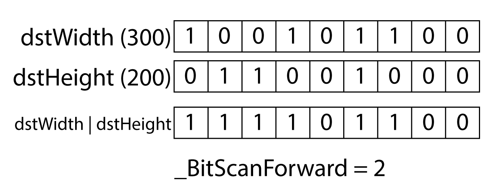

<div class="caption">

The number of times that a 300×200 texture can be halved before resulting in an odd dimension is 2 (twice).

</div>

In the case where halving the mipmap level results in an odd dimension requires the texture to be sampled multiple times which requires a new dispatch to be executed.

The `mipCount` value needs to be clamped to the maximum number of mips that are left to be generated in the texture and the maximum number of mips can can be generated in a single dispatch.

```cpp source="LearningDirectX12-v0.0.4/CommandList.cpp#L528-L537"
```

Since the `mipCount` returned from the [`_BitScanForward`](https://learn.microsoft.com/cpp/intrinsics/bitscanforward-bitscanforward64?view=msvc-170) intrinsic function is 0 based (the first bit position is 0), one is added to the `mipCount` on line 529 and the minimum of `mipCount + 1` and 4 is assigned back to the `mipCount` variable.

In order to prevent more mips from being generated than are in the original texture, the `mipCount` is clamped to the number of remaining mips on line 531.

The `dstWidth` and `dstHeight` parameters should not degenerate to 0. If the texture is not square, then one of the edges will become 0 when halving the the dimension of the texture. To prevent one of the dimensions becoming 0 during mipmap generation, the width and height are clamped to 1 on line 536 and 537.

```cpp source="LearningDirectX12-v0.0.4/CommandList.cpp#L539-L544"
```

The `GenerateMipsCB` structure is initialized on lines 539-542 and assigned to the root signature as a set of 32-bit constants using the `CommandList::SetCompute32BitConstants` method.

```cpp source="LearningDirectX12-v0.0.4/CommandList.cpp#L546-L546"
```

The SRV of the source mip is bound to the root signature using the `CommandList::SetShaderResourceView` method. Internally, this method uses the [`ResourceStateTracker`](/learning-directx-12-3/#resource-state-tracking) and [`DynamicDescriptorHeap`](/learning-directx-12-3/#dynamic-descriptor-heap) to ensure the (sub)resource is in the correct state and the SRV descriptor is bound to the correct position in the root signature.

```cpp source="LearningDirectX12-v0.0.4/CommandList.cpp#L548-L556"
```

Similar to the SRV for the source mip, the UAVs for the destination mips are bound to the root signature using the `CommandList::SetUnorderedAccessView` method.

```cpp source="LearningDirectX12-v0.0.4/CommandList.cpp#L558-L562"
```

If the number of mips to generate is less than 4, then any unused UAVs in the root signature should be padded with default UAV descriptors. In this case, the default UAVs have null resources so no state transition needs to occur. Instead, the [`DynamicDescriptorHeap`](/learning-directx-12-3/#dynamic-descriptor-heap) is used directly to stage the UAV descriptors to the descriptor table in the root signature.

```cpp source="LearningDirectX12-v0.0.4/CommandList.cpp#L564-L564"
```

On line 564 the compute dispatch is executed. The `Math::DivideByMultiple` function returns the largest whole number that results by dividing a value by some multiple according to the following formula:

$$
\left\lceil\frac{v}{m}\right\rceil
$$

For example, if `dstWidth` is 100 and the multiple is 8, then `DivideByMultiple` returns 13.

Before the next mip levels can be generated, all UAV writes to the destination mips must be complete. To guarantee all UAV writes are complete in one dispatch before performing any UAV (or SRV) reads in another dispatch (or pixel shader), a UAV barrier is added to the command list.

```cpp source="LearningDirectX12-v0.0.4/CommandList.cpp#L566-L566"
```

Adding a UAV barrier to the command list guarantees that any writes to a mip level of the textures have fully completed before attempting to read from that texture in another dispatch or draw command.

```cpp source="LearningDirectX12-v0.0.4/CommandList.cpp#L568-L570"
```

The `srcMip` value is incremented by the number of mips that were generated and the next iteration of the loop is performed.

At this point, the full mipmap chain of the texture should be generated. The texture can now be sampled in a using the [`Sample`](https://learn.microsoft.com/windows/win32/direct3dhlsl/dx-graphics-hlsl-to-sample) method in HLSL and the correct mip level should be used to reproduce an artifact-free image.

## Conclusion

In this lesson, you learned how to load textures using the [DirectXTex](https://github.com/Microsoft/DirectXTex) library. You also learned about texture sampling, linear, point, and anisotropic filtering modes, and the various addressing modes that can be used with a texture sampler.

You also learned about compute shaders and how to use a compute shader to generate the mipmaps of a texture in DirectX 12. You also learned how to handle incompatible UAV formats and how to dispatch the compute shader that generates the mipmaps of the texture.

## Download the Source

The source code for this project is available on [GitHub](https://github.com/jpvanoosten/LearningDirectX12):

[GitHub/LearningDirectX12](https://github.com/jpvanoosten/LearningDirectX12/tree/v0.0.4)

You can also download the source code directly from GitHub:

[Source Code.zip](https://github.com/jpvanoosten/LearningDirectX12/archive/v0.0.4.zip)

Or you can download the precompiled binaries if you just want to see it running:

[Tutorial4.zip](https://github.com/jpvanoosten/LearningDirectX12/releases/download/v0.0.4/Tutorial4.zip)

## References

<span id="cite-1"></span>\[1\] Microsoft, “Constants – Windows applications”, Docs.microsoft.com, 2019. \[Online\]. Available: [https://learn.microsoft.com/windows/win32/direct3d12/constants](https://learn.microsoft.com/windows/win32/direct3d12/constants). \[Accessed: 18- Feb- 2019\].

<span id="cite-2"></span>\[2\] D. Lively and H. Gruen, “Wave Programming in D3D12 and Vulkan”, San Francisco, California, 2017.

<span id="cite-3"></span>\[3\] Microsoft, “Compute Shader Overview – Windows applications”, Docs.microsoft.com, 2019. \[Online\]. Available: [https://learn.microsoft.com/windows/win32/direct3d11/direct3d-11-advanced-stages-compute-shader](https://learn.microsoft.com/windows/win32/direct3d11/direct3d-11-advanced-stages-compute-shader). \[Accessed: 19- Feb- 2019\].

<span id="cite-4"></span>\[4\] Microsoft, “Variable Syntax – Windows applications”, Docs.microsoft.com, 2019. \[Online\]. Available: [https://learn.microsoft.com/windows/win32/direct3dhlsl/dx-graphics-hlsl-variable-syntax](https://learn.microsoft.com/windows/win32/direct3dhlsl/dx-graphics-hlsl-variable-syntax). \[Accessed: 19- Feb- 2019\].

<span id="cite-5"></span>\[5\] NVidia, NVidia Turing GPU Architecture. NVidia, 2018.

<span id="cite-6"></span>\[6\] “SRGB”, Wikipedia, 2019. \[Online\]. Available: [https://en.wikipedia.org/wiki/SRGB](https://en.wikipedia.org/wiki/SRGB). \[Accessed: 21- Feb- 2019\].

<span id="cite-7"></span>\[7\] J. Holm, Specification of sRGB. 2015.

<span id="cite-8"></span>\[8\] “Format Support for Direct3D Feature Level 11.0 Hardware – Windows applications”, Windows Dev Center, 2019. \[Online\]. Available: [https://learn.microsoft.com/windows/win32/direct3ddxgi/format-support-for-direct3d-11-0-feature-level-hardware](https://learn.microsoft.com/windows/win32/direct3ddxgi/format-support-for-direct3d-11-0-feature-level-hardware). \[Accessed: 21- Feb- 2019\].

<span id="cite-9"></span>\[9\] Microsoft, “Typed unordered access view (UAV) loads – Windows applications”, Windows Dev Center, 2019. \[Online\]. Available: [https://learn.microsoft.com/windows/win32/direct3d12/typed-unordered-access-view-loads](https://learn.microsoft.com/windows/win32/direct3d12/typed-unordered-access-view-loads). \[Accessed: 11- Mar- 2019\].

<span id="cite-10"></span>\[10\] Microsoft, “D3D12\_RESOURCE\_FLAGS”, Windows Dev Center, 2019. \[Online\]. Available: [https://learn.microsoft.com/windows/win32/api/d3d12/ne-d3d12-d3d12_resource_flags](https://learn.microsoft.com/windows/win32/api/d3d12/ne-d3d12-d3d12_resource_flags). \[Accessed: 13- Mar- 2019\].
