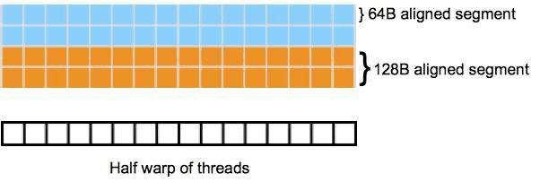
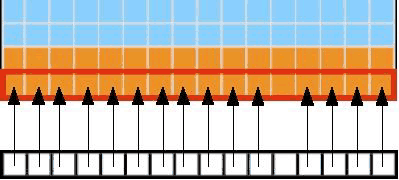
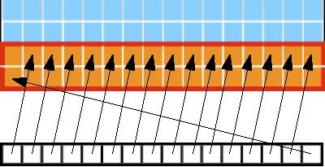
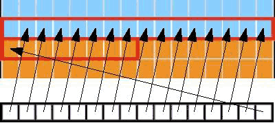
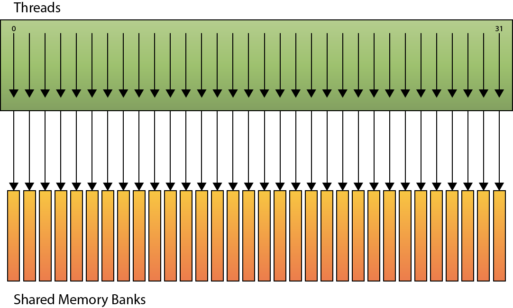
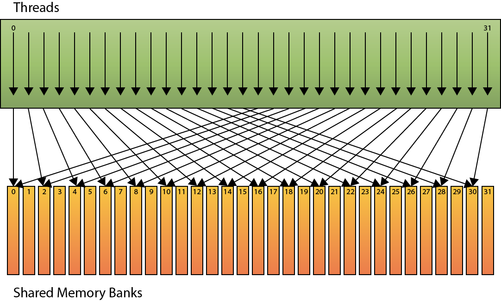
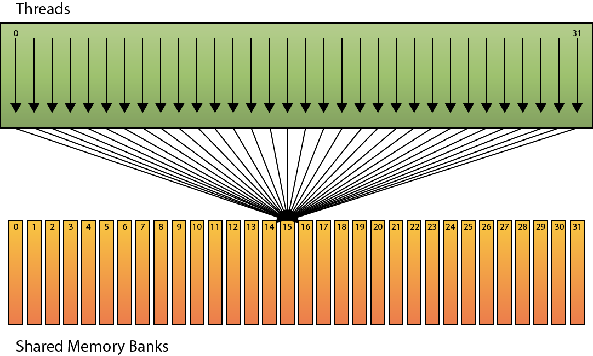
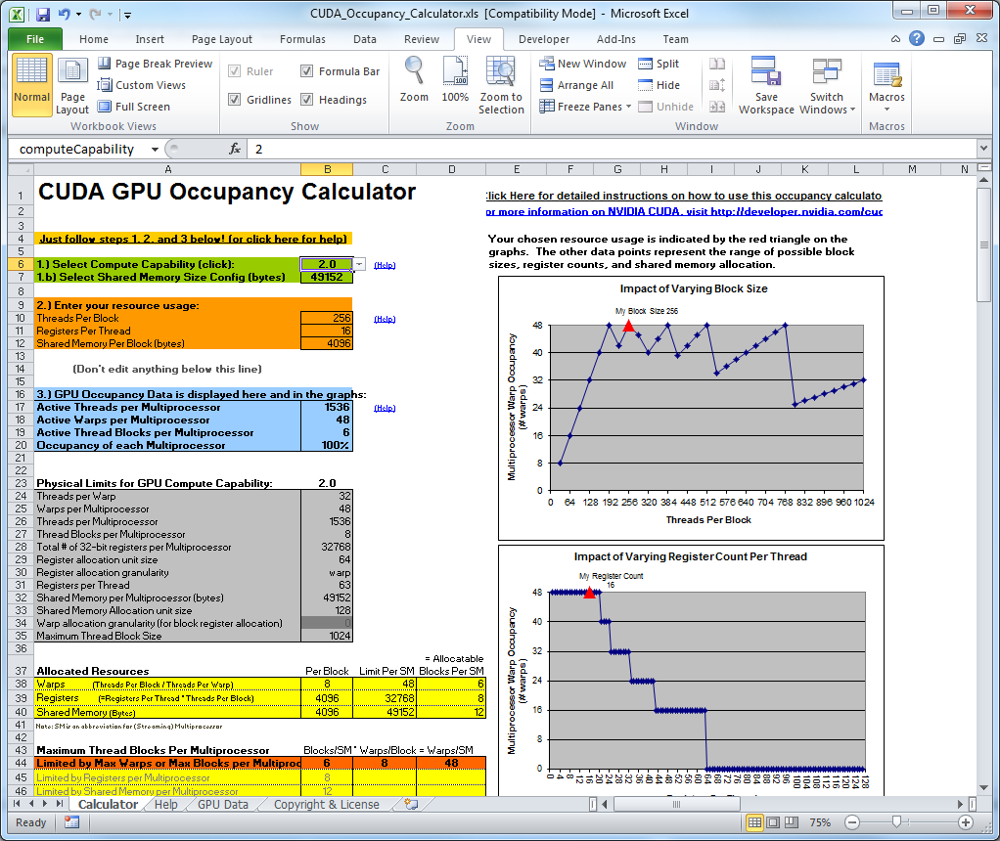
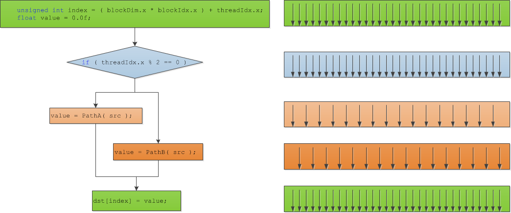

<span id="attachment-2187"></span>

:::note
This article was written in 2011 (CUDA 4). Measuring before optimizing, coalesced memory access, shared memory, occupancy and avoiding divergence are still the main optimizations, but the tools have changed: the Visual Profiler and Parallel Nsight were replaced by [Nsight Systems](https://developer.nvidia.com/nsight-systems) and [Nsight Compute](https://developer.nvidia.com/nsight-compute). The current guide is the [CUDA C++ Best Practices Guide](https://docs.nvidia.com/cuda/cuda-c-best-practices-guide/).
:::

In this article I will discuss a few of the best practices items as described in the “CUDA C Best Practices Guide”. This guide mentions about 40 best practices over more than 70 pages of documentation. This might be a bit more information than the average casual programmer will care to understand. In this article, I want to focus on what I feel are the most important best practices that will result in a direct performance increase to your CUDA application. If you are not familiar with CUDA yet, you may want to refer to my previous articles titled Introduction to CUDA, [CUDA Thread Execution](/cuda-thread-execution-model/), and [CUDA memory.](/cuda-memory-model/)

## Introduction

Getting the maximum performance from your application is the goal of every programmer (and perhaps more so for game programmers). In this article I will focus on a few of the important “best practices” for maximizing the performance of your CUDA applications. I will focus on several categories of optimizations: memory, execution, instruction, and flow-control optimization.

Before we can know if changes we make to our CUDA programs actually result in faster code, we must know how to measure the performance. I will also investigate performance measurements and tools that we can use to verify performance improvements and find areas that would benefit from implementing optimization techniques.

## Measuring Performance

Before you can be sure that any changes to your CUDA programs has an impact on performance, you must have a means to measure that performance. In this section, I will describe two methods to measure performance: CPU timers, and GPU timers.

### CPU Timers

You can measure the time it takes to execute any section of code that your application performs by using a CPU timer. Obviously measuring fast executing blocks of code doesn’t make sense unless you can measure the individual clock cycles that are required to execute that code. To a human, clock cycles are not that meaningful so we need a method to convert those clock cycles into meaningful units of measure such as time.

Using a high-resolution timer we can measure the amount of time that it takes to perform some block of code with a resolution of microseconds (one-million parts per second). On Windows, we can use the **QueryPerformanceCounter** method to query the high-performance counter. If we query the performance counter once before and once after a block of code, we can then determine how much time has passed between queries.

The following class can be used to implement such a counter that keeps track of the change in time before and after a block of code is executed.

```cpp title="HighResolutionTimer.h" showLineNumbers
#pragma once

class HighResolutionTimerImpl;

class HighResolutionTimer
{
public:
    HighResolutionTimer(void);
    ~HighResolutionTimer(void);

    // "Tick" the timer to compute the amount of time since the last it was ticked (or since the timer was created).
    void Tick();

    double ElapsedSeconds() const;
    double ElapsedMilliSeconds() const;
    double ElapsedMicroSeconds() const;

private:
    HighResolutionTimerImpl* pImpl;
};
```

In this particular implementation, the high-resolution timer provides a single function to “tick” or “mark” a moment in time. Every time the timer is “ticked”, the elapsed time since the previous “tick” (or since the timer object was created) is computed. The elapsed value can be queried using one of the **Elapsed** functions provided.

This class doesn’t implement the timer directly, instead the timer is queried indirectly using a private implementation (or PImpl – pointer to implementation). The reason for this is that the implementation of the timer functions are platform dependent (Windows has different methods than Linux/Unix operating systems). In this article, I will show the Windows methods for implementing this timer.

The Windows version of the high-resolution implementation might look something like this:

```cpp title="HighResolutionTimer.cpp" showLineNumbers
#define WIN32_LEAN_AND_MEAN
#include <windows.h>

#include "HighResolutionTimer.h"

class HighResolutionTimerImpl
{
public:
    HighResolutionTimerImpl();

    void Tick();

    double GetElapsedTimeInMicroSeconds();

private:
    LARGE_INTEGER t0, t1;
    LARGE_INTEGER frequency;
    double elapsedTime;
};
```

This is first the declaration for the Windows implementation of the high-resolution class. We need to include the windows header file unfortunately, but if we define the **WIN32\_LEAN\_AND\_MEAN** we can minimize the amount of windows stuff that gets put into our source file.

This class only defines two methods. The **Tick** method will query the current moment in time and compute the elapsed time since either the HighResolutionTimer object was created or since the previous time **Tick** was called.

The **GetElapsedTimeInMicroSeconds** returns the amount of time that was elapsed between calls to the **Tick** method. If **Tick** was never called, then the elapsed time will be 0. So don’t use the **GetElapsedTimeInMicroSeconds** method until the timer has been ticked at least once.

Let’s take a look at the definition of these methods.

```cpp title="HighResolutionTimer.cpp" showLineNumbers startLineNumber=21
HighResolutionTimerImpl::HighResolutionTimerImpl()
: elapsedTime(0)
{
    QueryPerformanceFrequency(&frequency);
    QueryPerformanceCounter(&t0);
}

void HighResolutionTimerImpl::Tick()
{
    QueryPerformanceCounter(&t1);
    // Compute the value in microseconds (1 second = 1,000,000 microseconds)
    elapsedTime = ( t1.QuadPart - t0.QuadPart ) * ( 1000000.0 / frequency.QuadPart );

    t0 = t1;
}

double HighResolutionTimerImpl::GetElapsedTimeInMicroSeconds()
{
    return elapsedTime;
}
```

In the constructor for the **HighResolutionTimerImpl** object, we need to query the granularity of the frequecy of the system timer that is being used. The **QueryPerformanceFrequency** method is used to get the number of clock ticks per second. On my PC, I get a value of 2,337,958 (which makes sense since my CPU is advertised as a 2.4 Ghz CPU) but the clock frequency will be different on different processors.

The current value of the high-resolution timer is also queried in the constructor so we only need to “Tick” the timer once to get a valid elapsed time.

In the **Tick** method, we query the counter again then we simply subtract the previous counter from the current counter to get the elapsed clock ticks. Since we want to know how much time has elapsed, we need to multiply the elapsed clock ticks by the number of ticks that could occur per microsecond. This gives the elapsed time in microseconds (1/1,000,000th of a second).

This defines the implementation of the timer on Windows. I’ll leave it up to you to provide an implementation that will work on other operating systems. (Hint: Use **gettimeofday** on Unix type operating systems).

With the platform specific implementation, we can then define the implementation of the general timer that can be used in a platform-independent manner.

```cpp title="HighResolutionTimer.cpp" showLineNumbers startLineNumber=42
HighResolutionTimer::HighResolutionTimer(void)
{
    pImpl = new HighResolutionTimerImpl();
}

HighResolutionTimer::~HighResolutionTimer(void)
{
    delete pImpl;
}

void HighResolutionTimer::Tick()
{
    pImpl->Tick();
}

double HighResolutionTimer::ElapsedSeconds() const
{
    return pImpl->GetElapsedTimeInMicroSeconds() * 0.000001;
}

double HighResolutionTimer::ElapsedMilliSeconds() const
{
    return pImpl->GetElapsedTimeInMicroSeconds() * 0.001;
}

double HighResolutionTimer::ElapsedMicroSeconds() const
{
    return pImpl->GetElapsedTimeInMicroSeconds();
}
```

The **HighResolutionTimer** class is used to hide the platform-dependent implementation details from the user. It is simply a “proxy” class through which the platform dependent version of the **HighResolutionTimerImpl** class is used. This class also provides additional functions that will convert the elapsed time value in microseconds into milliseconds or seconds.

It is important to keep in mind that CUDA kernel invocations are asynchronous (control is returned to the main thread immediately after the kernel function is invoked but doesn’t wait for the kernel function to complete) or if your program uses CUDA asynchronous function calls (pretty much any cuda function that has the word **Async** appended to it) then it is possible that your timings will not be correct. To ensure that all asynchronous CUDA functions have completed, you should always call **cudaDeviceSynchronize** before you “tick” the high-resolution timer. The **cudaDeviceSynchronize** function will block the current thread until the CUDA device has completed all preceding requested tasks.

### CUDA GPU Timers

While the CPU timer can be used in any general case, it is also possible to use the GPU timer to determine the elapsed time between CUDA kernel invocations. The CUDA runtime API provides a group of methods that are used for event management. CUDA events can be used to determine the amount of time that has elapsed between different events, but they can also be used to synchronize all preceding asynchronous operations that were en-queued on the CUDA device before the event was recorded.

Let’s take a look at an example:

```cpp showLineNumbers
cudaEvent_t start, stop; 
float time; 

cudaEventCreate(&start); 
cudaEventCreate(&stop); 

cudaEventRecord( start, 0 ); 

kernel<<<grid,threads>>> ( d_odata, d_idata, size_x, size_y, NUM_REPS);

cudaEventRecord( stop, 0 ); 
cudaEventSynchronize( stop ); 
cudaEventElapsedTime( &time, start, stop ); 

cudaEventDestroy( start ); 
cudaEventDestroy( stop );
```

First we need to create two event objects that will be used to compute the timing. When we want to start the timer, we record the current time into the **start** timer using the **cudaEventRecord** method. The second argument to this method is a stream object that is used to synchronize different CUDA invocations to the same device. Using “0” in this argument means that the default stream object is used for synchronization.

After we perform a kernel invocation, we then need to record the **stop** moment of the timer using the **cudaEventRecord** method again. You should be aware that the **cudaEventRecord** method is an asynchronous invocation and only en-queues a request to the CUDA context asking for the time-stamp when that event is reached in the command queue. In order to make sure the event object actually stores a valid time-stamp, we must synchronize the event with **cudaEventSynchronize** before we can query the elapsed time between events.

If all of the commands in the CUDA command queue have been processed including the **cudaEventRecord** for the **stop** event, we can use the **cudaEventElapsedTime** method to query the elapsed time between the recorded **start** and **stop** events. The time value returned is expressed in milliseconds and is accurate to about 0.5 microseconds.

The *cudaEventRecord* method uses the GPU clock to determine the time-stamp. These methods will always return accurate timings regardless of the operating system you are using (unlike the HighResolutionTimer class shown earlier uses different methods depending on the operating system).

### Profiling Tools

NVIDIA provides several profiling tools that you can use to test the performance of your CUDA application. The [NVIDIA Visual Profiler](https://developer.nvidia.com/nvidia-visual-profiler) is a performance analysis and profiling tool that is included in the [NVIDIA CUDA Toolkit 4.1](https://developer.nvidia.com/cuda-downloads) installation. You can download the user manual for the visual profiler tool here: [https://docs.nvidia.com/cuda/index.html](https://docs.nvidia.com/cuda/index.html)

NVIDIA also provides the [Parallel Nsight](https://developer.nvidia.com/nsight-visual-studio-edition) tool for CUDA debugging directly in Microsoft Visual Stdio development environment. It may be necessary to apply for a developer account before you are allowed to download this tool. The Parallel Nsight tool will also install the latest version of the CUDA Toolkit so you will only need to download and install the Parallel Nsight tool and you will have the latest CUDA toolkit as well (including the stand-alone Visual Profiler tool mentioned above).

## Memory Optimizations

Memory bandwidth is the greatest bottleneck with limiting the maximum performance of your CUDA application. Our goal is to minimize the use of the slow global memory while maximizing the use of fast, shared or cached memory. In this section I will discuss how we can setup our CUDA application to take advantage of the fast memory while minimizing accesses to slow global memory.

### Minimize Data Transfers Between Host and Device

Data transfer between the host (system) memory and the GPU (device) memory must pass through the PCI Express bus. PCI Express 2.0 has a memory throughput of 500 MB/s per lane. So a 16x PCI Express 2.0 bus has a total memory throughput of 8 GB/s. The GTX 580 has a memory bandwidth of 192.4 GB/s which is 24 x faster than the bandwidth of the PCI Express bus. The moral is, if you can keep all of your data on the GPU, then do it.

Always try to minimize the transfers between host and device memory even if it means running a kernel on the device that does not show any noticeable performance improvements compared to running them on the host CPU. The overall performance of your application will benefit if all the data never has to leave device memory.

Intermediate data structures should be allocated in device memory and kept on the device between kernel invocations without ever being copied to system memory.

If possible, you should also try to batch your memory transfers into one large transfer instead of many smaller ones.

### Page-Locked Host Memory

If you need to allocate memory on the host that will also be used on the device in a CUDA kernel, it is better to allocate the memory as page-locked host memory using **cudaMallocHost** or **cudaHostAlloc** rather than paged host memory using **malloc**.

Using page-locked host memory has several benefits:

-   Copies between page-locked host memory and device memory can be performed concurrently with kernel execution.
-   Page-locked host memory can be mapped into the address space of the device, eliminating the need to explicitly copy it to or from device memory.
-   On systems with a front-side bus (memory channel directly connects the CPU to the Northbridge controller), bandwidth between host and device memory is higher if host memory is allocated as page-locked host memory.

On devices that support mapped, page-locked memory, it is recommended to allocated host memory that will be used in a CUDA kernel as device mapped memory. You can check if the current device supports device mapped host memory with the **cudaGetDeviceProperties** method. Page-locked memory mapping is enabled by calling **cudaSetDeviceFlags** with **cudaDeviceMapHost** as an argument before the CUDA device is set using **cudaSetDevice** or **cudaGLSetGLDevice**.

To setup your device to support page-locked mapped memory, you need to check for support of mapped host memory and enable support on the device before the device is set as shown in the example code below:

```cpp title="main.cpp" showLineNumbers
    cudaDeviceProp prop;
    cudaGetDeviceProperties( &prop, 0 );
    if ( prop.canMapHostMemory )
    {
        // This device supports mapped host memory
        cudaSetDeviceFlags(cudaDeviceMapHost);
    }
    // We have to call cudaGLSetGLDevice() if we want to use OpenGL interoperability
    // otherwise use cudaSetDevice().
    cudaGLSetGLDevice(0);
```

By specifying the **cudaHostAllocMapped** flag parameter to the **cudaHostAlloc** function, the memory pointer returned by this function is directly mapped to device memory. The pointer to device memory that is mapped to this host memory can be obtained with the **cudaHostGetDevicePointer** method and then used to access this memory from within the kernel function.

Accessing memory in this way has several advantages:

-   There is no need to allocate device memory and copy host memory to the device. Data transfers between host and device of mapped memory are implicitly performed as needed by the kernel.
-   There is no need to use streams to overlap data transfers with kernel execution. Data transfers are automatically overlapped with kernel execution.

If a block of host memory will only be written to and read only on the device, it is recommended you use the **cudaHostAllocWriteCombined** flag when allocating page-locked host memory with the **cudaHostAlloc** function. Allocating write-combined memory in this way will improve transfer rates to device memory by up to 40%. Write-combined memory is not cached in the CPU’s L1 and L2 caches thus freeing up cache resource for the rest of the application. However, because write-combined memory is not cached, reading from this type of memory on the host is slower because every access results in a cache-miss, so reading from write-combined memory should be minimized on the host (or just eliminated all together).

### Coalesced Access to Global Memory

Accessing global memory is relatively slow compared to accessing shared memory in a CUDA kernel. Most of the latency of accessing global memory can be hidden if the CUDA kernel function performs access to global memory in a way that takes advantage of specific memory access patterns.

Coalesced memory access allows the device to reduce the number of fetches to global memory for every thread in a half-warp (or a full-warp for devices of compute capability 2.x) to as few as one when certain access patterns are followed.

To understand these memory access patterns, it is useful to think of device memory as aligned segments of 16 and 32 words where each **word** is a 32-bit value like a float or (signed or unsigned) int.

If we consider the global memory is divided into 64-Byte aligned memory segments (16 32-bit memory locations), then we could visually represent our memory in this way:

<span id="attachment-2156"></span>



<div class="caption">

Linear Aligned Global Device Memory

</div>

The two rows of the same color represent 128-Byte aligned memory segments. Blow the memory segments represent the individual threads of a half-warp (assuming a device of compute capability 1.x).

The access patterns that facilitate coalescing depends on the compute capability of the device:

-   On devices of compute capability 1.0 or 1.1, the k-th thread in a half-warp must access the k-th word in a segment (that is, the 0th thread in the half-warp accesses the 0th word in a segment and the 15th thread in the half-warp access the 15th word in a segment) that is aligned to 16 times the size of the elements being accessed (if the thread is accessing a 32-bit word such as floats or ints, then the memory must be 64-Byte aligned), but not all threads in the half-warp are required to participate (some may be deactivated due to flow-control divergence).
-   On devices of compute capability 1.2 and 1.3, then a single memory transaction is issued for each segment addressed by the half-warp. The size of the segment that participates in coalescing is determined by the size of the word accessed by the threads:
    
    -   The segment is 32 Bytes for 1-Byte words (char, uchar, char1, or uchar1)
    -   The segment is 64 Bytes for 2-Byte words (char2, uchar2)
    -   The segment is 128 Bytes for 4, 8, and 16-Byte words (float, int, and 2, and 4-component versions of these types)
    
    The order of memory that is accessed is not as strict as it is on devices that support compute capability 1.0 and 1.1 as long as all threads in the half-warp access memory in the same segment, then the device can coalesce the request into a single operaton.
    

-   On devices of compute capability 2.x, accesses to global memory is cached into into cache lines of 128 Bytes. Each cache line maps to a 128-Byte aligned segment of device memory. Access to global memory is cached in both L1 and L2 cache memory but using a compiler switch (-dlcm=cg) will restrict caching to L2 cache only. Memory accesses that are cached in L2 cache only are serviced with 32-Byte memory transactions which can provide a boost if the memory access patterns are scattered and do not fit into the 128-Byte aligned memory access pattern.  
    Each memory access is broken-down into cache line requests that are issued independently. A thread that requests memory that has been cached benefits from the increased throughput of the L1 or L2 cache. Threads in a warp can access any words in any order, even the same word in the segment and benefit from the L1 or L2 cache throughput.

#### Sequential Aligned Access Pattern

The simplest access pattern which facilitates coalescing occurs when the k-th thread access the k-th word in a memory segment. The image below demonstrates this type of access pattern. Notice that not all threads need to participate in order for the memory access to be coalesced.

<span id="attachment-2159"></span>



<div class="caption">

Simple Coalescing

</div>

This access pattern results in a single 64-byte transaction. Notice that even if not all of the words in the segment are being requested, the entire segment will be fetched. If the access of the words in a segment were non-sequential (all of the words of the 64-byte segment were accessed but not in sequential order according to the thread order) then on devices of compute capability 1.2 and 1.3 would result in a single 64-Byte transaction, but on devices of compute capability 1.0 and 1.1, this would result in 16 serialized memory transactions.

#### Sequential but Misaligned Access Pattern

If a request for global memory is sequential, but not aligned to the 64-byte memory segment bounds then on devices that support compute capability 1.0 and 1.1 this will result in a separate memory request for each element. On devices that support compute capability 1.2 and 1.3, then if all the memory fall within a 128-Byte segment, then a single 128-Byte transaction is performed, otherwise multiple transactions will be performed for every 128-Byte segment that is requested in the half-warp.

<span id="attachment-2160"></span>



<div class="caption">

Sequential but Misaligned 128-Byte Access Pattern

</div>

If a half-warp accesses memory that is sequential but split across two 128-Byte segments, then two transactions are performed. In the case shown in the image below, two transactions are performed, a 64-Byte transaction and a 32-Byte transaction.

<span id="attachment-2161"></span>



<div class="caption">

Sequential, Misaligned, Split Segments

</div>

Memory that is allocated using **cuadMalloc** is guaranteed to be aligned to at least 256 Bytes. Therefore, choosing a sensible thread block size, such as multiples of 16, facilitates memory accesses by threads in half-warps to aligned memory segments if memory is accessed in a similar fashion to the thread organization in the grid. For this reason, it is a good idea to choose a grid layout that matches the organization of the input data.

### Shared Memory Accessing

Access to shared memory is faster than accessing global memory. The latency to access shared memory is about 100x less than the latency to access global memory, provided we can access the shared memory with no bank conflicts between threads.

#### Minimize Bank Conflicts

Shared memory is split into equally sized memory banks (16 banks on devices of compute capability 1.x and 32 banks on devices of compute capability 2.x). The memory address are 32-bit interleaved so that access to sequential 32-bit memory addresses can be performed simultaneously. If multiple threads in a half-warp (full-warp for compute capability 2.x) request **different** 32-bit addresses that map to the same bank of shared memory, then the requests will be serialized. Unless every thread in the half-warp (full-warp for compute capability 2.x) access the same shared memory location – this will result in a broadcast.

To minimize bank conflicts, we must understand how memory addresses map to memory banks and how to optimally schedule memory requests.

For devices of compute capability 1.x, there are 16 banks. A request for shared memory is split into two requests per warp, one request for the first half-warp, and another for the second half-warp. In this case, no bank conflicts will occur if only one memory location per bank is accessed for each thread of the half-warp.

For devices of compute compatibility 2.x, there are 32 banks and 32 threads in a warp. Requests for shared memory are not split among threads of a half-warp (all threads in a warp will participate in a request for shared memory) therefore bank conflicts can occur if a thread in the first half of a warp requests a memory address in the same bank as a thread in the second half of a warp.

In the image below we see an example of linear bank addressing with a stride of one 32-bit word.

<span id="attachment-2178"></span>



<div class="caption">

Linear Addressing (no bank conflicts)

</div>

In this scenario, each k-th thread accesses the k-th shared memory bank and no bank conflict occurs.

In the next example, the shared memory is accessed with by each thread in the warp with a stride of two.

<span id="attachment-2180"></span>



<div class="caption">

Shared Memory Banks (2-way conflict)

</div>

In this case, a 2-way bank conflict occurs when threads access different words in the same bank. If this happens, this will result in 4 serialized access to the shared memory on devices of compute capability 1.x (2 accesses for each 1/2 warp – remember there are only 16 shared memory banks on these devices). And 2 accesses on devices of compute capability 2.x (2 accesses for each warp).

In the final scenario, no bank conflicts occur as long as all threads in the warp access the same word in the shared memory bank.

<span id="attachment-2182"></span>



<div class="caption">

Shared Memory Banks (broadcast)

</div>

In this case, since every thread of the warp access the same address of a single bank, the value will be broadcast to all threads and no bank conflict will occur.

#### Texture Memory

Read-only texture memory is cached. A texture fetch costs one fetch to device memory only on a cache miss, otherwise it costs one read from texture memory. Texture cache is optimized for 2D spatial locality so threads of the same warp that accesses the texture elements that are relatively close together will achieve best performance.

In certain addressing situations where coalesced memory access patterns can’t be followed will benefit from reading from global memory through texture fetching rather than from global or constant memory.

A more detailed analysis of texture memory and it’s advantages to global memory accesses is discussed in more detail in my previous article titled OpenGL Interoperability with CUDA.

### Memory Allocations

Device memory allocations and de-allocations through **cudaMalloc** and **cudaFree** are expensive operations. Device memory allocations should be minimized by allocating large blocks of memory that can be split instead of performing many smaller allocations. Device memory should also be reused if possible, for example allocating a block of shared memory that can be used every frame and only de-allocate the block of device memory when it is no longer needed (for example, when the applications is terminated).

## Execution Optimizations

Another way to maximize the performance of your CUDA application is to make sure that the multiprocessors on the device are as busy as possible. Therefor, it is important to choose a thread and block granularity that maximizes hardware utilization. One must consider both thread occupancy in the streaming multiprocessors as well as resource limitations which would have a direct impact on ability for the thread scheduler to maximize the occupancy of the streaming multiprocessor.

### Occupancy

It is always our goal to maximize thread occupancy on the streaming multiprocessors. Occupancy is defined as the ratio of the number of active warps to the maximum number of possible active warps.

The number of active warps is different depending on the compute capability of the device. For devices of compute capability 1.0 and 1.1, there can be a maximum of 24 active warps per multiprocessor and for devices of compute capability 1.2 and 1.3, there can be a maximum of 32 active warps per multiprocessor and on devices of compute capability 2.x, there can be a maximum of 48 warps per multiprocessor. Since a warp consists of 32 threads, this means that the maximum number of threads per streaming multiprocessor is 768 for devices of compute capability 1.0 and 1.1, 1024 threads for 1.2 and 1.3, and 1536 threads for devices of compute capability 2.x.

Besides the warp and thread limit, we must also adhere to the maximum number of resident blocks that can reside in a single multiprocessor. On all compute capabilities, the streaming multiprocessor is limited to 8 resident blocks.

To compute the occupancy of the streaming multiprocessor, we first consider the number of threads in a block. A block that consists of 256 threads is split into 256/32 = 8 warps. So we can fit 24/8 = 3 blocks on compute capability 1.0 and 1.1, 32/8 = 4 blocks on compute capability 1.2 and 1.3, and 48/8 = 6 blocks on compute capability 2.x. In each case, we are still within the 8 block limit. However, if you consider a block that consists of 128 threads, then the warp scheduler will split each block into 128/32 = 4 warps. So on devices of compute capability 1.0 and 1.1 we will have 24/4 = 6 blocks scheduled on the streaming multiprocessor, and 32/4 = 8 blocks on compute capability 1.2 and 1.3, but for devices of compute capability 2.0, 48/4 = 12 blocks but this exceeds the maximum number of blocks that can be scheduled on the streaming multiprocessor. In this case, only 8 blocks will be scheduled for a total of 32 warps (1024 threads) which means that from the total 48 warps that can be scheduled, only 32 will be active on the streaming multiprocessor meaning we can only achieve a thread occupancy of 32/48 = 0.666 (or 67% thread occupancy). Likewise if we make our blocks too big, we also won’t get 100% occupancy on lower compute capabilities (as an exercise, compute the thread occupancy of a block of 512 threads on devices of compute capability 1.0 and 1.1).

### Resources as a Limiting Constraint

The amount of resource that a block requires will also limit the number of blocks that can be resident in a streaming multiprocessor. Both register usage and shared memory allocation will have an influence on the number of blocks that can be scheduled on a streaming multiprocessor.

On devices that support compute capability 1.0 and 1.1, a streaming multiprocessor can have a maximum of 8,192 32-bit registers. That means that a thread block that consists of 256 threads will allow for a maximum of 3 blocks to be active on the streaming multiprocessor at once for a total of 256×3 = 768 threads (this is the maximum for compute capability 1.0 and 1.1). In order to maintain full occupancy, each thread is limited to 8,192/768 = 10.6 registers (or just 10 32-bit registers as we can’t use partial registers) per thread. On devices of compute capability 1.2 and 1.3, we can have a maximum of 16,384 registers so to maintain full occupancy, each thread is limited to a maximum of 16,384/1,024 = 16 32-bit registers.

The reader is encouraged to refer to **Section 4.2 “Hardware Multithreading”** of the **CUDA C Programming Guide** for a method to calculate the amount of registers allocated for a block and the amount of shared memory allocated to a block for devices of different compute capabilities.

### CUDA Occupancy Calculator Tool

Together with the CUDA Toolkit installation, NVIDIA provides an Excel spreadsheet file (located in the Tools folder of the CUDA Toolkit base folder) that can be used to determine the occupancy of the streaming multiprocessor. Using this tool, you can specify the compute capability of the device of interest, the number of threads per block, the number of registers per thread that are used by your kernel function, and the amount of shared memory allocated per block.

<span id="attachment-2169"></span>



<div class="caption">

CUDA Occupancy Calculator

</div>

## Instruction Optimizations

After all high-level optimizations have been exploited, it may be worth while to try to optimize the CUDA application on a low-level. If you are familiar with how instructions are executed in CUDA, you can sometimes find methods to optimize these instructions on a low-level.

### Automatic Conversions

If possible, the compiler will automatically convert parameters of one type to another if there is no loss of precision. This automatic type conversion can consume clock cycles and when a kernel is run a few million times per second, then these few clock cycles can add up to a lot of wasted clock cycles.

The compiler will perform automatic conversions in the following cases:

-   Functions operating on a **char** or **short** whose operands need to be converted to an **int**.
-   Double-precision floating-point constants (floating point values defined without a prefix like “1.0”, or “3.14”) are used as input to functions that expect single-precision floating-point parameters

These types of conversions can be avoided simply by using the type that is most commonly expected. For example, if you will be performing a lot of 32-bit integer instructions on a char or short parameter type, simply store the value in an int and convert back to the lower precision type at the end of the operations.

For the floating-point constants, you can simply provide the “f” prefix (like “1.0**f**“, and “3.14**f**” to denote a value should be represented as a single-precision floating-point value.

Try to avoid implicit type conversions from **float** to **double** when possible.

### Fast Math

Compiling your CUDA code with the **\-use\_fast\_math** compiler switch will ensure that transcendental math functions such as **sinf()**, **cosf()**, and **expf()** are converted to their intrinsic alternatives (**\_\_sinf()**, **\_\_cosf()**, **\_\_expf()**). You can also use these functions directly in your CUDA code however the trade-off for using these functions is accuracy for speed. There are more implications than accuracy when using these functions. The reader is encouraged to refer to **Appendix C** of the **CUDA C Programming Guide** for a complete discussion on these functions and their use.

Whenever you need to compute the sine and cosine of the same argument, it is better to use the **sincosf()** method to compute both parts in a single function invocation.

Whenever it is necessary to multiply the argument to the **sin** or **cos** functions by π (Pi), it is better to use the functions **sinpi** and **cospi** instead. These methods will simply pre-multiply the argument by π (Pi) before computing the result.

## Flow Control

Any time a flow control instruction is placed in your CUDA code, you are potentially introducing thread divergence. It is important to understand under which condition branch divergence will occur so that you can make the best efforts to minimize divergence from happening.

### Branching and Divergence

Divergence occurs when different threads of the same warp follow different execution paths. When this occurs, the warp must execute both execution paths but the threads that follow a divergent path are deactivated while the non-divergent threads are executed. When divergence occurs, the execution time of the warp is the sum of all divergent paths.

Let’s consider the following code as an example of thread divergence:

```cpp title="test.cu" showLineNumbers
__global__ void TestDivergence( float* dst, float* src )
{
    unsigned int index = ( blockDim.x * blockIdx.x ) + threadIdx.x;
    float value = 0.0f;

    if ( threadIdx.x % 2 == 0 )
    {
        // Threads executing PathA are active while threads
        // executing PathB are inactive.
        value = PathA( src );
    }
    else
    {
        // Threads executing PathB are active while threads 
        // executing PathA are inactive.
        value = PathB( src );
    }
    // Threads converge here again and execute in parallel.
    dst[index] = value;
}
```

The image below allows us to visualize this kernel function:

<span id="attachment-2010"></span>



<div class="caption">

Thread Divergence

</div>

The arrows on the right represent the currently active threads in the warp. When the conditional expression is evaluated in the 2nd phase of the diagram, the even-numbered threads are activated and the odd-numbered threads are deactivated and the true condition is executed on the even-numbered threads. Then, the false path is executed on the odd-numbered threads while the even-numbered threads are deactivated. Then finally the threads converge and warp execution becomes parallel again.

To obtain best performance in your CUDA kernel, it is best to try to minimize thread divergence for threads running in a single warp.

### Signed Integer Loop Counters

Unsigned integer overflow semantics are well defined, whereas signed integer overflow causes undefined results. Therefore, the compiler can better optimize loops that use signed integer loop counters. Because loop counters are usually only positive, it may be tempting to use an unsigned integer loop counter, but you can achieve slightly better performance by using signed integer loop counters.

## Conclusion

In this article, I explored several methods for optimizing your CUDA kernel. By far, the most important optimization is achieved through maximizing memory throughput by taking advantage of the fast memory available on the streaming multiprocessors. Next to using memory efficiently, I also discussed maximizing thread occupancy to keep the streaming multiprocessors on your GPU fully occupied. And finally instruction optimization and flow-control considerations are discussed.

Hopefully after reading this article, you are inspired to go back to your CUDA source code and find new and exciting ways to optimize the performance of your kernel functions.

## Resources

NVIDIA Corporation (2011, May). CUDA C Best Practices Guide. (Version 4.0). Santa Clara Available from: [http://developer.download.nvidia.com/compute/DevZone/docs/html/C/doc/CUDA\_C\_Best\_Practices\_Guide.pdf](https://web.archive.org/web/20260308175335/https://developer.download.nvidia.com/compute/DevZone/docs/html/C/doc/CUDA_C_Best_Practices_Guide.pdf). Accessed: 12 December 2011.

NVIDIA Corporation (2011, May). NVIDIA CUDA C Programming Guide. (Version 4.0). Santa Clara, CA 95050, USA Available from: [http://developer.download.nvidia.com/compute/cuda/4\_0/toolkit/docs/CUDA\_C\_Programming\_Guide.pdf](https://web.archive.org/web/20120214233111/http://developer.download.nvidia.com/compute/cuda/4_0/toolkit/docs/CUDA_C_Programming_Guide.pdf). Accessed: 12 December 2011.

NVIDIA Corporation (2011, February). CUDA API Reference Manual. Santa Clara, CA 95050, USA Available from: [http://developer.download.nvidia.com/compute/cuda/4\_0/toolkit/docs/CUDA\_Toolkit\_Reference\_Manual.pdf](https://web.archive.org/web/20210412215526/http://developer.download.nvidia.com/compute/cuda/4_0/toolkit/docs/CUDA_Toolkit_Reference_Manual.pdf). Accessed: 12 December 2011.
