<span id="attachment-6017"></span>

In this article I will discuss texture and lighting in DirectX 11 using HLSL shaders.

## Introduction

This article is a continuation of the previous article title [Introduction to DirectX 11](/introduction-to-directx-11/). In this article, I assume that you already know how to setup a project in Visual Studio 2012 or Visual Studio 2013 that can be used as a starting point for this application. If not, please first read the previous article [Introduction to DirectX 11](/introduction-to-directx-11/).

Texturing is the process of mapping 2D dimensional images onto 3D dimensional objects. Textures can be used to store more than simply color information about an object. Any type of data that we might want to define for the surface of an object can potentially be encoded in a texture such as diffuse color and opacity, ambient and emissive values, specular color and specular power, surface normals (also known as normal mapping), or translucency values, etcetera. Using the power of the programmable shader stages provided in DirectX 11, we can interpret texture data any way we want and use that texture data to determine the final look of the objects in our scene.

Texturing alone often does not capture the details required to make objects in our scene seem realistic. In order to improve the level of realism, we will use shaders to compute per-pixel lighting information for the objects in the scene. The pixel shader that we will create in this tutorial will be capable of lighting the objects in our scene using point lights, spot lights, or directional lights.

## Texturing

In this section, I will discuss the various details of using textures in DirectX 11. I will discuss texture coordinates, mipmapping, and options for sampling the textures.

### Texture Coordinates

Before we can apply a texture to the geometry in our scene, we must define at least one set of texture coordinates to our object. Texture coordinates are defined for each vertex of our geometry and the texture coordinate determines which part of the texture to sample. Defining the correct texture coordinate for the geometry is a complex process and is usually performed by a process referred to as [UV mapping](https://en.wikipedia.org/wiki/UV_mapping) which is a function of most modeling software (such as [Autodesk’s Maya](https://www.autodesk.com/campaigns/media-entertainment), [3ds Max](https://www.autodesk.com/products/3ds-max/overview), or [Blender](https://www.blender.org/)).

For 2-dimensional textures, we must define 2 components for the texture coordinate. When referring to textures, the first component of the texture coordinate defines the horizontal axis of the image and is commonly called the **U** coordinate and the 2nd coordinate defines the vertical axis axis and is commonly called the **V** coordinate (and thus the name **UV-mapping**).

Texture coordinates are usually expressed in **normalized texture space**. This means that the top-left texture element (texel) is at **(0, 0)** and the bottom-right texel is at **(1, 1)**.

<span id="attachment-5768"></span>

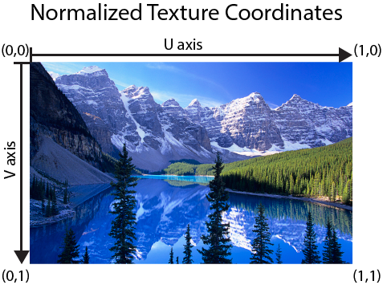

<div class="caption">

DX11 Texture Coordinates

</div>

Using normalized texture coordinates we can assign the texture coordinates to our vertex data without regard for the actual texture dimensions. This way a texture of size 1024×1024 will be applied to the geometry in the same way if we scaled the texture down to 512×512. This is important when making use of **mipmapping**.

### Mip Mapping

Mip mapping is the process of generating a chain of images from a texture where each image in the chain is half the size of the previous image in the mipmap chain. The image below demonstrates this technique.

<span id="attachment-5771"></span>

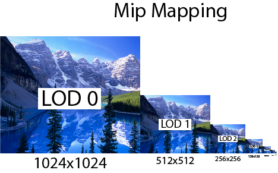

<div class="caption">

Mip Mapping

</div>

In order to generate the mipmap chain for a texture of size 1024×1024 the image size is halved for the next level of the mipmap chain and this process is repeated until the size of the texture in both dimensions is 1.

The largest image is at level **0** of the mipmap chain and smallest image is at level $\log_2(N)$ where $N$ is the size in texels of the longest edge of the image.

Mipmapping provides several benefits. The most obvious benefit to mipmapping is the use of **level of detail** (LOD). If the textured object moves further away from the camera, less detail in the object’s texture is visible and therefore a full resolution texture is not needed to render the object. Only when the object is close to the camera is a higher (level 0) mipmap texture required. Using smaller resolution images improves cache performance since a larger portion of the texture can be stored in high-speed cache thus reducing cache misses and subsequently improving texture look-up performance.

Mipmapping also reduces artifacts in the final image caused by poor image sampling. These artifacts can be mitigated by using pre-filtered images from the mipmap chain when viewing the scene objects that are far away. The image below demonstrates the artifacts that can appear if mipmapping is not used [\[1\]](#ref-mipmapping).

<span id="attachment-5782"></span>

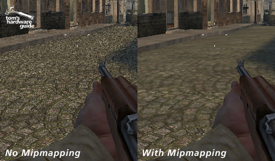

<div class="caption">

Mipmapping vs No Mipmapping [\[1\]](#ref-mipmapping)

</div>

### Texture Sampler

Before we can use textures in a shader, we must define a **texture sampler state** object. The texture sampler state defines how a texel from the texture is read. Several options can be configured to control how the texture is sampled. These options include filtering, address mode, LOD range and offset, and border color (among others).

#### Filter

The filter settings of the texture sampler state determines how the fetched texel is blended with it’s neighboring texels to produce the final texel color. There are commonly three types of filtering; **point** and **linear**, and **anisotropic**. Point filtering simply takes the closest texel to the sampled sub-texel. Linear filtering will apply a bi-linear blend between the closest texels to the sampled sub-texel using the distance to the center of the texel as the weight used to blend the texels to obtain the final texel. Anisotropic filtering is applied when sampling surfaces which are oblique (slanted angle) to the viewer. Anisotropic filtering is usually used when sampling textures that are applied to the ground plane or terrains [\[4\]](#ref-anisotropic-filtering).

<span id="attachment-5833"></span>

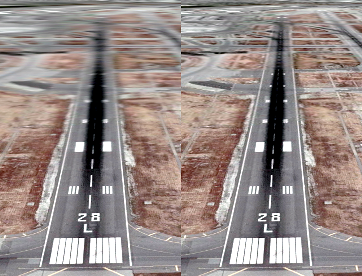

<div class="caption">

Anisotropic compare [\[4\]](#ref-anisotropic-filtering)

</div>

The **Anisotropic compare** image shows linear mipmapped filtering on the left and anisotropic filtering on the right.

The image below shows an example of how the texture filtering algorithms work.

<span id="attachment-5789"></span>

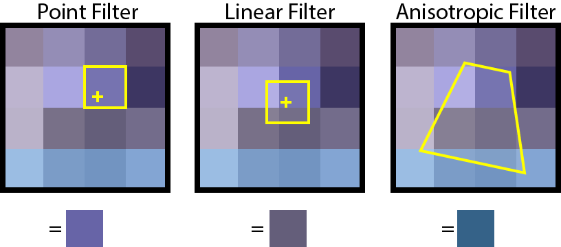

<div class="caption">

Texture Filtering

</div>

In the first case, point filtering samples the texel closest to the sampled sub-texel. Linear filtering will perform a bi-linear blend between the texels that are in the sampled square area close to the sampled sub-texel and anisotropic filtering will sample in an area that is dependent on the viewing area so samples closer to the viewer will have more influence on the final fetched color than samples further away.

Point filtering usually produces the poorest quality result but has the best performance while anisotropic filtering produces the best quality result at the expense of performance.

The filtering method used can be specified separately for **minification** and **magnification** filtering. **Minification** filtering occurs when a single texel from the sampled texture is smaller than a single screen pixel. In this case, a single screen pixel contains multiple texels and an appropriate filtering algorithm must be applied to determine the final color [\[6\]](#ref-texture-filtering). **Magnification** filtering occurs when a single texel from the sampled texture is larger than a single screen pixel. In this case, the texels have to be scaled up using an appropriate filtering algorithm. The image below shows the result of different filtering algorithms being applied in minification and magnification scenarios.

<span id="attachment-5800"></span>

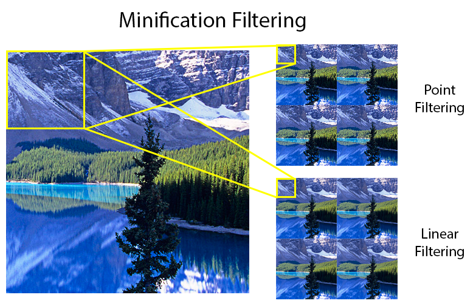

<div class="caption">

Minification Filtering

</div>

The image above shows an example of minification filtering. In the top-right of the image, point sampling is used to reduce the image size. The result seems to produce a more sharper image but can result in undesirable artifacts in the form of noise which are easily noticed when the object or the viewer are in motion.

<span id="attachment-5802"></span>

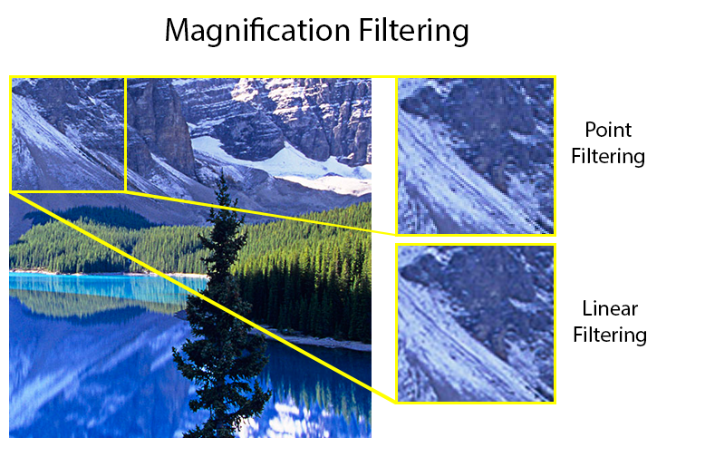

<div class="caption">

Magnification Filtering

</div>

#### Mipmap Filtering

Texture filtering also applies at the mipmap level. Neighboring mipmaps in the mipmap chain can also be blended using either point, linear, or anisotropic filtering.

<span id="attachment-5792"></span>

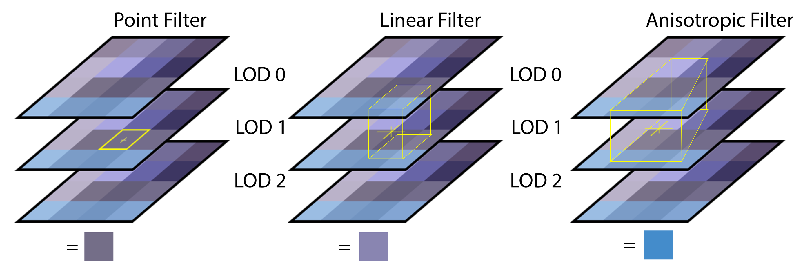

<div class="caption">

Mipmap Filtering

</div>

Using **point** mipmap filtering, the closest mipmap level to the sampled sub-texel will be used for sampling the texture. Using **linear** mipmap filtering the closest two mipmap textures to the sampled sub-texel will both be sampled and the filtered result from each mipmap will be blended based on the distance between each mipmap level. **Anisotropic** mipmap filtering will perform an non-orthogonal sampling from the two closest mip map levels to the sampled sub-texel and perform blend the results based on the distance between each mipmap level.

The following table describes the different filters available in DirectX 11 [\[5\]](#ref-d3d11-filter).

| Enumeration Constant | Description |
| --- | --- |
| **MIN\_MAG\_MIP\_POINT** | Use point sampling for minification, magnification, and mip-level sampling. |
| **MIN\_MAG\_POINT\_MIP\_LINEAR** | Use point sampling for minification and magnification; use linear interpolation for mip-level sampling. |
| **MIN\_POINT\_MAG\_LINEAR\_MIP\_POINT** | Use point sampling for minification; use linear interpolation for magnification; use point sampling for mip-level sampling. |

| **MIN\_POINT\_MAG\_MIP\_LINEAR** | Use point sampling for minification; use linear interpolation for magnification and mip-level sampling. |

| **MIN\_LINEAR\_MAG\_MIP\_POINT** | Use linear interpolation for minification; use point sampling for magnification and mip-level sampling. |

| **MIN\_LINEAR\_MAG\_POINT\_MIP\_LINEAR** | Use linear interpolation for minification; use point sampling for magnification; use linear interpolation for mip-level sampling. |

| **MIN\_MAG\_LINEAR\_MIP\_POINT** | Use linear interpolation for minification and magnification; use point sampling for mip-level sampling. |

| **MIN\_MAG\_MIP\_LINEAR** | Use linear interpolation for minification, magnification, and mip-level sampling. |

| **ANISOTROPIC** | Use anisotropic interpolation for minification, magnification, and mip-level sampling. |

#### Address Mode

Texture addressing modes allows you to specify how texture coordinates that are outside of the range **\[0 … 1\]** are interpreted. There are currently five different address modes in DirectX 11; wrap, mirror, clamp, border, and mirror once.

##### Wrap

The **wrap** address mode will simply truncate the whole number part of the texture coordinate, leaving only the fractional part. Using this technique, the texture coordinate (3.25, 3.75) will become (0.25, 0.75). If the texture coordinate is negative, then the resulting texture coordinate will be subtracted from 1 before being applied. For example, (-0.01, -2.25) will become (0.99, 0.75).

The following pseudo algorithm helps to explain this technique.

```cpp title="Wrap Address Mode" showLineNumbers
if texCoord > 1 then 
	let texCoord = fractional part of texCoord
else if texCoord < 0
	let texCoord = 1 - fractional part of texCoord
end if
```

The image below shows an example of using wrap addressing mode. The yellow lines show the texture coordinate integer boundaries.

<span id="attachment-5816"></span>

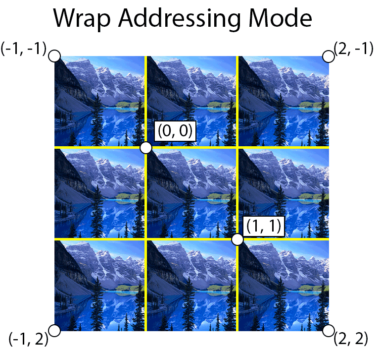

<div class="caption">

Wrap Addressing Mode

</div>

##### Mirror

The **mirror** texture address mode will flip the UV coordinates at every integer boundary. For example, texture coordinates in the range \[0 … 1\] will be treated normally but texture coordinates in the range (1 … 2\] will be flipped (by subtracting the fractional part of the texture coordinate by 1) and texture coordinates in the range (2 … 3\] will be treated normally again.

The following pseudo algorithm explains this technique.

```cpp title="Mirror Address Mode" showLineNumbers
if integer part of texCoord is odd then
	let texCoord = 1 - fractional part of texCoord
else
	let texCoord = fractional part of texCoord
end if
```

The image below shows an example of using mirror addressing mode. The yellow lines show the texture coordinate integer boundaries.

<span id="attachment-5817"></span>

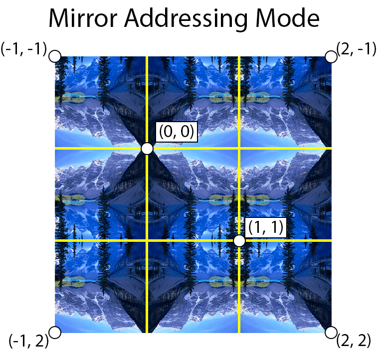

<div class="caption">

Mirror Addressing Mode

</div>

##### Clamp

Using **clamp** address mode, texture coordinates are clamped in the range \[0 … 1\].

The following pseudo code demonstrates this technique.

```cpp title="Clamp Address Mode" showLineNumbers
if texCoord > 1 then 
	let texCoord = 1
else if texCoord < 0 then
	let texCoord = 0
end if
```

The picture below demonstrates clamp addressing mode. The yellow lines show the texture coordinate integer boundaries.

<span id="attachment-5824"></span>

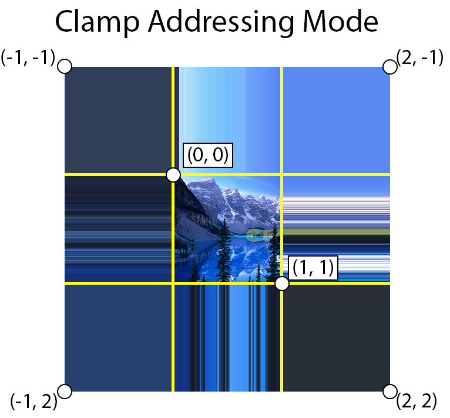

<div class="caption">

Clamp Addressing Mode

</div>

##### Border

**Border** addressing mode will use the specified border color when the texture coordinates are outside of the range \[0 … 1\].

The following pseudo code demonstrates this technique.

```cpp title="Border Address Mode" showLineNumbers
if texCoord < 0 or texCoord > 1 then
	return borderColor
end if
```

Suppose we set the border color to magenta, then the image below demonstrates border addressing mode. The yellow lines show the texture coordinate integer boundaries.

<span id="attachment-5826"></span>

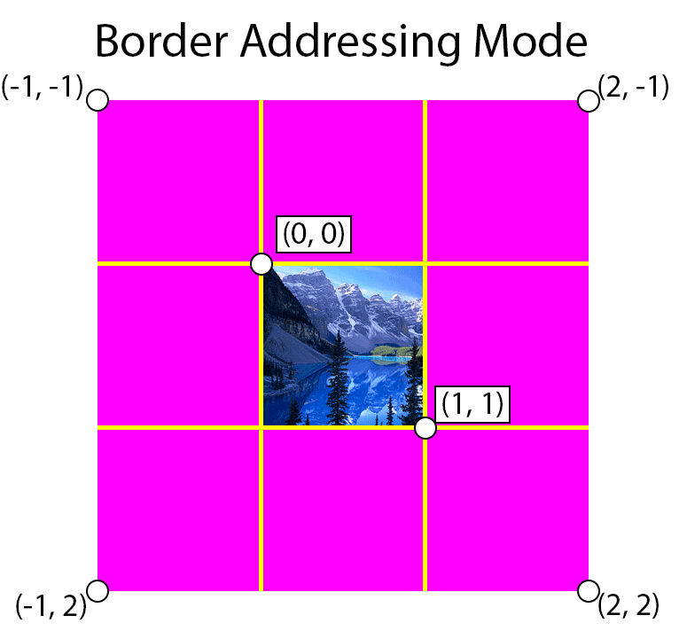

<div class="caption">

Border Addressing Mode

</div>

##### Mirror Once

The **mirror once** texture address mode takes the absolute value of the texture coordinate and clamps to 1.

The image below demonstrates mirror once addressing mode.

<span id="attachment-9003"></span>

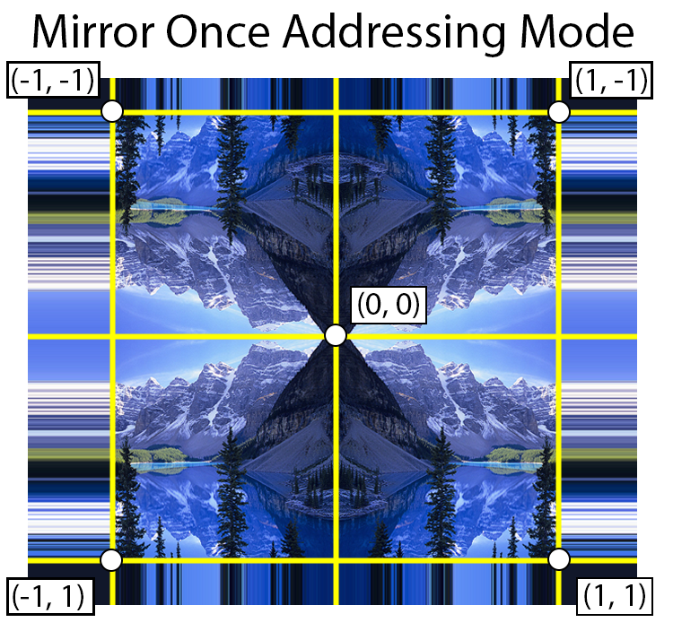

<div class="caption">

Mirror once address mode takes the absolute value of the texture coordinate and clamps the resulting value to 1.

</div>

##### Enumeration Constants

The following table summarizes the different addressing modes supported by DirectX 11 [\[7\]](#ref-texture-address-mode).

| Enumeration Constant | Description |
| --- | --- |
| **WRAP** | Tile the texture at every (u,v) integer junction. For example, for u values between 0 and 3, the texture is repeated three times. |
| **MIRROR** | Flip the texture at every (u,v) integer junction. For u values between 0 and 1, for example, the texture is addressed normally; between 1 and 2, the texture is flipped (mirrored); between 2 and 3, the texture is normal again; and so on. |
| **CLAMP** | Texture coordinates outside the range \[0.0, 1.0\] are set to the texture color at 0.0 or 1.0, respectively. |
| **BORDER** | Texture coordinates outside the range \[0.0, 1.0\] are set to the border color specified in [D3D11\_SAMPLER\_DESC](https://learn.microsoft.com/windows/win32/api/d3d11/ns-d3d11-d3d11_sampler_desc) or HLSL code. |
| **MIRROR\_ONCE** | Similar to **MIRROR** and **CLAMP**. Takes the absolute value of the texture coordinate (thus, mirroring around 0), and then clamps to the maximum value. |

#### Mipmap LOD Levels

It is also possible to specify the minimum and maximum mipmap LOD levels in a texture sampler.

Recall that the mipmap LOD level of the most detailed (highest resolution) texture is $0$ and the smallest mipmap LOD level is $\log_2(N)$ where $N$ is the number of texels on the longest edge of the image. By specifying the **MinLOD** and **MaxLOD** values in a texture sampler, we can limit the range of texture LOD levels that will be used while sampling from the texture.

By default, the **MinLOD** parameter is set to **\-FLT\_MAX** and the MaxLOD parameter is set to **FLT\_MAX** which disables any LOD limits.

We can also specify a LOD bias which will offset the computed LOD when sampling the texture. For example, if we have a LOD bias of 1 and the computed LOD level to sample the texture from is 3, then the mipmap texture at LOD level 4 will actually be used to sample the texture. This is useful in cases where you would like to force the graphics program to use a lower (or higher if you use a negative LOD bias) LOD level which may help improve quality or performance of your graphics application.

By default the LOD bias parameter is set to **0** which disables the LOD bias.

#### Border Color

The texture sampler also provides a property to specify the border color of the texture. If the **BORDER** texture address mode is used to sample the texture, then the border color will be returned when the texture coordinates are out of the range \[0 … 1\]. (See [Border address mode](#border)).

## Materials Properties

Before we talk about the lighting equations, I would like to distinguish the difference between material properties and light properties.

Each object in your scene can be assigned material properties which determines how the object is rendered. Although object materials can have a arbitrary set of parameters, for this article I will use a material that consists of the following properties:

-   **Emissive**: The material’s emissive term (denoted $k_e$) is used to make the material appear to “emit” light even in the absence of any lights.
-   **Ambient**: The material’s “ambient” term (denoted $k_a$) is used to simulate the effect of global lighting contributions such as light produced from the sun. The material’s ambient component can optionally be determined by the ambient contribution of all of the light sources in the scene but it is also possible to define the material’s ambient contribution by combining it with a global ambient constant to compute the final ambient contribution. In this article, we will use a global ambient term instead of specifying an ambient term per light source.
-   **Diffuse**: The material’s diffuse color (denoted $k_d$) is the color which is reflected evenly in all directions. A material’s diffuse color is not dependent on the viewing angle. Dull objects (like bark from a tree or sandpaper) are almost purely diffuse materials and appear the same color no matter the viewing angle. The materials diffuse term is combined with the diffuse contribution of all of the light sources in the scene.
-   **Specular**: The material’s specular color (denoted $k_s$) allows a material to appear shiny. Materials such as high-gloss paints, metals, and shiny plastics have bright highlights when viewed at certain angles. This is called the specular highlight and is apparent when the viewing angle is directly in the path of the reflection of the light source.
-   **Specular Power**: The apparent brightness of the specular highlight is determined by the material’s specular power (denoted $\alpha$). As the specular power is increased, the specular highlight becomes a tighter, sharper highlight. The material’s specular component is combined with the specular contribution of each light source in the scene.

## Light Properties

Similar to materials, lights also define a set of properties that determine the final output of the scene. Again, lights can have an arbitrary number of arguments depending on your lighting model but for this article, we will define the set of properties for the light.

-   **Light Type**: We will define 3 types of lights:
    -   **Point**: A positional light that emits light evenly in all directions.
    -   **Spot**: A positional light that emits light in a specific direction.
    -   **Directional**: A directional light source only defines a direction but does not have a position (it is considered to be infinitely far away). This light type can be used to simulate the sun in outdoor scenes.
-   **Color**: The color of the light source. For this article, we will combine the light’s diffuse and specular contributions into a single color property.
-   **Position**: For point and spot lights this property defines the 3-dimensional position of the light source.
-   **Direction**: For spot and directional lights this property defines the direction the light is pointing.
-   **SpotAngle**: The angle of the spotlight cone in radians.
-   **Attenuation**: The attenuation factor is used to simulate the apparent fall-off of the intensity of the light as the distance to the light source increases. This property only applies to positional light sources such as point lights and spot lights (since directional lights don’t have a position).

In the next sections we will see how we can combine the material’s properties with the lights in the scene to produce the final color.

## Lighting

For this tutorial, we will implement the [Phong lighting model](https://en.wikipedia.org/wiki/Phong_reflection_model). Using the programmable shader pipeline we can implement any kind of lighting model we would like but for simplicity, I will show how to implement the Phong lighting model.

Another similar lighting model to the Phong lighting model is called the [Blinn-Phong lighting model](https://en.wikipedia.org/wiki/Blinn%E2%80%93Phong_shading_model). This lighting model was used to perform per-vertex lighting using the fixed-function pipeline of DirectX 9 and earlier. The primary difference between the Phong lighting model and the Blinn-Phong lighting model is the way that the specular component is computed. The Blinn-Phong lighting model is an optimization of the Phong lighting model for directional lights because the light vector and the eye vector (which are both required to compute the specular component) can be considered constant when lighting is computed in view space. This means that these vectors do not need to be computed for each vertex (or pixel) during rendering which improves the overall performance of the rendering algorithm. The Blinn-Phong lighting model is an approximation of the Phong lighting model and can be prone to lighting artifacts in certain situations. For this reason, I chose to implement the Phong lighting model in this article.

The basic lighting equation for both the Phong and the Blinn-Phong lighting models is:

$$
Color_{final}=emissive+ambient+\sum_{i=0}^{N}(ambient_i+diffuse_i+specular_i)
$$

Where $N$ is the number of lights affecting the object being rendered.

In the next sections, I will talk about each of the lighting components separately.

### Emissive

The emissive component will add color to the surface of the object even in the absence of any lights. As the name suggests, the emissive term will give the effect that the object itself is emitting light. Although this statement is not entirely true because it will not actually cast light onto any objects around it nor will it automatically create the nice “bloom” effect that you expect from emissive materials. To achieve truly emissive materials, you need to either perform multiple passes during rendering or use an indirect global illumination algorithms such as ray-tracing or path-tracing. These topics are beyond the scope of this article as we will be focusing on forward-rendering techniques which have support for direct lighting contributions.

The emissive component is computed from the material’s emissive term.

$$
emissive=k_e
$$

Where $k_e$ is the material’s emissive term.

The image below shows a “Cornell box” scene with several objects with only emissive lighting contributions. In this scene, no lights are enabled yet the objects still appear colored.

<span id="attachment-5843"></span>

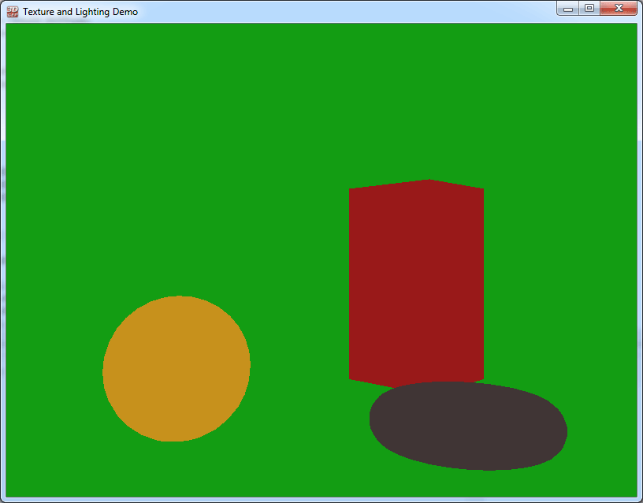

<div class="caption">

Emissive Only

</div>

The emissive component in this image has been exaggerated so that the shapes are visible. Usually, the emissive component is used for special effect where an object should appear brighter than normal. In most cases, the material’s emissive component is dark (black) or very dim. A bright emissive component results in a washed-out and overly bright objects.

### Ambient

The material’s ambient term is combined with a global ambient term to produce the final ambient contribution.

Let:

-   $G_a$ be the global ambient contribution
-   $k_a$ be the material’s ambient term

Then

$$
ambient=k_a G_a
$$

The image below shows the same scene rendered with only ambient contribution.

<span id="attachment-5849"></span>

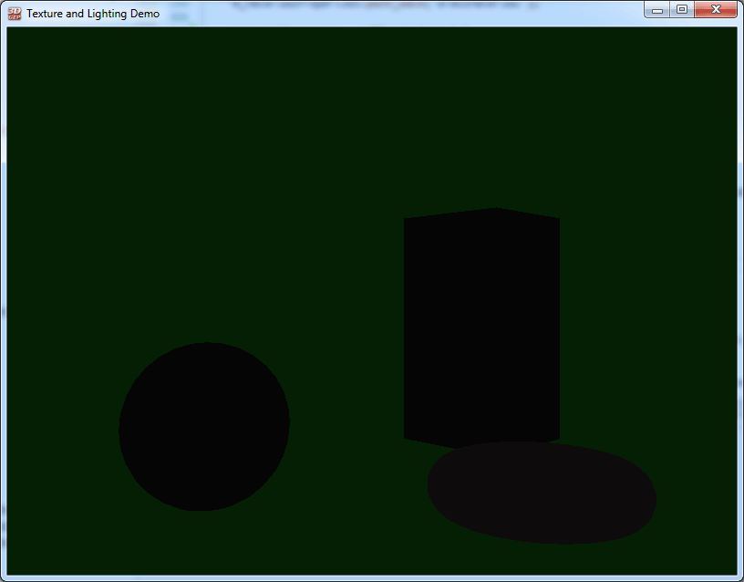

<div class="caption">

Ambient Only

</div>

The ambient contribution should not be too bright otherwise the scene will appear overexposed and washed-out.

### Diffuse

Both the diffuse and specular components require lights to be activated in the scene. The diffuse color is emitted evenly across the surface of an object. The intensity of the light that contributes to the color of the material is determined by the angle of the surface normal and the light vector.

<span id="attachment-5861"></span>

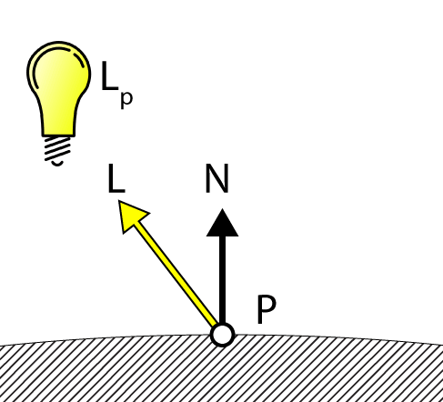

<div class="caption">

Diffuse Lighting

</div>

If:

-   $\mathbf{P}$ is the point in 3D space that we want to shade,
-   $\mathbf{N}$ is the surface normal at point we want to shade,
-   $\mathbf{L}_p$ is the position of the light in 3D space,
-   $\mathbf{L}_d$ is the diffuse contribution of the light source,
-   $\mathbf{L}$ is the normalized direction vector from the point we want to shade to the light source,
-   $k_d$ is the diffuse component of the material,

Then

$$
\begin{array}{rcl}
\mathbf{L} & = & \text{normalize}(\mathbf{L}_p-\mathbf{P}) \\
diffuse & = & \max(0,\mathbf{L} \cdot \mathbf{N}) \mathbf{L}_d k_d
\end{array}
$$

The image below shows the scene rendered with only diffuse lighting.

<span id="attachment-5863"></span>

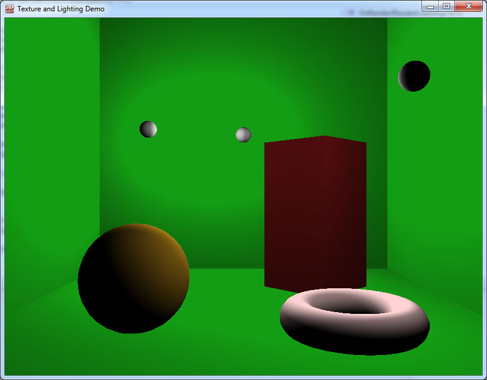

<div class="caption">

Diffuse Only

</div>

The three white spheres represent point light sources.

### Specular

Specular light is the bright highlights that appear on shiny surfaces. The specular highlights are brightest when viewed from an angle that is a perfect reflection from the eye to the light source.

<span id="attachment-5872"></span>

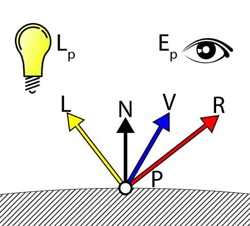

<div class="caption">

Specular Lighting

</div>

If:

-   $\mathbf{P}$ is the point in 3D space that we want to shade,
-   $\mathbf{N}$ is the surface normal at point we want to shade,
-   $\mathbf{L}_p$ is the position of the light in 3D space,
-   $\mathbf{L}$ is the normalized direction vector from the point we want to shade to the light source,
-   $\mathbf{E}_p$ is the eye position (position of the camera),
-   $\mathbf{V}$ is the view vector and is the normalized direction vector from the point we want to shade to the eye,
-   $\mathbf{R}$ is the reflection vector from the light source to the point we are shading about the surface normal $\mathbf{N}$,
-   $\mathbf{L}_s$ is the specular contribution of the light source,
-   $k_s$ is the specular component of the material,
-   $\alpha$ is the “shininess” of the material. The higher the “shininess” value, the smaller the specular highlight.

Then using the **Phong lighting model**, the specular component can be calculated as follows:

$$
\begin{array}{rcl}
\mathbf{L} & = & \text{normalize}(\mathbf{L}_p-\mathbf{P}) \\
\mathbf{V} & = & \text{normalize}(\mathbf{E}_p-\mathbf{P}) \\
\mathbf{R} & = & 2(\mathbf{L}\cdot\mathbf{N})\mathbf{N}-\mathbf{L} \\
specular & = & (\mathbf{R}\cdot\mathbf{V})^{\alpha}*\mathbf{L}_s*k_s
\end{array}
$$

The **Blinn-Phong lighting model** computes the specular contribution slightly differently. Instead of computing the light’s reflection vector ($\mathbf{R}$) about the surface normal ($\mathbf{N}$), a “halfway” vector ($\mathbf{H}$) between the light vector ($\mathbf{L}$) and the view vector ($\mathbf{V}$) is computed. The dot product between the halfway vector ($\mathbf{H}$) and the surface normal ($\mathbf{N}$) is used as an approximation to the dot product between the reflection vector ($\mathbf{R}$) and the view vector ($\mathbf{V}$).

In addition to the previous variables, we must also compute $\mathbf{H}$ as the halfway (or half-angle) vector between the light vector ($\mathbf{L}$) and the view vector ($\mathbf{V}$).

If:

-   $\mathbf{H}$ is the half-angle vector between the light vector and the view vector.

Then,

$$
\begin{array}{rcl}
\mathbf{H} & = & \text{normalize}(\mathbf{L}+\mathbf{V}) \\
specular & = & (\mathbf{N}\cdot\mathbf{H})^{\alpha}*\mathbf{L}_s*k_s
\end{array}
$$

When using the Blinn-Phong lighting model and if the light is a directional light (for example to simulate the sun) and we compute lighting in view space, then both $\mathbf{L}$ and $\mathbf{V}$ are constants, therefore the half-angle vector ($\mathbf{H}$) between $\mathbf{L}$ and $\mathbf{V}$ is also constant and can be passed as a uniform variable to our shader (one uniform variable per directional light in the scene). This eliminates the need to compute $\mathbf{L}$, $\mathbf{V}$ and $\mathbf{H}$ in the shader which saves at least three normalize function invocations per pixel (or vertex if performing per-vertex lighting). However, for positional lights (point and spot lights) we still need to at least compute both the $\mathbf{L}$ and $\mathbf{H}$ vectors which reduces the advantages of this optimization.

In the tutorial section of this article, I will demonstrate both Phong and Blinn-Phong lighting calculations and you can observe the difference for yourself.

The following image shows the scene rendered with just specular highlights.

<span id="attachment-5874"></span>

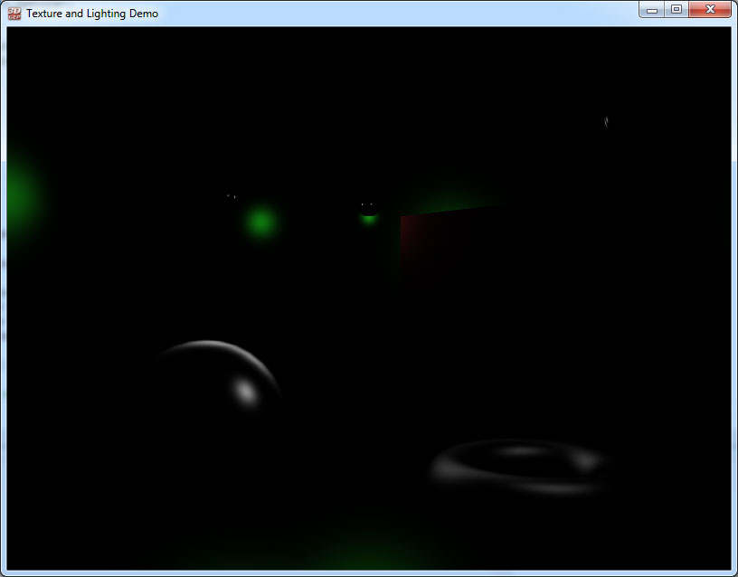

<div class="caption">

Specular Only

</div>

If we combine all of the different components of the lighting model, the rendered scene would look like the image shown below:

<span id="attachment-5876"></span>

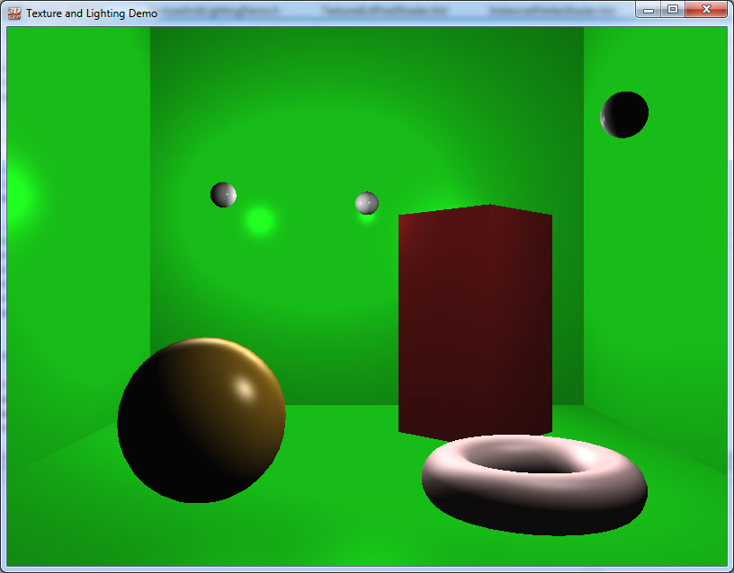

<div class="caption">

Phong Lighting

</div>

This scene is lit by three white point lights. Here you can clearly see the combination of the diffuse and specular contributions.

Before we get into the shaders for creating this effect, I want to talk about additional lighting effects such as specular intensity, spotlights, and attenuation.

## Specular Intensity

In the lighting functions shown in the previous section, the **specular power** was represented by the greek letter alpha ($\alpha$) but it was not clearly explained how this value affects the appearance of the specular highlights. The table below gives a few possible values for $\alpha$ and describes the result.

| $\alpha$ | Description |
| --- | --- |
| 0 | The specular intensity will be 1 everywhere regardless of the viewing angle and the object will appear overly bright. A specular power of 0 should not be used. To disable specular highlights without changing the shader code, set the material’s specular color to black. |
| 1 | The specular component now resembles diffuse lighting and will not display proper specular highlights. The object will appear overly bright and washed-out. A specular power of 1 should not be used. |
| 2 | The specular highlight will be very large and bright. The object will appear overly bright and washed-out. |
| 10 | The specular highlight will still appear very large and bright. This is appropriate for dull surfaces such as rough plastics or other rough materials. If the object still appears overly bright, consider reducing the intensity of the materials specular color ($k_s$) |
| 128 | The specular highlight will appear very small and focused. This specular power is useful for smooth plastics, glass or some metal surfaces. |

The graph below shows how the specular power value ($\alpha$) affects the result of the specular component of the final color.

<span id="attachment-5880"></span>

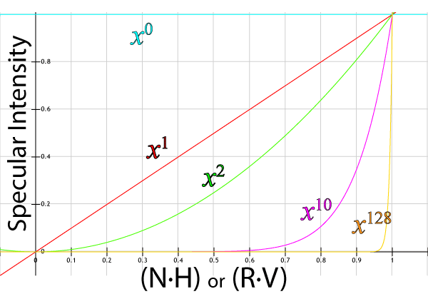

<div class="caption">

Specular Power Function

</div>

On the **horizontal axis** is the result of the $\mathbf{N}\cdot\mathbf{H}$ (for Blinn-Phong lighting) or $\mathbf{R}\cdot\mathbf{V}$ (for Phong lighting) while the **vertical axis** shows the specular intensity that results from the power function $x^{\alpha}$.

The image below shows the the specular highlights on the sphere at various specular powers.

<span id="attachment-5883"></span>

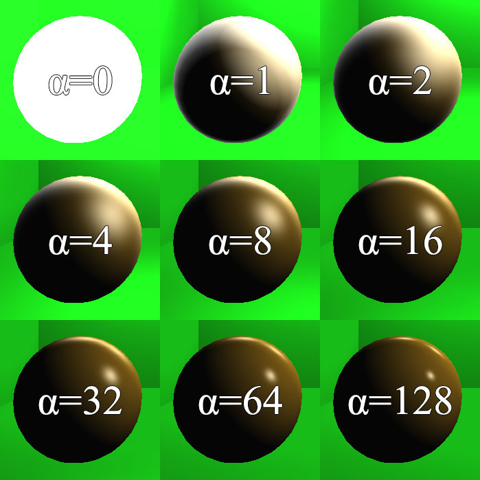

<div class="caption">

Specular Power

</div>

This animation shows how the specular power changes the specular highlights in the scene.

<video class="embed-video-file" src="/videos/Specular-Power-Animated.mp4" width="584" height="505" loop controls preload="metadata" playsinline></video>

## Spotlights

In addition to the functions explained in the section about lighting, spotlights have an additional function to compute the intensity of the spotlight cone. The **SpotAngle** property of the light is used to determine how wide or how narrow the spotlight cone will be. The spotlight angle is the half-angle of the spotlight cone. For example, a spotlight with a spotlight angle of 45° will result in a 90° spotlight cone.

<span id="attachment-5888"></span>

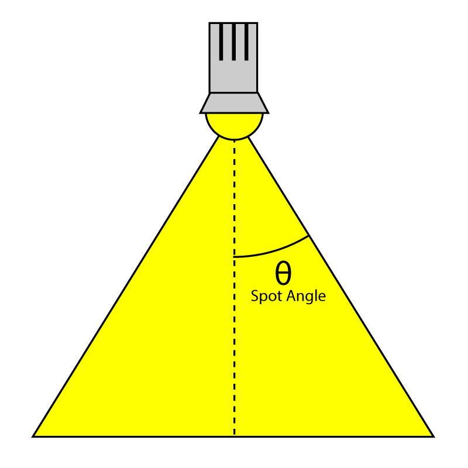

<div class="caption">

Spotlight

</div>

The intensity of the spotlight is brightest when the spotlight is pointing directly at the point being shaded. As the angle between the negated light vector ($-\mathbf{L}$) and the spotlight’s direction vector ($\mathbf{L}_{dir}$) increase, the spotlight’s intensity should decrease until this angle reaches the maximum spotlight angle at which point the spotlight intensity should become 0.

<span id="attachment-5894"></span>

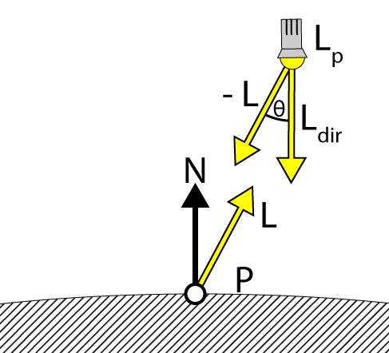

<div class="caption">

Spotlight Intensity

</div>

In the tutorial section of this article, we will see how we can compute the intensity of the spotlight.

The image below shows the scene lit by a single spotlight with a 45° spotlight angle.

<span id="attachment-5891"></span>

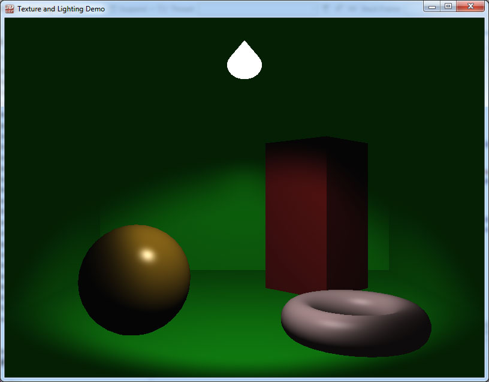

<div class="caption">

Spotlight

</div>

## Attenuation

**Attenuation** is the falloff of the intensity of the light as the distance to the light source increases. For this article, attenuation is computed from the reciprocal of the sum of three attenuation constants:

-   **Constant Attenuation**: A constant value used to increase or decrease the intensity of the light independent of the distance to the light source.
-   **Linear Attenuation**: The intensity of the light decreases linearly as the distance to the light source increases.
-   **Quadratic Attenuation**: The intensity of the light decreases quadratically as the distance to the light source increases.

If:

-   $d$: is the distance from the light source to the point being shaded,
-   $k_c$: is the constant attenuation factor,
-   $k_l$: is the linear attenuation factor,
-   $k_q$: is the quadratic attenuation factor,

Then the formula to compute the attenuation is:

$$
attenuation=\frac{1}{k_c+k_ld+k_qd^2}
$$

The graph below shows three example functions to compute the attenuation. On the horizontal axis is the distance to the light source and the vertical axis shows the intensity of the light due to attenuation. The resulting attenuation should always be clamped in the range \[0 … 1\] when used in your shader.

<span id="attachment-5904"></span>

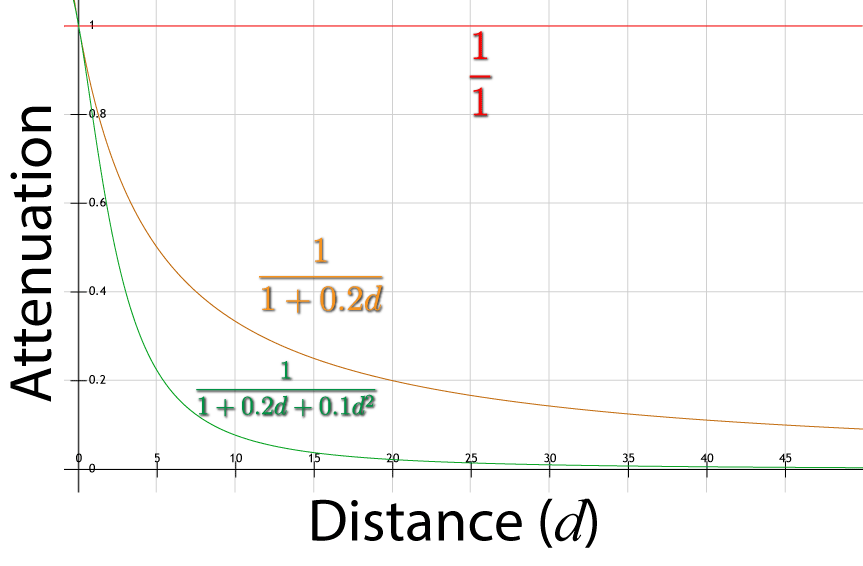

<div class="caption">

Attenuation Factor

</div>

The first graph (red) shows the attenuation with a constant attenuation factor of 1 and a linear and quadratic attenuation factors of 0. In this case, there is no falloff and the attenuation is constant regardless of the distance to the light source.

The second graph (orange) shows the attenuation with a constant attenuation factor of 1, a linear attenuation factor of 0.2 and a quadratic attenuation factor of 0.

And the third graph (green) shows the attenuation with a constant attenuation factor of 1, a linear attenuation factor of 0.2 and a quadratic attenuation factor of 0.1. In this case, the intensity of the light due to attenuation falls-off quickly.

Since the attenuation is dependent on the distance to the light, it is important to consider the units used in your scene when determining your attenuation factors. If 1 world unit is equivalent to 1 meter in your scene, then the intensity of the light due to attenuation will fall-off slower than if 1 world unit is equivalent to 1 cm. You should adjust your parameters appropriately according to the units used in your scene.

Before we get into the shader code, I would like to discuss some of the issues when dealing with constant buffers and how variables inside constant buffers are packed into 16 byte registers.

## Packing Rules for Constant Buffers

We will be using several structures in the pixel shader. One structure will be used to define the material properties for the object being rendered. Another structure will be used to define the light properties for a single light. The material and light properties (for all 8 lights) will be passed to the shader using a constant buffer. Since constant buffers have very strict packing rules, it is worth-while to discuss some of the issues with packing rules of constant buffers in HLSL.

In the next sections, we will look at packing rules as they apply to primitives, structs, and arrays.

### Primitive Packing

HLSL defines several scalar types as defined in the table below [\[12\]](#ref-scalar-types).

| Type | Size (bytes) | Notes |
| --- | --- | --- |
| **bool** | 4 | Although variables of this type can only have the value **true** or **false**, variables of type bool in an HLSL shader will consume 4 bytes when used as a uniform variable. |
| **int** | 4 | 32-bit signed integer in the range \[-231+1 … 231\-1\] (-2,147,483,647 … 2,147,483,647). |
| **uint** | 4 | 32-bit unsigned integer in the range \[0 … 232\-1\] (0 … 4,294,967,295). |
| **dword** | 4 | 32-bit unsigned integer in the range \[0 … 232\-1\] (0 … 4,294,967,295). |
| **float** | 4 | 32-bit floating point value in the range \[+/-3.402823466e+38\]. |
| **double** | 8 | 64-bit floating point value in the range \[+/-1.7976931348623158e+308\]. |

HLSL also defines a set of vector types whose types consist of a scalar type and a number of components in the range \[1-4\] such as **bool1** (a vector type with only a single component), **int2**, **float3**, and **double4** [\[13\]](#ref-vector-types) as well as matrix types whose types consists of a scalar type, number of rows, and number of columns such as **bool1x1** (a boolean matrix with 1 row and 1 column), **int4x1** (an integer matrix with 4 rows and 1 column), **float4x4** (a float matrix with 4 rows and 4 columns), and **double3x4** (a double matrix with 3 rows and 4 columns) [\[14\]](#ref-matrix-types). The special **matrix** type is an alias for the **float4x4** type.

Variables are packed into a given 4-component vector until the variable will straddle a 16 byte boundary [\[11\]](#ref-packing-rules). If a variable’s size will cause the current packing 4-component vector to straddle the 4-component vector boundary, it will be bounced to the next 4-component vector [\[11\]](#ref-packing-rules).

The following examples should help clarify this statement. The first example shows a simple example for vector packing.

```cpp title="Primitive Packing (HLSL)" showLineNumbers
cbuffer PrimitivePacking
{
    float4 Val1; // 16 bytes 
//-----------------------------------(16 byte boundary)
    float3 Val2; // 12 bytes
    // 4 bytes auto padding.
//-----------------------------------(16 byte boundary)
    float2 Val3; // 8 bytes
}; // Total size: 40 bytes
```

In the **PrimitivePacking** constant register, we see that the first variable **Val1** is a 16-byte value which fits perfectly into the 4-component vector register. The next variable **Val2** is a 3-component vector which occupies the first three components of the 4-component vector register. **Val3** is a 2-component vector which does not fit into **Val2**‘s vector register so it will jump to the next vector register leaving four bytes of padding between **Val2** and **Val3**.

The C++ struct that maps to the **PrimitivePacking** constant buffer would look like this:

```cpp title="Primitive Packing (C++)" showLineNumbers
struct PrimitivePacking
{
    float Val1[4];     // 16 bytes
//-----------------------------------(16 byte boundary)
    float Val2[3];     // 12 bytes
    float Padding1;    // 4 bytes padding
//-----------------------------------(16 byte boundary)
    float Val3[2];     // 8 bytes
    float Padding2[2]; // 8 bytes padding to make struct size divisible by 16.
//-----------------------------------(16 byte boundary)
}; // Total Size:      48 bytes (3 * 16 byte registers)
```

When allocating the buffer, we must ensure that the buffer size is divisible by 16 bytes. To do this, we add some extra padding at the end of the struct to make the struct exactly the size of three 16 byte registers.

In the next example, we see how values of different types are packed.

```cpp title="Mixed Scalar Packing (HLSL)" showLineNumbers
cbuffer MixedScalarPacking
{
    int   Val1; // 4 bytes
    bool  Val2; // 4 bytes
    float Val3; // 4 bytes
    bool  Val4; // 4 bytes
//-----------------------------------(16 byte boundary)
}; // Total:    16 bytes
```

In the **MixedScalarPacking** constant buffer all four of these variables fit into a singe 4-component vector register. In this case there will be no hidden padding. Each type is 32-bits (4 bytes) so they can be packed together in the same vector register.

The C++ struct that maps to the **MixedScalarPacking** constant buffer would look like this:

```cpp title="Mixed Scalar Packing (C++)" showLineNumbers
struct MixedScalarPacking
{
    int   Val1; // 4 bytes
    int   Val2; // 4 bytes
    float Val3; // 4 bytes
    int   Val4; // 4 bytes
//-----------------------------------(16 byte boundary)
}; // Total:    16 bytes
```

If you look carefully, you will notice that **Val2** and **Val4** are stored as **bool** values in the HLSL constant buffer but must be stored as 32-bit values in C++ to ensure the values align correctly in memory. Besides the difference in types, there is no hidden packing occurring here.

In the next example, we see how mixed vector types are packed.

```cpp title="Mixed Vector Packing (HLSL)" showLineNumbers
cbuffer MixedVectorPacking
{
    int2   Val1; // 8 bytes
    bool2  Val2; // 8 bytes
//-----------------------------------(16 byte boundary)
    float3 Val3; // 12 bytes
    // 4 bytes auto padding.
//-----------------------------------(16 byte boundary)
    int2   Val4; // 8 bytes.
};
```

In the **MixedVectorPacking** constant buffer, **Val1** and **Val2** consume eight bytes each. These two vectors fit within a single 4-component vector register. Again we see that there will be four bytes of hidden padding between **Val3** and **Val4** because they don’t both fit into a 4-component vector register.

The C++ struct that maps to the **MixedVectorPacking** constant buffer would look like this:

```cpp title="Mixed Vector Packing (C++)" showLineNumbers
struct MixedVectorPacking
{
    int   Val1[2];     // 8 bytes
    int   Val2[2];     // 8 bytes
//-----------------------------------(16 byte boundary)
    float Val3[3];     // 12 bytes
    float Padding1;    // 4 bytes
//-----------------------------------(16 byte boundary)
    int   Val4[2];     // 8 bytes
    int   Padding2[2]; // 8 bytes
//-----------------------------------(16 byte boundary)
}; // Total: 48 bytes (3 * 16 byte registers)
```

Similar to the previous example, you have to store the bool type (**Val2**) as ints to ensure they are stored as 32-bit values. We also need to add some explicit packing to make sure that **Val4** jumps to the next 16-byte boundary to ensure the values align correctly. Also we need an additional eight bytes of padding at the end of the struct to ensure the struct size is a multiple of 16 bytes.

In the next example, we will see that a single matrix can span multiple 4-component vector registers.

```cpp title="Matrix Packing (Column Major)" showLineNumbers
cbuffer MatrixPacking
{
    matrix Val1;                        // 64 bytes
    //---------------------------------- ( 4 * 16 = 64 byte boundary )
    float1x4 Val2;                      // 64 bytes
    //-----------------------------------( 4 * 16 = 64 byte boundary )
}; // Total: 128 bytes (8 * 16 byte registers)
```

The packing rules for matrices is very confusing because it differs depending if the matrix is using **column\_major** (the default) or **row\_major** packing. In the **MatrixPacking** constant buffer shown above, **Val1** is 4×4 floating-point matrix. This parameter consumes four 4-component vector registers regardless of the packing order. The second variable, **Val2** will consume four 4-component vector registers in **column-major** order but only one 4-component vector register in **row-major** order.

The C++ struct that maps to the **MatrixPacking** constant buffer shown above (assuming column\_major matrix packing) would look like this:

```cpp title="Matrix Packing (C++)" showLineNumbers
struct MatrixPacking
{
    float Val1[4][4];                   // 64 bytes
    //---------------------------------- ( 4 * 16 = 64 byte boundary )
    float Val2[4][4];                   // 64 bytes
    //-----------------------------------( 4 * 16 = 64 byte boundary )
}; // Total:                            // 128 bytes (8 * 16 bytes)
```

To initialize the correct values of **Val2**, we would need to set the following values:

```cpp title="Matrix Packing (cont...)" showLineNumbers
MatrixPacking matrixPacking;
matrixPacking.Val2[0][0] = x;
matrixPacking.Val2[1][0] = y;
matrixPacking.Val2[2][0] = z;
matrixPacking.Val2[3][0] = w;
```

On the other hand, if we specified the same constant buffer in HSLS using row-major packing, then we would have:

```cpp title="Matrix Packing (Row Major)" showLineNumbers
cbuffer MatrixPacking
{
    row_major matrix Val1;               // 64 bytes
    //---------------------------------- ( 4 * 16 = 64 byte boundary )
    row_major float1x4 Val2;             // 16 bytes
}; // Total: 80 bytes (5 * 16 byte registers)
```

And the C++ struct that maps to the **MatrixPacking** constant buffer would look like this:

```cpp title="Matrix Packing (C++)" showLineNumbers
struct MatrixPacking
{
    float Val1[4][4];                   // 64 bytes
    //---------------------------------- ( 4 * 16 = 64 byte boundary )
    float Val2[1][4];                   // 16 bytes
}; // Total: 80 bytes (5 * 16 bytes)
```

Since the **MatrixPacking** struct is already a multiple of 16 bytes in size, there is no need for extra padding at the end of this struct.

Using row\_major packing, the 1×4 matrix would be initialized in this way:

```cpp title="Matrix Packing (cont...)" showLineNumbers
MatrixPacking matrixPacking;
matrixPacking.Val2[0][0] = x;
matrixPacking.Val2[0][1] = y;
matrixPacking.Val2[0][2] = z;
matrixPacking.Val2[0][3] = w;
```

The image below shows the difference between these two layouts.

<span id="attachment-5942"></span>

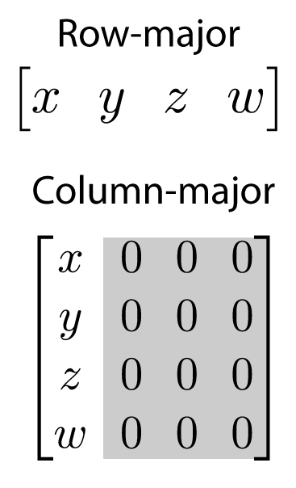

<div class="caption">

Matrix Packing

</div>

The row-major packing order for the 1×4 matrix fits nicely into a single 4-component vector, but for column-major packing order, there are three unused columns but the unused columns must be defined in the C/C++ struct to ensure proper alignment of data.

### Struct Packing

The first variable in a struct always starts at a 16 byte boundary [\[11\]](#ref-packing-rules). Variables that are declared after a struct in a constant buffer may be packed into the same 16-byte register as a variable in the struct (if it fits).

The following example demonstrates how structs are packed into constant buffers.

```cpp title="Struct Packing (HLSL)" showLineNumbers
struct MyStruct
{
    float4 SVal1;       // 16 bytes
    //----------------------------------- (16 byte boundary)
    float1 SVal2;       // 4 bytes
}; // Total: 20 bytes

cbuffer StructPacking
{
    float1      Val1;   // 4 bytes
                        // 12 bytes padding
    //----------------------------------- (16 byte boundary)
    MyStruct    Val2;   // 20 bytes
    float1      Val3;   // 4 bytes
}; // Total:               40 bytes
```

The **MyStruct** structure has two values, **SVal1** is a 4-component vector which fits into a 4-component vector register and **SVal2** which is a 1-component vector (4 bytes) which fits into the first sub-register of a 16 byte register.

In the **StructPacking** constant buffer, **Val1** is a 1-component vector which fits into the first sub-register. Since **Val2** is a struct, it will start on the next 4-component vector register (even if the struct’s first member variable is a 1-component vector). **Val3** is 1-component vector and fits in the same vector register as **Val2.SVal2** and no padding will be applied between **Val2** and **Val3**. The total size of the **StructPacking** constant buffer is 40 bytes.

The C++ struct that maps to the **StructPacking** constant buffer would look like this:

```cpp title="Struct Packing (C++)" showLineNumbers
struct MyStruct
{
    float SVal1[4];         // 16 bytes
    //----------------------------------- (16 byte boundary)
    float SVal2[1];         // 4 bytes
}; // Total: 20 bytes

struct StructPacking
{
    float Val1[1];          // 4 bytes
    float Padding1[3];      // 12 bytes
    //----------------------------------- (16 byte boundary)
    MyStruct Val2;          // 20 bytes
    float Val3[1];          // 4 bytes
    float Padding2[2];      // 8 bytes
    //----------------------------------- (2 * 16 byte boundary)
}; // Total:                48 bytes (3 * 16 byte registers)
```

The **MyStruct** struct looks the same as the HLSL version. We need to add 12 bytes of padding between **Val1** and **Val2** to ensure proper alignment. We also need to add 8 bytes of padding after **Val3** to ensure that the size of the **StructPacking** struct is divisible by 16 bytes.

### Array Packing

Each element of an array always begins on a 4-component vector register boundary [\[11\]](#ref-packing-rules).

The following example demonstrates how arrays are aligned in constant buffers:

```cpp title="Array Packing (HLSL)" showLineNumbers
cbuffer ArrayPacking
{
    float       Val1;       // 4 bytes
                            // 12 bytes padding
    //----------------------------------- (16 byte boundary)
    float       Val2[32];   // 500 bytes.
    float3      Val3;       // 12 bytes.
    //----------------------------------- (32 * 16 byte boundary)
}; // Total:                   528 bytes (33 * 16 byte registers)
```

The first value **Val1** consumes only 4 bytes but the first element of the **Val2** array will begin on the next 4-component vector register leaving 12 bytes of padding between **Val1** and **Val2**. **Val3** is a 3-component vector which fits in the same vector register as **Val2\[31\]** and no padding will be added between **Val2** and **Val3**. The total size of the struct is 528 bytes and consumes 33 4-component vector registers.

The equivalent C++ struct would look like this:

```cpp title="Array Packing (C++)" showLineNumbers
struct ArrayPacking
{
    float Val1;             // 4 bytes
    float Padding[3];       // 12 bytes padding
    //----------------------------------- (16 byte boundary)
    float Val2[125];        // 500 bytes
    float Val3[3];          // 12 bytes 
    //----------------------------------- (16 byte boundary)
}; // Total:                528 bytes (33 * 16 byte registers)
```

In order to make sure **Val2** contains the same amount of data as the HLSL constant buffer, we must make the **Val2** array 500 bytes (125 floats) and multiply the array index by 4 in order to compute the equivalent index for the HLSL constant buffer. For example, to access **Val2\[31\]** in the HLSL constant buffer, we must access **Val2\[124\]** in C/C++.

#### Aggressive Array Packing

We can use casting to reduce the number of vector registers used by the array. For example, we can reduce the **Val2** array from 500 bytes down to 128 bytes by storing **Val2** as an array of **float4** vectors instead of scalar float values.

```cpp showLineNumbers
;"  title="Array Packing (HLSL - Packed Arrays)"]
cbuffer ArrayPacking
{
    float       Val1;           // 4 bytes
                                // 12 bytes padding
    //----------------------------------- (16 byte boundary)
    float4      Val2_Packed[8]; // 128 bytes.
    //----------------------------------- (8 * 16 byte boundary)
    float3      Val3;           // 12 bytes.
}; // Total:                       156 bytes 

static float Val2[32] = (float[32])Val2_Packed;
```

In this case, we have changed **Val2** from a 32-element array of scalars to an 8-element array of float4 vectors and called it **Val2\_Packed**. In the global scope (line 11) we can cast the **Val2\_Packed** uniform variable to a static 32-element float array so we can access the elements of the array as expected without sacrificing precious vector registers in the constant buffer.

The equivalent C++ struct can also be reduced in size:

```cpp title="Array Packing (C++ Packed Arrays)" showLineNumbers
struct ArrayPacking
{
    float Val1;             // 4 bytes
    float Padding1[3];      // 12 bytes padding
    //----------------------------------- (16 byte boundary)
    float Val2[32];         // 128 bytes
    //----------------------------------- (8 * 16 byte boundary)
    float Val3[3];          // 12 bytes 
    float Padding2;
    //----------------------------------- (16 byte boundary)
}; // Total:                   160 bytes (10 * 16 byte registers)
```

Now the equivalent struct in C++ only requires 160 bytes instead of the 528 previously required and we can access the elements of the array as we would expect. We still need to pad 12 bytes between **Val1** and **Val2** because the first element of the **Val2** array must begin on a 16 byte boundary. We must also add 4-bytes of padding after **Val3** to make sure that the size of the **ArrayPacking** struct is divisible by 16 bytes.

It is important to note that because of the array packing issues in HLSL you should never explicitly pad constant buffers using arrays. If you want to explicitly pad a constant buffer in HLSL so that it matches the layout your C/C++ structs, use the scalar or vector types such as **float**, **float2**, or **float3** (or **int**, **int2**, **int3**, etc…) instead of the equivalent array types such as **float\[2\]** or **float\[3\]**. In C/C++ it is okay to use the array types to explicitly pad your structures because the C/C++ types do not suffer from these packing issues.

It is important to understand how variables are packed in the constant buffers in order to properly initialize the values from the application. With this knowledge, we can now take a closer look at the vertex and pixel shaders that will be used in this tutorial.

## Shaders

In this section I am going to introduce the vertex shader and the pixel shader that will be used to render our scene. This article continues from where the previous article titled [Introduction to DirectX 11](/introduction-to-directx-11/) left off. If you have not yet read that article, I suggest you do that first before following along here. For the rest of this article I will assume you have read [Introduction to DirectX 11](/introduction-to-directx-11/) and I will skip some of the details that were explained there.

We will build two vertex shaders in this article. The first vertex shader that I will discuss can be used to render a single instance of a scene object. The second vertex shader is used to render multiple instances of a scene object. In this tutorial, I will used the multiple instance vertex shader to render the six walls of our scene.

The pixel shader will perform the lighting computations for the geometry. The shader that we will build in this tutorial will be capable of rendering multiple light sources. Each light source can be either a point light, spot light, or directional light.

### Single Instance Vertex Shader

The first version of the vertex shader I will show is capable of handling a single instance of geometry at a time. It accepts as input per-object attributes such as position, normal and texture coordinate from the application and outputs the transformed position (in clip space for use in the rasterizer stage), position and normal in world space for use in the pixel shader, and the texture coordinate is passed through as-is for texturing the model in the pixel shader.

#### Uniform Variables

First, we will define the uniform variables that are required by our vertex shader.

```hlsl source="LearningDirectX11-v2.0.0/SimpleVertexShader.hlsl#L1-L6"
```

The **PerObject** cbuffer contains the transformation matrices for a single object. The **WorldMatrix** uniform matrix is used to transform the vertex position from object space to world space. The world space position is required by the pixel shader.

The **InverseTransposeWorldMatrix** uniform matrix is used to transform the vertex normal from object space to world space. The world space normal is required by the pixel shader as well. The inverse-transpose matrix is used to normalize the scale in a non-uniform scale transformation (in OpenGL this matrix is called the normal matrix). For a better explanation on why we need to use the inverse transform of the world matrix to transform our normal vectors, see [The Normal Matrix](https://www.lighthouse3d.com/tutorials/glsl-12-tutorial/the-normal-matrix/) [\[8\]](#ref-normal-matrix) (that article is written with repect to OpenGL but it also applies to DirectX).

The **WorldViewProjectionMatrix** uniform matrix is used to transform the vertex position from object space to projected clip space. The clip space vertex position is required by the rasterizer.

#### Application Data

The vertex attributes sent from the application are stored in the **AppData** struct.

```hlsl source="LearningDirectX11-v2.0.0/SimpleVertexShader.hlsl#L8-L13"
```

For the single-instance version of the vertex shader, only three attributes are sent from the application. The object space position and normal and the texture coordinates. Later I will show how these attributes are sent to the shader from the application using the binding semantics.

#### Vertex Shader Output

The output from the vertex shader is defined in the **VertexShaderOutput** struct.

```hlsl source="LearningDirectX11-v2.0.0/SimpleVertexShader.hlsl#L15-L21"
```

Here we see that the output variables are bound to the **TEXCOORD** semantics. It is arbitrary which semantics were use here as long as the same semantic for the input variables for the pixel shader.

The **Position** variable is bound to the **SV\_Position** **system-value** semantic and is consumed by the rasterizer stage and therefore not used by pixel shader. This variable is defined last in this struct because the offsets of the variables in this struct must match the offsets of the variables defined as inputs to the pixel shader.

#### Vertex Shader Entry Point

The **SimpleVertexShader** function is the only function defined in the vertex shader and is the main entry point for our vertex shader.

```hlsl source="LearningDirectX11-v2.0.0/SimpleVertexShader.hlsl#L23-L33"
```

On line 27, the clip space position is computed from the **WorldViewProjectionMatrix** uniform.

On line 28, the world space position is computed from the **WorldMatrix** uniform and on line 29 the world space normal is computed from the **InverseTransposeWorldMatrix** uniform variable. In the case of transforming the normal, we only want to consider the top-left 3×3 portion of the inverse-transpose world matrix.

On line 30, the texture coordinate is passed through as-is.

:::note
It is worth noting that the position and normals are post-multiplied (right multiply) by the matrices. This implies that the matrices are column-major and that the position and normal vectors are column-vectors. By default, matrices are loaded in column-major order. The default behaviour can be overridden by specifying **#pragma pack\_matrix(row\_major)** at the top of your vertex shader [\[9\]](#ref-matrix-ordering) or specify the **row\_major** type modifier when declaring a matrix variable [\[10\]](#ref-variabl-syntax).
:::

This all there is to it for the single instance version of our vertex shader. Next, I will show you how to create a vertex shader that can be used to render multiple instances of an object in a single draw call.

### Multiple Instance Vertex Shader

When we want to draw many instances of the same object in the scene we can either create a for-loop in our application to render each object instance in a separate draw call, or we can take advantage of hardware instancing and draw all of the instances of the same object in a single draw call. Hardware instancing allows multiple copies of the same object to be drawn many times using a single draw call.

Hardware instancing requires additional per-instance attributes to be sent along with the per-vertex attribute data. In this case, we will extract the **WorldMatrix** uniform variable and the **InverseTransposeWorldMatrix** uniform variable that were defined in the single instance vertex shader and move them to the vertex attributes defined in the **AppData** structure. Since the view and projection matrices are constant for all object rendered in the scene for a particular frame, we can send a precomputed view-projection matrix in a per-frame constant buffer but the world matrix is a per-instance attribute so we must still concatenate the view-project matrix with the world matrix to obtain the model-view-projection (MVP) matrix required to transform the object space vertex position into clip space.

#### Uniform Variables

First let’s create the cbuffer that will be used to define the only uniform variable sent to this vertex shader.

```hlsl source="LearningDirectX11-v2.0.0/InstancedVertexShader.hlsl#L1-L4"
```

The **ViewProjectionMatrix** is a combination of the view and projection matrices. Since this matrix is usually constant for all objects rendered this frame, we can send this as a uniform. But we still need the per-instance world matrix to transform the vertex position to clip space. The per-instance world matrix will be specified in **AppData** structure described next.

#### Application Data

The **AppData** struct defines all of the vertex attributes that are passed from the application. Both the per-vertex and the per-instance attributes will be sent in this struct.

```hlsl source="LearningDirectX11-v2.0.0/InstancedVertexShader.hlsl#L6-L15"
```

On lines 9-11, the per-vertex attributes are specified. These attributes are the same as those specified in the single instance version of the vertex shader.

On lines 13-14 the per-instance attributes are defined. Each instance will have it’s own world matrix and inverse transpose world matrix so that the vertex position and normal can be transformed correctly. The semantics used for the per-instance attributes are arbitrary but whatever semantic name we give to these variables, we must use the same semantic names to setup the input layout for this vertex shader later in the application.

In the application, the per-vertex attributes will be sent using one vertex buffer and the per-instance data will be sent using another vertex buffer. Conceptually, this looks like this:

<span id="attachment-5919"></span>

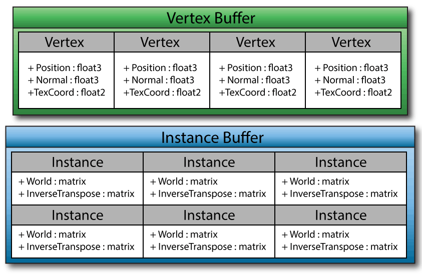

<div class="caption">

Instanced Vertex Data

</div>

The first buffer (Vertex Buffer) defines four vertices which define a plane. Since we want to render six instances of the plane using a single draw call, we must define an instance buffer which contains per-instance data for each of the instances. Later in the application, we will combine these two buffers into a single input layout for use by the input assembler.

#### Vertex Shader Entry Point

The main entry point function for our instanced vertex shader looks almost identical to that of the single instance vertex shader. The only difference is that we must compute the model-view-projection (MVP) matrix for each vertex instead of passing the MVP matrix precomputed as a uniform variable.

```hlsl source="LearningDirectX11-v2.0.0/InstancedVertexShader.hlsl#L25-L37"
```

The majority of this function is identical to the single instance vertex shader except on line 29 where the MVP matrix is computed per-vertex instead of being passed as a uniform. Optionally, we could have passed the precomputed MVP matrix as an additional per-instance attribute.

In the next section I will introduce the pixel shader. Since the output variables from the single instance vertex shader and the multiple instance vertex shader are the same, we can use the same pixel shader in both cases.

### Pixel Shader

The pixel shader for this article will be used to compute the lighting information for the objects in the scene. This pixel shader defined here is capable of rendering up to eight dynamic lights. Each light can be either a point light, a spotlight, or a directional light. The currently bound texture will also be applied to the object.

First, we’ll define a texture, sampler, and a constant buffer for the object’s material properties and a constant buffer for the light properties.

#### Texture and Samplers

In Shader Model 4 and 5 you can pass up to 128 textures to the pixel shader program [\[15\]](#ref-ps-4-0)[\[16\]](#ref-ps-5-0). Each texture must be assigned to a texture register (register(t#)). If you do not specify the register to assign a texture to, one will be automatically assigned based on the order the textures are defined in the shader.

In Shader Model 4 and 5 you can define up to 16 sampler objects in a single pixel shader [\[15\]](#ref-ps-4-0)[\[16\]](#ref-ps-5-0). Samplers are assigned to a sampler register (register(s#)). Similar to texture registers, you can either explicitly assign a sampler to a register in the shader or you can rely on the automatic register assignment made by the shader compiler. You do not need to define a sampler for each texture in your shader. All textures can be sampled using the same sampler object. You only need to create a sampler for each unique sampling mode that you want to use in your shader (see the section titled [Texture Sampler](#texture-sampler) for a description of the different sampling options you can define).

In this example, we will define a single texture and a single sampler in the pixel shader.

```hlsl source="LearningDirectX11-v2.0.0/TexturedLitPixelShader.hlsl#L1-L9"
```

The first few lines of this shader define a few constants. The **MAX\_LIGHTS** literal defines the number of lights this shader supports.

Since HLSL doesn’t support enumerations, we need to define the light types as constant literals. On line 4-6 we define constant literals for the **DIRECTIONAL\_LIGHT**, **POINT\_LIGHT**, and **SPOT\_LIGHT** light types.

On line 8 the texture object is defined. By default, the **Texture2D** type defines a texture object which returns a **float4** vector when sampled. Each component of the **float4** return value contains the red, green, blue, and alpha color components of the sampled texel. The color values will be normalized in the range \[0 .. 1\].

The texture is assigned to texture register 0. In the application, we will bind a texture to the first texture slot (slot 0). Binding the texture in the application will be shown later.

On line 9 a texture sampler is defined. The properties of the texture sampler will be defined in the application. The sampler is assigned to sampler register 0. In the application, we will assign a sampler object to the first sampler slot.

Next we’ll define a struct and a constant buffer for the material properties.

#### Material Properties

We will define a struct which will hold all of the material properties described in the section titled [Material Properties](#materials-properties).

```hlsl source="LearningDirectX11-v2.0.0/TexturedLitPixelShader.hlsl#L11-L30"
```

The **\_Material** struct defines all of the properties required to render an object. Most of the material properties were described in the section titled [Material Properties](#materials-properties) except the **UseTexture** boolean property declared on line 22. If the object should have a texture applied, the **UseTexture** boolean property will be set to **true** and the texture color will be blended with the final diffuse and specular components to determine the final color. If the **UseTexture** boolean property is set to **false** then only the material properties will be used to determine the final color of the object.

The **\_Material** struct is also explicitly padded with 8 bytes of data on line 23. This is only done to make sure that the size and alignment of this struct matches that defined in the application. Since this explicit padding does have any impact on the functionality of the shader, you can choose to leave it out (as long as you keep the explicit padding in the C/C++ version of this data structure).

The **MaterialProperties** constant buffer declares a single variable called **Material**. We will use the **Material** variable to access the material properties in the shader.

Next we’ll define a structure and a constant buffer to store the light properties.

#### Light Properties

For the properties of a light source, we will define a struct which contains all of the properties described in the section titled [Light Properties](#light-properties).

```hlsl title="TexturedLitPixelShader.hlsl" showLineNumbers startLineNumber=32
struct Light
{
    float4      Position;               // 16 bytes
    //----------------------------------- (16 byte boundary)
    float4      Direction;              // 16 bytes
    //----------------------------------- (16 byte boundary)
    float4      Color;                  // 16 bytes
    //----------------------------------- (16 byte boundary)
    float       SpotAngle;              // 4 bytes
    float       ConstantAttenuation;    // 4 bytes
    float       LinearAttenuation;      // 4 bytes
    float       QuadraticAttenuation;   // 4 bytes
    //----------------------------------- (16 byte boundary)
    int         LightType;              // 4 bytes
    bool        Enabled;                // 4 bytes
    int2        Padding;                // 8 bytes
    //----------------------------------- (16 byte boundary)
};  // Total:                           // 80 bytes (5 * 16)

cbuffer LightProperties : register(b1)
{
    float4 EyePosition;                 // 16 bytes
    //----------------------------------- (16 byte boundary)
    float4 GlobalAmbient;               // 16 bytes
    //----------------------------------- (16 byte boundary)
    Light Lights[MAX_LIGHTS];           // 80 * 8 = 640 bytes
};  // Total:                           // 672 bytes (42 * 16)
```

The **Light** struct contains properties for an individual light source. Again, this struct is explicitly padded with 8 bytes on line 47 to be consistent with the layout of the C/C++ struct that we will define in the application. Again, it is not necessary to explicitly add this padding to the **Light** struct in HLSL but the padding will be implicitly added to the constant buffer anyways.

The **LightProperties** constant buffer defines the **EyePosition** uniform variable which is the position of the camera in world space, the **GlobalAmbient** uniform variable declares the ambient term that will be applied to all objects in the scene. The **GlobalAmbient** term will be multiplied by the material’s ambient term to determine the final ambient contribution.

The **Lights** array stores all the properties for the eight lights that are supported by this pixel shader.

Next, we’ll define some light functions that will be used to compute the final lighting result.

#### Diffuse

To compute the diffuse lighting contribution, we need the light vector ($\mathbf{L}$) which points from the point being shaded to the light source, and the surface normal ($\mathbf{N}$) at the point being shaded. We also need a **Light** variable to extract the light color and modulate it by the dot product of the light vector and normal vector.

```hlsl source="LearningDirectX11-v2.0.0/TexturedLitPixelShader.hlsl#L60-L64"
```

Here we see an application of the functions defined in the previous section titled [Diffuse](#diffuse). You may notice that we do not yet apply the material’s diffuse property ($k_d$). The material’s diffuse value will be taken into consideration after the diffuse contributions of all the light sources have been computed using this function.

Next, we define a function to compute the specular contribution of a light source.

#### Specular

The specular contribution is computed slightly different for Phong and Blinn-Phong lighting models. In this function, we’ll define both methods and leave it to you to update the shader and switch between either Phong lighting or Blinn-Phong lighting and try to find the differences between these two methods (both visually and computationally).

Refer to the previous section titled [](#specular)for an explanation of the Phong and Blinn-Phong lighting equations.

```hlsl source="LearningDirectX11-v2.0.0/TexturedLitPixelShader.hlsl#L66-L77"
```

On lines 69 and 70 the **Phong** lighting properties are computed. On line 69, the reflection vector is computed using the **reflect** function in HLSL. This function takes the incident vector (the incoming vector) and the normal vector to reflect about. Since the incident vector points from the light source to the point being shaded, we need to negate the **L** vector since the incident vector actually points in the opposite direction as the light vector.

On line 73 and 74, the **Blinn-Phong** lighting properties are computed. On line 73 the half-angle vector ($\mathbf{H}$) is computed by normalizing the sum of the light vector ($\mathbf{L}$) and the view vector ($\mathbf{V}$).

On line 76, the specular contribution is computed using the power function to raise the $\mathbf{R}\cdot\mathbf{V}$ value (or the $\mathbf{N}\cdot\mathbf{H}$ value) to the power of the material’s **SpecularPower** value.

The specular brightness is multiplied by the light’s color value to compute the final specular contribution. The material’s specular contribution will be taken into consideration later.

Next, we’ll define a function for computing the attenuation factor for positional light sources.

#### Attenuation

The **DoAttenuation** is used to compute the attenuation factor for a light source. The light’s constant, linear, and quadratic attenuation factors and the distance from the point being shaded to the light source are considered when computing the total attenuation for that light source.

```hlsl source="LearningDirectX11-v2.0.0/TexturedLitPixelShader.hlsl#L79-L82"
```

#### Point Lights

The **DoPointLight** function will be used to compute the diffuse and specular contributions of point lights. We’ll define a struct called **LightingResult** to combine both the diffuse and specular results in a single return value.

```hlsl source="LearningDirectX11-v2.0.0/TexturedLitPixelShader.hlsl#L84-L104"
```

The **DoPointLight** function takes the light, the view vector ($\mathbf{V}$), the point being shaded ($\mathbf{P}$) in world space, and the surface normal ($\mathbf{N}$) and computes the diffuse and specular contributions of a single point light.

On lines 94-96 the light vector ($\mathbf{L}$) and the distance from the point being shaded ($\mathbf{P}$) to the light position ($\mathbf{L}_p$) is computed.

On line 98 the attenuation factor is computed using the **DoAttenuation** function defined earlier,

On lines 100 and 101 the diffuse and specular terms are computed. The attenuation factor is multiplied by diffuse and specular terms so that the intensity of the light is reduced as the distance to the light source increases.

Next we’ll compute the lighting contributions of directional lights.

#### Directional Lights

The **DoDirectionalLight** function is used to compute the diffuse and specular contributions of directional light sources. This function takes the light, the view vector ($\mathbf{V}$), the point being shaded ($\mathbf{P}$) in world space, and the surface normal ($\mathbf{N}$) and computes the diffuse and specular contributions of a single directional light source.

```hlsl source="LearningDirectX11-v2.0.0/TexturedLitPixelShader.hlsl#L106-L116"
```

Since directional lights don’t have a position in space, we need to compute the light vector from the light’s **Direction** property. We need to negate the light’s **Direction** property because we need the light vector ($\mathbf{L}$) to point from the point being shaded ($\mathbf{P}$) to the light source. Negating the light’s direction vector should give us what we want in this case.

On lines 112 and 113, the light’s diffuse and specular contributions are computed and returned to the calling function.

Next, we’ll compute the lighting contribution for spotlights.

#### Spotlight Cone

To compute the spotlight contribution, we’ll define two functions. The **DoSpotCone** function will compute the intensity of the light based on the angle in the spotlight cone. The **DoSpotLight** function will be used to compute the diffuse and specular contributions for a single spot light.

Let’s first look at the implementation of the **DoSpotCone** function.

```hlsl source="LearningDirectX11-v2.0.0/TexturedLitPixelShader.hlsl#L118-L124"
```

The **DoSpotCone** function computes the intensity of the spotlight based on the direction of the spotlight ($\mathbf{L}_{dir}$) and the (negated) light vector ($-\mathbf{L}$). As the angle between these two vectors increases, the intensity of the light decreases.

The cosine function is used on line 120 to convert the spotlight angle (expressed in radians) into a cosine value in the range \[-1 .. 1\]. This is the largest angle of the spotlight cone. The variable is called **minCos** because the largest angle in radians is the smallest cosine value (The cosine of a 0 degree angle is 1 and the cosine of a 180 degree angle is -1). The **maxCos** value is the smallest angle (and thus the maximum cosine value) where the intensity of the light will be 1 (or 100% intensity). If the cosine of the angle between the light direction vector ($\mathbf{L}_{dir}$) and the negated light vector ($-\mathbf{L}$) is greater than **maxCos** then the intensity of the spotlight will be 1 (100%). If the cosine of the angle is less than **minCos** then the intensity of the spotlight will be 0 (0%).

<span id="attachment-5975"></span>

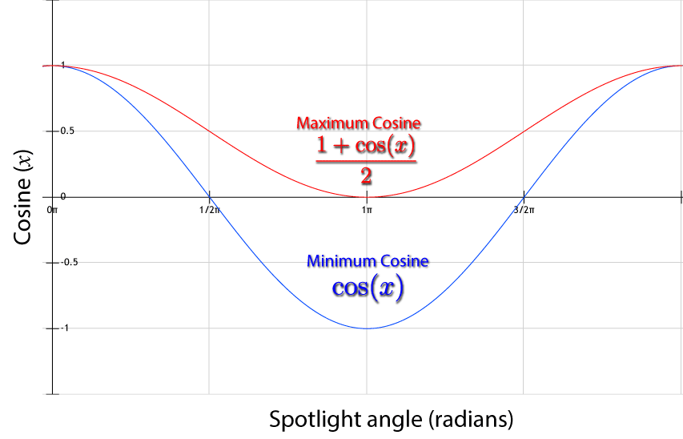

<div class="caption">

Spotlight Angle

</div>

This graph shows the functions of the maximum and minimum cosine functions of the spotlight cone. If the cone of the spotlight is 45° ($^\pi/_4$ radians) then the minimum cosine value will be approximately 0.7 and the maximum cosine value will be approximately 0.85. As the spotlight angle increases, the apparent “softness” of the spotlight will increase.

:::note
Optionally, you can specify the inner cosine angle and outer cosine angle in the light properties and use them directly. Doing so provide more control over the “softness” of the spotlight cone.
:::

If the cosine of the angle between the direction vector of the light source ($\mathbf{L}_{dir}$) and the negated light vector ($-\mathbf{L}$) falls between **minCos** and **maxCos** then the intensity of the spotlight will be interpolated between 0 (at **minCos**) and 1 (at **maxCos**) using the **smoothstep** function.

The following graph shows the result of the smoothstep function.

<span id="attachment-5967"></span>

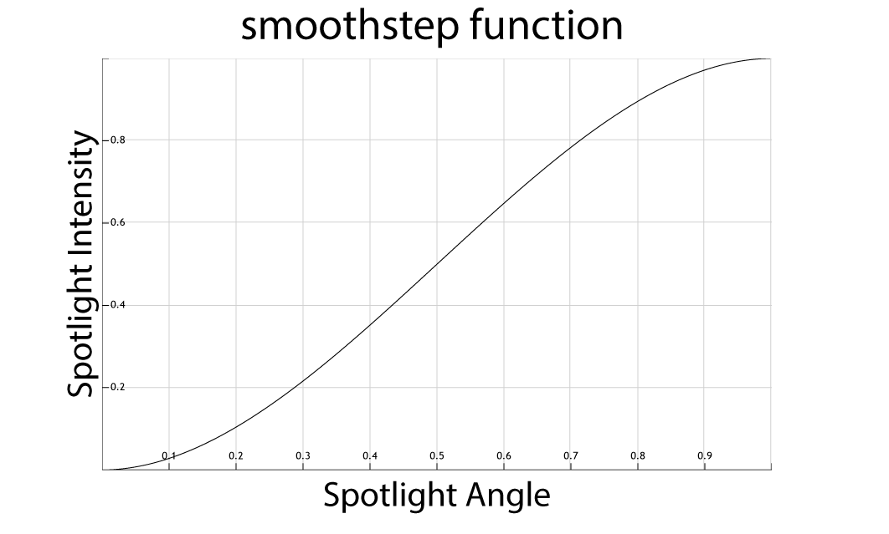

<div class="caption">

Smoothstep Function

</div>

This graph shows the intensity of the spotlight as the cosine of the angle between direction vector of the light source ($\mathbf{L}_{dir}$) and the negated light vector ($-\mathbf{L}$) transitions between **minCos** and **maxCos**.

Next, we’ll take a look at the **DoSpotLight** function.

#### Spotlight

The **DoSpotLight** function is used to compute the diffuse and specular contribution of the spotlight taking both attenuation and the spotlight intensity into consideration.

```hlsl source="LearningDirectX11-v2.0.0/TexturedLitPixelShader.hlsl#L126-L141"
```

The **DoSpotLight** function takes the light struct, the view vector ($\mathbf{V}$), the point being shaded ($\mathbf{P}$) in world space, and the surface normal ($\mathbf{N}$) at the point being shaded as input parameters and computes the diffuse and specular contributions of a single spot light.

Similar to the point light, the spotlight uses the **DoAttenuation** function on line 134 to compute the attenuation factor of the light.

The spotlight intensity based on the spotlight’s cone angle is computed on line 135.

On lines 137 and 138, the diffuse and specular contributions are computed using the **DoDiffuse** and **DoSpecular** functions and the result is combined with the attenuation and spotlight intensity to compute the final lighting contributions.

Now we can put everything together to compute the total lighting contribution for all of the lights in the scene.

#### Compute Lighting

The **ComputeLighting** function computes the total diffuse and specular lighting contributions for all of the lights in the scene.

```hlsl source="LearningDirectX11-v2.0.0/TexturedLitPixelShader.hlsl#L143-L182"
```

On line 145, the normalized view vector ($\mathbf{V}$) is computed from the eye position ($\mathbf{E}_p$) in world space and the point being shaded ($\mathbf{P}$) in world space.

On line 147 the final result of all of the lights in the scene is initialized to $\mathbf{0}$.

The **\[unroll\]** directive specifies that the for loop should be automatically unrolled [\[17\]](#ref-for-statement). Doing this may improve performance at the cost of instruction slots used by the shader. With the **\[loop\]** attribute specified on the for loop, the compiled shader uses approximately 122 instruction slots. With the **\[unroll\]** attribute specified on the for loop, the compiled shader uses approximately 755 instruction slots. If you have a large shader and need to minimize instruction use, you should specify the **\[loop\]** attribute on for loops (if any) in your shader. If your shader is relatively small (like this one) then specifying the **\[unroll\]** attribute on the for loops in your shader may improve the performance of the shader.

The for loop on lines 150-176 will loop through the **Lights** array, skipping lights that are not enabled. If the light type is **DIRECTIONAL\_LIGHT** then the **DoDirectionalLight** function will be used to compute the diffuse and specular contributions of the light. If the light type is **POINT\_LIGHT** then the **DoPointLight** function will be used compute the diffuse and specular contributions of the light. And if the light type is **SPOT\_LIGHT** then the **DoSpotLight** function will be used to compute the diffuse and specular contributions of the light.

On lines 174 and 175, the current light’s diffuse and specular contributions are summed to compute the total contributions of all of the light sources.

On line 178 and 179, the accumulated result is clamped in the range $[\mathbf{0} \ldots \mathbf{1}]$ using the **saturate** function.

Now let’s take a look at the main entry point for our pixel shader.

#### Pixel Shader Entry Point

The main entry-point function for the pixel shader is called **TexturedLitPixelShader**. It takes a **PixelShaderInput** structure as input and outputs a single 4-component color to the **SV\_Target** system-value semantic.

```hlsl source="LearningDirectX11-v2.0.0/TexturedLitPixelShader.hlsl#L184-L210"
```

The **PixelShaderInput** structure defines the input parameters to the pixel shader. The layout and semantics of this structure must match the layout and semantics of the **VertexShaderOutput** structure defined in the vertex shader. You will notice that the **Position** parameter that is mapped to the **SV\_Position** semantic in the vertex shader is not defined in the **PixelShaderInput**. The **Position** parameter was consumed by the rasterizer stage of the graphics pipeline and isn’t used or needed by the pixel shader stage.

On line 184, the specular and diffuse lighting contributions are computed using the **ComputeLighting** function defined earlier. The rasterizer stage is responsible for performing any interpolation on vertex attributes before they are passed to the pixel shader stage. This interpolation process can cause normalized vectors to become unnormalized. To avoid any issues due to the normal attribute becoming unnormalized, we should renormalize the normal attribute before we use it for any lighting calculations.

On lines 195-198 the materials properties are combined with the lighting contributions to compute the final color according to the formulas described in the section titled [Lighting](#lighting).

If the material should apply the currently bound texture, then the texture is sampled using the texture’s **Sample** method, passing the sampler object and the interpolated texture coordinates as parameters.

On line 207 the final pixel color is computed by combining the emissive, ambient, diffuse, and specular terms and modulating it by the texture color.

## Application Code

Now that we have defined the shaders that will be used by our DirectX demo, we can create the demo application that will be used to render a scene using these shaders.

The demo shown here uses the window and DirectX initialization code shown in the article titled [Introduction to DirectX 11](/introduction-to-directx-11/). I will not show any of the window or DirectX initialization code here but I will assume that you already know how to initialize a DirectX 11 application.

For this demo, we will render a simple “Cornell box” scene that consists of six walls and several geometric primitives placed inside the box. The walls and a sphere primitive will be textured. The final scene should look something similar to the image shown below.

<span id="attachment-5988"></span>

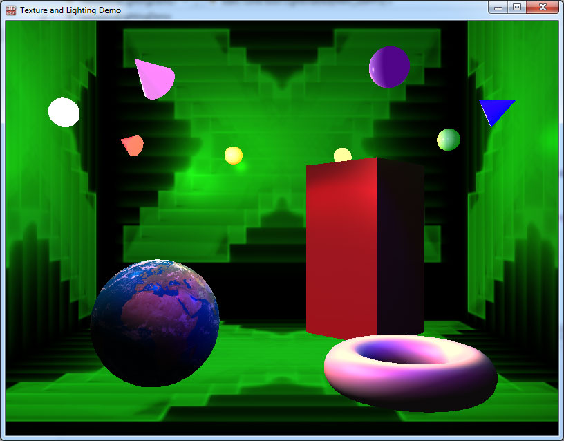

<div class="caption">

DirectX Demo Screenshot

</div>

Let’s first define the vertex data for the walls of our room.

### Vertex Data

A single wall of our Cornell box scene is going to consist of a single plane primitive. We are going to use instance rendering so that we can render all six walls of the Cornell box using a single draw call. In order to position the wall correctly in the scene, we will need to pass the world matrix of a single wall instance together with the vertex attributes that define a wall.

First, we’ll declare structs to store the per-vertex and per-instance data that will be passed to the vertex shader.

```cpp source="LearningDirectX11-v2.0.0/TextureAndLightingDemo.cpp#L18-L30"
```

The **VertexPosNormTex** structure defines the per-vertex attributes that will be passed to the vertex shader. The **PlaneInstanceData** structure defines the per-instance attributes that will be passed to the vertex shader. The **PlaneInstanceData** structure must be 16-byte aligned because the **XMMATRIX** type must be 16-byte aligned (see [DirectX Math (Type Usage Guidelines)](https://learn.microsoft.com/windows/win32/dxmath/pg-xnamath-getting-started) for more information on using DirectX math primitives.

Now let’s define the vertex and index data for the plane that will be used to draw the walls of our Cornell box.

```cpp source="LearningDirectX11-v2.0.0/TextureAndLightingDemo.cpp#L32-L45"
```

The **g\_PlaneVerts** global variable defines the unique vertices for a single plane and the **g\_PlaneIndex** defines the order that the vertices should be sent to the rendering pipeline. This index buffer defines a pair of triangles that make up a plane.

Next, we’ll define a few constant buffers that will be passed to the vertex shader.

```cpp source="LearningDirectX11-v2.0.0/TextureAndLightingDemo.cpp#L47-L60"
```

The **PerFrameConstantBufferData** struct defines a single parameter that will be used by the multiple instance vertex shader described in the section titled [Multiple Instance Vertex Shader](#multiple-instance-vertex-shader). In the multiple instance vertex shader, we’ll be passing the world matrix and the inverse-transpose matrix as per-instance attributes to the vertex shader.

The **PerObjectConstantBufferData** is used by the single-instance vertex shader described in the section titled [Single Instance Vertex Shader](#single-instance-vertex-shader). When rendering only a single instance of an object, we can pass the world, inverse-transpose, and model-view-projection matrix in a single constant buffer.

### Load Content

The **LoadContent** method is used to load textures and initialize the geometry that will be used by this demo. This function doesn’t contain any DirectX initialization code. You should make sure that you have a valid DirectX device, context, and swap-chain before you load any content here.

The LoadContent method is quite long so I will only show the relevant parts of this function. If you want to see the entirety of this method, you can download the source code at the end of this article.

#### Effect Factory

The **EffectFactory** class is part of the [DirectX Tool Kit](https://github.com/microsoft/DirectXTK). The **EffectFactory** can be used to load textures and create the shader resource view that is required by the pixel shader to apply the texture to the objects in our scene. Before we can use the **EffectFactory** class to load textures, we must create a new instance.

```cpp source="LearningDirectX11-v2.0.0/TextureAndLightingDemo.cpp#L99-L100"
```

The constructor for the **EffectFactory** needs a pointer to the Direct3D device so that it can create the texture buffer and resource view for the texture. The **EffectFactory::SetDirectory** method is used to specify the default prefix for the asset folder location.

Now that we have an **EffectFactory** instance, we can load a few textures.

#### Texture Loading

The **EffectFactory** we created on line 99 can be used to load a DirectDraw Surface textures (DDS) and other standard image formats such as PNG, JPG, BMP, and other texture formats. For this demo we will load two textures; a PNG texture and a DDS texture.

```cpp source="LearningDirectX11-v2.0.0/TextureAndLightingDemo.cpp#L102-L111"
```

The **EffectFactory**‘s **CreateTexture** method requires a path (as a wide-character string) relative to the base folder we specified on line 100, a pointer to the Direct3D device context, and a pointer (to a pointer) to a **ID3D11ShaderResourceView** to store the resulting (view) to a texture object.

If the **CreateTexture** method fails to load the texture, an exception is thrown in which case we’ll display an error message and return false (which will cause the application to exit).

In order to sample the texture in the pixel shader, we need to create a sampler object.

#### Sampler Object

We have create two texture objects but we will be sampling both textures in the same way so we only need a single sampler object which we will bind to the pixel shader later.

Similar to many resources in DirectX, in order to create a sampler, we first create a sampler description and then create a sampler object from that description.

```cpp source="LearningDirectX11-v2.0.0/TextureAndLightingDemo.cpp#L113-L136"
```

The **D3D11\_SAMPLER\_DESC** structure has the following definition [\[18\]](#ref-d3d11-sampler-desc):

```cpp title="D3D11_SAMPLER_DESC structure" showLineNumbers
typedef struct D3D11_SAMPLER_DESC {
  D3D11_FILTER               Filter;
  D3D11_TEXTURE_ADDRESS_MODE AddressU;
  D3D11_TEXTURE_ADDRESS_MODE AddressV;
  D3D11_TEXTURE_ADDRESS_MODE AddressW;
  FLOAT                      MipLODBias;
  UINT                       MaxAnisotropy;
  D3D11_COMPARISON_FUNC      ComparisonFunc;
  FLOAT                      BorderColor[4];
  FLOAT                      MinLOD;
  FLOAT                      MaxLOD;
} D3D11_SAMPLER_DESC;
```

Where:

-   **D3D11\_FILTER Filter**: Defines the filtering method to use when sampling the texture (see [D3D11\_FILTER](https://learn.microsoft.com/windows/win32/api/d3d11/ne-d3d11-d3d11_filter)).
-   **D3D11\_TEXTURE\_ADDRESS\_MODE AddressU**: Method to use for resolving a u texture coordinate that is outside the 0 to 1 range (see [D3D11\_TEXTURE\_ADDRESS\_MODE](https://learn.microsoft.com/windows/win32/api/d3d11/ne-d3d11-d3d11_texture_address_mode)).
-   **D3D11\_TEXTURE\_ADDRESS\_MODE AddressV**: Method to use for resolving a v texture coordinate that is outside the 0 to 1 range.
-   **D3D11\_TEXTURE\_ADDRESS\_MODE AddressW**: Method to use for resolving a w texture coordinate that is outside the 0 to 1 range.
-   **FLOAT MipLODBias**: Offset from the calculated mipmap level. For example, if Direct3D calculates that a texture should be sampled at mipmap level 3 and MipLODBias is 2, then the texture will be sampled at mipmap level 5.
-   **UINT MaxAnisotropy**: Clamping value used if **D3D11\_FILTER\_ANISOTROPIC** or **D3D11\_FILTER\_COMPARISON\_ANISOTROPIC** is specified in **Filter**. Valid values are between 1 and 16.
-   **D3D11\_COMPARISON\_FUNC ComparisonFunc**: A function that compares sampled data against existing sampled data. The function options are listed in [D3D11\_COMPARISON\_FUNC](https://learn.microsoft.com/windows/win32/api/d3d11/ne-d3d11-d3d11_comparison_func).
-   **FLOAT BorderColor\[4\]**: Border color to use if **D3D11\_TEXTURE\_ADDRESS\_BORDER** is specified for **AddressU**, **AddressV**, or **AddressW**. Range must be between 0.0 and 1.0 inclusive.
-   **FLOAT MinLOD**: Lower end of the mipmap range to clamp access to, where 0 is the largest and most detailed mipmap level and any level higher than that is less detailed.
-   **FLOAT MaxLOD**: Upper end of the mipmap range to clamp access to, where 0 is the largest and most detailed mipmap level and any level higher than that is less detailed. This value must be greater than or equal to MinLOD. To have no upper limit on LOD set this to a large value such as **D3D11\_FLOAT32\_MAX**

We’ll also define a few materials for the objects in our scene.

#### Materials

We’ll define a material struct to store the material definitions that we will use in the pixel shader.

The material struct looks like this:

```cpp source="LearningDirectX11-v2.0.0/TextureAndLightingDemo.h#L9-L39"
```

The **MaterialProperties** struct must match the layout of the **MaterialProperties** struct declared in the pixel shader. The size of both of these structs is exactly 80 bytes which is equivalent to five 4-component vector registers.

Now let’s define a few materials that we can use in the scene.

```cpp source="LearningDirectX11-v2.0.0/TextureAndLightingDemo.cpp#L138-L160"
```

We have defined 3 basic materials. The **defaultMaterial** is applied to the globe in the front of the scene, the **greeMaterial** is applied to the walls, the **redPlasticMaterial** is applied to the box in the back-right side of the screen, and the **pearlMaterial** is applied to the torus.

If you would like to try some different materials for yourself, the table below lists a few interesting materials [\[19\]](#ref-opengl-materials):

| Name | Ambient | Diffuse | Specular | Shininess |
| --- | --- | --- | --- | --- |
| Emerald | (0.0215, 0.1745, 0.0215, 1.0) | (0.07568, 0.61424, 0.07568, 1.0) | (0.633, 0.727811, 0.633, 1.0) | 76.8 |
| Jade | (0.135, 0.2225, 0.1575, 1.0) | (0.54, 0.89, 0.63, 1.0) | (0.316228, 0.316228, 0.316228, 1.0) | 12.8 |
| Obsidian | (0.05375, 0.05, 0.06625, 1.0) | (0.18275, 0.17, 0.22525, 1.0) | (0.332741, 0.328634, 0.346435, 1.0) | 38.4 |
| Pearl | (0.25, 0.20725, 0.20725, 1.0) | (1, 0.829, 0.829, 1.0) | (0.296648, 0.296648, 0.296648, 1.0) | 11.264 |
| Ruby | (0.1745, 0.01175, 0.01175, 1.0) | (0.61424, 0.04136, 0.04136, 1.0) | (0.727811, 0.626959, 0.626959, 1.0) | 76.8 |
| Turquoise | (0.1, 0.18725, 0.1745, 1.0) | (0.396, 0.74151, 0.69102, 1.0) | (0.297254, 0.30829, 0.306678, 1.0) | 12.8 |
| Brass | (0.329412, 0.223529, 0.027451, 1.0) | (0.780392, 0.568627, 0.113725, 1.0) | (0.992157, 0.941176, 0.807843, 1.0) | 27.9 |
| Bronze | (0.2125, 0.1275, 0.054, 1.0) | (0.714, 0.4284, 0.18144, 1.0) | (0.393548, 0.271906, 0.166721, 1.0) | 25.6 |
| Chrome | (0.25, 0.25, 0.25, 1.0) | (0.4, 0.4, 0.4, 1.0) | (0.774597, 0.774597, 0.774597, 1.0) | 76.8 |
| Copper | (0.19125, 0.0735, 0.0225, 1.0) | (0.7038, 0.27048, 0.0828, 1.0) | (0.256777, 0.137622, 0.086014, 1.0) | 12.8 |
| Gold | (0.24725, 0.1995, 0.0745, 1.0) | (0.75164, 0.60648, 0.22648, 1.0) | (0.628281, 0.555802, 0.366065, 1.0) | 51.2 |
| Silver | (0.19225, 0.19225, 0.19225, 1.0) | (0.50754, 0.50754, 0.50754, 1.0) | (0.508273, 0.508273, 0.508273, 1.0) | 51.2 |
| Black Plastic | (0, 0, 0, 1.0) | (0.01, 0.01, 0.01, 1.0) | (0.5, 0.5, 0.5, 1.0) | 32 |
| Cyan Plastic | (0, 0.1, 0.06, 1.0) | (0, 0.50980392, 0.50980392, 1.0) | (0.50196078, 0.50196078, 0.50196078, 1.0) | 32 |
| Green Plastic | (0, 0, 0, 1.0) | (0.1, 0.35, 0.1, 1.0) | (0.45, 0.55, 0.45, 1.0) | 32 |
| Red Plastic | (0, 0, 0, 1.0) | (0.5, 0, 0, 1.0) | (0.7, 0.6, 0.6, 1.0) | 32 |
| White Plastic | (0, 0, 0, 1.0) | (0.55, 0.55, 0.55, 1.0) | (0.7, 0.7, 0.7, 1.0) | 32 |
| Yellow Plastic | (0, 0, 0, 1.0) | (0.5, 0.5, 0, 1.0) | (0.6, 0.6, 0.5, 1.0) | 32 |
| Black Rubber | (0.02, 0.02, 0.02, 1.0) | (0.01, 0.01, 0.01, 1.0) | (0.4, 0.4, 0.4, 1.0) | 10 |
| Cyan Rubber | (0, 0.05, 0.05, 1.0) | (0.4, 0.5, 0.5, 1.0) | (0.04, 0.7, 0.7, 1.0) | 10 |
| Green Rubber | (0, 0.05, 0, 1.0) | (0.4, 0.5, 0.4, 1.0) | (0.04, 0.7, 0.04, 1.0) | 10 |
| Red Rubber | (0.05, 0, 0, 1.0) | (0.5, 0.4, 0.4, 1.0) | (0.7, 0.04, 0.04, 1.0) | 10 |
| White Rubber | (0.05, 0.05, 0.05, 1.0) | (0.5, 0.5, 0.5, 1.0) | (0.7, 0.7, 0.7, 1.0) | 10 |
| Yellow Rubber | (0.05, 0.05, 0, 1.0) | (0.5, 0.5, 0.4, 1.0) | (0.7, 0.7, 0.04, 1.0) | 10 |

#### Vertex and Index Buffers

I have already shown how to setup vertex buffers and index buffers for geometry in the article titled [Introduction to DirectX 11](/introduction-to-directx-11/) so I will not show it here. You can download the source code at the end of this article if you’d like to see it setup for this tutorial.

#### Instance Buffers

Since we’ll be using instance rendering for the six walls of our Cornell box, I’ll show how you can setup the per-instance attributes.

First, we need to setup an array that will be used to store the per-instance attributes.

```cpp title="TextureAndLightDemo.cpp" showLineNumbers startLineNumber=183
    // Create and setup the per-instance buffer data
    PlaneInstanceData* planeInstanceData = (PlaneInstanceData*)_aligned_malloc( sizeof(PlaneInstanceData) * 6, 16 );

    float scalePlane = 20.0f;
    float translateOffset = scalePlane / 2.0f;
    XMMATRIX scaleMatrix = XMMatrixScaling( scalePlane, 1.0f, scalePlane );
    XMMATRIX translateMatrix = XMMatrixTranslation( 0, 0, 0 );
    XMMATRIX rotateMatrix = XMMatrixRotationX( 0.0f );

    // Floor plane.
    XMMATRIX worldMatrix = scaleMatrix * rotateMatrix * translateMatrix;
    planeInstanceData[0].WorldMatrix = worldMatrix;
    planeInstanceData[0].InverseTransposeWorldMatrix = XMMatrixTranspose( XMMatrixInverse(nullptr, worldMatrix) );
// Continued for the next 5 planes...
```

On line 185 we need to make sure that the per-instance attribute array is aligned to 16-bytes (because of the **XMMATRIX** type requires this to work correctly). We can use the **\_aligned\_malloc** function to make sure that our **planeInstanceData** array is 16-byte aligned. There are six walls for our Cornell box so we need to allocate space for six array elements.

On line 187-191 we initialize some variables to help construct the transformation matrices required to position and orient the six planes correctly in our scene. Our plane geometry is initialized as a unit-plane (width and height is 1.0 units) but we want the walls of our Cornell box to be 20 units square. To accomplish this we scale the plane in the X and Z axis by 20 units. This introduces an non-uniform scale into our model which may cause the normals to become skewed if we transform them by the world matrix directly. To avoid any skew on the normals, we must compute the inverse-transpose of the world matrix and use the inverse-transpose to transform the normals of the plane. Since there is no **inverse** intrinsic function in HLSL, we must perform this calculation in the application and pass the matrix to the vertex function as an instance parameter.

The transformations of the other 5 planes is similar to the floor plane and isn’t shown here.

Now that we have defined the per-instance attributes for the six walls of our room, we need to create a vertex buffer so that we can bind it to the input assembler stage.

```cpp title="TextureAndLightDemo.cpp" showLineNumbers startLineNumber=235
    D3D11_SUBRESOURCE_DATA resourceData;
    ZeroMemory( &resourceData, sizeof(D3D11_SUBRESOURCE_DATA) );

    // Create the per-instance vertex buffer.
    D3D11_BUFFER_DESC instanceBufferDesc;
    ZeroMemory( &instanceBufferDesc, sizeof(D3D11_BUFFER_DESC) );

    instanceBufferDesc.BindFlags = D3D11_BIND_VERTEX_BUFFER;
    instanceBufferDesc.ByteWidth = sizeof( PlaneInstanceData ) * m_NumInstances;
    instanceBufferDesc.CPUAccessFlags = 0;
    instanceBufferDesc.Usage = D3D11_USAGE_DEFAULT;

    resourceData.pSysMem = planeInstanceData;

    hr = m_d3dDevice->CreateBuffer( &instanceBufferDesc, &resourceData, &m_d3dPlaneInstanceBuffer );

    _aligned_free( planeInstanceData );

    if ( FAILED(hr) )
    {
        MessageBoxA( m_Window.get_WindowHandle(), "Failed to create instance buffer.", "Error", MB_OK|MB_ICONERROR );
        return false;
    }
```

Just like a regular vertex buffer, we first create a **D3D11\_BUFFER\_DESC** and then we create the per-instance attribute buffer using the [ID3D11Device::CreateBuffer](https://learn.microsoft.com/windows/win32/api/d3d11/nf-d3d11-id3d11device-createbuffer) method. The **resourceData** should contain the pointer to our per-instance attribute data that we just defined.

#### Instanced Input Layout

Now we need to load the multiple-instance vertex shader and define the input layout that describes the layout of the per-vertex and per-instance attributes that are going to be sent to the vertex shader.

```cpp source="LearningDirectX11-v2.0.0/TextureAndLightingDemo.cpp#L277-L307"
```

On line 278, the instanced vertex shader is loaded using the technique described in the [Introduction to DirectX 11](/introduction-to-directx-11/#load-from-byte-array) to load the shader byte array from a precompiled shader object defined in a header file.

The input layout consists of three per-vertex attributes; position (as a 3-component float), normal (as a 3-component float) and a texture coordinate (as a 2-component float) and two per-instance attributes; world-matrix (as a 4×4 matrix) and inverse-transpose world-matrix (also a 4×4 matrix). You will notice that the **InputSlot** (the 4th element in the [D3D11\_INPUT\_ELEMENT\_DESC](https://learn.microsoft.com/windows/win32/api/d3d11/ns-d3d11-d3d11_input_element_desc) structure is **0** for the per-vertex attributes and **1** for the per-instance attributes. This indicates that the data for the per-vertex attributes will come from the first vertex buffer bound to the input assembler stage and the data for the per-instance attributes will come from the second vertex buffer bound to the input assembler stage.

You should also note that the two matrices for the per-instance attributes each consume four 4-component vector registers and must be bound to the appropriate index and by specifying the semantic name four times for each matrix and using the DXGI format of a single row (or column) of that matrix for each input element description. The last member of the [D3D11\_INPUT\_ELEMENT\_DESC](https://learn.microsoft.com/windows/win32/api/d3d11/ns-d3d11-d3d11_input_element_desc) structure is **InstanceDataStepRate** which specifies how many instances to render before stepping to the next attribute in the stream. We set this to **1** for the per-instance data which indicates that these attributes should be stepped for every individual rendered instance.

The lights in the scene will be animated. We will make them move around the scene in a circle. To perform the light animation, we will update the the position of the lights in the scene in the **Update** function.

### Update Function

In the update function we’ll update the position and orientation of the camera and spin the lights around the scene.

#### Update Camera

First, let’s update the camera.

```cpp source="LearningDirectX11-v2.0.0/TextureAndLightingDemo.cpp#L394-L407"
```

We’ll translate the camera (in local space) if the user presses the W, A, S, or D keys on the keyboard and we’ll pan the camera in the vertical axis if the user presses the Q, or E key on the keyboard. The **m\_Pitch** and **m\_Yaw** parameters are updated when the users drags with the mouse over the render window.

On line 407, we update the **EyePosition** parameter with the world space position of the camera. This parameter is required to compute specular reflections correctly.

Next, we’ll update the lights.

#### Update Lights

The lights will be animated so that they rotate in a circle above the objects in the scene.

```cpp title="TextureAndLightDemo.cpp" showLineNumbers startLineNumber=416
    static const XMVECTORF32 LightColors[MAX_LIGHTS] = {
        Colors::Red, Colors::Orange, Colors::Yellow, Colors::Green, Colors::Blue, Colors::Indigo, Colors::Violet, Colors::White
    };

    static const LightType LightTypes[MAX_LIGHTS] = {
        SpotLight, PointLight, SpotLight, PointLight, SpotLight, PointLight, SpotLight, PointLight
    };

    static const bool LightEnabled[MAX_LIGHTS] = {
        true, true, true, true, true, true, true, true
    };

    const int numLights = MAX_LIGHTS;
    float radius = 8.0f;
    float offset = 2.0f * XM_PI / numLights;
    for( int i = 0; i < numLights; ++i )
    {
        Light light;
        light.Enabled = static_cast<int>(LightEnabled[i]);
        light.LightType = LightTypes[i];
        light.Color = XMFLOAT4(LightColors[i]);
        light.SpotAngle = XMConvertToRadians(45.0f);
        light.ConstantAttenuation = 1.0f;
        light.LinearAttenuation = 0.08f;
        light.QuadraticAttenuation = 0.0f;
        XMFLOAT4 LightPosition = XMFLOAT4( std::sin( totalTime + offset * i ) * radius, 9.0f, std::cos( totalTime + offset * i ) * radius, 1.0f );
        light.Position = LightPosition;
        XMVECTOR LightDirection = XMVectorSet( -LightPosition.x, -LightPosition.y, -LightPosition.z, 0.0f );
        LightDirection = XMVector3Normalize( LightDirection );
        XMStoreFloat4( &light.Direction, LightDirection );

        m_LightProperties.Lights[i] = light;
    }
```

The **LightColors**, **LightTypes**, and **LightEnabled** arrays defined on lines 417, 421, and 425 respectively simply provide a convenient place to tweak the settings for our lights and see how this changes the result of our scene.

In the for-loop on line 432, we iterate the lights in the scene setting their parameters accordingly.

On line 442 the position of the light in world space is computed using our trigonomic friends the **sin** and **cos** functions. The **offset** parameter ensures that all of our lights are evenly spaced apart around a circle. For directional lights and spotlights, we want the lights to be pointing back at the origin. To do this, we can just negate the light’s position parameter and normalize the resulting vector on line 445.

With the lights array populated, we can update the light constant buffer that will be used by the pixel shader.

```cpp source="LearningDirectX11-v2.0.0/TextureAndLightingDemo.cpp#L450-L451"
```

Next, we’ll render our scene.

### Render Function

To render the Cornell Box scene, we will render the following objects:

1.  **Walls**: The six walls of our Cornell box will be rendered with the green material and the DirectX texture applied to them.
2.  **Sphere**: A sphere is rendered in the front of the room with the earth texture applied.
3.  **Cube**: A box is drawn in the back of the room with the red material applied. The box will not be textured.
4.  **Torus**: A torus is drawn in the front of the room with the pearl material applied. The torus will also not be textured.
5.  **Lights**: The scene will be lit by eight lights. Point lights will be represented by spheres and spot and directional lights will be represented by an orientated cone. Their materials will be related to the color of the light the object represents.

First we’ll setup the per-vertex and per-instance attributes for the walls of our room and bind them to the input assembler.

```cpp source="LearningDirectX11-v2.0.0/TextureAndLightingDemo.cpp#L493-L500"
```

We need to bind both the per-vertex and per-instance attributes to the input assembler stage. The **vertexStride**, **offset**, and **buffers** arrays define the data needed to correctly bind the two buffers to the input assembeler. Make sure that the order of your buffers defined here matches the order specified in the input layout that we created in the section titled [Instanced Input Layout](#instanced-input-layout).

We’ll also bind the instanced vertex shader object to the vertex shader stage and assign the only constant buffer used by this vertex shader.

```cpp source="LearningDirectX11-v2.0.0/TextureAndLightingDemo.cpp#L506-L507"
```

The **m\_d3dPerFrameConstantBuffer** constant buffer just contains the data for the **ViewProjectionMatrix** defined in the vertex shader.

Then we’ll bind the textured-lit pixel shader and bind the material and light properties to the constant buffers.

```cpp source="LearningDirectX11-v2.0.0/TextureAndLightingDemo.cpp#L509-L512"
```

Next, we’ll set the sampler and the shader resource view that references the texture.

```cpp source="LearningDirectX11-v2.0.0/TextureAndLightingDemo.cpp#L514-L515"
```

And setup the output merger stage.

```cpp source="LearningDirectX11-v2.0.0/TextureAndLightingDemo.cpp#L517-L518"
```

And now we can draw the walls of our Cornell box using the DrawIndexedInstanced method.

```cpp title="TextureAndLightDemo.cpp" showLineNumbers startLineNumber=519
    m_d3dDeviceContext->DrawIndexedInstanced( _countof(g_PlaneIndex), 6, 0, 0, 0 );
```

The [ID3D11DeviceContext::DrawIndexedInstanced](https://learn.microsoft.com/windows/win32/api/d3d11/nf-d3d11-id3d11devicecontext-drawindexedinstanced) method has the following definition [\[20\]](#ref-drawindexedinstanced):

```cpp title="ID3D11DeviceContext::DrawIndexedInstanced method" showLineNumbers
void DrawIndexedInstanced(
  [in]  UINT IndexCountPerInstance,
  [in]  UINT InstanceCount,
  [in]  UINT StartIndexLocation,
  [in]  INT BaseVertexLocation,
  [in]  UINT StartInstanceLocation
);
```

Where:

-   **UINT IndexCountPerInstance**: Number of indices read from the index buffer for each instance.
-   **UINT InstanceCount**: Number of instances to draw.
-   **UINT StartIndexLocation**: The location of the first index read by the GPU from the index buffer.
-   **INT BaseVertexLocation**: A value added to each index before reading a vertex from the vertex buffer.
-   **UINT StartInstanceLocation**: A value added to each index before reading per-instance data from a vertex buffer.

The rest of the geometry are rendered in a similar way except we’ll use the single-instance vertex shader instead of the multiple instance vertex shader and instead of using the [ID3D11DeviceContext::DrawIndexedInstanced](https://learn.microsoft.com/windows/win32/api/d3d11/nf-d3d11-id3d11devicecontext-drawindexedinstanced) method, we’ll use the [ID3D11DeviceContext::DrawIndexed](https://learn.microsoft.com/windows/win32/api/d3d11/nf-d3d11-id3d11devicecontext-drawindexed) method which was described in the previous article titled [Introduction to DirectX 11](/introduction-to-directx-11/).

## Final Result

If you run the demo, you should see something similar to what is shown in the video below.

<iframe class="embed embed-video" src="https://www.youtube-nocookie.com/embed/ut56ptxSJ3E?rel=0" title="YouTube video" loading="lazy" allowfullscreen></iframe>

## Download the Source

[https://github.com/jpvanoosten/LearningDirectX11](https://github.com/jpvanoosten/LearningDirectX11/tree/v2.0.0)

## References

<span id="ref-textures-in-dx11"></span>\[1\] Msdn.microsoft.com, ‘Introduction To Textures in Direct3D 11 (Windows)’, 2013. \[Online\]. Available: [https://learn.microsoft.com/windows/win32/direct3d11/overviews-direct3d-11-resources-textures-intro](https://learn.microsoft.com/windows/win32/direct3d11/overviews-direct3d-11-resources-textures-intro).

<span id="ref-beginning-directx"></span>\[2\] A. Sherrod and W. Jones, Beginning DirectX 11 game programming, 1st ed. Boston, MA: Course Technology, 2012.

<span id="ref-mipmapping"></span>\[3\] Shinvision.com, ‘Graphic Effects: MIPmapping | nVidia Graphic Visions’, 2010. \[Online\]. Available: [https://web.archive.org/web/20150728171733/http://www.shinvision.com/155](https://web.archive.org/web/20150728171733/http://www.shinvision.com/155). \[Accessed: 23- Mar- 2014\].

<span id="ref-anisotropic-filtering"></span>\[4\] En.wikipedia.org, ‘Anisotropic filtering – Wikipedia, the free encyclopedia’, 2012. \[Online\]. Available: [https://en.wikipedia.org/wiki/Anisotropic_filtering](https://en.wikipedia.org/wiki/Anisotropic_filtering). \[Accessed: 23- Mar- 2014\].

<span id="ref-d3d11-filter"></span>\[5\] Msdn.microsoft.com, ‘D3D11\_FILTER enumeration (Windows)’, 2013. \[Online\]. Available: [https://learn.microsoft.com/windows/win32/api/d3d11/ne-d3d11-d3d11_filter](https://learn.microsoft.com/windows/win32/api/d3d11/ne-d3d11-d3d11_filter). \[Accessed: 25- Mar- 2014\].

<span id="ref-texture-filtering"></span>\[6\] En.wikipedia.org, ‘Texture filtering – Wikipedia, the free encyclopedia’, 2007. \[Online\]. Available: [https://en.wikipedia.org/wiki/Texture_filtering](https://en.wikipedia.org/wiki/Texture_filtering). \[Accessed: 25- Mar- 2014\].

<span id="ref-texture-address-mode"></span>\[7\] Msdn.microsoft.com, ‘D3D11\_TEXTURE\_ADDRESS\_MODE enumeration (Windows)’, 2013. \[Online\]. Available: [https://learn.microsoft.com/windows/win32/api/d3d11/ne-d3d11-d3d11_texture_address_mode](https://learn.microsoft.com/windows/win32/api/d3d11/ne-d3d11-d3d11_texture_address_mode). \[Accessed: 30- Mar- 2014\].

<span id="ref-normal-matrix"></span>\[8\] Lighthouse3d.com, ‘The Normal Matrix’, 2011. \[Online\]. Available: [https://www.lighthouse3d.com/tutorials/glsl-12-tutorial/the-normal-matrix/](https://www.lighthouse3d.com/tutorials/glsl-12-tutorial/the-normal-matrix/). \[Accessed: 07- May- 2014\].

<span id="ref-matrix-ordering"></span>\[9\] Msdn.microsoft.com, ‘Per-Component Math Operations (Windows)’, 2014. \[Online\]. Available: [https://learn.microsoft.com/windows/win32/direct3dhlsl/dx-graphics-hlsl-per-component-math](https://learn.microsoft.com/windows/win32/direct3dhlsl/dx-graphics-hlsl-per-component-math). \[Accessed: 07- May- 2014\].

<span id="ref-variabl-syntax"></span>\[10\] Msdn.microsoft.com, ‘Variable Syntax (Windows)’, 2013. \[Online\]. Available: [https://learn.microsoft.com/windows/win32/direct3dhlsl/dx-graphics-hlsl-variable-syntax](https://learn.microsoft.com/windows/win32/direct3dhlsl/dx-graphics-hlsl-variable-syntax). \[Accessed: 08- May- 2014\].

<span id="ref-packing-rules"></span>\[11\] Msdn.microsoft.com, ‘Packing Rules for Constant Variables (Windows)’, 2013. \[Online\]. Available: [https://learn.microsoft.com/windows/win32/direct3dhlsl/dx-graphics-hlsl-packing-rules](https://learn.microsoft.com/windows/win32/direct3dhlsl/dx-graphics-hlsl-packing-rules). \[Accessed: 08- May- 2014\].

<span id="ref-scalar-types"></span>\[12\] Msdn.microsoft.com, ‘Scalar Types (Windows)’, 2013. \[Online\]. Available: [https://learn.microsoft.com/windows/win32/direct3dhlsl/dx-graphics-hlsl-scalar](https://learn.microsoft.com/windows/win32/direct3dhlsl/dx-graphics-hlsl-scalar). \[Accessed: 08- May- 2014\].

<span id="ref-vector-types"></span>\[13\] Msdn.microsoft.com, ‘Vector Type (Windows)’, 2013. \[Online\]. Available: [https://learn.microsoft.com/windows/win32/direct3dhlsl/dx-graphics-hlsl-vector](https://learn.microsoft.com/windows/win32/direct3dhlsl/dx-graphics-hlsl-vector). \[Accessed: 08- May- 2014\].

<span id="ref-matrix-types"></span>\[14\] Msdn.microsoft.com, ‘Matrix Type (Windows)’, 2013. \[Online\]. Available: [https://learn.microsoft.com/windows/win32/direct3dhlsl/dx-graphics-hlsl-matrix](https://learn.microsoft.com/windows/win32/direct3dhlsl/dx-graphics-hlsl-matrix). \[Accessed: 08- May- 2014\].

<span id="ref-ps-4-0"></span>\[15\] Msdn.microsoft.com, ‘Registers – ps\_4\_0 (Windows)’, 2013. \[Online\]. Available: [https://learn.microsoft.com/windows/win32/direct3dhlsl/dx-graphics-hlsl-sm4-registers-ps-4-0](https://learn.microsoft.com/windows/win32/direct3dhlsl/dx-graphics-hlsl-sm4-registers-ps-4-0). \[Accessed: 12- May- 2014\].

<span id="ref-ps-5-0"></span>\[16\] Msdn.microsoft.com, ‘Registers – ps\_5\_0 (Windows)’, 2013. \[Online\]. Available: [https://learn.microsoft.com/windows/win32/direct3dhlsl/registers---ps-5-0](https://learn.microsoft.com/windows/win32/direct3dhlsl/registers---ps-5-0). \[Accessed: 12- May- 2014\].

<span id="ref-for-statement"></span>\[17\] Msdn.microsoft.com, ‘for Statement (Windows)’, 2013. \[Online\]. Available: [https://learn.microsoft.com/windows/win32/direct3dhlsl/dx-graphics-hlsl-for](https://learn.microsoft.com/windows/win32/direct3dhlsl/dx-graphics-hlsl-for). \[Accessed: 13- May- 2014\].

<span id="ref-d3d11-sampler-desc"></span>\[18\] Msdn.microsoft.com, ‘D3D11\_SAMPLER\_DESC structure (Windows)’, 2013. \[Online\]. Available: [https://learn.microsoft.com/windows/win32/api/d3d11/ns-d3d11-d3d11_sampler_desc](https://learn.microsoft.com/windows/win32/api/d3d11/ns-d3d11-d3d11_sampler_desc). \[Accessed: 15- May- 2014\].

<span id="ref-opengl-materials"></span>\[19\] Devernay.free.fr, ‘OpenGL/VRML Materials’, 1994. \[Online\]. Available: [http://devernay.free.fr/cours/opengl/materials.html](http://devernay.free.fr/cours/opengl/materials.html). \[Accessed: 16- May- 2014\].

<span id="ref-drawindexedinstanced"></span>\[20\] Msdn.microsoft.com, ‘ID3D11DeviceContext::DrawIndexedInstanced method (Windows)’, 2013. \[Online\]. Available: [https://learn.microsoft.com/windows/win32/api/d3d11/nf-d3d11-id3d11devicecontext-drawindexedinstanced](https://learn.microsoft.com/windows/win32/api/d3d11/nf-d3d11-id3d11devicecontext-drawindexedinstanced). \[Accessed: 16- May- 2014\].
