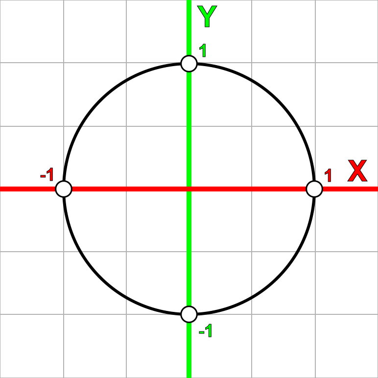
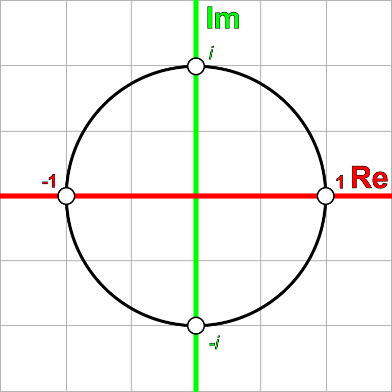
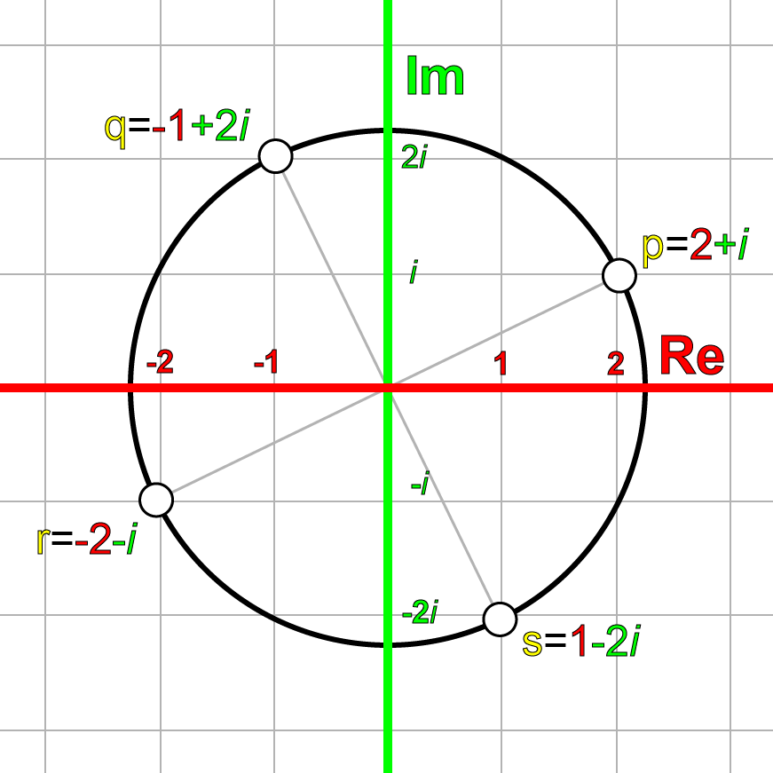
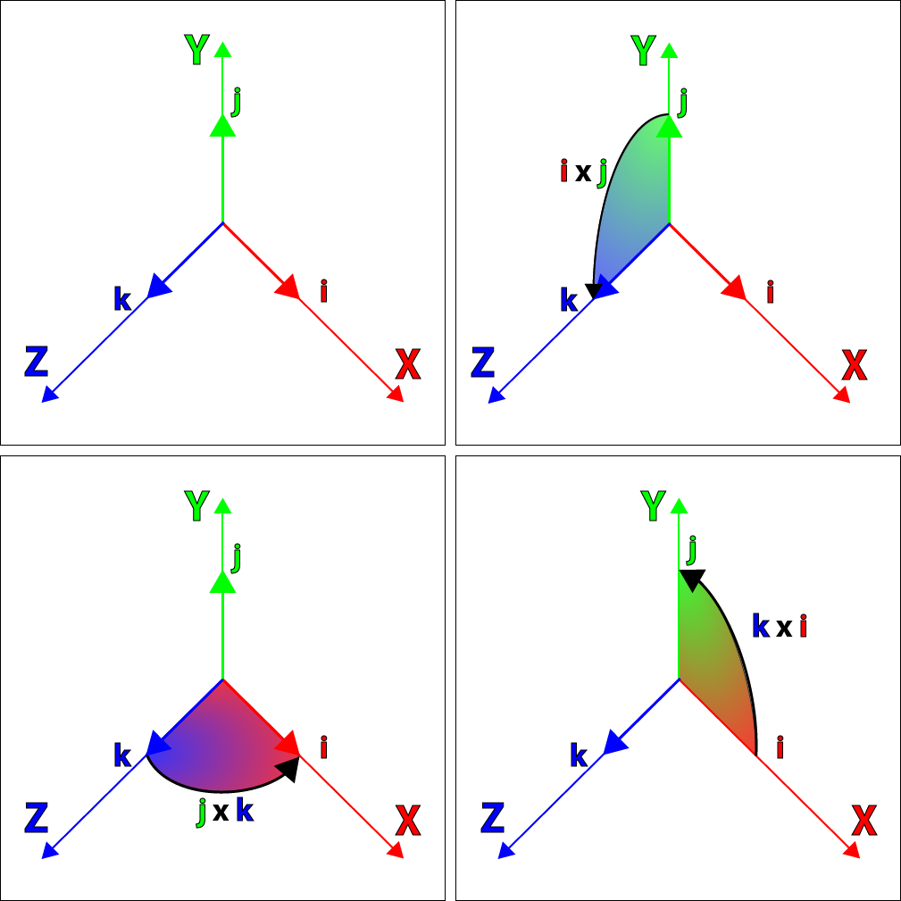
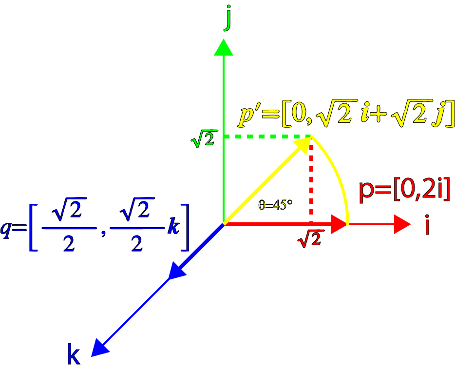
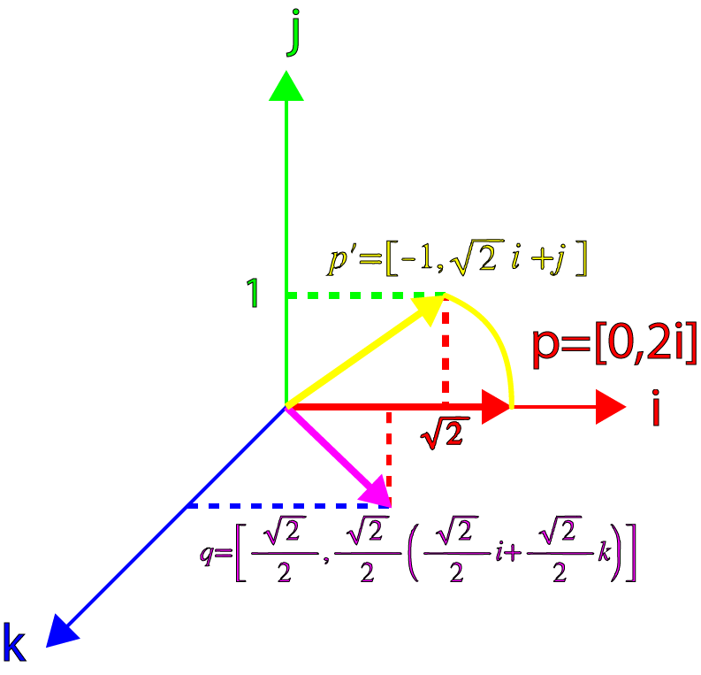
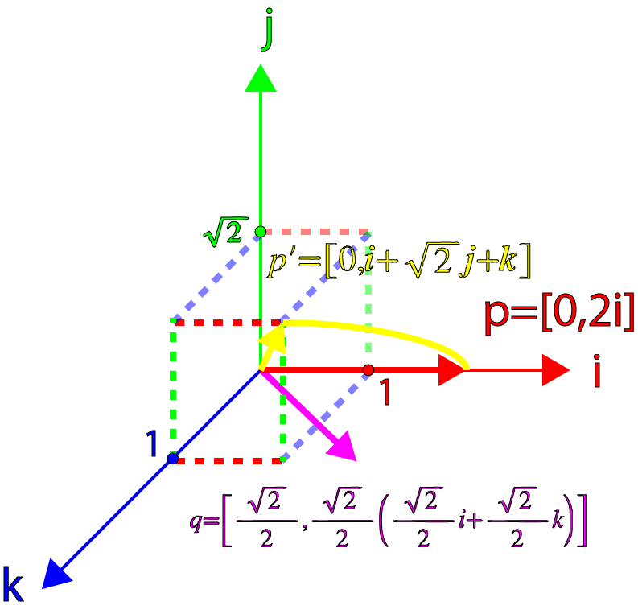
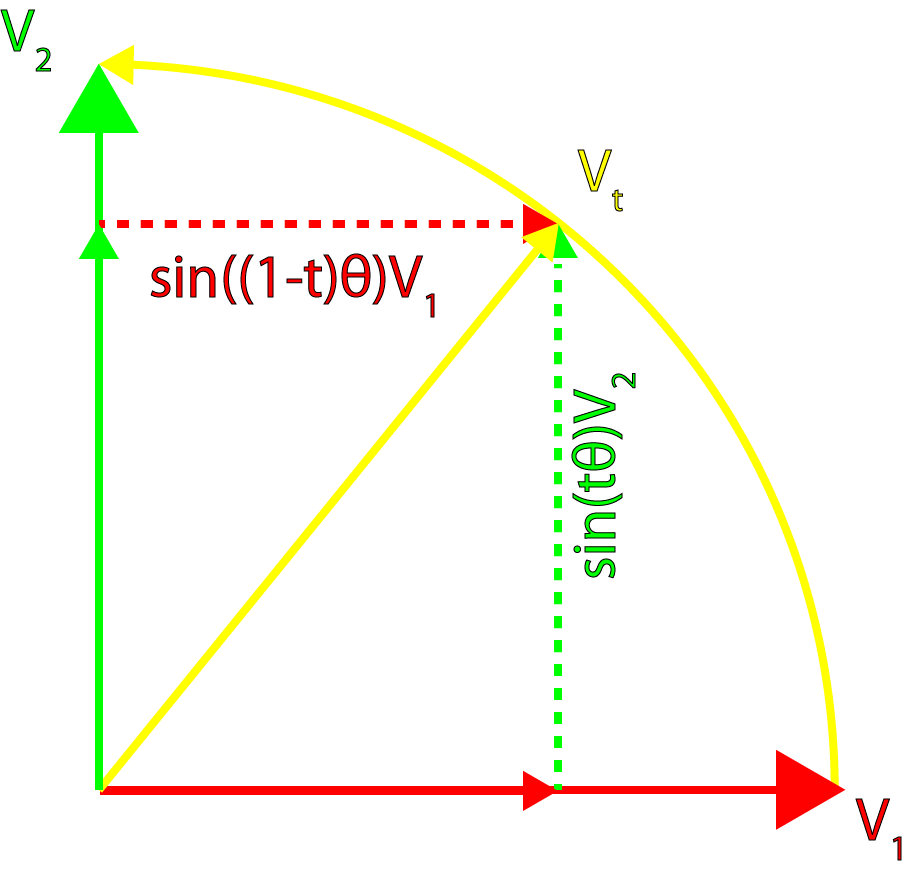

In this article I will attempt to explain the concept of Quaternions in an easy to understand way. I will explain how you might visualize a Quaternion as well as explain the different operations that can be applied to quaternions. I will also compare applications of matrices, Euler angles, and quaternions and try to explain when you would want to use quaternions instead of Euler angles or matrices and when you would not.

:::caution
You cannot fully understand quaternions in just 45 minutes.  
This article is extremely math intensive and is not intended for the weak-hearted.
:::

## Introduction

In computer graphics, we use transformation matrices to express a position in space (translation) as well as its orientation in space (rotation). Optionally, a single transformation matrix can also be used to express the scale or “shear” of an object. We can think of this transformation matrix as a “basis space” where if you multiply a vector or a point (or even another matrix) by a transformation matrix you “transform” that vector, point or matrix into the space represented by that matrix.

In this article, I will not discuss the details of transformation matrices. For a detailed description of transformation matrices, you can refer to my previous article titled [Matrices](/3d-math-primer-for-game-programmers-matrices/).

In this article, I want to discuss an alternative method of describing the orientation of an object (rotation) in space using quaternions.

The concept of quaternions was realized by the Irish mathematician [Sir William Rowan Hamilton](https://en.wikipedia.org/wiki/William_Rowan_Hamilton) on Monday October 16th 1843 in Dublin, Ireland. Hamilton was on his way to the [Royal Irish Academy](https://en.wikipedia.org/wiki/Royal_Irish_Academy) with his wife and as he was passing over the [Royal Canal](https://en.wikipedia.org/wiki/Royal_Canal) on the [Brougham Bridge](https://en.wikipedia.org/wiki/Broom_Bridge) he made a dramatic realization that he immediately carved into the stone of the bridge.

$$
i^2=j^2=k^2=ijk=-1
$$

William Rowan Hamilton Plaque on Broom Bridge on the Royal Canal commemorating his discovery of the fundamental formula for quaternion multiplication.

## Complex Numbers

Before we can fully understand quaternions, we must first understand where they came from. The root of quaternions is based on the concept of the complex number system.

In addition to the well-known number sets ([Natural](https://mathworld.wolfram.com/NaturalNumber.html), [Integer](https://mathworld.wolfram.com/Integer.html), [Real](https://mathworld.wolfram.com/RealNumber.html), and [Rational](https://mathworld.wolfram.com/RationalNumber.html)), the Complex Number system introduces a new set of numbers called imaginary numbers. Imaginary numbers were invented to solve certain equations that had no solutions such as:

$$
x^2+1=0
$$

To solve this expression, we must state that $x^2=-1$ which we know is not possible because the square of any real number (positive or negative) is never negative.

Mathematicians generally can’t accept that an expression does not have a solution so a new term was invented called the [imaginary number](https://mathworld.wolfram.com/ImaginaryNumber.html) that can be used to solve such equations.

The imaginary number has the form:

$$
i^2=-1
$$

Don’t try to actually understand this term as there is no logical reason why it exists. We just have to accept that $i$ is just something that squares to $-1$.

The set of imaginary numbers can be represented by $\mathbb{I}$.

The set of complex numbers (represented by the symbol $\mathbb{C}$) is the sum of a real number and an imaginary number and has the form:

$$
z=a+bi~~a,b\in\mathbb{R},~~i^2=-1
$$

It could also be stated that all Real numbers are complex numbers with $b=0$ and all imaginary numbers are complex numbers with $a=0$.

### Adding and Subtracting Complex Numbers

Complex numbers can be added and subtracted by adding or subtracting the real, and imaginary parts.

Addition:  

$$
(a_1+b_1i)+(a_2+b_2i)=(a_1+a_2)+(b_1+b_2)i
$$

Subtraction:  

$$
(a_1+b_1i)-(a_2+b_2i)=(a_1-a_2)+(b_1-b_2)i
$$

### Multiply a Complex Number by a Scalar

A complex number is multiplied by a scalar by multiplying each term of the complex number by the scalar:

$$
\lambda(a+bi)=\lambda{a}+\lambda{b}i
$$

### Product of Complex Numbers

Complex numbers can also be multiplied by applying normal algebraic rules.

$$
\begin{array}{rcl}z_1 & = & (a_1+b_1i) \\ z_2 & = & (a_2+b_2i) \\ z_1z_2 & = & (a_1+b_1i)(a_2+b_2i) \\ & = & a_1a_2+a_1b_2i+b_1a_2i+b_1b_2i^2 \\ & = & (a_1a_2-b_1b_2)+(a_1b_2+b_1a_2)i\end{array}
$$

### Square of Complex Numbers

A complex number can also be squared by multiplying by itself:

$$
\begin{array}{rcl}z & = & (a+bi) \\ z^2 & = & (a+bi)(a+bi) \\ & = & (a^2-b^2)+2abi\end{array}
$$

### Complex Conjugate

The **conjugate** of a complex number is a complex number with the imaginary part negated and is denoted as either $\bar{z}$ or $z^*$.

$$
\begin{array}{rcl}z & = & (a+bi) \\ z^* & = & (a-bi)\end{array}
$$

The product of a complex number and its conjugate gives a special result.

$$
\begin{array}{rcl}z & = & (a+bi) \\ z^* & = & (a-bi) \\ zz^* & = & (a+bi)(a-bi) \\ & = & a^2-abi+abi+b^2 \\ & = & a^2+b^2\end{array}
$$

### Absolute Value of a Complex Number

We can use the **conjugate** of a complex number to compute the absolute value (or **norm**, or **magnitude**) of a complex number. The absolute value of a complex number is the square-root of the complex number multiplied by its **conjugate** and is denoted $|z|$:

$$
\begin{array}{rcl}z & = & (a+bi) \\ |z| & = & \sqrt{zz^*} \\ & = & \sqrt{(a+bi)(a-bi)} \\ & = & \sqrt{a^2+b^2}\end{array}
$$

### Quotient of Two Complex Numbers

To compute the quotient of two complex numbers, we multiply the numerator and denominator by the complex conjugate of the denominator.

$$
\begin{array}{rcl}z_1 & = & (a_1+b_1i) \\ z_2 & = & (a_2+b_2i) \\ \cfrac{z_1}{z_2} & = & \cfrac{a_1+b_1i}{a_2+b_2i} \\ & = & \cfrac{(a_1+b_1i)(a_2-b_2i)}{(a_2+b_2i)(a_2-b_2i)} \\ & = & \cfrac{a_1a_2-a_1b_2i+b_1a_2i-b_1b_2i^2}{a_2^2+b_2^2} \\ & = & \cfrac{a_1a_2+b_1b_2}{a_2^2+b_2^2}+\cfrac{b_1a_2-a_1b_2}{a_2^2+b_2^2}i \end{array}
$$

## Powers of $i$

If we state that $i^2=-1$ then it should be possible to raise $i$ to other powers as well.

$$
\begin{array}{rrrrrrr}i^0 & = & & & & & 1 \\ i^1 & = & & & & & i \\ i^2 & = & & & & & -1 \\ i^3 & = & ii^2 & = & & & -i \\ i^4 & = & i^{2}i^{2} & = & & & 1 \\ i^5 & = & ii^4 & = & & & i \\ i^6 & = & ii^5 & = & i^2 & = & -1\end{array}
$$

If we keep writing this sequence, we will see a pattern emerge $(1,i,-1,-i,1,\dots)$.

A similar pattern emerges from the increasing negative powers.

$$
\begin{array}{rcr}i^0 & = & 1 \\ i^{-1} & = & -i \\ i^{-2} & = & -1 \\ i^{-3} & = & i \\ i^{-4} & = & 1 \\ i^{-5} & = & -i \\ i^{-6} & = & -1\end{array}
$$

You may have seen a similar pattern in mathematics before but in the form $(x,y,-x,-y,x,\dots)$ which is generated by rotating a point 90° counter-clockwise on a 2D Cartesian plane and the sequence $(x,-y,-x,y,x,\dots)$ is generated by rotating a point 90° clockwise on a 2D Cartesian plane.

Cartesian Plane

## The Complex Plane

We can also map complex numbers in a 2D grid called the **[Complex Plane](https://en.wikipedia.org/wiki/Complex_plane)** by mapping the **Real** part on the horizontal axis and the **Imaginary** part on the vertical axis.

Complex Plane

As shown in the previous sequence, we can say that if we multiply a complex number by $i$, we can rotate the complex number through the complex plane at 90° increments.

Let’s see if this is true. We’ll take an arbitrary point $p$ in the complex plane:

$$
p=2+i
$$

and we multiply it by $i$ gives $q$:

$$
\begin{array}{rcl}p & = & 2+i \\ q & = & pi \\ & = & (2+i)i \\ & = & 2i+i^2 \\ & = & -1+2i\end{array}
$$

Multiplying $q$ by $i$ gives $r$:

$$
\begin{array}{rcl}q & = & -1+2i \\ r & = & qi \\ & = & (-1+2i)i \\ & = & -i+2i^2 \\ & = & -2-i\end{array}
$$

And multiplying $r$ by $i$ gives $s$:

$$
\begin{array}{rcl}r & = & -2-i \\ s & = & ri \\ & = & (-2-i)i \\ & = & -2i-i^2 \\ & = & 1-2i\end{array}
$$

And multiplying $s$ by $i$ gives $t$:

$$
\begin{array}{rcl}s & = & 1-2i \\ t & = & si \\ & = & (1-2i)i \\ & = & i-2i^2 \\ & = & 2+i\end{array}
$$

Which is exactly what we started with ($p$). If we plot these complex numbers on the complex plane, we get the following result.

Complex Numbers on the Complex Plane

We can also rotate clock-wise in the complex plane by multiplying the complex number by $-i$.

### Rotors

We can also perform arbitrary rotations in the complex plane by defining a complex number of the form:

$$
q=\cos\theta+i\sin\theta
$$

Multiplying any complex number by the rotor $q$ produces the general formula:

$$
\begin{array}{rcl} p & = & a + bi \\ q & = & \cos\theta+i\sin\theta \\ pq & = & (a+bi)(\cos\theta+i\sin\theta) \\ a^{\prime}+b^{\prime}i & = & a\cos\theta-b\sin\theta+(a\sin\theta+b\cos\theta)i \end{array}
$$

Which can also be written in matrix form:

$$
\begin{bmatrix} a^{\prime} & -b^{\prime} \\ b^{\prime} & a^{\prime} \end{bmatrix}=\begin{bmatrix} \cos\theta & -\sin\theta \\ \sin\theta & \cos\theta \end{bmatrix}\begin{bmatrix}a & -b \\b & a \end{bmatrix}
$$

Which is the method to rotate an arbitrary point in the complex plane counter-clockwise about the origin.

## Quaternions

With this knowledge of the complex number system and the complex plane, we can extend this to 3-dimensional space by adding two imaginary numbers to our number system in addition to $i$.

The general form to express quaternions is

$$
q=s+xi+yj+zk~~s,x,y,z\in\mathbb{R}
$$

Where, according to Hamilton’s famous expression:

$$
i^2=j^2=k^2=ijk=-1
$$

and

$$
\begin{array}{ccc}ij=k & jk=i & ki=j \\ ji=-k & kj=-i & ik=-j\end{array}
$$

You may have noticed that the relationship between $i$, $j$, and $k$ are very similar to the cross product rules for the unit cartesian vectors:

$$
\begin{array}{ccc}\mathbf{x}\times \mathbf{y}=\mathbf{z} & \mathbf{y}\times \mathbf{z}=\mathbf{x} & \mathbf{z}\times \mathbf{x}=\mathbf{y} \\ \mathbf{y}\times \mathbf{x}=-\mathbf{z} & \mathbf{z}\times \mathbf{y}=-\mathbf{x} & \mathbf{x}\times \mathbf{z}=-\mathbf{y}\end{array}
$$

Hamilton also recognized that the $i$, $j$, and $k$ imaginary numbers could be used to represent three cartesian unit vectors $\mathbf{i}$, $\mathbf{j}$, and $\mathbf{k}$ with the same properties of imaginary numbers, such that $\mathbf{i}^2=\mathbf{j}^2=\mathbf{k}^2=-1$.

Visualizing the Properties of $\mathbf{ij}$, $\mathbf{jk}$, $\mathbf{ki}$

The image above visualizes the relationship between the cartesian unit vectors represented by $\mathbf{i}$, $\mathbf{j}$, and $\mathbf{k}$.

### Quaternions as an Ordered Pair

We can also represent quaternions as an ordered pair:

$$
q=[s,\mathbf{v}]~~s\in\mathbb{R}, \mathbf{v}\in\mathbb{R}^3
$$

Where $\mathbf{v}$ can also be represented by its individual components:

$$
q=[s,x\mathbf{i}+y\mathbf{j}+z\mathbf{k}]~~s,x,y,z\in\mathbb{R}
$$

Using this notation, we can more easily show the similarities between quaternions and complex numbers.

### Adding and Subtracting Quaternions

Quaternions can be added and subtracted similar to complex numbers:

$$
\begin{array}{rcl}q_a & = & [s_a,\mathbf{a}] \\ q_b & = & [s_b,\mathbf{b}] \\ q_a+q_b & = & [s_a+s_b,\mathbf{a}+\mathbf{b}] \\ q_a-q_b & = & [s_a-s_b,\mathbf{a}-\mathbf{b}]\end{array}
$$

### Quaternion Products

We can also express the product of two quaternions:

$$
\begin{array}{rcl}q_a & = & [s_a,\mathbf{a}] \\ q_b & = & [s_b,\mathbf{b}] \\ q_{a}q_{b} & = & [s_{a},\mathbf{a}][s_{b},\mathbf{b}] \\ & = & (s_{a}+x_{a}i+y_{a}j+z_{a}k)(s_{b}+x_{b}i+y_{b}j+z_{b}k) \\ & = & (s_{a}s_{b}-x_{a}x_{b}-y_{a}y_{b}-z_{a}z_{b}) \\ & & +(s_{a}x_{b}+s_{b}x_{a}+y_{a}z_{b}-y_{b}z_{a})i \\ & & +(s_{a}y_{b}+s_{b}y_{a}+z_{a}x_{b}-z_{b}x_{a})j \\ & & +(s_{a}z_{b}+s_{b}z_{a}+x_{a}y_{b}-x_{b}y_{a})k\end{array}
$$

Which results in another quaternion. If we replace the imaginary numbers $i$, $j$, and $k$ in the previous expression by the ordered pairs (also known as the quaternion units),

$$
i=[0,\mathbf{i}]~j=[0,\mathbf{j}]~k=[0,\mathbf{k}]
$$

And substituting back to the original expression together with $[1,\mathbf{0}]=1$ gives:

$$
\begin{array}{rcl}[s_{a},\mathbf{a}][s_{b},\mathbf{b}] & = & (s_{a}s_{b}-x_{a}x_{b}-y_{a}y_{b}-z_{a}z_{b})[1,\mathbf{0}] \\ & & +(s_{a}x_{b}+s_{b}x_{a}+y_{a}z_{b}-y_{b}z_{a})[0,\mathbf{i}] \\ & & +(s_{a}y_{b}+s_{b}y_{a}+z_{a}x_{b}-z_{b}x_{a})[0,\mathbf{j}] \\ & & +(s_{a}z_{b}+s_{b}z_{a}+x_{a}y_{b}-x_{b}y_{a})[0,\mathbf{k}]\end{array}
$$

And expanding this expression into a sum of ordered pairs gives:

$$
\begin{array}{rcl}[s_{a},\mathbf{a}][s_{b},\mathbf{b}] & = & [s_{a}s_{b}-x_{a}x_{b}-y_{a}y_{b}-z_{a}z_{b},\mathbf{0}] \\ & & +[0,(s_{a}x_{b}+s_{b}x_{a}+y_{a}z_{b}-y_{b}z_{a})\mathbf{i}] \\ & & +[0,(s_{a}y_{b}+s_{b}y_{a}+z_{a}x_{b}-z_{b}x_{a})\mathbf{j}] \\ & & +[0,(s_{a}z_{b}+s_{b}z_{a}+x_{a}y_{b}-x_{b}y_{a})\mathbf{k}]\end{array}
$$

If we multiply through with the quaternion unit and extract the common vector components, we can rewrite this equation in this way:

$$
\begin{array}{rcl}[s_{a},\mathbf{a}][s_{b},\mathbf{b}] & = & [s_{a}s_{b}-x_{a}x_{b}-y_{a}y_{b}-z_{a}z_{b},\mathbf{0}] \\ & & +[0,s_{a}(x_{b}\mathbf{i}+y_{b}\mathbf{j}+z_{b}\mathbf{k})+s_{b}(x_{a}\mathbf{i}+y_{a}\mathbf{j}+z_{a}\mathbf{k}) \\ & & +(y_{a}z_{b}-y_{b}z_{a})\mathbf{i}+(z_{a}x_{b}-z_{b}x_{a})\mathbf{j}+(x_{a}y_{b}-x_{b}y_{a})\mathbf{k}]\end{array}
$$

This equation gives us the sum of two ordered pairs. The first ordered pair is a **Real** quaternion and the second is a **Pure** quaternion. These two ordered pairs can be combined into a single ordered pair:

$$
\begin{array}{rcl}[s_{a},\mathbf{a}][s_{b},\mathbf{b}] & = & [s_{a}s_{b}-x_{a}x_{b}-y_{a}y_{b}-z_{a}z_{b}, \\ & & s_{a}(x_{b}\mathbf{i}+y_{b}\mathbf{j}+z_{b}\mathbf{k})+s_{b}(x_{a}\mathbf{i}+y_{a}\mathbf{j}+z_{a}\mathbf{k}) \\ & & +(y_{a}z_{b}-y_{b}z_{a})\mathbf{i}+(z_{a}x_{b}-z_{b}x_{a})\mathbf{j}+(x_{a}y_{b}-x_{b}y_{a})\mathbf{k}]\end{array}
$$

And if we substitute,

$$
\begin{array}{rcl}\mathbf{a} & = & x_{a}\mathbf{i}+y_{a}\mathbf{j}+z_{a}\mathbf{k} \\ \mathbf{b} & = & x_{b}\mathbf{i}+y_{b}\mathbf{j}+z_{b}\mathbf{k} \\ \mathbf{a}\cdot\mathbf{b} & = & x_{a}x_{b}+y_{a}y_{b}+z_{a}z_{b} \\ \mathbf{a}\times\mathbf{b} & = & (y_{a}z_{b}-y_{b}z_{a})\mathbf{i}+(z_{a}x_{b}-z_{b}x_{a})\mathbf{j}+(x_{a}y_{b}-x_{b}y_{a})\mathbf{k}\end{array}
$$

We get:

$$
[s_{a},\mathbf{a}][s_{b},\mathbf{b}]=[s_{a}s_{b}-\mathbf{a}\cdot\mathbf{b},s_{a}\mathbf{b}+s_{b}\mathbf{a}+\mathbf{a}\times\mathbf{b}]
$$

Which is the general equation of a quaternion product.

### A Real Quaternion

A **Real** Quaternion is a quaternion with a vector term of $\mathbf{0}$:

$$
q=[s,\mathbf{0}]
$$

And the product of two **Real** Quaternions is another **Real** Quaternion:

$$
\begin{array}{rcl}q_a & = & [s_a,\mathbf{0}] \\ q_b & = & [s_b,\mathbf{0}] \\ q_{a}q_{b} & = & [s_a,\mathbf{0}][s_b,\mathbf{0}] \\ & = & [s_{a}s_{b},\mathbf{0}]\end{array}
$$

Which is similar to the product of two complex numbers that contain a zero imaginary term.

$$
\begin{array}{rcl}z_1 & = & a_1+0i \\ z_2 & = & a_2+0i \\ z_{1}z_{2} & = & (a_1+0i)(a_2+0i) \\ & = & a_{1}a_{2}\end{array}
$$

### Multiplying a Quaternion by a Scalar

We can also multiply a quaternion by a scalar which should obey the rule:

$$
\begin{array}{rcl}q & = & [s,\mathbf{v}] \\ \lambda{q} & = & \lambda[s,\mathbf{v}] \\ & = & [\lambda{s},\lambda\mathbf{v}]\end{array}
$$

We can confirm this by using the product of **Real** Quaternions shown above to multiply a quaternion by the scalar as a **Real** Quaternion:

$$
\begin{array}{rcl}q & = & [s,\mathbf{v}] \\ \lambda & = & [\lambda,\mathbf{0}] \\ \lambda{q} & = & [\lambda,\mathbf{0}][s,\mathbf{v}] \\ & = & [\lambda{s},\lambda\mathbf{v}]\end{array}
$$

### Pure Quaternions

Similar to **Real** Quaternions, Hamilton also defined the **Pure** Quaternion as a quaternion that has a zero scalar term:

$$
q=[0,\mathbf{v}]
$$

Or, written in its component parts:

$$
q=xi+yj+zk
$$

And we can also take the product of two **Pure** quaternions:

$$
\begin{array}{rcl}q_a & = & [0,\mathbf{a}] \\ q_b & = & [0,\mathbf{b}] \\ q_{a}q_{b} & = & [0,\mathbf{a}][0,\mathbf{b}] \\ & = & [-\mathbf{a}\cdot\mathbf{b},\mathbf{a}\times\mathbf{b}]\end{array}
$$

According to the quaternion product rule shown above.

### Additive Form of a Quaternion

We can also express quaternions as an addition of the **Real** and **Pure** quaternion parts:

$$
\begin{array}{rcl}q & = & [s,\mathbf{v}] \\ & = & [s,\mathbf{0}]+[0,\mathbf{v}]\end{array}
$$

### Unit Quaternion

Given an arbitrary vector $\mathbf{v}$, we can express this vector in both its scalar magnitude and its direction as such:

$$
\mathbf{v}=v\mathbf{\hat{v}}~\text{where}~v=|\mathbf{v}|~\text{and}~|\mathbf{\hat{v}}|=1
$$

And combining this definition with the definition of a pure quaternion gives:

$$
\begin{array}{rcl}q & = & [0,\mathbf{v}] \\ & = & [0,v\mathbf{\hat{v}}] \\ & = & v[0,\mathbf{\hat{v}}]\end{array}
$$

And we can also describe a pure unit quaternion, which has a zero scalar and a unit vector, as such:

$$
\hat{q}=[0,\mathbf{\hat{v}}]
$$

### Binary Form of a Quaternion

If we combine the definitions of the unit quaternion and the additive form of a quaternion, we can create a representation of quaternions which is similar to the notation used to describe complex numbers:

$$
\begin{array}{rcl}q & = & [s,\mathbf{v}] \\ & = & [s,\mathbf{0}]+[0,\mathbf{v}] \\ & = & [s,\mathbf{0}]+v[0,\mathbf{\hat{v}}] \\ & = & s+v\hat{q}\end{array}
$$

This gives us a way to represent the quaternion that is very similar to complex numbers:

$$
\begin{array}{rcl}z & = & a+bi \\ q & = & s + v\hat{q}\end{array}
$$

### Quaternion Conjugate

The quaternion conjugate can be computed by negating the vector part of the quaternion:

$$
\begin{array}{rcl}q & = & [s,\mathbf{v}] \\ q^* & = & [s,-\mathbf{v}]\end{array}
$$

And the product of a quaternion with its conjugate gives:

$$
\begin{array}{rcl}qq^* & = & [s,\mathbf{v}][s,-\mathbf{v}] \\ & = & [s^2-\mathbf{v}\cdot-\mathbf{v},-s\mathbf{v}+s\mathbf{v}+\mathbf{v}\times-\mathbf{v}] \\ & = & [s^2+\mathbf{v}\cdot\mathbf{v},\mathbf{0}] \\ & = & [s^2+v^2,\mathbf{0}]\end{array}
$$

### Quaternion Norm

If you recall from the definition of the norm of a complex number:

$$
\begin{array}{rcl}|z| & = & \sqrt{a^2+b^2} \\ zz^* & = & |z|^2\end{array}
$$

Similarly, the norm (or magnitude) of a quaternion is defined as:

$$
\begin{array}{rcl}q & = & [s,\mathbf{v}] \\ |q| & = & \sqrt{s^2+v^2}\end{array}
$$

Which allows us to express the norm of a quaternion as:

$$
qq^*=|q|^2
$$

### Quaternion Normalization

With the definition of a quaternion norm, we can use it to normalize a quaternion. A quaternion is normalized by dividing it by $|q|$:

$$
q^{\prime}=\frac{q}{\sqrt{s^2+v^2}}
$$

As an example, let’s normalize the quaternion:

$$
q=[1,4\mathbf{i}+4\mathbf{j}-4\mathbf{k}]
$$

First, we must compute the **norm** of the quaternion:

$$
\begin{array}{rcl}|q| & = & \sqrt{1^2+4^2+4^2+(-4)^2} \\ & = & \sqrt{49} \\ & = & 7\end{array}
$$

Then, we must divide the quaternion by the norm of the quaternion to compute the normalized quaternion:

$$
\begin{array}{rcl}q^{\prime} & = & \cfrac{q}{|q|} \\[1.0em] & = & \cfrac{(1+4\mathbf{i}+4\mathbf{j}-4\mathbf{k})}{7} \\[1.0em] & = & \cfrac{1}{7}+\cfrac{4}{7}\mathbf{i}+\cfrac{4}{7}\mathbf{j}-\cfrac{4}{7}\mathbf{k}\end{array}
$$

### Quaternion Inverse

The inverse of a quaternion is denoted $q^{-1}$. To compute the inverse of a quaternion, we take the conjugate of the quaternion and divide it by the square of the norm:

$$
q^{-1}=\frac{q^*}{|q|^2}
$$

To show this, we can take the fact that by definition of the inverse:

$$
qq^{-1}=[1,\mathbf{0}]=1
$$

And multiply both sides by the conjugate of the quaternion gives:

$$
q^{*}qq^{-1}=q^{*}
$$

And by substitution we get:

$$
\begin{array}{rcl}|q|^{2}q^{-1} & = & q^{*} \\ q^{-1} & = & \cfrac{q^{*}}{|q|^{2}}\end{array}
$$

And for unit-norm quaternions whose norm is 1, we can write:

$$
q^{-1}=q^{*}
$$

### Quaternion Dot Product

Similar to vector dot-products, we can also compute the dot product between two quaternions by multiplying the corresponding components (the scalar parts and the vector components) and summing the results:

$$
\begin{array}{rcl}q_1 & = & [s_1,x_1\mathbf{i}+y_1\mathbf{j}+z_1\mathbf{k}] \\ q_2 & = & [s_2,x_2\mathbf{i}+y_2\mathbf{j}+z_2\mathbf{k}] \\ q_1{\cdot}q_2 & = & s_{1}s_{2}+x_{1}x_{2}+y_{1}y_{2}+z_{1}z_{2}\end{array}
$$

We can also use the quaternion dot-product to compute the angle between the quaternions (as 4D vectors; for rotation quaternions this is half the angle of the rotation from one orientation to the other):

$$
\cos\theta=\frac{s_{1}s_{2}+x_{1}x_{2}+y_{1}y_{2}+z_{1}z_{2}}{|q_{1}||q_{2}|}
$$

And for unit-norm quaternions, we can simplify the equation:

$$
\cos\theta=s_{1}s_{2}+x_{1}x_{2}+y_{1}y_{2}+z_{1}z_{2}
$$

## Rotations

If you recall we defined a special form of the complex number called a **Rotor** that could be used to rotate a point through the 2D complex plane as:

$$
q=\cos\theta+i\sin\theta
$$

Then by its similarities to complex numbers, it should be possible to express a quaternion that can be used to rotate a point in 3D-space as such:

$$
q=[\cos\theta,\sin\theta\mathbf{\hat{v}}]
$$

Let’s test if this theory holds by computing the product of the quaternion $q$ and the vector $\mathbf{p}$. First, we can express $\mathbf{p}$ as a **Pure** quaternion in the form:

$$
p=[0,\mathbf{p}]
$$

And $q$ is a unit-norm quaternion in the form:

$$
q=[s,\lambda\mathbf{\hat{v}}]
$$

Then,

$$
\begin{array}{rcl}p^{\prime} & = & qp \\ & = & [s,\lambda\mathbf{\hat{v}}][0,\mathbf{p}] \\ & = & [-\lambda\mathbf{\hat{v}}\cdot\mathbf{p},s\mathbf{p}+\lambda\mathbf{\hat{v}}\times\mathbf{p}]\end{array}
$$

We see that the result is a general quaternion with both a scalar and a vector part.

Let’s first consider the “special” case where $\mathbf{p}$ is perpendicular to $\mathbf{\hat{v}}$ in which case, the dot-product term $-\lambda\mathbf{\hat{v}}\cdot\mathbf{p}=0$ and the result becomes the **Pure** quaternion:

$$
p^{\prime}=[0,s\mathbf{p}+\lambda\mathbf{\hat{v}}\times\mathbf{p}]
$$

In this case, to rotate $\mathbf{p}$ about $\mathbf{\hat{v}}$ we just substitute $s=\cos\theta$ and $\lambda=\sin\theta$.

$$
p^{\prime}=[0,\cos\theta\mathbf{p}+\sin\theta\mathbf{\hat{v}}\times\mathbf{p}]
$$

As an example, let’s rotate a vector $\mathbf{p}$ 45° about the z-axis then our quaternion $q$ is:

$$
\begin{array}{rcl}q & = & [\cos\theta,\sin\theta\mathbf{k}] \\ & = & \left[\frac{\sqrt{2}}{2},\frac{\sqrt{2}}{2}\mathbf{k}\right]\end{array}
$$

And let’s take a vector $\mathbf{p}$ that adheres to the special case that $\mathbf{p}$ is perpendicular to $\mathbf{k}$:

$$
p=[0,2\mathbf{i}]
$$

Now let’s find the product of $qp$:

$$
\begin{array}{rcl}p^{\prime} & = & qp \\ & = & \left[\frac{\sqrt{2}}{2},\frac{\sqrt{2}}{2}\mathbf{k}\right][0,2\mathbf{i}] \\ & = & \left[0,2\frac{\sqrt{2}}{2}\mathbf{i}+2\frac{\sqrt{2}}{2}\mathbf{k}\times\mathbf{i}\right] \\ & = & [0, \sqrt{2}\mathbf{i}+\sqrt{2}\mathbf{j}]\end{array}
$$

Which results in a **Pure** quaternion that is rotated 45° about the $\mathbf{k}$ axis. We can also confirm that the magnitude of the resulting vector is maintained:

$$
\begin{array}{rcl}|\mathbf{p}^{\prime}| & = & \sqrt{\sqrt{2}^{2}+\sqrt{2}^{2}} \\ & = & 2\end{array}
$$

Which is exactly the result we expected!

We can visualize this by the following image:

Quaternion Rotation (1)

Now let’s consider a quaternion that is not orthogonal to $\mathbf{p}$. If we specify the vector part of our quaternion to 45° offset from $\mathbf{p}$ we get:

$$
\begin{array}{rcl}\mathbf{\hat{v}} & = & \frac{\sqrt{2}}{2}\mathbf{i}+\frac{\sqrt{2}}{2}\mathbf{k} \\ \mathbf{p} & = & 2\mathbf{i} \\ q & = & [\cos\theta,\sin\theta\mathbf{\hat{v}}] \\ p & = & [0,\mathbf{p}]\end{array}
$$

And multiplying our vector $\mathbf{p}$ by $q$ we get:

$$
\begin{array}{rcl}p^{\prime} & = & qp \\ & = & [\cos\theta,\sin\theta\mathbf{\hat{v}}][0,\mathbf{p}] \\ & = & [-\sin\theta\mathbf{\hat{v}}\cdot\mathbf{p},\cos\theta\mathbf{p}+\sin\theta\mathbf{\hat{v}}\times\mathbf{p}]\end{array}
$$

And substituting $\mathbf{\hat{v}}$, $\mathbf{p}$ and $\theta=45^{\circ}$ gives:

$$
\begin{array}{rcl}p^{\prime} & = & \left[-\frac{\sqrt{2}}{2}\left(\frac{\sqrt{2}}{2}\mathbf{i}+\frac{\sqrt{2}}{2}\mathbf{k}\right)\cdot(2\mathbf{i}),\frac{\sqrt{2}}{2}2\mathbf{i}+\frac{\sqrt{2}}{2}\left(\frac{\sqrt{2}}{2}\mathbf{i}+\frac{\sqrt{2}}{2}\mathbf{k}\right)\times2\mathbf{i}\right] \\ & = & [-1,\sqrt{2}\mathbf{i}+\mathbf{j}]\end{array}
$$

Which is no longer a **pure** quaternion, and it has not been rotated 45° and the vector’s norm is no longer 2 (instead it has been reduced to $\sqrt{3}$).

This result can be visualized by the image.

Quaternion Rotation (2)

:::note
Technically, it’s incorrect to represent the quaternion $p^{\prime}$ in 3D space because it’s actually a 4D vector! For the sake of simplicity, I will only visualize the vector component of quaternions.
:::

However, all is not lost. Hamilton recognized (but didn’t publish) that if we post-multiply the result of $qp$ by the inverse of $q$ then the result is a **pure** quaternion and the norm of the vector component is maintained. Let’s see if we can apply this to our example.

First, let’s compute $q^{-1}$:

$$
\begin{array}{rcl}q & = & \left[\cos\theta,\sin\theta\left(\frac{\sqrt{2}}{2}\mathbf{i}+\frac{\sqrt{2}}{2}\mathbf{k}\right)\right] \\ q^{-1} & = & \left[\cos\theta,-\sin\theta\left(\frac{\sqrt{2}}{2}\mathbf{i}+\frac{\sqrt{2}}{2}\mathbf{k}\right)\right]\end{array}
$$

For $\theta=45^{\circ}$ gives:

$$
\begin{array}{rcl}q^{-1} & = & \left[\frac{\sqrt{2}}{2},-\frac{\sqrt{2}}{2}\left(\frac{\sqrt{2}}{2}\mathbf{i}+\frac{\sqrt{2}}{2}\mathbf{k}\right)\right] \\ & = & \frac{1}{2}\left[\sqrt{2},-\mathbf{i}-\mathbf{k}\right]\end{array}
$$

And combining the previous value of $qp$ and $q^{-1}$ gives:

$$
\begin{array}{rcl}qp & = & \left[-1,\sqrt{2}\mathbf{i}+\mathbf{j}\right] \\ qpq^{-1} & = & \left[-1,\sqrt{2}\mathbf{i}+\mathbf{j}\right]\frac{1}{2}\left[\sqrt{2},-\mathbf{i}-\mathbf{k}\right] \\ & = & \frac{1}{2}\left[-\sqrt{2}-\left(\sqrt{2}\mathbf{i}+\mathbf{j}\right)\cdot(-\mathbf{i}-\mathbf{k}),\mathbf{i}+\mathbf{k}+\sqrt{2}\left(\sqrt{2}\mathbf{i}+\mathbf{j}\right)-\mathbf{i}+\sqrt{2}\mathbf{j}+\mathbf{k}\right] \\ & = & \frac{1}{2}\left[-\sqrt{2}+\sqrt{2},\mathbf{i}+\mathbf{k}+2\mathbf{i}+\sqrt{2}\mathbf{j}-\mathbf{i}+\sqrt{2}\mathbf{j}+\mathbf{k}\right] \\ & = & \left[0,\mathbf{i}+\sqrt{2}\mathbf{j}+\mathbf{k}\right]\end{array}
$$

Which is a **pure** quaternion and the norm of the result is:

$$
\begin{array}{rcl}|p^{\prime}| & = & \sqrt{1^2+\sqrt{2}^2+1^2} \\ & = & \sqrt{4} \\ & = & 2\end{array}
$$

which is the same as $\mathbf{p}$ so the norm of the vector is maintained.

The image below visualizes the result of the rotation.

Quaternion Rotation (3)

So we can see that the result is a pure quaternion and that the norm of the initial vector is maintained, but the vector has been rotated 90° rather than 45° which is twice as much as desired! So in order to correctly rotate a vector $\mathbf{p}$ by an angle $\theta$ about an arbitrary axis $\mathbf{\hat{v}}$, we must consider the half-angle and construct the following quaternion:

$$
q=\left[\cos\frac{1}{2}\theta,\sin\frac{1}{2}\theta\mathbf{\hat{v}}\right]
$$

Which is the general form of a rotation quaternion!

## Quaternion Interpolation

One of the most important reasons for using quaternions in computer graphics is that quaternions are very good at representing rotations in space. Quaternions overcome the issues that plague other methods of rotating points in 3D space such as [Gimbal lock](https://en.wikipedia.org/wiki/Gimbal_lock) which is an issue when you represent your rotation with Euler angles.

Using quaternions, we can define several methods that represents a rotational interpolation in 3D space. The first method I will examine is called **SLERP** which is used to smoothly interpolate a point between two orientations. The second method is an extension of **SLERP** called **SQUAD** which is used to interpolate through a sequence of orientations that define a path.

### SLERP

**SLERP** stands for **S**pherical **L**inear Int**erp**olation. **SLERP** provides a method to smoothly interpolate a point about two orientations.

I will represent the first orientation as $q_1$ and the second orientation as $q_2$. The point that is interpolated will be represented by $\mathbf{p}$ and the interpolated point will be represented by $\mathbf{p}^{\prime}$. The interpolation parameter $t$ will interpolate $\mathbf{p}$ from $q_1$ when $t=0$ to $q_2$ when $t=1$.

The standard linear interpolation formula is:

$$
\mathbf{p}^{\prime}=\mathbf{p_1}+t(\mathbf{p_2}-\mathbf{p_1})
$$

The general steps to apply this equation are:

-   Compute the difference between $\mathbf{p_1}$ and $\mathbf{p_2}$.
-   Take the fractional part of that difference.
-   Adjust the original value by the fractional difference between the two points.

We can use the same basic principle to interpolate between two quaternion orientations.

#### Quaternion Difference

The first step dictates that we must compute the difference between $q_1$ and $q_2$. With regards to quaternions, this is equivalent to computing the angular difference between the two quaternions.

$$
\Delta{q}=q_1^{-1}q_2
$$

#### Quaternion Exponentiation

The next step is to take the fractional part of that difference. We can compute the fractional part of a quaternion by raising it to a power whose value is in the range $[0\ldots 1]$.

The general formula for quaternion exponentiation is:

$$
q^t=\exp(t\log{q})
$$

Where the exponential function for quaternions is given by:

$$
\begin{array}{rcl}\exp(q) & = & \exp\left([0,\theta\mathbf{\hat{v}}]\right) \\ & = & [\cos\theta,\sin\theta\mathbf{\hat{v}}] \end{array}
$$

And the logarithm of a quaternion is given by:

$$
\begin{array}{rcl}\log{q} & = & \log(\cos\theta{+}\sin\theta\mathbf{\hat{v}}) \\ & = & \log\left(\exp(\theta\mathbf{\hat{v}})\right) \\ & = & \theta\mathbf{\hat{v}} \\ & = & [0,\theta\mathbf{\hat{v}}] \end{array}
$$

These definitions apply to unit quaternions written as $q=[\cos\theta,\sin\theta\mathbf{\hat{v}}]$; for a rotation quaternion, $\theta$ is half the rotation angle (see the rotation section above).

For $t=0$, we have:

$$
\begin{array}{rcl}q^0 & = & \exp(0\log{q}) \\ & = & \exp([0,0\mathbf{\hat{v}}]) \\ & = & [\cos(0),\sin(0)\mathbf{\hat{v}}] \\ & = & [1,\mathbf{0}]\end{array}
$$

And for $t=1$, we have:

$$
\begin{array}{rcl}q^1 & = & \exp(\log{q}) \\ & = & q\end{array}
$$

#### Fractional Difference of Quaternions

To compute the interpolated angular rotation, we adjust the original orientation $q_1$ by the fractional part of the difference between $q_1$ and $q_2$.

$$
q^{\prime}=q_1\left(q_1^{-1}q_2\right)^t
$$

Which is the general form of spherical linear interpolation using quaternions. However, this is not the form of the **SLERP** equation that is commonly used in practice.

We can apply a similar formula for performing a spherical interpolation of vectors to quaternions. The general form of a spherical interpolation for vectors is defined as:

$$
\mathbf{v}_t=\frac{\sin(1-t)\theta}{\sin\theta}\mathbf{v}_1+\frac{\sin{t\theta}}{\sin\theta}\mathbf{v}_2
$$

This is visualized in the following image.

Quaternion Interpolation

This formula can be applied unmodified to quaternions:

$$
q_t=\frac{\sin(1-t)\theta}{\sin\theta}q_1+\frac{\sin{t\theta}}{\sin\theta}q_2
$$

And we can obtain the angle $\theta$ by computing the dot-product between $q_1$ and $q_2$ (for rotation quaternions, $\theta$ is half the angle of the rotation from $q_1$ to $q_2$).

$$
\begin{array}{rcl}\cos\theta & = & \cfrac{q_1{\cdot} q_2}{|q_1||q_2|} \\ & = & \cfrac{s_{1}s_{2}+x_{1}x_{2}+y_{1}y_{2}+z_{1}z_{2}}{|q_1||q_2|} \\ \theta & = & \cos^{-1}\left(\cfrac{s_{1}s_{2}+x_{1}x_{2}+y_{1}y_{2}+z_{1}z_{2}}{|q_1||q_2|}\right)\end{array}
$$

#### Considerations

There are two issues with this implementation which must be taken into consideration during implementation.

First, if the quaternion dot-product results in a negative value, then the resulting interpolation will take the “long way” around: the rotation from one orientation to the other is more than 180°, which is not necessarily what we want. To solve this problem, we can test the result of the dot product and if it is negative, then we can negate one of the orientations. Negating the scalar and the vector part of the quaternion does not change the orientation that it represents but by doing this we guarantee that the rotation will be applied in the “shortest” path.

The other problem arises when the angular difference between $q_1$ and $q_2$ is very small then $\sin\theta$ becomes 0. If this happens, then we will get an undefined result when we divide by $\sin\theta$. In this case, we can fall-back to using linear interpolation between $q_1$ and $q_2$.

### SQUAD

Just as a **SLERP** can be used to compute an interpolation between two quaternions, a **SQUAD** (**S**pherical and **Quad**rangle) can be used to smoothly interpolate over a path of rotations.

If we have the sequence of quaternions:

$$
q_1,q_2,q_3,\cdots,q_{n-2},q_{n-1},q_{n}
$$

And we also define the “helper” quaternion ($s_i$) which we can consider an intermediate control point:

$$
s_i=\exp\left(-\frac{\log\left(q_{i+1}q_i^{-1}\right)+\log\left(q_{i-1}q_i^{-1}\right)}{4}\right)q_i
$$

Then the orientation along the sub-curve defined by:

$$
q_{i-1},q_i,q_{i+1},q_{i+2}
$$

at time **t** is given by:

$$
\mathrm{squad}(q_i,q_{i+1},s_i,s_{i+1},t)=\mathrm{slerp}(\mathrm{slerp}(q_i,q_{i+1},t),\mathrm{slerp}(s_i,s_{i+1},t),2t(1-t))
$$
At the ends of the sequence, the helper quaternions are usually chosen as $s_1=q_1$ and $s_n=q_n$. As with SLERP, neighbouring quaternions should first be negated where needed so that their dot product is not negative.

## Conclusion

Despite being extremely difficult to understand, quaternions provide a few obvious advantages over using matrices or Euler angles for representing rotations.

-   Quaternion interpolation using SLERP and SQUAD provide a way to interpolate smoothly between orientations in space.
-   Rotation concatenation using quaternions is faster than combining rotations expressed in matrix form.
-   For unit-norm quaternions, the inverse of the rotation is taken by negating the vector part of the quaternion. Computing the inverse of a rotation matrix is considerably slower if the matrix is not orthonormalized (if it is, then it’s just the transpose of the matrix).
-   Converting quaternions to matrices is slightly faster than for Euler angles.
-   Quaternions only require 4 numbers (3 if they are normalized. The Real part can be computed at run-time) to represent a rotation where a matrix requires at least 9 values.

However for all of the advantages in favor of using quaternions, there are also a few disadvantages.

-   Quaternions can become invalid because of floating-point round-off error however this “error creep” can be resolved by re-normalizing the quaternion.
-   And probably the most significant deterrent for using quaternions is that they are very hard to understand. I hope that this issue is resolved after reading this article.

There are several math libraries that implement quaternions and a few of those libraries implement quaternions correctly. In my personal experience, I find [GLM](https://glm.g-truc.net/) (OpenGL Math Library) to be a good math library with a good implementation of quaternions. If you are interested in using quaternions in your own applications, this is the library I would recommend.

## Interactive Demo

The demo below shows how a quaternion rotates an object in space. In the **Rotation** tab, choose a rotation axis
$\mathbf{v}$ and an angle $\theta$: the demo builds the rotation quaternion $q=\left[\cos\frac{1}{2}\theta,\sin\frac{1}{2}\theta\mathbf{\hat{v}}\right]$
and rotates the cube and the point $\mathbf{p}$ with $\mathbf{p}^{\prime}=q\mathbf{p}q^{-1}$. In the **Interpolation** tab, choose two
orientations $q_1$ and $q_2$ and compare **SLERP** with normalized (NLERP) and plain linear interpolation (LERP). Drag
to orbit the camera and use the mouse wheel to zoom.

<iframe class="embed embed-demo embed-demo-tall" src="/demos/understanding-quaternions.html" title="Interactive quaternion demo" loading="lazy" allowfullscreen></iframe>

[Open the demo in its own window](/demos/understanding-quaternions.html)

:::note
The original demo for this article was a Unity 3.5 project, shared as a zip file that is no longer available. This
WebGL demo replaces it and runs in the browser.
:::

## Reference

Vince, J (2011). *Quaternions for Computer Graphics*. 1st. ed. London: Springer.

Dunn, F. and Parberry, I. (2002). *3D Math Primer for Graphics and Game Development*. 1st. ed. Plano, Texas: Wordware Publishing, Inc.

- [Quaternions – Wikipedia](https://en.wikipedia.org/wiki/Quaternion)
- [Quaternions and Spatial Rotation – Wikipedia](https://en.wikipedia.org/wiki/Quaternions_and_spatial_rotation)
