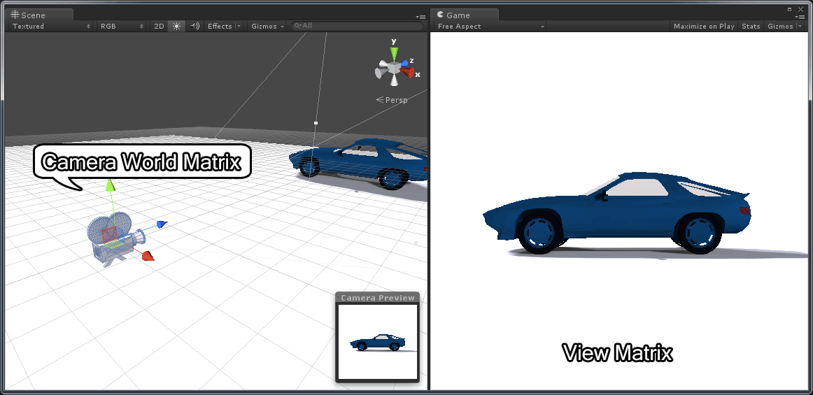

In this article, I will attempt to explain how to construct the view matrix correctly and how to use the view matrix to transform a model’s vertices into clip-space.  I will also try to explain how to compute the camera’s position in world space (also called the Eye position) from the view matrix.

## Introduction

Understanding how the view matrix works in 3D space is one of the most underestimated concepts of 3D game programming.  The reason for this is the abstract nature of this elusive matrix.  The world transformation matrix is the matrix that determines the position and orientation of an object in 3D space. The view matrix is used to transform a model’s vertices from world-space to view-space.  Don’t be mistaken and think that these two things are the same thing!

You can think of it like this:

Imagine you are holding a video camera, taking a picture of a car. You can get a different view of the car by moving your camera around it and it appears that the scene is moving when you view the image through your camera’s view finder.  In a computer program the camera doesn’t move at all and in actuality, the world is just moving in the **opposite direction and orientation** of how you would want the camera to move in reality.

In order to understand this correctly, we must think in terms of two different things:

1.  **The Camera Transformation Matrix**: The transformation that places the camera in the correct position and orientation in world space (this is the transformation that you would apply to a 3D model of the camera if you wanted to represent it in the scene).
2.  **The View Matrix**: This matrix will transform vertices from world-space to view-space.  This matrix is the inverse of the camera’s transformation matrix.

<span id="attachment-5287"></span>



<div class="caption">

Camera World Matrix vs View Matrix – The model of the car is from Nate Robin’s OpenGL tutorials ([http://user.xmission.com/~nate/tutors.html](<http://user.xmission.com/~nate/tutors.html>)).

</div>

In the image above, the camera’s world transform is shown in the left pane and the view from the camera is shown on the right.

## Convention

In this article I will use column vectors, with matrices stored in column-major order. That is, in a 4×4 homogeneous transformation matrix, the first column represents the “right” vector ($\mathbf{X}$), the second column represents the “up” vector ($\mathbf{Y}$), the third column represents the $\mathbf{Z}$ axis (the “forward” vector in a left-handed coordinate system; in a right-handed coordinate system, where the camera looks down the $-\mathbf{Z}$ axis, it points backward) and the fourth column represents the translation vector (origin or position) ($\mathbf{W}$) of the space represented by the transformation matrix.

$$
\begin{bmatrix}right_x & up_x & forward_x & position_x \\ right_y & up_y & forward_y & position_y \\ right_z & up_z & forward_z & position_z \\ 0 & 0 & 0 & 1 \end{bmatrix}
$$

Using this convention, we must pre-multiply column vectors to transform a vector by a transformation matrix. That is, in order to transform a vector $\mathbf{v}$ by a transformation matrix $\mathbf{M}$ we would need to pre-multiply the column vector $\mathbf{v}$ by the matrix $\mathbf{M}$ on the left.

$$
\begin{matrix}
\mathbf{v}' & = & \mathbf{M}\mathbf{v} \\
\begin{bmatrix} x' \\ y' \\ z' \\ w'\end{bmatrix} & = & \begin{bmatrix} m_{0,0} & m_{0,1} & m_{0,2} & m_{0,3} \\ m_{1,0} & m_{1,1} & m_{1,2} & m_{1,3} \\ m_{2,0} & m_{2,1} & m_{2,2} & m_{2,3} \\ m_{3,0} & m_{3,1} & m_{3,2} & m_{3,3} \end{bmatrix} \begin{bmatrix} x \\ y \\ z \\ w \end{bmatrix}
\end{matrix}
$$

The elements of the matrix $\mathbf{M}$ are written $m_{i,j}$ which represents the element in the $i^{th}$ row and the $j^{th}$ column of the matrix.

And to concatenate a set of affine transformations (such translation ($\mathbf{T}$), scale ($\mathbf{S}$), and rotation ($\mathbf{R}$)) we must apply the transformations from right to left:

$$
\mathbf{v}'=(\mathbf{T}(\mathbf{R}(\mathbf{S}\mathbf{v})))
$$

This transformation can be stated in words as “first scale, then rotate, then translate”. The $\mathbf{S}$, $\mathbf{R}$, and $\mathbf{T}$ matrices can also be concatenated to represent a single transformation:

$$
\begin{array}{rcl}
\mathbf{M} & = & \mathbf{T}\mathbf{R}\mathbf{S} \\
\mathbf{v}' & = & \mathbf{M}\mathbf{v}
\end{array}
$$

And to transform a child node in a scene graph by the transform of its parent you would pre-multiply the child’s local (relative to its parent) transformation matrix by its parent’s world transform on the left:

$$
\mathbf{Child}_{world}=\mathbf{Parent}_{world} * \mathbf{Child}_{local}
$$

:::note
Of course, if the node in the scene graph does not have a parent (the root node of the scene graph) then the node’s world transform is the same as its local (relative to its parent which in this case is just the identity matrix) transform:

$$
\mathbf{Child}_{world}=\mathbf{Child}_{local}
$$

:::

### Memory Layout of Column-Major Matrices

Using column matrices, the memory layout of the components in computer memory of a matrix are sequential in the columns of the matrix:

$$
\mathbf{M} = \begin{bmatrix} m_{0,0} & m_{1,0} & m_{2,0} & \cdots & m_{3,3} \end{bmatrix}
$$

This has the annoying consequence that if we want to initialize the values of a matrix we must actually transpose the values in order to load the matrix correctly.

For example, the following layout is the correct way to load a column-major matrix in a C program:

```cpp title="Loading a matrix in column-major order." showLineNumbers
    float right[4]    = { 1, 0, 0, 0 };
    float up[4]       = { 0, 1, 0, 0 };
    float forward[4]  = { 0, 0, 1, 0 };
    float position[4] = { 0, 0, 0, 1 };

    float matrix[4][4] = {
        {   right[0],    right[1],    right[2],    right[3] }, // First column
        {      up[0],       up[1],       up[2],       up[3] }, // Second column
        { forward[0],  forward[1],  forward[2],  forward[3] }, // Third column
        {position[0], position[1], position[2], position[3] }  // Fourth column
    };
```

At first glance, you will be thinking “wait a minute, that matrix is expressed in row-major format!”. Yes, this is actually true. A row-major matrix stores its elements in the same order in memory except the individual vectors are considered rows instead of columns.

So what is the big difference then? The difference is seen in the functions which perform matrix multiplication. Let’s see an example.

Suppose we have the following C++ definitions:

```cpp title="Types" showLineNumbers
struct vec4
{
    float values[4];

    vec4() 
    {
        values[0] = values[1] = values[2] = values[3] = 0;
    }

    vec4( float x, float y, float z, float w )
    {
        values[0] = x;
        values[1] = y;
        values[2] = z;
        values[3] = w;
    }

    // Provide array-like index operators for the components of the vector.
    const float& operator[] ( int index ) const
    {
        return values[index];
    }
    float& operator[] ( int index )
    {
        return values[index];
    }
};

struct mat4
{
    vec4 columns[4];

    mat4()
    {
        columns[0] = vec4( 1, 0, 0, 0 );
        columns[1] = vec4( 0, 1, 0, 0 );
        columns[2] = vec4( 0, 0, 1, 0 );
        columns[3] = vec4( 0, 0, 0, 1 );
    }

    mat4( vec4 x, vec4 y, vec4 z, vec4 w )
    {
        columns[0] = x;
        columns[1] = y;
        columns[2] = z;
        columns[3] = w;
    }

    // Provide array-like index operators for the columns of the matrix.
    const vec4& operator[]( int index ) const
    {
        return columns[index];
    }
    vec4& operator[]( int index )
    {
        return columns[index];
    }
};
```

The **vec4** structure provides an index operator to allow for the use of indices to access the individual components of the vector. This will make the code slightly easier to read. It is interesting to note that the **vec4** structure could be interpreted as either a row-vector or a column-vector. There is no way to differentiate the difference within this context.

The **mat4** structure provides an index operator to allow for the use of indices to access the individual columns (not rows!) of the matrix.

Using this technique, in order to access the $i^{th}$ row and the $j^{th}$ column of matrix $\mathbf{M}$, we need to access the elements of the matrix like this:

```cpp title="main.cpp" showLineNumbers
int i = row;
int j = column;
mat4 M;

// Access the i-th row and the j-th column of matrix M
float m_ij = M[j][i];
```

This is quite annoying that we have to swap the $i$ and $j$ indices in order to access the correct matrix element. This is probably a good reason to use row-major storage instead of column-major storage when programming. However, the most common convention in linear algebra textbooks and academic research papers is to use column vectors (transforming a vector as $\mathbf{v}^{\prime}=\mathbf{M}\mathbf{v}$), and storing the matrix in column-major order keeps the basis vectors and the translation in contiguous memory, as in the example above. Note that “column-major” describes how a matrix is stored in memory, while “column vectors” describes how the math is written; the two are often mixed up.

Suppose now that we define the following functions:

```cpp title="Matrix-vector multiplication" showLineNumbers
// Pre-multiply a vector by multiplying a matrix on the left.
vec4 operator*( const mat4& m, const vec4& v );
// Post-multiply a vector by multiplying a matrix on the right.
vec4 operator*( const vec4& v, const mat4& m );
// Matrix multiplication
mat4 operator*( const mat4& m1, const mat4& m2 );
```

The first function performs pre-multiplication of a 4-component column vector with a 4×4 matrix. The second method performs post-multiplication of a 4-component row vector with a 4×4 matrix.  
And the third method performs 4×4 matrix-matrix multiplication.

Then the pre-multiply function would look like this:

```cpp title="Pre-multiply vector by a matrix on the left." showLineNumbers
// Pre-multiply a vector by a matrix on the left.
vec4 operator*( const mat4& m, const vec4& v )
{
    return vec4( 
        m[0][0] * v[0] + m[1][0] * v[1] + m[2][0] * v[2] + m[3][0] * v[3],
        m[0][1] * v[0] + m[1][1] * v[1] + m[2][1] * v[2] + m[3][1] * v[3],
        m[0][2] * v[0] + m[1][2] * v[1] + m[2][2] * v[2] + m[3][2] * v[3],
        m[0][3] * v[0] + m[1][3] * v[1] + m[2][3] * v[2] + m[3][3] * v[3]
    );
}
```

Notice that we still multiply the rows of matrix **m** with the column vector **v** but the indices of **m** simply appear swapped.

And similarly the function which takes a 4-component row-vector **v** and post-multiplies it by a 4×4 matrix **m** (the matrix is on the right).

```cpp title="Post-multiply a vector by a matrix on the right." showLineNumbers
// Post-multiply a vector by a matrix on the right.
vec4 operator*( const vec4& v, const mat4& m )
{
    return vec4(
        v[0] * m[0][0] + v[1] * m[0][1] + v[2] * m[0][2] + v[3] * m[0][3],
        v[0] * m[1][0] + v[1] * m[1][1] + v[2] * m[1][2] + v[3] * m[1][3],
        v[0] * m[2][0] + v[1] * m[2][1] + v[2] * m[2][2] + v[3] * m[2][3],
        v[0] * m[3][0] + v[1] * m[3][1] + v[2] * m[3][2] + v[3] * m[3][3]
    );
}
```

In this case we multiply the row vector **v** by the columns of matrix **m**. Notice that we still need to swap the indices to access the correct column and row of matrix **m**.

And the final function which performs a matrix-matrix multiply:

```cpp title="Matrix-matrix multiply" showLineNumbers
// Matrix multiplication
mat4 operator*( const mat4& m1, const mat4& m2 )
{
    vec4 X(
        m1[0][0] * m2[0][0] + m1[1][0] * m2[0][1] + m1[2][0] * m2[0][2] + m1[3][0] * m2[0][3],
        m1[0][1] * m2[0][0] + m1[1][1] * m2[0][1] + m1[2][1] * m2[0][2] + m1[3][1] * m2[0][3],
        m1[0][2] * m2[0][0] + m1[1][2] * m2[0][1] + m1[2][2] * m2[0][2] + m1[3][2] * m2[0][3],
        m1[0][3] * m2[0][0] + m1[1][3] * m2[0][1] + m1[2][3] * m2[0][2] + m1[3][3] * m2[0][3]
    );
    vec4 Y(
        m1[0][0] * m2[1][0] + m1[1][0] * m2[1][1] + m1[2][0] * m2[1][2] + m1[3][0] * m2[1][3],
        m1[0][1] * m2[1][0] + m1[1][1] * m2[1][1] + m1[2][1] * m2[1][2] + m1[3][1] * m2[1][3],
        m1[0][2] * m2[1][0] + m1[1][2] * m2[1][1] + m1[2][2] * m2[1][2] + m1[3][2] * m2[1][3],
        m1[0][3] * m2[1][0] + m1[1][3] * m2[1][1] + m1[2][3] * m2[1][2] + m1[3][3] * m2[1][3]
    );
    vec4 Z(
        m1[0][0] * m2[2][0] + m1[1][0] * m2[2][1] + m1[2][0] * m2[2][2] + m1[3][0] * m2[2][3],
        m1[0][1] * m2[2][0] + m1[1][1] * m2[2][1] + m1[2][1] * m2[2][2] + m1[3][1] * m2[2][3],
        m1[0][2] * m2[2][0] + m1[1][2] * m2[2][1] + m1[2][2] * m2[2][2] + m1[3][2] * m2[2][3],
        m1[0][3] * m2[2][0] + m1[1][3] * m2[2][1] + m1[2][3] * m2[2][2] + m1[3][3] * m2[2][3]
    );
    vec4 W(
        m1[0][0] * m2[3][0] + m1[1][0] * m2[3][1] + m1[2][0] * m2[3][2] + m1[3][0] * m2[3][3],
        m1[0][1] * m2[3][0] + m1[1][1] * m2[3][1] + m1[2][1] * m2[3][2] + m1[3][1] * m2[3][3],
        m1[0][2] * m2[3][0] + m1[1][2] * m2[3][1] + m1[2][2] * m2[3][2] + m1[3][2] * m2[3][3],
        m1[0][3] * m2[3][0] + m1[1][3] * m2[3][1] + m1[2][3] * m2[3][2] + m1[3][3] * m2[3][3]
    );

    return mat4( X, Y, Z, W );
}
```

This function multiplies the rows of **m1** by the columns of **m2**. Notice we have to swap the indices in both **m1** and **m2**.

This function can be written slightly simplified if we reuse the pre-multiply function:

```cpp title="Matrix-matrix multiply (simplified)" showLineNumbers
// Matrix multiplication
mat4 operator*( const mat4& m1, const mat4& m2 )
{
    vec4 X = m1 * m2[0];
    vec4 Y = m1 * m2[1];
    vec4 Z = m1 * m2[2];
    vec4 W = m1 * m2[3];

    return mat4( X, Y, Z, W );
}
```

The main point is that whatever convention you use, you stick with it and be consistent and always make sure you document clearly in your API which convention you are using.

## Transformations

When rendering a scene in 3D space, there are usually 3 transformations that are applied to the 3D geometry in the scene:

1.  **World Transform**: The world transform (or sometimes referred to as the object transform or model matrix) will transform a models vertices (and normals) from object space (this is the space that the model was created in using a 3D content creation tool like 3D Studio Max or Maya) into world space. World space is the position, orientation (and sometimes scale) that positions the model in the correct place in the world.
2.  **View Transform**: The world space vertex positions (and normals) need to be transformed into a space that is relative to the view of the camera. This is called “view space” (sometimes referred to “camera space”) and is the transformation that will be studied in this article.
3.  **Projection Transform**: Vertices that have been transformed into view space need to be transformed by the projection transformation matrix into a space called “clip space”. This is the final space that the graphics programmer needs to worry about. The projection transformation matrix will not be discussed in this article.

If we think of the camera as an object in the scene (like any other object that is placed in the scene) then we can say that even the camera has a transformation matrix that can be used to orient and position it in the world space of the scene (the world transform, or in the context of this article, I will refer to this transform as the “camera transform” to differentiate it from the “view transform”). But since we want to render the scene from the view of the camera, we need to find a transformation matrix that will transform the camera into “view space”. In other words, we need a transformation matrix that will place the camera object at the origin of the world pointing down the Z-axis (the positive or negative Z-axis depends on whether we are working in a left-handed or right-handed coordinate system. For an explanation on left-handed and right-handed coordinate systems, you can refer to my article titled [Coordinate Systems](/3d-math-primer-for-game-programmers/)). In other words, we need to find a matrix $\mathbf{V}$ such that:

$$
\mathbf{I}=\mathbf{V}\mathbf{M}
$$

Where $\mathbf{M}$ is the camera transform matrix (or world transform), and $\mathbf{V}$ is the view matrix we are looking for that will transform the camera transform matrix into the identity matrix $\mathbf{I}$.

Well, it may be obvious that the matrix $\mathbf{V}$ is just the inverse of $\mathbf{M}$. That is,

$$
\mathbf{V}=\mathbf{M}^{-1}
$$

Coincidentally, the $\mathbf{V}$ matrix is used to transform any object in the scene from world space into view space (or camera space).

## The Camera Transformation

The camera transformation is the transformation matrix that can be used to position and orient an object or a model in the scene that represents the camera.  If you wanted to represent several cameras in the scene and you wanted to visualize where each camera was placed in the world, then this transformation would be used to transform the vertices of the model that represents the camera from object-space into world space. This is the same as a world-matrix or model-matrix that positions any model in the scene.  This transformation should not be mistaken as the view matrix.  It cannot be used directly to transform vertices from world-space into view-space.

To compute the camera’s transformation matrix is no different from computing the transformation matrix of any object placed in the scene.

If $\mathbf{R}$ represents the orientation of the camera, and $\mathbf{T}$ represents the translation of the camera in world space, then the camera’s transform matrix $\mathbf{M}$ can be computed by multiplying the two matrices together.

$$
\mathbf{M}=\mathbf{T}\mathbf{R}
$$

Remember that since we are dealing with column-major matrices, this is read from right-to-left. That is, first rotate, then translate.

## The View Matrix

The view matrix on the other hand is used to transform vertices from world-space to view-space.  This matrix is usually concatenated together with the object’s world matrix and the projection matrix so that vertices can be transformed from object-space directly to clip-space in the vertex program.

If $\mathbf{M}$ represents the object’s world matrix (or model matrix), and $\mathbf{V}$ represents the view matrix, and $\mathbf{P}$ is the projection matrix, then the concatenated world (or model), view, projection can be represented by $\mathbf{MVP}$ simply by multiplying the three matrices together:

$$
\mathbf{MVP}=\mathbf{P}*\mathbf{V}*\mathbf{M}
$$

And a vertex $\mathbf{v}$ can be transformed to clip-space by multiplying by the combined matrix $\mathbf{MVP}$:

$$
\mathbf{v}'=\mathbf{MVP}*\mathbf{v}
$$

So that’s how it’s used, so how is the view matrix computed? There are several methods to compute the view matrix and the preferred method usually depends on how you intend to use it.

A common method to derive the view matrix is to compute a Look-at matrix given the position of the camera in world space (usually referred to as the “eye” position), an “up” vector (which is usually $\begin{bmatrix} 0 & 1 & 0 \end{bmatrix}^T$), and a target point to look at in world space.

If you are creating a first-person-shooter (FPS), you will probably not use the Look-at method to compute the view matrix. In this case, it would be much more convenient to use a method that computes the view matrix based on a position in world space and pitch (rotation about the $\mathbf{X}$ axis) and yaw (rotation about the $\mathbf{Y}$ axis) angles (usually we don’t want the camera to roll (rotation about the $\mathbf{Z}$ axis) in a FPS shooter).

If you want to create a camera that can be used to pivot around a 3D object, then you would probably want to create an arcball camera.

I will discuss these 3 typical camera models in the following sections.

## Look At Camera

Using this method, we can directly compute the view matrix from the world position of the camera (eye), a global up vector, and a target point (the point we want to look at).

A typical implementation of this function (assuming a right-handed coordinate system where the camera looks down the $-\mathbf{Z}$ axis) may look something like this:

```cpp title="Look At, right-handed coordinate system." showLineNumbers
mat4 LookAtRH( vec3 eye, vec3 target, vec3 up )
{
    vec3 zaxis = normal(eye - target);    // The "backward" vector (the camera looks down -z).
    vec3 xaxis = normal(cross(up, zaxis));// The "right" vector.
    vec3 yaxis = cross(zaxis, xaxis);     // The "up" vector.

    // Create a 4x4 orientation matrix from the right, up, and forward vectors
    // This is transposed which is equivalent to performing an inverse 
    // if the matrix is orthonormalized (in this case, it is).
    mat4 orientation = {
       vec4( xaxis.x, yaxis.x, zaxis.x, 0 ),
       vec4( xaxis.y, yaxis.y, zaxis.y, 0 ),
       vec4( xaxis.z, yaxis.z, zaxis.z, 0 ),
       vec4(   0,       0,       0,     1 )
    };
    
    // Create a 4x4 translation matrix.
    // The eye position is negated which is equivalent
    // to the inverse of the translation matrix. 
    // T(v)^-1 == T(-v)
    mat4 translation = {
        vec4(   1,      0,      0,   0 ),
        vec4(   0,      1,      0,   0 ), 
        vec4(   0,      0,      1,   0 ),
        vec4(-eye.x, -eye.y, -eye.z, 1 )
    };

    // Combine the orientation and translation to compute 
    // the final view matrix. Note that the order of 
    // multiplication is reversed because the matrices
    // are already inverted.
    return ( orientation * translation );
}
```

This method can be slightly optimized because we can eliminate the need for the final matrix multiply if we directly compute the translation part of the matrix as shown in the code below.

```cpp title="Optimized look-at, right-handed coordinate system." showLineNumbers
mat4 LookAtRH( vec3 eye, vec3 target, vec3 up )
{
    vec3 zaxis = normal(eye - target);    // The "backward" vector (the camera looks down -z).
    vec3 xaxis = normal(cross(up, zaxis));// The "right" vector.
    vec3 yaxis = cross(zaxis, xaxis);     // The "up" vector.

    // Create a 4x4 view matrix from the right, up, forward and eye position vectors
    mat4 viewMatrix = {
        vec4(      xaxis.x,            yaxis.x,            zaxis.x,       0 ),
        vec4(      xaxis.y,            yaxis.y,            zaxis.y,       0 ),
        vec4(      xaxis.z,            yaxis.z,            zaxis.z,       0 ),
        vec4(-dot( xaxis, eye ), -dot( yaxis, eye ), -dot( zaxis, eye ),  1 )
    };
    
    return viewMatrix;
}
```

In this case, we can take advantage of the fact that taking the dot product of the x, y, and z axes with the eye position in the 4th column is equivalent to multiplying the orientation and translation matrices directly. The result of the dot product must be negated to account for the “inverse” of the translation part.

:::caution
The look-at matrix is undefined when the camera looks straight along the up vector (straight up or straight down): then `cross(up, zaxis)` is the zero vector and the right vector can’t be normalized. Either keep the view direction away from the up vector, or choose a different up vector in that case.
:::

A good example of using the gluLookAt function in OpenGL can be found on Nate Robins OpenGL tutor page: [http://user.xmission.com/~nate/tutors.html](http://user.xmission.com/~nate/tutors.html)

## FPS Camera

If we want to implement an FPS camera, we probably want to compute our view matrix from a set of euler angles (pitch and yaw) and a known world position. The basic theory of this camera model is that we want to build a camera matrix that first rotates **pitch** angle about the $\mathbf{X}$ axis, then rotates **yaw** angle about the $\mathbf{Y}$ axis, then translates to some position in the world. Since we want the view matrix, we need to compute the inverse of the resulting matrix.

$$
\mathbf{V}=(\mathbf{T}(\mathbf{R}_y\mathbf{R}_x))^{-1}
$$

The function to implement this camera model might look like this:

```cpp title="FPS camera, right-handed coordinate system." showLineNumbers
// Pitch must be in the range of [-90 ... 90] degrees and 
// yaw must be in the range of [0 ... 360] degrees.
// Pitch and yaw variables must be expressed in radians.
mat4 FPSViewRH( vec3 eye, float pitch, float yaw )
{
    // I assume the values are already converted to radians.
    float cosPitch = cos(pitch);
    float sinPitch = sin(pitch);
    float cosYaw = cos(yaw);
    float sinYaw = sin(yaw);

    vec3 xaxis = { cosYaw, 0, -sinYaw };
    vec3 yaxis = { sinYaw * sinPitch, cosPitch, cosYaw * sinPitch };
    vec3 zaxis = { sinYaw * cosPitch, -sinPitch, cosPitch * cosYaw };

    // Create a 4x4 view matrix from the right, up, forward and eye position vectors
    mat4 viewMatrix = {
        vec4(       xaxis.x,            yaxis.x,            zaxis.x,      0 ),
        vec4(       xaxis.y,            yaxis.y,            zaxis.y,      0 ),
        vec4(       xaxis.z,            yaxis.z,            zaxis.z,      0 ),
        vec4( -dot( xaxis, eye ), -dot( yaxis, eye ), -dot( zaxis, eye ), 1 )
    };
    
    return viewMatrix;
}
```

In this function we first compute the axes of the view matrix. This is derived from the concatenation of a rotation about the $\mathbf{X}$ axis followed by a rotation about the $\mathbf{Y}$ axis. Then we build the view matrix the same as before by taking advantage of the fact that the final column of the matrix is just the dot product of the basis vectors with the eye position of the camera.

## Arcball Orbit Camera

An arcball (orbit) camera is commonly used to allow the camera to orbit around an object that is placed in the scene. The object doesn’t necessarily need to be placed at the origin of the world. An arcball camera usually doesn’t limit the rotation around the object like the FPS camera in the previous example. In this case, we need to be aware of the notorious Gimbal-lock problem. If you are not familiar with the Gimbal-lock problem, then I suggest you read about it [here](https://en.wikipedia.org/wiki/Gimbal_lock) or watch this video created by [GuerrillaCG](https://www.youtube.com/channel/UC5fpWfCQ95VFghlkH1RG70w):

<iframe class="embed embed-video" src="https://www.youtube-nocookie.com/embed/zc8b2Jo7mno?rel=0" title="YouTube video" loading="lazy" allowfullscreen></iframe>

The Gimbal-lock problem can be avoided by using **quaternions** but Gimbal-lock is not the only problem when using Euler angles to express the rotation of the camera. If the camera is rotated more than 90° in either direction around the $\mathbf{X}$ axes, then the camera is upside-down and the left and right rotation about the $\mathbf{Y}$ axes become reversed. In my experience, this is a really hard problem to fix and most applications simply don’t allow the camera to rotate more than 90° around the $\mathbf{X}$ axes in order to avoid this problem altogether. I found that using quaternions is the only reliable way to solve this problem.

:::note
Refer to my previous article titled [Understanding Quaternions](/understanding-quaternions/) for a tutorial on how to work with quaternions.
:::

If you are using a mouse, you may want to be able to rotate the camera around an object by clicking and dragging on the screen. In order to determine the rotation, the point where the mouse was clicked on the screen ($\mathbf{p}_0$) is projected onto a unit sphere that covers the screen. When the mouse is moved, the point where the mouse moves to ($\mathbf{p}_1$) is projected onto the unit sphere and a quaternion is constructed that represents a rotation from $\mathbf{p}_0$ to $\mathbf{p}_1$. Working with quaternions is beyond the scope of this article. For a complete explanation on how to compute a quaternion from two points, refer to [this article](https://web.archive.org/web/20230730024200/http://lolengine.net/blog/2013/09/18/beautiful-maths-quaternion-from-vectors): [https://web.archive.org/web/20230730024200/http://lolengine.net/blog/2013/09/18/beautiful-maths-quaternion-from-vectors](https://web.archive.org/web/20230730024200/http://lolengine.net/blog/2013/09/18/beautiful-maths-quaternion-from-vectors). The [GLM math library](https://glm.g-truc.net/) also provides a quaternion class that has a constructor that takes two vectors and computes the rotation quaternion between those two vectors.

To construct the view matrix for the arcball camera, we will use two translations and a rotation. The first translation ($\mathbf{t}_0$) moves the camera a certain distance away from the object so the object can fit in the view. Then a rotation quaternion ($\mathbf{r}$) is applied to rotate the camera around the object. If the object is not placed at the origin of the world, then we need to apply an additional translation ($\mathbf{t}_1$) to move the pivot point of the camera to the center of the object being observed. The resulting matrix needs to be inverted to achieve the view matrix.

$$
\begin{array}{rcl}
\mathbf{M} & = & \mathbf{T}_1\mathbf{R}\mathbf{T}_0 \\
\mathbf{V} & = & \mathbf{M}^{-1}
\end{array}
$$

:::note
If you know that the object will always be at the origin, then $\mathbf{T}_1$ represents the identity matrix ($\mathbf{I}$) and can be omitted from the equation.
:::

The function to implement an arcball orbit camera might look like this:

```cpp title="Arcball camera" showLineNumbers
// t0 is a vector which represents the distance to move the camera away
//    from the object to ensure the object is in view.
// r  is a rotation quaternion which rotates the camera 
//    around the object being observed.
// t1 is an optional vector which represents the position of the object in the world.
mat4 Arcball( vec3 t0, quat r, vec3 t1 = vec3(0) )
{
    mat4 T0 = translate( t0 ); // Translation away from object.
    mat4 R  = toMat4( r );     // Rotate around object.
    mat4 T1 = translate( t1 ); // Translate to center of object.

    mat4 viewMatrix = inverse( T1 * R * T0 );

    return viewMatrix;
}
```

You can avoid the matrix inverse on line 12 if you pre-compute the inverse of the individual transformations and swap the order of multiplication.

```cpp title="Arcball camera (optimized)" showLineNumbers
// t0 is a vector which represents the distance to move the camera away
//    from the object to ensure the object is in view.
// r  is a rotation quaternion which rotates the camera 
//    around the object being observed.
// t1 is an optional vector which represents the position of the object in the world.
mat4 Arcball( vec3 t0, quat r, vec3 t1 = vec3(0) )
{
    mat4 T0 = translate( -t0 );       // Translation away from object.
    mat4 R  = toMat4( inverse( r ) ); // Rotate around object.
    mat4 T1 = translate( -t1 );       // Translate to center of object.

    mat4 viewMatrix = T0 * R * T1;

    return viewMatrix;
}
```

:::note
The [interactive demo](#interactive-demo) below uses this optimized form of the arcball camera.
:::

## Converting between Camera Transformation Matrix and View Matrix

If you only have the camera transformation matrix $\mathbf{M}$ and you want to compute the view matrix $\mathbf{V}$ that will correctly transform vertices from world-space to view-space, you only need to take the **inverse** of the camera transform.

$$
\mathbf{V}=\mathbf{M}^{-1}
$$

If you only have the view matrix $\mathbf{V}$ and you need to find a camera transformation matrix $\mathbf{M}$ that can be used to position a visual representation of the camera in the scene, you can simply take the inverse of the view matrix.

$$
\mathbf{M}=\mathbf{V}^{-1}
$$

This method is typically used in shaders when you only have access to the view matrix and you want to find out what the position of the camera is in world space. In this case, you can take the 4th column of the inverted view matrix to determine the position of the camera in world space:

$$
\begin{array}{rcl}
\mathbf{M} & = & \mathbf{V}^{-1} \\
\mathbf{eye}_{world} & = & \begin{bmatrix} \mathbf{M}_{0,3} & \mathbf{M}_{1,3} & \mathbf{M}_{2,3} \end{bmatrix}
\end{array}
$$

:::note
Of course it may be advisable to simply pass the eye position of the camera as a variable to your shader instead of inverting the view matrix for every invocation of your vertex shader or fragment shader.
:::

## Interactive Demo

The demo below implements the three camera models from this article: the **Look At** camera, the **FPS** camera and
the **Arcball** orbit camera. The large view shows the scene through the camera, transformed into view space by the
view matrix $\mathbf{V}$. The small world view shows the camera itself (its axes and view frustum), placed in the
world with the camera's transformation matrix $\mathbf{M}=\mathbf{V}^{-1}$. Both matrices are shown next to the
view, so you can see how the rows of $\mathbf{V}$ and the columns of $\mathbf{M}$ change as the camera moves.

-   **Look At**: move the target (the look-at point) with **W**, **A**, **S**, **D**, up and down with **Q** and **E**;
    the eye stays where it is and the camera turns to follow. Drag in the view to move the eye around the target, or use
    the sliders for the eye and target positions.
-   **FPS**: drag to change the pitch and yaw; move with **W**, **A**, **S**, **D**, up and down with **Q** and **E**,
    and hold **Shift** to move faster (click the view first).
-   **Arcball**: drag to rotate the camera around the selected object; the mouse wheel changes the distance.

Drag in the world view to look at the scene from another angle.

<iframe class="embed embed-demo embed-demo-tall" src="/demos/understanding-the-view-matrix.html" title="Interactive view matrix demo" loading="lazy" allowfullscreen></iframe>

[Open the demo in its own window](/demos/understanding-the-view-matrix.html)

:::note
The original demo for this article is a Windows OpenGL application that uses the
[OpenGL Mathematics library (GLM)](https://github.com/g-truc/glm). You can still download it, with its source code:
[ViewMatrixDemo.zip](https://drive.google.com/uc?export=download&id=0B0ND0J8HHfaXUFF4YUlCM3A4X0E).
:::

## Conclusion

I hope that I have made clear the differences between the camera’s transform matrix and the view matrix and how you can convert between one and the other. It is also very important to be aware of which matrix you are dealing with so that you can correctly obtain the eye position of the camera. When working with the camera’s world transformation, the eye position is the 4th row of the world transform, but if you are working with the view matrix, you must first inverse the matrix before you can extract the eye position in world space.
