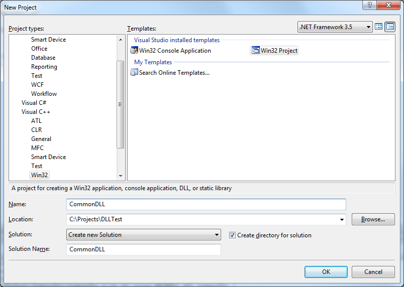
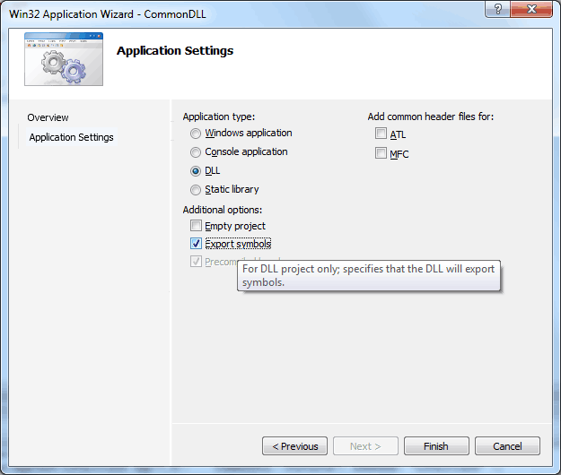
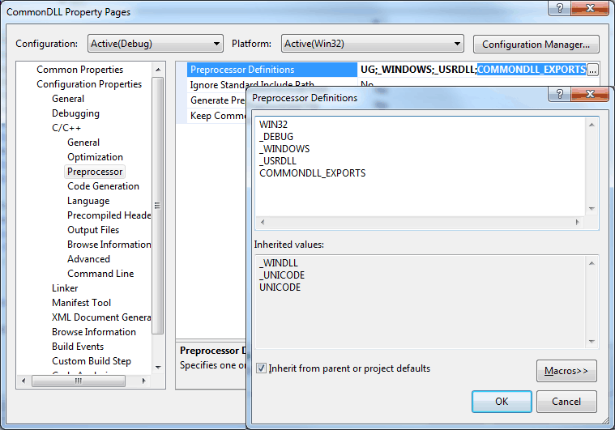
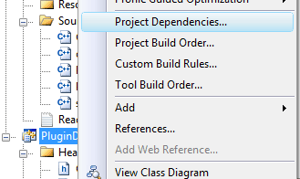
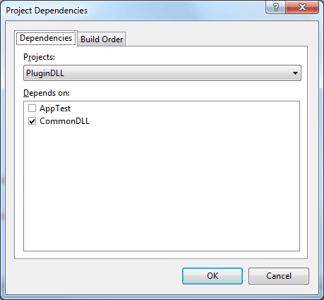

<span id="attachment-1760"></span>

In this article I will describe how to use Dynamic Link Libraries (DLL) in your own projects. I will show an example of how to define a DLL that is statically linked at compile-time to support implicit loading of the DLL at runtime. I will also show how to to use explicit DLL loading to allow your project to support plug-ins that can be dynamically loaded into your main executable at run-time. For this example, I will use Microsoft’s Visual Studio 2008 as the programming IDE.

## Introduction

Dynamic Link Library (DLL) is Microsoft’s implementation of the Shared Library Library concept in the Windows operating system. Under the Unix-like operating system the Dynamic Shared Object (DSO) or just Shared Object (SO) concept applies. The practices shown here should be similar in both implementations.

DLL’s can be used primarily in two ways. Either the DLL can be implicitly linked linked to your application in which case the DLL will be loaded automatically when the application is executed, or the DLL can be loaded dynamically at run-time.

### Implicit Linking

When you compile a DLL two files are generated. A library object file (.lib) is created and the DLL file itself is generated. To enable implicit linking, your main application can directly link against the generated .lib file which will ensure that the DLL is loaded automatically when your application starts. This is similar to the way you link against any static lib except any class, free function, or shared data must be **exported** when the DLL is compiled and **imported** when the main application that uses that library is compiled. I will discuss importing and exporting symbols later in the article.

### Explicit Linking

Explicit linking occurs when you load the DLL into your application at run-time using the **LoadLibrary** (or **LoadLibraryEx**) methods in a Windows application or **dlopen** on Unix-like systems. Explicit linking is required when you want to support additional functionality to your application using the Plug-In concept. In this case, your application does not have access to the classes, methods, and data at compile time and must be exposed by the DLL at run-time. In this article, I will demonstrate how to implement a Plug-In system using explicit linking of DLL files.

## Creating A Common Library

Before you can support a Plug-In system, you probably want to define a common interface that will be used by both the main application, as well as all the dynamic link libraries that your application can load at run-time. To facilitate this, we will create a common DLL that will be implicitly linked to both the main application and any DLL that needs to support your plug-in system.

### The Common DLL Project

Open Visual Studio 2008 and create a new project (File -> New -> Project…). You should be presented with the “**New Project**” dialog box shown below.

<span id="attachment-1766"></span>



<div class="caption">

New Project Dialog

</div>

In the “**Project types:**” frame, select “**Visual C++** -> **Win32**” and in the “**Templates:**” frame, select “**Win32 Project**” as shown in the image above.

Give your project a name, a location, and a solution. I called it “**CommonDLL**” because it is the common DLL that will define the interface types that are needed by both the main application and the plug-in types that will be loaded explicitly.

When ready, click the “**OK**” button to proceed to the next step. You should be presented with the “**Win32 Application Wizard**” dialog box.

<span id="attachment-1768"></span>



<div class="caption">

Win32 Application Wizard

</div>

When the Wizard opens, you’ll see the “**Welcome to the Win32 Application Wizard**” page. Either click “**Next**” or click the “**Application Settings**” text on the left-side of the window to go to “**Application Settings**” page.

Select “**DLL**” radio-button under the “**Application type:**” header and also check the “**Export symbols**” check-box under the “**Additional options:**” header. Checking the “**Export symbols**” check-box will generate some macros in your source files that will allow the symbols defined in this library to be exported when generating the library itself, and the same symbols will be imported when you are linking against this library.

Click “**Finish**” and you should have a new project in your solution explorer with several header files and source files.

If you open the “**CommonDLL.h**” header file that is automatically generated together with your project, you should see something similar to what is shown below.

```cpp title="CommonDLL.h" showLineNumbers
// The following ifdef block is the standard way of creating macros which make exporting 
// from a DLL simpler. All files within this DLL are compiled with the COMMONDLL_EXPORTS
// symbol defined on the command line. this symbol should not be defined on any project
// that uses this DLL. This way any other project whose source files include this file see 
// COMMONDLL_API functions as being imported from a DLL, whereas this DLL sees symbols
// defined with this macro as being exported.
#ifdef COMMONDLL_EXPORTS
#define COMMONDLL_API __declspec(dllexport)
#else
#define COMMONDLL_API __declspec(dllimport)
#endif

// This class is exported from the CommonDLL.dll
class COMMONDLL_API CCommonDLL {
public:
	CCommonDLL(void);
	// TODO: add your methods here.
};

extern COMMONDLL_API int nCommonDLL;

COMMONDLL_API int fnCommonDLL(void);
```

If you open the CommonDLL project properties you will also notice that the preprocessor macro “**COMMONDLL\_EXPORTS**” is defined in the “**Preprocessor Definitions**” as shown in the image below.

<span id="attachment-1770"></span>



<div class="caption">

Preprocessor Definitions

</div>

Defining the “**COMMONDLL\_EXPORTS**” macro in the project settings will allow the symbols that have the “**COMMONDLL\_API**” macro definition to be exported when the DLL is compiled and linked.

In this particular example, the **CCommonDLL** class and all of it’s operations and data will be exported and accessible outside the DLL. In addition to the class, the global int variable called **nCommonDLL** will also be exported and finally the **fnCommonDLL** method will also be exported.

If we examine the source code for the **CCommonDLL** source file, you will notice that the **nCOmmonDLL** integer and the **fnCommonDLL** method are defined with the storage-class specifier as a syntactic reminder that these symbols are exported and accessible outside the DLL.

```cpp title="CommonDLL.cpp" showLineNumbers
// CommonDLL.cpp : Defines the exported functions for the DLL application.
//

#include "stdafx.h"
#include "CommonDLL.h"

// This is an example of an exported variable
COMMONDLL_API int nCommonDLL=0;

// This is an example of an exported function.
COMMONDLL_API int fnCommonDLL(void)
{
	return 42;
}

// This is the constructor of a class that has been exported.
// see CommonDLL.h for the class definition
CCommonDLL::CCommonDLL()
{
	return;
}
```

Now let’s add something interesting. The interface for our Plugin type!

### The Plugin Interface

Create a new class in the **CommonDLL** project called “**Plugin**”

The Plugin class will be the base class for all of our plugin types that our application will support. For this example, I will only implement a very simple do-nothing interface. I simply want to give you an idea of how you might implement the plugin base type.

We will export the class by appending the **COMMONDLL\_API** macro to the class declaration to ensure the class’s data and methods are usable outside the DLL.

```cpp title="Plugin.h" showLineNumbers
#pragma once
#include "CommonDLL.h"

class COMMONDLL_API Plugin
{
public:
    Plugin(void);
    virtual ~Plugin(void);
};
```

If you recall from the “CommonDLL.h” header file, the “**COMMONDLL\_API**” macro will resolve to “**\_\_declspec(dllexport)**” if the “**COMMONDLL\_EXPORTS**” preprocessor macro is defined or “**\_\_declspec(dllimport)**” if it is not defined.

### The Plugin Manager

We probably also want a class that can keep track of the Plugin-Ins and manage their lifetime. For this purpose, we will add the Plug-In manager class.

Add a new class to the **CommonDLL** project called “**PluginManager**” and open the header file for the new **PluginManager** class.

The **PluginManager** needs to provide at least two methods:

1.  **LoadPlugin**: This method will load a plugin from a DLL and return a pointer to the plugin object.
2.  **UnloadPlugin**: This method will unload a particular plugin from the plugin manager. The DLL associated with the Plugin will also be unloaded.

Let’s see what the interface for the Plugin manager might look like.

```cpp title="PluginManager.h" showLineNumbers
#pragma once

#include "CommonDLL.h"
#include "Plugin.h"

class COMMONDLL_API PluginManager
{
public:
    PluginManager(void);
    ~PluginManager(void);

    Plugin* LoadPlugin( const std::wstring& pluginName );
    void UnloadPlugin( Plugin*& plugin );

private:
    typedef std::map<std::wstring, Plugin*> PluginMap;
    typedef std::map<std::wstring, HMODULE> LibraryMap;

    PluginMap m_Plugins;
    LibraryMap m_Libs;
};
```

If you are experienced with creating DLL’s, you may already notice a problem with this class definition. Specifically with the data members **m\_Plugins** and **m\_Libs**. The problem occurs because the **std::map** template types are not exported from the DLL but the data members **m\_Plugins** and **m\_Libs** are and the compiler will generate an annoying warning. There are several ways to work-around this issue that will appease the compiler. I will discuss these work-around’s in more detail later in the article.

The **m\_Plugins** map will store the pointers to the **Plugin**‘s that are loaded from the DLL and the **m\_Libs** will store the handles to the DLL’s that are dynamically loaded.

#### The PluginManager::LoadPlugin Method

Now let’s first take a look at the **LoadPlugin** method. The basic idea is that we want to load a DLL and get the address of a method that has been exported from the DLL that will be used to create and return a pointer to the plugin type that has been defined in the DLL. Let’s see how we might do that.

First, let’s define the signatures for the methods we expect to find in the DLL.

```cpp title="PluginManager.cpp" showLineNumbers startLineNumber=4
// Define the prototype for a function that should exist in the DLL
// that is used to create and return the plugin type in the DLL.
typedef Plugin* (*fnCreatePlugin)(void);
// Destroys the plugin type from the DLL before the library is unloaded.
typedef void (*fnDestroyPlugin)(void);
```

The “**CreatePlugin**” function will create an instance of the plugin object and return a pointer to the plugin. The “**DestroyPlugin**” function will simply destroy the plugin that was created with the CreatePlugin function.

Let’s look at the definition of the **PluginManager::LoadPlugin** method.

```cpp title="PluginManager.cpp" showLineNumbers startLineNumber=18
Plugin* PluginManager::LoadPlugin( const std::wstring& pluginName )
{
    Plugin* plugin = NULL;
    PluginMap::iterator iter = m_Plugins.find( pluginName );
    if ( iter == m_Plugins.end() )
    {
        // Try to load the plugin library
        HMODULE hModule = LoadLibraryW( pluginName.c_str() );
        if ( hModule != NULL )
        {
            fnCreatePlugin CreatePlugin = (fnCreatePlugin)GetProcAddress( hModule, "CreatePlugin" );
            if ( CreatePlugin != NULL )
            {
                // Invoke the function to get the plugin from the DLL.
                plugin = CreatePlugin();

                if ( plugin != NULL )
                {
                    plugin->SetName( pluginName );
                    // Add the plugin and library to the maps.
                    m_Plugins.insert( PluginMap::value_type( pluginName, plugin ) );
                    m_Libs.insert( LibraryMap::value_type(pluginName, hModule ) );
                }
                else
                {
                    std::wcerr << "ERROR: Could not load plugin from " << pluginName << std::endl;
                    // Unload the library.
                    FreeLibrary(hModule);
                }
            }
            else
            {
                std::wcerr << "ERROR: Could not find symbol \"CreatePlugin\" in " <<  pluginName << std::endl;
                FreeLibrary(hModule);
            }
        }
        else
        {
            std::wcerr << "ERROR: Could not load library: " << pluginName << std::endl;
        }
    }
    else
    {
        std::wcout << "INFO: Library \"" << pluginName << "\" already loaded." << std::endl;
        plugin = iter->second;
    }

    return plugin;
}
```

First, we check the map to see if the plugin has been loaded before. If the plugin is found in the plugin map, we don’t try to load it again but instead just return the plugin that was already loaded.

On line 25, we use the **LoadLibrary** method to get a handle to the DLL with the name **pluginName**. If the **LoadLibrary** returns a valid handle, we then use the **GetProcAddress** method to get the address of the symbol that is exported from the DLL with the name “**CreatePlugin**“. Every plugin that your application will load will need to define a method called **CreatePlugin** which returns a pointer to the **Plugin** object defined in the DLL. In the next section, I will show how we define and export this function from the DLL.

If the function pointer is valid and the “**CreatePlugin**” method generates a valid plugin, then we register both the plugin and the library it came from in the **m\_Plugins** and **m\_Libs** maps so we can unload the plugin later.

The remainder of the method is just error checking to make sure that everything is as it should be. If anything goes wrong, an error message is reported and a **NULL** plugin is returned.

#### The PluginManager::UnloadPlugin Method

When a plugin needs to be unloaded, we need to release all of the resources that were allocated in the DLL and free the DLL library itself. When we no longer need a plugin (or want to load a different plugin that does the same thing but in a different way) we will use the **PluginManager::UnloadPlugin** method to remove the plugin and library from memory.

```cpp title="PluginManager.cpp" showLineNumbers startLineNumber=68
void PluginManager::UnloadPlugin( Plugin*& plugin )
{
    if ( plugin != NULL )
    {
        LibraryMap::iterator iter = m_Libs.find( plugin->GetName() );
        if( iter != m_Libs.end() )
        {
            // Remove the plugin from our plugin map.
            m_Plugins.erase(plugin->GetName());

            HMODULE hModule = iter->second;
            fnDestroyPlugin DestroyPlugin = (fnDestroyPlugin)GetProcAddress( hModule, "DestroyPlugin" );
            if ( DestroyPlugin != NULL )
            {
                DestroyPlugin();
            }
            else
            {
                std::wcerr << "ERROR: Unable to find symbol \"DestroyPlugin\" in library \"" << plugin->GetName() << std::endl;
            }
            // Unload the library and remove the library from the map.
            FreeLibrary(hModule);
            m_Libs.erase(iter);
        }
        else
        {
            std::cout << "WARNING: Trying to unload a plugin that is already unloaded or has never been loaded." << std::endl;
        }
        // NULL the plugin
        plugin = NULL;
    }
}
```

On line 75, the address of the “**DestroyPlugin**” is found using the “**GetProcAddress**” method. If the address to the method is valid, it is invoked to destroy the plugin instance that was created in the “**CreatePlugin**” method. All resource that were allocated by the plugin should also be freed.

The DLL library itself is free’d using the **FreeLibrary** method on line 89.

## Creating a Plugin DLL

Now that we know how to load, and unload DLL’s, let’s see how we could implement the Plugin in a DLL that is dynamically loaded at run-time.

Create a new DLL project in your current solution called “**PluginDLL**” for example. The steps to create this plugin project are identical to the **CommonDLL** we created earlier (that is, create a “**Win32 Project**” and set the application type to “**DLL**” and make sure “**Export symbols**” is checked).

The “**New Project**” wizard will create a new project in our solution with the name “**PluginDLL**” and it will also define a preprocessor macro with the name **PLUGINDLL\_EXPORTS** that will export our DLL interface types when the macro is defined, or import the DLL interface types when it is not defined (this is no different from the **COMMONDLL\_EXPORTS** preprocessor macro defined in the **CommonDLL** project).

Before we can start defining classes that are derived from the **Plugin** base type, we must setup implicit linking for the **CommonDLL** library by telling our **PluginDLL** project to link against the “**CommonDLL.lib**” file.

There are multiple ways to tell the Visual Studio linker to link one project against another. The easiest way is to create a dependency between the two projects. This may be easier than explicitly setting up the paths and explicitly defining the libraries to link against in the project settings, but it is less obvious to anyone who may be using your project outside this of this solution. Generally, for my own test solutions, I will use this method to link projects together only when I am creating a small test case that generally won’t be shared with anyone, but for shared projects, I do not recommend using this method.

To setup (or check) a dependency between two projects, right-click the project in the Solution Explorer and select the “Project Depencies…” item from the pop-up menu as shown in the image below.

<span id="attachment-1785"></span>



<div class="caption">

Project Dependencies Menu

</div>

In the “**Project Dependencies**” dialog that appears, make sure that “**PluginDLL**” is selected in the “**Projects**” drop-down list and check the box next to “**CommonDLL**” in the “**Depends on**” frame.

<span id="attachment-1787"></span>



<div class="caption">

Project Dependencies Dialog

</div>

Using this method, you must ensure the “**Link Library Dependencies**” setting in the linker options in the project properties is set to “**Yes**“.

Another way to link against the **CommonDLL** library is to explicitly tell the linker to link against the **CommonDLL.lib** file in the “**Additional Dependencies**” setting in the linker options in the project properties. Make sure you also include the output directory of the **CommonDLL** project to the “**Additional Library Directories**” setting in the linker options for the **PluginDLL** project properties otherwise the linker won’t know where to find the library file.

If you want to be really explicit, you may want to add the “#pragma comment” preprocessor directive directly in one of the source files for the project. The “#pragma comment” preprocessor directive can be used to instruct the linker to include a specific library when the DLL is linked. Such a pragma directive for the **CommonDLL.lib** file might look like this:

```cpp showLineNumbers
#pragma comment(lib,"CommonDLL.lib")
```

Using this method, you still need to add the directory paths to the “**Additional Library Directories**” setting in the linker options for the **PluginDLL** project properties.

Linking against the **CommonDLL** library will allow the **PluginDLL** library to use the classes, methods, and data that are exported from the **CommonDLL** library. When using the **CommonDLL** library, we don’t define the **COMMONDLL\_EXPORTS** preprocessor macro which will ensure that the **COMMONDLL\_API** macro resolves to “**\_\_declspec(dllimport)**” when the classes are declared in the **PluginDLL** project.

In addition to linking the **CommonDLL.lib** file, we also add the include paths for the **CommonDLL** project to the **PluginDLL** project include file search paths. This is done by adding the path to the **CommonDLL** header files in the “**Additional Include Directories**” setting in the “**C/C++**” options for the **PluginDLL** project properties.

### The ConcretePlugin Class

Now let’s create a new class in our **PluginDLL** project called “**ConcretePlugin**“.

```cpp title="ConcretePlugin.cpp" showLineNumbers
#pragma once
#include "Plugin.h"
#include "PluginDLL.h"

class PLUGINDLL_API ConcretePlugin : public Plugin
{
public:
    ConcretePlugin(void);
    ~ConcretePlugin(void);
};
```

The **ConcretePlugin** type is derived from the **Plugin** base type that was defined in the CommonDLL library.

Now let’s define the functions that will be exported from the **PluginDLL** library and used by the **PluginManager** to get access to the **ConcretePlugin** type.

### The CreatePlugin and DestroyPlugin methods

In the “**PluginDLL.h**” file that is automatically generated by the project wizard, we’ll declare a few methods that will be exported from the DLL and used by the **PluginManager** to create an instance of the **ConcretePlugin** we just declared.

```cpp title="PluginDLL.h" showLineNumbers startLineNumber=21
extern "C" PLUGINDLL_API Plugin* CreatePlugin(void);
extern "C" PLUGINDLL_API void DestroyPlugin(void);
```

Besides exporting the function prototypes using the **PLUGINDLL\_API** macro, we need to also tell the compiler to use “**C**” linkage when compiling these methods. Doing this will prevent the compiler from [mangling the names](https://en.wikipedia.org/wiki/Name_mangling) of these methods and make it possible to get the address of the method using the **GetProcAddress** method in the **PluginManager** class.

Let’s take a look at the definition of these functions.

```cpp title="PluginDLL.cpp" showLineNumbers
// PluginDLL.cpp : Defines the exported functions for the DLL application.
//

#include "stdafx.h"
#include "ConcretePlugin.h"

ConcretePlugin* g_ConcretePlugin = NULL;

extern "C" PLUGINDLL_API Plugin* CreatePlugin(void)
{
    assert(g_ConcretePlugin == NULL);
    g_ConcretePlugin = new ConcretePlugin();
    return g_ConcretePlugin;
}

extern "C" PLUGINDLL_API void DestroyPlugin(void)
{
    assert(g_ConcretePlugin);
    delete g_ConcretePlugin;
    g_ConcretePlugin = NULL;
}
```

We define a pointer to a **ConcretePlugin** type in the global scope of the **PluginDLL** compilation unit called “**g\_ConcretePlugin**“.

In the **CreatePlugin** method, we create the **ConcretePlugin** and return a pointer to it.

In the **DestroyPlugin** method, we simply delete the plugin and set the **g\_ConcretePlugin** pointer to **NULL**.

## The ApplicationTest Project

Now we need an application to test our dynamic plugin loading.

Create a new Win32 project in the current solution but this time select “**Win32 Console Application**” or create a “**Win32 Project**” and set the “**Application type**” to “**Windows application**” instead of “DLL”. Give the new project a name like “**ApplicationTest**” or something similar.

Before we can use the plug-in system defined in the **CommonDLL** project, we must setup implicit linking with the **CommonDLL.dll** file. Since I’ve already explained how to setup implicit linking when we created the **PluginDLL** project, I won’t explain it here again. Just make sure the **ApplicationTest** adds the **CommonDLL.lib** file as a library dependency.

### The Main Source

For our test application, we only need a single file that will use the **PluginManager** defined in the **CommonDLL** project to load a plugin from the **PluginDLL** library that is explicitly linked from the “**PluginDLL.dll**” file at run-time.

```cpp title="main.cpp" showLineNumbers
#define WIN32_LEAN_AND_MEAN             // Exclude rarely-used stuff from Windows headers
// Windows Header Files:
#include <windows.h>

#include <assert.h>
#include <iostream>
#include <string>
#include <vector>
#include <map>

#include "PluginManager.h"

int main(void)
{
    // Load a dynamic plugin.
    Plugin* plugin = PluginManager::Instance().LoadPlugin( L"PluginDLL.dll" );
    assert( plugin != NULL );

    PluginManager::Instance().UnloadPlugin( plugin );

    system("PAUSE");

    return 0;
}
```

You’ll see that it is now very easy to dynamically load a plugin using the **PluginManager** class. We only need to use the **PluginManager::LoadPlugin** method to load the DLL and get a pointer to the plugin defined in the DLL.

## Special Considerations

There are a few things you have to consider when making DLL’s. The largest concern is with sharing memory across DLL boundaries. Another issue I would like to address is the annoying warnings given by Visual Studio when exporting a class that defines templated type member variables.

### Sharing Memory Across DLL Boundaries

Usually it isn’t safe to allocate memory in a DLL and pass that memory across the DLL boundary into the main application. The problem is that if the DLL is explicitly linked, then it can be explicitly un-linked which may leave that dynamic memory allocated inside the DLL in no-man’s-land. Which could be bad for the end-user who may not understand this restriction. A possible solution to this problem is using handles. Handles can refer to an object that is created in, and owned by an interface that is only accessible using functions exposed by the DLL itself. This is a pretty common solution to this problem, but it has it’s drawbacks. The most obvious drawback is that you don’t have direct access to the methods and data members that are associated with the created object. A lot of extra code has to be written that strictly hides access to the object types using methods.

A more natural way of sharing this type of data across DLL boundaries is using weak pointers. Weak pointers are pointer objects that don’t give ownership of the pointed-to (pointee) object but only keep track of the pointee’s existence. Before you can use the pointee that the weak pointer refers to, you must first check if the weak pointer points to a valid object by “locking” the referenced object so that it won’t suddenly be deleted while your trying to use it.

The [Boost](https://www.boost.org/) library provides the **boost::smart\_ptr** and **boost::weak\_ptr** pointer objects that can be used to safely share memory across shared libraries.

### How to Avoid the C4251 Warning

The other consideration I wanted to bring up is the annoying warnings that Visual Studio generates when you try to declare templated data members in an exported class.

This was demonstrated in the **PluginManager** class with the **m\_Plugins** and **m\_Libs** member variables which will generate the following warnings:

```cpp showLineNumbers
warning C4251: 'PluginManager::m_Plugins' : class 'std::map<_Kty,_Ty>' 
needs to have dll-interface to be used by clients of class 'PluginManager'
warning C4251: 'PluginManager::m_Libs' : class 'std::map<_Kty,_Ty>' 
needs to have dll-interface to be used by clients of class 'PluginManager'
```

The warning occurs because you are trying to export the **PluginManager** class including all of the methods and members that are declared in the class but the instantiated template type is not exported so it can’t be used directly outside the DLL without being defined.

Usually this error can be safely ignored if it is reported on private member variables that can’t be accessed outside the class anyways. These particular data members are only used internally so why would I care if these members are exported when they shouldn’t be.

One solution to this problem is not to export the entire class, but only the public and protected members of the class.

We could change our **PluginManager** class declaration to this:

```cpp title="PluginManager.h" showLineNumbers
#pragma once

#include "CommonDLL.h"
#include "Plugin.h"

class PluginManager
{
public:
    static COMMONDLL_API PluginManager& Instance();

    COMMONDLL_API Plugin* LoadPlugin( const std::wstring& pluginName );
    COMMONDLL_API void UnloadPlugin( Plugin*& plugin );

private:
    PluginManager(void);
    ~PluginManager(void);

    typedef std::map<std::wstring, Plugin*> PluginMap;
    typedef std::map<std::wstring, HMODULE > LibraryMap;

    PluginMap m_Plugins;
    LibraryMap m_Libs;
};
```

You’ll notice that I removed the **COMMONDLL\_API** specifier on the class definition and added the specifier to the public methods. Using this approach, no member functions or data will be exported unless explicitly stated using the **COMMONDLL\_API** macro.

Another solution to the problem is to hide the data members from the interface using the Pimpl (pointer to (private) implementation) idiom.

If we convert the **PluginManager** class to using the Pimpl idiom, we may get something similar to what is shown below:

```cpp showLineNumbers
;"  title="PluginManager.h"]
#pragma once

#include "CommonDLL.h"
#include "Plugin.h"

class PluginManagerPimpl; // Forward-declare the class implementation.

class COMMONDLL_API PluginManager
{
public:
    static PluginManager& Instance();

    Plugin* LoadPlugin( const std::wstring& pluginName );
    void UnloadPlugin( Plugin*& plugin );

private:
    PluginManager(void);
    ~PluginManager(void);

    // Pointer-to-Implementation (Pimpl)
    PluginManagerPimpl* m_Implementation;
};
```

On line 6 a class called **PluginManagerPimpl** is forward-declared and on line 21, we’ve replaced the data members with a pointer to the **PluginManagerPimpl** type. The **PluginManagerPimpl** class is defined in the same compilation unit as the **PluginManager** class.

```cpp title="PluginManager.cpp" showLineNumbers startLineNumber=10
typedef std::map<std::wstring, Plugin*> PluginMap;
typedef std::map<std::wstring, HMODULE > LibraryMap;

class PluginManagerPimpl
{
public:

    PluginMap m_Plugins;
    LibraryMap m_Libs;

};
```

The **PluginManagerPimpl** class only stores the two data members that have been removed from the **PluginManager** class. Then we have to update the **PluginManager**‘s constructor and destructor to create and delete the instance of the **PluginManagerPimpl**.

```cpp title="PluginManager.cpp" showLineNumbers startLineNumber=22
PluginManager::PluginManager(void)
{
    m_Implementation = new PluginManagerPimpl();
}

PluginManager::~PluginManager(void)
{
    delete m_Implementation;
}
```

As well, we also need to update all of the occurances of **m\_Plugins** and **m\_Libs** with **m\_Implementation->m\_Plugins** and **m\_Implementation->m\_Libs** throughout the **PluginManager** functions.

Personally, I would prefer to use the first approach to explicitly export the necessary methods from the class instead of exporting the entire class because it communicates the intentions of the class to the user more clearly than the Pimpl approach does.

## Conclusion

In this article I have shown how you can create a Common DLL that is **implicitly** linked in both the main application as well as the dynamic Plugin DLL. I’ve shown how you can **explicitly** link a DLL at run-time using the **LoadLibrary** method. I’ve also shown how you can define some methods that can be exposed outside of an explicitly loaded DLL using the **extern “C”** linkage specification. And finally, I’ve discussed a few additional points that you should be aware of when working with DLL’s and how to circumvent the annoying C4251 warning.

If you have any questions, concerns or comments, please leave a message at the end of this post and I will try to answer your questions as best as I can.

## Download the Source

You can download the source code from this article including solution and project files for Visual Studio 2008 from here:

[\[CreatingDLLs.zip\]](https://drive.google.com/file/d/0B9NpHNF2In_uMDI0Y2MzMzYtN2I5OC00YzBiLTkzOTgtMWY4ZmI5MWEyOTZk/view)
